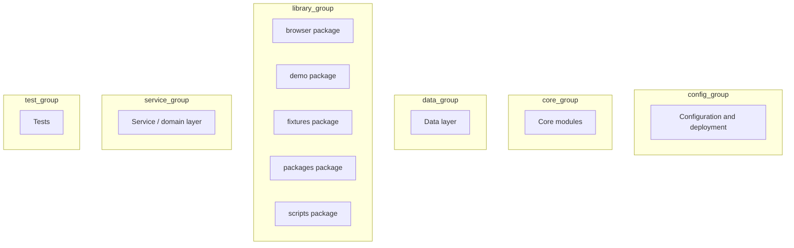

# Architecture report: infernojs/inferno

> Automated static analysis. **Observed** = directly seen in files/imports/AST; **Inferred** = interpretation from that evidence. Repository code was not executed.

## 1. Repository at a glance

| Item | Value |
| --- | --- |
| Repository | infernojs/inferno |
| Description | :fire: An extremely fast, React-like JavaScript library for building modern user interfaces |
| Language | JavaScript |
| Stars | 16459 |
| Licence | MIT |
| Analysed commit / branch | 3ef5668c5d87c969c2dd9afde9fbbfdc3555043e / master |
| Framework(s) | Koa |
| Files analysed | 494 |
| Components | 10 |

## 2. Architecture in one minute

infernojs/inferno - :fire: An extremely fast, React-like JavaScript library for building modern user interfaces. This repository was analysed statically from 494 file(s) (0 Python). Detected technologies (observed from imports/manifests): GitHub Actions, Koa, Redux, Jest, TypeScript, webpack. Files are grouped into 10 component(s): browser package, Configuration and deployment, Core modules, Data layer, demo package, fixtures package, packages package, scripts package. Findings below distinguish observed facts from inferred interpretation.

## 3. High-level block diagram

## 4. Main components

### browser package (`browser`)

- **Kind:** library
- **Status:** Observed
- **Confidence:** 0.85
- **Responsibility:** Groups 1 file(s) under browser package (observed from repository paths and static analysis).
- **Paths:** `browser/jsfiddle-integration-babel7v3.js`
- **Evidence:** [browser/jsfiddle-integration-babel7v3.js](https://github.com/infernojs/inferno/blob/3ef5668c5d87c969c2dd9afde9fbbfdc3555043e/browser/jsfiddle-integration-babel7v3.js)

### Configuration and deployment (`config`)

- **Kind:** config
- **Status:** Observed
- **Confidence:** 0.85
- **Responsibility:** Groups 24 file(s) under configuration and deployment (observed from repository paths and static analysis).
- **Paths:** `demo/inferno-router-demo/package.json`, `demo/inferno-router-demo/tsconfig.json`, `fixtures/browser/package.json`, `package.json`, `packages/inferno-animation/package.json`, `packages/inferno-clone-vnode/package.json`, `packages/inferno-compat/package.json`, `packages/inferno-create-element/package.json`, `packages/inferno-extras/package.json`, `packages/inferno-hydrate/package.json`, `packages/inferno-hyperscript/package.json`, `packages/inferno-mobx/package.json`, `packages/inferno-redux/package.json`, `packages/inferno-router/package.json`, `packages/inferno-server/package.json`, `packages/inferno-shared/package.json`, `packages/inferno-test-utils/package.json`, `packages/inferno-utils/package.json`, `packages/inferno-vnode-flags/package.json`, `packages/inferno/package.json`, `pnpm-workspace.yaml`, `scripts/babel/assumptions.json`, `scripts/babel/targets.json`, `tsconfig.json`
- **Evidence:** [demo/inferno-router-demo/package.json](https://github.com/infernojs/inferno/blob/3ef5668c5d87c969c2dd9afde9fbbfdc3555043e/demo/inferno-router-demo/package.json); [demo/inferno-router-demo/tsconfig.json](https://github.com/infernojs/inferno/blob/3ef5668c5d87c969c2dd9afde9fbbfdc3555043e/demo/inferno-router-demo/tsconfig.json); [fixtures/browser/package.json](https://github.com/infernojs/inferno/blob/3ef5668c5d87c969c2dd9afde9fbbfdc3555043e/fixtures/browser/package.json); [package.json](https://github.com/infernojs/inferno/blob/3ef5668c5d87c969c2dd9afde9fbbfdc3555043e/package.json); [packages/inferno-animation/package.json](https://github.com/infernojs/inferno/blob/3ef5668c5d87c969c2dd9afde9fbbfdc3555043e/packages/inferno-animation/package.json); [packages/inferno-clone-vnode/package.json](https://github.com/infernojs/inferno/blob/3ef5668c5d87c969c2dd9afde9fbbfdc3555043e/packages/inferno-clone-vnode/package.json); [packages/inferno-compat/package.json](https://github.com/infernojs/inferno/blob/3ef5668c5d87c969c2dd9afde9fbbfdc3555043e/packages/inferno-compat/package.json); [packages/inferno-create-element/package.json](https://github.com/infernojs/inferno/blob/3ef5668c5d87c969c2dd9afde9fbbfdc3555043e/packages/inferno-create-element/package.json)

### Core modules (`core`)

- **Kind:** core
- **Status:** Observed
- **Confidence:** 0.85
- **Responsibility:** Groups 3 file(s) under core modules (observed from repository paths and static analysis).
- **Paths:** `eslint.config.js`, `jest.config-nodom.js`, `jest.config.js`
- **Evidence:** [eslint.config.js](https://github.com/infernojs/inferno/blob/3ef5668c5d87c969c2dd9afde9fbbfdc3555043e/eslint.config.js); [jest.config-nodom.js](https://github.com/infernojs/inferno/blob/3ef5668c5d87c969c2dd9afde9fbbfdc3555043e/jest.config-nodom.js); [jest.config.js](https://github.com/infernojs/inferno/blob/3ef5668c5d87c969c2dd9afde9fbbfdc3555043e/jest.config.js)

### Data layer (`data_layer`)

- **Kind:** data
- **Status:** Observed
- **Confidence:** 0.85
- **Responsibility:** Groups 5 file(s) under data layer (observed from repository paths and static analysis).
- **Paths:** `packages/inferno/__tests__/data/common-render/child.tsx`, `packages/inferno/__tests__/data/common-render/parentbase.tsx`, `packages/inferno/__tests__/data/common-render/parentfirstcommon.tsx`, `packages/inferno/__tests__/data/common-render/parentsecondcommon.tsx`, `packages/inferno/__tests__/data/vnode-reuse-fuzzer.ts`
- **Evidence:** [packages/inferno/__tests__/data/common-render/child.tsx](https://github.com/infernojs/inferno/blob/3ef5668c5d87c969c2dd9afde9fbbfdc3555043e/packages/inferno/__tests__/data/common-render/child.tsx); [packages/inferno/__tests__/data/common-render/parentbase.tsx](https://github.com/infernojs/inferno/blob/3ef5668c5d87c969c2dd9afde9fbbfdc3555043e/packages/inferno/__tests__/data/common-render/parentbase.tsx); [packages/inferno/__tests__/data/common-render/parentfirstcommon.tsx](https://github.com/infernojs/inferno/blob/3ef5668c5d87c969c2dd9afde9fbbfdc3555043e/packages/inferno/__tests__/data/common-render/parentfirstcommon.tsx); [packages/inferno/__tests__/data/common-render/parentsecondcommon.tsx](https://github.com/infernojs/inferno/blob/3ef5668c5d87c969c2dd9afde9fbbfdc3555043e/packages/inferno/__tests__/data/common-render/parentsecondcommon.tsx); [packages/inferno/__tests__/data/vnode-reuse-fuzzer.ts](https://github.com/infernojs/inferno/blob/3ef5668c5d87c969c2dd9afde9fbbfdc3555043e/packages/inferno/__tests__/data/vnode-reuse-fuzzer.ts)

### demo package (`demo`)

- **Kind:** library
- **Status:** Observed
- **Confidence:** 0.85
- **Responsibility:** Groups 9 file(s) under demo package (observed from repository paths and static analysis).
- **Paths:** `demo/inferno-router-demo/scripts/parcel-inferno-transformer.cjs`, `demo/inferno-router-demo/src/App.tsx`, `demo/inferno-router-demo/src/index.tsx`, `demo/inferno-router-demo/src/indexServer.tsx`, `demo/inferno-router-demo/src/pages/AboutPage.tsx`, `demo/inferno-router-demo/src/pages/ContentPage.tsx`, `demo/inferno-router-demo/src/pages/PageTemplate.tsx`, `demo/inferno-router-demo/src/pages/StartPage.tsx`, `demo/inferno-router-demo/src/server.ts`
- **Evidence:** [demo/inferno-router-demo/scripts/parcel-inferno-transformer.cjs](https://github.com/infernojs/inferno/blob/3ef5668c5d87c969c2dd9afde9fbbfdc3555043e/demo/inferno-router-demo/scripts/parcel-inferno-transformer.cjs); [demo/inferno-router-demo/src/App.tsx](https://github.com/infernojs/inferno/blob/3ef5668c5d87c969c2dd9afde9fbbfdc3555043e/demo/inferno-router-demo/src/App.tsx); [demo/inferno-router-demo/src/index.tsx](https://github.com/infernojs/inferno/blob/3ef5668c5d87c969c2dd9afde9fbbfdc3555043e/demo/inferno-router-demo/src/index.tsx); [demo/inferno-router-demo/src/indexServer.tsx](https://github.com/infernojs/inferno/blob/3ef5668c5d87c969c2dd9afde9fbbfdc3555043e/demo/inferno-router-demo/src/indexServer.tsx); [demo/inferno-router-demo/src/pages/AboutPage.tsx](https://github.com/infernojs/inferno/blob/3ef5668c5d87c969c2dd9afde9fbbfdc3555043e/demo/inferno-router-demo/src/pages/AboutPage.tsx); [demo/inferno-router-demo/src/pages/ContentPage.tsx](https://github.com/infernojs/inferno/blob/3ef5668c5d87c969c2dd9afde9fbbfdc3555043e/demo/inferno-router-demo/src/pages/ContentPage.tsx); [demo/inferno-router-demo/src/pages/PageTemplate.tsx](https://github.com/infernojs/inferno/blob/3ef5668c5d87c969c2dd9afde9fbbfdc3555043e/demo/inferno-router-demo/src/pages/PageTemplate.tsx); [demo/inferno-router-demo/src/pages/StartPage.tsx](https://github.com/infernojs/inferno/blob/3ef5668c5d87c969c2dd9afde9fbbfdc3555043e/demo/inferno-router-demo/src/pages/StartPage.tsx)

### fixtures package (`fixtures`)

- **Kind:** library
- **Status:** Observed
- **Confidence:** 0.85
- **Responsibility:** Groups 7 file(s) under fixtures package (observed from repository paths and static analysis).
- **Paths:** `fixtures/browser/build-tests.js`, `fixtures/browser/jasmine-browser.mjs`, `fixtures/browser/run-sauce.mjs`, `fixtures/browser/run-transformers.mjs`, `fixtures/browser/test.index.js`, `fixtures/browser/test.no-compat.index.js`, `fixtures/browser/webpack.config.js`
- **Evidence:** [fixtures/browser/build-tests.js](https://github.com/infernojs/inferno/blob/3ef5668c5d87c969c2dd9afde9fbbfdc3555043e/fixtures/browser/build-tests.js); [fixtures/browser/jasmine-browser.mjs](https://github.com/infernojs/inferno/blob/3ef5668c5d87c969c2dd9afde9fbbfdc3555043e/fixtures/browser/jasmine-browser.mjs); [fixtures/browser/run-sauce.mjs](https://github.com/infernojs/inferno/blob/3ef5668c5d87c969c2dd9afde9fbbfdc3555043e/fixtures/browser/run-sauce.mjs); [fixtures/browser/run-transformers.mjs](https://github.com/infernojs/inferno/blob/3ef5668c5d87c969c2dd9afde9fbbfdc3555043e/fixtures/browser/run-transformers.mjs); [fixtures/browser/test.index.js](https://github.com/infernojs/inferno/blob/3ef5668c5d87c969c2dd9afde9fbbfdc3555043e/fixtures/browser/test.index.js); [fixtures/browser/test.no-compat.index.js](https://github.com/infernojs/inferno/blob/3ef5668c5d87c969c2dd9afde9fbbfdc3555043e/fixtures/browser/test.no-compat.index.js); [fixtures/browser/webpack.config.js](https://github.com/infernojs/inferno/blob/3ef5668c5d87c969c2dd9afde9fbbfdc3555043e/fixtures/browser/webpack.config.js)

### packages package (`packages`)

- **Kind:** library
- **Status:** Observed
- **Confidence:** 0.85
- **Responsibility:** Groups 306 file(s) under packages package (observed from repository paths and static analysis).
- **Paths:** `packages/inferno-animation/__tests__/animatedAllComponent.spec.tsx`, `packages/inferno-animation/__tests__/animatedComponent.spec.tsx`, `packages/inferno-animation/__tests__/animatedComponentTypings.spec.tsx`, `packages/inferno-animation/__tests__/animatedMoveComponent.spec.tsx`, `packages/inferno-animation/__tests__/animationGlitches.browser.spec.tsx`, `packages/inferno-animation/__tests__/animationGlitches.spec.tsx`, `packages/inferno-animation/__tests__/globalAnimations.spec.tsx`, `packages/inferno-animation/__tests__/helpers/browser.ts`, `packages/inferno-animation/__tests__/helpers/frames.ts`, `packages/inferno-animation/__tests__/index.spec.tsx`, `packages/inferno-animation/__tests__/layoutMoveShapes.browser.spec.tsx`, `packages/inferno-animation/__tests__/layoutMoves.browser.spec.tsx`, `packages/inferno-animation/__tests__/layoutMoves.spec.tsx`, `packages/inferno-animation/__tests__/layoutOwnership.browser.spec.tsx`, `packages/inferno-animation/__tests__/moveShapes.spec.tsx`, `packages/inferno-animation/__tests__/utils.spec.tsx`, `packages/inferno-animation/index.cjs`, `packages/inferno-animation/src/AnimatedAllComponent.ts`, `packages/inferno-animation/src/AnimatedComponent.ts`, `packages/inferno-animation/src/AnimatedMoveComponent.ts`, `packages/inferno-animation/src/animationCoordinator.ts`, `packages/inferno-animation/src/animations.ts`, `packages/inferno-animation/src/index.ts`, `packages/inferno-animation/src/moveAnimations.ts`, `packages/inferno-animation/src/utils.ts`, `packages/inferno-clone-vnode/__tests__/cloneVNode.spec.tsx`, `packages/inferno-clone-vnode/index.cjs`, `packages/inferno-clone-vnode/src/index.ts`, `packages/inferno-compat/__tests__/ReactChildren.spec.tsx`, `packages/inferno-compat/__tests__/ReactComponent.spec.tsx`, `packages/inferno-compat/__tests__/ReactComponentLifeCycle.spec.tsx`, `packages/inferno-compat/__tests__/ReactCompositeComponentState.spec.tsx`, `packages/inferno-compat/__tests__/ReactDOM.spec.tsx`, `packages/inferno-compat/__tests__/ReactDOMComponent.spec.tsx`, `packages/inferno-compat/__tests__/ReactES6Class.spec.tsx`, `packages/inferno-compat/__tests__/ReactElement.spec.tsx`, `packages/inferno-compat/__tests__/ReactElementClone.spec.tsx`, `packages/inferno-compat/__tests__/ReactJSXElement.spec.tsx`, `packages/inferno-compat/__tests__/ReactMount.spec.tsx`, `packages/inferno-compat/__tests__/ReactMountDestruction.spec.tsx`, `packages/inferno-compat/__tests__/ReactMultiChild.spec.tsx`, `packages/inferno-compat/__tests__/ReactPureComponent.spec.tsx`, `packages/inferno-compat/__tests__/ReactStatelessComponent.spec.tsx`, `packages/inferno-compat/__tests__/SelectValueElement.spec.tsx`, `packages/inferno-compat/__tests__/clonevnode.spec.tsx`, `packages/inferno-compat/__tests__/compat_children.spec.tsx`, `packages/inferno-compat/__tests__/findDOMNodes.spec.tsx`, `packages/inferno-compat/__tests__/isValidElement.spec.tsx`, `packages/inferno-compat/__tests__/lifecycle.spec.tsx`, `packages/inferno-compat/__tests__/misc.spec.tsx`, `packages/inferno-compat/__tests__/onlyChild.spec.tsx`, `packages/inferno-compat/__tests__/styles.spec.tsx`, `packages/inferno-compat/__tests__/svg.spec.tsx`, `packages/inferno-compat/__tests__/testutils.spec.tsx`, `packages/inferno-compat/__tests__/warnings.spec.tsx`, `packages/inferno-compat/index.cjs`, `packages/inferno-compat/lib/EventConstants.js`, `packages/inferno-compat/lib/EventPluginHub.js`, `packages/inferno-compat/lib/EventPluginUtils.js`, `packages/inferno-compat/lib/EventPropagators.js`, `packages/inferno-compat/lib/ReactCSSTransitionGroup.js`, `packages/inferno-compat/lib/ReactFragment.js`, `packages/inferno-compat/lib/ReactMount.js`, `packages/inferno-compat/lib/ReactTransitionEvents.js`, `packages/inferno-compat/lib/ReactTransitionGroup.js`, `packages/inferno-compat/lib/SyntheticUIEvent.js`, `packages/inferno-compat/lib/ViewportMetrics.js`, `packages/inferno-compat/lib/shallowCompare.js`, `packages/inferno-compat/src/InfernoCompatPropertyMap.ts`, `packages/inferno-compat/src/PropTypes.ts`, `packages/inferno-compat/src/index.ts`, `packages/inferno-compat/src/reactstyles.ts`, `packages/inferno-create-element/__tests__/callback.in.ctr.spec.tsx`, `packages/inferno-create-element/__tests__/children.spec.ts`, `packages/inferno-create-element/__tests__/components.spec.ts`, `packages/inferno-create-element/__tests__/components1.spec.tsx`, `packages/inferno-create-element/__tests__/components2b.spec.tsx`, `packages/inferno-create-element/__tests__/components3.spec.tsx`, `packages/inferno-create-element/__tests__/createElement.fragment.spec.ts`, `packages/inferno-create-element/__tests__/createElement.spec.ts`, `packages/inferno-create-element/__tests__/createElementTyped.spec.tsx`, `packages/inferno-create-element/__tests__/creation.spec.ts`, `packages/inferno-create-element/__tests__/elements.spec.tsx`, `packages/inferno-create-element/__tests__/events.spec.tsx`, `packages/inferno-create-element/__tests__/hooks.spec.ts`, `packages/inferno-create-element/__tests__/patchKeyedChildren.spec.ts`, `packages/inferno-create-element/__tests__/patchMixedKeyed.spec.ts`, `packages/inferno-create-element/__tests__/patchNonKeyedChildren.spec.ts`, `packages/inferno-create-element/__tests__/patching.spec.ts`, `packages/inferno-create-element/__tests__/select.spec.ts`, `packages/inferno-create-element/__tests__/svg.ext.spec.ts`, `packages/inferno-create-element/__tests__/svg.spec.tsx`, `packages/inferno-create-element/__tests__/text.spec.ts`, `packages/inferno-create-element/__tests__/update.ext.spec.ts`, `packages/inferno-create-element/__tests__/update.spec.tsx`, `packages/inferno-create-element/index.cjs`, `packages/inferno-create-element/src/index.ts`, `packages/inferno-extras/__tests__/extras.spec.tsx`, `packages/inferno-extras/index.cjs`, `packages/inferno-extras/src/findDOMNode.ts`, `packages/inferno-extras/src/index.ts`, `packages/inferno-extras/src/isDOMInsideVDOM.ts`, `packages/inferno-hydrate/__tests__/hydrate-forward-ref.spec.tsx`, `packages/inferno-hydrate/__tests__/hydrate.spec.tsx`, `packages/inferno-hydrate/index.cjs`, `packages/inferno-hydrate/src/index.ts`, `packages/inferno-hyperscript/__tests__/hyperscript.spec.tsx`, `packages/inferno-hyperscript/index.cjs`, `packages/inferno-hyperscript/src/index.ts`, `packages/inferno-mobx/__tests__/context.spec.tsx`, `packages/inferno-mobx/__tests__/extra/eventemitter.spec.ts`, `packages/inferno-mobx/__tests__/generic.spec.tsx`, `packages/inferno-mobx/__tests__/inject.spec.tsx`, `packages/inferno-mobx/__tests__/misc.spec.tsx`, `packages/inferno-mobx/__tests__/observer.spec.tsx`, `packages/inferno-mobx/__tests__/observerPatch.spec.tsx`, `packages/inferno-mobx/__tests__/observerWrap.spec.tsx`, `packages/inferno-mobx/__tests__/stateless.spec.tsx`, `packages/inferno-mobx/__tests__/transactions.spec.tsx`, `packages/inferno-mobx/__tests__/types.spec.tsx`, `packages/inferno-mobx/index.cjs`, `packages/inferno-mobx/src/Provider.ts`, `packages/inferno-mobx/src/index.ts`, `packages/inferno-mobx/src/observer.ts`, `packages/inferno-mobx/src/observerPatch.ts`, `packages/inferno-mobx/src/observerWrap.ts`, `packages/inferno-mobx/src/utils/EventEmitter.ts`, `packages/inferno-mobx/src/utils/utils.ts`, `packages/inferno-redux/__tests__/components/Provider.spec.tsx`, `packages/inferno-redux/__tests__/components/Provider.typings.tsx`, `packages/inferno-redux/__tests__/components/connect.spec.tsx`, `packages/inferno-redux/__tests__/functional.spec.tsx`, `packages/inferno-redux/__tests__/utils/shallowEqual.spec.ts`, `packages/inferno-redux/__tests__/utils/wrapActionCreators.spec.ts`, `packages/inferno-redux/index.cjs`, `packages/inferno-redux/src/components/Provider.ts`, `packages/inferno-redux/src/components/connectAdvanced.ts`, `packages/inferno-redux/src/connect/connect.ts`, `packages/inferno-redux/src/connect/mapDispatchToProps.ts`, `packages/inferno-redux/src/connect/mapStateToProps.ts`, `packages/inferno-redux/src/connect/mergeProps.ts`, `packages/inferno-redux/src/connect/selectorFactory.ts`, `packages/inferno-redux/src/connect/verifySubselectors.ts`, `packages/inferno-redux/src/connect/wrapMapToProps.ts`, `packages/inferno-redux/src/index.ts`, `packages/inferno-redux/src/utils/Subscription.ts`, `packages/inferno-redux/src/utils/shallowEqual.ts`, `packages/inferno-redux/src/utils/verifyPlainObject.ts`, `packages/inferno-redux/src/utils/warning.ts`, `packages/inferno-redux/src/utils/wrapActionCreators.ts`, `packages/inferno-router/__tests__/BrowserRouter.spec.tsx`, `packages/inferno-router/__tests__/HashRouter.spec.tsx`, `packages/inferno-router/__tests__/Link.ext.spec.tsx`, `packages/inferno-router/__tests__/Link.spec.tsx`, `packages/inferno-router/__tests__/MemoryRouter.spec.tsx`, `packages/inferno-router/__tests__/NavLink.spec.tsx`, `packages/inferno-router/__tests__/Prompt.confirmation.spec.tsx`, `packages/inferno-router/__tests__/Prompt.spec.tsx`, `packages/inferno-router/__tests__/Redirect.spec.tsx`, `packages/inferno-router/__tests__/Route.spec.tsx`, `packages/inferno-router/__tests__/Route.typings.spec.tsx`, `packages/inferno-router/__tests__/Router.spec.tsx`, `packages/inferno-router/__tests__/Switch.spec.tsx`, `packages/inferno-router/__tests__/SwitchMount.spec.tsx`, `packages/inferno-router/__tests__/exports.typings.spec.tsx`, `packages/inferno-router/__tests__/github1176.spec.tsx`, `packages/inferno-router/__tests__/integration.spec.tsx`, `packages/inferno-router/__tests__/issue1322.spec.tsx`, `packages/inferno-router/__tests__/loaderOnRoute.spec.tsx`, `packages/inferno-router/__tests__/loaderWithSwitch.spec.tsx`, `packages/inferno-router/__tests__/matchPath.spec.ts`, `packages/inferno-router/__tests__/mobx-router.spec.tsx`, `packages/inferno-router/__tests__/testUtils.ts`, `packages/inferno-router/__tests__/withRouter.spec.tsx`, `packages/inferno-router/index.cjs`, `packages/inferno-router/src/BrowserRouter.ts`, `packages/inferno-router/src/HashRouter.ts`, `packages/inferno-router/src/Link.ts`, `packages/inferno-router/src/MemoryRouter.ts`, `packages/inferno-router/src/NavLink.ts`, `packages/inferno-router/src/Prompt.ts`, `packages/inferno-router/src/Redirect.ts`, `packages/inferno-router/src/Route.ts`, `packages/inferno-router/src/Router.ts`, `packages/inferno-router/src/StaticRouter.ts`, `packages/inferno-router/src/Switch.ts`, `packages/inferno-router/src/helpers.ts`, `packages/inferno-router/src/index.ts`, `packages/inferno-router/src/locationUtils.ts`, `packages/inferno-router/src/matchPath.ts`, `packages/inferno-router/src/resolveLoaders.ts`, `packages/inferno-router/src/utils.ts`, `packages/inferno-router/src/withRouter.ts`, `packages/inferno-server/__tests__/StaticRouter.spec.server-nodom.tsx`, `packages/inferno-server/__tests__/animationHooks.spec.server.tsx`, `packages/inferno-server/__tests__/creation-queuestream.spec.server.tsx`, `packages/inferno-server/__tests__/creation-stream.spec.server.ts`, `packages/inferno-server/__tests__/creation-stream.spec.server.tsx`, `packages/inferno-server/__tests__/creation.spec.server.ts`, `packages/inferno-server/__tests__/creation.spec.server.tsx`, `packages/inferno-server/__tests__/fragments-arrays.spec.server.tsx`, `packages/inferno-server/__tests__/hydrate-reuse.fuzz.spec.server.tsx`, `packages/inferno-server/__tests__/hydration-ext.spec.server.tsx`, `packages/inferno-server/__tests__/hydration.spec.server.ts`, `packages/inferno-server/__tests__/hydration.spec.server.tsx`, `packages/inferno-server/__tests__/loaderOnRoute.spec.server.tsx`, `packages/inferno-server/__tests__/observer.spec.server.tsx`, `packages/inferno-server/__tests__/props-context.spec.server.tsx`, `packages/inferno-server/__tests__/security.spec.server.tsx`, `packages/inferno-server/__tests__/ssr-forwardref.spec.tsx`, `packages/inferno-server/__tests__/utils.spec.server.tsx`, `packages/inferno-server/index.cjs`, `packages/inferno-server/index.mjs`, `packages/inferno-server/src/index.ts`, `packages/inferno-server/src/prop-renderers.ts`, `packages/inferno-server/src/renderToString.queuestream.ts`, `packages/inferno-server/src/renderToString.stream.ts`, `packages/inferno-server/src/renderToString.ts`, `packages/inferno-server/src/stream/streamUtils.ts`, `packages/inferno-server/src/utils.ts`, `packages/inferno-shared/index.cjs`, `packages/inferno-shared/src/index.ts`, `packages/inferno-test-utils/__tests__/snapshots.spec.tsx`, `packages/inferno-test-utils/__tests__/testUtils.jest.spec.tsx`, `packages/inferno-test-utils/__tests__/testUtils.spec.tsx`, `packages/inferno-test-utils/index.cjs`, `packages/inferno-test-utils/src/index.ts`, `packages/inferno-test-utils/src/jest.ts`, `packages/inferno-test-utils/src/utils.ts`, `packages/inferno-utils/__tests__/utils.spec.tsx`, `packages/inferno-utils/src/index.ts`, `packages/inferno-vnode-flags/__tests__/declarations.spec.server-nodom.ts`, `packages/inferno-vnode-flags/__tests__/fixtures/consumer.ts`, `packages/inferno-vnode-flags/index.cjs`, `packages/inferno-vnode-flags/src/index.ts`, `packages/inferno/__tests__/animationHooks.spec.tsx`, `packages/inferno/__tests__/animationHooksFunc.spec.tsx`, `packages/inferno/__tests__/async-setstate.spec.tsx`, `packages/inferno/__tests__/autoFocus.spec.tsx`, `packages/inferno/__tests__/blueprints.spec.tsx`, `packages/inferno/__tests__/booleanAttributes.spec.tsx`, `packages/inferno/__tests__/childFlags.spec.tsx`, `packages/inferno/__tests__/children.spec.tsx`, `packages/inferno/__tests__/clonenode.spec.tsx`, `packages/inferno/__tests__/columnrender.spec.tsx`, `packages/inferno/__tests__/componentlifecycle.spec.tsx`, `packages/inferno/__tests__/components2.spec.tsx`, `packages/inferno/__tests__/createref.spec.tsx`, `packages/inferno/__tests__/defaultprops-typings.spec.tsx`, `packages/inferno/__tests__/delegatedEvents.spec.tsx`, `packages/inferno/__tests__/error.spec.tsx`, `packages/inferno/__tests__/forceUpdate.spec.tsx`, `packages/inferno/__tests__/formelements.spec.tsx`, `packages/inferno/__tests__/forward-ref.spec.tsx`, `packages/inferno/__tests__/fragments.spec.tsx`, `packages/inferno/__tests__/hooks.spec.tsx`, `packages/inferno/__tests__/input.spec.tsx`, `packages/inferno/__tests__/instancenull.spec.tsx`, `packages/inferno/__tests__/issue-1369.spec.tsx`, `packages/inferno/__tests__/leaveHooks.spec.tsx`, `packages/inferno/__tests__/lifecycle.spec.tsx`, `packages/inferno/__tests__/link.spec.tsx`, `packages/inferno/__tests__/linkEvent.spec.tsx`, `packages/inferno/__tests__/mixedFormElements.spec.tsx`, `packages/inferno/__tests__/moveAnimationRegressions.spec.tsx`, `packages/inferno/__tests__/moveAnimations.spec.tsx`, `packages/inferno/__tests__/newVNode.spec.tsx`, `packages/inferno/__tests__/newlifecycle.spec.tsx`, `packages/inferno/__tests__/patching-jsx.spec.tsx`, `packages/inferno/__tests__/patching.spec.tsx`, `packages/inferno/__tests__/portal.spec.tsx`, `packages/inferno/__tests__/rendering.spec.tsx`, `packages/inferno/__tests__/select.spec.tsx`, `packages/inferno/__tests__/select2.spec.tsx`, `packages/inferno/__tests__/setState.spec.tsx`, `packages/inferno/__tests__/singlepatches.spec.tsx`, `packages/inferno/__tests__/state.spec.tsx`, `packages/inferno/__tests__/styles.spec.tsx`, `packages/inferno/__tests__/svgXlink.spec.tsx`, `packages/inferno/__tests__/topcontext.spec.tsx`, `packages/inferno/__tests__/transition.spec.tsx`, `packages/inferno/__tests__/types.children.spec.tsx`, `packages/inferno/__tests__/types.spec.tsx`, `packages/inferno/__tests__/validations.spec.tsx`, `packages/inferno/__tests__/vnode-reuse.fuzz.spec.tsx`, `packages/inferno/__tests__/vnode-reuse.spec.tsx`, `packages/inferno/index.cjs`, `packages/inferno/index.mjs`, `packages/inferno/src/DOM/constants.ts`, `packages/inferno/src/DOM/events/attachEvent.ts`, `packages/inferno/src/DOM/events/delegation.ts`, `packages/inferno/src/DOM/events/linkEvent.ts`, `packages/inferno/src/DOM/mounting.ts`, `packages/inferno/src/DOM/patching.ts`, `packages/inferno/src/DOM/props.ts`, `packages/inferno/src/DOM/rendering.ts`, `packages/inferno/src/DOM/unmounting.ts`, `packages/inferno/src/DOM/utils/common.ts`, `packages/inferno/src/DOM/utils/componentUtil.ts`, `packages/inferno/src/DOM/utils/innerHTML.ts`, `packages/inferno/src/DOM/wrappers/InputWrapper.ts`, `packages/inferno/src/DOM/wrappers/SelectWrapper.ts`, `packages/inferno/src/DOM/wrappers/TextareaWrapper.ts`, `packages/inferno/src/DOM/wrappers/processElement.ts`, `packages/inferno/src/DOM/wrappers/wrapper.ts`, `packages/inferno/src/index.ts`
- **Evidence:** [packages/inferno-animation/__tests__/animatedAllComponent.spec.tsx](https://github.com/infernojs/inferno/blob/3ef5668c5d87c969c2dd9afde9fbbfdc3555043e/packages/inferno-animation/__tests__/animatedAllComponent.spec.tsx); [packages/inferno-animation/__tests__/animatedComponent.spec.tsx](https://github.com/infernojs/inferno/blob/3ef5668c5d87c969c2dd9afde9fbbfdc3555043e/packages/inferno-animation/__tests__/animatedComponent.spec.tsx); [packages/inferno-animation/__tests__/animatedComponentTypings.spec.tsx](https://github.com/infernojs/inferno/blob/3ef5668c5d87c969c2dd9afde9fbbfdc3555043e/packages/inferno-animation/__tests__/animatedComponentTypings.spec.tsx); [packages/inferno-animation/__tests__/animatedMoveComponent.spec.tsx](https://github.com/infernojs/inferno/blob/3ef5668c5d87c969c2dd9afde9fbbfdc3555043e/packages/inferno-animation/__tests__/animatedMoveComponent.spec.tsx); [packages/inferno-animation/__tests__/animationGlitches.browser.spec.tsx](https://github.com/infernojs/inferno/blob/3ef5668c5d87c969c2dd9afde9fbbfdc3555043e/packages/inferno-animation/__tests__/animationGlitches.browser.spec.tsx); [packages/inferno-animation/__tests__/animationGlitches.spec.tsx](https://github.com/infernojs/inferno/blob/3ef5668c5d87c969c2dd9afde9fbbfdc3555043e/packages/inferno-animation/__tests__/animationGlitches.spec.tsx); [packages/inferno-animation/__tests__/globalAnimations.spec.tsx](https://github.com/infernojs/inferno/blob/3ef5668c5d87c969c2dd9afde9fbbfdc3555043e/packages/inferno-animation/__tests__/globalAnimations.spec.tsx); [packages/inferno-animation/__tests__/helpers/browser.ts](https://github.com/infernojs/inferno/blob/3ef5668c5d87c969c2dd9afde9fbbfdc3555043e/packages/inferno-animation/__tests__/helpers/browser.ts)

### scripts package (`scripts`)

- **Kind:** library
- **Status:** Observed
- **Confidence:** 0.85
- **Responsibility:** Groups 18 file(s) under scripts package (observed from repository paths and static analysis).
- **Paths:** `scripts/bundle/bundle-size.js`, `scripts/bundle/move-compiled.js`, `scripts/bundle/move-typedefs.js`, `scripts/bundle/read-files-in-dir.js`, `scripts/ci/sauce-workflow.mjs`, `scripts/ci/sauce-workflow.test.mjs`, `scripts/fakedom/build.js`, `scripts/fakedom/libs/setup.js`, `scripts/fakedom/libs/uibench.js`, `scripts/fakedom/uibench-reactlike/app.js`, `scripts/fakedom/uibench-reactlike/start.js`, `scripts/fakedom/viewer.js`, `scripts/release/publish.js`, `scripts/release/version.js`, `scripts/rollup/build.js`, `scripts/rollup/plugins/alias.js`, `scripts/rollup/plugins/index.js`, `scripts/rollup/plugins/stream-stub.js`
- **Evidence:** [scripts/bundle/bundle-size.js](https://github.com/infernojs/inferno/blob/3ef5668c5d87c969c2dd9afde9fbbfdc3555043e/scripts/bundle/bundle-size.js); [scripts/bundle/move-compiled.js](https://github.com/infernojs/inferno/blob/3ef5668c5d87c969c2dd9afde9fbbfdc3555043e/scripts/bundle/move-compiled.js); [scripts/bundle/move-typedefs.js](https://github.com/infernojs/inferno/blob/3ef5668c5d87c969c2dd9afde9fbbfdc3555043e/scripts/bundle/move-typedefs.js); [scripts/bundle/read-files-in-dir.js](https://github.com/infernojs/inferno/blob/3ef5668c5d87c969c2dd9afde9fbbfdc3555043e/scripts/bundle/read-files-in-dir.js); [scripts/ci/sauce-workflow.mjs](https://github.com/infernojs/inferno/blob/3ef5668c5d87c969c2dd9afde9fbbfdc3555043e/scripts/ci/sauce-workflow.mjs); [scripts/ci/sauce-workflow.test.mjs](https://github.com/infernojs/inferno/blob/3ef5668c5d87c969c2dd9afde9fbbfdc3555043e/scripts/ci/sauce-workflow.test.mjs); [scripts/fakedom/build.js](https://github.com/infernojs/inferno/blob/3ef5668c5d87c969c2dd9afde9fbbfdc3555043e/scripts/fakedom/build.js); [scripts/fakedom/libs/setup.js](https://github.com/infernojs/inferno/blob/3ef5668c5d87c969c2dd9afde9fbbfdc3555043e/scripts/fakedom/libs/setup.js)

### Service / domain layer (`service_layer`)

- **Kind:** service
- **Status:** Observed
- **Confidence:** 0.85
- **Responsibility:** Groups 6 file(s) under service / domain layer (observed from repository paths and static analysis).
- **Paths:** `packages/inferno/src/core/component.ts`, `packages/inferno/src/core/implementation.ts`, `packages/inferno/src/core/nativetypes.ts`, `packages/inferno/src/core/refs.ts`, `packages/inferno/src/core/types.ts`, `packages/inferno/src/core/validate.ts`
- **Evidence:** [packages/inferno/src/core/component.ts](https://github.com/infernojs/inferno/blob/3ef5668c5d87c969c2dd9afde9fbbfdc3555043e/packages/inferno/src/core/component.ts); [packages/inferno/src/core/implementation.ts](https://github.com/infernojs/inferno/blob/3ef5668c5d87c969c2dd9afde9fbbfdc3555043e/packages/inferno/src/core/implementation.ts); [packages/inferno/src/core/nativetypes.ts](https://github.com/infernojs/inferno/blob/3ef5668c5d87c969c2dd9afde9fbbfdc3555043e/packages/inferno/src/core/nativetypes.ts); [packages/inferno/src/core/refs.ts](https://github.com/infernojs/inferno/blob/3ef5668c5d87c969c2dd9afde9fbbfdc3555043e/packages/inferno/src/core/refs.ts); [packages/inferno/src/core/types.ts](https://github.com/infernojs/inferno/blob/3ef5668c5d87c969c2dd9afde9fbbfdc3555043e/packages/inferno/src/core/types.ts); [packages/inferno/src/core/validate.ts](https://github.com/infernojs/inferno/blob/3ef5668c5d87c969c2dd9afde9fbbfdc3555043e/packages/inferno/src/core/validate.ts)

### Tests (`tests`)

- **Kind:** test
- **Status:** Observed
- **Confidence:** 0.85
- **Responsibility:** Groups 6 file(s) under tests (observed from repository paths and static analysis).
- **Paths:** `demo/inferno-router-demo/test/backend.test.mjs`, `scripts/test/globals.js`, `scripts/test/jasmine-polyfill.js`, `scripts/test/jsdom-environment.js`, `scripts/test/request.ts`, `scripts/test/requestAnimationFrame.ts`
- **Evidence:** [demo/inferno-router-demo/test/backend.test.mjs](https://github.com/infernojs/inferno/blob/3ef5668c5d87c969c2dd9afde9fbbfdc3555043e/demo/inferno-router-demo/test/backend.test.mjs); [scripts/test/globals.js](https://github.com/infernojs/inferno/blob/3ef5668c5d87c969c2dd9afde9fbbfdc3555043e/scripts/test/globals.js); [scripts/test/jasmine-polyfill.js](https://github.com/infernojs/inferno/blob/3ef5668c5d87c969c2dd9afde9fbbfdc3555043e/scripts/test/jasmine-polyfill.js); [scripts/test/jsdom-environment.js](https://github.com/infernojs/inferno/blob/3ef5668c5d87c969c2dd9afde9fbbfdc3555043e/scripts/test/jsdom-environment.js); [scripts/test/request.ts](https://github.com/infernojs/inferno/blob/3ef5668c5d87c969c2dd9afde9fbbfdc3555043e/scripts/test/request.ts); [scripts/test/requestAnimationFrame.ts](https://github.com/infernojs/inferno/blob/3ef5668c5d87c969c2dd9afde9fbbfdc3555043e/scripts/test/requestAnimationFrame.ts)

## 5. Execution flow

**Observed** entry point(s):

- [demo/inferno-router-demo/src/App.tsx](https://github.com/infernojs/inferno/blob/3ef5668c5d87c969c2dd9afde9fbbfdc3555043e/demo/inferno-router-demo/src/App.tsx)
- [demo/inferno-router-demo/src/index.tsx](https://github.com/infernojs/inferno/blob/3ef5668c5d87c969c2dd9afde9fbbfdc3555043e/demo/inferno-router-demo/src/index.tsx)
- [demo/inferno-router-demo/src/server.ts](https://github.com/infernojs/inferno/blob/3ef5668c5d87c969c2dd9afde9fbbfdc3555043e/demo/inferno-router-demo/src/server.ts)
- [packages/inferno-animation/src/index.ts](https://github.com/infernojs/inferno/blob/3ef5668c5d87c969c2dd9afde9fbbfdc3555043e/packages/inferno-animation/src/index.ts)
- [packages/inferno-clone-vnode/src/index.ts](https://github.com/infernojs/inferno/blob/3ef5668c5d87c969c2dd9afde9fbbfdc3555043e/packages/inferno-clone-vnode/src/index.ts)
- [packages/inferno-compat/src/index.ts](https://github.com/infernojs/inferno/blob/3ef5668c5d87c969c2dd9afde9fbbfdc3555043e/packages/inferno-compat/src/index.ts)
- [packages/inferno-create-element/src/index.ts](https://github.com/infernojs/inferno/blob/3ef5668c5d87c969c2dd9afde9fbbfdc3555043e/packages/inferno-create-element/src/index.ts)
- [packages/inferno-extras/src/index.ts](https://github.com/infernojs/inferno/blob/3ef5668c5d87c969c2dd9afde9fbbfdc3555043e/packages/inferno-extras/src/index.ts)
- [packages/inferno-hydrate/src/index.ts](https://github.com/infernojs/inferno/blob/3ef5668c5d87c969c2dd9afde9fbbfdc3555043e/packages/inferno-hydrate/src/index.ts)
- [packages/inferno-hyperscript/src/index.ts](https://github.com/infernojs/inferno/blob/3ef5668c5d87c969c2dd9afde9fbbfdc3555043e/packages/inferno-hyperscript/src/index.ts)
- [packages/inferno-mobx/src/index.ts](https://github.com/infernojs/inferno/blob/3ef5668c5d87c969c2dd9afde9fbbfdc3555043e/packages/inferno-mobx/src/index.ts)
- [packages/inferno-redux/src/index.ts](https://github.com/infernojs/inferno/blob/3ef5668c5d87c969c2dd9afde9fbbfdc3555043e/packages/inferno-redux/src/index.ts)

Representative flow (derived from observed entry points and the import graph; steps beyond the entry point are **Inferred**):

1. Execution starts at an observed entry point listed above, if present.
2. No internal import relationships between components were observed.

## 6. Project structure

### `(root)`

- `.editorconfig` - config (265 bytes)
- `.gitattributes` - other (241 bytes)
- `.gitignore` - other (272 bytes)
- `CHANGELOG.md` - docs (69 bytes)
- `CONTRIBUTING.md` - docs (8492 bytes)
- `LICENSE.md` - docs (1079 bytes)
- `README.md` - docs (48214 bytes)
- `eslint.config.js` - source, JavaScript (1503 bytes)
- `jest.config-nodom.js` - source, JavaScript (324 bytes)
- `jest.config.js` - source, JavaScript (1812 bytes)
- `package.json` - manifest (5796 bytes)
- `pnpm-workspace.yaml` - config (2902 bytes)
- `tsconfig.json` - config (2299 bytes)

### `.github`

- `.github/COMMIT_TEMPLATE.md` - docs (1074 bytes)
- `.github/FUNDING.yml` - config (72 bytes)
- `.github/ISSUE_TEMPLATE.md` - docs (995 bytes)
- `.github/PULL_REQUEST_TEMPLATE.md` - docs (338 bytes)
- `.github/dependabot.yml` - config (186 bytes)
- `.github/workflows/ci-template.yml` - ci, YAML (1076 bytes)
- `.github/workflows/codeql-analysis.yml` - ci, YAML (2926 bytes)
- `.github/workflows/sauce-labs.yml` - ci, YAML (6295 bytes)

### `browser`

- `browser/jsfiddle-integration-babel7v3.js` - source, JavaScript (640 bytes)

### `demo`

- `demo/inferno-router-demo/.babelrc` - other (36 bytes)
- `demo/inferno-router-demo/.gitignore` - other (236 bytes)
- `demo/inferno-router-demo/.parcelrc` - other (287 bytes)
- `demo/inferno-router-demo/.proxyrc` - other (58 bytes)
- `demo/inferno-router-demo/README.md` - docs (622 bytes)
- `demo/inferno-router-demo/package.json` - manifest (1893 bytes)
- `demo/inferno-router-demo/scripts/parcel-inferno-transformer.cjs` - source, JavaScript (1519 bytes)
- `demo/inferno-router-demo/src/App.tsx` - source, TypeScript (699 bytes)
- `demo/inferno-router-demo/src/index.html` - other (222 bytes)
- `demo/inferno-router-demo/src/index.tsx` - source, TypeScript (311 bytes)
- `demo/inferno-router-demo/src/indexServer.tsx` - source, TypeScript (321 bytes)
- `demo/inferno-router-demo/src/pages/AboutPage.scss` - other (0 bytes)
- `demo/inferno-router-demo/src/pages/AboutPage.tsx` - source, TypeScript (894 bytes)
- `demo/inferno-router-demo/src/pages/ContentPage.scss` - other (0 bytes)
- `demo/inferno-router-demo/src/pages/ContentPage.tsx` - source, TypeScript (950 bytes)
- `demo/inferno-router-demo/src/pages/PageTemplate.scss` - other (677 bytes)
- `demo/inferno-router-demo/src/pages/PageTemplate.tsx` - source, TypeScript (596 bytes)
- `demo/inferno-router-demo/src/pages/StartPage.scss` - other (0 bytes)
- `demo/inferno-router-demo/src/pages/StartPage.tsx` - source, TypeScript (477 bytes)
- `demo/inferno-router-demo/src/server.ts` - source, TypeScript (3919 bytes)
- `demo/inferno-router-demo/test/backend.test.mjs` - test, JavaScript (2613 bytes)
- `demo/inferno-router-demo/tsconfig.json` - config (236 bytes)

### `docs`

- `docs/1kcomponents/app.js` - docs (5797 bytes)
- `docs/1kcomponents/index.html` - docs (194 bytes)
- `docs/1kcomponents/style.css` - docs (1011 bytes)
- `docs/animation-glitch/app.css` - docs (4671 bytes)
- `docs/animation-glitch/app.js` - docs (33541 bytes)
- `docs/animation-glitch/index.html` - docs (17841 bytes)
- `docs/animations-demo-inner/app.css` - docs (3018 bytes)
- `docs/animations-demo-inner/app.js` - docs (2655 bytes)
- `docs/animations-demo-inner/index.html` - docs (351 bytes)
- `docs/animations-demo/app.css` - docs (5125 bytes)
- `docs/animations-demo/app.js` - docs (2795 bytes)
- `docs/animations-demo/index.html` - docs (332 bytes)
- `docs/animations-global-demo/app.css` - docs (2304 bytes)
- `docs/animations-global-demo/app.js` - docs (2787 bytes)
- `docs/animations-global-demo/index.html` - docs (345 bytes)
- `docs/animations-global-demo/inferno-logo.svg` - docs (1347 bytes)
- `docs/animations/app.css` - docs (4277 bytes)
- `docs/animations/app.js` - docs (21394 bytes)
- `docs/animations/index.html` - docs (720 bytes)
- `docs/async-render/app.js` - docs (1260 bytes)
- `docs/async-render/index.html` - docs (222 bytes)
- `docs/autofocus_bug/app.css` - docs (741 bytes)
- `docs/autofocus_bug/app.js` - docs (3490 bytes)
- `docs/autofocus_bug/index.html` - docs (3248 bytes)
- `docs/build.js` - docs (4213 bytes)
- `docs/compat/app.js` - docs (7536 bytes)
- `docs/compat/index.html` - docs (679 bytes)
- `docs/dbmonster-mobx/app.js` - docs (11617 bytes)
- `docs/dbmonster-mobx/index.html` - docs (226 bytes)
- `docs/dbmonster-mobx/style.css` - docs (1935 bytes)
- `docs/dbmonster/ENV.js` - docs (5292 bytes)
- `docs/dbmonster/app.js` - docs (1847 bytes)
- `docs/dbmonster/index.html` - docs (258 bytes)
- `docs/dbmonster/style.css` - docs (1880 bytes)
- `docs/event-test/app.js` - docs (4841 bytes)
- `docs/event-test/index.html` - docs (259 bytes)
- `docs/event-test/styles.css` - docs (225 bytes)
- `docs/form/app.js` - docs (3020 bytes)
- `docs/form/index.html` - docs (779 bytes)
- `docs/index.html` - docs (10778 bytes)
- `docs/math-elements/app.js` - docs (1464 bytes)
- `docs/math-elements/index.html` - docs (194 bytes)
- `docs/math-elements/style.css` - docs (1011 bytes)
- `docs/router_prompt/README.md` - docs (6690 bytes)
- `docs/router_prompt/app.js` - docs (26391 bytes)
- `docs/router_prompt/index.html` - docs (4182 bytes)
- `docs/styles.css` - docs (1124 bytes)
- `docs/svg/app.js` - docs (96335 bytes)
- `docs/svg/tiger.html` - docs (164 bytes)
- `docs/uibench-inferno-compat/app.js` - docs (3776 bytes)
- `docs/uibench-inferno-compat/index.html` - docs (399 bytes)
- `docs/uibench-lifecycle/app.js` - docs (9177 bytes)
- `docs/uibench-lifecycle/index.html` - docs (409 bytes)
- `docs/uibench-normalization/app.js` - docs (3983 bytes)
- `docs/uibench-normalization/index.html` - docs (399 bytes)
- `docs/uibench-reactlike/app.js` - docs (4658 bytes)
- `docs/uibench-reactlike/index.html` - docs (399 bytes)
- `docs/uibench/app.js` - docs (5060 bytes)
- `docs/uibench/custom-uibench.js` - docs (45896 bytes)
- `docs/uibench/index.html` - docs (399 bytes)

### `documentation`

- `documentation/v10-migration.md` - docs (13633 bytes)
- `documentation/v10-release.md` - docs (18790 bytes)
- `documentation/v4-migration.md` - docs (2151 bytes)
- `documentation/v6-migration.md` - docs (4391 bytes)
- `documentation/v6-release.md` - docs (8050 bytes)
- `documentation/v9-migration.md` - docs (1145 bytes)

### `fixtures`

- `fixtures/browser/build-tests.js` - source, JavaScript (841 bytes)
- `fixtures/browser/jasmine-browser.mjs` - source, JavaScript (550 bytes)
- `fixtures/browser/package.json` - manifest (1356 bytes)
- `fixtures/browser/run-sauce.mjs` - source, JavaScript (4482 bytes)
- `fixtures/browser/run-transformers.mjs` - source, JavaScript (5167 bytes)
- `fixtures/browser/test.index.js` - source, JavaScript (1560 bytes)
- `fixtures/browser/test.no-compat.index.js` - source, JavaScript (1457 bytes)
- `fixtures/browser/webpack.config.js` - source, JavaScript (5013 bytes)

### `packages`

- `packages/inferno-animation/__tests__/animatedAllComponent.spec.tsx` - source, TypeScript (9661 bytes)
- `packages/inferno-animation/__tests__/animatedComponent.spec.tsx` - source, TypeScript (9387 bytes)
- `packages/inferno-animation/__tests__/animatedComponentTypings.spec.tsx` - source, TypeScript (1011 bytes)
- `packages/inferno-animation/__tests__/animatedMoveComponent.spec.tsx` - source, TypeScript (9119 bytes)
- `packages/inferno-animation/__tests__/animationGlitches.browser.spec.tsx` - source, TypeScript (16234 bytes)
- `packages/inferno-animation/__tests__/animationGlitches.spec.tsx` - source, TypeScript (8999 bytes)
- `packages/inferno-animation/__tests__/globalAnimations.spec.tsx` - source, TypeScript (4244 bytes)
- `packages/inferno-animation/__tests__/helpers/browser.ts` - source, TypeScript (5252 bytes)
- `packages/inferno-animation/__tests__/helpers/frames.ts` - source, TypeScript (3079 bytes)
- `packages/inferno-animation/__tests__/index.spec.tsx` - source, TypeScript (856 bytes)
- `packages/inferno-animation/__tests__/layoutMoveShapes.browser.spec.tsx` - source, TypeScript (10711 bytes)
- `packages/inferno-animation/__tests__/layoutMoves.browser.spec.tsx` - source, TypeScript (10908 bytes)
- `packages/inferno-animation/__tests__/layoutMoves.spec.tsx` - source, TypeScript (28706 bytes)
- `packages/inferno-animation/__tests__/layoutOwnership.browser.spec.tsx` - source, TypeScript (7396 bytes)
- `packages/inferno-animation/__tests__/moveShapes.spec.tsx` - source, TypeScript (24063 bytes)
- `packages/inferno-animation/__tests__/utils.spec.tsx` - source, TypeScript (11285 bytes)
- `packages/inferno-animation/index.cjs` - source, JavaScript (171 bytes)
- `packages/inferno-animation/index.css` - other (956 bytes)
- `packages/inferno-animation/package.json` - manifest (1719 bytes)
- `packages/inferno-animation/readme.md` - docs (14577 bytes)
- `packages/inferno-animation/src/AnimatedAllComponent.ts` - source, TypeScript (947 bytes)
- `packages/inferno-animation/src/AnimatedComponent.ts` - source, TypeScript (614 bytes)
- `packages/inferno-animation/src/AnimatedMoveComponent.ts` - source, TypeScript (615 bytes)
- `packages/inferno-animation/src/animationCoordinator.ts` - source, TypeScript (6563 bytes)
- `packages/inferno-animation/src/animations.ts` - source, TypeScript (43112 bytes)
- `packages/inferno-animation/src/index.ts` - source, TypeScript (721 bytes)
- `packages/inferno-animation/src/moveAnimations.ts` - source, TypeScript (19379 bytes)
- `packages/inferno-animation/src/utils.ts` - source, TypeScript (21931 bytes)
- `packages/inferno-clone-vnode/README.md` - docs (543 bytes)
- `packages/inferno-clone-vnode/__tests__/cloneVNode.spec.tsx` - source, TypeScript (23788 bytes)
- `packages/inferno-clone-vnode/index.cjs` - source, JavaScript (171 bytes)
- `packages/inferno-clone-vnode/package.json` - manifest (1473 bytes)
- `packages/inferno-clone-vnode/src/index.ts` - source, TypeScript (2553 bytes)
- `packages/inferno-compat/README.md` - docs (4047 bytes)
- `packages/inferno-compat/__tests__/ReactChildren.spec.tsx` - source, TypeScript (8780 bytes)
- `packages/inferno-compat/__tests__/ReactComponent.spec.tsx` - source, TypeScript (4553 bytes)
- `packages/inferno-compat/__tests__/ReactComponentLifeCycle.spec.tsx` - source, TypeScript (8907 bytes)
- `packages/inferno-compat/__tests__/ReactCompositeComponentState.spec.tsx` - source, TypeScript (1235 bytes)
- `packages/inferno-compat/__tests__/ReactDOM.spec.tsx` - source, TypeScript (3617 bytes)
- `packages/inferno-compat/__tests__/ReactDOMComponent.spec.tsx` - source, TypeScript (9654 bytes)
- `packages/inferno-compat/__tests__/ReactES6Class.spec.tsx` - source, TypeScript (10257 bytes)
- `packages/inferno-compat/__tests__/ReactElement.spec.tsx` - source, TypeScript (8640 bytes)
- `packages/inferno-compat/__tests__/ReactElementClone.spec.tsx` - source, TypeScript (4288 bytes)
- `packages/inferno-compat/__tests__/ReactJSXElement.spec.tsx` - source, TypeScript (8482 bytes)
- `packages/inferno-compat/__tests__/ReactMount.spec.tsx` - source, TypeScript (8568 bytes)
- `packages/inferno-compat/__tests__/ReactMountDestruction.spec.tsx` - source, TypeScript (3348 bytes)
- `packages/inferno-compat/__tests__/ReactMultiChild.spec.tsx` - source, TypeScript (6524 bytes)
- `packages/inferno-compat/__tests__/ReactPureComponent.spec.tsx` - source, TypeScript (4593 bytes)
- `packages/inferno-compat/__tests__/ReactStatelessComponent.spec.tsx` - source, TypeScript (4864 bytes)
- `packages/inferno-compat/__tests__/SelectValueElement.spec.tsx` - source, TypeScript (4162 bytes)
- `packages/inferno-compat/__tests__/clonevnode.spec.tsx` - source, TypeScript (734 bytes)
- `packages/inferno-compat/__tests__/compat_children.spec.tsx` - source, TypeScript (12945 bytes)
- `packages/inferno-compat/__tests__/findDOMNodes.spec.tsx` - source, TypeScript (4893 bytes)
- `packages/inferno-compat/__tests__/isValidElement.spec.tsx` - source, TypeScript (3457 bytes)
- `packages/inferno-compat/__tests__/lifecycle.spec.tsx` - source, TypeScript (7486 bytes)
- `packages/inferno-compat/__tests__/misc.spec.tsx` - source, TypeScript (12863 bytes)
- `packages/inferno-compat/__tests__/onlyChild.spec.tsx` - source, TypeScript (1861 bytes)
- `packages/inferno-compat/__tests__/styles.spec.tsx` - source, TypeScript (1299 bytes)
- `packages/inferno-compat/__tests__/svg.spec.tsx` - source, TypeScript (2282 bytes)
- `packages/inferno-compat/__tests__/testutils.spec.tsx` - source, TypeScript (2434 bytes)
- `packages/inferno-compat/__tests__/warnings.spec.tsx` - source, TypeScript (937 bytes)
- `packages/inferno-compat/index.cjs` - source, JavaScript (213 bytes)
- `packages/inferno-compat/lib/EventConstants.js` - source, JavaScript (1656 bytes)
- `packages/inferno-compat/lib/EventPluginHub.js` - source, JavaScript (163 bytes)
- `packages/inferno-compat/lib/EventPluginUtils.js` - source, JavaScript (489 bytes)
- `packages/inferno-compat/lib/EventPropagators.js` - source, JavaScript (145 bytes)
- `packages/inferno-compat/lib/ReactCSSTransitionGroup.js` - source, JavaScript (48 bytes)
- `packages/inferno-compat/lib/ReactFragment.js` - source, JavaScript (722 bytes)
- `packages/inferno-compat/lib/ReactMount.js` - source, JavaScript (57 bytes)
- `packages/inferno-compat/lib/ReactTransitionEvents.js` - source, JavaScript (771 bytes)
- `packages/inferno-compat/lib/ReactTransitionGroup.js` - source, JavaScript (42 bytes)
- `packages/inferno-compat/lib/SyntheticUIEvent.js` - source, JavaScript (151 bytes)
- `packages/inferno-compat/lib/ViewportMetrics.js` - source, JavaScript (295 bytes)
- `packages/inferno-compat/lib/shallowCompare.js` - source, JavaScript (322 bytes)
- `packages/inferno-compat/package.json` - manifest (1752 bytes)
- `packages/inferno-compat/src/InfernoCompatPropertyMap.ts` - source, TypeScript (2599 bytes)
- `packages/inferno-compat/src/PropTypes.ts` - source, TypeScript (950 bytes)
- `packages/inferno-compat/src/index.ts` - source, TypeScript (13381 bytes)
- `packages/inferno-compat/src/reactstyles.ts` - source, TypeScript (1168 bytes)
- `packages/inferno-create-element/__tests__/callback.in.ctr.spec.tsx` - source, TypeScript (6310 bytes)
- `packages/inferno-create-element/__tests__/children.spec.ts` - source, TypeScript (11476 bytes)
- `packages/inferno-create-element/__tests__/components.spec.ts` - source, TypeScript (41522 bytes)
- `packages/inferno-create-element/__tests__/components1.spec.tsx` - source, TypeScript (19689 bytes)
- `packages/inferno-create-element/__tests__/components2b.spec.tsx` - source, TypeScript (47243 bytes)
- `packages/inferno-create-element/__tests__/components3.spec.tsx` - source, TypeScript (17185 bytes)
- `packages/inferno-create-element/__tests__/createElement.fragment.spec.ts` - source, TypeScript (42158 bytes)
- `packages/inferno-create-element/__tests__/createElement.spec.ts` - source, TypeScript (6729 bytes)
- `packages/inferno-create-element/__tests__/createElementTyped.spec.tsx` - source, TypeScript (3074 bytes)
- `packages/inferno-create-element/__tests__/creation.spec.ts` - source, TypeScript (5219 bytes)
- `packages/inferno-create-element/__tests__/elements.spec.tsx` - source, TypeScript (41313 bytes)
- `packages/inferno-create-element/__tests__/events.spec.tsx` - source, TypeScript (22117 bytes)
- `packages/inferno-create-element/__tests__/hooks.spec.ts` - source, TypeScript (11986 bytes)
- `packages/inferno-create-element/__tests__/patchKeyedChildren.spec.ts` - source, TypeScript (44867 bytes)
- `packages/inferno-create-element/__tests__/patchMixedKeyed.spec.ts` - source, TypeScript (15831 bytes)
- `packages/inferno-create-element/__tests__/patchNonKeyedChildren.spec.ts` - source, TypeScript (22856 bytes)
- `packages/inferno-create-element/__tests__/patching.spec.ts` - source, TypeScript (9889 bytes)
- `packages/inferno-create-element/__tests__/select.spec.ts` - source, TypeScript (19694 bytes)
- `packages/inferno-create-element/__tests__/svg.ext.spec.ts` - source, TypeScript (18303 bytes)
- `packages/inferno-create-element/__tests__/svg.spec.tsx` - source, TypeScript (9702 bytes)
- `packages/inferno-create-element/__tests__/text.spec.ts` - source, TypeScript (12861 bytes)
- `packages/inferno-create-element/__tests__/update.ext.spec.ts` - source, TypeScript (56672 bytes)
- `packages/inferno-create-element/__tests__/update.spec.tsx` - source, TypeScript (21011 bytes)
- `packages/inferno-create-element/index.cjs` - source, JavaScript (171 bytes)
- `packages/inferno-create-element/package.json` - manifest (1487 bytes)
- `packages/inferno-create-element/readme.md` - docs (360 bytes)
- `packages/inferno-create-element/src/index.ts` - source, TypeScript (4677 bytes)
- `packages/inferno-extras/README.md` - docs (1223 bytes)
- `packages/inferno-extras/__tests__/extras.spec.tsx` - source, TypeScript (6715 bytes)
- `packages/inferno-extras/index.cjs` - source, JavaScript (171 bytes)
- `packages/inferno-extras/package.json` - manifest (1306 bytes)
- `packages/inferno-extras/src/findDOMNode.ts` - source, TypeScript (559 bytes)
- `packages/inferno-extras/src/index.ts` - source, TypeScript (186 bytes)
- `packages/inferno-extras/src/isDOMInsideVDOM.ts` - source, TypeScript (1029 bytes)
- `packages/inferno-hydrate/__tests__/hydrate-forward-ref.spec.tsx` - source, TypeScript (3349 bytes)
- `packages/inferno-hydrate/__tests__/hydrate.spec.tsx` - source, TypeScript (43879 bytes)
- `packages/inferno-hydrate/index.cjs` - source, JavaScript (171 bytes)
- `packages/inferno-hydrate/package.json` - manifest (1661 bytes)
- `packages/inferno-hydrate/readme.md` - docs (423 bytes)
- `packages/inferno-hydrate/src/index.ts` - source, TypeScript (10926 bytes)
- `packages/inferno-hyperscript/README.md` - docs (1304 bytes)
- `packages/inferno-hyperscript/__tests__/hyperscript.spec.tsx` - source, TypeScript (13771 bytes)
- `packages/inferno-hyperscript/index.cjs` - source, JavaScript (171 bytes)
- `packages/inferno-hyperscript/package.json` - manifest (1392 bytes)
- `packages/inferno-hyperscript/src/index.ts` - source, TypeScript (4036 bytes)
- `packages/inferno-mobx/README.md` - docs (24710 bytes)
- `packages/inferno-mobx/__tests__/context.spec.tsx` - source, TypeScript (7096 bytes)
- `packages/inferno-mobx/__tests__/extra/eventemitter.spec.ts` - source, TypeScript (1723 bytes)
- `packages/inferno-mobx/__tests__/generic.spec.tsx` - source, TypeScript (1649 bytes)
- `packages/inferno-mobx/__tests__/inject.spec.tsx` - source, TypeScript (9351 bytes)
- `packages/inferno-mobx/__tests__/misc.spec.tsx` - source, TypeScript (5129 bytes)
- `packages/inferno-mobx/__tests__/observer.spec.tsx` - source, TypeScript (14547 bytes)
- `packages/inferno-mobx/__tests__/observerPatch.spec.tsx` - source, TypeScript (11265 bytes)
- `packages/inferno-mobx/__tests__/observerWrap.spec.tsx` - source, TypeScript (19794 bytes)
- `packages/inferno-mobx/__tests__/stateless.spec.tsx` - source, TypeScript (1777 bytes)
- `packages/inferno-mobx/__tests__/transactions.spec.tsx` - source, TypeScript (2783 bytes)
- `packages/inferno-mobx/__tests__/types.spec.tsx` - source, TypeScript (1924 bytes)
- `packages/inferno-mobx/index.cjs` - source, JavaScript (171 bytes)
- `packages/inferno-mobx/package.json` - manifest (1543 bytes)
- `packages/inferno-mobx/src/Provider.ts` - source, TypeScript (1741 bytes)
- `packages/inferno-mobx/src/index.ts` - source, TypeScript (868 bytes)
- `packages/inferno-mobx/src/observer.ts` - source, TypeScript (15345 bytes)
- `packages/inferno-mobx/src/observerPatch.ts` - source, TypeScript (3492 bytes)
- `packages/inferno-mobx/src/observerWrap.ts` - source, TypeScript (5182 bytes)
- `packages/inferno-mobx/src/utils/EventEmitter.ts` - source, TypeScript (497 bytes)
- `packages/inferno-mobx/src/utils/utils.ts` - source, TypeScript (96 bytes)
- `packages/inferno-redux/README.md` - docs (1953 bytes)
- `packages/inferno-redux/__tests__/components/Provider.spec.tsx` - source, TypeScript (8310 bytes)
- `packages/inferno-redux/__tests__/components/Provider.typings.tsx` - source, TypeScript (1858 bytes)
- `packages/inferno-redux/__tests__/components/connect.spec.tsx` - source, TypeScript (79369 bytes)
- `packages/inferno-redux/__tests__/functional.spec.tsx` - source, TypeScript (2914 bytes)
- `packages/inferno-redux/__tests__/utils/shallowEqual.spec.ts` - source, TypeScript (1874 bytes)
- `packages/inferno-redux/__tests__/utils/wrapActionCreators.spec.ts` - source, TypeScript (1047 bytes)
- `packages/inferno-redux/index.cjs` - source, JavaScript (171 bytes)
- `packages/inferno-redux/package.json` - manifest (1534 bytes)
- `packages/inferno-redux/src/components/Provider.ts` - source, TypeScript (1563 bytes)
- `packages/inferno-redux/src/components/connectAdvanced.ts` - source, TypeScript (12105 bytes)
- `packages/inferno-redux/src/connect/connect.ts` - source, TypeScript (2878 bytes)
- `packages/inferno-redux/src/connect/mapDispatchToProps.ts` - source, TypeScript (982 bytes)
- `packages/inferno-redux/src/connect/mapStateToProps.ts` - source, TypeScript (570 bytes)
- `packages/inferno-redux/src/connect/mergeProps.ts` - source, TypeScript (1328 bytes)
- `packages/inferno-redux/src/connect/selectorFactory.ts` - source, TypeScript (3817 bytes)
- `packages/inferno-redux/src/connect/verifySubselectors.ts` - source, TypeScript (852 bytes)
- `packages/inferno-redux/src/connect/wrapMapToProps.ts` - source, TypeScript (2659 bytes)
- `packages/inferno-redux/src/index.ts` - source, TypeScript (477 bytes)
- `packages/inferno-redux/src/utils/Subscription.ts` - source, TypeScript (2755 bytes)
- `packages/inferno-redux/src/utils/shallowEqual.ts` - source, TypeScript (421 bytes)
- `packages/inferno-redux/src/utils/verifyPlainObject.ts` - source, TypeScript (673 bytes)
- `packages/inferno-redux/src/utils/warning.ts` - source, TypeScript (202 bytes)
- `packages/inferno-redux/src/utils/wrapActionCreators.ts` - source, TypeScript (223 bytes)
- `packages/inferno-router/README.md` - docs (6573 bytes)
- `packages/inferno-router/__tests__/BrowserRouter.spec.tsx` - source, TypeScript (1105 bytes)
- `packages/inferno-router/__tests__/HashRouter.spec.tsx` - source, TypeScript (909 bytes)
- `packages/inferno-router/__tests__/Link.ext.spec.tsx` - source, TypeScript (1434 bytes)
- `packages/inferno-router/__tests__/Link.spec.tsx` - source, TypeScript (6737 bytes)
- `packages/inferno-router/__tests__/MemoryRouter.spec.tsx` - source, TypeScript (2438 bytes)
- `packages/inferno-router/__tests__/NavLink.spec.tsx` - source, TypeScript (15783 bytes)
- `packages/inferno-router/__tests__/Prompt.confirmation.spec.tsx` - source, TypeScript (14563 bytes)
- `packages/inferno-router/__tests__/Prompt.spec.tsx` - source, TypeScript (3833 bytes)
- `packages/inferno-router/__tests__/Redirect.spec.tsx` - source, TypeScript (1617 bytes)
- `packages/inferno-router/__tests__/Route.spec.tsx` - source, TypeScript (10357 bytes)
- `packages/inferno-router/__tests__/Route.typings.spec.tsx` - source, TypeScript (1699 bytes)
- `packages/inferno-router/__tests__/Router.spec.tsx` - source, TypeScript (2938 bytes)
- `packages/inferno-router/__tests__/Switch.spec.tsx` - source, TypeScript (14191 bytes)
- `packages/inferno-router/__tests__/SwitchMount.spec.tsx` - source, TypeScript (1943 bytes)
- `packages/inferno-router/__tests__/exports.typings.spec.tsx` - source, TypeScript (2827 bytes)
- `packages/inferno-router/__tests__/github1176.spec.tsx` - source, TypeScript (2843 bytes)
- `packages/inferno-router/__tests__/integration.spec.tsx` - source, TypeScript (1910 bytes)
- `packages/inferno-router/__tests__/issue1322.spec.tsx` - source, TypeScript (4764 bytes)
- `packages/inferno-router/__tests__/loaderOnRoute.spec.tsx` - source, TypeScript (23304 bytes)
- `packages/inferno-router/__tests__/loaderWithSwitch.spec.tsx` - source, TypeScript (13480 bytes)
- `packages/inferno-router/__tests__/matchPath.spec.ts` - source, TypeScript (2399 bytes)
- `packages/inferno-router/__tests__/mobx-router.spec.tsx` - source, TypeScript (3251 bytes)
- `packages/inferno-router/__tests__/testUtils.ts` - source, TypeScript (2121 bytes)
- `packages/inferno-router/__tests__/withRouter.spec.tsx` - source, TypeScript (3182 bytes)
- `packages/inferno-router/index.cjs` - source, JavaScript (171 bytes)
- `packages/inferno-router/package.json` - manifest (1676 bytes)
- `packages/inferno-router/src/BrowserRouter.ts` - source, TypeScript (1414 bytes)
- `packages/inferno-router/src/HashRouter.ts` - source, TypeScript (1209 bytes)
- `packages/inferno-router/src/Link.ts` - source, TypeScript (2682 bytes)
- `packages/inferno-router/src/MemoryRouter.ts` - source, TypeScript (1417 bytes)
- `packages/inferno-router/src/NavLink.ts` - source, TypeScript (2164 bytes)
- `packages/inferno-router/src/Prompt.ts` - source, TypeScript (5968 bytes)
- `packages/inferno-router/src/Redirect.ts` - source, TypeScript (2254 bytes)
- `packages/inferno-router/src/Route.ts` - source, TypeScript (6081 bytes)
- `packages/inferno-router/src/Router.ts` - source, TypeScript (5974 bytes)
- `packages/inferno-router/src/StaticRouter.ts` - source, TypeScript (4578 bytes)
- `packages/inferno-router/src/Switch.ts` - source, TypeScript (3898 bytes)
- `packages/inferno-router/src/helpers.ts` - source, TypeScript (350 bytes)
- `packages/inferno-router/src/index.ts` - source, TypeScript (1438 bytes)
- `packages/inferno-router/src/locationUtils.ts` - source, TypeScript (341 bytes)
- `packages/inferno-router/src/matchPath.ts` - source, TypeScript (2143 bytes)
- `packages/inferno-router/src/resolveLoaders.ts` - source, TypeScript (8843 bytes)
- `packages/inferno-router/src/utils.ts` - source, TypeScript (962 bytes)
- `packages/inferno-router/src/withRouter.ts` - source, TypeScript (1398 bytes)
- `packages/inferno-server/README.md` - docs (615 bytes)
- `packages/inferno-server/__tests__/StaticRouter.spec.server-nodom.tsx` - source, TypeScript (7041 bytes)
- `packages/inferno-server/__tests__/animationHooks.spec.server.tsx` - source, TypeScript (2856 bytes)
- `packages/inferno-server/__tests__/creation-queuestream.spec.server.tsx` - source, TypeScript (31684 bytes)
- `packages/inferno-server/__tests__/creation-stream.spec.server.ts` - source, TypeScript (2642 bytes)
- `packages/inferno-server/__tests__/creation-stream.spec.server.tsx` - source, TypeScript (24497 bytes)
- `packages/inferno-server/__tests__/creation.spec.server.ts` - source, TypeScript (5611 bytes)
- `packages/inferno-server/__tests__/creation.spec.server.tsx` - source, TypeScript (26619 bytes)
- `packages/inferno-server/__tests__/fragments-arrays.spec.server.tsx` - source, TypeScript (4232 bytes)
- `packages/inferno-server/__tests__/hydrate-reuse.fuzz.spec.server.tsx` - source, TypeScript (4440 bytes)
- `packages/inferno-server/__tests__/hydration-ext.spec.server.tsx` - source, TypeScript (10722 bytes)
- `packages/inferno-server/__tests__/hydration.spec.server.ts` - source, TypeScript (956 bytes)
- `packages/inferno-server/__tests__/hydration.spec.server.tsx` - source, TypeScript (35748 bytes)
- `packages/inferno-server/__tests__/loaderOnRoute.spec.server.tsx` - source, TypeScript (1815 bytes)
- `packages/inferno-server/__tests__/observer.spec.server.tsx` - source, TypeScript (2026 bytes)
- `packages/inferno-server/__tests__/props-context.spec.server.tsx` - source, TypeScript (2990 bytes)
- `packages/inferno-server/__tests__/security.spec.server.tsx` - source, TypeScript (5396 bytes)
- `packages/inferno-server/__tests__/ssr-forwardref.spec.tsx` - source, TypeScript (4895 bytes)
- `packages/inferno-server/__tests__/utils.spec.server.tsx` - source, TypeScript (576 bytes)
- `packages/inferno-server/index.cjs` - source, JavaScript (171 bytes)
- `packages/inferno-server/index.mjs` - source, JavaScript (388 bytes)
- `packages/inferno-server/package.json` - manifest (1719 bytes)
- `packages/inferno-server/src/index.ts` - source, TypeScript (564 bytes)
- `packages/inferno-server/src/prop-renderers.ts` - source, TypeScript (680 bytes)
- `packages/inferno-server/src/renderToString.queuestream.ts` - source, TypeScript (12730 bytes)
- `packages/inferno-server/src/renderToString.stream.ts` - source, TypeScript (8025 bytes)
- `packages/inferno-server/src/renderToString.ts` - source, TypeScript (7312 bytes)
- `packages/inferno-server/src/stream/streamUtils.ts` - source, TypeScript (402 bytes)
- `packages/inferno-server/src/utils.ts` - source, TypeScript (5824 bytes)
- `packages/inferno-shared/index.cjs` - source, JavaScript (171 bytes)
- `packages/inferno-shared/package.json` - manifest (1056 bytes)
- `packages/inferno-shared/src/index.ts` - source, TypeScript (2430 bytes)
- `packages/inferno-test-utils/README.md` - docs (8656 bytes)
- `packages/inferno-test-utils/__tests__/__snapshots__/snapshots.spec.tsx.snap` - other (2375 bytes)
- `packages/inferno-test-utils/__tests__/__snapshots__/testUtils.jest.spec.tsx.snap` - other (496 bytes)
- `packages/inferno-test-utils/__tests__/snapshots.spec.tsx` - source, TypeScript (6440 bytes)
- `packages/inferno-test-utils/__tests__/testUtils.jest.spec.tsx` - source, TypeScript (1461 bytes)
- `packages/inferno-test-utils/__tests__/testUtils.spec.tsx` - source, TypeScript (27433 bytes)
- `packages/inferno-test-utils/index.cjs` - source, JavaScript (171 bytes)
- `packages/inferno-test-utils/package.json` - manifest (1501 bytes)
- `packages/inferno-test-utils/src/index.ts` - source, TypeScript (7247 bytes)
- `packages/inferno-test-utils/src/jest.ts` - source, TypeScript (3396 bytes)
- `packages/inferno-test-utils/src/utils.ts` - source, TypeScript (1234 bytes)
- `packages/inferno-utils/__tests__/utils.spec.tsx` - source, TypeScript (3925 bytes)
- `packages/inferno-utils/package.json` - manifest (536 bytes)
- `packages/inferno-utils/src/index.ts` - source, TypeScript (1780 bytes)
- `packages/inferno-vnode-flags/README.md` - docs (3957 bytes)
- `packages/inferno-vnode-flags/__tests__/declarations.spec.server-nodom.ts` - source, TypeScript (954 bytes)
- `packages/inferno-vnode-flags/__tests__/fixtures/consumer.ts` - source, TypeScript (212 bytes)
- `packages/inferno-vnode-flags/index.cjs` - source, JavaScript (171 bytes)
- `packages/inferno-vnode-flags/package.json` - manifest (1338 bytes)
- `packages/inferno-vnode-flags/src/index.ts` - source, TypeScript (2957 bytes)
- `packages/inferno/README.md` - docs (48180 bytes)
- `packages/inferno/__tests__/animationHooks.spec.tsx` - source, TypeScript (47247 bytes)
- `packages/inferno/__tests__/animationHooksFunc.spec.tsx` - source, TypeScript (41243 bytes)
- `packages/inferno/__tests__/async-setstate.spec.tsx` - source, TypeScript (12655 bytes)
- `packages/inferno/__tests__/autoFocus.spec.tsx` - source, TypeScript (2372 bytes)
- `packages/inferno/__tests__/blueprints.spec.tsx` - source, TypeScript (5533 bytes)
- `packages/inferno/__tests__/booleanAttributes.spec.tsx` - source, TypeScript (9111 bytes)
- `packages/inferno/__tests__/childFlags.spec.tsx` - source, TypeScript (5994 bytes)
- `packages/inferno/__tests__/children.spec.tsx` - source, TypeScript (61932 bytes)
- `packages/inferno/__tests__/clonenode.spec.tsx` - source, TypeScript (577 bytes)
- `packages/inferno/__tests__/columnrender.spec.tsx` - source, TypeScript (17510 bytes)
- `packages/inferno/__tests__/componentlifecycle.spec.tsx` - source, TypeScript (8376 bytes)
- `packages/inferno/__tests__/components2.spec.tsx` - source, TypeScript (9828 bytes)
- `packages/inferno/__tests__/createref.spec.tsx` - source, TypeScript (9385 bytes)
- `packages/inferno/__tests__/data/common-render/child.tsx` - source, TypeScript (687 bytes)
- `packages/inferno/__tests__/data/common-render/parentbase.tsx` - source, TypeScript (264 bytes)
- `packages/inferno/__tests__/data/common-render/parentfirstcommon.tsx` - source, TypeScript (180 bytes)
- `packages/inferno/__tests__/data/common-render/parentsecondcommon.tsx` - source, TypeScript (182 bytes)
- `packages/inferno/__tests__/data/vnode-reuse-fuzzer.ts` - source, TypeScript (18034 bytes)
- `packages/inferno/__tests__/defaultprops-typings.spec.tsx` - source, TypeScript (848 bytes)
- `packages/inferno/__tests__/delegatedEvents.spec.tsx` - source, TypeScript (7685 bytes)
- `packages/inferno/__tests__/error.spec.tsx` - source, TypeScript (21939 bytes)
- `packages/inferno/__tests__/forceUpdate.spec.tsx` - source, TypeScript (4582 bytes)
- `packages/inferno/__tests__/formelements.spec.tsx` - source, TypeScript (26650 bytes)
- `packages/inferno/__tests__/forward-ref.spec.tsx` - source, TypeScript (8222 bytes)
- `packages/inferno/__tests__/fragments.spec.tsx` - source, TypeScript (29580 bytes)
- `packages/inferno/__tests__/hooks.spec.tsx` - source, TypeScript (42345 bytes)
- `packages/inferno/__tests__/input.spec.tsx` - source, TypeScript (4914 bytes)
- `packages/inferno/__tests__/instancenull.spec.tsx` - source, TypeScript (11745 bytes)
- `packages/inferno/__tests__/issue-1369.spec.tsx` - source, TypeScript (5192 bytes)
- `packages/inferno/__tests__/leaveHooks.spec.tsx` - source, TypeScript (4137 bytes)
- `packages/inferno/__tests__/lifecycle.spec.tsx` - source, TypeScript (13196 bytes)
- `packages/inferno/__tests__/link.spec.tsx` - source, TypeScript (1755 bytes)
- `packages/inferno/__tests__/linkEvent.spec.tsx` - source, TypeScript (6925 bytes)
- `packages/inferno/__tests__/mixedFormElements.spec.tsx` - source, TypeScript (15631 bytes)
- `packages/inferno/__tests__/moveAnimationRegressions.spec.tsx` - source, TypeScript (8612 bytes)
- `packages/inferno/__tests__/moveAnimations.spec.tsx` - source, TypeScript (20837 bytes)
- `packages/inferno/__tests__/newVNode.spec.tsx` - source, TypeScript (12377 bytes)
- `packages/inferno/__tests__/newlifecycle.spec.tsx` - source, TypeScript (53936 bytes)
- `packages/inferno/__tests__/patching-jsx.spec.tsx` - source, TypeScript (3903 bytes)
- `packages/inferno/__tests__/patching.spec.tsx` - source, TypeScript (23911 bytes)
- `packages/inferno/__tests__/portal.spec.tsx` - source, TypeScript (50205 bytes)
- `packages/inferno/__tests__/rendering.spec.tsx` - source, TypeScript (10324 bytes)
- `packages/inferno/__tests__/select.spec.tsx` - source, TypeScript (5061 bytes)
- `packages/inferno/__tests__/select2.spec.tsx` - source, TypeScript (23803 bytes)
- `packages/inferno/__tests__/setState.spec.tsx` - source, TypeScript (23200 bytes)
- `packages/inferno/__tests__/singlepatches.spec.tsx` - source, TypeScript (26324 bytes)
- `packages/inferno/__tests__/state.spec.tsx` - source, TypeScript (3343 bytes)
- `packages/inferno/__tests__/styles.spec.tsx` - source, TypeScript (6326 bytes)
- `packages/inferno/__tests__/svgXlink.spec.tsx` - source, TypeScript (3372 bytes)
- `packages/inferno/__tests__/topcontext.spec.tsx` - source, TypeScript (2832 bytes)
- `packages/inferno/__tests__/transition.spec.tsx` - source, TypeScript (1860 bytes)
- `packages/inferno/__tests__/types.children.spec.tsx` - source, TypeScript (8015 bytes)
- `packages/inferno/__tests__/types.spec.tsx` - source, TypeScript (7635 bytes)
- `packages/inferno/__tests__/validations.spec.tsx` - source, TypeScript (21366 bytes)
- `packages/inferno/__tests__/vnode-reuse.fuzz.spec.tsx` - source, TypeScript (19648 bytes)
- `packages/inferno/__tests__/vnode-reuse.spec.tsx` - source, TypeScript (34924 bytes)
- `packages/inferno/index.cjs` - source, JavaScript (171 bytes)
- `packages/inferno/index.mjs` - source, JavaScript (381 bytes)
- `packages/inferno/package.json` - manifest (1932 bytes)
- `packages/inferno/src/DOM/constants.ts` - source, TypeScript (418 bytes)
- `packages/inferno/src/DOM/events/attachEvent.ts` - source, TypeScript (488 bytes)
- `packages/inferno/src/DOM/events/delegation.ts` - source, TypeScript (7273 bytes)
- `packages/inferno/src/DOM/events/linkEvent.ts` - source, TypeScript (860 bytes)
- `packages/inferno/src/DOM/mounting.ts` - source, TypeScript (11484 bytes)
- `packages/inferno/src/DOM/patching.ts` - source, TypeScript (34585 bytes)
- `packages/inferno/src/DOM/props.ts` - source, TypeScript (7513 bytes)
- `packages/inferno/src/DOM/rendering.ts` - source, TypeScript (3865 bytes)
- `packages/inferno/src/DOM/unmounting.ts` - source, TypeScript (6329 bytes)
- `packages/inferno/src/DOM/utils/common.ts` - source, TypeScript (13669 bytes)
- `packages/inferno/src/DOM/utils/componentUtil.ts` - source, TypeScript (3710 bytes)
- `packages/inferno/src/DOM/utils/innerHTML.ts` - source, TypeScript (196 bytes)
- `packages/inferno/src/DOM/wrappers/InputWrapper.ts` - source, TypeScript (1772 bytes)
- `packages/inferno/src/DOM/wrappers/SelectWrapper.ts` - source, TypeScript (2754 bytes)
- `packages/inferno/src/DOM/wrappers/TextareaWrapper.ts` - source, TypeScript (1178 bytes)
- `packages/inferno/src/DOM/wrappers/processElement.ts` - source, TypeScript (1513 bytes)
- `packages/inferno/src/DOM/wrappers/wrapper.ts` - source, TypeScript (1718 bytes)
- `packages/inferno/src/core/component.ts` - source, TypeScript (7189 bytes)
- `packages/inferno/src/core/implementation.ts` - source, TypeScript (16462 bytes)
- `packages/inferno/src/core/nativetypes.ts` - source, TypeScript (278 bytes)
- `packages/inferno/src/core/refs.ts` - source, TypeScript (1252 bytes)
- `packages/inferno/src/core/types.ts` - source, TypeScript (116500 bytes)
- `packages/inferno/src/core/validate.ts` - source, TypeScript (9964 bytes)
- `packages/inferno/src/index.ts` - source, TypeScript (2851 bytes)

### `scripts`

- `scripts/babel/assumptions.json` - config (35 bytes)
- `scripts/babel/targets.json` - config (76 bytes)
- `scripts/bundle/bundle-size.js` - source, JavaScript (1925 bytes)
- `scripts/bundle/move-compiled.js` - source, JavaScript (351 bytes)
- `scripts/bundle/move-typedefs.js` - source, JavaScript (1347 bytes)
- `scripts/bundle/read-files-in-dir.js` - source, JavaScript (532 bytes)
- `scripts/ci/sauce-workflow.mjs` - source, JavaScript (7757 bytes)
- `scripts/ci/sauce-workflow.test.mjs` - source, JavaScript (14153 bytes)
- `scripts/fakedom/build.js` - source, JavaScript (3776 bytes)
- `scripts/fakedom/libs/setup.js` - source, JavaScript (436 bytes)
- `scripts/fakedom/libs/uibench.js` - source, JavaScript (41422 bytes)
- `scripts/fakedom/uibench-reactlike/app.js` - source, JavaScript (4661 bytes)
- `scripts/fakedom/uibench-reactlike/start.js` - source, JavaScript (2245 bytes)
- `scripts/fakedom/viewer.html` - other (1740 bytes)
- `scripts/fakedom/viewer.js` - source, JavaScript (1011 bytes)
- `scripts/release/publish.js` - source, JavaScript (1352 bytes)
- `scripts/release/version.js` - source, JavaScript (2150 bytes)
- `scripts/rollup/build.js` - source, JavaScript (6153 bytes)
- `scripts/rollup/plugins/alias.js` - source, JavaScript (1789 bytes)
- `scripts/rollup/plugins/index.js` - source, JavaScript (1888 bytes)
- `scripts/rollup/plugins/stream-stub.js` - source, JavaScript (379 bytes)
- `scripts/test/globals.js` - test, JavaScript (23 bytes)
- `scripts/test/jasmine-polyfill.js` - test, JavaScript (112 bytes)
- `scripts/test/jsdom-environment.js` - test, JavaScript (374 bytes)
- `scripts/test/request.ts` - test, TypeScript (370 bytes)
- `scripts/test/requestAnimationFrame.ts` - test, TypeScript (1203 bytes)

## 7. Key dependencies and integrations

| Name | Category | Status | Confidence | Evidence |
| --- | --- | --- | --- | --- |
| GitHub Actions | ci | Observed | 0.90 | [.github/workflows/ci-template.yml](https://github.com/infernojs/inferno/blob/3ef5668c5d87c969c2dd9afde9fbbfdc3555043e/.github/workflows/ci-template.yml); [.github/workflows/codeql-analysis.yml](https://github.com/infernojs/inferno/blob/3ef5668c5d87c969c2dd9afde9fbbfdc3555043e/.github/workflows/codeql-analysis.yml); [.github/workflows/sauce-labs.yml](https://github.com/infernojs/inferno/blob/3ef5668c5d87c969c2dd9afde9fbbfdc3555043e/.github/workflows/sauce-labs.yml) |
| Koa | framework | Observed | 0.85 | [demo/inferno-router-demo/package.json:16](https://github.com/infernojs/inferno/blob/3ef5668c5d87c969c2dd9afde9fbbfdc3555043e/demo/inferno-router-demo/package.json#L16) |
| Redux | library | Observed | 0.90 | [packages/inferno-redux/package.json:2](https://github.com/infernojs/inferno/blob/3ef5668c5d87c969c2dd9afde9fbbfdc3555043e/packages/inferno-redux/package.json#L2) |
| Jest | tooling | Observed | 0.85 | [package.json:22](https://github.com/infernojs/inferno/blob/3ef5668c5d87c969c2dd9afde9fbbfdc3555043e/package.json#L22) |
| TypeScript | tooling | Observed | 0.90 | [demo/inferno-router-demo/package.json:38](https://github.com/infernojs/inferno/blob/3ef5668c5d87c969c2dd9afde9fbbfdc3555043e/demo/inferno-router-demo/package.json#L38); [package.json:67](https://github.com/infernojs/inferno/blob/3ef5668c5d87c969c2dd9afde9fbbfdc3555043e/package.json#L67) |
| webpack | tooling | Observed | 0.85 | [fixtures/browser/package.json:30](https://github.com/infernojs/inferno/blob/3ef5668c5d87c969c2dd9afde9fbbfdc3555043e/fixtures/browser/package.json#L30) |

## 8. Data and state

- Data component `data_layer` (Observed): Groups 5 file(s) under data layer (observed from repository paths and static analysis).

## 9. Configuration and deployment clues

- `.editorconfig` (config)
- `.github/FUNDING.yml` (config)
- `.github/dependabot.yml` (config)
- `.github/workflows/ci-template.yml` (ci)
- `.github/workflows/codeql-analysis.yml` (ci)
- `.github/workflows/sauce-labs.yml` (ci)
- `demo/inferno-router-demo/package.json` (manifest)
- `demo/inferno-router-demo/tsconfig.json` (config)
- `fixtures/browser/package.json` (manifest)
- `package.json` (manifest)
- `packages/inferno-animation/package.json` (manifest)
- `packages/inferno-clone-vnode/package.json` (manifest)
- `packages/inferno-compat/package.json` (manifest)
- `packages/inferno-create-element/package.json` (manifest)
- `packages/inferno-extras/package.json` (manifest)
- `packages/inferno-hydrate/package.json` (manifest)
- `packages/inferno-hyperscript/package.json` (manifest)
- `packages/inferno-mobx/package.json` (manifest)
- `packages/inferno-redux/package.json` (manifest)
- `packages/inferno-router/package.json` (manifest)
- `packages/inferno-server/package.json` (manifest)
- `packages/inferno-shared/package.json` (manifest)
- `packages/inferno-test-utils/package.json` (manifest)
- `packages/inferno-utils/package.json` (manifest)
- `packages/inferno-vnode-flags/package.json` (manifest)
- `packages/inferno/package.json` (manifest)
- `pnpm-workspace.yaml` (config)
- `scripts/babel/assumptions.json` (config)
- `scripts/babel/targets.json` (config)
- `tsconfig.json` (config)

## 10. Design observations

- Data-related code is grouped separately, suggesting a data-layer boundary (Inferred).
- Service/domain code is distinct from entry and data code, suggesting layered separation (Inferred).
- Tests are present alongside source code (Observed from test file paths).

These observations are interpretations (**Inferred**) of the observed structure, not guarantees about runtime design.

## 11. Limitations and unknowns

- Static analysis only: repository code was not executed, installed, or imported at runtime.
- Components and relationships are inferred from file paths, imports, and AST structure; runtime behaviour, dynamic imports, and reflection may not be visible.
- 18 file(s) were skipped during inventory (1 x likely secret file excluded; 17 x vendored/generated directory excluded).
- No clear application entry point was observed in the analysed files.
- Repository text was treated as untrusted data; no instructions found in repository files were followed, and likely secret values were redacted/excluded.
- JavaScript and TypeScript files were inventoried from paths and package manifests. They were not parsed with a full language AST, and repository code was not executed.

## 12. Source references

- [.github/workflows/ci-template.yml](https://github.com/infernojs/inferno/blob/3ef5668c5d87c969c2dd9afde9fbbfdc3555043e/.github/workflows/ci-template.yml)
- [.github/workflows/codeql-analysis.yml](https://github.com/infernojs/inferno/blob/3ef5668c5d87c969c2dd9afde9fbbfdc3555043e/.github/workflows/codeql-analysis.yml)
- [.github/workflows/sauce-labs.yml](https://github.com/infernojs/inferno/blob/3ef5668c5d87c969c2dd9afde9fbbfdc3555043e/.github/workflows/sauce-labs.yml)
- [browser/jsfiddle-integration-babel7v3.js](https://github.com/infernojs/inferno/blob/3ef5668c5d87c969c2dd9afde9fbbfdc3555043e/browser/jsfiddle-integration-babel7v3.js)
- [demo/inferno-router-demo/package.json](https://github.com/infernojs/inferno/blob/3ef5668c5d87c969c2dd9afde9fbbfdc3555043e/demo/inferno-router-demo/package.json)
- [demo/inferno-router-demo/package.json:16](https://github.com/infernojs/inferno/blob/3ef5668c5d87c969c2dd9afde9fbbfdc3555043e/demo/inferno-router-demo/package.json#L16)
- [demo/inferno-router-demo/package.json:38](https://github.com/infernojs/inferno/blob/3ef5668c5d87c969c2dd9afde9fbbfdc3555043e/demo/inferno-router-demo/package.json#L38)
- [demo/inferno-router-demo/scripts/parcel-inferno-transformer.cjs](https://github.com/infernojs/inferno/blob/3ef5668c5d87c969c2dd9afde9fbbfdc3555043e/demo/inferno-router-demo/scripts/parcel-inferno-transformer.cjs)
- [demo/inferno-router-demo/src/App.tsx](https://github.com/infernojs/inferno/blob/3ef5668c5d87c969c2dd9afde9fbbfdc3555043e/demo/inferno-router-demo/src/App.tsx)
- [demo/inferno-router-demo/src/index.tsx](https://github.com/infernojs/inferno/blob/3ef5668c5d87c969c2dd9afde9fbbfdc3555043e/demo/inferno-router-demo/src/index.tsx)
- [demo/inferno-router-demo/src/indexServer.tsx](https://github.com/infernojs/inferno/blob/3ef5668c5d87c969c2dd9afde9fbbfdc3555043e/demo/inferno-router-demo/src/indexServer.tsx)
- [demo/inferno-router-demo/src/pages/AboutPage.tsx](https://github.com/infernojs/inferno/blob/3ef5668c5d87c969c2dd9afde9fbbfdc3555043e/demo/inferno-router-demo/src/pages/AboutPage.tsx)
- [demo/inferno-router-demo/src/pages/ContentPage.tsx](https://github.com/infernojs/inferno/blob/3ef5668c5d87c969c2dd9afde9fbbfdc3555043e/demo/inferno-router-demo/src/pages/ContentPage.tsx)
- [demo/inferno-router-demo/src/pages/PageTemplate.tsx](https://github.com/infernojs/inferno/blob/3ef5668c5d87c969c2dd9afde9fbbfdc3555043e/demo/inferno-router-demo/src/pages/PageTemplate.tsx)
- [demo/inferno-router-demo/src/pages/StartPage.tsx](https://github.com/infernojs/inferno/blob/3ef5668c5d87c969c2dd9afde9fbbfdc3555043e/demo/inferno-router-demo/src/pages/StartPage.tsx)
- [demo/inferno-router-demo/src/server.ts](https://github.com/infernojs/inferno/blob/3ef5668c5d87c969c2dd9afde9fbbfdc3555043e/demo/inferno-router-demo/src/server.ts)
- [demo/inferno-router-demo/test/backend.test.mjs](https://github.com/infernojs/inferno/blob/3ef5668c5d87c969c2dd9afde9fbbfdc3555043e/demo/inferno-router-demo/test/backend.test.mjs)
- [demo/inferno-router-demo/tsconfig.json](https://github.com/infernojs/inferno/blob/3ef5668c5d87c969c2dd9afde9fbbfdc3555043e/demo/inferno-router-demo/tsconfig.json)
- [eslint.config.js](https://github.com/infernojs/inferno/blob/3ef5668c5d87c969c2dd9afde9fbbfdc3555043e/eslint.config.js)
- [fixtures/browser/build-tests.js](https://github.com/infernojs/inferno/blob/3ef5668c5d87c969c2dd9afde9fbbfdc3555043e/fixtures/browser/build-tests.js)
- [fixtures/browser/jasmine-browser.mjs](https://github.com/infernojs/inferno/blob/3ef5668c5d87c969c2dd9afde9fbbfdc3555043e/fixtures/browser/jasmine-browser.mjs)
- [fixtures/browser/package.json](https://github.com/infernojs/inferno/blob/3ef5668c5d87c969c2dd9afde9fbbfdc3555043e/fixtures/browser/package.json)
- [fixtures/browser/package.json:30](https://github.com/infernojs/inferno/blob/3ef5668c5d87c969c2dd9afde9fbbfdc3555043e/fixtures/browser/package.json#L30)
- [fixtures/browser/run-sauce.mjs](https://github.com/infernojs/inferno/blob/3ef5668c5d87c969c2dd9afde9fbbfdc3555043e/fixtures/browser/run-sauce.mjs)
- [fixtures/browser/run-transformers.mjs](https://github.com/infernojs/inferno/blob/3ef5668c5d87c969c2dd9afde9fbbfdc3555043e/fixtures/browser/run-transformers.mjs)
- [fixtures/browser/test.index.js](https://github.com/infernojs/inferno/blob/3ef5668c5d87c969c2dd9afde9fbbfdc3555043e/fixtures/browser/test.index.js)
- [fixtures/browser/test.no-compat.index.js](https://github.com/infernojs/inferno/blob/3ef5668c5d87c969c2dd9afde9fbbfdc3555043e/fixtures/browser/test.no-compat.index.js)
- [fixtures/browser/webpack.config.js](https://github.com/infernojs/inferno/blob/3ef5668c5d87c969c2dd9afde9fbbfdc3555043e/fixtures/browser/webpack.config.js)
- [jest.config-nodom.js](https://github.com/infernojs/inferno/blob/3ef5668c5d87c969c2dd9afde9fbbfdc3555043e/jest.config-nodom.js)
- [jest.config.js](https://github.com/infernojs/inferno/blob/3ef5668c5d87c969c2dd9afde9fbbfdc3555043e/jest.config.js)
- [package.json](https://github.com/infernojs/inferno/blob/3ef5668c5d87c969c2dd9afde9fbbfdc3555043e/package.json)
- [package.json:22](https://github.com/infernojs/inferno/blob/3ef5668c5d87c969c2dd9afde9fbbfdc3555043e/package.json#L22)
- [package.json:67](https://github.com/infernojs/inferno/blob/3ef5668c5d87c969c2dd9afde9fbbfdc3555043e/package.json#L67)
- [packages/inferno-animation/__tests__/animatedAllComponent.spec.tsx](https://github.com/infernojs/inferno/blob/3ef5668c5d87c969c2dd9afde9fbbfdc3555043e/packages/inferno-animation/__tests__/animatedAllComponent.spec.tsx)
- [packages/inferno-animation/__tests__/animatedComponent.spec.tsx](https://github.com/infernojs/inferno/blob/3ef5668c5d87c969c2dd9afde9fbbfdc3555043e/packages/inferno-animation/__tests__/animatedComponent.spec.tsx)
- [packages/inferno-animation/__tests__/animatedComponentTypings.spec.tsx](https://github.com/infernojs/inferno/blob/3ef5668c5d87c969c2dd9afde9fbbfdc3555043e/packages/inferno-animation/__tests__/animatedComponentTypings.spec.tsx)
- [packages/inferno-animation/__tests__/animatedMoveComponent.spec.tsx](https://github.com/infernojs/inferno/blob/3ef5668c5d87c969c2dd9afde9fbbfdc3555043e/packages/inferno-animation/__tests__/animatedMoveComponent.spec.tsx)
- [packages/inferno-animation/__tests__/animationGlitches.browser.spec.tsx](https://github.com/infernojs/inferno/blob/3ef5668c5d87c969c2dd9afde9fbbfdc3555043e/packages/inferno-animation/__tests__/animationGlitches.browser.spec.tsx)
- [packages/inferno-animation/__tests__/animationGlitches.spec.tsx](https://github.com/infernojs/inferno/blob/3ef5668c5d87c969c2dd9afde9fbbfdc3555043e/packages/inferno-animation/__tests__/animationGlitches.spec.tsx)
- [packages/inferno-animation/__tests__/globalAnimations.spec.tsx](https://github.com/infernojs/inferno/blob/3ef5668c5d87c969c2dd9afde9fbbfdc3555043e/packages/inferno-animation/__tests__/globalAnimations.spec.tsx)
- [packages/inferno-animation/__tests__/helpers/browser.ts](https://github.com/infernojs/inferno/blob/3ef5668c5d87c969c2dd9afde9fbbfdc3555043e/packages/inferno-animation/__tests__/helpers/browser.ts)
- [packages/inferno-animation/package.json](https://github.com/infernojs/inferno/blob/3ef5668c5d87c969c2dd9afde9fbbfdc3555043e/packages/inferno-animation/package.json)
- [packages/inferno-animation/src/index.ts](https://github.com/infernojs/inferno/blob/3ef5668c5d87c969c2dd9afde9fbbfdc3555043e/packages/inferno-animation/src/index.ts)
- [packages/inferno-clone-vnode/package.json](https://github.com/infernojs/inferno/blob/3ef5668c5d87c969c2dd9afde9fbbfdc3555043e/packages/inferno-clone-vnode/package.json)
- [packages/inferno-clone-vnode/src/index.ts](https://github.com/infernojs/inferno/blob/3ef5668c5d87c969c2dd9afde9fbbfdc3555043e/packages/inferno-clone-vnode/src/index.ts)
- [packages/inferno-compat/package.json](https://github.com/infernojs/inferno/blob/3ef5668c5d87c969c2dd9afde9fbbfdc3555043e/packages/inferno-compat/package.json)
- [packages/inferno-compat/src/index.ts](https://github.com/infernojs/inferno/blob/3ef5668c5d87c969c2dd9afde9fbbfdc3555043e/packages/inferno-compat/src/index.ts)
- [packages/inferno-create-element/package.json](https://github.com/infernojs/inferno/blob/3ef5668c5d87c969c2dd9afde9fbbfdc3555043e/packages/inferno-create-element/package.json)
- [packages/inferno-create-element/src/index.ts](https://github.com/infernojs/inferno/blob/3ef5668c5d87c969c2dd9afde9fbbfdc3555043e/packages/inferno-create-element/src/index.ts)
- [packages/inferno-extras/src/index.ts](https://github.com/infernojs/inferno/blob/3ef5668c5d87c969c2dd9afde9fbbfdc3555043e/packages/inferno-extras/src/index.ts)
- [packages/inferno-hydrate/src/index.ts](https://github.com/infernojs/inferno/blob/3ef5668c5d87c969c2dd9afde9fbbfdc3555043e/packages/inferno-hydrate/src/index.ts)
- [packages/inferno-hyperscript/src/index.ts](https://github.com/infernojs/inferno/blob/3ef5668c5d87c969c2dd9afde9fbbfdc3555043e/packages/inferno-hyperscript/src/index.ts)
- [packages/inferno-mobx/src/index.ts](https://github.com/infernojs/inferno/blob/3ef5668c5d87c969c2dd9afde9fbbfdc3555043e/packages/inferno-mobx/src/index.ts)
- [packages/inferno-redux/package.json:2](https://github.com/infernojs/inferno/blob/3ef5668c5d87c969c2dd9afde9fbbfdc3555043e/packages/inferno-redux/package.json#L2)
- [packages/inferno-redux/src/index.ts](https://github.com/infernojs/inferno/blob/3ef5668c5d87c969c2dd9afde9fbbfdc3555043e/packages/inferno-redux/src/index.ts)
- [packages/inferno/__tests__/data/common-render/child.tsx](https://github.com/infernojs/inferno/blob/3ef5668c5d87c969c2dd9afde9fbbfdc3555043e/packages/inferno/__tests__/data/common-render/child.tsx)
- [packages/inferno/__tests__/data/common-render/parentbase.tsx](https://github.com/infernojs/inferno/blob/3ef5668c5d87c969c2dd9afde9fbbfdc3555043e/packages/inferno/__tests__/data/common-render/parentbase.tsx)
- [packages/inferno/__tests__/data/common-render/parentfirstcommon.tsx](https://github.com/infernojs/inferno/blob/3ef5668c5d87c969c2dd9afde9fbbfdc3555043e/packages/inferno/__tests__/data/common-render/parentfirstcommon.tsx)
- [packages/inferno/__tests__/data/common-render/parentsecondcommon.tsx](https://github.com/infernojs/inferno/blob/3ef5668c5d87c969c2dd9afde9fbbfdc3555043e/packages/inferno/__tests__/data/common-render/parentsecondcommon.tsx)
- [packages/inferno/__tests__/data/vnode-reuse-fuzzer.ts](https://github.com/infernojs/inferno/blob/3ef5668c5d87c969c2dd9afde9fbbfdc3555043e/packages/inferno/__tests__/data/vnode-reuse-fuzzer.ts)
- [packages/inferno/src/core/component.ts](https://github.com/infernojs/inferno/blob/3ef5668c5d87c969c2dd9afde9fbbfdc3555043e/packages/inferno/src/core/component.ts)
- [packages/inferno/src/core/implementation.ts](https://github.com/infernojs/inferno/blob/3ef5668c5d87c969c2dd9afde9fbbfdc3555043e/packages/inferno/src/core/implementation.ts)
- [packages/inferno/src/core/nativetypes.ts](https://github.com/infernojs/inferno/blob/3ef5668c5d87c969c2dd9afde9fbbfdc3555043e/packages/inferno/src/core/nativetypes.ts)
- [packages/inferno/src/core/refs.ts](https://github.com/infernojs/inferno/blob/3ef5668c5d87c969c2dd9afde9fbbfdc3555043e/packages/inferno/src/core/refs.ts)
- [packages/inferno/src/core/types.ts](https://github.com/infernojs/inferno/blob/3ef5668c5d87c969c2dd9afde9fbbfdc3555043e/packages/inferno/src/core/types.ts)
- [packages/inferno/src/core/validate.ts](https://github.com/infernojs/inferno/blob/3ef5668c5d87c969c2dd9afde9fbbfdc3555043e/packages/inferno/src/core/validate.ts)
- [scripts/bundle/bundle-size.js](https://github.com/infernojs/inferno/blob/3ef5668c5d87c969c2dd9afde9fbbfdc3555043e/scripts/bundle/bundle-size.js)
- [scripts/bundle/move-compiled.js](https://github.com/infernojs/inferno/blob/3ef5668c5d87c969c2dd9afde9fbbfdc3555043e/scripts/bundle/move-compiled.js)
- [scripts/bundle/move-typedefs.js](https://github.com/infernojs/inferno/blob/3ef5668c5d87c969c2dd9afde9fbbfdc3555043e/scripts/bundle/move-typedefs.js)
- [scripts/bundle/read-files-in-dir.js](https://github.com/infernojs/inferno/blob/3ef5668c5d87c969c2dd9afde9fbbfdc3555043e/scripts/bundle/read-files-in-dir.js)
- [scripts/ci/sauce-workflow.mjs](https://github.com/infernojs/inferno/blob/3ef5668c5d87c969c2dd9afde9fbbfdc3555043e/scripts/ci/sauce-workflow.mjs)
- [scripts/ci/sauce-workflow.test.mjs](https://github.com/infernojs/inferno/blob/3ef5668c5d87c969c2dd9afde9fbbfdc3555043e/scripts/ci/sauce-workflow.test.mjs)
- [scripts/fakedom/build.js](https://github.com/infernojs/inferno/blob/3ef5668c5d87c969c2dd9afde9fbbfdc3555043e/scripts/fakedom/build.js)
- [scripts/fakedom/libs/setup.js](https://github.com/infernojs/inferno/blob/3ef5668c5d87c969c2dd9afde9fbbfdc3555043e/scripts/fakedom/libs/setup.js)
- [scripts/test/globals.js](https://github.com/infernojs/inferno/blob/3ef5668c5d87c969c2dd9afde9fbbfdc3555043e/scripts/test/globals.js)
- [scripts/test/jasmine-polyfill.js](https://github.com/infernojs/inferno/blob/3ef5668c5d87c969c2dd9afde9fbbfdc3555043e/scripts/test/jasmine-polyfill.js)
- [scripts/test/jsdom-environment.js](https://github.com/infernojs/inferno/blob/3ef5668c5d87c969c2dd9afde9fbbfdc3555043e/scripts/test/jsdom-environment.js)
- [scripts/test/request.ts](https://github.com/infernojs/inferno/blob/3ef5668c5d87c969c2dd9afde9fbbfdc3555043e/scripts/test/request.ts)
- [scripts/test/requestAnimationFrame.ts](https://github.com/infernojs/inferno/blob/3ef5668c5d87c969c2dd9afde9fbbfdc3555043e/scripts/test/requestAnimationFrame.ts)
