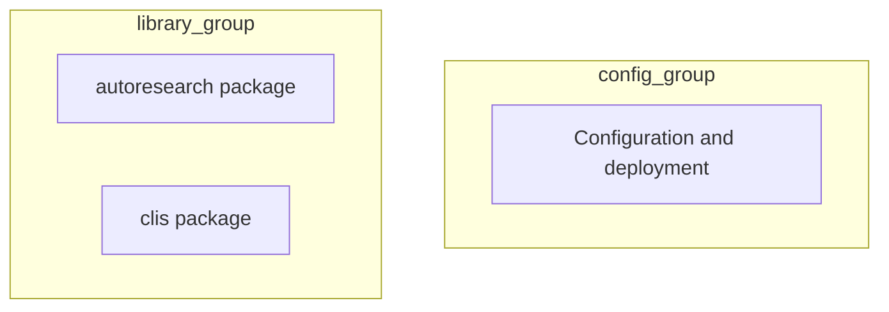

# Architecture report: jackwener/OpenCLI

> Automated static analysis. **Observed** = directly seen in files/imports/AST; **Inferred** = interpretation from that evidence. Repository code was not executed.

## 1. Repository at a glance

| Item | Value |
| --- | --- |
| Repository | jackwener/OpenCLI |
| Description | Make Any Website into CLI & Use your logged-in browser by AI agent.  |
| Language | JavaScript |
| Stars | 31079 |
| Licence | Apache-2.0 |
| Analysed commit / branch | 9bc5f5ca132ec4d4e48d7ee517d4303bf159e8e8 / main |
| Framework(s) | None detected |
| Files analysed | 800 |
| Components | 3 |

## 2. Architecture in one minute

jackwener/OpenCLI - Make Any Website into CLI & Use your logged-in browser by AI agent. . This repository was analysed statically from 800 file(s) (0 Python). Detected technologies (observed from imports/manifests): GitHub Actions. Files are grouped into 3 component(s): autoresearch package, clis package, Configuration and deployment. Findings below distinguish observed facts from inferred interpretation.

## 3. High-level block diagram

## 4. Main components

### autoresearch package (`autoresearch`)

- **Kind:** library
- **Status:** Observed
- **Confidence:** 0.85
- **Responsibility:** Groups 30 file(s) under autoresearch package (observed from repository paths and static analysis).
- **Paths:** `autoresearch/commands/debug.ts`, `autoresearch/commands/fix.ts`, `autoresearch/commands/plan.ts`, `autoresearch/commands/run.ts`, `autoresearch/config.ts`, `autoresearch/engine.ts`, `autoresearch/eval-all.ts`, `autoresearch/eval-browse.ts`, `autoresearch/eval-publish.ts`, `autoresearch/eval-save.ts`, `autoresearch/eval-skill.ts`, `autoresearch/eval-v2ex.ts`, `autoresearch/eval-zhihu.ts`, `autoresearch/logger.ts`, `autoresearch/presets/browser-reliability.ts`, `autoresearch/presets/combined-reliability.ts`, `autoresearch/presets/index.ts`, `autoresearch/presets/save-reliability.ts`, `autoresearch/presets/skill-quality.ts`, `autoresearch/presets/v2ex-reliability.ts`, `autoresearch/presets/zhihu-reliability.ts`, `autoresearch/run-browse.sh`, `autoresearch/run-save.sh`, `autoresearch/run-skill.sh`, `autoresearch/save-adapters/xhs-explore-deep.ts`, `autoresearch/save-adapters/xhs-note-comments.ts`, `autoresearch/save-adapters/xhs-search-full.ts`, `autoresearch/save-adapters/zhihu-hot-detail.ts`, `autoresearch/save-adapters/zhihu-question-full.ts`, `autoresearch/save-adapters/zhihu-search-detail.ts`
- **Evidence:** [autoresearch/commands/debug.ts](https://github.com/jackwener/OpenCLI/blob/9bc5f5ca132ec4d4e48d7ee517d4303bf159e8e8/autoresearch/commands/debug.ts); [autoresearch/commands/fix.ts](https://github.com/jackwener/OpenCLI/blob/9bc5f5ca132ec4d4e48d7ee517d4303bf159e8e8/autoresearch/commands/fix.ts); [autoresearch/commands/plan.ts](https://github.com/jackwener/OpenCLI/blob/9bc5f5ca132ec4d4e48d7ee517d4303bf159e8e8/autoresearch/commands/plan.ts); [autoresearch/commands/run.ts](https://github.com/jackwener/OpenCLI/blob/9bc5f5ca132ec4d4e48d7ee517d4303bf159e8e8/autoresearch/commands/run.ts); [autoresearch/config.ts](https://github.com/jackwener/OpenCLI/blob/9bc5f5ca132ec4d4e48d7ee517d4303bf159e8e8/autoresearch/config.ts); [autoresearch/engine.ts](https://github.com/jackwener/OpenCLI/blob/9bc5f5ca132ec4d4e48d7ee517d4303bf159e8e8/autoresearch/engine.ts); [autoresearch/eval-all.ts](https://github.com/jackwener/OpenCLI/blob/9bc5f5ca132ec4d4e48d7ee517d4303bf159e8e8/autoresearch/eval-all.ts); [autoresearch/eval-browse.ts](https://github.com/jackwener/OpenCLI/blob/9bc5f5ca132ec4d4e48d7ee517d4303bf159e8e8/autoresearch/eval-browse.ts)

### clis package (`clis`)

- **Kind:** library
- **Status:** Observed
- **Confidence:** 0.85
- **Responsibility:** Groups 722 file(s) under clis package (observed from repository paths and static analysis).
- **Paths:** `clis/12306/auth.js`, `clis/12306/me.js`, `clis/12306/orders.js`, `clis/12306/passengers.js`, `clis/12306/price.js`, `clis/12306/stations.js`, `clis/12306/train.js`, `clis/12306/trains.js`, `clis/12306/utils.js`, `clis/12306/utils.test.js`, `clis/1688/assets.js`, `clis/1688/assets.test.js`, `clis/1688/auth.js`, `clis/1688/download.js`, `clis/1688/download.test.js`, `clis/1688/item.js`, `clis/1688/item.test.js`, `clis/1688/search.js`, `clis/1688/search.test.js`, `clis/1688/shared.js`, `clis/1688/shared.test.js`, `clis/1688/store.js`, `clis/1688/store.test.js`, `clis/1point3acres/auth.js`, `clis/1point3acres/auth.test.js`, `clis/1point3acres/digest.js`, `clis/1point3acres/forum.js`, `clis/1point3acres/forums.js`, `clis/1point3acres/hot.js`, `clis/1point3acres/latest.js`, `clis/1point3acres/notifications.js`, `clis/1point3acres/search.js`, `clis/1point3acres/thread.js`, `clis/1point3acres/user.js`, `clis/1point3acres/utils.js`, `clis/36kr/article.js`, `clis/36kr/hot.js`, `clis/36kr/hot.test.js`, `clis/36kr/news.js`, `clis/36kr/news.test.js`, `clis/36kr/search.js`, `clis/51job/company.js`, `clis/51job/company.test.js`, `clis/51job/detail.js`, `clis/51job/hot.js`, `clis/51job/search.js`, `clis/51job/utils.js`, `clis/51job/utils.test.js`, `clis/_atlassian/shared.js`, `clis/_atlassian/shared.test.js`, `clis/_shared/auth-regressions.test.js`, `clis/_shared/common.js`, `clis/_shared/google-account.js`, `clis/_shared/search-adapter.js`, `clis/_shared/site-auth.js`, `clis/_shared/site-auth.test.js`, `clis/aibase/news.js`, `clis/aibase/news.test.js`, `clis/amazon/auth.js`, `clis/amazon/bestsellers.js`, `clis/amazon/bestsellers.test.js`, `clis/amazon/discussion.js`, `clis/amazon/discussion.test.js`, `clis/amazon/movers-shakers.js`, `clis/amazon/new-releases.js`, `clis/amazon/offer.js`, `clis/amazon/offer.test.js`, `clis/amazon/product.js`, `clis/amazon/product.test.js`, `clis/amazon/rankings.js`, `clis/amazon/rankings.test.js`, `clis/amazon/search.js`, `clis/amazon/search.test.js`, `clis/amazon/shared.js`, `clis/amazon/shared.test.js`, `clis/apple-podcasts/episodes.js`, `clis/apple-podcasts/search.js`, `clis/apple-podcasts/top.js`, `clis/apple-podcasts/utils.js`, `clis/apple-podcasts/utils.test.js`, `clis/archive/archive.test.js`, `clis/archive/item.js`, `clis/archive/search.js`, `clis/archive/snapshots.js`, `clis/archive/wayback.js`, `clis/arxiv/arxiv.test.js`, `clis/arxiv/author.js`, `clis/arxiv/paper.js`, `clis/arxiv/recent.js`, `clis/arxiv/search.js`, `clis/arxiv/utils.js`, `clis/autohome/autohome.test.js`, `clis/autohome/brand.js`, `clis/autohome/score.js`, `clis/autohome/utils.js`, `clis/baidu-scholar/search.js`, `clis/band/auth.js`, `clis/band/bands.js`, `clis/band/mentions.js`, `clis/band/post.js`, `clis/band/posts.js`, `clis/barchart/flow.js`, `clis/barchart/greeks.js`, `clis/barchart/options.js`, `clis/barchart/quote.js`, `clis/bbc/news.js`, `clis/bbc/topic.js`, `clis/bbc/utils.js`, `clis/bilibili/auth.js`, `clis/bilibili/comment.js`, `clis/bilibili/comment.test.js`, `clis/bilibili/comments.js`, `clis/bilibili/creator-stats.js`, `clis/bilibili/download.js`, `clis/bilibili/download.test.js`, `clis/bilibili/dynamic.js`, `clis/bilibili/favorite.js`, `clis/bilibili/feed.js`, `clis/bilibili/follow.js`, `clis/bilibili/follow.test.js`, `clis/bilibili/following.js`, `clis/bilibili/history.js`, `clis/bilibili/hot.js`, `clis/bilibili/me.js`, `clis/bilibili/ranking.js`, `clis/bilibili/relation.js`, `clis/bilibili/search.js`, `clis/bilibili/subtitle.js`, `clis/bilibili/summary.js`, `clis/bilibili/unfollow.js`, `clis/bilibili/user-videos.js`, `clis/bilibili/utils.js`, `clis/bilibili/utils.test.js`, `clis/bilibili/video.js`, `clis/binance/asks.js`, `clis/binance/commands.test.js`, `clis/binance/depth.js`, `clis/binance/gainers.js`, `clis/binance/klines.js`, `clis/binance/losers.js`, `clis/binance/pairs.js`, `clis/binance/price.js`, `clis/binance/prices.js`, `clis/binance/ticker.js`, `clis/binance/top.js`, `clis/binance/trades.js`, `clis/bloomberg/businessweek.js`, `clis/bloomberg/businessweek.test.js`, `clis/bloomberg/crypto.js`, `clis/bloomberg/economics.js`, `clis/bloomberg/feeds.js`, `clis/bloomberg/green.js`, `clis/bloomberg/industries.js`, `clis/bloomberg/main.js`, `clis/bloomberg/markets.js`, `clis/bloomberg/news.js`, `clis/bloomberg/opinions.js`, `clis/bloomberg/politics.js`, `clis/bloomberg/pursuits.js`, `clis/bloomberg/tech.js`, `clis/bloomberg/utils.js`, `clis/bloomberg/utils.test.js`, `clis/bluesky/feeds.js`, `clis/bluesky/followers.js`, `clis/bluesky/following.js`, `clis/bluesky/profile.js`, `clis/bluesky/search.js`, `clis/bluesky/starter-packs.js`, `clis/bluesky/thread.js`, `clis/bluesky/trending.js`, `clis/bluesky/user.js`, `clis/booking/booking.test.js`, `clis/booking/search.js`, `clis/boss/auth.js`, `clis/boss/auth.test.js`, `clis/boss/batchgreet.js`, `clis/boss/chatlist.js`, `clis/boss/chatmsg.js`, `clis/boss/detail.js`, `clis/boss/detail.test.js`, `clis/boss/exchange.js`, `clis/boss/greet.js`, `clis/boss/invite.js`, `clis/boss/joblist.js`, `clis/boss/mark.js`, `clis/boss/recommend.js`, `clis/boss/resume.js`, `clis/boss/search.js`, `clis/boss/search.test.js`, `clis/boss/send.js`, `clis/boss/stats.js`, `clis/boss/utils.js`, `clis/boss/utils.test.js`, `clis/brave/search.js`, `clis/chaoxing/assignments.js`, `clis/chaoxing/auth.js`, `clis/chaoxing/exams.js`, `clis/chaoxing/utils.js`, `clis/chaoxing/utils.test.js`, `clis/chatgpt/ask-file.js`, `clis/chatgpt/ask-file.test.js`, `clis/chatgpt/ask.js`, `clis/chatgpt/auth.js`, `clis/chatgpt/commands.test.js`, `clis/chatgpt/current-ui.test.js`, `clis/chatgpt/deep-research-result.js`, `clis/chatgpt/detail.js`, `clis/chatgpt/envelope.test.js`, `clis/chatgpt/file-upload-scope.test.js`, `clis/chatgpt/history.js`, `clis/chatgpt/image.js`, `clis/chatgpt/image.test.js`, `clis/chatgpt/model.js`, `clis/chatgpt/model.test.js`, `clis/chatgpt/new.js`, `clis/chatgpt/project-file-add.js`, `clis/chatgpt/project-list.js`, `clis/chatgpt/read.js`, `clis/chatgpt/send.js`, `clis/chatgpt/status.js`, `clis/chatgpt/utils.js`, `clis/chatgpt/utils.test.js`, `clis/chess/analyze.js`, `clis/chess/game.js`, `clis/chess/game.test.js`, `clis/chess/games.js`, `clis/chess/games.test.js`, `clis/chess/stats.js`, `clis/chess/utils.js`, `clis/chess/utils.test.js`, `clis/claude/ask.js`, `clis/claude/ask.test.js`, `clis/claude/auth.js`, `clis/claude/commands.test.js`, `clis/claude/detail.js`, `clis/claude/history.js`, `clis/claude/new.js`, `clis/claude/read.js`, `clis/claude/send.js`, `clis/claude/status.js`, `clis/claude/utils.js`, `clis/claude/utils.test.js`, `clis/cnki/search.js`, `clis/coingecko/categories.js`, `clis/coingecko/coin.js`, `clis/coingecko/coingecko.test.js`, `clis/coingecko/derivatives.js`, `clis/coingecko/exchanges.js`, `clis/coingecko/global.js`, `clis/coingecko/top.js`, `clis/coingecko/trending.js`, `clis/confluence/commands.test.js`, `clis/confluence/create.js`, `clis/confluence/page.js`, `clis/confluence/search.js`, `clis/confluence/shared.js`, `clis/confluence/update.js`, `clis/coupang/add-to-cart.js`, `clis/coupang/auth.js`, `clis/coupang/coupang.test.js`, `clis/coupang/product.js`, `clis/coupang/search.js`, `clis/coupang/utils.js`, `clis/coupang/utils.test.js`, `clis/crates/crate.js`, `clis/crates/search.js`, `clis/crates/utils.js`, `clis/ctrip/attraction.js`, `clis/ctrip/auth.js`, `clis/ctrip/auth.test.js`, `clis/ctrip/bus.js`, `clis/ctrip/cruise.js`, `clis/ctrip/ctrip.test.js`, `clis/ctrip/ferry.js`, `clis/ctrip/flight-round.js`, `clis/ctrip/flight.js`, `clis/ctrip/hotel-search.js`, `clis/ctrip/hotel-suggest.js`, `clis/ctrip/hotel.js`, `clis/ctrip/package.js`, `clis/ctrip/search.js`, `clis/ctrip/tour.js`, `clis/ctrip/train.js`, `clis/ctrip/utils.js`, `clis/dblp/author.js`, `clis/dblp/browser.js`, `clis/dblp/browser.test.js`, `clis/dblp/dblp.test.js`, `clis/dblp/paper.js`, `clis/dblp/search.js`, `clis/dblp/utils.js`, `clis/dblp/venue.js`, `clis/deepseek/ask.js`, `clis/deepseek/ask.test.js`, `clis/deepseek/auth.js`, `clis/deepseek/detail.js`, `clis/deepseek/history.js`, `clis/deepseek/new.js`, `clis/deepseek/read.js`, `clis/deepseek/send.js`, `clis/deepseek/send.test.js`, `clis/deepseek/status.js`, `clis/deepseek/usage.js`, `clis/deepseek/utils.js`, `clis/deepseek/utils.test.js`, `clis/defillama/defillama.test.js`, `clis/defillama/protocol.js`, `clis/defillama/protocols.js`, `clis/defillama/utils.js`, `clis/devto/latest.js`, `clis/devto/read.js`, `clis/devto/tag.js`, `clis/devto/top.js`, `clis/devto/user.js`, `clis/dianping/auth.js`, `clis/dianping/cityResolver.js`, `clis/dianping/dianping.test.js`, `clis/dianping/search.js`, `clis/dianping/shop.js`, `clis/dianping/utils.js`, `clis/dictionary/examples.js`, `clis/dictionary/search.js`, `clis/dictionary/synonyms.js`, `clis/dockerhub/image.js`, `clis/dockerhub/search.js`, `clis/dockerhub/utils.js`, `clis/dongchedi/dongchedi.test.js`, `clis/dongchedi/koubei.js`, `clis/dongchedi/models.js`, `clis/dongchedi/score.js`, `clis/dongchedi/search.js`, `clis/dongchedi/series.js`, `clis/dongchedi/specs.js`, `clis/dongchedi/utils.js`, `clis/douban/auth.js`, `clis/douban/auth.test.js`, `clis/douban/book-hot.js`, `clis/douban/download.js`, `clis/douban/download.test.js`, `clis/douban/marks.js`, `clis/douban/movie-hot.js`, `clis/douban/photos.js`, `clis/douban/reviews.js`, `clis/douban/search.js`, `clis/douban/subject.js`, `clis/douban/top250.js`, `clis/douban/utils.js`, `clis/douban/utils.test.js`, `clis/doubao/ask.js`, `clis/doubao/auth.js`, `clis/doubao/detail.js`, `clis/doubao/history.js`, `clis/doubao/meeting-summary.js`, `clis/doubao/meeting-transcript.js`, `clis/doubao/new.js`, `clis/doubao/read.js`, `clis/doubao/send.js`, `clis/doubao/status.js`, `clis/doubao/utils.js`, `clis/doubao/utils.test.js`, `clis/douyin/_shared/browser-fetch.js`, `clis/douyin/_shared/browser-fetch.test.js`, `clis/douyin/_shared/creation-id.js`, `clis/douyin/_shared/creation-id.test.js`, `clis/douyin/_shared/evaluate-result.js`, `clis/douyin/_shared/imagex-upload.js`, `clis/douyin/_shared/imagex-upload.test.js`, `clis/douyin/_shared/public-api.js`, `clis/douyin/_shared/sts2.js`, `clis/douyin/_shared/sts2.test.js`, `clis/douyin/_shared/text-extra.js`, `clis/douyin/_shared/text-extra.test.js`, `clis/douyin/_shared/timing.js`, `clis/douyin/_shared/timing.test.js`, `clis/douyin/_shared/tos-upload-short-read.test.js`, `clis/douyin/_shared/tos-upload.js`, `clis/douyin/_shared/tos-upload.test.js`, `clis/douyin/_shared/transcode.js`, `clis/douyin/_shared/transcode.test.js`, `clis/douyin/_shared/types.js`, `clis/douyin/_shared/vod-upload.js`, `clis/douyin/_shared/vod-upload.test.js`, `clis/douyin/activities.js`, `clis/douyin/auth.js`, `clis/douyin/collections.js`, `clis/douyin/delete.js`, `clis/douyin/delete.test.js`, `clis/douyin/detail.js`, `clis/douyin/detail.test.js`, `clis/douyin/draft.js`, `clis/douyin/draft.test.js`, `clis/douyin/drafts.js`, `clis/douyin/hashtag.js`, `clis/douyin/hashtag.test.js`, `clis/douyin/location.js`, `clis/douyin/profile.js`, `clis/douyin/publish-upload-id.test.js`, `clis/douyin/publish.js`, `clis/douyin/search.js`, `clis/douyin/search.test.js`, `clis/douyin/stats.js`, `clis/douyin/stats.test.js`, `clis/douyin/update.js`, `clis/douyin/user-videos.js`, `clis/douyin/user-videos.test.js`, `clis/douyin/videos.js`, `clis/douyin/videos.test.js`, `clis/dribbble/auth.js`, `clis/dribbble/collection.js`, `clis/dribbble/designer.js`, `clis/dribbble/dribbble.test.js`, `clis/dribbble/member.js`, `clis/dribbble/portfolio.js`, `clis/dribbble/profile.js`, `clis/dribbble/service.js`, `clis/dribbble/shot-detail.js`, `clis/dribbble/shot.js`, `clis/dribbble/utils.js`, `clis/duckduckgo/search.js`, `clis/duckduckgo/search.test.js`, `clis/duckduckgo/suggest.js`, `clis/eastmoney/_secid.js`, `clis/eastmoney/announcement.js`, `clis/eastmoney/convertible.js`, `clis/eastmoney/convertible.test.js`, `clis/eastmoney/etf.js`, `clis/eastmoney/holders.js`, `clis/eastmoney/hot-rank.js`, `clis/eastmoney/index-board.js`, `clis/eastmoney/kline.js`, `clis/eastmoney/kuaixun.js`, `clis/eastmoney/longhu.js`, `clis/eastmoney/money-flow.js`, `clis/eastmoney/northbound.js`, `clis/eastmoney/quote.js`, `clis/eastmoney/rank.js`, `clis/eastmoney/sectors.js`, `clis/endoflife/product.js`, `clis/endoflife/utils.js`, `clis/facebook/add-friend.js`, `clis/facebook/auth.js`, `clis/facebook/events.js`, `clis/facebook/feed.js`, `clis/facebook/feed.test.js`, `clis/facebook/friends.js`, `clis/facebook/groups.js`, `clis/facebook/join-group.js`, `clis/facebook/marketplace-inbox.js`, `clis/facebook/marketplace-listings.js`, `clis/facebook/marketplace.test.js`, `clis/facebook/memories.js`, `clis/facebook/notifications.js`, `clis/facebook/notifications.test.js`, `clis/facebook/profile.js`, `clis/facebook/profile.test.js`, `clis/facebook/search.js`, `clis/facebook/search.test.js`, `clis/flathub/app.js`, `clis/flathub/flathub.test.js`, `clis/flathub/search.js`, `clis/flathub/utils.js`, `clis/flomo/auth.js`, `clis/flomo/memos.js`, `clis/flomo/memos.test.js`, `clis/gemini/ask.js`, `clis/gemini/ask.test.js`, `clis/gemini/auth.js`, `clis/gemini/auth.test.js`, `clis/gemini/commands.test.js`, `clis/gemini/current-ui.test.js`, `clis/gemini/deep-research-result.js`, `clis/gemini/deep-research-result.test.js`, `clis/gemini/deep-research.js`, `clis/gemini/deep-research.test.js`, `clis/gemini/detail.js`, `clis/gemini/history.js`, `clis/gemini/image-pipeline.test.js`, `clis/gemini/image.js`, `clis/gemini/image.test.js`, `clis/gemini/models.js`, `clis/gemini/models.test.js`, `clis/gemini/new.js`, `clis/gemini/read.js`, `clis/gemini/reply-state.test.js`, `clis/gemini/status.js`, `clis/gemini/utils.js`, `clis/gemini/utils.test.js`, `clis/geogebra/add-circle.js`, `clis/geogebra/add-line.js`, `clis/geogebra/add-point.js`, `clis/geogebra/add-polygon.js`, `clis/geogebra/eval.js`, `clis/geogebra/geogebra.test.js`, `clis/geogebra/hexagon.js`, `clis/geogebra/info.js`, `clis/geogebra/list.js`, `clis/geogebra/triangle.js`, `clis/geogebra/utils.js`, `clis/gitee/auth.js`, `clis/gitee/index.js`, `clis/gitee/search.js`, `clis/gitee/trending.js`, `clis/gitee/user.js`, `clis/github-trending/repos.js`, `clis/github/auth.js`, `clis/gmail/attachments.js`, `clis/gmail/auth.js`, `clis/gmail/labels.js`, `clis/gmail/search.js`, `clis/gmail/thread.js`, `clis/gmail/utils.js`, `clis/gmail/utils.test.js`, `clis/google-scholar/cite.js`, `clis/google-scholar/profile.js`, `clis/google-scholar/search.js`, `clis/google/images.js`, `clis/google/images.test.js`, `clis/google/news.js`, `clis/google/search.js`, `clis/google/suggest.js`, `clis/google/trends.js`, `clis/google/utils.js`, `clis/google/utils.test.js`, `clis/goproxy/goproxy.test.js`, `clis/goproxy/module.js`, `clis/goproxy/utils.js`, `clis/goproxy/versions.js`, `clis/gov-law/recent.js`, `clis/gov-law/search.js`, `clis/gov-law/shared.js`, `clis/gov-policy/gov-policy.test.js`, `clis/gov-policy/recent.js`, `clis/gov-policy/search.js`, `clis/gov-policy/utils.js`, `clis/grok/ask.js`, `clis/grok/ask.test.js`, `clis/grok/auth.js`, `clis/grok/auth.test.js`, `clis/grok/delete.js`, `clis/grok/detail.js`, `clis/grok/export-all.js`, `clis/grok/export-utils.js`, `clis/grok/export.js`, `clis/grok/export.test.js`, `clis/grok/history.js`, `clis/grok/image.js`, `clis/grok/image.test.ts`, `clis/grok/new.js`, `clis/grok/pin.js`, `clis/grok/read.js`, `clis/grok/send.js`, `clis/grok/status.js`, `clis/grok/utils.js`, `clis/grok/utils.test.js`, `clis/guazi/browse.js`, `clis/guazi/car.js`, `clis/guazi/guazi.test.js`, `clis/guazi/utils.js`, `clis/hackernews/ask.js`, `clis/hackernews/best.js`, `clis/hackernews/jobs.js`, `clis/hackernews/new.js`, `clis/hackernews/read.js`, `clis/hackernews/search.js`, `clis/hackernews/show.js`, `clis/hackernews/top.js`, `clis/hackernews/user.js`, `clis/hf/auth.js`, `clis/hf/datasets.js`, `clis/hf/models.js`, `clis/hf/paper.js`, `clis/hf/spaces.js`, `clis/hf/top.js`, `clis/hltv/event-matches.js`, `clis/hltv/hltv.test.js`, `clis/hltv/match-map.js`, `clis/hltv/match-series.js`, `clis/hltv/player-duel.js`, `clis/hltv/player-form.js`, `clis/hltv/player-map-pool.js`, `clis/hltv/player-matches.js`, `clis/hltv/player-summary.js`, `clis/hltv/player-teammate-impact.js`, `clis/hltv/player-vs-team.js`, `clis/hltv/search.js`, `clis/hltv/team-map-pool.js`, `clis/hltv/team-matches.js`, `clis/hltv/utils.js`, `clis/homebrew/cask.js`, `clis/homebrew/formula.js`, `clis/homebrew/popular.js`, `clis/homebrew/utils.js`, `clis/huodongxing/events.js`, `clis/huodongxing/events.test.js`, `clis/hupu/auth.js`, `clis/hupu/detail.js`, `clis/hupu/hot.js`, `clis/hupu/hot.test.js`, `clis/hupu/like.js`, `clis/hupu/mentions.js`, `clis/hupu/reply.js`, `clis/hupu/search.js`, `clis/hupu/unlike.js`, `clis/hupu/utils.js`, `clis/imdb/person.js`, `clis/imdb/reviews.js`, `clis/imdb/search.js`, `clis/imdb/title.js`, `clis/imdb/top.js`, `clis/imdb/trending.js`, `clis/imdb/utils.js`, `clis/imdb/utils.test.js`, `clis/indeed/indeed.test.js`, `clis/indeed/job.js`, `clis/indeed/search.js`, `clis/indeed/utils.js`, `clis/instagram/_shared/navigation.js`, `clis/instagram/_shared/navigation.test.js`, `clis/instagram/_shared/post-like.js`, `clis/instagram/_shared/post-like.test.js`, `clis/instagram/_shared/private-publish.js`, `clis/instagram/_shared/private-publish.test.js`, `clis/instagram/_shared/protocol-capture.js`, `clis/instagram/_shared/protocol-capture.test.js`, `clis/instagram/_shared/read-response.js`, `clis/instagram/_shared/read-response.test.js`, `clis/instagram/_shared/runtime-info.js`, `clis/instagram/_shared/runtime-info.test.js`, `clis/instagram/_shared/user-id.js`, `clis/instagram/auth.js`, `clis/instagram/collection-create.js`, `clis/instagram/collection-delete.js`, `clis/instagram/comment.js`, `clis/instagram/download.js`, `clis/instagram/download.test.js`, `clis/instagram/explore.js`, `clis/instagram/follow.js`, `clis/instagram/followers.js`, `clis/instagram/following.js`, `clis/instagram/instagram.test.js`, `clis/instagram/like.js`, `clis/instagram/note.js`, `clis/instagram/note.test.js`, `clis/instagram/post.js`, `clis/instagram/post.test.js`, `clis/instagram/profile.js`, `clis/instagram/reel.js`, `clis/instagram/reel.test.js`, `clis/instagram/save.js`, `clis/instagram/saved.js`, `clis/instagram/search.js`, `clis/instagram/story.js`, `clis/instagram/story.test.js`, `clis/instagram/unfollow.js`, `clis/instagram/unlike.js`, `clis/instagram/unsave.js`, `clis/instagram/user.js`, `clis/instagram/user.test.js`, `clis/jd/add-cart.js`, `clis/jd/auth.js`, `clis/jd/cart.js`, `clis/jd/commands.test.js`, `clis/jd/detail.js`, `clis/jd/item.js`, `clis/jd/item.test.js`, `clis/jd/item.test.ts`, `clis/jd/page-state.js`, `clis/jd/reviews.js`, `clis/jd/search.js`, `clis/jd/search.test.js`, `clis/jianyu/auth.js`, `clis/jianyu/detail.js`, `clis/jianyu/search.js`, `clis/jianyu/search.test.js`, `clis/jianyu/shared/china-bid-search.js`, `clis/jianyu/shared/procurement-contract.js`, `clis/jianyu/shared/procurement-contract.test.js`, `clis/jianyu/shared/procurement-detail.js`, `clis/jianyu/shared/procurement-detail.test.js`, `clis/jike/auth-read.test.js`, `clis/jike/auth.js`, `clis/jike/comment.js`, `clis/jike/create.js`, `clis/jike/feed.js`, `clis/jike/like.js`, `clis/jike/notifications.js`, `clis/jike/notifications.test.js`, `clis/jike/post.js`, `clis/jike/read.test.js`, `clis/jike/repost.js`, `clis/jike/search.js`, `clis/jike/search.test.js`, `clis/jike/topic.js`, `clis/jike/user.js`, `clis/jike/utils.js`, `clis/jimeng/auth.js`, `clis/jimeng/generate.js`, `clis/jimeng/history.js`, `clis/jimeng/new.js`, `clis/jimeng/workspaces.js`, `clis/jira/attachments.js`, `clis/jira/commands.test.js`, `clis/jira/comments.js`, `clis/jira/issue.js`, `clis/jira/links.js`, `clis/jira/search.js`, `clis/jira/shared.js`, `clis/juejin/hot.js`, `clis/juejin/juejin.test.js`, `clis/juejin/recommend.js`, `clis/juejin/utils.js`, `clis/ke/auth.js`, `clis/ke/chengjiao.js`, `clis/ke/ershoufang.js`, `clis/ke/utils.js`, `clis/ke/xiaoqu.js`, `clis/ke/zufang.js`, `clis/kimi/_utils.js`, `clis/kimi/audit-extras.js`, `clis/kimi/auth.js`, `clis/kimi/chat.js`, `clis/kimi/kimi.test.js`
- **Evidence:** [clis/12306/auth.js](https://github.com/jackwener/OpenCLI/blob/9bc5f5ca132ec4d4e48d7ee517d4303bf159e8e8/clis/12306/auth.js); [clis/12306/me.js](https://github.com/jackwener/OpenCLI/blob/9bc5f5ca132ec4d4e48d7ee517d4303bf159e8e8/clis/12306/me.js); [clis/12306/orders.js](https://github.com/jackwener/OpenCLI/blob/9bc5f5ca132ec4d4e48d7ee517d4303bf159e8e8/clis/12306/orders.js); [clis/12306/passengers.js](https://github.com/jackwener/OpenCLI/blob/9bc5f5ca132ec4d4e48d7ee517d4303bf159e8e8/clis/12306/passengers.js); [clis/12306/price.js](https://github.com/jackwener/OpenCLI/blob/9bc5f5ca132ec4d4e48d7ee517d4303bf159e8e8/clis/12306/price.js); [clis/12306/stations.js](https://github.com/jackwener/OpenCLI/blob/9bc5f5ca132ec4d4e48d7ee517d4303bf159e8e8/clis/12306/stations.js); [clis/12306/train.js](https://github.com/jackwener/OpenCLI/blob/9bc5f5ca132ec4d4e48d7ee517d4303bf159e8e8/clis/12306/train.js); [clis/12306/trains.js](https://github.com/jackwener/OpenCLI/blob/9bc5f5ca132ec4d4e48d7ee517d4303bf159e8e8/clis/12306/trains.js)

### Configuration and deployment (`config`)

- **Kind:** config
- **Status:** Observed
- **Confidence:** 0.85
- **Responsibility:** Groups 9 file(s) under configuration and deployment (observed from repository paths and static analysis).
- **Paths:** `autoresearch/browse-tasks.json`, `autoresearch/publish-tasks.json`, `autoresearch/save-tasks.json`, `autoresearch/v2ex-tasks.json`, `autoresearch/zhihu-tasks.json`, `clis/autohome/__fixtures__/koubei.json`, `clis/dongchedi/__fixtures__/search.json`, `clis/dongchedi/__fixtures__/series-detail.json`, `clis/dongchedi/__fixtures__/series-score.json`
- **Evidence:** [autoresearch/browse-tasks.json](https://github.com/jackwener/OpenCLI/blob/9bc5f5ca132ec4d4e48d7ee517d4303bf159e8e8/autoresearch/browse-tasks.json); [autoresearch/publish-tasks.json](https://github.com/jackwener/OpenCLI/blob/9bc5f5ca132ec4d4e48d7ee517d4303bf159e8e8/autoresearch/publish-tasks.json); [autoresearch/save-tasks.json](https://github.com/jackwener/OpenCLI/blob/9bc5f5ca132ec4d4e48d7ee517d4303bf159e8e8/autoresearch/save-tasks.json); [autoresearch/v2ex-tasks.json](https://github.com/jackwener/OpenCLI/blob/9bc5f5ca132ec4d4e48d7ee517d4303bf159e8e8/autoresearch/v2ex-tasks.json); [autoresearch/zhihu-tasks.json](https://github.com/jackwener/OpenCLI/blob/9bc5f5ca132ec4d4e48d7ee517d4303bf159e8e8/autoresearch/zhihu-tasks.json); [clis/autohome/__fixtures__/koubei.json](https://github.com/jackwener/OpenCLI/blob/9bc5f5ca132ec4d4e48d7ee517d4303bf159e8e8/clis/autohome/__fixtures__/koubei.json); [clis/dongchedi/__fixtures__/search.json](https://github.com/jackwener/OpenCLI/blob/9bc5f5ca132ec4d4e48d7ee517d4303bf159e8e8/clis/dongchedi/__fixtures__/search.json); [clis/dongchedi/__fixtures__/series-detail.json](https://github.com/jackwener/OpenCLI/blob/9bc5f5ca132ec4d4e48d7ee517d4303bf159e8e8/clis/dongchedi/__fixtures__/series-detail.json)

## 5. Execution flow

**Observed** entry point(s):

- [autoresearch/presets/index.ts](https://github.com/jackwener/OpenCLI/blob/9bc5f5ca132ec4d4e48d7ee517d4303bf159e8e8/autoresearch/presets/index.ts)
- [clis/bloomberg/main.js](https://github.com/jackwener/OpenCLI/blob/9bc5f5ca132ec4d4e48d7ee517d4303bf159e8e8/clis/bloomberg/main.js)
- [clis/confluence/page.js](https://github.com/jackwener/OpenCLI/blob/9bc5f5ca132ec4d4e48d7ee517d4303bf159e8e8/clis/confluence/page.js)
- [clis/flathub/app.js](https://github.com/jackwener/OpenCLI/blob/9bc5f5ca132ec4d4e48d7ee517d4303bf159e8e8/clis/flathub/app.js)
- [clis/gitee/index.js](https://github.com/jackwener/OpenCLI/blob/9bc5f5ca132ec4d4e48d7ee517d4303bf159e8e8/clis/gitee/index.js)

Representative flow (derived from observed entry points and the import graph; steps beyond the entry point are **Inferred**):

1. Execution starts at an observed entry point listed above, if present.
2. No internal import relationships between components were observed.

## 6. Project structure

### `(root)`

- `.gitignore` - other (300 bytes)
- `CHANGELOG.md` - docs (104953 bytes)
- `CONTRIBUTING.md` - docs (6410 bytes)
- `LICENSE` - docs (10760 bytes)
- `PRIVACY.md` - docs (2655 bytes)
- `README.md` - docs (23254 bytes)
- `README.zh-CN.md` - docs (23751 bytes)
- `TESTING.md` - docs (328 bytes)

### `.github`

- `.github/ISSUE_TEMPLATE/bug_report.yml` - config (1803 bytes)
- `.github/ISSUE_TEMPLATE/config.yml` - config (333 bytes)
- `.github/ISSUE_TEMPLATE/feature_request.yml` - config (1120 bytes)
- `.github/ISSUE_TEMPLATE/new_site_adapter.yml` - config (1571 bytes)
- `.github/RELEASING.md` - docs (1830 bytes)
- `.github/actions/setup-chrome/action.yml` - config (912 bytes)
- `.github/pull_request_template.md` - docs (1028 bytes)
- `.github/workflows/build-extension.yml` - ci, YAML (1716 bytes)
- `.github/workflows/ci.yml` - ci, YAML (4592 bytes)
- `.github/workflows/doc-check.yml` - ci, YAML (761 bytes)
- `.github/workflows/docs.yml` - ci, YAML (404 bytes)
- `.github/workflows/e2e-headed.yml` - ci, YAML (3645 bytes)
- `.github/workflows/release.yml` - ci, YAML (5813 bytes)
- `.github/workflows/security.yml` - ci, YAML (611 bytes)

### `autoresearch`

- `autoresearch/baseline-browse.txt` - docs (6 bytes)
- `autoresearch/baseline-skill.txt` - docs (6 bytes)
- `autoresearch/browse-tasks.json` - config (24735 bytes)
- `autoresearch/commands/debug.ts` - source, TypeScript (6119 bytes)
- `autoresearch/commands/fix.ts` - source, TypeScript (4812 bytes)
- `autoresearch/commands/plan.ts` - source, TypeScript (3200 bytes)
- `autoresearch/commands/run.ts` - source, TypeScript (5619 bytes)
- `autoresearch/config.ts` - source, TypeScript (2981 bytes)
- `autoresearch/engine.ts` - source, TypeScript (11914 bytes)
- `autoresearch/eval-all.ts` - source, TypeScript (4618 bytes)
- `autoresearch/eval-browse.ts` - source, TypeScript (5733 bytes)
- `autoresearch/eval-publish.ts` - source, TypeScript (8418 bytes)
- `autoresearch/eval-save.ts` - source, TypeScript (8730 bytes)
- `autoresearch/eval-skill.ts` - source, TypeScript (14890 bytes)
- `autoresearch/eval-v2ex.ts` - source, TypeScript (7468 bytes)
- `autoresearch/eval-zhihu.ts` - source, TypeScript (8321 bytes)
- `autoresearch/logger.ts` - source, TypeScript (2277 bytes)
- `autoresearch/presets/browser-reliability.ts` - source, TypeScript (682 bytes)
- `autoresearch/presets/combined-reliability.ts` - source, TypeScript (777 bytes)
- `autoresearch/presets/index.ts` - source, TypeScript (1058 bytes)
- `autoresearch/presets/save-reliability.ts` - source, TypeScript (1070 bytes)
- `autoresearch/presets/skill-quality.ts` - source, TypeScript (566 bytes)
- `autoresearch/presets/v2ex-reliability.ts` - source, TypeScript (683 bytes)
- `autoresearch/presets/zhihu-reliability.ts` - source, TypeScript (755 bytes)
- `autoresearch/publish-tasks.json` - config (30403 bytes)
- `autoresearch/run-browse.sh` - source, Shell (214 bytes)
- `autoresearch/run-save.sh` - source, Shell (312 bytes)
- `autoresearch/run-skill.sh` - source, Shell (206 bytes)
- `autoresearch/save-adapters/xhs-explore-deep.ts` - source, TypeScript (3202 bytes)
- `autoresearch/save-adapters/xhs-note-comments.ts` - source, TypeScript (3172 bytes)
- `autoresearch/save-adapters/xhs-search-full.ts` - source, TypeScript (2877 bytes)
- `autoresearch/save-adapters/zhihu-hot-detail.ts` - source, TypeScript (2429 bytes)
- `autoresearch/save-adapters/zhihu-question-full.ts` - source, TypeScript (2821 bytes)
- `autoresearch/save-adapters/zhihu-search-detail.ts` - source, TypeScript (2704 bytes)
- `autoresearch/save-tasks.json` - config (22629 bytes)
- `autoresearch/v2ex-tasks.json` - config (35073 bytes)
- `autoresearch/zhihu-tasks.json` - config (36518 bytes)

### `cases`

- `cases/README.md` - docs (269 bytes)
- `cases/daily-rl-research-monitor.md` - docs (2696 bytes)
- `cases/find-paper-implementation.md` - docs (3528 bytes)
- `cases/track-conference-papers.md` - docs (4122 bytes)

### `clis`

- `clis/12306/auth.js` - source, JavaScript (2559 bytes)
- `clis/12306/me.js` - source, JavaScript (3710 bytes)
- `clis/12306/orders.js` - source, JavaScript (4635 bytes)
- `clis/12306/passengers.js` - source, JavaScript (3882 bytes)
- `clis/12306/price.js` - source, JavaScript (7922 bytes)
- `clis/12306/stations.js` - source, JavaScript (1907 bytes)
- `clis/12306/train.js` - source, JavaScript (4374 bytes)
- `clis/12306/trains.js` - source, JavaScript (6919 bytes)
- `clis/12306/utils.js` - source, JavaScript (10965 bytes)
- `clis/12306/utils.test.js` - source, JavaScript (20623 bytes)
- `clis/1688/assets.js` - source, JavaScript (12242 bytes)
- `clis/1688/assets.test.js` - source, JavaScript (4408 bytes)
- `clis/1688/auth.js` - source, JavaScript (1681 bytes)
- `clis/1688/download.js` - source, JavaScript (2605 bytes)
- `clis/1688/download.test.js` - source, JavaScript (1251 bytes)
- `clis/1688/item.js` - source, JavaScript (8522 bytes)
- `clis/1688/item.test.js` - source, JavaScript (2867 bytes)
- `clis/1688/search.js` - source, JavaScript (13233 bytes)
- `clis/1688/search.test.js` - source, JavaScript (4107 bytes)
- `clis/1688/shared.js` - source, JavaScript (18289 bytes)
- `clis/1688/shared.test.js` - source, JavaScript (3226 bytes)
- `clis/1688/store.js` - source, JavaScript (9147 bytes)
- `clis/1688/store.test.js` - source, JavaScript (3024 bytes)
- `clis/1point3acres/auth.js` - source, JavaScript (3037 bytes)
- `clis/1point3acres/auth.test.js` - source, JavaScript (4052 bytes)
- `clis/1point3acres/digest.js` - source, JavaScript (1216 bytes)
- `clis/1point3acres/forum.js` - source, JavaScript (2174 bytes)
- `clis/1point3acres/forums.js` - source, JavaScript (1775 bytes)
- `clis/1point3acres/hot.js` - source, JavaScript (1226 bytes)
- `clis/1point3acres/latest.js` - source, JavaScript (1201 bytes)
- `clis/1point3acres/notifications.js` - source, JavaScript (3090 bytes)
- `clis/1point3acres/search.js` - source, JavaScript (2821 bytes)
- `clis/1point3acres/thread.js` - source, JavaScript (6107 bytes)
- `clis/1point3acres/user.js` - source, JavaScript (3077 bytes)
- `clis/1point3acres/utils.js` - source, JavaScript (10056 bytes)
- `clis/36kr/article.js` - source, JavaScript (2878 bytes)
- `clis/36kr/hot.js` - source, JavaScript (3455 bytes)
- `clis/36kr/hot.test.js` - source, JavaScript (737 bytes)
- `clis/36kr/news.js` - source, JavaScript (2078 bytes)
- `clis/36kr/news.test.js` - source, JavaScript (2455 bytes)
- `clis/36kr/search.js` - source, JavaScript (3284 bytes)
- `clis/51job/company.js` - source, JavaScript (5518 bytes)
- `clis/51job/company.test.js` - source, JavaScript (1101 bytes)
- `clis/51job/detail.js` - source, JavaScript (4878 bytes)
- `clis/51job/hot.js` - source, JavaScript (2335 bytes)
- `clis/51job/search.js` - source, JavaScript (4093 bytes)
- `clis/51job/utils.js` - source, JavaScript (11911 bytes)
- `clis/51job/utils.test.js` - source, JavaScript (2407 bytes)
- `clis/_atlassian/shared.js` - source, JavaScript (20706 bytes)
- `clis/_atlassian/shared.test.js` - source, JavaScript (7431 bytes)
- `clis/_shared/auth-regressions.test.js` - source, JavaScript (6271 bytes)
- `clis/_shared/common.js` - source, JavaScript (1030 bytes)
- `clis/_shared/google-account.js` - source, JavaScript (2504 bytes)
- `clis/_shared/search-adapter.js` - source, JavaScript (2285 bytes)
- `clis/_shared/site-auth.js` - source, JavaScript (4515 bytes)
- `clis/_shared/site-auth.test.js` - source, JavaScript (4790 bytes)
- `clis/aibase/news.js` - source, JavaScript (4055 bytes)
- `clis/aibase/news.test.js` - source, JavaScript (2431 bytes)
- `clis/amazon/auth.js` - source, JavaScript (2504 bytes)
- `clis/amazon/bestsellers.js` - source, JavaScript (303 bytes)
- `clis/amazon/bestsellers.test.js` - source, JavaScript (1370 bytes)
- `clis/amazon/discussion.js` - source, JavaScript (6215 bytes)
- `clis/amazon/discussion.test.js` - source, JavaScript (2163 bytes)
- `clis/amazon/movers-shakers.js` - source, JavaScript (310 bytes)
- `clis/amazon/new-releases.js` - source, JavaScript (301 bytes)
- `clis/amazon/offer.js` - source, JavaScript (6440 bytes)
- `clis/amazon/offer.test.js` - source, JavaScript (1481 bytes)
- `clis/amazon/product.js` - source, JavaScript (4694 bytes)
- `clis/amazon/product.test.js` - source, JavaScript (1230 bytes)
- `clis/amazon/rankings.js` - source, JavaScript (10352 bytes)
- `clis/amazon/rankings.test.js` - source, JavaScript (2027 bytes)
- `clis/amazon/search.js` - source, JavaScript (4046 bytes)
- `clis/amazon/search.test.js` - source, JavaScript (1099 bytes)
- `clis/amazon/shared.js` - source, JavaScript (14908 bytes)
- `clis/amazon/shared.test.js` - source, JavaScript (6061 bytes)
- `clis/apple-podcasts/episodes.js` - source, JavaScript (1396 bytes)
- `clis/apple-podcasts/search.js` - source, JavaScript (1241 bytes)
- `clis/apple-podcasts/top.js` - source, JavaScript (1962 bytes)
- `clis/apple-podcasts/utils.js` - source, JavaScript (1064 bytes)
- `clis/apple-podcasts/utils.test.js` - source, JavaScript (2062 bytes)
- `clis/archive/archive.test.js` - source, JavaScript (10426 bytes)
- `clis/archive/item.js` - source, JavaScript (3920 bytes)
- `clis/archive/search.js` - source, JavaScript (5060 bytes)
- `clis/archive/snapshots.js` - source, JavaScript (5722 bytes)
- `clis/archive/wayback.js` - source, JavaScript (3421 bytes)
- `clis/arxiv/arxiv.test.js` - source, JavaScript (4099 bytes)
- `clis/arxiv/author.js` - source, JavaScript (2062 bytes)
- `clis/arxiv/paper.js` - source, JavaScript (946 bytes)
- `clis/arxiv/recent.js` - source, JavaScript (1488 bytes)
- `clis/arxiv/search.js` - source, JavaScript (1514 bytes)
- `clis/arxiv/utils.js` - source, JavaScript (4342 bytes)
- `clis/autohome/__fixtures__/catalog.html` - other (4037 bytes)
- `clis/autohome/__fixtures__/koubei.json` - config (2181 bytes)
- `clis/autohome/autohome.test.js` - source, JavaScript (4435 bytes)
- `clis/autohome/brand.js` - source, JavaScript (4060 bytes)
- `clis/autohome/score.js` - source, JavaScript (3625 bytes)
- `clis/autohome/utils.js` - source, JavaScript (6956 bytes)
- `clis/baidu-scholar/search.js` - source, JavaScript (3273 bytes)
- `clis/band/auth.js` - source, JavaScript (2417 bytes)
- `clis/band/bands.js` - source, JavaScript (2936 bytes)
- `clis/band/mentions.js` - source, JavaScript (6426 bytes)
- `clis/band/post.js` - source, JavaScript (8692 bytes)
- `clis/band/posts.js` - source, JavaScript (3771 bytes)
- `clis/barchart/flow.js` - source, JavaScript (4431 bytes)
- `clis/barchart/greeks.js` - source, JavaScript (8964 bytes)
- `clis/barchart/options.js` - source, JavaScript (4353 bytes)
- `clis/barchart/quote.js` - source, JavaScript (5681 bytes)
- `clis/bbc/news.js` - source, JavaScript (1741 bytes)
- `clis/bbc/topic.js` - source, JavaScript (2096 bytes)
- `clis/bbc/utils.js` - source, JavaScript (3065 bytes)
- `clis/bilibili/auth.js` - source, JavaScript (1278 bytes)
- `clis/bilibili/comment.js` - source, JavaScript (5018 bytes)
- `clis/bilibili/comment.test.js` - source, JavaScript (6589 bytes)
- `clis/bilibili/comments.js` - source, JavaScript (6875 bytes)
- `clis/bilibili/creator-stats.js` - source, JavaScript (7493 bytes)
- `clis/bilibili/download.js` - source, JavaScript (7577 bytes)
- `clis/bilibili/download.test.js` - source, JavaScript (6818 bytes)
- `clis/bilibili/dynamic.js` - source, JavaScript (1343 bytes)
- `clis/bilibili/favorite.js` - source, JavaScript (1913 bytes)
- `clis/bilibili/feed.js` - source, JavaScript (10277 bytes)
- `clis/bilibili/follow.js` - source, JavaScript (3696 bytes)
- `clis/bilibili/follow.test.js` - source, JavaScript (10178 bytes)
- `clis/bilibili/following.js` - source, JavaScript (2082 bytes)
- `clis/bilibili/history.js` - source, JavaScript (1734 bytes)
- `clis/bilibili/hot.js` - source, JavaScript (1298 bytes)
- `clis/bilibili/me.js` - source, JavaScript (759 bytes)
- `clis/bilibili/ranking.js` - source, JavaScript (952 bytes)
- `clis/bilibili/relation.js` - source, JavaScript (1692 bytes)
- `clis/bilibili/search.js` - source, JavaScript (2671 bytes)
- `clis/bilibili/subtitle.js` - source, JavaScript (7561 bytes)
- `clis/bilibili/summary.js` - source, JavaScript (6861 bytes)
- `clis/bilibili/unfollow.js` - source, JavaScript (3023 bytes)
- `clis/bilibili/user-videos.js` - source, JavaScript (5279 bytes)
- `clis/bilibili/utils.js` - source, JavaScript (14356 bytes)
- `clis/bilibili/utils.test.js` - source, JavaScript (7148 bytes)
- `clis/bilibili/video.js` - source, JavaScript (7988 bytes)
- `clis/binance/asks.js` - source, JavaScript (854 bytes)
- `clis/binance/commands.test.js` - source, JavaScript (2550 bytes)
- `clis/binance/depth.js` - source, JavaScript (977 bytes)
- `clis/binance/gainers.js` - source, JavaScript (1068 bytes)
- `clis/binance/klines.js` - source, JavaScript (1007 bytes)
- `clis/binance/losers.js` - source, JavaScript (1051 bytes)
- `clis/binance/pairs.js` - source, JavaScript (763 bytes)
- `clis/binance/price.js` - source, JavaScript (956 bytes)
- `clis/binance/prices.js` - source, JavaScript (632 bytes)
- `clis/binance/ticker.js` - source, JavaScript (1267 bytes)
- `clis/binance/top.js` - source, JavaScript (1146 bytes)
- `clis/binance/trades.js` - source, JavaScript (897 bytes)
- `clis/bloomberg/businessweek.js` - source, JavaScript (5568 bytes)
- `clis/bloomberg/businessweek.test.js` - source, JavaScript (3798 bytes)
- `clis/bloomberg/crypto.js` - source, JavaScript (602 bytes)
- `clis/bloomberg/economics.js` - source, JavaScript (611 bytes)
- `clis/bloomberg/feeds.js` - source, JavaScript (502 bytes)
- `clis/bloomberg/green.js` - source, JavaScript (618 bytes)
- `clis/bloomberg/industries.js` - source, JavaScript (614 bytes)
- `clis/bloomberg/main.js` - source, JavaScript (600 bytes)
- `clis/bloomberg/markets.js` - source, JavaScript (605 bytes)
- `clis/bloomberg/news.js` - source, JavaScript (4796 bytes)
- `clis/bloomberg/opinions.js` - source, JavaScript (607 bytes)
- `clis/bloomberg/politics.js` - source, JavaScript (608 bytes)
- `clis/bloomberg/pursuits.js` - source, JavaScript (620 bytes)
- `clis/bloomberg/tech.js` - source, JavaScript (596 bytes)
- `clis/bloomberg/utils.js` - source, JavaScript (14035 bytes)
- `clis/bloomberg/utils.test.js` - source, JavaScript (5356 bytes)
- `clis/bluesky/feeds.js` - source, JavaScript (969 bytes)
- `clis/bluesky/followers.js` - source, JavaScript (1010 bytes)
- `clis/bluesky/following.js` - source, JavaScript (1014 bytes)
- `clis/bluesky/profile.js` - source, JavaScript (1029 bytes)
- `clis/bluesky/search.js` - source, JavaScript (1052 bytes)
- `clis/bluesky/starter-packs.js` - source, JavaScript (1122 bytes)
- `clis/bluesky/thread.js` - source, JavaScript (1128 bytes)
- `clis/bluesky/trending.js` - source, JavaScript (700 bytes)
- `clis/bluesky/user.js` - source, JavaScript (1200 bytes)
- `clis/booking/booking.test.js` - source, JavaScript (6861 bytes)
- `clis/booking/search.js` - source, JavaScript (13500 bytes)
- `clis/boss/__fixtures__/detail.html` - other (1455 bytes)
- `clis/boss/auth.js` - source, JavaScript (2067 bytes)
- `clis/boss/auth.test.js` - source, JavaScript (811 bytes)
- `clis/boss/batchgreet.js` - source, JavaScript (2737 bytes)
- `clis/boss/chatlist.js` - source, JavaScript (4816 bytes)
- `clis/boss/chatmsg.js` - source, JavaScript (5588 bytes)
- `clis/boss/detail.js` - source, JavaScript (9165 bytes)
- `clis/boss/detail.test.js` - source, JavaScript (4004 bytes)
- `clis/boss/exchange.js` - source, JavaScript (1892 bytes)
- `clis/boss/greet.js` - source, JavaScript (2189 bytes)
- `clis/boss/invite.js` - source, JavaScript (3114 bytes)
- `clis/boss/joblist.js` - source, JavaScript (1104 bytes)
- `clis/boss/mark.js` - source, JavaScript (3111 bytes)
- `clis/boss/recommend.js` - source, JavaScript (1812 bytes)
- `clis/boss/resume.js` - source, JavaScript (6977 bytes)
- `clis/boss/search.js` - source, JavaScript (10079 bytes)
- `clis/boss/search.test.js` - source, JavaScript (1092 bytes)
- `clis/boss/send.js` - source, JavaScript (1896 bytes)
- `clis/boss/stats.js` - source, JavaScript (2527 bytes)
- `clis/boss/utils.js` - source, JavaScript (20207 bytes)
- `clis/boss/utils.test.js` - source, JavaScript (2446 bytes)
- `clis/brave/search.js` - source, JavaScript (2944 bytes)
- `clis/chaoxing/assignments.js` - source, JavaScript (3164 bytes)
- `clis/chaoxing/auth.js` - source, JavaScript (2409 bytes)
- `clis/chaoxing/exams.js` - source, JavaScript (3070 bytes)
- `clis/chaoxing/utils.js` - source, JavaScript (9086 bytes)
- `clis/chaoxing/utils.test.js` - source, JavaScript (1860 bytes)
- `clis/chatgpt/ask-file.js` - source, JavaScript (5043 bytes)
- `clis/chatgpt/ask-file.test.js` - source, JavaScript (4507 bytes)
- `clis/chatgpt/ask.js` - source, JavaScript (5907 bytes)
- `clis/chatgpt/auth.js` - source, JavaScript (2014 bytes)
- `clis/chatgpt/commands.test.js` - source, JavaScript (15651 bytes)
- `clis/chatgpt/current-ui.test.js` - source, JavaScript (12854 bytes)
- `clis/chatgpt/deep-research-result.js` - source, JavaScript (4866 bytes)
- `clis/chatgpt/detail.js` - source, JavaScript (2907 bytes)
- `clis/chatgpt/envelope.test.js` - source, JavaScript (5475 bytes)
- `clis/chatgpt/file-upload-scope.test.js` - source, JavaScript (17569 bytes)
- `clis/chatgpt/history.js` - source, JavaScript (1387 bytes)
- `clis/chatgpt/image.js` - source, JavaScript (7426 bytes)
- `clis/chatgpt/image.test.js` - source, JavaScript (9584 bytes)
- `clis/chatgpt/model.js` - source, JavaScript (1164 bytes)
- `clis/chatgpt/model.test.js` - source, JavaScript (1387 bytes)
- `clis/chatgpt/new.js` - source, JavaScript (1005 bytes)
- `clis/chatgpt/project-file-add.js` - source, JavaScript (2647 bytes)
- `clis/chatgpt/project-list.js` - source, JavaScript (1307 bytes)
- `clis/chatgpt/read.js` - source, JavaScript (1693 bytes)
- `clis/chatgpt/send.js` - source, JavaScript (2830 bytes)
- `clis/chatgpt/status.js` - source, JavaScript (839 bytes)
- `clis/chatgpt/utils.js` - source, JavaScript (176704 bytes)
- `clis/chatgpt/utils.test.js` - source, JavaScript (107508 bytes)
- `clis/chess/analyze.js` - source, JavaScript (1419 bytes)
- `clis/chess/game.js` - source, JavaScript (4933 bytes)
- `clis/chess/game.test.js` - source, JavaScript (3873 bytes)
- `clis/chess/games.js` - source, JavaScript (3092 bytes)
- `clis/chess/games.test.js` - source, JavaScript (2444 bytes)
- `clis/chess/stats.js` - source, JavaScript (1322 bytes)
- `clis/chess/utils.js` - source, JavaScript (6972 bytes)
- `clis/chess/utils.test.js` - source, JavaScript (9907 bytes)
- `clis/claude/ask.js` - source, JavaScript (7028 bytes)
- `clis/claude/ask.test.js` - source, JavaScript (12442 bytes)
- `clis/claude/auth.js` - source, JavaScript (2510 bytes)
- `clis/claude/commands.test.js` - source, JavaScript (4938 bytes)
- `clis/claude/detail.js` - source, JavaScript (1634 bytes)
- `clis/claude/history.js` - source, JavaScript (1289 bytes)
- `clis/claude/new.js` - source, JavaScript (1115 bytes)
- `clis/claude/read.js` - source, JavaScript (1099 bytes)
- `clis/claude/send.js` - source, JavaScript (2010 bytes)
- `clis/claude/status.js` - source, JavaScript (794 bytes)
- `clis/claude/utils.js` - source, JavaScript (18685 bytes)
- `clis/claude/utils.test.js` - source, JavaScript (6011 bytes)
- `clis/cnki/search.js` - source, JavaScript (2527 bytes)
- `clis/coingecko/categories.js` - source, JavaScript (3438 bytes)
- `clis/coingecko/coin.js` - source, JavaScript (4859 bytes)
- `clis/coingecko/coingecko.test.js` - source, JavaScript (920 bytes)
- `clis/coingecko/derivatives.js` - source, JavaScript (4002 bytes)
- `clis/coingecko/exchanges.js` - source, JavaScript (3254 bytes)
- `clis/coingecko/global.js` - source, JavaScript (3610 bytes)
- `clis/coingecko/top.js` - source, JavaScript (2633 bytes)
- `clis/coingecko/trending.js` - source, JavaScript (2134 bytes)
- `clis/confluence/commands.test.js` - source, JavaScript (8231 bytes)
- `clis/confluence/create.js` - source, JavaScript (2048 bytes)
- `clis/confluence/page.js` - source, JavaScript (859 bytes)
- `clis/confluence/search.js` - source, JavaScript (1698 bytes)
- `clis/confluence/shared.js` - source, JavaScript (6543 bytes)
- `clis/confluence/update.js` - source, JavaScript (2109 bytes)
- `clis/coupang/add-to-cart.js` - source, JavaScript (6464 bytes)
- `clis/coupang/auth.js` - source, JavaScript (1975 bytes)
- `clis/coupang/coupang.test.js` - source, JavaScript (6799 bytes)
- `clis/coupang/product.js` - source, JavaScript (12677 bytes)
- `clis/coupang/search.js` - source, JavaScript (22364 bytes)
- `clis/coupang/utils.js` - source, JavaScript (11971 bytes)
- `clis/coupang/utils.test.js` - source, JavaScript (2757 bytes)
- `clis/crates/crate.js` - source, JavaScript (3043 bytes)
- `clis/crates/search.js` - source, JavaScript (2235 bytes)
- `clis/crates/utils.js` - source, JavaScript (2608 bytes)
- `clis/ctrip/attraction.js` - source, JavaScript (3089 bytes)
- `clis/ctrip/auth.js` - source, JavaScript (2816 bytes)
- `clis/ctrip/auth.test.js` - source, JavaScript (2988 bytes)
- `clis/ctrip/bus.js` - source, JavaScript (3597 bytes)
- `clis/ctrip/cruise.js` - source, JavaScript (3944 bytes)
- `clis/ctrip/ctrip.test.js` - source, JavaScript (98708 bytes)
- `clis/ctrip/ferry.js` - source, JavaScript (3607 bytes)
- `clis/ctrip/flight-round.js` - source, JavaScript (6113 bytes)
- `clis/ctrip/flight.js` - source, JavaScript (11674 bytes)
- `clis/ctrip/hotel-search.js` - source, JavaScript (5369 bytes)
- `clis/ctrip/hotel-suggest.js` - source, JavaScript (1807 bytes)
- `clis/ctrip/hotel.js` - source, JavaScript (2670 bytes)
- `clis/ctrip/package.js` - source, JavaScript (2893 bytes)
- `clis/ctrip/search.js` - source, JavaScript (1581 bytes)
- `clis/ctrip/tour.js` - source, JavaScript (2900 bytes)
- `clis/ctrip/train.js` - source, JavaScript (3723 bytes)
- `clis/ctrip/utils.js` - source, JavaScript (47720 bytes)
- `clis/dblp/author.js` - source, JavaScript (5297 bytes)
- `clis/dblp/browser.js` - source, JavaScript (6279 bytes)
- `clis/dblp/browser.test.js` - source, JavaScript (6282 bytes)
- `clis/dblp/dblp.test.js` - source, JavaScript (10410 bytes)
- `clis/dblp/paper.js` - source, JavaScript (1431 bytes)
- `clis/dblp/search.js` - source, JavaScript (1796 bytes)
- `clis/dblp/utils.js` - source, JavaScript (8148 bytes)
- `clis/dblp/venue.js` - source, JavaScript (2575 bytes)
- `clis/deepseek/ask.js` - source, JavaScript (7558 bytes)
- `clis/deepseek/ask.test.js` - source, JavaScript (14330 bytes)
- `clis/deepseek/auth.js` - source, JavaScript (2902 bytes)
- `clis/deepseek/detail.js` - source, JavaScript (1669 bytes)
- `clis/deepseek/history.js` - source, JavaScript (929 bytes)
- `clis/deepseek/new.js` - source, JavaScript (1177 bytes)
- `clis/deepseek/read.js` - source, JavaScript (857 bytes)
- `clis/deepseek/send.js` - source, JavaScript (7137 bytes)
- `clis/deepseek/send.test.js` - source, JavaScript (5213 bytes)
- `clis/deepseek/status.js` - source, JavaScript (806 bytes)
- `clis/deepseek/usage.js` - source, JavaScript (10091 bytes)
- `clis/deepseek/utils.js` - source, JavaScript (20732 bytes)
- `clis/deepseek/utils.test.js` - source, JavaScript (16869 bytes)
- `clis/defillama/defillama.test.js` - source, JavaScript (1364 bytes)
- `clis/defillama/protocol.js` - source, JavaScript (4063 bytes)
- `clis/defillama/protocols.js` - source, JavaScript (2525 bytes)
- `clis/defillama/utils.js` - source, JavaScript (3703 bytes)
- `clis/devto/latest.js` - source, JavaScript (3104 bytes)
- `clis/devto/read.js` - source, JavaScript (4080 bytes)
- `clis/devto/tag.js` - source, JavaScript (1375 bytes)
- `clis/devto/top.js` - source, JavaScript (1182 bytes)
- `clis/devto/user.js` - source, JavaScript (1331 bytes)
- `clis/dianping/__fixtures__/search.html` - other (8064 bytes)
- `clis/dianping/__fixtures__/shop.html` - other (3445 bytes)
- `clis/dianping/auth.js` - source, JavaScript (2095 bytes)
- `clis/dianping/cityResolver.js` - source, JavaScript (7570 bytes)
- `clis/dianping/dianping.test.js` - source, JavaScript (24231 bytes)
- `clis/dianping/search.js` - source, JavaScript (6451 bytes)
- `clis/dianping/shop.js` - source, JavaScript (7272 bytes)
- `clis/dianping/utils.js` - source, JavaScript (5751 bytes)
- `clis/dictionary/examples.js` - source, JavaScript (1002 bytes)
- `clis/dictionary/search.js` - source, JavaScript (1477 bytes)
- `clis/dictionary/synonyms.js` - source, JavaScript (1183 bytes)
- `clis/dockerhub/image.js` - source, JavaScript (2498 bytes)
- `clis/dockerhub/search.js` - source, JavaScript (2305 bytes)
- `clis/dockerhub/utils.js` - source, JavaScript (3531 bytes)
- `clis/dongchedi/__fixtures__/search.json` - config (1208 bytes)
- `clis/dongchedi/__fixtures__/series-detail.json` - config (25599 bytes)
- `clis/dongchedi/__fixtures__/series-score.json` - config (62862 bytes)
- `clis/dongchedi/dongchedi.test.js` - source, JavaScript (7980 bytes)
- `clis/dongchedi/koubei.js` - source, JavaScript (3290 bytes)
- `clis/dongchedi/models.js` - source, JavaScript (3738 bytes)
- `clis/dongchedi/score.js` - source, JavaScript (2998 bytes)
- `clis/dongchedi/search.js` - source, JavaScript (3098 bytes)
- `clis/dongchedi/series.js` - source, JavaScript (3373 bytes)
- `clis/dongchedi/specs.js` - source, JavaScript (4847 bytes)
- `clis/dongchedi/utils.js` - source, JavaScript (6564 bytes)
- `clis/douban/auth.js` - source, JavaScript (2786 bytes)
- `clis/douban/auth.test.js` - source, JavaScript (3499 bytes)
- `clis/douban/book-hot.js` - source, JavaScript (563 bytes)
- `clis/douban/download.js` - source, JavaScript (3480 bytes)
- `clis/douban/download.test.js` - source, JavaScript (7526 bytes)
- `clis/douban/marks.js` - source, JavaScript (4172 bytes)
- `clis/douban/movie-hot.js` - source, JavaScript (550 bytes)
- `clis/douban/photos.js` - source, JavaScript (1437 bytes)
- `clis/douban/reviews.js` - source, JavaScript (3828 bytes)
- `clis/douban/search.js` - source, JavaScript (822 bytes)
- `clis/douban/subject.js` - source, JavaScript (1179 bytes)
- `clis/douban/top250.js` - source, JavaScript (1973 bytes)
- `clis/douban/utils.js` - source, JavaScript (26612 bytes)
- `clis/douban/utils.test.js` - source, JavaScript (19858 bytes)
- `clis/doubao/ask.js` - source, JavaScript (1693 bytes)
- `clis/doubao/auth.js` - source, JavaScript (2920 bytes)
- `clis/doubao/detail.js` - source, JavaScript (1309 bytes)
- `clis/doubao/history.js` - source, JavaScript (1132 bytes)
- `clis/doubao/meeting-summary.js` - source, JavaScript (1761 bytes)
- `clis/doubao/meeting-transcript.js` - source, JavaScript (1884 bytes)
- `clis/doubao/new.js` - source, JavaScript (725 bytes)
- `clis/doubao/read.js` - source, JavaScript (701 bytes)
- `clis/doubao/send.js` - source, JavaScript (843 bytes)
- `clis/doubao/status.js` - source, JavaScript (936 bytes)
- `clis/doubao/utils.js` - source, JavaScript (43224 bytes)
- `clis/doubao/utils.test.js` - source, JavaScript (17741 bytes)
- `clis/douyin/_shared/browser-fetch.js` - source, JavaScript (3429 bytes)
- `clis/douyin/_shared/browser-fetch.test.js` - source, JavaScript (6300 bytes)
- `clis/douyin/_shared/creation-id.js` - source, JavaScript (245 bytes)
- `clis/douyin/_shared/creation-id.test.js` - source, JavaScript (886 bytes)
- `clis/douyin/_shared/evaluate-result.js` - source, JavaScript (572 bytes)
- `clis/douyin/_shared/imagex-upload.js` - source, JavaScript (1887 bytes)
- `clis/douyin/_shared/imagex-upload.test.js` - source, JavaScript (3866 bytes)
- `clis/douyin/_shared/public-api.js` - source, JavaScript (1107 bytes)
- `clis/douyin/_shared/sts2.js` - source, JavaScript (910 bytes)
- `clis/douyin/_shared/sts2.test.js` - source, JavaScript (1038 bytes)
- `clis/douyin/_shared/text-extra.js` - source, JavaScript (456 bytes)
- `clis/douyin/_shared/text-extra.test.js` - source, JavaScript (1385 bytes)
- `clis/douyin/_shared/timing.js` - source, JavaScript (817 bytes)
- `clis/douyin/_shared/timing.test.js` - source, JavaScript (1208 bytes)
- `clis/douyin/_shared/tos-upload-short-read.test.js` - source, JavaScript (3516 bytes)
- `clis/douyin/_shared/tos-upload.js` - source, JavaScript (14135 bytes)
- `clis/douyin/_shared/tos-upload.test.js` - source, JavaScript (10655 bytes)
- `clis/douyin/_shared/transcode.js` - source, JavaScript (2060 bytes)
- `clis/douyin/_shared/transcode.test.js` - source, JavaScript (4198 bytes)
- `clis/douyin/_shared/types.js` - source, JavaScript (11 bytes)
- `clis/douyin/_shared/vod-upload.js` - source, JavaScript (8405 bytes)
- `clis/douyin/_shared/vod-upload.test.js` - source, JavaScript (3028 bytes)
- `clis/douyin/activities.js` - source, JavaScript (905 bytes)
- `clis/douyin/auth.js` - source, JavaScript (1465 bytes)
- `clis/douyin/collections.js` - source, JavaScript (840 bytes)
- `clis/douyin/delete.js` - source, JavaScript (7381 bytes)
- `clis/douyin/delete.test.js` - source, JavaScript (3935 bytes)
- `clis/douyin/detail.LICENSE` - other (1071 bytes)
- `clis/douyin/detail.js` - source, JavaScript (6025 bytes)
- `clis/douyin/detail.test.js` - source, JavaScript (4343 bytes)
- `clis/douyin/draft.js` - source, JavaScript (14158 bytes)
- `clis/douyin/draft.test.js` - source, JavaScript (14585 bytes)
- `clis/douyin/drafts.js` - source, JavaScript (893 bytes)
- `clis/douyin/hashtag.js` - source, JavaScript (5996 bytes)
- `clis/douyin/hashtag.test.js` - source, JavaScript (2515 bytes)
- `clis/douyin/location.js` - source, JavaScript (957 bytes)
- `clis/douyin/profile.js` - source, JavaScript (1093 bytes)
- `clis/douyin/publish-upload-id.test.js` - source, JavaScript (9397 bytes)
- `clis/douyin/publish.js` - source, JavaScript (16635 bytes)
- `clis/douyin/search.js` - source, JavaScript (13152 bytes)
- `clis/douyin/search.test.js` - source, JavaScript (4343 bytes)
- `clis/douyin/stats.js` - source, JavaScript (3268 bytes)
- `clis/douyin/stats.test.js` - source, JavaScript (3312 bytes)
- `clis/douyin/update.js` - source, JavaScript (1540 bytes)
- `clis/douyin/user-videos.js` - source, JavaScript (5067 bytes)
- `clis/douyin/user-videos.test.js` - source, JavaScript (1878 bytes)
- `clis/douyin/videos.js` - source, JavaScript (5235 bytes)
- `clis/douyin/videos.test.js` - source, JavaScript (3696 bytes)
- `clis/dribbble/auth.js` - source, JavaScript (2102 bytes)
- `clis/dribbble/collection.js` - source, JavaScript (1281 bytes)
- `clis/dribbble/designer.js` - source, JavaScript (1407 bytes)
- `clis/dribbble/dribbble.test.js` - source, JavaScript (22172 bytes)
- `clis/dribbble/member.js` - source, JavaScript (1268 bytes)
- `clis/dribbble/portfolio.js` - source, JavaScript (2023 bytes)
- `clis/dribbble/profile.js` - source, JavaScript (1267 bytes)
- `clis/dribbble/service.js` - source, JavaScript (2056 bytes)
- `clis/dribbble/shot-detail.js` - source, JavaScript (1154 bytes)
- `clis/dribbble/shot.js` - source, JavaScript (2174 bytes)
- `clis/dribbble/utils.js` - source, JavaScript (25250 bytes)
- `clis/duckduckgo/search.js` - source, JavaScript (5134 bytes)
- `clis/duckduckgo/search.test.js` - source, JavaScript (3553 bytes)
- `clis/duckduckgo/suggest.js` - source, JavaScript (1710 bytes)
- `clis/eastmoney/_secid.js` - source, JavaScript (2848 bytes)
- `clis/eastmoney/announcement.js` - source, JavaScript (2375 bytes)
- `clis/eastmoney/convertible.js` - source, JavaScript (7696 bytes)
- `clis/eastmoney/convertible.test.js` - source, JavaScript (3421 bytes)
- `clis/eastmoney/etf.js` - source, JavaScript (2550 bytes)
- `clis/eastmoney/holders.js` - source, JavaScript (3292 bytes)
- `clis/eastmoney/hot-rank.js` - source, JavaScript (1886 bytes)
- `clis/eastmoney/index-board.js` - source, JavaScript (3211 bytes)
- `clis/eastmoney/kline.js` - source, JavaScript (3649 bytes)
- `clis/eastmoney/kuaixun.js` - source, JavaScript (2092 bytes)
- `clis/eastmoney/longhu.js` - source, JavaScript (2859 bytes)
- `clis/eastmoney/money-flow.js` - source, JavaScript (3417 bytes)
- `clis/eastmoney/northbound.js` - source, JavaScript (2676 bytes)
- `clis/eastmoney/quote.js` - source, JavaScript (3463 bytes)
- `clis/eastmoney/rank.js` - source, JavaScript (4025 bytes)
- `clis/eastmoney/sectors.js` - source, JavaScript (3179 bytes)
- `clis/endoflife/product.js` - source, JavaScript (2758 bytes)
- `clis/endoflife/utils.js` - source, JavaScript (3283 bytes)
- `clis/facebook/__fixtures__/notifications-page.html` - other (5585 bytes)
- `clis/facebook/add-friend.js` - source, JavaScript (1434 bytes)
- `clis/facebook/auth.js` - source, JavaScript (1754 bytes)
- `clis/facebook/events.js` - source, JavaScript (1279 bytes)
- `clis/facebook/feed.js` - source, JavaScript (16393 bytes)
- `clis/facebook/feed.test.js` - source, JavaScript (10676 bytes)
- `clis/facebook/friends.js` - source, JavaScript (1401 bytes)
- `clis/facebook/groups.js` - source, JavaScript (1494 bytes)
- `clis/facebook/join-group.js` - source, JavaScript (1481 bytes)
- `clis/facebook/marketplace-inbox.js` - source, JavaScript (3570 bytes)
- `clis/facebook/marketplace-listings.js` - source, JavaScript (3563 bytes)
- `clis/facebook/marketplace.test.js` - source, JavaScript (3889 bytes)
- `clis/facebook/memories.js` - source, JavaScript (1361 bytes)
- `clis/facebook/notifications.js` - source, JavaScript (13351 bytes)
- `clis/facebook/notifications.test.js` - source, JavaScript (19364 bytes)
- `clis/facebook/profile.js` - source, JavaScript (2694 bytes)
- `clis/facebook/profile.test.js` - source, JavaScript (2685 bytes)
- `clis/facebook/search.js` - source, JavaScript (9837 bytes)
- `clis/facebook/search.test.js` - source, JavaScript (13165 bytes)
- `clis/flathub/app.js` - source, JavaScript (2750 bytes)
- `clis/flathub/flathub.test.js` - source, JavaScript (1307 bytes)
- `clis/flathub/search.js` - source, JavaScript (3446 bytes)
- `clis/flathub/utils.js` - source, JavaScript (4745 bytes)
- `clis/flomo/auth.js` - source, JavaScript (2182 bytes)
- `clis/flomo/memos.js` - source, JavaScript (7401 bytes)
- `clis/flomo/memos.test.js` - source, JavaScript (2505 bytes)
- `clis/gemini/ask.js` - source, JavaScript (12967 bytes)
- `clis/gemini/ask.test.js` - source, JavaScript (54869 bytes)
- `clis/gemini/auth.js` - source, JavaScript (761 bytes)
- `clis/gemini/auth.test.js` - source, JavaScript (1979 bytes)
- `clis/gemini/commands.test.js` - source, JavaScript (8781 bytes)
- `clis/gemini/current-ui.test.js` - source, JavaScript (6545 bytes)
- `clis/gemini/deep-research-result.js` - source, JavaScript (5205 bytes)
- `clis/gemini/deep-research-result.test.js` - source, JavaScript (4846 bytes)
- `clis/gemini/deep-research.js` - source, JavaScript (5694 bytes)
- `clis/gemini/deep-research.test.js` - source, JavaScript (11155 bytes)
- `clis/gemini/detail.js` - source, JavaScript (3030 bytes)
- `clis/gemini/history.js` - source, JavaScript (2658 bytes)
- `clis/gemini/image-pipeline.test.js` - source, JavaScript (9897 bytes)
- `clis/gemini/image.js` - source, JavaScript (5480 bytes)
- `clis/gemini/image.test.js` - source, JavaScript (3415 bytes)
- `clis/gemini/models.js` - source, JavaScript (18432 bytes)
- `clis/gemini/models.test.js` - source, JavaScript (24931 bytes)
- `clis/gemini/new.js` - source, JavaScript (723 bytes)
- `clis/gemini/read.js` - source, JavaScript (1148 bytes)
- `clis/gemini/reply-state.test.js` - source, JavaScript (30410 bytes)
- `clis/gemini/status.js` - source, JavaScript (1039 bytes)
- `clis/gemini/utils.js` - source, JavaScript (114043 bytes)
- `clis/gemini/utils.test.js` - source, JavaScript (32978 bytes)
- `clis/geogebra/add-circle.js` - source, JavaScript (1999 bytes)
- `clis/geogebra/add-line.js` - source, JavaScript (1432 bytes)
- `clis/geogebra/add-point.js` - source, JavaScript (1008 bytes)
- `clis/geogebra/add-polygon.js` - source, JavaScript (956 bytes)
- `clis/geogebra/eval.js` - source, JavaScript (1329 bytes)
- `clis/geogebra/geogebra.test.js` - source, JavaScript (7386 bytes)
- `clis/geogebra/hexagon.js` - source, JavaScript (2563 bytes)
- `clis/geogebra/info.js` - source, JavaScript (2764 bytes)
- `clis/geogebra/list.js` - source, JavaScript (1335 bytes)
- `clis/geogebra/triangle.js` - source, JavaScript (2705 bytes)
- `clis/geogebra/utils.js` - source, JavaScript (10100 bytes)
- `clis/gitee/auth.js` - source, JavaScript (1946 bytes)
- `clis/gitee/index.js` - source, JavaScript (66 bytes)
- `clis/gitee/search.js` - source, JavaScript (5269 bytes)
- `clis/gitee/trending.js` - source, JavaScript (20092 bytes)
- `clis/gitee/user.js` - source, JavaScript (8513 bytes)
- `clis/github-trending/repos.js` - source, JavaScript (6490 bytes)
- `clis/github/auth.js` - source, JavaScript (1713 bytes)
- `clis/gmail/attachments.js` - source, JavaScript (1333 bytes)
- `clis/gmail/auth.js` - source, JavaScript (836 bytes)
- `clis/gmail/labels.js` - source, JavaScript (822 bytes)
- `clis/gmail/search.js` - source, JavaScript (2463 bytes)
- `clis/gmail/thread.js` - source, JavaScript (1064 bytes)
- `clis/gmail/utils.js` - source, JavaScript (26080 bytes)
- `clis/gmail/utils.test.js` - source, JavaScript (11525 bytes)
- `clis/google-scholar/cite.js` - source, JavaScript (2977 bytes)
- `clis/google-scholar/profile.js` - source, JavaScript (3788 bytes)
- `clis/google-scholar/search.js` - source, JavaScript (3256 bytes)
- `clis/google/images.js` - source, JavaScript (17699 bytes)
- `clis/google/images.test.js` - source, JavaScript (15680 bytes)
- `clis/google/news.js` - source, JavaScript (2472 bytes)
- `clis/google/search.js` - source, JavaScript (5619 bytes)
- `clis/google/suggest.js` - source, JavaScript (1463 bytes)
- `clis/google/trends.js` - source, JavaScript (1595 bytes)
- `clis/google/utils.js` - source, JavaScript (1068 bytes)
- `clis/google/utils.test.js` - source, JavaScript (2953 bytes)
- `clis/goproxy/goproxy.test.js` - source, JavaScript (1208 bytes)
- `clis/goproxy/module.js` - source, JavaScript (2307 bytes)
- `clis/goproxy/utils.js` - source, JavaScript (6176 bytes)
- `clis/goproxy/versions.js` - source, JavaScript (2944 bytes)
- `clis/gov-law/recent.js` - source, JavaScript (754 bytes)
- `clis/gov-law/search.js` - source, JavaScript (1778 bytes)
- `clis/gov-law/shared.js` - source, JavaScript (2063 bytes)
- `clis/gov-policy/__fixtures__/recent.html` - other (1370 bytes)
- `clis/gov-policy/__fixtures__/search.html` - other (3125 bytes)
- `clis/gov-policy/gov-policy.test.js` - source, JavaScript (8988 bytes)
- `clis/gov-policy/recent.js` - source, JavaScript (3341 bytes)
- `clis/gov-policy/search.js` - source, JavaScript (3653 bytes)
- `clis/gov-policy/utils.js` - source, JavaScript (2050 bytes)
- `clis/grok/ask.js` - source, JavaScript (4337 bytes)
- `clis/grok/ask.test.js` - source, JavaScript (4919 bytes)
- `clis/grok/auth.js` - source, JavaScript (3504 bytes)
- `clis/grok/auth.test.js` - source, JavaScript (3317 bytes)
- `clis/grok/delete.js` - source, JavaScript (2069 bytes)
- `clis/grok/detail.js` - source, JavaScript (2249 bytes)
- `clis/grok/export-all.js` - source, JavaScript (16042 bytes)
- `clis/grok/export-utils.js` - source, JavaScript (3968 bytes)
- `clis/grok/export.js` - source, JavaScript (7221 bytes)
- `clis/grok/export.test.js` - source, JavaScript (3786 bytes)
- `clis/grok/history.js` - source, JavaScript (1627 bytes)
- `clis/grok/image.js` - source, JavaScript (12220 bytes)
- `clis/grok/image.test.ts` - source, TypeScript (3820 bytes)
- `clis/grok/new.js` - source, JavaScript (527 bytes)
- `clis/grok/pin.js` - source, JavaScript (2966 bytes)
- `clis/grok/read.js` - source, JavaScript (1228 bytes)
- `clis/grok/send.js` - source, JavaScript (1834 bytes)
- `clis/grok/status.js` - source, JavaScript (1265 bytes)
- `clis/grok/utils.js` - source, JavaScript (30355 bytes)
- `clis/grok/utils.test.js` - source, JavaScript (15312 bytes)
- `clis/guazi/__fixtures__/detail.html` - other (2674 bytes)
- `clis/guazi/__fixtures__/list.html` - other (6344 bytes)
- `clis/guazi/browse.js` - source, JavaScript (3699 bytes)
- `clis/guazi/car.js` - source, JavaScript (4391 bytes)
- `clis/guazi/guazi.test.js` - source, JavaScript (3962 bytes)
- `clis/guazi/utils.js` - source, JavaScript (5155 bytes)
- `clis/hackernews/ask.js` - source, JavaScript (1202 bytes)
- `clis/hackernews/best.js` - source, JavaScript (1204 bytes)
- `clis/hackernews/jobs.js` - source, JavaScript (1090 bytes)
- `clis/hackernews/new.js` - source, JavaScript (1204 bytes)
- `clis/hackernews/read.js` - source, JavaScript (7285 bytes)
- `clis/hackernews/search.js` - source, JavaScript (1393 bytes)
- `clis/hackernews/show.js` - source, JavaScript (1205 bytes)
- `clis/hackernews/top.js` - source, JavaScript (1201 bytes)
- `clis/hackernews/user.js` - source, JavaScript (827 bytes)
- `clis/hf/auth.js` - source, JavaScript (1974 bytes)
- `clis/hf/datasets.js` - source, JavaScript (3682 bytes)
- `clis/hf/models.js` - source, JavaScript (4031 bytes)
- `clis/hf/paper.js` - source, JavaScript (3536 bytes)
- `clis/hf/spaces.js` - source, JavaScript (4680 bytes)
- `clis/hf/top.js` - source, JavaScript (5707 bytes)
- `clis/hltv/event-matches.js` - source, JavaScript (4161 bytes)
- `clis/hltv/hltv.test.js` - source, JavaScript (2752 bytes)
- `clis/hltv/match-map.js` - source, JavaScript (862 bytes)
- `clis/hltv/match-series.js` - source, JavaScript (829 bytes)
- `clis/hltv/player-duel.js` - source, JavaScript (14540 bytes)
- `clis/hltv/player-form.js` - source, JavaScript (4890 bytes)
- `clis/hltv/player-map-pool.js` - source, JavaScript (4241 bytes)
- `clis/hltv/player-matches.js` - source, JavaScript (1738 bytes)
- `clis/hltv/player-summary.js` - source, JavaScript (4455 bytes)
- `clis/hltv/player-teammate-impact.js` - source, JavaScript (4760 bytes)
- `clis/hltv/player-vs-team.js` - source, JavaScript (4272 bytes)
- `clis/hltv/search.js` - source, JavaScript (3998 bytes)
- `clis/hltv/team-map-pool.js` - source, JavaScript (5937 bytes)
- `clis/hltv/team-matches.js` - source, JavaScript (1820 bytes)
- `clis/hltv/utils.js` - source, JavaScript (33045 bytes)
- `clis/homebrew/cask.js` - source, JavaScript (1850 bytes)
- `clis/homebrew/formula.js` - source, JavaScript (1976 bytes)
- `clis/homebrew/popular.js` - source, JavaScript (2650 bytes)
- `clis/homebrew/utils.js` - source, JavaScript (3606 bytes)
- `clis/huodongxing/events.js` - source, JavaScript (13409 bytes)
- `clis/huodongxing/events.test.js` - source, JavaScript (12544 bytes)
- `clis/hupu/__fixtures__/hot-home.html` - other (2755 bytes)
- `clis/hupu/auth.js` - source, JavaScript (1897 bytes)
- `clis/hupu/detail.js` - source, JavaScript (3036 bytes)
- `clis/hupu/hot.js` - source, JavaScript (6865 bytes)
- `clis/hupu/hot.test.js` - source, JavaScript (9116 bytes)
- `clis/hupu/like.js` - source, JavaScript (2415 bytes)
- `clis/hupu/mentions.js` - source, JavaScript (5660 bytes)
- `clis/hupu/reply.js` - source, JavaScript (2347 bytes)
- `clis/hupu/search.js` - source, JavaScript (2099 bytes)
- `clis/hupu/unlike.js` - source, JavaScript (2464 bytes)
- `clis/hupu/utils.js` - source, JavaScript (10244 bytes)
- `clis/imdb/person.js` - source, JavaScript (8801 bytes)
- `clis/imdb/reviews.js` - source, JavaScript (4189 bytes)
- `clis/imdb/search.js` - source, JavaScript (7238 bytes)
- `clis/imdb/title.js` - source, JavaScript (4556 bytes)
- `clis/imdb/top.js` - source, JavaScript (2361 bytes)
- `clis/imdb/trending.js` - source, JavaScript (2284 bytes)
- `clis/imdb/utils.js` - source, JavaScript (8927 bytes)
- `clis/imdb/utils.test.js` - source, JavaScript (4356 bytes)
- `clis/indeed/indeed.test.js` - source, JavaScript (6478 bytes)
- `clis/indeed/job.js` - source, JavaScript (4370 bytes)
- `clis/indeed/search.js` - source, JavaScript (5526 bytes)
- `clis/indeed/utils.js` - source, JavaScript (5261 bytes)
- `clis/instagram/_shared/navigation.js` - source, JavaScript (324 bytes)
- `clis/instagram/_shared/navigation.test.js` - source, JavaScript (1539 bytes)
- `clis/instagram/_shared/post-like.js` - source, JavaScript (9656 bytes)
- `clis/instagram/_shared/post-like.test.js` - source, JavaScript (14711 bytes)
- `clis/instagram/_shared/private-publish.js` - source, JavaScript (41740 bytes)
- `clis/instagram/_shared/private-publish.test.js` - source, JavaScript (33664 bytes)
- `clis/instagram/_shared/protocol-capture.js` - source, JavaScript (11736 bytes)
- `clis/instagram/_shared/protocol-capture.test.js` - source, JavaScript (5568 bytes)
- `clis/instagram/_shared/read-response.js` - source, JavaScript (2679 bytes)
- `clis/instagram/_shared/read-response.test.js` - source, JavaScript (2452 bytes)
- `clis/instagram/_shared/runtime-info.js` - source, JavaScript (2671 bytes)
- `clis/instagram/_shared/runtime-info.test.js` - source, JavaScript (2134 bytes)
- `clis/instagram/_shared/user-id.js` - source, JavaScript (2184 bytes)
- `clis/instagram/auth.js` - source, JavaScript (2744 bytes)
- `clis/instagram/collection-create.js` - source, JavaScript (1876 bytes)
- `clis/instagram/collection-delete.js` - source, JavaScript (3584 bytes)
- `clis/instagram/comment.js` - source, JavaScript (3142 bytes)
- `clis/instagram/download.js` - source, JavaScript (15643 bytes)
- `clis/instagram/download.test.js` - source, JavaScript (16396 bytes)
- `clis/instagram/explore.js` - source, JavaScript (2622 bytes)
- `clis/instagram/follow.js` - source, JavaScript (1765 bytes)
- `clis/instagram/followers.js` - source, JavaScript (2146 bytes)
- `clis/instagram/following.js` - source, JavaScript (3665 bytes)
- `clis/instagram/instagram.test.js` - source, JavaScript (28321 bytes)
- `clis/instagram/like.js` - source, JavaScript (666 bytes)
- `clis/instagram/note.js` - source, JavaScript (7881 bytes)
- `clis/instagram/note.test.js` - source, JavaScript (2112 bytes)
- `clis/instagram/post.js` - source, JavaScript (62855 bytes)
- `clis/instagram/post.test.js` - source, JavaScript (77596 bytes)
- `clis/instagram/profile.js` - source, JavaScript (4198 bytes)
- `clis/instagram/reel.js` - source, JavaScript (34869 bytes)
- `clis/instagram/reel.test.js` - source, JavaScript (7652 bytes)
- `clis/instagram/save.js` - source, JavaScript (3083 bytes)
- `clis/instagram/saved.js` - source, JavaScript (2502 bytes)
- `clis/instagram/search.js` - source, JavaScript (1863 bytes)
- `clis/instagram/story.js` - source, JavaScript (4859 bytes)
- `clis/instagram/story.test.js` - source, JavaScript (5397 bytes)
- `clis/instagram/unfollow.js` - source, JavaScript (1517 bytes)
- `clis/instagram/unlike.js` - source, JavaScript (671 bytes)
- `clis/instagram/unsave.js` - source, JavaScript (3104 bytes)
- `clis/instagram/user.js` - source, JavaScript (2043 bytes)
- `clis/instagram/user.test.js` - source, JavaScript (2186 bytes)
- `clis/jd/add-cart.js` - source, JavaScript (2847 bytes)
- `clis/jd/auth.js` - source, JavaScript (1837 bytes)
- `clis/jd/cart.js` - source, JavaScript (3113 bytes)
- `clis/jd/commands.test.js` - source, JavaScript (1405 bytes)
- `clis/jd/detail.js` - source, JavaScript (2518 bytes)
- `clis/jd/item.js` - source, JavaScript (31870 bytes)
- `clis/jd/item.test.js` - source, JavaScript (9259 bytes)
- `clis/jd/item.test.ts` - source, TypeScript (21506 bytes)
- `clis/jd/page-state.js` - source, JavaScript (2082 bytes)
- `clis/jd/reviews.js` - source, JavaScript (2141 bytes)
- `clis/jd/search.js` - source, JavaScript (3619 bytes)
- `clis/jd/search.test.js` - source, JavaScript (5960 bytes)
- `clis/jianyu/auth.js` - source, JavaScript (2733 bytes)
- `clis/jianyu/detail.js` - source, JavaScript (819 bytes)
- `clis/jianyu/search.js` - source, JavaScript (21828 bytes)
- `clis/jianyu/search.test.js` - source, JavaScript (7776 bytes)
- `clis/jianyu/shared/china-bid-search.js` - source, JavaScript (6481 bytes)
- `clis/jianyu/shared/procurement-contract.js` - source, JavaScript (9398 bytes)
- `clis/jianyu/shared/procurement-contract.test.js` - source, JavaScript (3394 bytes)
- `clis/jianyu/shared/procurement-detail.js` - source, JavaScript (3973 bytes)
- `clis/jianyu/shared/procurement-detail.test.js` - source, JavaScript (3094 bytes)
- `clis/jike/auth-read.test.js` - source, JavaScript (4296 bytes)
- `clis/jike/auth.js` - source, JavaScript (1194 bytes)
- `clis/jike/comment.js` - source, JavaScript (4232 bytes)
- `clis/jike/create.js` - source, JavaScript (3747 bytes)
- `clis/jike/feed.js` - source, JavaScript (2435 bytes)
- `clis/jike/like.js` - source, JavaScript (2035 bytes)
- `clis/jike/notifications.js` - source, JavaScript (6289 bytes)
- `clis/jike/notifications.test.js` - source, JavaScript (4008 bytes)
- `clis/jike/post.js` - source, JavaScript (2391 bytes)
- `clis/jike/read.test.js` - source, JavaScript (3860 bytes)
- `clis/jike/repost.js` - source, JavaScript (4187 bytes)
- `clis/jike/search.js` - source, JavaScript (4006 bytes)
- `clis/jike/search.test.js` - source, JavaScript (3849 bytes)
- `clis/jike/topic.js` - source, JavaScript (2628 bytes)
- `clis/jike/user.js` - source, JavaScript (2684 bytes)
- `clis/jike/utils.js` - source, JavaScript (4674 bytes)
- `clis/jimeng/auth.js` - source, JavaScript (2355 bytes)
- `clis/jimeng/generate.js` - source, JavaScript (3160 bytes)
- `clis/jimeng/history.js` - source, JavaScript (1934 bytes)
- `clis/jimeng/new.js` - source, JavaScript (1472 bytes)
- `clis/jimeng/workspaces.js` - source, JavaScript (1582 bytes)
- `clis/jira/attachments.js` - source, JavaScript (1090 bytes)
- `clis/jira/commands.test.js` - source, JavaScript (2166 bytes)
- `clis/jira/comments.js` - source, JavaScript (1081 bytes)
- `clis/jira/issue.js` - source, JavaScript (1776 bytes)
- `clis/jira/links.js` - source, JavaScript (1029 bytes)
- `clis/jira/search.js` - source, JavaScript (1977 bytes)
- `clis/jira/shared.js` - source, JavaScript (12261 bytes)
- `clis/juejin/hot.js` - source, JavaScript (1649 bytes)
- `clis/juejin/juejin.test.js` - source, JavaScript (4126 bytes)
- `clis/juejin/recommend.js` - source, JavaScript (2478 bytes)
- `clis/juejin/utils.js` - source, JavaScript (7605 bytes)
- `clis/ke/auth.js` - source, JavaScript (2081 bytes)
- `clis/ke/chengjiao.js` - source, JavaScript (2773 bytes)
- `clis/ke/ershoufang.js` - source, JavaScript (3726 bytes)
- `clis/ke/utils.js` - source, JavaScript (3206 bytes)
- `clis/ke/xiaoqu.js` - source, JavaScript (2580 bytes)
- `clis/ke/zufang.js` - source, JavaScript (3201 bytes)
- `clis/kimi/_utils.js` - source, JavaScript (5254 bytes)
- `clis/kimi/audit-extras.js` - source, JavaScript (11765 bytes)
- `clis/kimi/auth.js` - source, JavaScript (2553 bytes)
- `clis/kimi/chat.js` - source, JavaScript (19804 bytes)
- `clis/kimi/kimi.test.js` - source, JavaScript (10606 bytes)

## 7. Key dependencies and integrations

| Name | Category | Status | Confidence | Evidence |
| --- | --- | --- | --- | --- |
| GitHub Actions | ci | Observed | 0.90 | [.github/workflows/build-extension.yml](https://github.com/jackwener/OpenCLI/blob/9bc5f5ca132ec4d4e48d7ee517d4303bf159e8e8/.github/workflows/build-extension.yml); [.github/workflows/ci.yml](https://github.com/jackwener/OpenCLI/blob/9bc5f5ca132ec4d4e48d7ee517d4303bf159e8e8/.github/workflows/ci.yml); [.github/workflows/doc-check.yml](https://github.com/jackwener/OpenCLI/blob/9bc5f5ca132ec4d4e48d7ee517d4303bf159e8e8/.github/workflows/doc-check.yml); [.github/workflows/docs.yml](https://github.com/jackwener/OpenCLI/blob/9bc5f5ca132ec4d4e48d7ee517d4303bf159e8e8/.github/workflows/docs.yml) |

## 8. Data and state

No database, cache, queue, or persistent-state usage was observed in the analysed files. State handling, if any, may be in-memory or in files that were not analysed.

## 9. Configuration and deployment clues

- `.github/ISSUE_TEMPLATE/bug_report.yml` (config)
- `.github/ISSUE_TEMPLATE/config.yml` (config)
- `.github/ISSUE_TEMPLATE/feature_request.yml` (config)
- `.github/ISSUE_TEMPLATE/new_site_adapter.yml` (config)
- `.github/actions/setup-chrome/action.yml` (config)
- `.github/workflows/build-extension.yml` (ci)
- `.github/workflows/ci.yml` (ci)
- `.github/workflows/doc-check.yml` (ci)
- `.github/workflows/docs.yml` (ci)
- `.github/workflows/e2e-headed.yml` (ci)
- `.github/workflows/release.yml` (ci)
- `.github/workflows/security.yml` (ci)
- `autoresearch/browse-tasks.json` (config)
- `autoresearch/publish-tasks.json` (config)
- `autoresearch/save-tasks.json` (config)
- `autoresearch/v2ex-tasks.json` (config)
- `autoresearch/zhihu-tasks.json` (config)
- `clis/autohome/__fixtures__/koubei.json` (config)
- `clis/dongchedi/__fixtures__/search.json` (config)
- `clis/dongchedi/__fixtures__/series-detail.json` (config)
- `clis/dongchedi/__fixtures__/series-score.json` (config)

## 10. Design observations

- No strong design patterns could be established from the available evidence.

These observations are interpretations (**Inferred**) of the observed structure, not guarantees about runtime design.

## 11. Limitations and unknowns

- Static analysis only: repository code was not executed, installed, or imported at runtime.
- Components and relationships are inferred from file paths, imports, and AST structure; runtime behaviour, dynamic imports, and reflection may not be visible.
- No clear application entry point was observed in the analysed files.
- Repository text was treated as untrusted data; no instructions found in repository files were followed, and likely secret values were redacted/excluded.
- JavaScript and TypeScript files were inventoried from paths and package manifests. They were not parsed with a full language AST, and repository code was not executed.

## 12. Source references

- [.github/workflows/build-extension.yml](https://github.com/jackwener/OpenCLI/blob/9bc5f5ca132ec4d4e48d7ee517d4303bf159e8e8/.github/workflows/build-extension.yml)
- [.github/workflows/ci.yml](https://github.com/jackwener/OpenCLI/blob/9bc5f5ca132ec4d4e48d7ee517d4303bf159e8e8/.github/workflows/ci.yml)
- [.github/workflows/doc-check.yml](https://github.com/jackwener/OpenCLI/blob/9bc5f5ca132ec4d4e48d7ee517d4303bf159e8e8/.github/workflows/doc-check.yml)
- [.github/workflows/docs.yml](https://github.com/jackwener/OpenCLI/blob/9bc5f5ca132ec4d4e48d7ee517d4303bf159e8e8/.github/workflows/docs.yml)
- [.github/workflows/e2e-headed.yml](https://github.com/jackwener/OpenCLI/blob/9bc5f5ca132ec4d4e48d7ee517d4303bf159e8e8/.github/workflows/e2e-headed.yml)
- [.github/workflows/release.yml](https://github.com/jackwener/OpenCLI/blob/9bc5f5ca132ec4d4e48d7ee517d4303bf159e8e8/.github/workflows/release.yml)
- [.github/workflows/security.yml](https://github.com/jackwener/OpenCLI/blob/9bc5f5ca132ec4d4e48d7ee517d4303bf159e8e8/.github/workflows/security.yml)
- [autoresearch/browse-tasks.json](https://github.com/jackwener/OpenCLI/blob/9bc5f5ca132ec4d4e48d7ee517d4303bf159e8e8/autoresearch/browse-tasks.json)
- [autoresearch/commands/debug.ts](https://github.com/jackwener/OpenCLI/blob/9bc5f5ca132ec4d4e48d7ee517d4303bf159e8e8/autoresearch/commands/debug.ts)
- [autoresearch/commands/fix.ts](https://github.com/jackwener/OpenCLI/blob/9bc5f5ca132ec4d4e48d7ee517d4303bf159e8e8/autoresearch/commands/fix.ts)
- [autoresearch/commands/plan.ts](https://github.com/jackwener/OpenCLI/blob/9bc5f5ca132ec4d4e48d7ee517d4303bf159e8e8/autoresearch/commands/plan.ts)
- [autoresearch/commands/run.ts](https://github.com/jackwener/OpenCLI/blob/9bc5f5ca132ec4d4e48d7ee517d4303bf159e8e8/autoresearch/commands/run.ts)
- [autoresearch/config.ts](https://github.com/jackwener/OpenCLI/blob/9bc5f5ca132ec4d4e48d7ee517d4303bf159e8e8/autoresearch/config.ts)
- [autoresearch/engine.ts](https://github.com/jackwener/OpenCLI/blob/9bc5f5ca132ec4d4e48d7ee517d4303bf159e8e8/autoresearch/engine.ts)
- [autoresearch/eval-all.ts](https://github.com/jackwener/OpenCLI/blob/9bc5f5ca132ec4d4e48d7ee517d4303bf159e8e8/autoresearch/eval-all.ts)
- [autoresearch/eval-browse.ts](https://github.com/jackwener/OpenCLI/blob/9bc5f5ca132ec4d4e48d7ee517d4303bf159e8e8/autoresearch/eval-browse.ts)
- [autoresearch/presets/index.ts](https://github.com/jackwener/OpenCLI/blob/9bc5f5ca132ec4d4e48d7ee517d4303bf159e8e8/autoresearch/presets/index.ts)
- [autoresearch/publish-tasks.json](https://github.com/jackwener/OpenCLI/blob/9bc5f5ca132ec4d4e48d7ee517d4303bf159e8e8/autoresearch/publish-tasks.json)
- [autoresearch/save-tasks.json](https://github.com/jackwener/OpenCLI/blob/9bc5f5ca132ec4d4e48d7ee517d4303bf159e8e8/autoresearch/save-tasks.json)
- [autoresearch/v2ex-tasks.json](https://github.com/jackwener/OpenCLI/blob/9bc5f5ca132ec4d4e48d7ee517d4303bf159e8e8/autoresearch/v2ex-tasks.json)
- [autoresearch/zhihu-tasks.json](https://github.com/jackwener/OpenCLI/blob/9bc5f5ca132ec4d4e48d7ee517d4303bf159e8e8/autoresearch/zhihu-tasks.json)
- [clis/12306/auth.js](https://github.com/jackwener/OpenCLI/blob/9bc5f5ca132ec4d4e48d7ee517d4303bf159e8e8/clis/12306/auth.js)
- [clis/12306/me.js](https://github.com/jackwener/OpenCLI/blob/9bc5f5ca132ec4d4e48d7ee517d4303bf159e8e8/clis/12306/me.js)
- [clis/12306/orders.js](https://github.com/jackwener/OpenCLI/blob/9bc5f5ca132ec4d4e48d7ee517d4303bf159e8e8/clis/12306/orders.js)
- [clis/12306/passengers.js](https://github.com/jackwener/OpenCLI/blob/9bc5f5ca132ec4d4e48d7ee517d4303bf159e8e8/clis/12306/passengers.js)
- [clis/12306/price.js](https://github.com/jackwener/OpenCLI/blob/9bc5f5ca132ec4d4e48d7ee517d4303bf159e8e8/clis/12306/price.js)
- [clis/12306/stations.js](https://github.com/jackwener/OpenCLI/blob/9bc5f5ca132ec4d4e48d7ee517d4303bf159e8e8/clis/12306/stations.js)
- [clis/12306/train.js](https://github.com/jackwener/OpenCLI/blob/9bc5f5ca132ec4d4e48d7ee517d4303bf159e8e8/clis/12306/train.js)
- [clis/12306/trains.js](https://github.com/jackwener/OpenCLI/blob/9bc5f5ca132ec4d4e48d7ee517d4303bf159e8e8/clis/12306/trains.js)
- [clis/autohome/__fixtures__/koubei.json](https://github.com/jackwener/OpenCLI/blob/9bc5f5ca132ec4d4e48d7ee517d4303bf159e8e8/clis/autohome/__fixtures__/koubei.json)
- [clis/bloomberg/main.js](https://github.com/jackwener/OpenCLI/blob/9bc5f5ca132ec4d4e48d7ee517d4303bf159e8e8/clis/bloomberg/main.js)
- [clis/confluence/page.js](https://github.com/jackwener/OpenCLI/blob/9bc5f5ca132ec4d4e48d7ee517d4303bf159e8e8/clis/confluence/page.js)
- [clis/dongchedi/__fixtures__/search.json](https://github.com/jackwener/OpenCLI/blob/9bc5f5ca132ec4d4e48d7ee517d4303bf159e8e8/clis/dongchedi/__fixtures__/search.json)
- [clis/dongchedi/__fixtures__/series-detail.json](https://github.com/jackwener/OpenCLI/blob/9bc5f5ca132ec4d4e48d7ee517d4303bf159e8e8/clis/dongchedi/__fixtures__/series-detail.json)
- [clis/flathub/app.js](https://github.com/jackwener/OpenCLI/blob/9bc5f5ca132ec4d4e48d7ee517d4303bf159e8e8/clis/flathub/app.js)
- [clis/gitee/index.js](https://github.com/jackwener/OpenCLI/blob/9bc5f5ca132ec4d4e48d7ee517d4303bf159e8e8/clis/gitee/index.js)
