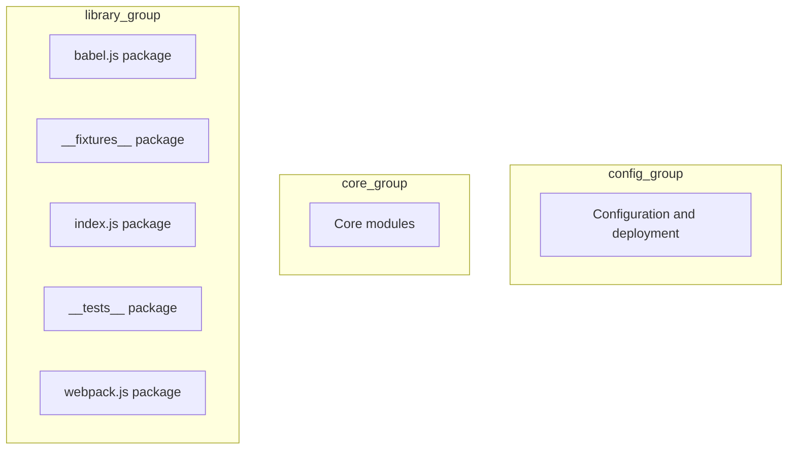

# Architecture report: jamiebuilds/react-loadable

> Automated static analysis. **Observed** = directly seen in files/imports/AST; **Inferred** = interpretation from that evidence. Repository code was not executed.

## 1. Repository at a glance

| Item | Value |
| --- | --- |
| Repository | jamiebuilds/react-loadable |
| Description | :hourglass_flowing_sand: A higher order component for loading components with promises. |
| Language | JavaScript |
| Stars | 16494 |
| Licence | MIT |
| Analysed commit / branch | 6201c5837b212d6244c57f3748f2b1375096beeb / master |
| Framework(s) | Express, React |
| Files analysed | 26 |
| Components | 7 |

## 2. Architecture in one minute

jamiebuilds/react-loadable - :hourglass_flowing_sand: A higher order component for loading components with promises.. This repository was analysed statically from 26 file(s) (0 Python). Detected technologies (observed from imports/manifests): Express, React, Jest, webpack. Files are grouped into 7 component(s): babel.js package, Configuration and deployment, Core modules, __fixtures__ package, index.js package, __tests__ package, webpack.js package. Findings below distinguish observed facts from inferred interpretation.

## 3. High-level block diagram

## 4. Main components

### babel.js package (`babel_js`)

- **Kind:** library
- **Status:** Observed
- **Confidence:** 0.85
- **Responsibility:** Groups 1 file(s) under babel.js package (observed from repository paths and static analysis).
- **Paths:** `src/babel.js`
- **Evidence:** [src/babel.js](https://github.com/jamiebuilds/react-loadable/blob/6201c5837b212d6244c57f3748f2b1375096beeb/src/babel.js)

### Configuration and deployment (`config`)

- **Kind:** config
- **Status:** Observed
- **Confidence:** 0.85
- **Responsibility:** Groups 1 file(s) under configuration and deployment (observed from repository paths and static analysis).
- **Paths:** `package.json`
- **Evidence:** [package.json](https://github.com/jamiebuilds/react-loadable/blob/6201c5837b212d6244c57f3748f2b1375096beeb/package.json)

### Core modules (`core`)

- **Kind:** core
- **Status:** Observed
- **Confidence:** 0.85
- **Responsibility:** Groups 3 file(s) under core modules (observed from repository paths and static analysis).
- **Paths:** `babel.js`, `webpack.config.js`, `webpack.js`
- **Evidence:** [babel.js](https://github.com/jamiebuilds/react-loadable/blob/6201c5837b212d6244c57f3748f2b1375096beeb/babel.js); [webpack.config.js](https://github.com/jamiebuilds/react-loadable/blob/6201c5837b212d6244c57f3748f2b1375096beeb/webpack.config.js); [webpack.js](https://github.com/jamiebuilds/react-loadable/blob/6201c5837b212d6244c57f3748f2b1375096beeb/webpack.js)

### __fixtures__ package (`fixtures`)

- **Kind:** library
- **Status:** Observed
- **Confidence:** 0.85
- **Responsibility:** Groups 2 file(s) under __fixtures__ package (observed from repository paths and static analysis).
- **Paths:** `__fixtures__/component.es6.js`, `__fixtures__/component.js`
- **Evidence:** [__fixtures__/component.es6.js](https://github.com/jamiebuilds/react-loadable/blob/6201c5837b212d6244c57f3748f2b1375096beeb/__fixtures__/component.es6.js); [__fixtures__/component.js](https://github.com/jamiebuilds/react-loadable/blob/6201c5837b212d6244c57f3748f2b1375096beeb/__fixtures__/component.js)

### index.js package (`index_js`)

- **Kind:** library
- **Status:** Observed
- **Confidence:** 0.85
- **Responsibility:** Groups 1 file(s) under index.js package (observed from repository paths and static analysis).
- **Paths:** `src/index.js`
- **Evidence:** [src/index.js](https://github.com/jamiebuilds/react-loadable/blob/6201c5837b212d6244c57f3748f2b1375096beeb/src/index.js)

### __tests__ package (`tests`)

- **Kind:** library
- **Status:** Observed
- **Confidence:** 0.85
- **Responsibility:** Groups 1 file(s) under __tests__ package (observed from repository paths and static analysis).
- **Paths:** `__tests__/test.js`
- **Evidence:** [__tests__/test.js](https://github.com/jamiebuilds/react-loadable/blob/6201c5837b212d6244c57f3748f2b1375096beeb/__tests__/test.js)

### webpack.js package (`webpack_js`)

- **Kind:** library
- **Status:** Observed
- **Confidence:** 0.85
- **Responsibility:** Groups 1 file(s) under webpack.js package (observed from repository paths and static analysis).
- **Paths:** `src/webpack.js`
- **Evidence:** [src/webpack.js](https://github.com/jamiebuilds/react-loadable/blob/6201c5837b212d6244c57f3748f2b1375096beeb/src/webpack.js)

## 5. Execution flow

**Observed** entry point(s):

- [src/index.js](https://github.com/jamiebuilds/react-loadable/blob/6201c5837b212d6244c57f3748f2b1375096beeb/src/index.js)

Representative flow (derived from observed entry points and the import graph; steps beyond the entry point are **Inferred**):

1. Execution starts at an observed entry point listed above, if present.
2. No internal import relationships between components were observed.

## 6. Project structure

### `(root)`

- `.babelrc` - other (238 bytes)
- `.flowconfig` - other (76 bytes)
- `.gitignore` - other (51 bytes)
- `.travis.yml` - ci, YAML (121 bytes)
- `LICENSE` - docs (1084 bytes)
- `README.md` - docs (33540 bytes)
- `babel.js` - source, JavaScript (41 bytes)
- `package.json` - manifest (1363 bytes)
- `webpack.config.js` - source, JavaScript (1164 bytes)
- `webpack.js` - source, JavaScript (43 bytes)

### `__fixtures__`

- `__fixtures__/component.es6.js` - source, JavaScript (143 bytes)
- `__fixtures__/component.js` - source, JavaScript (106 bytes)

### `__tests__`

- `__tests__/.babelrc` - other (196 bytes)
- `__tests__/__snapshots__/test.js.snap` - other (3659 bytes)
- `__tests__/test.js` - source, JavaScript (7719 bytes)

### `example`

- `example/.babelrc` - other (367 bytes)
- `example/client.js` - source, JavaScript (269 bytes)
- `example/components/App.js` - source, JavaScript (321 bytes)
- `example/components/Example.js` - source, JavaScript (409 bytes)
- `example/components/ExampleNested.js` - source, JavaScript (129 bytes)
- `example/components/Loading.js` - source, JavaScript (388 bytes)
- `example/server.js` - source, JavaScript (1662 bytes)
- `example/utils/delay.js` - source, JavaScript (96 bytes)

### `src`

- `src/babel.js` - source, JavaScript (2833 bytes)
- `src/index.js` - source, JavaScript (6591 bytes)
- `src/webpack.js` - source, JavaScript (1607 bytes)

## 7. Key dependencies and integrations

| Name | Category | Status | Confidence | Evidence |
| --- | --- | --- | --- | --- |
| Express | framework | Observed | 0.85 | [package.json:37](https://github.com/jamiebuilds/react-loadable/blob/6201c5837b212d6244c57f3748f2b1375096beeb/package.json#L37) |
| React | framework | Observed | 0.90 | [package.json:2](https://github.com/jamiebuilds/react-loadable/blob/6201c5837b212d6244c57f3748f2b1375096beeb/package.json#L2); [package.json:41](https://github.com/jamiebuilds/react-loadable/blob/6201c5837b212d6244c57f3748f2b1375096beeb/package.json#L41) |
| Jest | tooling | Observed | 0.85 | [package.json:15](https://github.com/jamiebuilds/react-loadable/blob/6201c5837b212d6244c57f3748f2b1375096beeb/package.json#L15) |
| webpack | tooling | Observed | 0.85 | [package.json:11](https://github.com/jamiebuilds/react-loadable/blob/6201c5837b212d6244c57f3748f2b1375096beeb/package.json#L11) |

## 8. Data and state

No database, cache, queue, or persistent-state usage was observed in the analysed files. State handling, if any, may be in-memory or in files that were not analysed.

## 9. Configuration and deployment clues

- `.travis.yml` (ci)
- `package.json` (manifest)

## 10. Design observations

- No strong design patterns could be established from the available evidence.

These observations are interpretations (**Inferred**) of the observed structure, not guarantees about runtime design.

## 11. Limitations and unknowns

- Static analysis only: repository code was not executed, installed, or imported at runtime.
- Components and relationships are inferred from file paths, imports, and AST structure; runtime behaviour, dynamic imports, and reflection may not be visible.
- No clear application entry point was observed in the analysed files.
- Repository text was treated as untrusted data; no instructions found in repository files were followed, and likely secret values were redacted/excluded.
- JavaScript and TypeScript files were inventoried from paths and package manifests. They were not parsed with a full language AST, and repository code was not executed.

## 12. Source references

- [__fixtures__/component.es6.js](https://github.com/jamiebuilds/react-loadable/blob/6201c5837b212d6244c57f3748f2b1375096beeb/__fixtures__/component.es6.js)
- [__fixtures__/component.js](https://github.com/jamiebuilds/react-loadable/blob/6201c5837b212d6244c57f3748f2b1375096beeb/__fixtures__/component.js)
- [__tests__/test.js](https://github.com/jamiebuilds/react-loadable/blob/6201c5837b212d6244c57f3748f2b1375096beeb/__tests__/test.js)
- [babel.js](https://github.com/jamiebuilds/react-loadable/blob/6201c5837b212d6244c57f3748f2b1375096beeb/babel.js)
- [package.json](https://github.com/jamiebuilds/react-loadable/blob/6201c5837b212d6244c57f3748f2b1375096beeb/package.json)
- [package.json:2](https://github.com/jamiebuilds/react-loadable/blob/6201c5837b212d6244c57f3748f2b1375096beeb/package.json#L2)
- [package.json:11](https://github.com/jamiebuilds/react-loadable/blob/6201c5837b212d6244c57f3748f2b1375096beeb/package.json#L11)
- [package.json:15](https://github.com/jamiebuilds/react-loadable/blob/6201c5837b212d6244c57f3748f2b1375096beeb/package.json#L15)
- [package.json:37](https://github.com/jamiebuilds/react-loadable/blob/6201c5837b212d6244c57f3748f2b1375096beeb/package.json#L37)
- [package.json:41](https://github.com/jamiebuilds/react-loadable/blob/6201c5837b212d6244c57f3748f2b1375096beeb/package.json#L41)
- [src/babel.js](https://github.com/jamiebuilds/react-loadable/blob/6201c5837b212d6244c57f3748f2b1375096beeb/src/babel.js)
- [src/index.js](https://github.com/jamiebuilds/react-loadable/blob/6201c5837b212d6244c57f3748f2b1375096beeb/src/index.js)
- [src/webpack.js](https://github.com/jamiebuilds/react-loadable/blob/6201c5837b212d6244c57f3748f2b1375096beeb/src/webpack.js)
- [webpack.config.js](https://github.com/jamiebuilds/react-loadable/blob/6201c5837b212d6244c57f3748f2b1375096beeb/webpack.config.js)
- [webpack.js](https://github.com/jamiebuilds/react-loadable/blob/6201c5837b212d6244c57f3748f2b1375096beeb/webpack.js)
