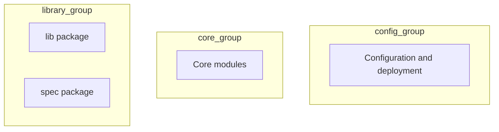

# Architecture report: jantimon/html-webpack-plugin

> Automated static analysis. **Observed** = directly seen in files/imports/AST; **Inferred** = interpretation from that evidence. Repository code was not executed.

## 1. Repository at a glance

| Item | Value |
| --- | --- |
| Repository | jantimon/html-webpack-plugin |
| Description | Simplifies creation of HTML files to serve your webpack bundles |
| Language | JavaScript |
| Stars | 10723 |
| Licence | MIT |
| Analysed commit / branch | 9e342d2202e18cd37d5ccc1428c46ad049e24733 / main |
| Framework(s) | None detected |
| Files analysed | 138 |
| Components | 4 |

## 2. Architecture in one minute

jantimon/html-webpack-plugin - Simplifies creation of HTML files to serve your webpack bundles. This repository was analysed statically from 138 file(s) (0 Python). Detected technologies (observed from imports/manifests): GitHub Actions, Jest, TypeScript, webpack. Files are grouped into 4 component(s): Configuration and deployment, Core modules, lib package, spec package. Findings below distinguish observed facts from inferred interpretation.

## 3. High-level block diagram

## 4. Main components

### Configuration and deployment (`config`)

- **Kind:** config
- **Status:** Observed
- **Confidence:** 0.85
- **Responsibility:** Groups 2 file(s) under configuration and deployment (observed from repository paths and static analysis).
- **Paths:** `package.json`, `tsconfig.json`
- **Evidence:** [package.json](https://github.com/jantimon/html-webpack-plugin/blob/9e342d2202e18cd37d5ccc1428c46ad049e24733/package.json); [tsconfig.json](https://github.com/jantimon/html-webpack-plugin/blob/9e342d2202e18cd37d5ccc1428c46ad049e24733/tsconfig.json)

### Core modules (`core`)

- **Kind:** core
- **Status:** Observed
- **Confidence:** 0.85
- **Responsibility:** Groups 4 file(s) under core modules (observed from repository paths and static analysis).
- **Paths:** `commitlint.config.js`, `index.js`, `lint-staged.config.js`, `typings.d.ts`
- **Evidence:** [commitlint.config.js](https://github.com/jantimon/html-webpack-plugin/blob/9e342d2202e18cd37d5ccc1428c46ad049e24733/commitlint.config.js); [index.js](https://github.com/jantimon/html-webpack-plugin/blob/9e342d2202e18cd37d5ccc1428c46ad049e24733/index.js); [lint-staged.config.js](https://github.com/jantimon/html-webpack-plugin/blob/9e342d2202e18cd37d5ccc1428c46ad049e24733/lint-staged.config.js); [typings.d.ts](https://github.com/jantimon/html-webpack-plugin/blob/9e342d2202e18cd37d5ccc1428c46ad049e24733/typings.d.ts)

### lib package (`lib`)

- **Kind:** library
- **Status:** Observed
- **Confidence:** 0.85
- **Responsibility:** Groups 7 file(s) under lib package (observed from repository paths and static analysis).
- **Paths:** `lib/cached-child-compiler.js`, `lib/child-compiler.js`, `lib/chunksorter.js`, `lib/errors.js`, `lib/hooks.js`, `lib/html-tags.js`, `lib/loader.js`
- **Evidence:** [lib/cached-child-compiler.js](https://github.com/jantimon/html-webpack-plugin/blob/9e342d2202e18cd37d5ccc1428c46ad049e24733/lib/cached-child-compiler.js); [lib/child-compiler.js](https://github.com/jantimon/html-webpack-plugin/blob/9e342d2202e18cd37d5ccc1428c46ad049e24733/lib/child-compiler.js); [lib/chunksorter.js](https://github.com/jantimon/html-webpack-plugin/blob/9e342d2202e18cd37d5ccc1428c46ad049e24733/lib/chunksorter.js); [lib/errors.js](https://github.com/jantimon/html-webpack-plugin/blob/9e342d2202e18cd37d5ccc1428c46ad049e24733/lib/errors.js); [lib/hooks.js](https://github.com/jantimon/html-webpack-plugin/blob/9e342d2202e18cd37d5ccc1428c46ad049e24733/lib/hooks.js); [lib/html-tags.js](https://github.com/jantimon/html-webpack-plugin/blob/9e342d2202e18cd37d5ccc1428c46ad049e24733/lib/html-tags.js); [lib/loader.js](https://github.com/jantimon/html-webpack-plugin/blob/9e342d2202e18cd37d5ccc1428c46ad049e24733/lib/loader.js)

### spec package (`spec`)

- **Kind:** library
- **Status:** Observed
- **Confidence:** 0.85
- **Responsibility:** Groups 11 file(s) under spec package (observed from repository paths and static analysis).
- **Paths:** `spec/basic.spec.js`, `spec/caching.spec.js`, `spec/example.spec.js`, `spec/fixtures/async.js`, `spec/fixtures/common.js`, `spec/fixtures/index.js`, `spec/fixtures/templateParam.cjs`, `spec/fixtures/templateParam.js`, `spec/fixtures/theme.js`, `spec/fixtures/util.js`, `spec/hot.spec.js`
- **Evidence:** [spec/basic.spec.js](https://github.com/jantimon/html-webpack-plugin/blob/9e342d2202e18cd37d5ccc1428c46ad049e24733/spec/basic.spec.js); [spec/caching.spec.js](https://github.com/jantimon/html-webpack-plugin/blob/9e342d2202e18cd37d5ccc1428c46ad049e24733/spec/caching.spec.js); [spec/example.spec.js](https://github.com/jantimon/html-webpack-plugin/blob/9e342d2202e18cd37d5ccc1428c46ad049e24733/spec/example.spec.js); [spec/fixtures/async.js](https://github.com/jantimon/html-webpack-plugin/blob/9e342d2202e18cd37d5ccc1428c46ad049e24733/spec/fixtures/async.js); [spec/fixtures/common.js](https://github.com/jantimon/html-webpack-plugin/blob/9e342d2202e18cd37d5ccc1428c46ad049e24733/spec/fixtures/common.js); [spec/fixtures/index.js](https://github.com/jantimon/html-webpack-plugin/blob/9e342d2202e18cd37d5ccc1428c46ad049e24733/spec/fixtures/index.js); [spec/fixtures/templateParam.cjs](https://github.com/jantimon/html-webpack-plugin/blob/9e342d2202e18cd37d5ccc1428c46ad049e24733/spec/fixtures/templateParam.cjs); [spec/fixtures/templateParam.js](https://github.com/jantimon/html-webpack-plugin/blob/9e342d2202e18cd37d5ccc1428c46ad049e24733/spec/fixtures/templateParam.js)

## 5. Execution flow

**Observed** entry point(s):

- [index.js](https://github.com/jantimon/html-webpack-plugin/blob/9e342d2202e18cd37d5ccc1428c46ad049e24733/index.js)
- [spec/fixtures/index.js](https://github.com/jantimon/html-webpack-plugin/blob/9e342d2202e18cd37d5ccc1428c46ad049e24733/spec/fixtures/index.js)

Representative flow (derived from observed entry points and the import graph; steps beyond the entry point are **Inferred**):

1. Execution starts at an observed entry point listed above, if present.
2. No internal import relationships between components were observed.

## 6. Project structure

### `(root)`

- `.cspell.json` - config (746 bytes)
- `.editorconfig` - config (188 bytes)
- `.eslintrc.js` - source, JavaScript (561 bytes)
- `.gitignore` - other (109 bytes)
- `.mailmap` - other (354 bytes)
- `.node-version` - other (8 bytes)
- `.prettierignore` - other (74 bytes)
- `CHANGELOG.md` - docs (42620 bytes)
- `LICENSE` - docs (1071 bytes)
- `README.md` - docs (40447 bytes)
- `commitlint.config.js` - source, JavaScript (184 bytes)
- `default_index.ejs` - other (153 bytes)
- `flow.puml` - other (1135 bytes)
- `index.js` - source, JavaScript (49324 bytes)
- `lint-staged.config.js` - source, JavaScript (164 bytes)
- `logs` - other (827 bytes)
- `migration.md` - docs (4723 bytes)
- `package.json` - manifest (3205 bytes)
- `tsconfig.json` - config (2102 bytes)
- `typings.d.ts` - source, TypeScript (8209 bytes)

### `.github`

- `.github/FUNDING.yml` - config (682 bytes)
- `.github/ISSUE_TEMPLATE/bug_report.md` - docs (1243 bytes)
- `.github/ISSUE_TEMPLATE/feature_request.md` - docs (559 bytes)
- `.github/issue_template.md` - docs (2007 bytes)
- `.github/lock.yml` - config (454 bytes)
- `.github/stale.yml` - config (655 bytes)
- `.github/workflows/main.yml` - ci, YAML (2536 bytes)

### `.husky`

- `.husky/commit-msg` - other (38 bytes)
- `.husky/pre-commit` - other (29 bytes)

### `docs`

- `docs/template-option.md` - docs (2179 bytes)

### `examples`

- `examples/README.md` - docs (1488 bytes)
- `examples/build-examples.js` - source, JavaScript (1485 bytes)
- `examples/chunk-optimization/entryA.js` - source, JavaScript (245 bytes)
- `examples/chunk-optimization/entryB.js` - source, JavaScript (197 bytes)
- `examples/chunk-optimization/lib-concat.js` - source, JavaScript (76 bytes)
- `examples/chunk-optimization/lib-multiply.js` - source, JavaScript (171 bytes)
- `examples/chunk-optimization/lib-sum.js` - source, JavaScript (57 bytes)
- `examples/chunk-optimization/main.css` - other (29 bytes)
- `examples/chunk-optimization/readme.md` - docs (78 bytes)
- `examples/chunk-optimization/webpack.config.js` - source, JavaScript (1247 bytes)
- `examples/custom-insertion-position/example.js` - source, JavaScript (101 bytes)
- `examples/custom-insertion-position/index.ejs` - other (301 bytes)
- `examples/custom-insertion-position/readme.md` - docs (735 bytes)
- `examples/custom-insertion-position/webpack.config.js` - source, JavaScript (686 bytes)
- `examples/custom-template/example.js` - source, JavaScript (124 bytes)
- `examples/custom-template/main.css` - other (29 bytes)
- `examples/custom-template/partial.html` - other (40 bytes)
- `examples/custom-template/readme.md` - docs (169 bytes)
- `examples/custom-template/template.html` - other (298 bytes)
- `examples/custom-template/webpack.config.js` - source, JavaScript (727 bytes)
- `examples/default/example.js` - source, JavaScript (124 bytes)
- `examples/default/main.css` - other (29 bytes)
- `examples/default/readme.md` - docs (78 bytes)
- `examples/default/webpack.config.js` - source, JavaScript (544 bytes)
- `examples/favicon/example.js` - source, JavaScript (124 bytes)
- `examples/favicon/main.css` - other (29 bytes)
- `examples/favicon/template.html` - other (246 bytes)
- `examples/favicon/webpack.config.js` - source, JavaScript (798 bytes)
- `examples/html-loader/example.js` - source, JavaScript (124 bytes)
- `examples/html-loader/main.css` - other (29 bytes)
- `examples/html-loader/template.html` - other (246 bytes)
- `examples/html-loader/webpack.config.js` - source, JavaScript (966 bytes)
- `examples/inline/example.js` - source, JavaScript (66 bytes)
- `examples/inline/main.css` - other (29 bytes)
- `examples/inline/readme.md` - docs (164 bytes)
- `examples/inline/template.pug` - other (401 bytes)
- `examples/inline/webpack.config.js` - source, JavaScript (850 bytes)
- `examples/javascript-advanced/example.js` - source, JavaScript (166 bytes)
- `examples/javascript-advanced/main.css` - other (29 bytes)
- `examples/javascript-advanced/partial.html` - other (40 bytes)
- `examples/javascript-advanced/readme.md` - docs (168 bytes)
- `examples/javascript-advanced/template.js` - source, JavaScript (491 bytes)
- `examples/javascript-advanced/universal.js` - source, JavaScript (302 bytes)
- `examples/javascript-advanced/webpack.config.js` - source, JavaScript (794 bytes)
- `examples/javascript/example.js` - source, JavaScript (166 bytes)
- `examples/javascript/main.css` - other (29 bytes)
- `examples/javascript/partial.html` - other (40 bytes)
- `examples/javascript/readme.md` - docs (172 bytes)
- `examples/javascript/template.js` - source, JavaScript (226 bytes)
- `examples/javascript/universal.js` - source, JavaScript (302 bytes)
- `examples/javascript/webpack.config.js` - source, JavaScript (754 bytes)
- `examples/multi-page/first.js` - source, JavaScript (124 bytes)
- `examples/multi-page/main.css` - other (29 bytes)
- `examples/multi-page/readme.md` - docs (78 bytes)
- `examples/multi-page/second.js` - source, JavaScript (124 bytes)
- `examples/multi-page/webpack.config.js` - source, JavaScript (634 bytes)
- `examples/pug-loader/example.js` - source, JavaScript (282 bytes)
- `examples/pug-loader/main.css` - other (29 bytes)
- `examples/pug-loader/readme.md` - docs (164 bytes)
- `examples/pug-loader/template.pug` - other (156 bytes)
- `examples/pug-loader/time.pug` - other (137 bytes)
- `examples/pug-loader/webpack.config.js` - source, JavaScript (859 bytes)
- `examples/sort-manually/a.js` - source, JavaScript (114 bytes)
- `examples/sort-manually/b.js` - source, JavaScript (91 bytes)
- `examples/sort-manually/c.js` - source, JavaScript (91 bytes)
- `examples/sort-manually/d.js` - source, JavaScript (91 bytes)
- `examples/sort-manually/e.js` - source, JavaScript (91 bytes)
- `examples/sort-manually/main.css` - other (29 bytes)
- `examples/sort-manually/template.html` - other (246 bytes)
- `examples/sort-manually/webpack.config.js` - source, JavaScript (1158 bytes)
- `examples/template-parameters/example.js` - source, JavaScript (101 bytes)
- `examples/template-parameters/index.ejs` - other (126 bytes)
- `examples/template-parameters/readme.md` - docs (105 bytes)
- `examples/template-parameters/webpack.config.js` - source, JavaScript (1014 bytes)

### `lib`

- `lib/cached-child-compiler.js` - source, JavaScript (15252 bytes)
- `lib/child-compiler.js` - source, JavaScript (8761 bytes)
- `lib/chunksorter.js` - source, JavaScript (1255 bytes)
- `lib/errors.js` - source, JavaScript (1153 bytes)
- `lib/hooks.js` - source, JavaScript (191 bytes)
- `lib/html-tags.js` - source, JavaScript (3364 bytes)
- `lib/loader.js` - source, JavaScript (1725 bytes)

### `spec`

- `spec/basic.spec.js` - source, JavaScript (103010 bytes)
- `spec/caching.spec.js` - source, JavaScript (10772 bytes)
- `spec/example.spec.js` - source, JavaScript (3307 bytes)
- `spec/fixtures/async.js` - source, JavaScript (40 bytes)
- `spec/fixtures/common.js` - source, JavaScript (42 bytes)
- `spec/fixtures/empty.html` - other (0 bytes)
- `spec/fixtures/empty_html.html` - other (0 bytes)
- `spec/fixtures/html-template-with-image.html` - other (182 bytes)
- `spec/fixtures/index.js` - source, JavaScript (168 bytes)
- `spec/fixtures/interpolation.html` - other (183 bytes)
- `spec/fixtures/invalid.html` - other (190 bytes)
- `spec/fixtures/logo.html` - other (254 bytes)
- `spec/fixtures/main.css` - other (28 bytes)
- `spec/fixtures/plain.html` - other (227 bytes)
- `spec/fixtures/spaced_plain.html` - other (97 bytes)
- `spec/fixtures/src/index.ejs` - other (270 bytes)
- `spec/fixtures/template-partial.hbs` - other (19 bytes)
- `spec/fixtures/template.ejs` - other (394 bytes)
- `spec/fixtures/template.hbs` - other (270 bytes)
- `spec/fixtures/template.pug` - other (168 bytes)
- `spec/fixtures/templateParam.cjs` - source, JavaScript (537 bytes)
- `spec/fixtures/templateParam.js` - source, JavaScript (537 bytes)
- `spec/fixtures/test.html` - other (212 bytes)
- `spec/fixtures/theme.js` - source, JavaScript (61 bytes)
- `spec/fixtures/util.js` - source, JavaScript (106 bytes)
- `spec/fixtures/webpackconfig.html` - other (251 bytes)
- `spec/hot.spec.js` - source, JavaScript (9872 bytes)

## 7. Key dependencies and integrations

| Name | Category | Status | Confidence | Evidence |
| --- | --- | --- | --- | --- |
| GitHub Actions | ci | Observed | 0.85 | [.github/workflows/main.yml](https://github.com/jantimon/html-webpack-plugin/blob/9e342d2202e18cd37d5ccc1428c46ad049e24733/.github/workflows/main.yml) |
| Jest | tooling | Observed | 0.85 | [package.json:28](https://github.com/jantimon/html-webpack-plugin/blob/9e342d2202e18cd37d5ccc1428c46ad049e24733/package.json#L28) |
| TypeScript | tooling | Observed | 0.85 | [package.json:61](https://github.com/jantimon/html-webpack-plugin/blob/9e342d2202e18cd37d5ccc1428c46ad049e24733/package.json#L61) |
| webpack | tooling | Observed | 0.90 | [package.json:2](https://github.com/jantimon/html-webpack-plugin/blob/9e342d2202e18cd37d5ccc1428c46ad049e24733/package.json#L2) |

## 8. Data and state

No database, cache, queue, or persistent-state usage was observed in the analysed files. State handling, if any, may be in-memory or in files that were not analysed.

## 9. Configuration and deployment clues

- `.cspell.json` (config)
- `.editorconfig` (config)
- `.github/FUNDING.yml` (config)
- `.github/lock.yml` (config)
- `.github/stale.yml` (config)
- `.github/workflows/main.yml` (ci)
- `package.json` (manifest)
- `tsconfig.json` (config)

## 10. Design observations

- No strong design patterns could be established from the available evidence.

These observations are interpretations (**Inferred**) of the observed structure, not guarantees about runtime design.

## 11. Limitations and unknowns

- Static analysis only: repository code was not executed, installed, or imported at runtime.
- Components and relationships are inferred from file paths, imports, and AST structure; runtime behaviour, dynamic imports, and reflection may not be visible.
- 49 file(s) were skipped during inventory (49 x vendored/generated directory excluded).
- No clear application entry point was observed in the analysed files.
- Repository text was treated as untrusted data; no instructions found in repository files were followed, and likely secret values were redacted/excluded.
- JavaScript and TypeScript files were inventoried from paths and package manifests. They were not parsed with a full language AST, and repository code was not executed.

## 12. Source references

- [.github/workflows/main.yml](https://github.com/jantimon/html-webpack-plugin/blob/9e342d2202e18cd37d5ccc1428c46ad049e24733/.github/workflows/main.yml)
- [commitlint.config.js](https://github.com/jantimon/html-webpack-plugin/blob/9e342d2202e18cd37d5ccc1428c46ad049e24733/commitlint.config.js)
- [index.js](https://github.com/jantimon/html-webpack-plugin/blob/9e342d2202e18cd37d5ccc1428c46ad049e24733/index.js)
- [lib/cached-child-compiler.js](https://github.com/jantimon/html-webpack-plugin/blob/9e342d2202e18cd37d5ccc1428c46ad049e24733/lib/cached-child-compiler.js)
- [lib/child-compiler.js](https://github.com/jantimon/html-webpack-plugin/blob/9e342d2202e18cd37d5ccc1428c46ad049e24733/lib/child-compiler.js)
- [lib/chunksorter.js](https://github.com/jantimon/html-webpack-plugin/blob/9e342d2202e18cd37d5ccc1428c46ad049e24733/lib/chunksorter.js)
- [lib/errors.js](https://github.com/jantimon/html-webpack-plugin/blob/9e342d2202e18cd37d5ccc1428c46ad049e24733/lib/errors.js)
- [lib/hooks.js](https://github.com/jantimon/html-webpack-plugin/blob/9e342d2202e18cd37d5ccc1428c46ad049e24733/lib/hooks.js)
- [lib/html-tags.js](https://github.com/jantimon/html-webpack-plugin/blob/9e342d2202e18cd37d5ccc1428c46ad049e24733/lib/html-tags.js)
- [lib/loader.js](https://github.com/jantimon/html-webpack-plugin/blob/9e342d2202e18cd37d5ccc1428c46ad049e24733/lib/loader.js)
- [lint-staged.config.js](https://github.com/jantimon/html-webpack-plugin/blob/9e342d2202e18cd37d5ccc1428c46ad049e24733/lint-staged.config.js)
- [package.json](https://github.com/jantimon/html-webpack-plugin/blob/9e342d2202e18cd37d5ccc1428c46ad049e24733/package.json)
- [package.json:2](https://github.com/jantimon/html-webpack-plugin/blob/9e342d2202e18cd37d5ccc1428c46ad049e24733/package.json#L2)
- [package.json:28](https://github.com/jantimon/html-webpack-plugin/blob/9e342d2202e18cd37d5ccc1428c46ad049e24733/package.json#L28)
- [package.json:61](https://github.com/jantimon/html-webpack-plugin/blob/9e342d2202e18cd37d5ccc1428c46ad049e24733/package.json#L61)
- [spec/basic.spec.js](https://github.com/jantimon/html-webpack-plugin/blob/9e342d2202e18cd37d5ccc1428c46ad049e24733/spec/basic.spec.js)
- [spec/caching.spec.js](https://github.com/jantimon/html-webpack-plugin/blob/9e342d2202e18cd37d5ccc1428c46ad049e24733/spec/caching.spec.js)
- [spec/example.spec.js](https://github.com/jantimon/html-webpack-plugin/blob/9e342d2202e18cd37d5ccc1428c46ad049e24733/spec/example.spec.js)
- [spec/fixtures/async.js](https://github.com/jantimon/html-webpack-plugin/blob/9e342d2202e18cd37d5ccc1428c46ad049e24733/spec/fixtures/async.js)
- [spec/fixtures/common.js](https://github.com/jantimon/html-webpack-plugin/blob/9e342d2202e18cd37d5ccc1428c46ad049e24733/spec/fixtures/common.js)
- [spec/fixtures/index.js](https://github.com/jantimon/html-webpack-plugin/blob/9e342d2202e18cd37d5ccc1428c46ad049e24733/spec/fixtures/index.js)
- [spec/fixtures/templateParam.cjs](https://github.com/jantimon/html-webpack-plugin/blob/9e342d2202e18cd37d5ccc1428c46ad049e24733/spec/fixtures/templateParam.cjs)
- [spec/fixtures/templateParam.js](https://github.com/jantimon/html-webpack-plugin/blob/9e342d2202e18cd37d5ccc1428c46ad049e24733/spec/fixtures/templateParam.js)
- [tsconfig.json](https://github.com/jantimon/html-webpack-plugin/blob/9e342d2202e18cd37d5ccc1428c46ad049e24733/tsconfig.json)
- [typings.d.ts](https://github.com/jantimon/html-webpack-plugin/blob/9e342d2202e18cd37d5ccc1428c46ad049e24733/typings.d.ts)
