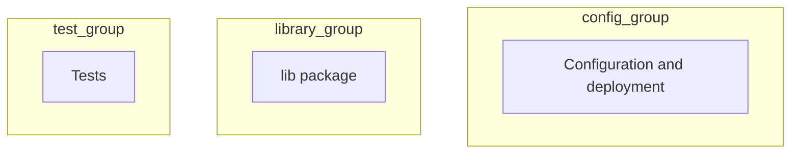

# Architecture report: jaredhanson/passport

> Automated static analysis. **Observed** = directly seen in files/imports/AST; **Inferred** = interpretation from that evidence. Repository code was not executed.

## 1. Repository at a glance

| Item | Value |
| --- | --- |
| Repository | jaredhanson/passport |
| Description | Simple, unobtrusive authentication for Node.js. |
| Language | JavaScript |
| Stars | 23518 |
| Licence | MIT |
| Analysed commit / branch | 217018dbc46dcd4118dd6f2c60c8d97010c587f8 / master |
| Framework(s) | None detected |
| Files analysed | 53 |
| Components | 3 |

## 2. Architecture in one minute

jaredhanson/passport - Simple, unobtrusive authentication for Node.js.. This repository was analysed statically from 53 file(s) (0 Python). Detected technologies (observed from imports/manifests): GitHub Actions. Files are grouped into 3 component(s): Configuration and deployment, lib package, Tests. Findings below distinguish observed facts from inferred interpretation.

## 3. High-level block diagram

## 4. Main components

### Configuration and deployment (`config`)

- **Kind:** config
- **Status:** Observed
- **Confidence:** 0.85
- **Responsibility:** Groups 2 file(s) under configuration and deployment (observed from repository paths and static analysis).
- **Paths:** `etc/jsdoc.json`, `package.json`
- **Evidence:** [etc/jsdoc.json](https://github.com/jaredhanson/passport/blob/217018dbc46dcd4118dd6f2c60c8d97010c587f8/etc/jsdoc.json); [package.json](https://github.com/jaredhanson/passport/blob/217018dbc46dcd4118dd6f2c60c8d97010c587f8/package.json)

### lib package (`lib`)

- **Kind:** library
- **Status:** Observed
- **Confidence:** 0.85
- **Responsibility:** Groups 9 file(s) under lib package (observed from repository paths and static analysis).
- **Paths:** `lib/authenticator.js`, `lib/errors/authenticationerror.js`, `lib/framework/connect.js`, `lib/http/request.js`, `lib/index.js`, `lib/middleware/authenticate.js`, `lib/middleware/initialize.js`, `lib/sessionmanager.js`, `lib/strategies/session.js`
- **Evidence:** [lib/authenticator.js](https://github.com/jaredhanson/passport/blob/217018dbc46dcd4118dd6f2c60c8d97010c587f8/lib/authenticator.js); [lib/errors/authenticationerror.js](https://github.com/jaredhanson/passport/blob/217018dbc46dcd4118dd6f2c60c8d97010c587f8/lib/errors/authenticationerror.js); [lib/framework/connect.js](https://github.com/jaredhanson/passport/blob/217018dbc46dcd4118dd6f2c60c8d97010c587f8/lib/framework/connect.js); [lib/http/request.js](https://github.com/jaredhanson/passport/blob/217018dbc46dcd4118dd6f2c60c8d97010c587f8/lib/http/request.js); [lib/index.js](https://github.com/jaredhanson/passport/blob/217018dbc46dcd4118dd6f2c60c8d97010c587f8/lib/index.js); [lib/middleware/authenticate.js](https://github.com/jaredhanson/passport/blob/217018dbc46dcd4118dd6f2c60c8d97010c587f8/lib/middleware/authenticate.js); [lib/middleware/initialize.js](https://github.com/jaredhanson/passport/blob/217018dbc46dcd4118dd6f2c60c8d97010c587f8/lib/middleware/initialize.js); [lib/sessionmanager.js](https://github.com/jaredhanson/passport/blob/217018dbc46dcd4118dd6f2c60c8d97010c587f8/lib/sessionmanager.js)

### Tests (`tests`)

- **Kind:** test
- **Status:** Observed
- **Confidence:** 0.85
- **Responsibility:** Groups 25 file(s) under tests (observed from repository paths and static analysis).
- **Paths:** `test/authenticator.framework.test.js`, `test/authenticator.middleware.test.js`, `test/authenticator.test.js`, `test/bootstrap/node.js`, `test/http/request.test.js`, `test/middleware/authenticate.error.callback.test.js`, `test/middleware/authenticate.error.test.js`, `test/middleware/authenticate.fail.callback.test.js`, `test/middleware/authenticate.fail.flash.test.js`, `test/middleware/authenticate.fail.message.test.js`, `test/middleware/authenticate.fail.multi.test.js`, `test/middleware/authenticate.fail.test.js`, `test/middleware/authenticate.pass.test.js`, `test/middleware/authenticate.redirect.test.js`, `test/middleware/authenticate.success.callback.test.js`, `test/middleware/authenticate.success.flash.test.js`, `test/middleware/authenticate.success.info.test.js`, `test/middleware/authenticate.success.message.test.js`, `test/middleware/authenticate.success.multi.test.js`, `test/middleware/authenticate.success.test.js`, `test/middleware/authenticate.test.js`, `test/middleware/initialize.test.js`, `test/package.test.js`, `test/strategies/session.pause.test.js`, `test/strategies/session.test.js`
- **Evidence:** [test/authenticator.framework.test.js](https://github.com/jaredhanson/passport/blob/217018dbc46dcd4118dd6f2c60c8d97010c587f8/test/authenticator.framework.test.js); [test/authenticator.middleware.test.js](https://github.com/jaredhanson/passport/blob/217018dbc46dcd4118dd6f2c60c8d97010c587f8/test/authenticator.middleware.test.js); [test/authenticator.test.js](https://github.com/jaredhanson/passport/blob/217018dbc46dcd4118dd6f2c60c8d97010c587f8/test/authenticator.test.js); [test/bootstrap/node.js](https://github.com/jaredhanson/passport/blob/217018dbc46dcd4118dd6f2c60c8d97010c587f8/test/bootstrap/node.js); [test/http/request.test.js](https://github.com/jaredhanson/passport/blob/217018dbc46dcd4118dd6f2c60c8d97010c587f8/test/http/request.test.js); [test/middleware/authenticate.error.callback.test.js](https://github.com/jaredhanson/passport/blob/217018dbc46dcd4118dd6f2c60c8d97010c587f8/test/middleware/authenticate.error.callback.test.js); [test/middleware/authenticate.error.test.js](https://github.com/jaredhanson/passport/blob/217018dbc46dcd4118dd6f2c60c8d97010c587f8/test/middleware/authenticate.error.test.js); [test/middleware/authenticate.fail.callback.test.js](https://github.com/jaredhanson/passport/blob/217018dbc46dcd4118dd6f2c60c8d97010c587f8/test/middleware/authenticate.fail.callback.test.js)

## 5. Execution flow

**Observed** entry point(s):

- [lib/index.js](https://github.com/jaredhanson/passport/blob/217018dbc46dcd4118dd6f2c60c8d97010c587f8/lib/index.js)

Representative flow (derived from observed entry points and the import graph; steps beyond the entry point are **Inferred**):

1. Execution starts at an observed entry point listed above, if present.
2. No internal import relationships between components were observed.

## 6. Project structure

### `(root)`

- `.gitignore` - other (75 bytes)
- `.jshintrc` - other (299 bytes)
- `.npmignore` - other (100 bytes)
- `.travis.yml` - ci, YAML (353 bytes)
- `CHANGELOG.md` - docs (2990 bytes)
- `CONTRIBUTING.md` - docs (411 bytes)
- `LICENSE` - docs (1084 bytes)
- `Makefile` - other (460 bytes)
- `README.md` - docs (11600 bytes)
- `SPONSORS.md` - docs (495 bytes)
- `package.json` - manifest (1287 bytes)

### `.github`

- `.github/FUNDING.yml` - config (60 bytes)
- `.github/ISSUE_TEMPLATE.md` - docs (1897 bytes)
- `.github/PULL_REQUEST_TEMPLATE.md` - docs (1906 bytes)
- `.github/workflows/node.yml` - ci, YAML (969 bytes)

### `etc`

- `etc/jsdoc.json` - config (38 bytes)

### `lib`

- `lib/authenticator.js` - source, JavaScript (15334 bytes)
- `lib/errors/authenticationerror.js` - source, JavaScript (438 bytes)
- `lib/framework/connect.js` - source, JavaScript (504 bytes)
- `lib/http/request.js` - source, JavaScript (2010 bytes)
- `lib/index.js` - source, JavaScript (465 bytes)
- `lib/middleware/authenticate.js` - source, JavaScript (14126 bytes)
- `lib/middleware/initialize.js` - source, JavaScript (4133 bytes)
- `lib/sessionmanager.js` - source, JavaScript (2516 bytes)
- `lib/strategies/session.js` - source, JavaScript (4950 bytes)

### `sponsors`

- `sponsors/descope-dark.svg` - other (6151 bytes)
- `sponsors/descope.svg` - other (6256 bytes)
- `sponsors/fusionauth.svg` - other (12463 bytes)

### `test`

- `test/authenticator.framework.test.js` - test, JavaScript (1580 bytes)
- `test/authenticator.middleware.test.js` - test, JavaScript (10009 bytes)
- `test/authenticator.test.js` - test, JavaScript (28215 bytes)
- `test/bootstrap/node.js` - test, JavaScript (191 bytes)
- `test/http/request.test.js` - test, JavaScript (34538 bytes)
- `test/middleware/authenticate.error.callback.test.js` - test, JavaScript (2335 bytes)
- `test/middleware/authenticate.error.test.js` - test, JavaScript (1074 bytes)
- `test/middleware/authenticate.fail.callback.test.js` - test, JavaScript (8132 bytes)
- `test/middleware/authenticate.fail.flash.test.js` - test, JavaScript (29346 bytes)
- `test/middleware/authenticate.fail.message.test.js` - test, JavaScript (5426 bytes)
- `test/middleware/authenticate.fail.multi.test.js` - test, JavaScript (10594 bytes)
- `test/middleware/authenticate.fail.test.js` - test, JavaScript (12760 bytes)
- `test/middleware/authenticate.pass.test.js` - test, JavaScript (972 bytes)
- `test/middleware/authenticate.redirect.test.js` - test, JavaScript (3932 bytes)
- `test/middleware/authenticate.success.callback.test.js` - test, JavaScript (3009 bytes)
- `test/middleware/authenticate.success.flash.test.js` - test, JavaScript (35678 bytes)
- `test/middleware/authenticate.success.info.test.js` - test, JavaScript (5797 bytes)
- `test/middleware/authenticate.success.message.test.js` - test, JavaScript (6634 bytes)
- `test/middleware/authenticate.success.multi.test.js` - test, JavaScript (2560 bytes)
- `test/middleware/authenticate.success.test.js` - test, JavaScript (11134 bytes)
- `test/middleware/authenticate.test.js` - test, JavaScript (1268 bytes)
- `test/middleware/initialize.test.js` - test, JavaScript (5813 bytes)
- `test/package.test.js` - test, JavaScript (634 bytes)
- `test/strategies/session.pause.test.js` - test, JavaScript (3728 bytes)
- `test/strategies/session.test.js` - test, JavaScript (7204 bytes)

## 7. Key dependencies and integrations

| Name | Category | Status | Confidence | Evidence |
| --- | --- | --- | --- | --- |
| GitHub Actions | ci | Observed | 0.85 | [.github/workflows/node.yml](https://github.com/jaredhanson/passport/blob/217018dbc46dcd4118dd6f2c60c8d97010c587f8/.github/workflows/node.yml) |

## 8. Data and state

No database, cache, queue, or persistent-state usage was observed in the analysed files. State handling, if any, may be in-memory or in files that were not analysed.

## 9. Configuration and deployment clues

- `.github/FUNDING.yml` (config)
- `.github/workflows/node.yml` (ci)
- `.travis.yml` (ci)
- `etc/jsdoc.json` (config)
- `package.json` (manifest)

## 10. Design observations

- Tests are present alongside source code (Observed from test file paths).

These observations are interpretations (**Inferred**) of the observed structure, not guarantees about runtime design.

## 11. Limitations and unknowns

- Static analysis only: repository code was not executed, installed, or imported at runtime.
- Components and relationships are inferred from file paths, imports, and AST structure; runtime behaviour, dynamic imports, and reflection may not be visible.
- No clear application entry point was observed in the analysed files.
- Repository text was treated as untrusted data; no instructions found in repository files were followed, and likely secret values were redacted/excluded.
- JavaScript and TypeScript files were inventoried from paths and package manifests. They were not parsed with a full language AST, and repository code was not executed.

## 12. Source references

- [.github/workflows/node.yml](https://github.com/jaredhanson/passport/blob/217018dbc46dcd4118dd6f2c60c8d97010c587f8/.github/workflows/node.yml)
- [etc/jsdoc.json](https://github.com/jaredhanson/passport/blob/217018dbc46dcd4118dd6f2c60c8d97010c587f8/etc/jsdoc.json)
- [lib/authenticator.js](https://github.com/jaredhanson/passport/blob/217018dbc46dcd4118dd6f2c60c8d97010c587f8/lib/authenticator.js)
- [lib/errors/authenticationerror.js](https://github.com/jaredhanson/passport/blob/217018dbc46dcd4118dd6f2c60c8d97010c587f8/lib/errors/authenticationerror.js)
- [lib/framework/connect.js](https://github.com/jaredhanson/passport/blob/217018dbc46dcd4118dd6f2c60c8d97010c587f8/lib/framework/connect.js)
- [lib/http/request.js](https://github.com/jaredhanson/passport/blob/217018dbc46dcd4118dd6f2c60c8d97010c587f8/lib/http/request.js)
- [lib/index.js](https://github.com/jaredhanson/passport/blob/217018dbc46dcd4118dd6f2c60c8d97010c587f8/lib/index.js)
- [lib/middleware/authenticate.js](https://github.com/jaredhanson/passport/blob/217018dbc46dcd4118dd6f2c60c8d97010c587f8/lib/middleware/authenticate.js)
- [lib/middleware/initialize.js](https://github.com/jaredhanson/passport/blob/217018dbc46dcd4118dd6f2c60c8d97010c587f8/lib/middleware/initialize.js)
- [lib/sessionmanager.js](https://github.com/jaredhanson/passport/blob/217018dbc46dcd4118dd6f2c60c8d97010c587f8/lib/sessionmanager.js)
- [package.json](https://github.com/jaredhanson/passport/blob/217018dbc46dcd4118dd6f2c60c8d97010c587f8/package.json)
- [test/authenticator.framework.test.js](https://github.com/jaredhanson/passport/blob/217018dbc46dcd4118dd6f2c60c8d97010c587f8/test/authenticator.framework.test.js)
- [test/authenticator.middleware.test.js](https://github.com/jaredhanson/passport/blob/217018dbc46dcd4118dd6f2c60c8d97010c587f8/test/authenticator.middleware.test.js)
- [test/authenticator.test.js](https://github.com/jaredhanson/passport/blob/217018dbc46dcd4118dd6f2c60c8d97010c587f8/test/authenticator.test.js)
- [test/bootstrap/node.js](https://github.com/jaredhanson/passport/blob/217018dbc46dcd4118dd6f2c60c8d97010c587f8/test/bootstrap/node.js)
- [test/http/request.test.js](https://github.com/jaredhanson/passport/blob/217018dbc46dcd4118dd6f2c60c8d97010c587f8/test/http/request.test.js)
- [test/middleware/authenticate.error.callback.test.js](https://github.com/jaredhanson/passport/blob/217018dbc46dcd4118dd6f2c60c8d97010c587f8/test/middleware/authenticate.error.callback.test.js)
- [test/middleware/authenticate.error.test.js](https://github.com/jaredhanson/passport/blob/217018dbc46dcd4118dd6f2c60c8d97010c587f8/test/middleware/authenticate.error.test.js)
- [test/middleware/authenticate.fail.callback.test.js](https://github.com/jaredhanson/passport/blob/217018dbc46dcd4118dd6f2c60c8d97010c587f8/test/middleware/authenticate.fail.callback.test.js)
