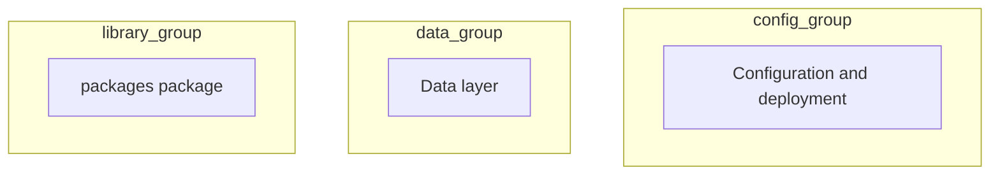

# Architecture report: jaredpalmer/razzle

> Automated static analysis. **Observed** = directly seen in files/imports/AST; **Inferred** = interpretation from that evidence. Repository code was not executed.

## 1. Repository at a glance

| Item | Value |
| --- | --- |
| Repository | jaredpalmer/razzle |
| Description | ✨ Create server-rendered universal JavaScript applications with no configuration |
| Language | JavaScript |
| Stars | 11019 |
| Licence | MIT |
| Analysed commit / branch | 54724b7bb810d06bb418951ada3f90ae3f135668 / master |
| Framework(s) | Express, Fastify, Koa, React, Vue |
| Files analysed | 788 |
| Components | 3 |

## 2. Architecture in one minute

jaredpalmer/razzle - ✨ Create server-rendered universal JavaScript applications with no configuration. This repository was analysed statically from 788 file(s) (0 Python). Detected technologies (observed from imports/manifests): GitHub Actions, SQLite, Express, Fastify, Koa, React. Files are grouped into 3 component(s): Configuration and deployment, Data layer, packages package. Findings below distinguish observed facts from inferred interpretation.

## 3. High-level block diagram

## 4. Main components

### Configuration and deployment (`config`)

- **Kind:** config
- **Status:** Observed
- **Confidence:** 0.85
- **Responsibility:** Groups 4 file(s) under configuration and deployment (observed from repository paths and static analysis).
- **Paths:** `lerna.json`, `package.json`, `package.meta.json`, `packages/babel-preset-razzle/package.json`
- **Evidence:** [lerna.json](https://github.com/jaredpalmer/razzle/blob/54724b7bb810d06bb418951ada3f90ae3f135668/lerna.json); [package.json](https://github.com/jaredpalmer/razzle/blob/54724b7bb810d06bb418951ada3f90ae3f135668/package.json); [package.meta.json](https://github.com/jaredpalmer/razzle/blob/54724b7bb810d06bb418951ada3f90ae3f135668/package.meta.json); [packages/babel-preset-razzle/package.json](https://github.com/jaredpalmer/razzle/blob/54724b7bb810d06bb418951ada3f90ae3f135668/packages/babel-preset-razzle/package.json)

### Data layer (`data_layer`)

- **Kind:** data
- **Status:** Inferred
- **Confidence:** 0.70
- **Responsibility:** Groups 0 file(s) under data layer (observed from repository paths and static analysis).
- **Evidence:** [examples/with-typeorm-graphql/package.json:63](https://github.com/jaredpalmer/razzle/blob/54724b7bb810d06bb418951ada3f90ae3f135668/examples/with-typeorm-graphql/package.json#L63)

### packages package (`packages`)

- **Kind:** library
- **Status:** Observed
- **Confidence:** 0.85
- **Responsibility:** Groups 10 file(s) under packages package (observed from repository paths and static analysis).
- **Paths:** `packages/babel-preset-razzle/babel-plugins/commonjs.js`, `packages/babel-preset-razzle/babel-plugins/jsx-pragma.js`, `packages/babel-preset-razzle/babel-plugins/no-anonymous-default-export.js`, `packages/babel-preset-razzle/babel-plugins/optimize-hook-destructuring.js`, `packages/babel-preset-razzle/index.js`, `packages/create-razzle-app/index.js`, `packages/create-razzle-app/lib/index.js`, `packages/create-razzle-app/lib/messages.js`, `packages/create-razzle-app/lib/officialExamples.js`, `packages/create-razzle-app/lib/utils/copy-dir.js`
- **Evidence:** [packages/babel-preset-razzle/babel-plugins/commonjs.js](https://github.com/jaredpalmer/razzle/blob/54724b7bb810d06bb418951ada3f90ae3f135668/packages/babel-preset-razzle/babel-plugins/commonjs.js); [packages/babel-preset-razzle/babel-plugins/jsx-pragma.js](https://github.com/jaredpalmer/razzle/blob/54724b7bb810d06bb418951ada3f90ae3f135668/packages/babel-preset-razzle/babel-plugins/jsx-pragma.js); [packages/babel-preset-razzle/babel-plugins/no-anonymous-default-export.js](https://github.com/jaredpalmer/razzle/blob/54724b7bb810d06bb418951ada3f90ae3f135668/packages/babel-preset-razzle/babel-plugins/no-anonymous-default-export.js); [packages/babel-preset-razzle/babel-plugins/optimize-hook-destructuring.js](https://github.com/jaredpalmer/razzle/blob/54724b7bb810d06bb418951ada3f90ae3f135668/packages/babel-preset-razzle/babel-plugins/optimize-hook-destructuring.js); [packages/babel-preset-razzle/index.js](https://github.com/jaredpalmer/razzle/blob/54724b7bb810d06bb418951ada3f90ae3f135668/packages/babel-preset-razzle/index.js); [packages/create-razzle-app/index.js](https://github.com/jaredpalmer/razzle/blob/54724b7bb810d06bb418951ada3f90ae3f135668/packages/create-razzle-app/index.js); [packages/create-razzle-app/lib/index.js](https://github.com/jaredpalmer/razzle/blob/54724b7bb810d06bb418951ada3f90ae3f135668/packages/create-razzle-app/lib/index.js); [packages/create-razzle-app/lib/messages.js](https://github.com/jaredpalmer/razzle/blob/54724b7bb810d06bb418951ada3f90ae3f135668/packages/create-razzle-app/lib/messages.js)

## 5. Execution flow

**Observed** entry point(s):

- [packages/babel-preset-razzle/index.js](https://github.com/jaredpalmer/razzle/blob/54724b7bb810d06bb418951ada3f90ae3f135668/packages/babel-preset-razzle/index.js)
- [packages/create-razzle-app/index.js](https://github.com/jaredpalmer/razzle/blob/54724b7bb810d06bb418951ada3f90ae3f135668/packages/create-razzle-app/index.js)
- [packages/create-razzle-app/lib/index.js](https://github.com/jaredpalmer/razzle/blob/54724b7bb810d06bb418951ada3f90ae3f135668/packages/create-razzle-app/lib/index.js)

Representative flow (derived from observed entry points and the import graph; steps beyond the entry point are **Inferred**):

1. Execution starts at an observed entry point listed above, if present.
2. No internal import relationships between components were observed.

## 6. Project structure

### `(root)`

- `.all-contributorsrc` - other (3530 bytes)
- `.eslintignore` - other (98 bytes)
- `.eslintrc` - other (277 bytes)
- `.gitignore` - other (607 bytes)
- `.prettierrc` - other (68 bytes)
- `LICENSE` - docs (1079 bytes)
- `lerna.json` - config (978 bytes)
- `package.json` - manifest (3758 bytes)
- `package.meta.json` - config (642 bytes)

### `.changeset`

- `.changeset/config.json` - config (322 bytes)

### `.github`

- `.github/CODE_OF_CONDUCT.md` - docs (3870 bytes)
- `.github/CONTRIBUTING.md` - docs (9153 bytes)
- `.github/FUNDING.yml` - config (71 bytes)
- `.github/ISSUE_TEMPLATE/Bug_report.md` - docs (899 bytes)
- `.github/ISSUE_TEMPLATE/Documentation.md` - docs (122 bytes)
- `.github/ISSUE_TEMPLATE/Feature_request.md` - docs (1027 bytes)
- `.github/ISSUE_TEMPLATE/Question.md` - docs (79 bytes)
- `.github/labels.yml` - config (248 bytes)
- `.github/stale.yml` - config (696 bytes)
- `.github/workflows/examples.yml` - ci, YAML (4034 bytes)
- `.github/workflows/examples_node14.yml` - ci, YAML (4034 bytes)
- `.github/workflows/label.yml` - ci, YAML (672 bytes)
- `.github/workflows/nodejs.yml` - ci, YAML (3034 bytes)
- `.github/workflows/release.yml` - ci, YAML (796 bytes)
- `.github/workflows/test-examples.yml` - ci, YAML (3225 bytes)

### `examples`

- `examples/.gitignore` - other (28 bytes)
- `examples/basic-server/README.md` - docs (583 bytes)
- `examples/basic-server/gitignore` - other (91 bytes)
- `examples/basic-server/package.json` - manifest (631 bytes)
- `examples/basic-server/public/robots.txt` - docs (15 bytes)
- `examples/basic-server/razzle.config.js` - source, JavaScript (84 bytes)
- `examples/basic-server/sandbox.config.json` - config (42 bytes)
- `examples/basic-server/src/App.css` - other (218 bytes)
- `examples/basic-server/src/App.js` - source, JavaScript (98 bytes)
- `examples/basic-server/src/App.test.js` - source, JavaScript (251 bytes)
- `examples/basic-server/src/index.js` - source, JavaScript (607 bytes)
- `examples/basic-server/src/server.js` - source, JavaScript (848 bytes)
- `examples/basic-serverless/README.md` - docs (596 bytes)
- `examples/basic-serverless/gitignore` - other (91 bytes)
- `examples/basic-serverless/package.json` - manifest (656 bytes)
- `examples/basic-serverless/public/robots.txt` - docs (15 bytes)
- `examples/basic-serverless/razzle.config.js` - source, JavaScript (961 bytes)
- `examples/basic-serverless/sandbox.config.json` - config (42 bytes)
- `examples/basic-serverless/src/App.css` - other (218 bytes)
- `examples/basic-serverless/src/App.js` - source, JavaScript (118 bytes)
- `examples/basic-serverless/src/App.test.js` - source, JavaScript (251 bytes)
- `examples/basic-serverless/src/client.js` - source, JavaScript (185 bytes)
- `examples/basic-serverless/src/index.js` - source, JavaScript (607 bytes)
- `examples/basic-serverless/src/server.js` - source, JavaScript (1479 bytes)
- `examples/basic-spa/.gitignore` - other (91 bytes)
- `examples/basic-spa/README.md` - docs (719 bytes)
- `examples/basic-spa/package.json` - manifest (605 bytes)
- `examples/basic-spa/public/index.html` - other (1476 bytes)
- `examples/basic-spa/public/robots.txt` - docs (15 bytes)
- `examples/basic-spa/razzle.config.js` - source, JavaScript (96 bytes)
- `examples/basic-spa/src/App.css` - other (218 bytes)
- `examples/basic-spa/src/App.js` - source, JavaScript (118 bytes)
- `examples/basic-spa/src/App.test.js` - source, JavaScript (251 bytes)
- `examples/basic-spa/src/client.js` - source, JavaScript (183 bytes)
- `examples/basic/README.md` - docs (596 bytes)
- `examples/basic/gitignore` - other (91 bytes)
- `examples/basic/package.json` - manifest (624 bytes)
- `examples/basic/public/robots.txt` - docs (15 bytes)
- `examples/basic/sandbox.config.json` - config (42 bytes)
- `examples/basic/src/App.css` - other (218 bytes)
- `examples/basic/src/App.js` - source, JavaScript (118 bytes)
- `examples/basic/src/App.test.js` - source, JavaScript (251 bytes)
- `examples/basic/src/client.js` - source, JavaScript (185 bytes)
- `examples/basic/src/index.js` - source, JavaScript (607 bytes)
- `examples/basic/src/server.js` - source, JavaScript (1479 bytes)
- `examples/with-afterjs/README.md` - docs (150 bytes)
- `examples/with-custom-babel-config/.babelrc` - other (105 bytes)
- `examples/with-custom-babel-config/.gitignore` - other (91 bytes)
- `examples/with-custom-babel-config/README.md` - docs (589 bytes)
- `examples/with-custom-babel-config/package.json` - manifest (801 bytes)
- `examples/with-custom-babel-config/razzle.config.js` - source, JavaScript (57 bytes)
- `examples/with-custom-babel-config/src/App.js` - source, JavaScript (218 bytes)
- `examples/with-custom-babel-config/src/Home.js` - source, JavaScript (1091 bytes)
- `examples/with-custom-babel-config/src/client.js` - source, JavaScript (280 bytes)
- `examples/with-custom-babel-config/src/index.js` - source, JavaScript (607 bytes)
- `examples/with-custom-babel-config/src/server.js` - source, JavaScript (1840 bytes)
- `examples/with-custom-devserver-options/.gitignore` - other (150 bytes)
- `examples/with-custom-devserver-options/README.md` - docs (1187 bytes)
- `examples/with-custom-devserver-options/package.json` - manifest (818 bytes)
- `examples/with-custom-devserver-options/public/robots.txt` - docs (15 bytes)
- `examples/with-custom-devserver-options/razzle.config.js` - source, JavaScript (327 bytes)
- `examples/with-custom-devserver-options/src/App.js` - source, JavaScript (98 bytes)
- `examples/with-custom-devserver-options/src/client.js` - source, JavaScript (185 bytes)
- `examples/with-custom-devserver-options/src/index.js` - source, JavaScript (607 bytes)
- `examples/with-custom-devserver-options/src/server.js` - source, JavaScript (1479 bytes)
- `examples/with-custom-environment-variables/.gitignore` - other (150 bytes)
- `examples/with-custom-environment-variables/README.md` - docs (1156 bytes)
- `examples/with-custom-environment-variables/package.json` - manifest (695 bytes)
- `examples/with-custom-environment-variables/public/robots.txt` - docs (15 bytes)
- `examples/with-custom-environment-variables/src/App.js` - source, JavaScript (111 bytes)
- `examples/with-custom-environment-variables/src/client.js` - source, JavaScript (185 bytes)
- `examples/with-custom-environment-variables/src/index.js` - source, JavaScript (607 bytes)
- `examples/with-custom-environment-variables/src/server.js` - source, JavaScript (1479 bytes)
- `examples/with-custom-target-babel-config/.babelrc.node` - other (105 bytes)
- `examples/with-custom-target-babel-config/.babelrc.web` - other (105 bytes)
- `examples/with-custom-target-babel-config/.gitignore` - other (91 bytes)
- `examples/with-custom-target-babel-config/README.md` - docs (643 bytes)
- `examples/with-custom-target-babel-config/package.json` - manifest (808 bytes)
- `examples/with-custom-target-babel-config/razzle.config.js` - source, JavaScript (88 bytes)
- `examples/with-custom-target-babel-config/src/App.js` - source, JavaScript (218 bytes)
- `examples/with-custom-target-babel-config/src/Home.js` - source, JavaScript (1091 bytes)
- `examples/with-custom-target-babel-config/src/client.js` - source, JavaScript (280 bytes)
- `examples/with-custom-target-babel-config/src/index.js` - source, JavaScript (607 bytes)
- `examples/with-custom-target-babel-config/src/server.js` - source, JavaScript (1640 bytes)
- `examples/with-custom-webpack-config/.gitignore` - other (150 bytes)
- `examples/with-custom-webpack-config/README.md` - docs (1159 bytes)
- `examples/with-custom-webpack-config/package.json` - manifest (645 bytes)
- `examples/with-custom-webpack-config/public/robots.txt` - docs (15 bytes)
- `examples/with-custom-webpack-config/razzle.config.js` - source, JavaScript (300 bytes)
- `examples/with-custom-webpack-config/src/App.js` - source, JavaScript (98 bytes)
- `examples/with-custom-webpack-config/src/client.js` - source, JavaScript (185 bytes)
- `examples/with-custom-webpack-config/src/index.js` - source, JavaScript (607 bytes)
- `examples/with-custom-webpack-config/src/server.js` - source, JavaScript (1479 bytes)
- `examples/with-devcert-https/.gitignore` - other (150 bytes)
- `examples/with-devcert-https/README.md` - docs (1762 bytes)
- `examples/with-devcert-https/package.json` - manifest (707 bytes)
- `examples/with-devcert-https/public/robots.txt` - docs (15 bytes)
- `examples/with-devcert-https/razzle.config.js` - source, JavaScript (2172 bytes)
- `examples/with-devcert-https/src/App.css` - other (218 bytes)
- `examples/with-devcert-https/src/App.js` - source, JavaScript (118 bytes)
- `examples/with-devcert-https/src/client.js` - source, JavaScript (185 bytes)
- `examples/with-devcert-https/src/index.js` - source, JavaScript (663 bytes)
- `examples/with-devcert-https/src/server.js` - source, JavaScript (2210 bytes)
- `examples/with-development-build/README.md` - docs (1074 bytes)
- `examples/with-development-build/gitignore` - other (91 bytes)
- `examples/with-development-build/package.json` - manifest (726 bytes)
- `examples/with-development-build/public/robots.txt` - docs (15 bytes)
- `examples/with-development-build/sandbox.config.json` - config (42 bytes)
- `examples/with-development-build/src/App.css` - other (218 bytes)
- `examples/with-development-build/src/App.js` - source, JavaScript (118 bytes)
- `examples/with-development-build/src/App.test.js` - source, JavaScript (251 bytes)
- `examples/with-development-build/src/client.js` - source, JavaScript (185 bytes)
- `examples/with-development-build/src/index.js` - source, JavaScript (607 bytes)
- `examples/with-development-build/src/server.js` - source, JavaScript (1479 bytes)
- `examples/with-elm/.gitignore` - other (420 bytes)
- `examples/with-elm/README.md` - docs (1527 bytes)
- `examples/with-elm/elm-package.json` - config (478 bytes)
- `examples/with-elm/package.json` - manifest (729 bytes)
- `examples/with-elm/public/robots.txt` - docs (15 bytes)
- `examples/with-elm/razzle.config.js` - source, JavaScript (1636 bytes)
- `examples/with-elm/src/App.elm` - other (1100 bytes)
- `examples/with-elm/src/Main.elm` - other (269 bytes)
- `examples/with-elm/src/client.js` - source, JavaScript (212 bytes)
- `examples/with-elm/src/index.js` - source, JavaScript (607 bytes)
- `examples/with-elm/src/server.js` - source, JavaScript (1888 bytes)
- `examples/with-esbuild-loader/.eslintrc.js` - source, JavaScript (1271 bytes)
- `examples/with-esbuild-loader/.gitignore` - other (150 bytes)
- `examples/with-esbuild-loader/README.md` - docs (2488 bytes)
- `examples/with-esbuild-loader/package.json` - manifest (1960 bytes)
- `examples/with-esbuild-loader/public/robots.txt` - docs (15 bytes)
- `examples/with-esbuild-loader/razzle.config.js` - source, JavaScript (2081 bytes)
- `examples/with-esbuild-loader/src/App.css` - other (62 bytes)
- `examples/with-esbuild-loader/src/App.test.tsx` - source, TypeScript (358 bytes)
- `examples/with-esbuild-loader/src/App.tsx` - source, TypeScript (246 bytes)
- `examples/with-esbuild-loader/src/Home.css` - other (455 bytes)
- `examples/with-esbuild-loader/src/Home.tsx` - source, TypeScript (913 bytes)
- `examples/with-esbuild-loader/src/client.tsx` - source, TypeScript (281 bytes)
- `examples/with-esbuild-loader/src/index.ts` - source, TypeScript (746 bytes)
- `examples/with-esbuild-loader/src/react.svg` - other (7839 bytes)
- `examples/with-esbuild-loader/src/server.tsx` - source, TypeScript (1974 bytes)
- `examples/with-esbuild-loader/tsconfig.json` - config (870 bytes)
- `examples/with-esbuild-loader/typings/index.d.ts` - source, TypeScript (78 bytes)
- `examples/with-eslint/.eslintrc.json` - config (277 bytes)
- `examples/with-eslint/.gitignore` - other (91 bytes)
- `examples/with-eslint/README.md` - docs (614 bytes)
- `examples/with-eslint/package.json` - manifest (1132 bytes)
- `examples/with-eslint/public/robots.txt` - docs (15 bytes)
- `examples/with-eslint/razzle.config.js` - source, JavaScript (90 bytes)
- `examples/with-eslint/sandbox.config.json` - config (42 bytes)
- `examples/with-eslint/src/App.css` - other (218 bytes)
- `examples/with-eslint/src/App.js` - source, JavaScript (118 bytes)
- `examples/with-eslint/src/App.test.js` - source, JavaScript (251 bytes)
- `examples/with-eslint/src/client.js` - source, JavaScript (185 bytes)
- `examples/with-eslint/src/index.js` - source, JavaScript (607 bytes)
- `examples/with-eslint/src/server.js` - source, JavaScript (1479 bytes)
- `examples/with-experimental-refresh/README.md` - docs (804 bytes)
- `examples/with-experimental-refresh/package.json` - manifest (654 bytes)
- `examples/with-experimental-refresh/razzle.config.js` - source, JavaScript (69 bytes)
- `examples/with-experimental-refresh/src/App.css` - other (218 bytes)
- `examples/with-experimental-refresh/src/App.js` - source, JavaScript (1159 bytes)
- `examples/with-experimental-refresh/src/App.test.js` - source, JavaScript (251 bytes)
- `examples/with-experimental-refresh/src/client.js` - source, JavaScript (189 bytes)
- `examples/with-experimental-refresh/src/components/ClickCount.js` - source, JavaScript (408 bytes)
- `examples/with-experimental-refresh/src/components/ClickCount.module.css` - other (585 bytes)
- `examples/with-experimental-refresh/src/global.css` - other (778 bytes)
- `examples/with-experimental-refresh/src/index.js` - source, JavaScript (607 bytes)
- `examples/with-experimental-refresh/src/server.js` - source, JavaScript (1483 bytes)
- `examples/with-fastify/.gitignore` - other (150 bytes)
- `examples/with-fastify/README.md` - docs (1185 bytes)
- `examples/with-fastify/package.json` - manifest (1186 bytes)
- `examples/with-fastify/public/robots.txt` - docs (15 bytes)
- `examples/with-fastify/src/App.css` - other (63 bytes)
- `examples/with-fastify/src/App.test.tsx` - source, TypeScript (385 bytes)
- `examples/with-fastify/src/App.tsx` - source, TypeScript (246 bytes)
- `examples/with-fastify/src/Home.css` - other (468 bytes)
- `examples/with-fastify/src/Home.tsx` - source, TypeScript (913 bytes)
- `examples/with-fastify/src/client.tsx` - source, TypeScript (281 bytes)
- `examples/with-fastify/src/index.ts` - source, TypeScript (1016 bytes)
- `examples/with-fastify/src/react.svg` - other (7839 bytes)
- `examples/with-fastify/src/server.tsx` - source, TypeScript (2480 bytes)
- `examples/with-fastify/src/setupTests.ts` - source, TypeScript (255 bytes)
- `examples/with-fastify/tsconfig.json` - config (531 bytes)
- `examples/with-fastify/typings/svg.d.ts` - source, TypeScript (148 bytes)
- `examples/with-firebase-functions/.firebaserc` - other (63 bytes)
- `examples/with-firebase-functions/.gitignore` - other (91 bytes)
- `examples/with-firebase-functions/README.md` - docs (764 bytes)
- `examples/with-firebase-functions/firebase.json` - config (274 bytes)
- `examples/with-firebase-functions/index.js` - source, JavaScript (172 bytes)
- `examples/with-firebase-functions/package.json` - manifest (716 bytes)
- `examples/with-firebase-functions/public/robots.txt` - docs (15 bytes)
- `examples/with-firebase-functions/razzle.config.js` - source, JavaScript (456 bytes)
- `examples/with-firebase-functions/src/App.css` - other (218 bytes)
- `examples/with-firebase-functions/src/App.js` - source, JavaScript (118 bytes)
- `examples/with-firebase-functions/src/App.test.js` - source, JavaScript (251 bytes)
- `examples/with-firebase-functions/src/client.js` - source, JavaScript (185 bytes)
- `examples/with-firebase-functions/src/index.js` - source, JavaScript (607 bytes)
- `examples/with-firebase-functions/src/server.js` - source, JavaScript (1479 bytes)
- `examples/with-heroku/.gitignore` - other (91 bytes)
- `examples/with-heroku/Procfile` - other (21 bytes)
- `examples/with-heroku/README.md` - docs (2017 bytes)
- `examples/with-heroku/package.json` - manifest (687 bytes)
- `examples/with-heroku/public/robots.txt` - docs (15 bytes)
- `examples/with-heroku/razzle.config.js` - source, JavaScript (96 bytes)
- `examples/with-heroku/src/App.css` - other (218 bytes)
- `examples/with-heroku/src/App.js` - source, JavaScript (118 bytes)
- `examples/with-heroku/src/App.test.js` - source, JavaScript (251 bytes)
- `examples/with-heroku/src/client.js` - source, JavaScript (185 bytes)
- `examples/with-heroku/src/index.js` - source, JavaScript (607 bytes)
- `examples/with-heroku/src/server.js` - source, JavaScript (1479 bytes)
- `examples/with-hyperapp/.babelrc` - other (140 bytes)
- `examples/with-hyperapp/.gitignore` - other (150 bytes)
- `examples/with-hyperapp/README.md` - docs (1208 bytes)
- `examples/with-hyperapp/package.json` - manifest (743 bytes)
- `examples/with-hyperapp/public/robots.txt` - docs (70 bytes)
- `examples/with-hyperapp/src/App.css` - other (190 bytes)
- `examples/with-hyperapp/src/App.js` - source, JavaScript (427 bytes)
- `examples/with-hyperapp/src/App.test.js` - source, JavaScript (358 bytes)
- `examples/with-hyperapp/src/client.js` - source, JavaScript (181 bytes)
- `examples/with-hyperapp/src/hyperapp.svg` - other (698 bytes)
- `examples/with-hyperapp/src/index.js` - source, JavaScript (607 bytes)
- `examples/with-hyperapp/src/main.js` - source, JavaScript (383 bytes)
- `examples/with-hyperapp/src/main.test.js` - source, JavaScript (383 bytes)
- `examples/with-hyperapp/src/server.js` - source, JavaScript (1543 bytes)
- `examples/with-inferno/.babelrc` - other (75 bytes)
- `examples/with-inferno/.eslintrc` - other (169 bytes)
- `examples/with-inferno/.gitignore` - other (150 bytes)
- `examples/with-inferno/README.md` - docs (1028 bytes)
- `examples/with-inferno/package.json` - manifest (867 bytes)
- `examples/with-inferno/public/robots.txt` - docs (70 bytes)
- `examples/with-inferno/src/App.js` - source, JavaScript (323 bytes)
- `examples/with-inferno/src/client.js` - source, JavaScript (216 bytes)
- `examples/with-inferno/src/index.js` - source, JavaScript (607 bytes)
- `examples/with-inferno/src/inferno.svg` - other (1655 bytes)
- `examples/with-inferno/src/server.js` - source, JavaScript (1481 bytes)
- `examples/with-jest-snapshots/.gitignore` - other (150 bytes)
- `examples/with-jest-snapshots/README.md` - docs (1692 bytes)
- `examples/with-jest-snapshots/package.json` - manifest (701 bytes)
- `examples/with-jest-snapshots/public/robots.txt` - docs (70 bytes)
- `examples/with-jest-snapshots/src/App.js` - source, JavaScript (218 bytes)
- `examples/with-jest-snapshots/src/Home.js` - source, JavaScript (130 bytes)
- `examples/with-jest-snapshots/src/__tests__/App.test.js` - source, JavaScript (447 bytes)
- `examples/with-jest-snapshots/src/__tests__/Home.test.js` - source, JavaScript (226 bytes)
- `examples/with-jest-snapshots/src/__tests__/__snapshots__/App.test.js.snap` - other (114 bytes)
- `examples/with-jest-snapshots/src/__tests__/__snapshots__/Home.test.js.snap` - other (115 bytes)
- `examples/with-jest-snapshots/src/client.js` - source, JavaScript (280 bytes)
- `examples/with-jest-snapshots/src/index.js` - source, JavaScript (607 bytes)
- `examples/with-jest-snapshots/src/server.js` - source, JavaScript (1614 bytes)
- `examples/with-jsconfig-paths/.gitignore` - other (91 bytes)
- `examples/with-jsconfig-paths/README.md` - docs (702 bytes)
- `examples/with-jsconfig-paths/here-is-extra/extra.js` - source, JavaScript (99 bytes)
- `examples/with-jsconfig-paths/jsconfig.json` - config (114 bytes)
- `examples/with-jsconfig-paths/package.json` - manifest (629 bytes)
- `examples/with-jsconfig-paths/public/robots.txt` - docs (15 bytes)
- `examples/with-jsconfig-paths/sandbox.config.json` - config (42 bytes)
- `examples/with-jsconfig-paths/src/App.css` - other (218 bytes)
- `examples/with-jsconfig-paths/src/App.js` - source, JavaScript (161 bytes)
- `examples/with-jsconfig-paths/src/App.test.js` - source, JavaScript (251 bytes)
- `examples/with-jsconfig-paths/src/client.js` - source, JavaScript (185 bytes)
- `examples/with-jsconfig-paths/src/index.js` - source, JavaScript (607 bytes)
- `examples/with-jsconfig-paths/src/server.js` - source, JavaScript (1479 bytes)
- `examples/with-jsxstyle/.gitignore` - other (91 bytes)
- `examples/with-jsxstyle/README.md` - docs (1899 bytes)
- `examples/with-jsxstyle/package.json` - manifest (692 bytes)
- `examples/with-jsxstyle/public/robots.txt` - docs (15 bytes)
- `examples/with-jsxstyle/src/About.js` - source, JavaScript (973 bytes)
- `examples/with-jsxstyle/src/App.css` - other (372 bytes)
- `examples/with-jsxstyle/src/App.js` - source, JavaScript (650 bytes)
- `examples/with-jsxstyle/src/App.test.js` - source, JavaScript (363 bytes)
- `examples/with-jsxstyle/src/Home.js` - source, JavaScript (1156 bytes)
- `examples/with-jsxstyle/src/client.js` - source, JavaScript (280 bytes)
- `examples/with-jsxstyle/src/index.js` - source, JavaScript (607 bytes)
- `examples/with-jsxstyle/src/server.js` - source, JavaScript (2060 bytes)
- `examples/with-koa/README.md` - docs (1797 bytes)
- `examples/with-koa/package.json` - manifest (742 bytes)
- `examples/with-koa/public/robots.txt` - docs (15 bytes)
- `examples/with-koa/src/App.css` - other (271 bytes)
- `examples/with-koa/src/App.js` - source, JavaScript (238 bytes)
- `examples/with-koa/src/App.test.js` - source, JavaScript (363 bytes)
- `examples/with-koa/src/Home.css` - other (403 bytes)
- `examples/with-koa/src/Home.js` - source, JavaScript (990 bytes)
- `examples/with-koa/src/client.js` - source, JavaScript (280 bytes)
- `examples/with-koa/src/index.js` - source, JavaScript (934 bytes)
- `examples/with-koa/src/server.js` - source, JavaScript (2474 bytes)
- `examples/with-less/.gitignore` - other (91 bytes)
- `examples/with-less/README.md` - docs (758 bytes)
- `examples/with-less/package.json` - manifest (788 bytes)
- `examples/with-less/public/robots.txt` - docs (15 bytes)
- `examples/with-less/razzle.config.js` - source, JavaScript (58 bytes)
- `examples/with-less/src/App.js` - source, JavaScript (198 bytes)
- `examples/with-less/src/App.less` - other (167 bytes)
- `examples/with-less/src/App.test.js` - source, JavaScript (251 bytes)
- `examples/with-less/src/client.js` - source, JavaScript (185 bytes)
- `examples/with-less/src/index.js` - source, JavaScript (488 bytes)
- `examples/with-less/src/other.less` - other (78 bytes)
- `examples/with-less/src/server.js` - source, JavaScript (1479 bytes)
- `examples/with-loadable-components/.babelrc` - other (75 bytes)
- `examples/with-loadable-components/.gitignore` - other (136 bytes)
- `examples/with-loadable-components/README.md` - docs (810 bytes)
- `examples/with-loadable-components/package.json` - manifest (862 bytes)
- `examples/with-loadable-components/public/robots.txt` - docs (15 bytes)
- `examples/with-loadable-components/razzle.config.js` - source, JavaScript (671 bytes)
- `examples/with-loadable-components/src/App.css` - other (218 bytes)
- `examples/with-loadable-components/src/App.js` - source, JavaScript (381 bytes)
- `examples/with-loadable-components/src/App.test.js` - source, JavaScript (251 bytes)
- `examples/with-loadable-components/src/Body.js` - source, JavaScript (224 bytes)
- `examples/with-loadable-components/src/BodyPart.js` - source, JavaScript (117 bytes)
- `examples/with-loadable-components/src/Footer.js` - source, JavaScript (103 bytes)
- `examples/with-loadable-components/src/Header.js` - source, JavaScript (103 bytes)
- `examples/with-loadable-components/src/client.js` - source, JavaScript (320 bytes)
- `examples/with-loadable-components/src/index.js` - source, JavaScript (607 bytes)
- `examples/with-loadable-components/src/server.js` - source, JavaScript (1602 bytes)
- `examples/with-loadable-components/src/static_export.js` - source, JavaScript (200 bytes)
- `examples/with-material-ui/README.md` - docs (542 bytes)
- `examples/with-material-ui/package.json` - manifest (738 bytes)
- `examples/with-material-ui/public/robots.txt` - docs (15 bytes)
- `examples/with-material-ui/src/App.css` - other (218 bytes)
- `examples/with-material-ui/src/App.js` - source, JavaScript (814 bytes)
- `examples/with-material-ui/src/App.test.js` - source, JavaScript (251 bytes)
- `examples/with-material-ui/src/client.js` - source, JavaScript (572 bytes)
- `examples/with-material-ui/src/index.js` - source, JavaScript (607 bytes)
- `examples/with-material-ui/src/server.js` - source, JavaScript (1901 bytes)
- `examples/with-material-ui/src/theme.js` - source, JavaScript (286 bytes)
- `examples/with-mdx/.gitignore` - other (91 bytes)
- `examples/with-mdx/README.md` - docs (652 bytes)
- `examples/with-mdx/package.json` - manifest (672 bytes)
- `examples/with-mdx/razzle.config.js` - source, JavaScript (181 bytes)
- `examples/with-mdx/src/App.js` - source, JavaScript (90 bytes)
- `examples/with-mdx/src/client.js` - source, JavaScript (185 bytes)
- `examples/with-mdx/src/example.md` - docs (3362 bytes)
- `examples/with-mdx/src/index.js` - source, JavaScript (607 bytes)
- `examples/with-mdx/src/server.js` - source, JavaScript (1479 bytes)
- `examples/with-module-federation/.gitignore` - other (91 bytes)
- `examples/with-module-federation/README.md` - docs (658 bytes)
- `examples/with-module-federation/basic-1/package.json` - manifest (194 bytes)
- `examples/with-module-federation/basic-1/public/index.html` - other (1476 bytes)
- `examples/with-module-federation/basic-1/public/robots.txt` - docs (15 bytes)
- `examples/with-module-federation/basic-1/razzle.config.js` - source, JavaScript (1062 bytes)
- `examples/with-module-federation/basic-1/src/App.js` - source, JavaScript (347 bytes)
- `examples/with-module-federation/basic-1/src/Button.js` - source, JavaScript (192 bytes)
- `examples/with-module-federation/basic-1/src/bootstrap.js` - source, JavaScript (185 bytes)
- `examples/with-module-federation/basic-1/src/client.js` - source, JavaScript (23 bytes)
- `examples/with-module-federation/basic-2/package.json` - manifest (194 bytes)
- `examples/with-module-federation/basic-2/public/index.html` - other (1476 bytes)
- `examples/with-module-federation/basic-2/public/robots.txt` - docs (15 bytes)
- `examples/with-module-federation/basic-2/razzle.config.js` - source, JavaScript (1062 bytes)
- `examples/with-module-federation/basic-2/src/App.js` - source, JavaScript (347 bytes)
- `examples/with-module-federation/basic-2/src/Button.js` - source, JavaScript (192 bytes)
- `examples/with-module-federation/basic-2/src/bootstrap.js` - source, JavaScript (185 bytes)
- `examples/with-module-federation/basic-2/src/client.js` - source, JavaScript (23 bytes)
- `examples/with-module-federation/package.json` - manifest (1439 bytes)
- `examples/with-monorepo-without-workspaces/.gitignore` - other (91 bytes)
- `examples/with-monorepo-without-workspaces/README.md` - docs (751 bytes)
- `examples/with-monorepo-without-workspaces/basic-1/public/robots.txt` - docs (15 bytes)
- `examples/with-monorepo-without-workspaces/basic-1/src/App.css` - other (218 bytes)
- `examples/with-monorepo-without-workspaces/basic-1/src/App.js` - source, JavaScript (118 bytes)
- `examples/with-monorepo-without-workspaces/basic-1/src/App.test.js` - source, JavaScript (251 bytes)
- `examples/with-monorepo-without-workspaces/basic-1/src/client.js` - source, JavaScript (185 bytes)
- `examples/with-monorepo-without-workspaces/basic-1/src/index.js` - source, JavaScript (607 bytes)
- `examples/with-monorepo-without-workspaces/basic-1/src/server.js` - source, JavaScript (1504 bytes)
- `examples/with-monorepo-without-workspaces/basic-2/public/robots.txt` - docs (15 bytes)
- `examples/with-monorepo-without-workspaces/basic-2/src/App.css` - other (218 bytes)
- `examples/with-monorepo-without-workspaces/basic-2/src/App.js` - source, JavaScript (118 bytes)
- `examples/with-monorepo-without-workspaces/basic-2/src/App.test.js` - source, JavaScript (251 bytes)
- `examples/with-monorepo-without-workspaces/basic-2/src/client.js` - source, JavaScript (185 bytes)
- `examples/with-monorepo-without-workspaces/basic-2/src/index.js` - source, JavaScript (607 bytes)
- `examples/with-monorepo-without-workspaces/basic-2/src/server.js` - source, JavaScript (1504 bytes)
- `examples/with-monorepo-without-workspaces/package.json` - manifest (1404 bytes)
- `examples/with-monorepo/.gitignore` - other (91 bytes)
- `examples/with-monorepo/README.md` - docs (646 bytes)
- `examples/with-monorepo/basic-1/package.json` - manifest (194 bytes)
- `examples/with-monorepo/basic-1/public/robots.txt` - docs (15 bytes)
- `examples/with-monorepo/basic-1/src/App.css` - other (218 bytes)
- `examples/with-monorepo/basic-1/src/App.js` - source, JavaScript (118 bytes)
- `examples/with-monorepo/basic-1/src/App.test.js` - source, JavaScript (251 bytes)
- `examples/with-monorepo/basic-1/src/client.js` - source, JavaScript (185 bytes)
- `examples/with-monorepo/basic-1/src/index.js` - source, JavaScript (607 bytes)
- `examples/with-monorepo/basic-1/src/server.js` - source, JavaScript (1504 bytes)
- `examples/with-monorepo/basic-2/package.json` - manifest (194 bytes)
- `examples/with-monorepo/basic-2/public/robots.txt` - docs (15 bytes)
- `examples/with-monorepo/basic-2/src/App.css` - other (218 bytes)
- `examples/with-monorepo/basic-2/src/App.js` - source, JavaScript (118 bytes)
- `examples/with-monorepo/basic-2/src/App.test.js` - source, JavaScript (251 bytes)
- `examples/with-monorepo/basic-2/src/client.js` - source, JavaScript (185 bytes)
- `examples/with-monorepo/basic-2/src/index.js` - source, JavaScript (607 bytes)
- `examples/with-monorepo/basic-2/src/server.js` - source, JavaScript (1504 bytes)
- `examples/with-monorepo/package.json` - manifest (1359 bytes)
- `examples/with-now-v2/.gitignore` - other (91 bytes)
- `examples/with-now-v2/README.md` - docs (1982 bytes)
- `examples/with-now-v2/now.json` - config (519 bytes)
- `examples/with-now-v2/package.json` - manifest (657 bytes)
- `examples/with-now-v2/public/robots.txt` - docs (15 bytes)
- `examples/with-now-v2/src/App.css` - other (218 bytes)
- `examples/with-now-v2/src/App.js` - source, JavaScript (118 bytes)
- `examples/with-now-v2/src/App.test.js` - source, JavaScript (251 bytes)
- `examples/with-now-v2/src/client.js` - source, JavaScript (185 bytes)
- `examples/with-now-v2/src/index.js` - source, JavaScript (607 bytes)
- `examples/with-now-v2/src/server.js` - source, JavaScript (1479 bytes)
- `examples/with-now/.gitignore` - other (91 bytes)
- `examples/with-now/README.md` - docs (1412 bytes)
- `examples/with-now/package.json` - manifest (663 bytes)
- `examples/with-now/public/robots.txt` - docs (15 bytes)
- `examples/with-now/src/App.css` - other (218 bytes)
- `examples/with-now/src/App.js` - source, JavaScript (118 bytes)
- `examples/with-now/src/App.test.js` - source, JavaScript (251 bytes)
- `examples/with-now/src/client.js` - source, JavaScript (185 bytes)
- `examples/with-now/src/index.js` - source, JavaScript (607 bytes)
- `examples/with-now/src/server.js` - source, JavaScript (1479 bytes)
- `examples/with-polka/.gitignore` - other (91 bytes)
- `examples/with-polka/README.md` - docs (777 bytes)
- `examples/with-polka/package.json` - manifest (657 bytes)
- `examples/with-polka/public/robots.txt` - docs (15 bytes)
- `examples/with-polka/src/App.css` - other (218 bytes)
- `examples/with-polka/src/App.js` - source, JavaScript (118 bytes)
- `examples/with-polka/src/App.test.js` - source, JavaScript (251 bytes)
- `examples/with-polka/src/client.js` - source, JavaScript (185 bytes)
- `examples/with-polka/src/index.js` - source, JavaScript (648 bytes)
- `examples/with-polka/src/server.js` - source, JavaScript (1446 bytes)
- `examples/with-preact/.babelrc` - other (154 bytes)
- `examples/with-preact/.gitignore` - other (157 bytes)
- `examples/with-preact/README.md` - docs (1016 bytes)
- `examples/with-preact/package.json` - manifest (825 bytes)
- `examples/with-preact/public/robots.txt` - docs (70 bytes)
- `examples/with-preact/razzle.config.js` - source, JavaScript (808 bytes)
- `examples/with-preact/src/App.js` - source, JavaScript (481 bytes)
- `examples/with-preact/src/client.js` - source, JavaScript (143 bytes)
- `examples/with-preact/src/index.js` - source, JavaScript (607 bytes)
- `examples/with-preact/src/preact.svg` - other (2343 bytes)
- `examples/with-preact/src/server.js` - source, JavaScript (1504 bytes)
- `examples/with-promise-config/.gitignore` - other (150 bytes)
- `examples/with-promise-config/README.md` - docs (1253 bytes)
- `examples/with-promise-config/package.json` - manifest (638 bytes)
- `examples/with-promise-config/public/robots.txt` - docs (15 bytes)
- `examples/with-promise-config/razzle.config.js` - source, JavaScript (406 bytes)
- `examples/with-promise-config/src/App.js` - source, JavaScript (98 bytes)
- `examples/with-promise-config/src/client.js` - source, JavaScript (185 bytes)
- `examples/with-promise-config/src/index.js` - source, JavaScript (607 bytes)
- `examples/with-promise-config/src/server.js` - source, JavaScript (1479 bytes)
- `examples/with-react-native-web/.babelrc` - other (93 bytes)
- `examples/with-react-native-web/README.md` - docs (4617 bytes)
- `examples/with-react-native-web/package.json` - manifest (797 bytes)
- `examples/with-react-native-web/public/robots.txt` - docs (15 bytes)
- `examples/with-react-native-web/razzle.config.js` - source, JavaScript (544 bytes)
- `examples/with-react-native-web/src/App.js` - source, JavaScript (376 bytes)
- `examples/with-react-native-web/src/client.js` - source, JavaScript (336 bytes)
- `examples/with-react-native-web/src/index.js` - source, JavaScript (607 bytes)
- `examples/with-react-native-web/src/server.js` - source, JavaScript (1766 bytes)
- `examples/with-react-router/.gitignore` - other (91 bytes)
- `examples/with-react-router/README.md` - docs (729 bytes)
- `examples/with-react-router/package.json` - manifest (770 bytes)
- `examples/with-react-router/public/robots.txt` - docs (15 bytes)
- `examples/with-react-router/src/About.js` - source, JavaScript (85 bytes)
- `examples/with-react-router/src/App.css` - other (218 bytes)
- `examples/with-react-router/src/App.js` - source, JavaScript (360 bytes)
- `examples/with-react-router/src/App.test.js` - source, JavaScript (366 bytes)
- `examples/with-react-router/src/Home.js` - source, JavaScript (214 bytes)
- `examples/with-react-router/src/client.js` - source, JavaScript (280 bytes)
- `examples/with-react-router/src/index.js` - source, JavaScript (607 bytes)
- `examples/with-react-router/src/server.js` - source, JavaScript (1424 bytes)
- `examples/with-react-router/src/static_export.js` - source, JavaScript (203 bytes)
- `examples/with-react-server-components/.gitignore` - other (91 bytes)
- `examples/with-react-server-components/README.md` - docs (717 bytes)
- `examples/with-react-server-components/babel.config.js` - source, JavaScript (780 bytes)
- `examples/with-react-server-components/notes/.gitkeep` - other (0 bytes)
- `examples/with-react-server-components/notes/1.md` - docs (50 bytes)
- `examples/with-react-server-components/notes/2.md` - docs (148 bytes)
- `examples/with-react-server-components/notes/3.md` - docs (292 bytes)
- `examples/with-react-server-components/notes/4.md` - docs (30 bytes)
- `examples/with-react-server-components/package.json` - manifest (2692 bytes)
- `examples/with-react-server-components/plugin/ReactFlightWebpackLoader.js` - source, JavaScript (815 bytes)
- `examples/with-react-server-components/plugin/ReactFlightWebpackLoader.ts` - source, TypeScript (720 bytes)
- `examples/with-react-server-components/plugin/ReactFlightWebpackNodeLoader.js` - source, JavaScript (7006 bytes)
- `examples/with-react-server-components/plugin/ReactFlightWebpackNodeLoader.ts` - source, TypeScript (7949 bytes)
- `examples/with-react-server-components/plugin/ReactFlightWebpackNodeRegister.js` - source, JavaScript (3172 bytes)
- `examples/with-react-server-components/plugin/ReactFlightWebpackNodeRegister.ts` - source, TypeScript (3246 bytes)
- `examples/with-react-server-components/plugin/ReactFlightWebpackPlugin.js` - source, JavaScript (8744 bytes)
- `examples/with-react-server-components/plugin/ReactFlightWebpackPlugin.ts` - source, TypeScript (9822 bytes)
- `examples/with-react-server-components/plugin/__tests__/ReactFlightWebpackPlugin.spec.ts` - source, TypeScript (7158 bytes)
- `examples/with-react-server-components/plugin/__tests__/fixture/Form.client.js` - source, JavaScript (60 bytes)
- `examples/with-react-server-components/plugin/__tests__/fixture/FormServer.server.js` - source, JavaScript (58 bytes)
- `examples/with-react-server-components/plugin/__tests__/fixture/entry.js` - source, JavaScript (162 bytes)
- `examples/with-react-server-components/plugin/__tests__/fixture/package.json` - manifest (22 bytes)
- `examples/with-react-server-components/public/checkmark.svg` - other (228 bytes)
- `examples/with-react-server-components/public/chevron-down.svg` - other (203 bytes)
- `examples/with-react-server-components/public/chevron-up.svg` - other (203 bytes)
- `examples/with-react-server-components/public/cross.svg` - other (207 bytes)
- `examples/with-react-server-components/public/index.html` - other (1553 bytes)
- `examples/with-react-server-components/public/logo.svg` - other (366 bytes)
- `examples/with-react-server-components/public/robots.txt` - docs (15 bytes)
- `examples/with-react-server-components/public/style.css` - other (12886 bytes)
- `examples/with-react-server-components/razzle.config.js` - source, JavaScript (1937 bytes)
- `examples/with-react-server-components/sandbox.config.json` - config (42 bytes)
- `examples/with-react-server-components/scripts/seed.js` - source, JavaScript (3174 bytes)
- `examples/with-react-server-components/src/App.server.tsx` - source, TypeScript (1312 bytes)
- `examples/with-react-server-components/src/Cache.client.tsx` - source, TypeScript (771 bytes)
- `examples/with-react-server-components/src/EditButton.client.tsx` - source, TypeScript (773 bytes)
- `examples/with-react-server-components/src/LocationContext.client.tsx` - source, TypeScript (222 bytes)
- `examples/with-react-server-components/src/Note.server.tsx` - source, TypeScript (1986 bytes)
- `examples/with-react-server-components/src/NoteEditor.client.tsx` - source, TypeScript (4946 bytes)
- `examples/with-react-server-components/src/NoteList.server.tsx` - source, TypeScript (860 bytes)
- `examples/with-react-server-components/src/NoteListSkeleton.tsx` - source, TypeScript (849 bytes)
- `examples/with-react-server-components/src/NotePreview.tsx` - source, TypeScript (396 bytes)
- `examples/with-react-server-components/src/NoteSkeleton.tsx` - source, TypeScript (2566 bytes)
- `examples/with-react-server-components/src/Root.client.tsx` - source, TypeScript (910 bytes)
- `examples/with-react-server-components/src/SearchField.client.tsx` - source, TypeScript (1172 bytes)
- `examples/with-react-server-components/src/SidebarNote.client.tsx` - source, TypeScript (2318 bytes)
- `examples/with-react-server-components/src/SidebarNote.tsx` - source, TypeScript (995 bytes)
- `examples/with-react-server-components/src/Spinner.tsx` - source, TypeScript (418 bytes)
- `examples/with-react-server-components/src/TextWithMarkdown.tsx` - source, TypeScript (768 bytes)
- `examples/with-react-server-components/src/cli.server.js` - source, JavaScript (631 bytes)
- `examples/with-react-server-components/src/db.server.ts` - source, TypeScript (319 bytes)
- `examples/with-react-server-components/src/index.client.tsx` - source, TypeScript (234 bytes)
- `examples/with-react-server-components/src/index.server.ts` - source, TypeScript (4915 bytes)
- `examples/with-reason-react/.gitignore` - other (173 bytes)
- `examples/with-reason-react/README.md` - docs (7502 bytes)
- `examples/with-reason-react/bsconfig.json` - config (705 bytes)
- `examples/with-reason-react/jsconfig.json` - config (116 bytes)
- `examples/with-reason-react/package.json` - manifest (994 bytes)
- `examples/with-reason-react/public/robots.txt` - docs (15 bytes)
- `examples/with-reason-react/src/App.re` - other (224 bytes)
- `examples/with-reason-react/src/CommentList.css` - other (601 bytes)
- `examples/with-reason-react/src/CommentList.re` - other (3689 bytes)
- `examples/with-reason-react/src/CommentsPage.css` - other (178 bytes)
- `examples/with-reason-react/src/CommentsPage.re` - other (1597 bytes)
- `examples/with-reason-react/src/NotFound.css` - other (201 bytes)
- `examples/with-reason-react/src/NotFound.re` - other (553 bytes)
- `examples/with-reason-react/src/StoryData.re` - other (3733 bytes)
- `examples/with-reason-react/src/StoryListItem.css` - other (1543 bytes)
- `examples/with-reason-react/src/StoryListItem.re` - other (2240 bytes)
- `examples/with-reason-react/src/TopStoriesPage.re` - other (2102 bytes)
- `examples/with-reason-react/src/Utils.re` - other (1231 bytes)
- `examples/with-reason-react/src/client.js` - source, JavaScript (288 bytes)
- `examples/with-reason-react/src/index.js` - source, JavaScript (607 bytes)
- `examples/with-reason-react/src/index.re` - other (120 bytes)
- `examples/with-reason-react/src/link.re` - other (323 bytes)
- `examples/with-reason-react/src/logo.svg` - other (2632 bytes)
- `examples/with-reason-react/src/registerServiceWorker.js` - source, JavaScript (2209 bytes)
- `examples/with-reason-react/src/server.js` - source, JavaScript (1539 bytes)
- `examples/with-redux/.gitignore` - other (150 bytes)
- `examples/with-redux/README.md` - docs (598 bytes)
- `examples/with-redux/package.json` - manifest (797 bytes)
- `examples/with-redux/public/robots.txt` - docs (15 bytes)
- `examples/with-redux/src/client/index.js` - source, JavaScript (576 bytes)
- `examples/with-redux/src/common/actions/index.js` - source, JavaScript (654 bytes)
- `examples/with-redux/src/common/api/counter.js` - source, JavaScript (443 bytes)
- `examples/with-redux/src/common/components/Counter.js` - source, JavaScript (729 bytes)
- `examples/with-redux/src/common/containers/App.js` - source, JavaScript (410 bytes)
- `examples/with-redux/src/common/reducers/counter.js` - source, JavaScript (367 bytes)
- `examples/with-redux/src/common/reducers/index.js` - source, JavaScript (157 bytes)
- `examples/with-redux/src/common/store/configureStore.js` - source, JavaScript (563 bytes)
- `examples/with-redux/src/index.js` - source, JavaScript (607 bytes)
- `examples/with-redux/src/server/index.js` - source, JavaScript (2505 bytes)
- `examples/with-scss-options/.gitignore` - other (91 bytes)
- `examples/with-scss-options/README.md` - docs (789 bytes)
- `examples/with-scss-options/package.json` - manifest (744 bytes)
- `examples/with-scss-options/public/robots.txt` - docs (15 bytes)
- `examples/with-scss-options/razzle.config.js` - source, JavaScript (455 bytes)
- `examples/with-scss-options/src/App.js` - source, JavaScript (263 bytes)
- `examples/with-scss-options/src/App.scss` - other (160 bytes)
- `examples/with-scss-options/src/App.test.js` - source, JavaScript (251 bytes)
- `examples/with-scss-options/src/app.module.scss` - other (30 bytes)
- `examples/with-scss-options/src/client.js` - source, JavaScript (185 bytes)
- `examples/with-scss-options/src/index.js` - source, JavaScript (488 bytes)
- `examples/with-scss-options/src/other.scss` - other (48 bytes)
- `examples/with-scss-options/src/prepend.scss` - other (47 bytes)
- `examples/with-scss-options/src/server.js` - source, JavaScript (1479 bytes)
- `examples/with-scss/.gitignore` - other (91 bytes)
- `examples/with-scss/README.md` - docs (757 bytes)
- `examples/with-scss/package.json` - manifest (736 bytes)
- `examples/with-scss/public/robots.txt` - docs (15 bytes)
- `examples/with-scss/razzle.config.js` - source, JavaScript (58 bytes)
- `examples/with-scss/src/App.js` - source, JavaScript (263 bytes)
- `examples/with-scss/src/App.scss` - other (160 bytes)
- `examples/with-scss/src/App.test.js` - source, JavaScript (251 bytes)
- `examples/with-scss/src/app.module.scss` - other (30 bytes)
- `examples/with-scss/src/client.js` - source, JavaScript (185 bytes)
- `examples/with-scss/src/index.js` - source, JavaScript (488 bytes)
- `examples/with-scss/src/other.scss` - other (48 bytes)
- `examples/with-scss/src/server.js` - source, JavaScript (1479 bytes)
- `examples/with-single-exposed-port/.gitignore` - other (150 bytes)
- `examples/with-single-exposed-port/README.md` - docs (2550 bytes)
- `examples/with-single-exposed-port/package.json` - manifest (653 bytes)
- `examples/with-single-exposed-port/public/robots.txt` - docs (15 bytes)
- `examples/with-single-exposed-port/razzle.config.js` - source, JavaScript (337 bytes)
- `examples/with-single-exposed-port/src/App.js` - source, JavaScript (98 bytes)
- `examples/with-single-exposed-port/src/client.js` - source, JavaScript (185 bytes)
- `examples/with-single-exposed-port/src/index.js` - source, JavaScript (607 bytes)
- `examples/with-single-exposed-port/src/server.js` - source, JavaScript (1479 bytes)
- `examples/with-styled-components/.gitignore` - other (91 bytes)
- `examples/with-styled-components/README.md` - docs (859 bytes)
- `examples/with-styled-components/package.json` - manifest (703 bytes)
- `examples/with-styled-components/public/robots.txt` - docs (15 bytes)
- `examples/with-styled-components/src/App.css` - other (218 bytes)
- `examples/with-styled-components/src/App.js` - source, JavaScript (395 bytes)
- `examples/with-styled-components/src/App.test.js` - source, JavaScript (251 bytes)
- `examples/with-styled-components/src/client.js` - source, JavaScript (185 bytes)
- `examples/with-styled-components/src/index.js` - source, JavaScript (607 bytes)
- `examples/with-styled-components/src/server.js` - source, JavaScript (1958 bytes)
- `examples/with-svelte/.gitignore` - other (91 bytes)
- `examples/with-svelte/README.md` - docs (650 bytes)
- `examples/with-svelte/package.json` - manifest (668 bytes)
- `examples/with-svelte/public/robots.txt` - docs (15 bytes)
- `examples/with-svelte/razzle.config.js` - source, JavaScript (60 bytes)
- `examples/with-svelte/sandbox.config.json` - config (42 bytes)
- `examples/with-svelte/src/App.css` - other (218 bytes)
- `examples/with-svelte/src/App.js` - source, JavaScript (118 bytes)
- `examples/with-svelte/src/App.test.js` - source, JavaScript (251 bytes)
- `examples/with-svelte/src/client.js` - source, JavaScript (185 bytes)
- `examples/with-svelte/src/index.js` - source, JavaScript (607 bytes)
- `examples/with-svelte/src/server.js` - source, JavaScript (1479 bytes)
- `examples/with-tailwindcss/.gitignore` - other (91 bytes)
- `examples/with-tailwindcss/README.md` - docs (640 bytes)
- `examples/with-tailwindcss/package.json` - manifest (767 bytes)
- `examples/with-tailwindcss/public/robots.txt` - docs (15 bytes)
- `examples/with-tailwindcss/razzle.config.js` - source, JavaScript (208 bytes)
- `examples/with-tailwindcss/sandbox.config.json` - config (42 bytes)
- `examples/with-tailwindcss/src/App.css` - other (34 bytes)
- `examples/with-tailwindcss/src/App.js` - source, JavaScript (921 bytes)
- `examples/with-tailwindcss/src/App.test.js` - source, JavaScript (251 bytes)
- `examples/with-tailwindcss/src/client.js` - source, JavaScript (185 bytes)
- `examples/with-tailwindcss/src/index.js` - source, JavaScript (607 bytes)
- `examples/with-tailwindcss/src/server.js` - source, JavaScript (1479 bytes)
- `examples/with-typeorm-graphql/.babelrc` - other (459 bytes)
- `examples/with-typeorm-graphql/.eslintrc.js` - source, JavaScript (1271 bytes)
- `examples/with-typeorm-graphql/.gitignore` - other (150 bytes)
- `examples/with-typeorm-graphql/.prettierrc` - other (26 bytes)
- `examples/with-typeorm-graphql/README.md` - docs (782 bytes)
- `examples/with-typeorm-graphql/package.json` - manifest (2400 bytes)
- `examples/with-typeorm-graphql/public/robots.txt` - docs (15 bytes)
- `examples/with-typeorm-graphql/razzle.config.js` - source, JavaScript (1430 bytes)
- `examples/with-typeorm-graphql/src/App.css` - other (62 bytes)
- `examples/with-typeorm-graphql/src/App.test.tsx` - source, TypeScript (385 bytes)
- `examples/with-typeorm-graphql/src/App.tsx` - source, TypeScript (249 bytes)
- `examples/with-typeorm-graphql/src/Home.css` - other (455 bytes)
- `examples/with-typeorm-graphql/src/Home.tsx` - source, TypeScript (854 bytes)
- `examples/with-typeorm-graphql/src/client.tsx` - source, TypeScript (281 bytes)
- `examples/with-typeorm-graphql/src/database/init_db.ts` - source, TypeScript (2471 bytes)
- `examples/with-typeorm-graphql/src/declarations.d.ts` - source, TypeScript (148 bytes)
- `examples/with-typeorm-graphql/src/index.ts` - source, TypeScript (670 bytes)
- `examples/with-typeorm-graphql/src/models/Abilities.ts` - source, TypeScript (352 bytes)
- `examples/with-typeorm-graphql/src/models/Pokemon.ts` - source, TypeScript (567 bytes)
- `examples/with-typeorm-graphql/src/models/PokemonAbilities.ts` - source, TypeScript (760 bytes)
- `examples/with-typeorm-graphql/src/models/Types.ts` - source, TypeScript (355 bytes)
- `examples/with-typeorm-graphql/src/models/index.ts` - source, TypeScript (117 bytes)
- `examples/with-typeorm-graphql/src/react.svg` - other (7839 bytes)
- `examples/with-typeorm-graphql/src/schema/Resolvers.ts` - source, TypeScript (1534 bytes)
- `examples/with-typeorm-graphql/src/schema/index.ts` - source, TypeScript (29 bytes)
- `examples/with-typeorm-graphql/src/server.tsx` - source, TypeScript (2877 bytes)
- `examples/with-typeorm-graphql/src/setupTests.ts` - source, TypeScript (255 bytes)
- `examples/with-typeorm-graphql/tsconfig.json` - config (501 bytes)
- `examples/with-typescript-plugin/.eslintrc.js` - source, JavaScript (1236 bytes)
- `examples/with-typescript-plugin/.gitignore` - other (150 bytes)
- `examples/with-typescript-plugin/README.md` - docs (2493 bytes)
- `examples/with-typescript-plugin/package.json` - manifest (1927 bytes)
- `examples/with-typescript-plugin/public/robots.txt` - docs (15 bytes)
- `examples/with-typescript-plugin/razzle.config.js` - source, JavaScript (64 bytes)
- `examples/with-typescript-plugin/src/App.css` - other (62 bytes)
- `examples/with-typescript-plugin/src/App.test.tsx` - source, TypeScript (358 bytes)
- `examples/with-typescript-plugin/src/App.tsx` - source, TypeScript (246 bytes)
- `examples/with-typescript-plugin/src/Home.css` - other (455 bytes)
- `examples/with-typescript-plugin/src/Home.tsx` - source, TypeScript (913 bytes)
- `examples/with-typescript-plugin/src/client.tsx` - source, TypeScript (281 bytes)
- `examples/with-typescript-plugin/src/index.ts` - source, TypeScript (746 bytes)
- `examples/with-typescript-plugin/src/react.svg` - other (7839 bytes)
- `examples/with-typescript-plugin/src/server.tsx` - source, TypeScript (1974 bytes)
- `examples/with-typescript-plugin/tsconfig.json` - config (870 bytes)
- `examples/with-typescript-plugin/typings/index.d.ts` - source, TypeScript (78 bytes)
- `examples/with-typescript/.gitignore` - other (157 bytes)
- `examples/with-typescript/README.md` - docs (767 bytes)
- `examples/with-typescript/package.json` - manifest (1259 bytes)
- `examples/with-typescript/public/robots.txt` - docs (15 bytes)
- `examples/with-typescript/src/App.css` - other (62 bytes)
- `examples/with-typescript/src/App.test.tsx` - source, TypeScript (385 bytes)
- `examples/with-typescript/src/App.tsx` - source, TypeScript (246 bytes)
- `examples/with-typescript/src/Home.css` - other (455 bytes)
- `examples/with-typescript/src/Home.tsx` - source, TypeScript (913 bytes)
- `examples/with-typescript/src/client.tsx` - source, TypeScript (281 bytes)
- `examples/with-typescript/src/declarations.d.ts` - source, TypeScript (148 bytes)
- `examples/with-typescript/src/index.ts` - source, TypeScript (577 bytes)
- `examples/with-typescript/src/react.svg` - other (7839 bytes)
- `examples/with-typescript/src/server.tsx` - source, TypeScript (2042 bytes)
- `examples/with-typescript/src/setupTests.ts` - source, TypeScript (255 bytes)
- `examples/with-typescript/tsconfig.json` - config (465 bytes)
- `examples/with-vendor-bundle/.gitignore` - other (150 bytes)
- `examples/with-vendor-bundle/README.md` - docs (3994 bytes)
- `examples/with-vendor-bundle/package.json` - manifest (637 bytes)
- `examples/with-vendor-bundle/public/robots.txt` - docs (15 bytes)
- `examples/with-vendor-bundle/razzle.config.js` - source, JavaScript (954 bytes)
- `examples/with-vendor-bundle/src/App.js` - source, JavaScript (174 bytes)
- `examples/with-vendor-bundle/src/client.js` - source, JavaScript (185 bytes)
- `examples/with-vendor-bundle/src/index.js` - source, JavaScript (607 bytes)
- `examples/with-vendor-bundle/src/server.js` - source, JavaScript (1479 bytes)
- `examples/with-vue-router/.eslintrc` - other (126 bytes)
- `examples/with-vue-router/.gitignore` - other (136 bytes)
- `examples/with-vue-router/README.md` - docs (1611 bytes)
- `examples/with-vue-router/package.json` - manifest (892 bytes)
- `examples/with-vue-router/public/robots.txt` - docs (15 bytes)
- `examples/with-vue-router/razzle.config.js` - source, JavaScript (42 bytes)
- `examples/with-vue-router/src/About.vue` - source, Vue (260 bytes)
- `examples/with-vue-router/src/App.js` - source, JavaScript (274 bytes)
- `examples/with-vue-router/src/App.vue` - source, Vue (128 bytes)
- `examples/with-vue-router/src/Home.vue` - source, Vue (531 bytes)
- `examples/with-vue-router/src/PageNotFound.vue` - source, Vue (209 bytes)
- `examples/with-vue-router/src/client.js` - source, JavaScript (173 bytes)
- `examples/with-vue-router/src/index.js` - source, JavaScript (476 bytes)
- `examples/with-vue-router/src/router.js` - source, JavaScript (866 bytes)
- `examples/with-vue-router/src/server.js` - source, JavaScript (1936 bytes)
- `examples/with-vue-router/src/vue.svg` - other (253 bytes)
- `examples/with-vue/.eslintrc` - other (43 bytes)
- `examples/with-vue/.gitignore` - other (136 bytes)
- `examples/with-vue/README.md` - docs (950 bytes)
- `examples/with-vue/package.json` - manifest (771 bytes)
- `examples/with-vue/public/robots.txt` - docs (15 bytes)
- `examples/with-vue/razzle.config.js` - source, JavaScript (42 bytes)
- `examples/with-vue/src/App.js` - source, JavaScript (222 bytes)
- `examples/with-vue/src/App.vue` - source, Vue (456 bytes)
- `examples/with-vue/src/client.js` - source, JavaScript (135 bytes)
- `examples/with-vue/src/index.js` - source, JavaScript (476 bytes)
- `examples/with-vue/src/server.js` - source, JavaScript (1522 bytes)
- `examples/with-vue/src/vue.svg` - other (253 bytes)
- `examples/with-webpack-dev-server-v4/README.md` - docs (821 bytes)
- `examples/with-webpack-dev-server-v4/gitignore` - other (91 bytes)
- `examples/with-webpack-dev-server-v4/package.json` - manifest (644 bytes)
- `examples/with-webpack-dev-server-v4/public/robots.txt` - docs (15 bytes)
- `examples/with-webpack-dev-server-v4/razzle.config.js` - source, JavaScript (512 bytes)
- `examples/with-webpack-dev-server-v4/sandbox.config.json` - config (42 bytes)
- `examples/with-webpack-dev-server-v4/src/App.css` - other (218 bytes)
- `examples/with-webpack-dev-server-v4/src/App.js` - source, JavaScript (118 bytes)
- `examples/with-webpack-dev-server-v4/src/App.test.js` - source, JavaScript (251 bytes)
- `examples/with-webpack-dev-server-v4/src/client.js` - source, JavaScript (185 bytes)
- `examples/with-webpack-dev-server-v4/src/index.js` - source, JavaScript (607 bytes)
- `examples/with-webpack-dev-server-v4/src/server.js` - source, JavaScript (1479 bytes)
- `examples/with-webpack-public-path/README.md` - docs (653 bytes)
- `examples/with-webpack-public-path/package.json` - manifest (624 bytes)
- `examples/with-webpack-public-path/public/robots.txt` - docs (15 bytes)
- `examples/with-webpack-public-path/sandbox.config.json` - config (42 bytes)
- `examples/with-webpack-public-path/src/App.css` - other (218 bytes)
- `examples/with-webpack-public-path/src/App.js` - source, JavaScript (118 bytes)
- `examples/with-webpack-public-path/src/App.test.js` - source, JavaScript (251 bytes)
- `examples/with-webpack-public-path/src/client.js` - source, JavaScript (47 bytes)
- `examples/with-webpack-public-path/src/index.js` - source, JavaScript (607 bytes)
- `examples/with-webpack-public-path/src/init.client.js` - source, JavaScript (52 bytes)
- `examples/with-webpack-public-path/src/init.server.js` - source, JavaScript (114 bytes)
- `examples/with-webpack-public-path/src/real.client.js` - source, JavaScript (185 bytes)
- `examples/with-webpack-public-path/src/real.server.js` - source, JavaScript (1745 bytes)
- `examples/with-webpack-public-path/src/server.js` - source, JavaScript (86 bytes)

### `packages`

- `packages/babel-preset-razzle/CHANGELOG.md` - docs (756 bytes)
- `packages/babel-preset-razzle/LICENSE` - docs (1079 bytes)
- `packages/babel-preset-razzle/README.md` - docs (796 bytes)
- `packages/babel-preset-razzle/babel-plugins/commonjs.js` - source, JavaScript (788 bytes)
- `packages/babel-preset-razzle/babel-plugins/jsx-pragma.js` - source, JavaScript (3406 bytes)
- `packages/babel-preset-razzle/babel-plugins/no-anonymous-default-export.js` - source, JavaScript (2275 bytes)
- `packages/babel-preset-razzle/babel-plugins/optimize-hook-destructuring.js` - source, JavaScript (2081 bytes)
- `packages/babel-preset-razzle/index.js` - source, JavaScript (4879 bytes)
- `packages/babel-preset-razzle/package.json` - manifest (1402 bytes)
- `packages/create-razzle-app/.gitignore` - other (19 bytes)
- `packages/create-razzle-app/CHANGELOG.md` - docs (754 bytes)
- `packages/create-razzle-app/README.md` - docs (1471 bytes)
- `packages/create-razzle-app/bin/create-razzle-app` - other (959 bytes)
- `packages/create-razzle-app/index.js` - source, JavaScript (176 bytes)
- `packages/create-razzle-app/lib/index.js` - source, JavaScript (7217 bytes)
- `packages/create-razzle-app/lib/messages.js` - source, JavaScript (3076 bytes)
- `packages/create-razzle-app/lib/officialExamples.js` - source, JavaScript (1310 bytes)
- `packages/create-razzle-app/lib/utils/copy-dir.js` - source, JavaScript (1378 bytes)

## 7. Key dependencies and integrations

| Name | Category | Status | Confidence | Evidence |
| --- | --- | --- | --- | --- |
| GitHub Actions | ci | Observed | 0.90 | [.github/workflows/examples.yml](https://github.com/jaredpalmer/razzle/blob/54724b7bb810d06bb418951ada3f90ae3f135668/.github/workflows/examples.yml); [.github/workflows/examples_node14.yml](https://github.com/jaredpalmer/razzle/blob/54724b7bb810d06bb418951ada3f90ae3f135668/.github/workflows/examples_node14.yml); [.github/workflows/label.yml](https://github.com/jaredpalmer/razzle/blob/54724b7bb810d06bb418951ada3f90ae3f135668/.github/workflows/label.yml); [.github/workflows/nodejs.yml](https://github.com/jaredpalmer/razzle/blob/54724b7bb810d06bb418951ada3f90ae3f135668/.github/workflows/nodejs.yml) |
| SQLite | database | Observed | 0.85 | [examples/with-typeorm-graphql/package.json:63](https://github.com/jaredpalmer/razzle/blob/54724b7bb810d06bb418951ada3f90ae3f135668/examples/with-typeorm-graphql/package.json#L63) |
| Express | framework | Observed | 0.90 | [examples/basic-server/package.json:12](https://github.com/jaredpalmer/razzle/blob/54724b7bb810d06bb418951ada3f90ae3f135668/examples/basic-server/package.json#L12); [examples/basic-serverless/package.json:13](https://github.com/jaredpalmer/razzle/blob/54724b7bb810d06bb418951ada3f90ae3f135668/examples/basic-serverless/package.json#L13); [examples/basic/package.json:12](https://github.com/jaredpalmer/razzle/blob/54724b7bb810d06bb418951ada3f90ae3f135668/examples/basic/package.json#L12); [examples/with-custom-babel-config/package.json:12](https://github.com/jaredpalmer/razzle/blob/54724b7bb810d06bb418951ada3f90ae3f135668/examples/with-custom-babel-config/package.json#L12) |
| Fastify | framework | Observed | 0.85 | [examples/with-fastify/package.json:2](https://github.com/jaredpalmer/razzle/blob/54724b7bb810d06bb418951ada3f90ae3f135668/examples/with-fastify/package.json#L2) |
| Koa | framework | Observed | 0.85 | [examples/with-koa/package.json:2](https://github.com/jaredpalmer/razzle/blob/54724b7bb810d06bb418951ada3f90ae3f135668/examples/with-koa/package.json#L2) |
| React | framework | Observed | 0.90 | [examples/basic-server/package.json:13](https://github.com/jaredpalmer/razzle/blob/54724b7bb810d06bb418951ada3f90ae3f135668/examples/basic-server/package.json#L13); [examples/basic-server/package.json:14](https://github.com/jaredpalmer/razzle/blob/54724b7bb810d06bb418951ada3f90ae3f135668/examples/basic-server/package.json#L14); [examples/basic-serverless/package.json:14](https://github.com/jaredpalmer/razzle/blob/54724b7bb810d06bb418951ada3f90ae3f135668/examples/basic-serverless/package.json#L14); [examples/basic-serverless/package.json:15](https://github.com/jaredpalmer/razzle/blob/54724b7bb810d06bb418951ada3f90ae3f135668/examples/basic-serverless/package.json#L15) |
| Vue | framework | Observed | 0.90 | [examples/with-vue-router/package.json:2](https://github.com/jaredpalmer/razzle/blob/54724b7bb810d06bb418951ada3f90ae3f135668/examples/with-vue-router/package.json#L2); [examples/with-vue/package.json:2](https://github.com/jaredpalmer/razzle/blob/54724b7bb810d06bb418951ada3f90ae3f135668/examples/with-vue/package.json#L2) |
| axios | library | Observed | 0.85 | [package.json:18](https://github.com/jaredpalmer/razzle/blob/54724b7bb810d06bb418951ada3f90ae3f135668/package.json#L18) |
| React Router | library | Observed | 0.90 | [examples/with-custom-babel-config/package.json:15](https://github.com/jaredpalmer/razzle/blob/54724b7bb810d06bb418951ada3f90ae3f135668/examples/with-custom-babel-config/package.json#L15); [examples/with-custom-target-babel-config/package.json:15](https://github.com/jaredpalmer/razzle/blob/54724b7bb810d06bb418951ada3f90ae3f135668/examples/with-custom-target-babel-config/package.json#L15); [examples/with-esbuild-loader/package.json:15](https://github.com/jaredpalmer/razzle/blob/54724b7bb810d06bb418951ada3f90ae3f135668/examples/with-esbuild-loader/package.json#L15); [examples/with-fastify/package.json:16](https://github.com/jaredpalmer/razzle/blob/54724b7bb810d06bb418951ada3f90ae3f135668/examples/with-fastify/package.json#L16) |
| Redux | library | Observed | 0.85 | [examples/with-redux/package.json:2](https://github.com/jaredpalmer/razzle/blob/54724b7bb810d06bb418951ada3f90ae3f135668/examples/with-redux/package.json#L2) |
| Tailwind CSS | library | Observed | 0.85 | [examples/with-tailwindcss/package.json:2](https://github.com/jaredpalmer/razzle/blob/54724b7bb810d06bb418951ada3f90ae3f135668/examples/with-tailwindcss/package.json#L2) |
| Jest | tooling | Observed | 0.85 | [package.json:29](https://github.com/jaredpalmer/razzle/blob/54724b7bb810d06bb418951ada3f90ae3f135668/package.json#L29) |
| TypeScript | tooling | Observed | 0.90 | [examples/with-esbuild-loader/package.json:2](https://github.com/jaredpalmer/razzle/blob/54724b7bb810d06bb418951ada3f90ae3f135668/examples/with-esbuild-loader/package.json#L2); [examples/with-fastify/package.json:37](https://github.com/jaredpalmer/razzle/blob/54724b7bb810d06bb418951ada3f90ae3f135668/examples/with-fastify/package.json#L37); [examples/with-react-server-components/package.json:50](https://github.com/jaredpalmer/razzle/blob/54724b7bb810d06bb418951ada3f90ae3f135668/examples/with-react-server-components/package.json#L50); [examples/with-typeorm-graphql/package.json:32](https://github.com/jaredpalmer/razzle/blob/54724b7bb810d06bb418951ada3f90ae3f135668/examples/with-typeorm-graphql/package.json#L32) |
| webpack | tooling | Observed | 0.90 | [examples/basic-server/package.json:20](https://github.com/jaredpalmer/razzle/blob/54724b7bb810d06bb418951ada3f90ae3f135668/examples/basic-server/package.json#L20); [examples/basic-serverless/package.json:19](https://github.com/jaredpalmer/razzle/blob/54724b7bb810d06bb418951ada3f90ae3f135668/examples/basic-serverless/package.json#L19); [examples/basic-spa/package.json:17](https://github.com/jaredpalmer/razzle/blob/54724b7bb810d06bb418951ada3f90ae3f135668/examples/basic-spa/package.json#L17); [examples/basic/package.json:20](https://github.com/jaredpalmer/razzle/blob/54724b7bb810d06bb418951ada3f90ae3f135668/examples/basic/package.json#L20) |

## 8. Data and state

- **SQLite** (Observed, confidence 0.85) - evidence: [examples/with-typeorm-graphql/package.json:63](https://github.com/jaredpalmer/razzle/blob/54724b7bb810d06bb418951ada3f90ae3f135668/examples/with-typeorm-graphql/package.json#L63)
- Data component `data_layer` (Inferred): Groups 0 file(s) under data layer (observed from repository paths and static analysis).

## 9. Configuration and deployment clues

- `.changeset/config.json` (config)
- `.github/FUNDING.yml` (config)
- `.github/labels.yml` (config)
- `.github/stale.yml` (config)
- `.github/workflows/examples.yml` (ci)
- `.github/workflows/examples_node14.yml` (ci)
- `.github/workflows/label.yml` (ci)
- `.github/workflows/nodejs.yml` (ci)
- `.github/workflows/release.yml` (ci)
- `.github/workflows/test-examples.yml` (ci)
- `examples/basic-server/package.json` (manifest)
- `examples/basic-server/sandbox.config.json` (config)
- `examples/basic-serverless/package.json` (manifest)
- `examples/basic-serverless/sandbox.config.json` (config)
- `examples/basic-spa/package.json` (manifest)
- `examples/basic/package.json` (manifest)
- `examples/basic/sandbox.config.json` (config)
- `examples/with-custom-babel-config/package.json` (manifest)
- `examples/with-custom-devserver-options/package.json` (manifest)
- `examples/with-custom-environment-variables/package.json` (manifest)
- `examples/with-custom-target-babel-config/package.json` (manifest)
- `examples/with-custom-webpack-config/package.json` (manifest)
- `examples/with-devcert-https/package.json` (manifest)
- `examples/with-development-build/package.json` (manifest)
- `examples/with-development-build/sandbox.config.json` (config)
- `examples/with-elm/elm-package.json` (config)
- `examples/with-elm/package.json` (manifest)
- `examples/with-esbuild-loader/package.json` (manifest)
- `examples/with-esbuild-loader/tsconfig.json` (config)
- `examples/with-eslint/.eslintrc.json` (config)
- `examples/with-eslint/package.json` (manifest)
- `examples/with-eslint/sandbox.config.json` (config)
- `examples/with-experimental-refresh/package.json` (manifest)
- `examples/with-fastify/package.json` (manifest)
- `examples/with-fastify/tsconfig.json` (config)
- `examples/with-firebase-functions/firebase.json` (config)
- `examples/with-firebase-functions/package.json` (manifest)
- `examples/with-heroku/package.json` (manifest)
- `examples/with-hyperapp/package.json` (manifest)
- `examples/with-inferno/package.json` (manifest)
- `examples/with-jest-snapshots/package.json` (manifest)
- `examples/with-jsconfig-paths/jsconfig.json` (config)
- `examples/with-jsconfig-paths/package.json` (manifest)
- `examples/with-jsconfig-paths/sandbox.config.json` (config)
- `examples/with-jsxstyle/package.json` (manifest)
- `examples/with-koa/package.json` (manifest)
- `examples/with-less/package.json` (manifest)
- `examples/with-loadable-components/package.json` (manifest)
- `examples/with-material-ui/package.json` (manifest)
- `examples/with-mdx/package.json` (manifest)
- `examples/with-module-federation/basic-1/package.json` (manifest)
- `examples/with-module-federation/basic-2/package.json` (manifest)
- `examples/with-module-federation/package.json` (manifest)
- `examples/with-monorepo-without-workspaces/package.json` (manifest)
- `examples/with-monorepo/basic-1/package.json` (manifest)
- `examples/with-monorepo/basic-2/package.json` (manifest)
- `examples/with-monorepo/package.json` (manifest)
- `examples/with-now-v2/now.json` (config)
- `examples/with-now-v2/package.json` (manifest)
- `examples/with-now/package.json` (manifest)
- `examples/with-polka/package.json` (manifest)
- `examples/with-preact/package.json` (manifest)
- `examples/with-promise-config/package.json` (manifest)
- `examples/with-react-native-web/package.json` (manifest)
- `examples/with-react-router/package.json` (manifest)
- `examples/with-react-server-components/package.json` (manifest)
- `examples/with-react-server-components/plugin/__tests__/fixture/package.json` (manifest)
- `examples/with-react-server-components/sandbox.config.json` (config)
- `examples/with-reason-react/bsconfig.json` (config)
- `examples/with-reason-react/jsconfig.json` (config)
- `examples/with-reason-react/package.json` (manifest)
- `examples/with-redux/package.json` (manifest)
- `examples/with-scss-options/package.json` (manifest)
- `examples/with-scss/package.json` (manifest)
- `examples/with-single-exposed-port/package.json` (manifest)
- `examples/with-styled-components/package.json` (manifest)
- `examples/with-svelte/package.json` (manifest)
- `examples/with-svelte/sandbox.config.json` (config)
- `examples/with-tailwindcss/package.json` (manifest)
- `examples/with-tailwindcss/sandbox.config.json` (config)
- `examples/with-typeorm-graphql/package.json` (manifest)
- `examples/with-typeorm-graphql/tsconfig.json` (config)
- `examples/with-typescript-plugin/package.json` (manifest)
- `examples/with-typescript-plugin/tsconfig.json` (config)
- `examples/with-typescript/package.json` (manifest)
- `examples/with-typescript/tsconfig.json` (config)
- `examples/with-vendor-bundle/package.json` (manifest)
- `examples/with-vue-router/package.json` (manifest)
- `examples/with-vue/package.json` (manifest)
- `examples/with-webpack-dev-server-v4/package.json` (manifest)
- `examples/with-webpack-dev-server-v4/sandbox.config.json` (config)
- `examples/with-webpack-public-path/package.json` (manifest)
- `examples/with-webpack-public-path/sandbox.config.json` (config)
- `lerna.json` (config)
- `package.json` (manifest)
- `package.meta.json` (config)
- `packages/babel-preset-razzle/package.json` (manifest)

## 10. Design observations

- Data-related code is grouped separately, suggesting a data-layer boundary (Inferred).

These observations are interpretations (**Inferred**) of the observed structure, not guarantees about runtime design.

## 11. Limitations and unknowns

- Static analysis only: repository code was not executed, installed, or imported at runtime.
- Components and relationships are inferred from file paths, imports, and AST structure; runtime behaviour, dynamic imports, and reflection may not be visible.
- 12 file(s) were skipped during inventory (12 x likely secret file excluded).
- No clear application entry point was observed in the analysed files.
- Repository text was treated as untrusted data; no instructions found in repository files were followed, and likely secret values were redacted/excluded.
- JavaScript and TypeScript files were inventoried from paths and package manifests. They were not parsed with a full language AST, and repository code was not executed.

## 12. Source references

- [.github/workflows/examples.yml](https://github.com/jaredpalmer/razzle/blob/54724b7bb810d06bb418951ada3f90ae3f135668/.github/workflows/examples.yml)
- [.github/workflows/examples_node14.yml](https://github.com/jaredpalmer/razzle/blob/54724b7bb810d06bb418951ada3f90ae3f135668/.github/workflows/examples_node14.yml)
- [.github/workflows/label.yml](https://github.com/jaredpalmer/razzle/blob/54724b7bb810d06bb418951ada3f90ae3f135668/.github/workflows/label.yml)
- [.github/workflows/nodejs.yml](https://github.com/jaredpalmer/razzle/blob/54724b7bb810d06bb418951ada3f90ae3f135668/.github/workflows/nodejs.yml)
- [.github/workflows/release.yml](https://github.com/jaredpalmer/razzle/blob/54724b7bb810d06bb418951ada3f90ae3f135668/.github/workflows/release.yml)
- [.github/workflows/test-examples.yml](https://github.com/jaredpalmer/razzle/blob/54724b7bb810d06bb418951ada3f90ae3f135668/.github/workflows/test-examples.yml)
- [examples/basic-server/package.json:12](https://github.com/jaredpalmer/razzle/blob/54724b7bb810d06bb418951ada3f90ae3f135668/examples/basic-server/package.json#L12)
- [examples/basic-server/package.json:13](https://github.com/jaredpalmer/razzle/blob/54724b7bb810d06bb418951ada3f90ae3f135668/examples/basic-server/package.json#L13)
- [examples/basic-server/package.json:14](https://github.com/jaredpalmer/razzle/blob/54724b7bb810d06bb418951ada3f90ae3f135668/examples/basic-server/package.json#L14)
- [examples/basic-server/package.json:20](https://github.com/jaredpalmer/razzle/blob/54724b7bb810d06bb418951ada3f90ae3f135668/examples/basic-server/package.json#L20)
- [examples/basic-serverless/package.json:13](https://github.com/jaredpalmer/razzle/blob/54724b7bb810d06bb418951ada3f90ae3f135668/examples/basic-serverless/package.json#L13)
- [examples/basic-serverless/package.json:14](https://github.com/jaredpalmer/razzle/blob/54724b7bb810d06bb418951ada3f90ae3f135668/examples/basic-serverless/package.json#L14)
- [examples/basic-serverless/package.json:15](https://github.com/jaredpalmer/razzle/blob/54724b7bb810d06bb418951ada3f90ae3f135668/examples/basic-serverless/package.json#L15)
- [examples/basic-serverless/package.json:19](https://github.com/jaredpalmer/razzle/blob/54724b7bb810d06bb418951ada3f90ae3f135668/examples/basic-serverless/package.json#L19)
- [examples/basic-spa/package.json:12](https://github.com/jaredpalmer/razzle/blob/54724b7bb810d06bb418951ada3f90ae3f135668/examples/basic-spa/package.json#L12)
- [examples/basic-spa/package.json:13](https://github.com/jaredpalmer/razzle/blob/54724b7bb810d06bb418951ada3f90ae3f135668/examples/basic-spa/package.json#L13)
- [examples/basic-spa/package.json:17](https://github.com/jaredpalmer/razzle/blob/54724b7bb810d06bb418951ada3f90ae3f135668/examples/basic-spa/package.json#L17)
- [examples/basic/package.json:12](https://github.com/jaredpalmer/razzle/blob/54724b7bb810d06bb418951ada3f90ae3f135668/examples/basic/package.json#L12)
- [examples/basic/package.json:13](https://github.com/jaredpalmer/razzle/blob/54724b7bb810d06bb418951ada3f90ae3f135668/examples/basic/package.json#L13)
- [examples/basic/package.json:14](https://github.com/jaredpalmer/razzle/blob/54724b7bb810d06bb418951ada3f90ae3f135668/examples/basic/package.json#L14)
- [examples/basic/package.json:20](https://github.com/jaredpalmer/razzle/blob/54724b7bb810d06bb418951ada3f90ae3f135668/examples/basic/package.json#L20)
- [examples/with-custom-babel-config/package.json:12](https://github.com/jaredpalmer/razzle/blob/54724b7bb810d06bb418951ada3f90ae3f135668/examples/with-custom-babel-config/package.json#L12)
- [examples/with-custom-babel-config/package.json:15](https://github.com/jaredpalmer/razzle/blob/54724b7bb810d06bb418951ada3f90ae3f135668/examples/with-custom-babel-config/package.json#L15)
- [examples/with-custom-babel-config/package.json:23](https://github.com/jaredpalmer/razzle/blob/54724b7bb810d06bb418951ada3f90ae3f135668/examples/with-custom-babel-config/package.json#L23)
- [examples/with-custom-devserver-options/package.json:13](https://github.com/jaredpalmer/razzle/blob/54724b7bb810d06bb418951ada3f90ae3f135668/examples/with-custom-devserver-options/package.json#L13)
- [examples/with-custom-devserver-options/package.json:22](https://github.com/jaredpalmer/razzle/blob/54724b7bb810d06bb418951ada3f90ae3f135668/examples/with-custom-devserver-options/package.json#L22)
- [examples/with-custom-environment-variables/package.json:12](https://github.com/jaredpalmer/razzle/blob/54724b7bb810d06bb418951ada3f90ae3f135668/examples/with-custom-environment-variables/package.json#L12)
- [examples/with-custom-environment-variables/package.json:20](https://github.com/jaredpalmer/razzle/blob/54724b7bb810d06bb418951ada3f90ae3f135668/examples/with-custom-environment-variables/package.json#L20)
- [examples/with-custom-target-babel-config/package.json:12](https://github.com/jaredpalmer/razzle/blob/54724b7bb810d06bb418951ada3f90ae3f135668/examples/with-custom-target-babel-config/package.json#L12)
- [examples/with-custom-target-babel-config/package.json:15](https://github.com/jaredpalmer/razzle/blob/54724b7bb810d06bb418951ada3f90ae3f135668/examples/with-custom-target-babel-config/package.json#L15)
- [examples/with-custom-target-babel-config/package.json:23](https://github.com/jaredpalmer/razzle/blob/54724b7bb810d06bb418951ada3f90ae3f135668/examples/with-custom-target-babel-config/package.json#L23)
- [examples/with-custom-webpack-config/package.json:12](https://github.com/jaredpalmer/razzle/blob/54724b7bb810d06bb418951ada3f90ae3f135668/examples/with-custom-webpack-config/package.json#L12)
- [examples/with-esbuild-loader/package.json:2](https://github.com/jaredpalmer/razzle/blob/54724b7bb810d06bb418951ada3f90ae3f135668/examples/with-esbuild-loader/package.json#L2)
- [examples/with-esbuild-loader/package.json:15](https://github.com/jaredpalmer/razzle/blob/54724b7bb810d06bb418951ada3f90ae3f135668/examples/with-esbuild-loader/package.json#L15)
- [examples/with-fastify/package.json:2](https://github.com/jaredpalmer/razzle/blob/54724b7bb810d06bb418951ada3f90ae3f135668/examples/with-fastify/package.json#L2)
- [examples/with-fastify/package.json:16](https://github.com/jaredpalmer/razzle/blob/54724b7bb810d06bb418951ada3f90ae3f135668/examples/with-fastify/package.json#L16)
- [examples/with-fastify/package.json:37](https://github.com/jaredpalmer/razzle/blob/54724b7bb810d06bb418951ada3f90ae3f135668/examples/with-fastify/package.json#L37)
- [examples/with-jest-snapshots/package.json:15](https://github.com/jaredpalmer/razzle/blob/54724b7bb810d06bb418951ada3f90ae3f135668/examples/with-jest-snapshots/package.json#L15)
- [examples/with-jsxstyle/package.json:16](https://github.com/jaredpalmer/razzle/blob/54724b7bb810d06bb418951ada3f90ae3f135668/examples/with-jsxstyle/package.json#L16)
- [examples/with-koa/package.json:2](https://github.com/jaredpalmer/razzle/blob/54724b7bb810d06bb418951ada3f90ae3f135668/examples/with-koa/package.json#L2)
- [examples/with-koa/package.json:18](https://github.com/jaredpalmer/razzle/blob/54724b7bb810d06bb418951ada3f90ae3f135668/examples/with-koa/package.json#L18)
- [examples/with-react-router/package.json:17](https://github.com/jaredpalmer/razzle/blob/54724b7bb810d06bb418951ada3f90ae3f135668/examples/with-react-router/package.json#L17)
- [examples/with-react-server-components/package.json:50](https://github.com/jaredpalmer/razzle/blob/54724b7bb810d06bb418951ada3f90ae3f135668/examples/with-react-server-components/package.json#L50)
- [examples/with-redux/package.json:2](https://github.com/jaredpalmer/razzle/blob/54724b7bb810d06bb418951ada3f90ae3f135668/examples/with-redux/package.json#L2)
- [examples/with-tailwindcss/package.json:2](https://github.com/jaredpalmer/razzle/blob/54724b7bb810d06bb418951ada3f90ae3f135668/examples/with-tailwindcss/package.json#L2)
- [examples/with-typeorm-graphql/package.json:32](https://github.com/jaredpalmer/razzle/blob/54724b7bb810d06bb418951ada3f90ae3f135668/examples/with-typeorm-graphql/package.json#L32)
- [examples/with-typeorm-graphql/package.json:63](https://github.com/jaredpalmer/razzle/blob/54724b7bb810d06bb418951ada3f90ae3f135668/examples/with-typeorm-graphql/package.json#L63)
- [examples/with-typescript-plugin/package.json:2](https://github.com/jaredpalmer/razzle/blob/54724b7bb810d06bb418951ada3f90ae3f135668/examples/with-typescript-plugin/package.json#L2)
- [examples/with-typescript/package.json:2](https://github.com/jaredpalmer/razzle/blob/54724b7bb810d06bb418951ada3f90ae3f135668/examples/with-typescript/package.json#L2)
- [examples/with-vue-router/package.json:2](https://github.com/jaredpalmer/razzle/blob/54724b7bb810d06bb418951ada3f90ae3f135668/examples/with-vue-router/package.json#L2)
- [examples/with-vue/package.json:2](https://github.com/jaredpalmer/razzle/blob/54724b7bb810d06bb418951ada3f90ae3f135668/examples/with-vue/package.json#L2)
- [lerna.json](https://github.com/jaredpalmer/razzle/blob/54724b7bb810d06bb418951ada3f90ae3f135668/lerna.json)
- [package.json](https://github.com/jaredpalmer/razzle/blob/54724b7bb810d06bb418951ada3f90ae3f135668/package.json)
- [package.json:18](https://github.com/jaredpalmer/razzle/blob/54724b7bb810d06bb418951ada3f90ae3f135668/package.json#L18)
- [package.json:29](https://github.com/jaredpalmer/razzle/blob/54724b7bb810d06bb418951ada3f90ae3f135668/package.json#L29)
- [package.meta.json](https://github.com/jaredpalmer/razzle/blob/54724b7bb810d06bb418951ada3f90ae3f135668/package.meta.json)
- [packages/babel-preset-razzle/babel-plugins/commonjs.js](https://github.com/jaredpalmer/razzle/blob/54724b7bb810d06bb418951ada3f90ae3f135668/packages/babel-preset-razzle/babel-plugins/commonjs.js)
- [packages/babel-preset-razzle/babel-plugins/jsx-pragma.js](https://github.com/jaredpalmer/razzle/blob/54724b7bb810d06bb418951ada3f90ae3f135668/packages/babel-preset-razzle/babel-plugins/jsx-pragma.js)
- [packages/babel-preset-razzle/babel-plugins/no-anonymous-default-export.js](https://github.com/jaredpalmer/razzle/blob/54724b7bb810d06bb418951ada3f90ae3f135668/packages/babel-preset-razzle/babel-plugins/no-anonymous-default-export.js)
- [packages/babel-preset-razzle/babel-plugins/optimize-hook-destructuring.js](https://github.com/jaredpalmer/razzle/blob/54724b7bb810d06bb418951ada3f90ae3f135668/packages/babel-preset-razzle/babel-plugins/optimize-hook-destructuring.js)
- [packages/babel-preset-razzle/index.js](https://github.com/jaredpalmer/razzle/blob/54724b7bb810d06bb418951ada3f90ae3f135668/packages/babel-preset-razzle/index.js)
- [packages/babel-preset-razzle/package.json](https://github.com/jaredpalmer/razzle/blob/54724b7bb810d06bb418951ada3f90ae3f135668/packages/babel-preset-razzle/package.json)
- [packages/create-razzle-app/index.js](https://github.com/jaredpalmer/razzle/blob/54724b7bb810d06bb418951ada3f90ae3f135668/packages/create-razzle-app/index.js)
- [packages/create-razzle-app/lib/index.js](https://github.com/jaredpalmer/razzle/blob/54724b7bb810d06bb418951ada3f90ae3f135668/packages/create-razzle-app/lib/index.js)
- [packages/create-razzle-app/lib/messages.js](https://github.com/jaredpalmer/razzle/blob/54724b7bb810d06bb418951ada3f90ae3f135668/packages/create-razzle-app/lib/messages.js)
