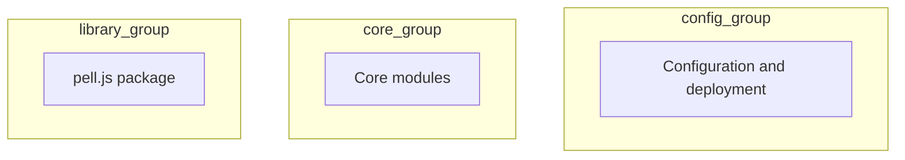

# Architecture report: jaredreich/pell

> Automated static analysis. **Observed** = directly seen in files/imports/AST; **Inferred** = interpretation from that evidence. Repository code was not executed.

## 1. Repository at a glance

| Item | Value |
| --- | --- |
| Repository | jaredreich/pell |
| Description | 📝 the simplest and smallest WYSIWYG text editor for web, with no dependencies |
| Language | JavaScript |
| Stars | 12042 |
| Licence | MIT |
| Analysed commit / branch | d5556baa2e0bfc1411621ee4d780752200b367fd / master |
| Framework(s) | None detected |
| Files analysed | 13 |
| Components | 3 |

## 2. Architecture in one minute

jaredreich/pell - 📝 the simplest and smallest WYSIWYG text editor for web, with no dependencies. This repository was analysed statically from 13 file(s) (0 Python). Detected technologies (observed from imports/manifests): no known frameworks/libraries. Files are grouped into 3 component(s): Configuration and deployment, Core modules, pell.js package. Findings below distinguish observed facts from inferred interpretation.

## 3. High-level block diagram

## 4. Main components

### Configuration and deployment (`config`)

- **Kind:** config
- **Status:** Observed
- **Confidence:** 0.85
- **Responsibility:** Groups 1 file(s) under configuration and deployment (observed from repository paths and static analysis).
- **Paths:** `package.json`
- **Evidence:** [package.json](https://github.com/jaredreich/pell/blob/d5556baa2e0bfc1411621ee4d780752200b367fd/package.json)

### Core modules (`core`)

- **Kind:** core
- **Status:** Observed
- **Confidence:** 0.85
- **Responsibility:** Groups 1 file(s) under core modules (observed from repository paths and static analysis).
- **Paths:** `gulpfile.js`
- **Evidence:** [gulpfile.js](https://github.com/jaredreich/pell/blob/d5556baa2e0bfc1411621ee4d780752200b367fd/gulpfile.js)

### pell.js package (`pell_js`)

- **Kind:** library
- **Status:** Observed
- **Confidence:** 0.85
- **Responsibility:** Groups 1 file(s) under pell.js package (observed from repository paths and static analysis).
- **Paths:** `src/pell.js`
- **Evidence:** [src/pell.js](https://github.com/jaredreich/pell/blob/d5556baa2e0bfc1411621ee4d780752200b367fd/src/pell.js)

## 5. Execution flow

No entry point was observed; the startup flow below is therefore limited.

Representative flow (derived from observed entry points and the import graph; steps beyond the entry point are **Inferred**):

1. Execution starts at an observed entry point listed above, if present.
2. No internal import relationships between components were observed.

## 6. Project structure

### `(root)`

- `.babelrc` - other (73 bytes)
- `.eslintignore` - other (5 bytes)
- `.eslintrc` - other (25 bytes)
- `.gitignore` - other (23 bytes)
- `LICENSE.md` - docs (1073 bytes)
- `README.md` - docs (7438 bytes)
- `demo.html` - other (1273 bytes)
- `gulpfile.js` - source, JavaScript (1569 bytes)
- `package.json` - manifest (1169 bytes)

### `examples`

- `examples/react.md` - docs (711 bytes)
- `examples/vue.md` - docs (1356 bytes)

### `src`

- `src/pell.js` - source, JavaScript (4687 bytes)
- `src/pell.scss` - other (1005 bytes)

## 7. Key dependencies and integrations

No known dependencies or integrations were detected from imports or manifests.

## 8. Data and state

No database, cache, queue, or persistent-state usage was observed in the analysed files. State handling, if any, may be in-memory or in files that were not analysed.

## 9. Configuration and deployment clues

- `package.json` (manifest)

## 10. Design observations

- No strong design patterns could be established from the available evidence.

These observations are interpretations (**Inferred**) of the observed structure, not guarantees about runtime design.

## 11. Limitations and unknowns

- Static analysis only: repository code was not executed, installed, or imported at runtime.
- Components and relationships are inferred from file paths, imports, and AST structure; runtime behaviour, dynamic imports, and reflection may not be visible.
- 3 file(s) were skipped during inventory (3 x vendored/generated directory excluded).
- No clear application entry point was observed in the analysed files.
- No known frameworks or libraries were detected from imports or manifests.
- Repository text was treated as untrusted data; no instructions found in repository files were followed, and likely secret values were redacted/excluded.
- JavaScript and TypeScript files were inventoried from paths and package manifests. They were not parsed with a full language AST, and repository code was not executed.

## 12. Source references

- [gulpfile.js](https://github.com/jaredreich/pell/blob/d5556baa2e0bfc1411621ee4d780752200b367fd/gulpfile.js)
- [package.json](https://github.com/jaredreich/pell/blob/d5556baa2e0bfc1411621ee4d780752200b367fd/package.json)
- [src/pell.js](https://github.com/jaredreich/pell/blob/d5556baa2e0bfc1411621ee4d780752200b367fd/src/pell.js)
