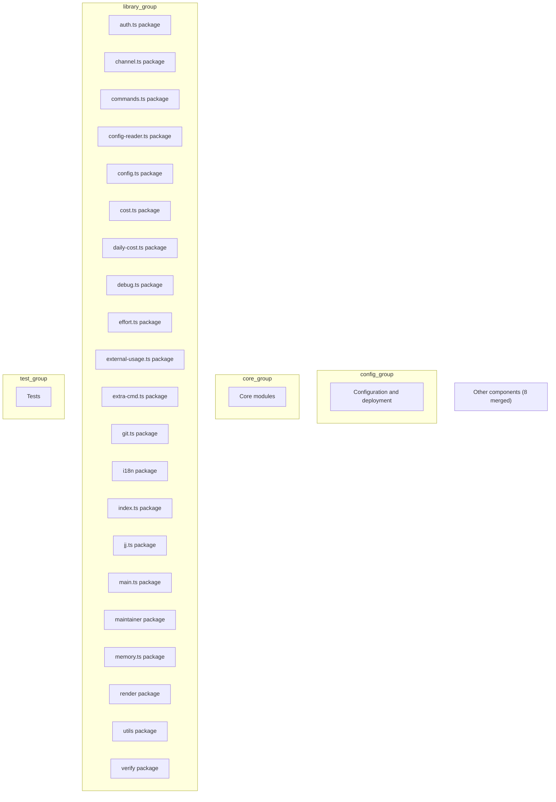

# Architecture report: jarrodwatts/claude-hud

> Automated static analysis. **Observed** = directly seen in files/imports/AST; **Inferred** = interpretation from that evidence. Repository code was not executed.

## 1. Repository at a glance

| Item | Value |
| --- | --- |
| Repository | jarrodwatts/claude-hud |
| Description | A Claude Code plugin that shows what's happening - context usage, active tools, running agents, and todo progress |
| Language | JavaScript |
| Stars | 29201 |
| Licence | MIT |
| Analysed commit / branch | 9d2b6fa4df43c8ced61c0c23956fd291551726ac / main |
| Framework(s) | None detected |
| Files analysed | 160 |
| Components | 32 |

## 2. Architecture in one minute

jarrodwatts/claude-hud - A Claude Code plugin that shows what's happening - context usage, active tools, running agents, and todo progress. This repository was analysed statically from 160 file(s) (0 Python). Detected technologies (observed from imports/manifests): GitHub Actions, TypeScript. Files are grouped into 32 component(s): auth.ts package, channel.ts package, commands.ts package, Configuration and deployment, config-reader.ts package, config.ts package, Core modules, cost.ts package. Findings below distinguish observed facts from inferred interpretation.

## 3. High-level block diagram

## 4. Main components

### auth.ts package (`auth_ts`)

- **Kind:** library
- **Status:** Observed
- **Confidence:** 0.85
- **Responsibility:** Groups 1 file(s) under auth.ts package (observed from repository paths and static analysis).
- **Paths:** `src/auth.ts`
- **Evidence:** [src/auth.ts](https://github.com/jarrodwatts/claude-hud/blob/9d2b6fa4df43c8ced61c0c23956fd291551726ac/src/auth.ts)

### channel.ts package (`channel_ts`)

- **Kind:** library
- **Status:** Observed
- **Confidence:** 0.85
- **Responsibility:** Groups 1 file(s) under channel.ts package (observed from repository paths and static analysis).
- **Paths:** `src/channel.ts`
- **Evidence:** [src/channel.ts](https://github.com/jarrodwatts/claude-hud/blob/9d2b6fa4df43c8ced61c0c23956fd291551726ac/src/channel.ts)

### commands.ts package (`commands_ts`)

- **Kind:** library
- **Status:** Observed
- **Confidence:** 0.85
- **Responsibility:** Groups 1 file(s) under commands.ts package (observed from repository paths and static analysis).
- **Paths:** `src/commands.ts`
- **Evidence:** [src/commands.ts](https://github.com/jarrodwatts/claude-hud/blob/9d2b6fa4df43c8ced61c0c23956fd291551726ac/src/commands.ts)

### Configuration and deployment (`config`)

- **Kind:** config
- **Status:** Observed
- **Confidence:** 0.85
- **Responsibility:** Groups 3 file(s) under configuration and deployment (observed from repository paths and static analysis).
- **Paths:** `maintainer/outbox.schema.json`, `package.json`, `tsconfig.json`
- **Evidence:** [maintainer/outbox.schema.json](https://github.com/jarrodwatts/claude-hud/blob/9d2b6fa4df43c8ced61c0c23956fd291551726ac/maintainer/outbox.schema.json); [package.json](https://github.com/jarrodwatts/claude-hud/blob/9d2b6fa4df43c8ced61c0c23956fd291551726ac/package.json); [tsconfig.json](https://github.com/jarrodwatts/claude-hud/blob/9d2b6fa4df43c8ced61c0c23956fd291551726ac/tsconfig.json)

### config-reader.ts package (`config_reader_ts`)

- **Kind:** library
- **Status:** Observed
- **Confidence:** 0.85
- **Responsibility:** Groups 1 file(s) under config-reader.ts package (observed from repository paths and static analysis).
- **Paths:** `src/config-reader.ts`
- **Evidence:** [src/config-reader.ts](https://github.com/jarrodwatts/claude-hud/blob/9d2b6fa4df43c8ced61c0c23956fd291551726ac/src/config-reader.ts)

### config.ts package (`config_ts`)

- **Kind:** library
- **Status:** Observed
- **Confidence:** 0.85
- **Responsibility:** Groups 1 file(s) under config.ts package (observed from repository paths and static analysis).
- **Paths:** `src/config.ts`
- **Evidence:** [src/config.ts](https://github.com/jarrodwatts/claude-hud/blob/9d2b6fa4df43c8ced61c0c23956fd291551726ac/src/config.ts)

### Core modules (`core`)

- **Kind:** core
- **Status:** Observed
- **Confidence:** 0.85
- **Responsibility:** Groups 4 file(s) under core modules (observed from repository paths and static analysis).
- **Paths:** `collector.mjs`, `fence.mjs`, `hud.mjs`, `install.mjs`
- **Evidence:** [collector.mjs](https://github.com/jarrodwatts/claude-hud/blob/9d2b6fa4df43c8ced61c0c23956fd291551726ac/collector.mjs); [fence.mjs](https://github.com/jarrodwatts/claude-hud/blob/9d2b6fa4df43c8ced61c0c23956fd291551726ac/fence.mjs); [hud.mjs](https://github.com/jarrodwatts/claude-hud/blob/9d2b6fa4df43c8ced61c0c23956fd291551726ac/hud.mjs); [install.mjs](https://github.com/jarrodwatts/claude-hud/blob/9d2b6fa4df43c8ced61c0c23956fd291551726ac/install.mjs)

### cost.ts package (`cost_ts`)

- **Kind:** library
- **Status:** Observed
- **Confidence:** 0.85
- **Responsibility:** Groups 1 file(s) under cost.ts package (observed from repository paths and static analysis).
- **Paths:** `src/cost.ts`
- **Evidence:** [src/cost.ts](https://github.com/jarrodwatts/claude-hud/blob/9d2b6fa4df43c8ced61c0c23956fd291551726ac/src/cost.ts)

### daily-cost.ts package (`daily_cost_ts`)

- **Kind:** library
- **Status:** Observed
- **Confidence:** 0.85
- **Responsibility:** Groups 1 file(s) under daily-cost.ts package (observed from repository paths and static analysis).
- **Paths:** `src/daily-cost.ts`
- **Evidence:** [src/daily-cost.ts](https://github.com/jarrodwatts/claude-hud/blob/9d2b6fa4df43c8ced61c0c23956fd291551726ac/src/daily-cost.ts)

### debug.ts package (`debug_ts`)

- **Kind:** library
- **Status:** Observed
- **Confidence:** 0.85
- **Responsibility:** Groups 1 file(s) under debug.ts package (observed from repository paths and static analysis).
- **Paths:** `src/debug.ts`
- **Evidence:** [src/debug.ts](https://github.com/jarrodwatts/claude-hud/blob/9d2b6fa4df43c8ced61c0c23956fd291551726ac/src/debug.ts)

### effort.ts package (`effort_ts`)

- **Kind:** library
- **Status:** Observed
- **Confidence:** 0.85
- **Responsibility:** Groups 1 file(s) under effort.ts package (observed from repository paths and static analysis).
- **Paths:** `src/effort.ts`
- **Evidence:** [src/effort.ts](https://github.com/jarrodwatts/claude-hud/blob/9d2b6fa4df43c8ced61c0c23956fd291551726ac/src/effort.ts)

### external-usage.ts package (`external_usage_ts`)

- **Kind:** library
- **Status:** Observed
- **Confidence:** 0.85
- **Responsibility:** Groups 1 file(s) under external-usage.ts package (observed from repository paths and static analysis).
- **Paths:** `src/external-usage.ts`
- **Evidence:** [src/external-usage.ts](https://github.com/jarrodwatts/claude-hud/blob/9d2b6fa4df43c8ced61c0c23956fd291551726ac/src/external-usage.ts)

### extra-cmd.ts package (`extra_cmd_ts`)

- **Kind:** library
- **Status:** Observed
- **Confidence:** 0.85
- **Responsibility:** Groups 1 file(s) under extra-cmd.ts package (observed from repository paths and static analysis).
- **Paths:** `src/extra-cmd.ts`
- **Evidence:** [src/extra-cmd.ts](https://github.com/jarrodwatts/claude-hud/blob/9d2b6fa4df43c8ced61c0c23956fd291551726ac/src/extra-cmd.ts)

### git.ts package (`git_ts`)

- **Kind:** library
- **Status:** Observed
- **Confidence:** 0.85
- **Responsibility:** Groups 1 file(s) under git.ts package (observed from repository paths and static analysis).
- **Paths:** `src/git.ts`
- **Evidence:** [src/git.ts](https://github.com/jarrodwatts/claude-hud/blob/9d2b6fa4df43c8ced61c0c23956fd291551726ac/src/git.ts)

### i18n package (`i18n`)

- **Kind:** library
- **Status:** Observed
- **Confidence:** 0.85
- **Responsibility:** Groups 5 file(s) under i18n package (observed from repository paths and static analysis).
- **Paths:** `src/i18n/en.ts`, `src/i18n/index.ts`, `src/i18n/types.ts`, `src/i18n/zh-Hans.ts`, `src/i18n/zh-Hant.ts`
- **Evidence:** [src/i18n/en.ts](https://github.com/jarrodwatts/claude-hud/blob/9d2b6fa4df43c8ced61c0c23956fd291551726ac/src/i18n/en.ts); [src/i18n/index.ts](https://github.com/jarrodwatts/claude-hud/blob/9d2b6fa4df43c8ced61c0c23956fd291551726ac/src/i18n/index.ts); [src/i18n/types.ts](https://github.com/jarrodwatts/claude-hud/blob/9d2b6fa4df43c8ced61c0c23956fd291551726ac/src/i18n/types.ts); [src/i18n/zh-Hans.ts](https://github.com/jarrodwatts/claude-hud/blob/9d2b6fa4df43c8ced61c0c23956fd291551726ac/src/i18n/zh-Hans.ts); [src/i18n/zh-Hant.ts](https://github.com/jarrodwatts/claude-hud/blob/9d2b6fa4df43c8ced61c0c23956fd291551726ac/src/i18n/zh-Hant.ts)

### index.ts package (`index_ts`)

- **Kind:** library
- **Status:** Observed
- **Confidence:** 0.85
- **Responsibility:** Groups 1 file(s) under index.ts package (observed from repository paths and static analysis).
- **Paths:** `src/index.ts`
- **Evidence:** [src/index.ts](https://github.com/jarrodwatts/claude-hud/blob/9d2b6fa4df43c8ced61c0c23956fd291551726ac/src/index.ts)

### jj.ts package (`jj_ts`)

- **Kind:** library
- **Status:** Observed
- **Confidence:** 0.85
- **Responsibility:** Groups 1 file(s) under jj.ts package (observed from repository paths and static analysis).
- **Paths:** `src/jj.ts`
- **Evidence:** [src/jj.ts](https://github.com/jarrodwatts/claude-hud/blob/9d2b6fa4df43c8ced61c0c23956fd291551726ac/src/jj.ts)

### main.ts package (`main_ts`)

- **Kind:** library
- **Status:** Observed
- **Confidence:** 0.85
- **Responsibility:** Groups 1 file(s) under main.ts package (observed from repository paths and static analysis).
- **Paths:** `src/main.ts`
- **Evidence:** [src/main.ts](https://github.com/jarrodwatts/claude-hud/blob/9d2b6fa4df43c8ced61c0c23956fd291551726ac/src/main.ts)

### maintainer package (`maintainer`)

- **Kind:** library
- **Status:** Observed
- **Confidence:** 0.85
- **Responsibility:** Groups 4 file(s) under maintainer package (observed from repository paths and static analysis).
- **Paths:** `maintainer/act.mjs`, `maintainer/harness.mjs`, `maintainer/probe.mjs`, `maintainer/scorecard.mjs`
- **Evidence:** [maintainer/act.mjs](https://github.com/jarrodwatts/claude-hud/blob/9d2b6fa4df43c8ced61c0c23956fd291551726ac/maintainer/act.mjs); [maintainer/harness.mjs](https://github.com/jarrodwatts/claude-hud/blob/9d2b6fa4df43c8ced61c0c23956fd291551726ac/maintainer/harness.mjs); [maintainer/probe.mjs](https://github.com/jarrodwatts/claude-hud/blob/9d2b6fa4df43c8ced61c0c23956fd291551726ac/maintainer/probe.mjs); [maintainer/scorecard.mjs](https://github.com/jarrodwatts/claude-hud/blob/9d2b6fa4df43c8ced61c0c23956fd291551726ac/maintainer/scorecard.mjs)

### memory.ts package (`memory_ts`)

- **Kind:** library
- **Status:** Observed
- **Confidence:** 0.85
- **Responsibility:** Groups 1 file(s) under memory.ts package (observed from repository paths and static analysis).
- **Paths:** `src/memory.ts`
- **Evidence:** [src/memory.ts](https://github.com/jarrodwatts/claude-hud/blob/9d2b6fa4df43c8ced61c0c23956fd291551726ac/src/memory.ts)

### model-source.ts package (`model_source_ts`)

- **Kind:** library
- **Status:** Observed
- **Confidence:** 0.85
- **Responsibility:** Groups 1 file(s) under model-source.ts package (observed from repository paths and static analysis).
- **Paths:** `src/model-source.ts`
- **Evidence:** [src/model-source.ts](https://github.com/jarrodwatts/claude-hud/blob/9d2b6fa4df43c8ced61c0c23956fd291551726ac/src/model-source.ts)

### render package (`render`)

- **Kind:** library
- **Status:** Observed
- **Confidence:** 0.85
- **Responsibility:** Groups 16 file(s) under render package (observed from repository paths and static analysis).
- **Paths:** `src/render/activity.ts`, `src/render/ansi.ts`, `src/render/colors.ts`, `src/render/compact.ts`, `src/render/context.ts`, `src/render/derive.ts`, `src/render/expanded.ts`, `src/render/frame.ts`, `src/render/index.ts`, `src/render/labels.ts`, `src/render/lines.ts`, `src/render/order.ts`, `src/render/parts.ts`, `src/render/time.ts`, `src/render/usage.ts`, `src/render/vcs.ts`
- **Evidence:** [src/render/activity.ts](https://github.com/jarrodwatts/claude-hud/blob/9d2b6fa4df43c8ced61c0c23956fd291551726ac/src/render/activity.ts); [src/render/ansi.ts](https://github.com/jarrodwatts/claude-hud/blob/9d2b6fa4df43c8ced61c0c23956fd291551726ac/src/render/ansi.ts); [src/render/colors.ts](https://github.com/jarrodwatts/claude-hud/blob/9d2b6fa4df43c8ced61c0c23956fd291551726ac/src/render/colors.ts); [src/render/compact.ts](https://github.com/jarrodwatts/claude-hud/blob/9d2b6fa4df43c8ced61c0c23956fd291551726ac/src/render/compact.ts); [src/render/context.ts](https://github.com/jarrodwatts/claude-hud/blob/9d2b6fa4df43c8ced61c0c23956fd291551726ac/src/render/context.ts); [src/render/derive.ts](https://github.com/jarrodwatts/claude-hud/blob/9d2b6fa4df43c8ced61c0c23956fd291551726ac/src/render/derive.ts); [src/render/expanded.ts](https://github.com/jarrodwatts/claude-hud/blob/9d2b6fa4df43c8ced61c0c23956fd291551726ac/src/render/expanded.ts); [src/render/frame.ts](https://github.com/jarrodwatts/claude-hud/blob/9d2b6fa4df43c8ced61c0c23956fd291551726ac/src/render/frame.ts)

### schema.ts package (`schema_ts`)

- **Kind:** library
- **Status:** Observed
- **Confidence:** 0.85
- **Responsibility:** Groups 1 file(s) under schema.ts package (observed from repository paths and static analysis).
- **Paths:** `src/schema.ts`
- **Evidence:** [src/schema.ts](https://github.com/jarrodwatts/claude-hud/blob/9d2b6fa4df43c8ced61c0c23956fd291551726ac/src/schema.ts)

### scripts package (`scripts`)

- **Kind:** library
- **Status:** Observed
- **Confidence:** 0.85
- **Responsibility:** Groups 1 file(s) under scripts package (observed from repository paths and static analysis).
- **Paths:** `scripts/statusline.mjs`
- **Evidence:** [scripts/statusline.mjs](https://github.com/jarrodwatts/claude-hud/blob/9d2b6fa4df43c8ced61c0c23956fd291551726ac/scripts/statusline.mjs)

### speed.ts package (`speed_ts`)

- **Kind:** library
- **Status:** Observed
- **Confidence:** 0.85
- **Responsibility:** Groups 1 file(s) under speed.ts package (observed from repository paths and static analysis).
- **Paths:** `src/speed.ts`
- **Evidence:** [src/speed.ts](https://github.com/jarrodwatts/claude-hud/blob/9d2b6fa4df43c8ced61c0c23956fd291551726ac/src/speed.ts)

### stdin.ts package (`stdin_ts`)

- **Kind:** library
- **Status:** Observed
- **Confidence:** 0.85
- **Responsibility:** Groups 1 file(s) under stdin.ts package (observed from repository paths and static analysis).
- **Paths:** `src/stdin.ts`
- **Evidence:** [src/stdin.ts](https://github.com/jarrodwatts/claude-hud/blob/9d2b6fa4df43c8ced61c0c23956fd291551726ac/src/stdin.ts)

### Tests (`tests`)

- **Kind:** test
- **Status:** Observed
- **Confidence:** 0.85
- **Responsibility:** Groups 62 file(s) under tests (observed from repository paths and static analysis).
- **Paths:** `tests/ansi.test.js`, `tests/auth.test.js`, `tests/cage.test.js`, `tests/clean-env.js`, `tests/commands.test.js`, `tests/config-reader.test.js`, `tests/config.test.js`, `tests/corpus/0100-daily-cost-numeric-session-id.json`, `tests/corpus/0100-model-name-escapes.json`, `tests/corpus/0100-output-style-escapes.json`, `tests/corpus/0378-no-stdin-kept-open.json`, `tests/corpus/0430-initial-zero-frame.json`, `tests/corpus/0589-autocompact-window-not-integer.json`, `tests/corpus/0662-weekly-hidden-below-default-threshold.json`, `tests/corpus/0673-cjk-narrow-fits.json`, `tests/corpus/0678-full-path-bidi.json`, `tests/corpus/0687-variation-selectors-fit.json`, `tests/corpus/0693-hostile-max-width.json`, `tests/corpus/0727-prompt-cache-until.json`, `tests/corpus/0753-version-from-stdin.json`, `tests/corpus/0754-session-name-escapes.json`, `tests/corpus/0801-partial-stdin-kept-open.json`, `tests/corpus/0811-folder-separator-closes-link.json`, `tests/corpus/0830-jj-bookmark-emoji-at-cap.json`, `tests/corpus/0830-output-style-emoji-at-cap.json`, `tests/corpus/0830-session-name-emoji-at-cap.json`, `tests/corpus/0857-changed-files-git-order.json`, `tests/corpus/changelog-0.10.0-vcs-branch-link-from-workspace-repo.json`, `tests/corpus/changelog-0.10.0-vcs-no-commits-shows-branch.json`, `tests/daily-cost.test.js`, `tests/effort.test.js`, `tests/external-usage.test.js`, `tests/extra-cmd.test.js`, `tests/fixtures/expected/render-basic.txt`, `tests/fixtures/transcript-render.jsonl`, `tests/fixtures/transcript-ultracode.jsonl`, `tests/format-reset-time.test.js`, `tests/git-runner.test.js`, `tests/git.test.js`, `tests/golden.test.js`, `tests/golden/cases.mjs`, `tests/golden/expected.txt`, `tests/golden/freeze-time.mjs`, `tests/golden/transcript-activity.jsonl`, `tests/golden/transcript-deleted-tasks.jsonl`, `tests/golden/transcript.jsonl`, `tests/hud.test.js`, `tests/hyperlinks.test.js`, `tests/i18n.test.js`, `tests/install.test.js`, `tests/integration.test.js`, `tests/jj.test.js`, `tests/memory-coverage.test.js`, `tests/memory.test.js`, `tests/prompt-cache.test.js`, `tests/render.test.js`, `tests/speed.test.js`, `tests/stdin.test.js`, `tests/terminal.test.js`, `tests/transcript.test.js`, `tests/truncate.test.js`, `tests/usage-pace.test.js`
- **Evidence:** [tests/ansi.test.js](https://github.com/jarrodwatts/claude-hud/blob/9d2b6fa4df43c8ced61c0c23956fd291551726ac/tests/ansi.test.js); [tests/auth.test.js](https://github.com/jarrodwatts/claude-hud/blob/9d2b6fa4df43c8ced61c0c23956fd291551726ac/tests/auth.test.js); [tests/cage.test.js](https://github.com/jarrodwatts/claude-hud/blob/9d2b6fa4df43c8ced61c0c23956fd291551726ac/tests/cage.test.js); [tests/clean-env.js](https://github.com/jarrodwatts/claude-hud/blob/9d2b6fa4df43c8ced61c0c23956fd291551726ac/tests/clean-env.js); [tests/commands.test.js](https://github.com/jarrodwatts/claude-hud/blob/9d2b6fa4df43c8ced61c0c23956fd291551726ac/tests/commands.test.js); [tests/config-reader.test.js](https://github.com/jarrodwatts/claude-hud/blob/9d2b6fa4df43c8ced61c0c23956fd291551726ac/tests/config-reader.test.js); [tests/config.test.js](https://github.com/jarrodwatts/claude-hud/blob/9d2b6fa4df43c8ced61c0c23956fd291551726ac/tests/config.test.js); [tests/corpus/0100-daily-cost-numeric-session-id.json](https://github.com/jarrodwatts/claude-hud/blob/9d2b6fa4df43c8ced61c0c23956fd291551726ac/tests/corpus/0100-daily-cost-numeric-session-id.json)

### transcript.ts package (`transcript_ts`)

- **Kind:** library
- **Status:** Observed
- **Confidence:** 0.85
- **Responsibility:** Groups 1 file(s) under transcript.ts package (observed from repository paths and static analysis).
- **Paths:** `src/transcript.ts`
- **Evidence:** [src/transcript.ts](https://github.com/jarrodwatts/claude-hud/blob/9d2b6fa4df43c8ced61c0c23956fd291551726ac/src/transcript.ts)

### types.ts package (`types_ts`)

- **Kind:** library
- **Status:** Observed
- **Confidence:** 0.85
- **Responsibility:** Groups 1 file(s) under types.ts package (observed from repository paths and static analysis).
- **Paths:** `src/types.ts`
- **Evidence:** [src/types.ts](https://github.com/jarrodwatts/claude-hud/blob/9d2b6fa4df43c8ced61c0c23956fd291551726ac/src/types.ts)

### usage-pace.ts package (`usage_pace_ts`)

- **Kind:** library
- **Status:** Observed
- **Confidence:** 0.85
- **Responsibility:** Groups 1 file(s) under usage-pace.ts package (observed from repository paths and static analysis).
- **Paths:** `src/usage-pace.ts`
- **Evidence:** [src/usage-pace.ts](https://github.com/jarrodwatts/claude-hud/blob/9d2b6fa4df43c8ced61c0c23956fd291551726ac/src/usage-pace.ts)

### utils package (`utils`)

- **Kind:** library
- **Status:** Observed
- **Confidence:** 0.85
- **Responsibility:** Groups 5 file(s) under utils package (observed from repository paths and static analysis).
- **Paths:** `src/utils/format.ts`, `src/utils/hyperlinks.ts`, `src/utils/sanitize.ts`, `src/utils/terminal.ts`, `src/utils/truncate.ts`
- **Evidence:** [src/utils/format.ts](https://github.com/jarrodwatts/claude-hud/blob/9d2b6fa4df43c8ced61c0c23956fd291551726ac/src/utils/format.ts); [src/utils/hyperlinks.ts](https://github.com/jarrodwatts/claude-hud/blob/9d2b6fa4df43c8ced61c0c23956fd291551726ac/src/utils/hyperlinks.ts); [src/utils/sanitize.ts](https://github.com/jarrodwatts/claude-hud/blob/9d2b6fa4df43c8ced61c0c23956fd291551726ac/src/utils/sanitize.ts); [src/utils/terminal.ts](https://github.com/jarrodwatts/claude-hud/blob/9d2b6fa4df43c8ced61c0c23956fd291551726ac/src/utils/terminal.ts); [src/utils/truncate.ts](https://github.com/jarrodwatts/claude-hud/blob/9d2b6fa4df43c8ced61c0c23956fd291551726ac/src/utils/truncate.ts)

### verify package (`verify`)

- **Kind:** library
- **Status:** Observed
- **Confidence:** 0.85
- **Responsibility:** Groups 14 file(s) under verify package (observed from repository paths and static analysis).
- **Paths:** `verify/arch.check.mjs`, `verify/case.mjs`, `verify/corpus.check.mjs`, `verify/e2e.check.mjs`, `verify/escape.check.mjs`, `verify/launcher.check.mjs`, `verify/lib/ans2html.mjs`, `verify/lib/claude-code.mjs`, `verify/lib/escape-probe.mjs`, `verify/lib/fake-api.mjs`, `verify/lib/fake-github.mjs`, `verify/maintainer.check.mjs`, `verify/owner.check.mjs`, `verify/run.mjs`
- **Evidence:** [verify/arch.check.mjs](https://github.com/jarrodwatts/claude-hud/blob/9d2b6fa4df43c8ced61c0c23956fd291551726ac/verify/arch.check.mjs); [verify/case.mjs](https://github.com/jarrodwatts/claude-hud/blob/9d2b6fa4df43c8ced61c0c23956fd291551726ac/verify/case.mjs); [verify/corpus.check.mjs](https://github.com/jarrodwatts/claude-hud/blob/9d2b6fa4df43c8ced61c0c23956fd291551726ac/verify/corpus.check.mjs); [verify/e2e.check.mjs](https://github.com/jarrodwatts/claude-hud/blob/9d2b6fa4df43c8ced61c0c23956fd291551726ac/verify/e2e.check.mjs); [verify/escape.check.mjs](https://github.com/jarrodwatts/claude-hud/blob/9d2b6fa4df43c8ced61c0c23956fd291551726ac/verify/escape.check.mjs); [verify/launcher.check.mjs](https://github.com/jarrodwatts/claude-hud/blob/9d2b6fa4df43c8ced61c0c23956fd291551726ac/verify/launcher.check.mjs); [verify/lib/ans2html.mjs](https://github.com/jarrodwatts/claude-hud/blob/9d2b6fa4df43c8ced61c0c23956fd291551726ac/verify/lib/ans2html.mjs); [verify/lib/claude-code.mjs](https://github.com/jarrodwatts/claude-hud/blob/9d2b6fa4df43c8ced61c0c23956fd291551726ac/verify/lib/claude-code.mjs)

## 5. Execution flow

**Observed** entry point(s):

- [hud.mjs](https://github.com/jarrodwatts/claude-hud/blob/9d2b6fa4df43c8ced61c0c23956fd291551726ac/hud.mjs)
- [src/i18n/index.ts](https://github.com/jarrodwatts/claude-hud/blob/9d2b6fa4df43c8ced61c0c23956fd291551726ac/src/i18n/index.ts)
- [src/index.ts](https://github.com/jarrodwatts/claude-hud/blob/9d2b6fa4df43c8ced61c0c23956fd291551726ac/src/index.ts)
- [src/main.ts](https://github.com/jarrodwatts/claude-hud/blob/9d2b6fa4df43c8ced61c0c23956fd291551726ac/src/main.ts)
- [src/render/index.ts](https://github.com/jarrodwatts/claude-hud/blob/9d2b6fa4df43c8ced61c0c23956fd291551726ac/src/render/index.ts)

Representative flow (derived from observed entry points and the import graph; steps beyond the entry point are **Inferred**):

1. Execution starts at an observed entry point listed above, if present.
2. No internal import relationships between components were observed.

## 6. Project structure

### `(root)`

- `.editorconfig` - config (188 bytes)
- `.gitignore` - other (664 bytes)
- `ARCHITECTURE.md` - docs (6008 bytes)
- `CHANGELOG.md` - docs (38441 bytes)
- `CLAUDE.md` - docs (5849 bytes)
- `CODE_OF_CONDUCT.md` - docs (1384 bytes)
- `CONTRIBUTING.md` - docs (3352 bytes)
- `LICENSE` - docs (1069 bytes)
- `README.md` - docs (4152 bytes)
- `README.zh.md` - docs (4274 bytes)
- `SECURITY.md` - docs (458 bytes)
- `collector.mjs` - source, JavaScript (30935 bytes)
- `fence.mjs` - source, JavaScript (4860 bytes)
- `hud.mjs` - source, JavaScript (16759 bytes)
- `install.mjs` - source, JavaScript (4550 bytes)
- `package.json` - manifest (970 bytes)
- `tsconfig.json` - config (415 bytes)

### `.claude-plugin`

- `.claude-plugin/marketplace.json` - config (622 bytes)
- `.claude-plugin/plugin.json` - config (514 bytes)

### `.github`

- `.github/ISSUE_TEMPLATE/bug_report.md` - docs (241 bytes)
- `.github/ISSUE_TEMPLATE/case.yml` - config (728 bytes)
- `.github/ISSUE_TEMPLATE/config.yml` - config (230 bytes)
- `.github/ISSUE_TEMPLATE/feature_request.md` - docs (194 bytes)
- `.github/pull_request_template.md` - docs (155 bytes)
- `.github/workflows/ci.yml` - ci, YAML (861 bytes)
- `.github/workflows/maintain.yml` - ci, YAML (3899 bytes)
- `.github/workflows/verify.yml` - ci, YAML (2502 bytes)

### `maintainer`

- `maintainer/PLAYBOOK.md` - docs (3606 bytes)
- `maintainer/act.mjs` - source, JavaScript (12346 bytes)
- `maintainer/harness.mjs` - source, JavaScript (13897 bytes)
- `maintainer/outbox.schema.json` - config (2209 bytes)
- `maintainer/probe.mjs` - source, JavaScript (3925 bytes)
- `maintainer/scorecard.mjs` - source, JavaScript (2835 bytes)

### `scripts`

- `scripts/statusline.mjs` - source, JavaScript (1909 bytes)

### `skills`

- `skills/hud/SKILL.md` - docs (2498 bytes)

### `src`

- `src/auth.ts` - source, TypeScript (4865 bytes)
- `src/channel.ts` - source, TypeScript (4525 bytes)
- `src/commands.ts` - source, TypeScript (15616 bytes)
- `src/config-reader.ts` - source, TypeScript (4410 bytes)
- `src/config.ts` - source, TypeScript (25138 bytes)
- `src/cost.ts` - source, TypeScript (970 bytes)
- `src/daily-cost.ts` - source, TypeScript (9822 bytes)
- `src/debug.ts` - source, TypeScript (375 bytes)
- `src/effort.ts` - source, TypeScript (1368 bytes)
- `src/external-usage.ts` - source, TypeScript (6432 bytes)
- `src/extra-cmd.ts` - source, TypeScript (923 bytes)
- `src/git.ts` - source, TypeScript (7415 bytes)
- `src/i18n/en.ts` - source, TypeScript (1279 bytes)
- `src/i18n/index.ts` - source, TypeScript (1783 bytes)
- `src/i18n/types.ts` - source, TypeScript (896 bytes)
- `src/i18n/zh-Hans.ts` - source, TypeScript (1305 bytes)
- `src/i18n/zh-Hant.ts` - source, TypeScript (1308 bytes)
- `src/index.ts` - source, TypeScript (249 bytes)
- `src/jj.ts` - source, TypeScript (1554 bytes)
- `src/main.ts` - source, TypeScript (7077 bytes)
- `src/memory.ts` - source, TypeScript (2461 bytes)
- `src/model-source.ts` - source, TypeScript (480 bytes)
- `src/render/activity.ts` - source, TypeScript (7593 bytes)
- `src/render/ansi.ts` - source, TypeScript (6947 bytes)
- `src/render/colors.ts` - source, TypeScript (6486 bytes)
- `src/render/compact.ts` - source, TypeScript (2754 bytes)
- `src/render/context.ts` - source, TypeScript (1991 bytes)
- `src/render/derive.ts` - source, TypeScript (1299 bytes)
- `src/render/expanded.ts` - source, TypeScript (7315 bytes)
- `src/render/frame.ts` - source, TypeScript (729 bytes)
- `src/render/index.ts` - source, TypeScript (762 bytes)
- `src/render/labels.ts` - source, TypeScript (976 bytes)
- `src/render/lines.ts` - source, TypeScript (5193 bytes)
- `src/render/order.ts` - source, TypeScript (970 bytes)
- `src/render/parts.ts` - source, TypeScript (10682 bytes)
- `src/render/time.ts` - source, TypeScript (4072 bytes)
- `src/render/usage.ts` - source, TypeScript (6325 bytes)
- `src/render/vcs.ts` - source, TypeScript (4704 bytes)
- `src/schema.ts` - source, TypeScript (20185 bytes)
- `src/speed.ts` - source, TypeScript (3061 bytes)
- `src/stdin.ts` - source, TypeScript (5720 bytes)
- `src/transcript.ts` - source, TypeScript (27474 bytes)
- `src/types.ts` - source, TypeScript (6319 bytes)
- `src/usage-pace.ts` - source, TypeScript (3417 bytes)
- `src/utils/format.ts` - source, TypeScript (1164 bytes)
- `src/utils/hyperlinks.ts` - source, TypeScript (1205 bytes)
- `src/utils/sanitize.ts` - source, TypeScript (885 bytes)
- `src/utils/terminal.ts` - source, TypeScript (575 bytes)
- `src/utils/truncate.ts` - source, TypeScript (604 bytes)

### `tests`

- `tests/ansi.test.js` - test, JavaScript (5115 bytes)
- `tests/auth.test.js` - test, JavaScript (8718 bytes)
- `tests/cage.test.js` - test, JavaScript (5844 bytes)
- `tests/clean-env.js` - test, JavaScript (389 bytes)
- `tests/commands.test.js` - test, JavaScript (10531 bytes)
- `tests/config-reader.test.js` - test, JavaScript (20321 bytes)
- `tests/config.test.js` - test, JavaScript (14891 bytes)
- `tests/corpus/0100-daily-cost-numeric-session-id.json` - test (483 bytes)
- `tests/corpus/0100-model-name-escapes.json` - test (449 bytes)
- `tests/corpus/0100-output-style-escapes.json` - test (537 bytes)
- `tests/corpus/0378-no-stdin-kept-open.json` - test (244 bytes)
- `tests/corpus/0430-initial-zero-frame.json` - test (416 bytes)
- `tests/corpus/0589-autocompact-window-not-integer.json` - test (435 bytes)
- `tests/corpus/0662-weekly-hidden-below-default-threshold.json` - test (635 bytes)
- `tests/corpus/0673-cjk-narrow-fits.json` - test (654 bytes)
- `tests/corpus/0678-full-path-bidi.json` - test (452 bytes)
- `tests/corpus/0687-variation-selectors-fit.json` - test (629 bytes)
- `tests/corpus/0693-hostile-max-width.json` - test (416 bytes)
- `tests/corpus/0727-prompt-cache-until.json` - test (652 bytes)
- `tests/corpus/0753-version-from-stdin.json` - test (489 bytes)
- `tests/corpus/0754-session-name-escapes.json` - test (493 bytes)
- `tests/corpus/0801-partial-stdin-kept-open.json` - test (340 bytes)
- `tests/corpus/0811-folder-separator-closes-link.json` - test (475 bytes)
- `tests/corpus/0830-jj-bookmark-emoji-at-cap.json` - test (715 bytes)
- `tests/corpus/0830-output-style-emoji-at-cap.json` - test (517 bytes)
- `tests/corpus/0830-session-name-emoji-at-cap.json` - test (531 bytes)
- `tests/corpus/0857-changed-files-git-order.json` - test (918 bytes)
- `tests/corpus/changelog-0.10.0-vcs-branch-link-from-workspace-repo.json` - test (1187 bytes)
- `tests/corpus/changelog-0.10.0-vcs-no-commits-shows-branch.json` - test (565 bytes)
- `tests/daily-cost.test.js` - test, JavaScript (14194 bytes)
- `tests/effort.test.js` - test, JavaScript (1078 bytes)
- `tests/external-usage.test.js` - test, JavaScript (18107 bytes)
- `tests/extra-cmd.test.js` - test, JavaScript (2862 bytes)
- `tests/fixtures/expected/render-basic.txt` - test (65 bytes)
- `tests/fixtures/transcript-render.jsonl` - test (1524 bytes)
- `tests/fixtures/transcript-ultracode.jsonl` - test (1293 bytes)
- `tests/format-reset-time.test.js` - test, JavaScript (3738 bytes)
- `tests/git-runner.test.js` - test, JavaScript (4145 bytes)
- `tests/git.test.js` - test, JavaScript (12432 bytes)
- `tests/golden.test.js` - test, JavaScript (5231 bytes)
- `tests/golden/cases.mjs` - test, JavaScript (12750 bytes)
- `tests/golden/expected.txt` - test (51712 bytes)
- `tests/golden/freeze-time.mjs` - test, JavaScript (349 bytes)
- `tests/golden/transcript-activity.jsonl` - test (2927 bytes)
- `tests/golden/transcript-deleted-tasks.jsonl` - test (1040 bytes)
- `tests/golden/transcript.jsonl` - test (7662 bytes)
- `tests/hud.test.js` - test, JavaScript (3865 bytes)
- `tests/hyperlinks.test.js` - test, JavaScript (1251 bytes)
- `tests/i18n.test.js` - test, JavaScript (1523 bytes)
- `tests/install.test.js` - test, JavaScript (7828 bytes)
- `tests/integration.test.js` - test, JavaScript (19810 bytes)
- `tests/jj.test.js` - test, JavaScript (10086 bytes)
- `tests/memory-coverage.test.js` - test, JavaScript (3749 bytes)
- `tests/memory.test.js` - test, JavaScript (3882 bytes)
- `tests/prompt-cache.test.js` - test, JavaScript (2138 bytes)
- `tests/render.test.js` - test, JavaScript (29403 bytes)
- `tests/speed.test.js` - test, JavaScript (1575 bytes)
- `tests/stdin.test.js` - test, JavaScript (7227 bytes)
- `tests/terminal.test.js` - test, JavaScript (1701 bytes)
- `tests/transcript.test.js` - test, JavaScript (34163 bytes)
- `tests/truncate.test.js` - test, JavaScript (1456 bytes)
- `tests/usage-pace.test.js` - test, JavaScript (2994 bytes)

### `verify`

- `verify/arch.check.mjs` - source, JavaScript (4779 bytes)
- `verify/case.mjs` - source, JavaScript (4809 bytes)
- `verify/corpus.check.mjs` - source, JavaScript (4640 bytes)
- `verify/e2e.check.mjs` - source, JavaScript (12909 bytes)
- `verify/escape.check.mjs` - source, JavaScript (3806 bytes)
- `verify/launcher.check.mjs` - source, JavaScript (4295 bytes)
- `verify/lib/ans2html.mjs` - source, JavaScript (3056 bytes)
- `verify/lib/claude-code.mjs` - source, JavaScript (1408 bytes)
- `verify/lib/escape-probe.mjs` - source, JavaScript (8788 bytes)
- `verify/lib/fake-api.mjs` - source, JavaScript (3628 bytes)
- `verify/lib/fake-github.mjs` - source, JavaScript (1485 bytes)
- `verify/maintainer.check.mjs` - source, JavaScript (22135 bytes)
- `verify/owner.check.mjs` - source, JavaScript (14948 bytes)
- `verify/run.mjs` - source, JavaScript (2047 bytes)

## 7. Key dependencies and integrations

| Name | Category | Status | Confidence | Evidence |
| --- | --- | --- | --- | --- |
| GitHub Actions | ci | Observed | 0.90 | [.github/workflows/ci.yml](https://github.com/jarrodwatts/claude-hud/blob/9d2b6fa4df43c8ced61c0c23956fd291551726ac/.github/workflows/ci.yml); [.github/workflows/maintain.yml](https://github.com/jarrodwatts/claude-hud/blob/9d2b6fa4df43c8ced61c0c23956fd291551726ac/.github/workflows/maintain.yml); [.github/workflows/verify.yml](https://github.com/jarrodwatts/claude-hud/blob/9d2b6fa4df43c8ced61c0c23956fd291551726ac/.github/workflows/verify.yml) |
| TypeScript | tooling | Observed | 0.85 | [package.json:36](https://github.com/jarrodwatts/claude-hud/blob/9d2b6fa4df43c8ced61c0c23956fd291551726ac/package.json#L36) |

## 8. Data and state

No database, cache, queue, or persistent-state usage was observed in the analysed files. State handling, if any, may be in-memory or in files that were not analysed.

## 9. Configuration and deployment clues

- `.claude-plugin/marketplace.json` (config)
- `.claude-plugin/plugin.json` (config)
- `.editorconfig` (config)
- `.github/ISSUE_TEMPLATE/case.yml` (config)
- `.github/ISSUE_TEMPLATE/config.yml` (config)
- `.github/workflows/ci.yml` (ci)
- `.github/workflows/maintain.yml` (ci)
- `.github/workflows/verify.yml` (ci)
- `maintainer/outbox.schema.json` (config)
- `package.json` (manifest)
- `tsconfig.json` (config)

## 10. Design observations

- Tests are present alongside source code (Observed from test file paths).

These observations are interpretations (**Inferred**) of the observed structure, not guarantees about runtime design.

## 11. Limitations and unknowns

- Static analysis only: repository code was not executed, installed, or imported at runtime.
- Components and relationships are inferred from file paths, imports, and AST structure; runtime behaviour, dynamic imports, and reflection may not be visible.
- 2 file(s) were skipped during inventory (1 x lockfile excluded; 1 x vendored/generated directory excluded).
- No clear application entry point was observed in the analysed files.
- Repository text was treated as untrusted data; no instructions found in repository files were followed, and likely secret values were redacted/excluded.
- JavaScript and TypeScript files were inventoried from paths and package manifests. They were not parsed with a full language AST, and repository code was not executed.

## 12. Source references

- [.github/workflows/ci.yml](https://github.com/jarrodwatts/claude-hud/blob/9d2b6fa4df43c8ced61c0c23956fd291551726ac/.github/workflows/ci.yml)
- [.github/workflows/maintain.yml](https://github.com/jarrodwatts/claude-hud/blob/9d2b6fa4df43c8ced61c0c23956fd291551726ac/.github/workflows/maintain.yml)
- [.github/workflows/verify.yml](https://github.com/jarrodwatts/claude-hud/blob/9d2b6fa4df43c8ced61c0c23956fd291551726ac/.github/workflows/verify.yml)
- [collector.mjs](https://github.com/jarrodwatts/claude-hud/blob/9d2b6fa4df43c8ced61c0c23956fd291551726ac/collector.mjs)
- [fence.mjs](https://github.com/jarrodwatts/claude-hud/blob/9d2b6fa4df43c8ced61c0c23956fd291551726ac/fence.mjs)
- [hud.mjs](https://github.com/jarrodwatts/claude-hud/blob/9d2b6fa4df43c8ced61c0c23956fd291551726ac/hud.mjs)
- [install.mjs](https://github.com/jarrodwatts/claude-hud/blob/9d2b6fa4df43c8ced61c0c23956fd291551726ac/install.mjs)
- [maintainer/act.mjs](https://github.com/jarrodwatts/claude-hud/blob/9d2b6fa4df43c8ced61c0c23956fd291551726ac/maintainer/act.mjs)
- [maintainer/harness.mjs](https://github.com/jarrodwatts/claude-hud/blob/9d2b6fa4df43c8ced61c0c23956fd291551726ac/maintainer/harness.mjs)
- [maintainer/outbox.schema.json](https://github.com/jarrodwatts/claude-hud/blob/9d2b6fa4df43c8ced61c0c23956fd291551726ac/maintainer/outbox.schema.json)
- [maintainer/probe.mjs](https://github.com/jarrodwatts/claude-hud/blob/9d2b6fa4df43c8ced61c0c23956fd291551726ac/maintainer/probe.mjs)
- [maintainer/scorecard.mjs](https://github.com/jarrodwatts/claude-hud/blob/9d2b6fa4df43c8ced61c0c23956fd291551726ac/maintainer/scorecard.mjs)
- [package.json](https://github.com/jarrodwatts/claude-hud/blob/9d2b6fa4df43c8ced61c0c23956fd291551726ac/package.json)
- [package.json:36](https://github.com/jarrodwatts/claude-hud/blob/9d2b6fa4df43c8ced61c0c23956fd291551726ac/package.json#L36)
- [scripts/statusline.mjs](https://github.com/jarrodwatts/claude-hud/blob/9d2b6fa4df43c8ced61c0c23956fd291551726ac/scripts/statusline.mjs)
- [src/auth.ts](https://github.com/jarrodwatts/claude-hud/blob/9d2b6fa4df43c8ced61c0c23956fd291551726ac/src/auth.ts)
- [src/channel.ts](https://github.com/jarrodwatts/claude-hud/blob/9d2b6fa4df43c8ced61c0c23956fd291551726ac/src/channel.ts)
- [src/commands.ts](https://github.com/jarrodwatts/claude-hud/blob/9d2b6fa4df43c8ced61c0c23956fd291551726ac/src/commands.ts)
- [src/config-reader.ts](https://github.com/jarrodwatts/claude-hud/blob/9d2b6fa4df43c8ced61c0c23956fd291551726ac/src/config-reader.ts)
- [src/config.ts](https://github.com/jarrodwatts/claude-hud/blob/9d2b6fa4df43c8ced61c0c23956fd291551726ac/src/config.ts)
- [src/cost.ts](https://github.com/jarrodwatts/claude-hud/blob/9d2b6fa4df43c8ced61c0c23956fd291551726ac/src/cost.ts)
- [src/daily-cost.ts](https://github.com/jarrodwatts/claude-hud/blob/9d2b6fa4df43c8ced61c0c23956fd291551726ac/src/daily-cost.ts)
- [src/debug.ts](https://github.com/jarrodwatts/claude-hud/blob/9d2b6fa4df43c8ced61c0c23956fd291551726ac/src/debug.ts)
- [src/effort.ts](https://github.com/jarrodwatts/claude-hud/blob/9d2b6fa4df43c8ced61c0c23956fd291551726ac/src/effort.ts)
- [src/external-usage.ts](https://github.com/jarrodwatts/claude-hud/blob/9d2b6fa4df43c8ced61c0c23956fd291551726ac/src/external-usage.ts)
- [src/extra-cmd.ts](https://github.com/jarrodwatts/claude-hud/blob/9d2b6fa4df43c8ced61c0c23956fd291551726ac/src/extra-cmd.ts)
- [src/git.ts](https://github.com/jarrodwatts/claude-hud/blob/9d2b6fa4df43c8ced61c0c23956fd291551726ac/src/git.ts)
- [src/i18n/en.ts](https://github.com/jarrodwatts/claude-hud/blob/9d2b6fa4df43c8ced61c0c23956fd291551726ac/src/i18n/en.ts)
- [src/i18n/index.ts](https://github.com/jarrodwatts/claude-hud/blob/9d2b6fa4df43c8ced61c0c23956fd291551726ac/src/i18n/index.ts)
- [src/i18n/types.ts](https://github.com/jarrodwatts/claude-hud/blob/9d2b6fa4df43c8ced61c0c23956fd291551726ac/src/i18n/types.ts)
- [src/i18n/zh-Hans.ts](https://github.com/jarrodwatts/claude-hud/blob/9d2b6fa4df43c8ced61c0c23956fd291551726ac/src/i18n/zh-Hans.ts)
- [src/i18n/zh-Hant.ts](https://github.com/jarrodwatts/claude-hud/blob/9d2b6fa4df43c8ced61c0c23956fd291551726ac/src/i18n/zh-Hant.ts)
- [src/index.ts](https://github.com/jarrodwatts/claude-hud/blob/9d2b6fa4df43c8ced61c0c23956fd291551726ac/src/index.ts)
- [src/jj.ts](https://github.com/jarrodwatts/claude-hud/blob/9d2b6fa4df43c8ced61c0c23956fd291551726ac/src/jj.ts)
- [src/main.ts](https://github.com/jarrodwatts/claude-hud/blob/9d2b6fa4df43c8ced61c0c23956fd291551726ac/src/main.ts)
- [src/memory.ts](https://github.com/jarrodwatts/claude-hud/blob/9d2b6fa4df43c8ced61c0c23956fd291551726ac/src/memory.ts)
- [src/model-source.ts](https://github.com/jarrodwatts/claude-hud/blob/9d2b6fa4df43c8ced61c0c23956fd291551726ac/src/model-source.ts)
- [src/render/activity.ts](https://github.com/jarrodwatts/claude-hud/blob/9d2b6fa4df43c8ced61c0c23956fd291551726ac/src/render/activity.ts)
- [src/render/ansi.ts](https://github.com/jarrodwatts/claude-hud/blob/9d2b6fa4df43c8ced61c0c23956fd291551726ac/src/render/ansi.ts)
- [src/render/colors.ts](https://github.com/jarrodwatts/claude-hud/blob/9d2b6fa4df43c8ced61c0c23956fd291551726ac/src/render/colors.ts)
- [src/render/compact.ts](https://github.com/jarrodwatts/claude-hud/blob/9d2b6fa4df43c8ced61c0c23956fd291551726ac/src/render/compact.ts)
- [src/render/context.ts](https://github.com/jarrodwatts/claude-hud/blob/9d2b6fa4df43c8ced61c0c23956fd291551726ac/src/render/context.ts)
- [src/render/derive.ts](https://github.com/jarrodwatts/claude-hud/blob/9d2b6fa4df43c8ced61c0c23956fd291551726ac/src/render/derive.ts)
- [src/render/expanded.ts](https://github.com/jarrodwatts/claude-hud/blob/9d2b6fa4df43c8ced61c0c23956fd291551726ac/src/render/expanded.ts)
- [src/render/frame.ts](https://github.com/jarrodwatts/claude-hud/blob/9d2b6fa4df43c8ced61c0c23956fd291551726ac/src/render/frame.ts)
- [src/render/index.ts](https://github.com/jarrodwatts/claude-hud/blob/9d2b6fa4df43c8ced61c0c23956fd291551726ac/src/render/index.ts)
- [src/schema.ts](https://github.com/jarrodwatts/claude-hud/blob/9d2b6fa4df43c8ced61c0c23956fd291551726ac/src/schema.ts)
- [src/speed.ts](https://github.com/jarrodwatts/claude-hud/blob/9d2b6fa4df43c8ced61c0c23956fd291551726ac/src/speed.ts)
- [src/stdin.ts](https://github.com/jarrodwatts/claude-hud/blob/9d2b6fa4df43c8ced61c0c23956fd291551726ac/src/stdin.ts)
- [src/transcript.ts](https://github.com/jarrodwatts/claude-hud/blob/9d2b6fa4df43c8ced61c0c23956fd291551726ac/src/transcript.ts)
- [src/types.ts](https://github.com/jarrodwatts/claude-hud/blob/9d2b6fa4df43c8ced61c0c23956fd291551726ac/src/types.ts)
- [src/usage-pace.ts](https://github.com/jarrodwatts/claude-hud/blob/9d2b6fa4df43c8ced61c0c23956fd291551726ac/src/usage-pace.ts)
- [src/utils/format.ts](https://github.com/jarrodwatts/claude-hud/blob/9d2b6fa4df43c8ced61c0c23956fd291551726ac/src/utils/format.ts)
- [src/utils/hyperlinks.ts](https://github.com/jarrodwatts/claude-hud/blob/9d2b6fa4df43c8ced61c0c23956fd291551726ac/src/utils/hyperlinks.ts)
- [src/utils/sanitize.ts](https://github.com/jarrodwatts/claude-hud/blob/9d2b6fa4df43c8ced61c0c23956fd291551726ac/src/utils/sanitize.ts)
- [src/utils/terminal.ts](https://github.com/jarrodwatts/claude-hud/blob/9d2b6fa4df43c8ced61c0c23956fd291551726ac/src/utils/terminal.ts)
- [src/utils/truncate.ts](https://github.com/jarrodwatts/claude-hud/blob/9d2b6fa4df43c8ced61c0c23956fd291551726ac/src/utils/truncate.ts)
- [tests/ansi.test.js](https://github.com/jarrodwatts/claude-hud/blob/9d2b6fa4df43c8ced61c0c23956fd291551726ac/tests/ansi.test.js)
- [tests/auth.test.js](https://github.com/jarrodwatts/claude-hud/blob/9d2b6fa4df43c8ced61c0c23956fd291551726ac/tests/auth.test.js)
- [tests/cage.test.js](https://github.com/jarrodwatts/claude-hud/blob/9d2b6fa4df43c8ced61c0c23956fd291551726ac/tests/cage.test.js)
- [tests/clean-env.js](https://github.com/jarrodwatts/claude-hud/blob/9d2b6fa4df43c8ced61c0c23956fd291551726ac/tests/clean-env.js)
- [tests/commands.test.js](https://github.com/jarrodwatts/claude-hud/blob/9d2b6fa4df43c8ced61c0c23956fd291551726ac/tests/commands.test.js)
- [tests/config-reader.test.js](https://github.com/jarrodwatts/claude-hud/blob/9d2b6fa4df43c8ced61c0c23956fd291551726ac/tests/config-reader.test.js)
- [tests/config.test.js](https://github.com/jarrodwatts/claude-hud/blob/9d2b6fa4df43c8ced61c0c23956fd291551726ac/tests/config.test.js)
- [tests/corpus/0100-daily-cost-numeric-session-id.json](https://github.com/jarrodwatts/claude-hud/blob/9d2b6fa4df43c8ced61c0c23956fd291551726ac/tests/corpus/0100-daily-cost-numeric-session-id.json)
- [tsconfig.json](https://github.com/jarrodwatts/claude-hud/blob/9d2b6fa4df43c8ced61c0c23956fd291551726ac/tsconfig.json)
- [verify/arch.check.mjs](https://github.com/jarrodwatts/claude-hud/blob/9d2b6fa4df43c8ced61c0c23956fd291551726ac/verify/arch.check.mjs)
- [verify/case.mjs](https://github.com/jarrodwatts/claude-hud/blob/9d2b6fa4df43c8ced61c0c23956fd291551726ac/verify/case.mjs)
- [verify/corpus.check.mjs](https://github.com/jarrodwatts/claude-hud/blob/9d2b6fa4df43c8ced61c0c23956fd291551726ac/verify/corpus.check.mjs)
- [verify/e2e.check.mjs](https://github.com/jarrodwatts/claude-hud/blob/9d2b6fa4df43c8ced61c0c23956fd291551726ac/verify/e2e.check.mjs)
- [verify/escape.check.mjs](https://github.com/jarrodwatts/claude-hud/blob/9d2b6fa4df43c8ced61c0c23956fd291551726ac/verify/escape.check.mjs)
- [verify/launcher.check.mjs](https://github.com/jarrodwatts/claude-hud/blob/9d2b6fa4df43c8ced61c0c23956fd291551726ac/verify/launcher.check.mjs)
- [verify/lib/ans2html.mjs](https://github.com/jarrodwatts/claude-hud/blob/9d2b6fa4df43c8ced61c0c23956fd291551726ac/verify/lib/ans2html.mjs)
- [verify/lib/claude-code.mjs](https://github.com/jarrodwatts/claude-hud/blob/9d2b6fa4df43c8ced61c0c23956fd291551726ac/verify/lib/claude-code.mjs)
