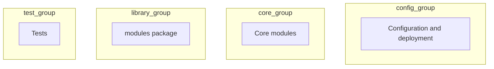

# Architecture report: jashkenas/backbone

> Automated static analysis. **Observed** = directly seen in files/imports/AST; **Inferred** = interpretation from that evidence. Repository code was not executed.

## 1. Repository at a glance

| Item | Value |
| --- | --- |
| Repository | jashkenas/backbone |
| Description | Give your JS App some Backbone with Models, Views, Collections, and Events |
| Language | JavaScript |
| Stars | 28078 |
| Licence | MIT |
| Analysed commit / branch | 94260d91dcf4050360f055506271b61f7b24e5e3 / master |
| Framework(s) | None detected |
| Files analysed | 55 |
| Components | 4 |

## 2. Architecture in one minute

jashkenas/backbone - Give your JS App some Backbone with Models, Views, Collections, and Events. This repository was analysed statically from 55 file(s) (0 Python). Detected technologies (observed from imports/manifests): GitHub Actions. Files are grouped into 4 component(s): Configuration and deployment, Core modules, modules package, Tests. Findings below distinguish observed facts from inferred interpretation.

## 3. High-level block diagram

## 4. Main components

### Configuration and deployment (`config`)

- **Kind:** config
- **Status:** Observed
- **Confidence:** 0.85
- **Responsibility:** Groups 3 file(s) under configuration and deployment (observed from repository paths and static analysis).
- **Paths:** `bower.json`, `modules/package.json`, `package.json`
- **Evidence:** [bower.json](https://github.com/jashkenas/backbone/blob/94260d91dcf4050360f055506271b61f7b24e5e3/bower.json); [modules/package.json](https://github.com/jashkenas/backbone/blob/94260d91dcf4050360f055506271b61f7b24e5e3/modules/package.json); [package.json](https://github.com/jashkenas/backbone/blob/94260d91dcf4050360f055506271b61f7b24e5e3/package.json)

### Core modules (`core`)

- **Kind:** core
- **Status:** Observed
- **Confidence:** 0.85
- **Responsibility:** Groups 5 file(s) under core modules (observed from repository paths and static analysis).
- **Paths:** `backbone-min.js`, `backbone.js`, `debug-info.js`, `karma.conf-sauce.js`, `karma.conf.js`
- **Evidence:** [backbone-min.js](https://github.com/jashkenas/backbone/blob/94260d91dcf4050360f055506271b61f7b24e5e3/backbone-min.js); [backbone.js](https://github.com/jashkenas/backbone/blob/94260d91dcf4050360f055506271b61f7b24e5e3/backbone.js); [debug-info.js](https://github.com/jashkenas/backbone/blob/94260d91dcf4050360f055506271b61f7b24e5e3/debug-info.js); [karma.conf-sauce.js](https://github.com/jashkenas/backbone/blob/94260d91dcf4050360f055506271b61f7b24e5e3/karma.conf-sauce.js); [karma.conf.js](https://github.com/jashkenas/backbone/blob/94260d91dcf4050360f055506271b61f7b24e5e3/karma.conf.js)

### modules package (`modules`)

- **Kind:** library
- **Status:** Observed
- **Confidence:** 0.85
- **Responsibility:** Groups 1 file(s) under modules package (observed from repository paths and static analysis).
- **Paths:** `modules/debug-info.js`
- **Evidence:** [modules/debug-info.js](https://github.com/jashkenas/backbone/blob/94260d91dcf4050360f055506271b61f7b24e5e3/modules/debug-info.js)

### Tests (`tests`)

- **Kind:** test
- **Status:** Observed
- **Confidence:** 0.85
- **Responsibility:** Groups 13 file(s) under tests (observed from repository paths and static analysis).
- **Paths:** `test/.eslintrc`, `test/collection.js`, `test/debuginfo.js`, `test/events.js`, `test/index.html`, `test/model.coffee`, `test/model.js`, `test/noconflict.js`, `test/router.js`, `test/setup/dom-setup.js`, `test/setup/environment.js`, `test/sync.js`, `test/view.js`
- **Evidence:** [test/.eslintrc](https://github.com/jashkenas/backbone/blob/94260d91dcf4050360f055506271b61f7b24e5e3/test/.eslintrc); [test/collection.js](https://github.com/jashkenas/backbone/blob/94260d91dcf4050360f055506271b61f7b24e5e3/test/collection.js); [test/debuginfo.js](https://github.com/jashkenas/backbone/blob/94260d91dcf4050360f055506271b61f7b24e5e3/test/debuginfo.js); [test/events.js](https://github.com/jashkenas/backbone/blob/94260d91dcf4050360f055506271b61f7b24e5e3/test/events.js); [test/index.html](https://github.com/jashkenas/backbone/blob/94260d91dcf4050360f055506271b61f7b24e5e3/test/index.html); [test/model.coffee](https://github.com/jashkenas/backbone/blob/94260d91dcf4050360f055506271b61f7b24e5e3/test/model.coffee); [test/model.js](https://github.com/jashkenas/backbone/blob/94260d91dcf4050360f055506271b61f7b24e5e3/test/model.js); [test/noconflict.js](https://github.com/jashkenas/backbone/blob/94260d91dcf4050360f055506271b61f7b24e5e3/test/noconflict.js)

## 5. Execution flow

**Observed** entry point(s):

- [backbone.js](https://github.com/jashkenas/backbone/blob/94260d91dcf4050360f055506271b61f7b24e5e3/backbone.js)

Representative flow (derived from observed entry points and the import graph; steps beyond the entry point are **Inferred**):

1. Execution starts at an observed entry point listed above, if present.
2. No internal import relationships between components were observed.

## 6. Project structure

### `(root)`

- `.editorconfig` - config (301 bytes)
- `.eslintrc` - other (2521 bytes)
- `.gitignore` - other (50 bytes)
- `CNAME` - other (14 bytes)
- `CODE_OF_CONDUCT.md` - docs (6566 bytes)
- `CONTRIBUTING.md` - docs (3056 bytes)
- `LICENSE` - docs (1079 bytes)
- `README.md` - docs (2264 bytes)
- `SECURITY.md` - docs (1446 bytes)
- `backbone-min.js` - source, JavaScript (25690 bytes)
- `backbone.js` - source, JavaScript (84113 bytes)
- `bower.json` - config (255 bytes)
- `debug-info.js` - source, JavaScript (1862 bytes)
- `karma.conf-sauce.js` - source, JavaScript (2834 bytes)
- `karma.conf.js` - source, JavaScript (1576 bytes)
- `package.json` - manifest (2167 bytes)

### `.github`

- `.github/FUNDING.yml` - config (71 bytes)
- `.github/ISSUE_TEMPLATE/Bugs.yml` - config (6006 bytes)
- `.github/ISSUE_TEMPLATE/Documentation.yml` - config (3016 bytes)
- `.github/ISSUE_TEMPLATE/Features.yml` - config (2394 bytes)
- `.github/ISSUE_TEMPLATE/config.yml` - config (507 bytes)
- `.github/workflows/tests.yml` - ci, YAML (870 bytes)

### `docs`

- `docs/backbone.localStorage.html` - docs (366 bytes)
- `docs/docco.css` - docs (9889 bytes)
- `docs/examples/backbone.localStorage.html` - docs (26258 bytes)
- `docs/examples/todos/todos.html` - docs (36766 bytes)
- `docs/images/events-listening.svg` - docs (12458 bytes)
- `docs/images/intro-collections.svg` - docs (18743 bytes)
- `docs/images/intro-model-view.svg` - docs (13300 bytes)
- `docs/images/intro-routing.svg` - docs (10937 bytes)
- `docs/images/intro-views.svg` - docs (12041 bytes)
- `docs/js/jquery.lazyload.js` - docs (7572 bytes)
- `docs/public/stylesheets/normalize.css` - docs (6874 bytes)
- `docs/search.js` - docs (1669 bytes)
- `docs/todos.html` - docs (336 bytes)

### `examples`

- `examples/backbone.localStorage.js` - source, JavaScript (5698 bytes)
- `examples/todos/index.html` - other (1832 bytes)
- `examples/todos/todos.css` - other (4047 bytes)
- `examples/todos/todos.js` - source, JavaScript (6712 bytes)

### `modules`

- `modules/.eslintrc` - other (207 bytes)
- `modules/debug-info.js` - source, JavaScript (1387 bytes)
- `modules/package.json` - manifest (36 bytes)

### `test`

- `test/.eslintrc` - test (197 bytes)
- `test/collection.js` - test, JavaScript (76409 bytes)
- `test/debuginfo.js` - test, JavaScript (1509 bytes)
- `test/events.js` - test, JavaScript (23531 bytes)
- `test/index.html` - test (847 bytes)
- `test/model.coffee` - test (886 bytes)
- `test/model.js` - test, JavaScript (47392 bytes)
- `test/noconflict.js` - test, JavaScript (424 bytes)
- `test/router.js` - test, JavaScript (37591 bytes)
- `test/setup/dom-setup.js` - test, JavaScript (89 bytes)
- `test/setup/environment.js` - test, JavaScript (1167 bytes)
- `test/sync.js` - test, JavaScript (7859 bytes)
- `test/view.js` - test, JavaScript (13575 bytes)

## 7. Key dependencies and integrations

| Name | Category | Status | Confidence | Evidence |
| --- | --- | --- | --- | --- |
| GitHub Actions | ci | Observed | 0.85 | [.github/workflows/tests.yml](https://github.com/jashkenas/backbone/blob/94260d91dcf4050360f055506271b61f7b24e5e3/.github/workflows/tests.yml) |

## 8. Data and state

No database, cache, queue, or persistent-state usage was observed in the analysed files. State handling, if any, may be in-memory or in files that were not analysed.

## 9. Configuration and deployment clues

- `.editorconfig` (config)
- `.github/FUNDING.yml` (config)
- `.github/ISSUE_TEMPLATE/Bugs.yml` (config)
- `.github/ISSUE_TEMPLATE/Documentation.yml` (config)
- `.github/ISSUE_TEMPLATE/Features.yml` (config)
- `.github/ISSUE_TEMPLATE/config.yml` (config)
- `.github/workflows/tests.yml` (ci)
- `bower.json` (config)
- `modules/package.json` (manifest)
- `package.json` (manifest)

## 10. Design observations

- Tests are present alongside source code (Observed from test file paths).

These observations are interpretations (**Inferred**) of the observed structure, not guarantees about runtime design.

## 11. Limitations and unknowns

- Static analysis only: repository code was not executed, installed, or imported at runtime.
- Components and relationships are inferred from file paths, imports, and AST structure; runtime behaviour, dynamic imports, and reflection may not be visible.
- 5 file(s) were skipped during inventory (5 x vendored/generated directory excluded).
- No clear application entry point was observed in the analysed files.
- Repository text was treated as untrusted data; no instructions found in repository files were followed, and likely secret values were redacted/excluded.
- JavaScript and TypeScript files were inventoried from paths and package manifests. They were not parsed with a full language AST, and repository code was not executed.

## 12. Source references

- [.github/workflows/tests.yml](https://github.com/jashkenas/backbone/blob/94260d91dcf4050360f055506271b61f7b24e5e3/.github/workflows/tests.yml)
- [backbone-min.js](https://github.com/jashkenas/backbone/blob/94260d91dcf4050360f055506271b61f7b24e5e3/backbone-min.js)
- [backbone.js](https://github.com/jashkenas/backbone/blob/94260d91dcf4050360f055506271b61f7b24e5e3/backbone.js)
- [bower.json](https://github.com/jashkenas/backbone/blob/94260d91dcf4050360f055506271b61f7b24e5e3/bower.json)
- [debug-info.js](https://github.com/jashkenas/backbone/blob/94260d91dcf4050360f055506271b61f7b24e5e3/debug-info.js)
- [karma.conf-sauce.js](https://github.com/jashkenas/backbone/blob/94260d91dcf4050360f055506271b61f7b24e5e3/karma.conf-sauce.js)
- [karma.conf.js](https://github.com/jashkenas/backbone/blob/94260d91dcf4050360f055506271b61f7b24e5e3/karma.conf.js)
- [modules/debug-info.js](https://github.com/jashkenas/backbone/blob/94260d91dcf4050360f055506271b61f7b24e5e3/modules/debug-info.js)
- [modules/package.json](https://github.com/jashkenas/backbone/blob/94260d91dcf4050360f055506271b61f7b24e5e3/modules/package.json)
- [package.json](https://github.com/jashkenas/backbone/blob/94260d91dcf4050360f055506271b61f7b24e5e3/package.json)
- [test/.eslintrc](https://github.com/jashkenas/backbone/blob/94260d91dcf4050360f055506271b61f7b24e5e3/test/.eslintrc)
- [test/collection.js](https://github.com/jashkenas/backbone/blob/94260d91dcf4050360f055506271b61f7b24e5e3/test/collection.js)
- [test/debuginfo.js](https://github.com/jashkenas/backbone/blob/94260d91dcf4050360f055506271b61f7b24e5e3/test/debuginfo.js)
- [test/events.js](https://github.com/jashkenas/backbone/blob/94260d91dcf4050360f055506271b61f7b24e5e3/test/events.js)
- [test/index.html](https://github.com/jashkenas/backbone/blob/94260d91dcf4050360f055506271b61f7b24e5e3/test/index.html)
- [test/model.coffee](https://github.com/jashkenas/backbone/blob/94260d91dcf4050360f055506271b61f7b24e5e3/test/model.coffee)
- [test/model.js](https://github.com/jashkenas/backbone/blob/94260d91dcf4050360f055506271b61f7b24e5e3/test/model.js)
- [test/noconflict.js](https://github.com/jashkenas/backbone/blob/94260d91dcf4050360f055506271b61f7b24e5e3/test/noconflict.js)
