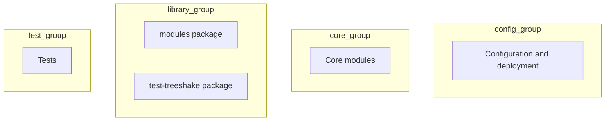

# Architecture report: jashkenas/underscore

> Automated static analysis. **Observed** = directly seen in files/imports/AST; **Inferred** = interpretation from that evidence. Repository code was not executed.

## 1. Repository at a glance

| Item | Value |
| --- | --- |
| Repository | jashkenas/underscore |
| Description | JavaScript's utility _ belt |
| Language | JavaScript |
| Stars | 27294 |
| Licence | MIT |
| Analysed commit / branch | 5c1e5f686f8500af9c9d15614ed60289d6d35d6b / master |
| Framework(s) | None detected |
| Files analysed | 375 |
| Components | 5 |

## 2. Architecture in one minute

jashkenas/underscore - JavaScript's utility _ belt. This repository was analysed statically from 375 file(s) (0 Python). Detected technologies (observed from imports/manifests): GitHub Actions. Files are grouped into 5 component(s): Configuration and deployment, Core modules, modules package, test-treeshake package, Tests. Findings below distinguish observed facts from inferred interpretation.

## 3. High-level block diagram

## 4. Main components

### Configuration and deployment (`config`)

- **Kind:** config
- **Status:** Observed
- **Confidence:** 0.85
- **Responsibility:** Groups 3 file(s) under configuration and deployment (observed from repository paths and static analysis).
- **Paths:** `bower.json`, `modules/package.json`, `package.json`
- **Evidence:** [bower.json](https://github.com/jashkenas/underscore/blob/5c1e5f686f8500af9c9d15614ed60289d6d35d6b/bower.json); [modules/package.json](https://github.com/jashkenas/underscore/blob/5c1e5f686f8500af9c9d15614ed60289d6d35d6b/modules/package.json); [package.json](https://github.com/jashkenas/underscore/blob/5c1e5f686f8500af9c9d15614ed60289d6d35d6b/package.json)

### Core modules (`core`)

- **Kind:** core
- **Status:** Observed
- **Confidence:** 0.85
- **Responsibility:** Groups 14 file(s) under core modules (observed from repository paths and static analysis).
- **Paths:** `karma.conf-sauce.js`, `karma.conf.js`, `rollup.common.js`, `rollup.config.js`, `rollup.config2.js`, `underscore-esm-min.js`, `underscore-esm.js`, `underscore-min.js`, `underscore-node-f.cjs`, `underscore-node.cjs`, `underscore-node.mjs`, `underscore-umd-min.js`, `underscore-umd.js`, `underscore.js`
- **Evidence:** [karma.conf-sauce.js](https://github.com/jashkenas/underscore/blob/5c1e5f686f8500af9c9d15614ed60289d6d35d6b/karma.conf-sauce.js); [karma.conf.js](https://github.com/jashkenas/underscore/blob/5c1e5f686f8500af9c9d15614ed60289d6d35d6b/karma.conf.js); [rollup.common.js](https://github.com/jashkenas/underscore/blob/5c1e5f686f8500af9c9d15614ed60289d6d35d6b/rollup.common.js); [rollup.config.js](https://github.com/jashkenas/underscore/blob/5c1e5f686f8500af9c9d15614ed60289d6d35d6b/rollup.config.js); [rollup.config2.js](https://github.com/jashkenas/underscore/blob/5c1e5f686f8500af9c9d15614ed60289d6d35d6b/rollup.config2.js); [underscore-esm-min.js](https://github.com/jashkenas/underscore/blob/5c1e5f686f8500af9c9d15614ed60289d6d35d6b/underscore-esm-min.js); [underscore-esm.js](https://github.com/jashkenas/underscore/blob/5c1e5f686f8500af9c9d15614ed60289d6d35d6b/underscore-esm.js); [underscore-min.js](https://github.com/jashkenas/underscore/blob/5c1e5f686f8500af9c9d15614ed60289d6d35d6b/underscore-min.js)

### modules package (`modules`)

- **Kind:** library
- **Status:** Observed
- **Confidence:** 0.85
- **Responsibility:** Groups 161 file(s) under modules package (observed from repository paths and static analysis).
- **Paths:** `modules/_baseCreate.js`, `modules/_baseIteratee.js`, `modules/_cb.js`, `modules/_chainResult.js`, `modules/_collectNonEnumProps.js`, `modules/_createAssigner.js`, `modules/_createEscaper.js`, `modules/_createIndexFinder.js`, `modules/_createPredicateIndexFinder.js`, `modules/_createReduce.js`, `modules/_createSizePropertyCheck.js`, `modules/_deepGet.js`, `modules/_escapeMap.js`, `modules/_executeBound.js`, `modules/_flatten.js`, `modules/_getByteLength.js`, `modules/_getLength.js`, `modules/_group.js`, `modules/_has.js`, `modules/_hasObjectTag.js`, `modules/_isArrayLike.js`, `modules/_isBufferLike.js`, `modules/_keyInObj.js`, `modules/_methodFingerprint.js`, `modules/_optimizeCb.js`, `modules/_setup.js`, `modules/_shallowProperty.js`, `modules/_stringTagBug.js`, `modules/_tagTester.js`, `modules/_toBufferView.js`, `modules/_toPath.js`, `modules/_unescapeMap.js`, `modules/after.js`, `modules/allKeys.js`, `modules/before.js`, `modules/bind.js`, `modules/bindAll.js`, `modules/chain.js`, `modules/chunk.js`, `modules/clone.js`, `modules/compact.js`, `modules/compose.js`, `modules/constant.js`, `modules/contains.js`, `modules/countBy.js`, `modules/create.js`, `modules/debounce.js`, `modules/defaults.js`, `modules/defer.js`, `modules/delay.js`, `modules/difference.js`, `modules/each.js`, `modules/escape.js`, `modules/every.js`, `modules/extend.js`, `modules/extendOwn.js`, `modules/filter.js`, `modules/find.js`, `modules/findIndex.js`, `modules/findKey.js`, `modules/findLastIndex.js`, `modules/findWhere.js`, `modules/first.js`, `modules/flatten.js`, `modules/functions.js`, `modules/get.js`, `modules/groupBy.js`, `modules/has.js`, `modules/identity.js`, `modules/index-all.js`, `modules/index-default.js`, `modules/index.js`, `modules/indexBy.js`, `modules/indexOf.js`, `modules/initial.js`, `modules/intersection.js`, `modules/invert.js`, `modules/invoke.js`, `modules/isArguments.js`, `modules/isArray.js`, `modules/isArrayBuffer.js`, `modules/isBoolean.js`, `modules/isDataView.js`, `modules/isDate.js`, `modules/isElement.js`, `modules/isEmpty.js`, `modules/isEqual.js`, `modules/isError.js`, `modules/isFinite.js`, `modules/isFunction.js`, `modules/isMap.js`, `modules/isMatch.js`, `modules/isNaN.js`, `modules/isNull.js`, `modules/isNumber.js`, `modules/isObject.js`, `modules/isRegExp.js`, `modules/isSet.js`, `modules/isString.js`, `modules/isSymbol.js`, `modules/isTypedArray.js`, `modules/isUndefined.js`, `modules/isWeakMap.js`, `modules/isWeakSet.js`, `modules/iteratee.js`, `modules/keys.js`, `modules/last.js`, `modules/lastIndexOf.js`, `modules/map.js`, `modules/mapObject.js`, `modules/matcher.js`, `modules/max.js`, `modules/memoize.js`, `modules/min.js`, `modules/mixin.js`, `modules/negate.js`, `modules/noop.js`, `modules/now.js`, `modules/object.js`, `modules/omit.js`, `modules/once.js`, `modules/pairs.js`, `modules/partial.js`, `modules/partition.js`, `modules/pick.js`, `modules/pluck.js`, `modules/property.js`, `modules/propertyOf.js`, `modules/random.js`, `modules/range.js`, `modules/reduce.js`, `modules/reduceRight.js`, `modules/reject.js`, `modules/rest.js`, `modules/restArguments.js`, `modules/result.js`, `modules/sample.js`, `modules/shuffle.js`, `modules/size.js`, `modules/some.js`, `modules/sortBy.js`, `modules/sortedIndex.js`, `modules/tap.js`, `modules/template.js`, `modules/templateSettings.js`, `modules/throttle.js`, `modules/times.js`, `modules/toArray.js`, `modules/toPath.js`, `modules/underscore-array-methods.js`, `modules/underscore.js`, `modules/unescape.js`, `modules/union.js`, `modules/uniq.js`, `modules/uniqueId.js`, `modules/unzip.js`, `modules/values.js`, `modules/where.js`, `modules/without.js`, `modules/wrap.js`, `modules/zip.js`
- **Evidence:** [modules/_baseCreate.js](https://github.com/jashkenas/underscore/blob/5c1e5f686f8500af9c9d15614ed60289d6d35d6b/modules/_baseCreate.js); [modules/_baseIteratee.js](https://github.com/jashkenas/underscore/blob/5c1e5f686f8500af9c9d15614ed60289d6d35d6b/modules/_baseIteratee.js); [modules/_cb.js](https://github.com/jashkenas/underscore/blob/5c1e5f686f8500af9c9d15614ed60289d6d35d6b/modules/_cb.js); [modules/_chainResult.js](https://github.com/jashkenas/underscore/blob/5c1e5f686f8500af9c9d15614ed60289d6d35d6b/modules/_chainResult.js); [modules/_collectNonEnumProps.js](https://github.com/jashkenas/underscore/blob/5c1e5f686f8500af9c9d15614ed60289d6d35d6b/modules/_collectNonEnumProps.js); [modules/_createAssigner.js](https://github.com/jashkenas/underscore/blob/5c1e5f686f8500af9c9d15614ed60289d6d35d6b/modules/_createAssigner.js); [modules/_createEscaper.js](https://github.com/jashkenas/underscore/blob/5c1e5f686f8500af9c9d15614ed60289d6d35d6b/modules/_createEscaper.js); [modules/_createIndexFinder.js](https://github.com/jashkenas/underscore/blob/5c1e5f686f8500af9c9d15614ed60289d6d35d6b/modules/_createIndexFinder.js)

### test-treeshake package (`test_treeshake`)

- **Kind:** library
- **Status:** Observed
- **Confidence:** 0.85
- **Responsibility:** Groups 3 file(s) under test-treeshake package (observed from repository paths and static analysis).
- **Paths:** `test-treeshake/map.js`, `test-treeshake/rollup.config.js`, `test-treeshake/template.js`
- **Evidence:** [test-treeshake/map.js](https://github.com/jashkenas/underscore/blob/5c1e5f686f8500af9c9d15614ed60289d6d35d6b/test-treeshake/map.js); [test-treeshake/rollup.config.js](https://github.com/jashkenas/underscore/blob/5c1e5f686f8500af9c9d15614ed60289d6d35d6b/test-treeshake/rollup.config.js); [test-treeshake/template.js](https://github.com/jashkenas/underscore/blob/5c1e5f686f8500af9c9d15614ed60289d6d35d6b/test-treeshake/template.js)

### Tests (`tests`)

- **Kind:** test
- **Status:** Observed
- **Confidence:** 0.85
- **Responsibility:** Groups 12 file(s) under tests (observed from repository paths and static analysis).
- **Paths:** `test/.eslintrc`, `test/arrays.js`, `test/chaining.js`, `test/collections.js`, `test/cross-document.js`, `test/functions.js`, `test/index.html`, `test/objects.js`, `test/overrides.js`, `test/qunit-setup.js`, `test/treeshake.js`, `test/utility.js`
- **Evidence:** [test/.eslintrc](https://github.com/jashkenas/underscore/blob/5c1e5f686f8500af9c9d15614ed60289d6d35d6b/test/.eslintrc); [test/arrays.js](https://github.com/jashkenas/underscore/blob/5c1e5f686f8500af9c9d15614ed60289d6d35d6b/test/arrays.js); [test/chaining.js](https://github.com/jashkenas/underscore/blob/5c1e5f686f8500af9c9d15614ed60289d6d35d6b/test/chaining.js); [test/collections.js](https://github.com/jashkenas/underscore/blob/5c1e5f686f8500af9c9d15614ed60289d6d35d6b/test/collections.js); [test/cross-document.js](https://github.com/jashkenas/underscore/blob/5c1e5f686f8500af9c9d15614ed60289d6d35d6b/test/cross-document.js); [test/functions.js](https://github.com/jashkenas/underscore/blob/5c1e5f686f8500af9c9d15614ed60289d6d35d6b/test/functions.js); [test/index.html](https://github.com/jashkenas/underscore/blob/5c1e5f686f8500af9c9d15614ed60289d6d35d6b/test/index.html); [test/objects.js](https://github.com/jashkenas/underscore/blob/5c1e5f686f8500af9c9d15614ed60289d6d35d6b/test/objects.js)

## 5. Execution flow

**Observed** entry point(s):

- [modules/index.js](https://github.com/jashkenas/underscore/blob/5c1e5f686f8500af9c9d15614ed60289d6d35d6b/modules/index.js)
- [underscore-umd.js](https://github.com/jashkenas/underscore/blob/5c1e5f686f8500af9c9d15614ed60289d6d35d6b/underscore-umd.js)

Representative flow (derived from observed entry points and the import graph; steps beyond the entry point are **Inferred**):

1. Execution starts at an observed entry point listed above, if present.
2. No internal import relationships between components were observed.

## 6. Project structure

### `(root)`

- `.editorconfig` - config (301 bytes)
- `.eslintrc` - other (121 bytes)
- `.gitignore` - other (112 bytes)
- `.travis.yml` - ci, YAML (1327 bytes)
- `CNAME` - other (17 bytes)
- `CODE_OF_CONDUCT.md` - docs (4061 bytes)
- `CONTRIBUTING.md` - docs (3747 bytes)
- `LICENSE` - docs (1139 bytes)
- `README.md` - docs (1846 bytes)
- `SECURITY.md` - docs (2468 bytes)
- `bower.json` - config (257 bytes)
- `index.html` - other (190816 bytes)
- `karma.conf-sauce.js` - source, JavaScript (2651 bytes)
- `karma.conf.js` - source, JavaScript (966 bytes)
- `package.json` - manifest (4818 bytes)
- `rollup.common.js` - source, JavaScript (637 bytes)
- `rollup.config.js` - source, JavaScript (1587 bytes)
- `rollup.config2.js` - source, JavaScript (843 bytes)
- `underscore-esm-min.js` - source, JavaScript (25841 bytes)
- `underscore-esm.js` - source, JavaScript (71558 bytes)
- `underscore-min.js` - source, JavaScript (19668 bytes)
- `underscore-node-f.cjs` - source, JavaScript (73360 bytes)
- `underscore-node.cjs` - source, JavaScript (382 bytes)
- `underscore-node.mjs` - source, JavaScript (1816 bytes)
- `underscore-umd-min.js` - source, JavaScript (19668 bytes)
- `underscore-umd.js` - source, JavaScript (74302 bytes)
- `underscore.js` - source, JavaScript (69679 bytes)

### `.github`

- `.github/FUNDING.yml` - config (73 bytes)
- `.github/config/codeql.yml` - config (96 bytes)
- `.github/workflows/codeql-analysis.yml` - ci, YAML (2629 bytes)

### `docs`

- `docs/.eslintrc` - docs (86 bytes)
- `docs/docco.css` - docs (9921 bytes)
- `docs/linked-esm.jst` - docs (4296 bytes)
- `docs/main.js` - docs (1758 bytes)
- `docs/modules/_baseCreate.html` - docs (29643 bytes)
- `docs/modules/_baseIteratee.html` - docs (29656 bytes)
- `docs/modules/_cb.html` - docs (28549 bytes)
- `docs/modules/_chainResult.html` - docs (28040 bytes)
- `docs/modules/_collectNonEnumProps.html` - docs (31676 bytes)
- `docs/modules/_createAssigner.html` - docs (28751 bytes)
- `docs/modules/_createEscaper.html` - docs (29577 bytes)
- `docs/modules/_createIndexFinder.html` - docs (30414 bytes)
- `docs/modules/_createPredicateIndexFinder.html` - docs (28972 bytes)
- `docs/modules/_createReduce.html` - docs (30328 bytes)
- `docs/modules/_createSizePropertyCheck.html` - docs (28534 bytes)
- `docs/modules/_deepGet.html` - docs (27941 bytes)
- `docs/modules/_escapeMap.html` - docs (27815 bytes)
- `docs/modules/_executeBound.html` - docs (28920 bytes)
- `docs/modules/_flatten.html` - docs (31263 bytes)
- `docs/modules/_getByteLength.html` - docs (27847 bytes)
- `docs/modules/_getLength.html` - docs (27831 bytes)
- `docs/modules/_group.html` - docs (28685 bytes)
- `docs/modules/_has.html` - docs (28033 bytes)
- `docs/modules/_hasObjectTag.html` - docs (27367 bytes)
- `docs/modules/_isArrayLike.html` - docs (28225 bytes)
- `docs/modules/_isBufferLike.html` - docs (28020 bytes)
- `docs/modules/_keyInObj.html` - docs (27479 bytes)
- `docs/modules/_methodFingerprint.html` - docs (32369 bytes)
- `docs/modules/_optimizeCb.html` - docs (29569 bytes)
- `docs/modules/_setup.html` - docs (35428 bytes)
- `docs/modules/_shallowProperty.html` - docs (27672 bytes)
- `docs/modules/_stringTagBug.html` - docs (29078 bytes)
- `docs/modules/_tagTester.html` - docs (28248 bytes)
- `docs/modules/_toBufferView.html` - docs (28303 bytes)
- `docs/modules/_toPath.html` - docs (28078 bytes)
- `docs/modules/_unescapeMap.html` - docs (27891 bytes)
- `docs/modules/after.html` - docs (27748 bytes)
- `docs/modules/allKeys.html` - docs (29091 bytes)
- `docs/modules/before.html` - docs (27964 bytes)
- `docs/modules/bind.html` - docs (28995 bytes)
- `docs/modules/bindAll.html` - docs (29040 bytes)
- `docs/modules/chain.html` - docs (28042 bytes)
- `docs/modules/chunk.html` - docs (28480 bytes)
- `docs/modules/clone.html` - docs (28455 bytes)
- `docs/modules/compact.html` - docs (27947 bytes)
- `docs/modules/compose.html` - docs (28227 bytes)
- `docs/modules/constant.html` - docs (27490 bytes)
- `docs/modules/contains.html` - docs (28690 bytes)
- `docs/modules/countBy.html` - docs (28265 bytes)
- `docs/modules/create.html` - docs (28356 bytes)
- `docs/modules/debounce.html` - docs (30525 bytes)
- `docs/modules/defaults.html` - docs (27942 bytes)
- `docs/modules/defer.html` - docs (28085 bytes)
- `docs/modules/delay.html` - docs (28216 bytes)
- `docs/modules/difference.html` - docs (28811 bytes)
- `docs/modules/each.html` - docs (29215 bytes)
- `docs/modules/escape.html` - docs (27907 bytes)
- `docs/modules/every.html` - docs (28979 bytes)
- `docs/modules/extend.html` - docs (27920 bytes)
- `docs/modules/extendOwn.html` - docs (28120 bytes)
- `docs/modules/filter.html` - docs (28477 bytes)
- `docs/modules/find.html` - docs (28613 bytes)
- `docs/modules/findIndex.html` - docs (27839 bytes)
- `docs/modules/findKey.html` - docs (28541 bytes)
- `docs/modules/findLastIndex.html` - docs (27847 bytes)
- `docs/modules/findWhere.html` - docs (28206 bytes)
- `docs/modules/first.html` - docs (28635 bytes)
- `docs/modules/flatten.html` - docs (28134 bytes)
- `docs/modules/functions.html` - docs (28285 bytes)
- `docs/modules/get.html` - docs (28650 bytes)
- `docs/modules/groupBy.html` - docs (28270 bytes)
- `docs/modules/has.html` - docs (28738 bytes)
- `docs/modules/identity.html` - docs (27350 bytes)
- `docs/modules/index-all.html` - docs (28359 bytes)
- `docs/modules/index-default.html` - docs (30012 bytes)
- `docs/modules/index.html` - docs (67035 bytes)
- `docs/modules/indexBy.html` - docs (27935 bytes)
- `docs/modules/indexOf.html` - docs (28311 bytes)
- `docs/modules/initial.html` - docs (28370 bytes)
- `docs/modules/intersection.html` - docs (29176 bytes)
- `docs/modules/invert.html` - docs (28269 bytes)
- `docs/modules/invoke.html` - docs (29922 bytes)
- `docs/modules/isArguments.html` - docs (28586 bytes)
- `docs/modules/isArray.html` - docs (27991 bytes)
- `docs/modules/isArrayBuffer.html` - docs (27372 bytes)
- `docs/modules/isBoolean.html` - docs (28068 bytes)
- `docs/modules/isDataView.html` - docs (28999 bytes)
- `docs/modules/isDate.html` - docs (27351 bytes)
- `docs/modules/isElement.html` - docs (27426 bytes)
- `docs/modules/isEmpty.html` - docs (29839 bytes)
- `docs/modules/isEqual.html` - docs (53934 bytes)
- `docs/modules/isError.html` - docs (27354 bytes)
- `docs/modules/isFinite.html` - docs (28224 bytes)
- `docs/modules/isFunction.html` - docs (29030 bytes)
- `docs/modules/isMap.html` - docs (27768 bytes)
- `docs/modules/isMatch.html` - docs (28725 bytes)
- `docs/modules/isNaN.html` - docs (28105 bytes)
- `docs/modules/isNull.html` - docs (27358 bytes)
- `docs/modules/isNumber.html` - docs (27357 bytes)
- `docs/modules/isObject.html` - docs (27555 bytes)
- `docs/modules/isRegExp.html` - docs (27357 bytes)
- `docs/modules/isSet.html` - docs (27768 bytes)
- `docs/modules/isString.html` - docs (27357 bytes)
- `docs/modules/isSymbol.html` - docs (27357 bytes)
- `docs/modules/isTypedArray.html` - docs (29530 bytes)
- `docs/modules/isUndefined.html` - docs (27407 bytes)
- `docs/modules/isWeakMap.html` - docs (27788 bytes)
- `docs/modules/isWeakSet.html` - docs (27360 bytes)
- `docs/modules/iteratee.html` - docs (28372 bytes)
- `docs/modules/keys.html` - docs (29556 bytes)
- `docs/modules/last.html` - docs (28722 bytes)
- `docs/modules/lastIndexOf.html` - docs (28039 bytes)
- `docs/modules/map.html` - docs (28908 bytes)
- `docs/modules/mapObject.html` - docs (28719 bytes)
- `docs/modules/matcher.html` - docs (28324 bytes)
- `docs/modules/max.html` - docs (30063 bytes)
- `docs/modules/memoize.html` - docs (28786 bytes)
- `docs/modules/min.html` - docs (30059 bytes)
- `docs/modules/mixin.html` - docs (29379 bytes)
- `docs/modules/negate.html` - docs (27635 bytes)
- `docs/modules/noop.html` - docs (27291 bytes)
- `docs/modules/now.html` - docs (27512 bytes)
- `docs/modules/object.html` - docs (28577 bytes)
- `docs/modules/omit.html` - docs (29812 bytes)
- `docs/modules/once.html` - docs (27981 bytes)
- `docs/modules/pairs.html` - docs (28407 bytes)
- `docs/modules/partial.html` - docs (29867 bytes)
- `docs/modules/partition.html` - docs (28100 bytes)
- `docs/modules/pick.html` - docs (30048 bytes)
- `docs/modules/pluck.html` - docs (28135 bytes)
- `docs/modules/property.html` - docs (28377 bytes)
- `docs/modules/propertyOf.html` - docs (28340 bytes)
- `docs/modules/random.html` - docs (27766 bytes)
- `docs/modules/range.html` - docs (28456 bytes)
- `docs/modules/reduce.html` - docs (27845 bytes)
- `docs/modules/reduceRight.html` - docs (27810 bytes)
- `docs/modules/reject.html` - docs (28324 bytes)
- `docs/modules/rest.html` - docs (28170 bytes)
- `docs/modules/restArguments.html` - docs (30094 bytes)
- `docs/modules/result.html` - docs (29318 bytes)
- `docs/modules/sample.html` - docs (30220 bytes)
- `docs/modules/shuffle.html` - docs (27925 bytes)
- `docs/modules/size.html` - docs (28357 bytes)
- `docs/modules/some.html` - docs (28987 bytes)
- `docs/modules/sortBy.html` - docs (29812 bytes)
- `docs/modules/sortedIndex.html` - docs (28969 bytes)
- `docs/modules/tap.html` - docs (27588 bytes)
- `docs/modules/template.html` - docs (38444 bytes)
- `docs/modules/templateSettings.html` - docs (28133 bytes)
- `docs/modules/throttle.html` - docs (30826 bytes)
- `docs/modules/times.html` - docs (28413 bytes)
- `docs/modules/toArray.html` - docs (30077 bytes)
- `docs/modules/toPath.html` - docs (28189 bytes)
- `docs/modules/underscore-array-methods.html` - docs (31406 bytes)
- `docs/modules/underscore.html` - docs (30679 bytes)
- `docs/modules/unescape.html` - docs (27921 bytes)
- `docs/modules/union.html` - docs (28394 bytes)
- `docs/modules/uniq.html` - docs (30249 bytes)
- `docs/modules/uniqueId.html` - docs (27608 bytes)
- `docs/modules/unzip.html` - docs (28755 bytes)
- `docs/modules/values.html` - docs (28327 bytes)
- `docs/modules/where.html` - docs (28200 bytes)
- `docs/modules/without.html` - docs (28139 bytes)
- `docs/modules/wrap.html` - docs (28042 bytes)
- `docs/modules/zip.html` - docs (27928 bytes)
- `docs/public/stylesheets/normalize.css` - docs (6874 bytes)

### `modules`

- `modules/.eslintrc` - other (346 bytes)
- `modules/_baseCreate.js` - source, JavaScript (535 bytes)
- `modules/_baseIteratee.js` - source, JavaScript (764 bytes)
- `modules/_cb.js` - source, JavaScript (418 bytes)
- `modules/_chainResult.js` - source, JavaScript (200 bytes)
- `modules/_collectNonEnumProps.js` - source, JavaScript (1363 bytes)
- `modules/_createAssigner.js` - source, JavaScript (582 bytes)
- `modules/_createEscaper.js` - source, JavaScript (604 bytes)
- `modules/_createIndexFinder.js` - source, JavaScript (977 bytes)
- `modules/_createPredicateIndexFinder.js` - source, JavaScript (509 bytes)
- `modules/_createReduce.js` - source, JavaScript (1045 bytes)
- `modules/_createSizePropertyCheck.js` - source, JavaScript (368 bytes)
- `modules/_deepGet.js` - source, JavaScript (280 bytes)
- `modules/_escapeMap.js` - source, JavaScript (164 bytes)
- `modules/_executeBound.js` - source, JavaScript (584 bytes)
- `modules/_flatten.js` - source, JavaScript (1192 bytes)
- `modules/_getByteLength.js` - source, JavaScript (169 bytes)
- `modules/_getLength.js` - source, JavaScript (161 bytes)
- `modules/_group.js` - source, JavaScript (457 bytes)
- `modules/_has.js` - source, JavaScript (222 bytes)
- `modules/_hasObjectTag.js` - source, JavaScript (78 bytes)
- `modules/_isArrayLike.js` - source, JavaScript (422 bytes)
- `modules/_isBufferLike.js` - source, JavaScript (279 bytes)
- `modules/_keyInObj.js` - source, JavaScript (183 bytes)
- `modules/_methodFingerprint.js` - source, JavaScript (1498 bytes)
- `modules/_optimizeCb.js` - source, JavaScript (810 bytes)
- `modules/_setup.js` - source, JavaScript (1828 bytes)
- `modules/_shallowProperty.js` - source, JavaScript (202 bytes)
- `modules/_stringTagBug.js` - source, JavaScript (694 bytes)
- `modules/_tagTester.js` - source, JavaScript (257 bytes)
- `modules/_toBufferView.js` - source, JavaScript (365 bytes)
- `modules/_toPath.js` - source, JavaScript (218 bytes)
- `modules/_unescapeMap.js` - source, JavaScript (160 bytes)
- `modules/after.js` - source, JavaScript (221 bytes)
- `modules/allKeys.js` - source, JavaScript (416 bytes)
- `modules/before.js` - source, JavaScript (300 bytes)
- `modules/bind.js` - source, JavaScript (528 bytes)
- `modules/bindAll.js` - source, JavaScript (602 bytes)
- `modules/chain.js` - source, JavaScript (190 bytes)
- `modules/chunk.js` - source, JavaScript (370 bytes)
- `modules/clone.js` - source, JavaScript (290 bytes)
- `modules/compact.js` - source, JavaScript (155 bytes)
- `modules/compose.js` - source, JavaScript (399 bytes)
- `modules/constant.js` - source, JavaScript (159 bytes)
- `modules/contains.js` - source, JavaScript (404 bytes)
- `modules/countBy.js` - source, JavaScript (340 bytes)
- `modules/create.js` - source, JavaScript (390 bytes)
- `modules/debounce.js` - source, JavaScript (1220 bytes)
- `modules/defaults.js` - source, JavaScript (185 bytes)
- `modules/defer.js` - source, JavaScript (227 bytes)
- `modules/delay.js` - source, JavaScript (300 bytes)
- `modules/difference.js` - source, JavaScript (469 bytes)
- `modules/each.js` - source, JavaScript (719 bytes)
- `modules/escape.js` - source, JavaScript (188 bytes)
- `modules/every.js` - source, JavaScript (531 bytes)
- `modules/extend.js` - source, JavaScript (201 bytes)
- `modules/extendOwn.js` - source, JavaScript (298 bytes)
- `modules/filter.js` - source, JavaScript (354 bytes)
- `modules/find.js` - source, JavaScript (392 bytes)
- `modules/findIndex.js` - source, JavaScript (192 bytes)
- `modules/findKey.js` - source, JavaScript (386 bytes)
- `modules/findLastIndex.js` - source, JavaScript (192 bytes)
- `modules/findWhere.js` - source, JavaScript (277 bytes)
- `modules/first.js` - source, JavaScript (408 bytes)
- `modules/flatten.js` - source, JavaScript (284 bytes)
- `modules/functions.js` - source, JavaScript (274 bytes)
- `modules/get.js` - source, JavaScript (497 bytes)
- `modules/groupBy.js` - source, JavaScript (331 bytes)
- `modules/has.js` - source, JavaScript (526 bytes)
- `modules/identity.js` - source, JavaScript (120 bytes)
- `modules/index-all.js` - source, JavaScript (809 bytes)
- `modules/index-default.js` - source, JavaScript (872 bytes)
- `modules/index.js` - source, JavaScript (8905 bytes)
- `modules/indexBy.js` - source, JavaScript (248 bytes)
- `modules/indexOf.js` - source, JavaScript (431 bytes)
- `modules/initial.js` - source, JavaScript (361 bytes)
- `modules/intersection.js` - source, JavaScript (574 bytes)
- `modules/invert.js` - source, JavaScript (311 bytes)
- `modules/invoke.js` - source, JavaScript (832 bytes)
- `modules/isArguments.js` - source, JavaScript (400 bytes)
- `modules/isArray.js` - source, JavaScript (217 bytes)
- `modules/isArrayBuffer.js` - source, JavaScript (83 bytes)
- `modules/isBoolean.js` - source, JavaScript (200 bytes)
- `modules/isDataView.js` - source, JavaScript (611 bytes)
- `modules/isDate.js` - source, JavaScript (76 bytes)
- `modules/isElement.js` - source, JavaScript (118 bytes)
- `modules/isEmpty.js` - source, JavaScript (639 bytes)
- `modules/isEqual.js` - source, JavaScript (10569 bytes)
- `modules/isError.js` - source, JavaScript (77 bytes)
- `modules/isFinite.js` - source, JavaScript (230 bytes)
- `modules/isFunction.js` - source, JavaScript (528 bytes)
- `modules/isMap.js` - source, JavaScript (231 bytes)
- `modules/isMatch.js` - source, JavaScript (409 bytes)
- `modules/isNaN.js` - source, JavaScript (184 bytes)
- `modules/isNull.js` - source, JavaScript (98 bytes)
- `modules/isNumber.js` - source, JavaScript (78 bytes)
- `modules/isObject.js` - source, JavaScript (163 bytes)
- `modules/isRegExp.js` - source, JavaScript (78 bytes)
- `modules/isSet.js` - source, JavaScript (231 bytes)
- `modules/isString.js` - source, JavaScript (78 bytes)
- `modules/isSymbol.js` - source, JavaScript (78 bytes)
- `modules/isTypedArray.js` - source, JavaScript (726 bytes)
- `modules/isUndefined.js` - source, JavaScript (104 bytes)
- `modules/isWeakMap.js` - source, JavaScript (243 bytes)
- `modules/isWeakSet.js` - source, JavaScript (79 bytes)
- `modules/iteratee.js` - source, JavaScript (416 bytes)
- `modules/keys.js` - source, JavaScript (565 bytes)
- `modules/last.js` - source, JavaScript (372 bytes)
- `modules/lastIndexOf.js` - source, JavaScript (280 bytes)
- `modules/map.js` - source, JavaScript (561 bytes)
- `modules/mapObject.js` - source, JavaScript (530 bytes)
- `modules/matcher.js` - source, JavaScript (309 bytes)
- `modules/max.js` - source, JavaScript (977 bytes)
- `modules/memoize.js` - source, JavaScript (419 bytes)
- `modules/min.js` - source, JavaScript (973 bytes)
- `modules/mixin.js` - source, JavaScript (543 bytes)
- `modules/negate.js` - source, JavaScript (176 bytes)
- `modules/noop.js` - source, JavaScript (103 bytes)
- `modules/now.js` - source, JavaScript (145 bytes)
- `modules/object.js` - source, JavaScript (537 bytes)
- `modules/omit.js` - source, JavaScript (708 bytes)
- `modules/once.js` - source, JavaScript (236 bytes)
- `modules/package.json` - manifest (37 bytes)
- `modules/pairs.js` - source, JavaScript (359 bytes)
- `modules/partial.js` - source, JavaScript (977 bytes)
- `modules/partition.js` - source, JavaScript (280 bytes)
- `modules/pick.js` - source, JavaScript (855 bytes)
- `modules/pluck.js` - source, JavaScript (222 bytes)
- `modules/property.js` - source, JavaScript (360 bytes)
- `modules/propertyOf.js` - source, JavaScript (267 bytes)
- `modules/random.js` - source, JavaScript (222 bytes)
- `modules/range.js` - source, JavaScript (573 bytes)
- `modules/reduce.js` - source, JavaScript (172 bytes)
- `modules/reduceRight.js` - source, JavaScript (148 bytes)
- `modules/reject.js` - source, JavaScript (267 bytes)
- `modules/rest.js` - source, JavaScript (316 bytes)
- `modules/restArguments.js` - source, JavaScript (1126 bytes)
- `modules/result.js` - source, JavaScript (745 bytes)
- `modules/sample.js` - source, JavaScript (978 bytes)
- `modules/shuffle.js` - source, JavaScript (133 bytes)
- `modules/size.js` - source, JavaScript (252 bytes)
- `modules/some.js` - source, JavaScript (541 bytes)
- `modules/sortBy.js` - source, JavaScript (680 bytes)
- `modules/sortedIndex.js` - source, JavaScript (551 bytes)
- `modules/tap.js` - source, JavaScript (295 bytes)
- `modules/template.js` - source, JavaScript (3283 bytes)
- `modules/templateSettings.js` - source, JavaScript (305 bytes)
- `modules/throttle.js` - source, JavaScript (1461 bytes)
- `modules/times.js` - source, JavaScript (285 bytes)
- `modules/toArray.js` - source, JavaScript (700 bytes)
- `modules/toPath.js` - source, JavaScript (273 bytes)
- `modules/underscore-array-methods.js` - source, JavaScript (925 bytes)
- `modules/underscore.js` - source, JavaScript (791 bytes)
- `modules/unescape.js` - source, JavaScript (198 bytes)
- `modules/union.js` - source, JavaScript (316 bytes)
- `modules/uniq.js` - source, JavaScript (1215 bytes)
- `modules/uniqueId.js` - source, JavaScript (237 bytes)
- `modules/unzip.js` - source, JavaScript (456 bytes)
- `modules/values.js` - source, JavaScript (294 bytes)
- `modules/where.js` - source, JavaScript (279 bytes)
- `modules/without.js` - source, JavaScript (275 bytes)
- `modules/wrap.js` - source, JavaScript (301 bytes)
- `modules/zip.js` - source, JavaScript (217 bytes)

### `patches`

- `patches/docco+0.8.0.patch` - other (330 bytes)

### `test`

- `test/.eslintrc` - test (193 bytes)
- `test/arrays.js` - test, JavaScript (30120 bytes)
- `test/chaining.js` - test, JavaScript (3830 bytes)
- `test/collections.js` - test, JavaScript (44718 bytes)
- `test/cross-document.js` - test, JavaScript (4658 bytes)
- `test/functions.js` - test, JavaScript (32177 bytes)
- `test/index.html` - test (707 bytes)
- `test/objects.js` - test, JavaScript (61626 bytes)
- `test/overrides.js` - test, JavaScript (278 bytes)
- `test/qunit-setup.js` - test, JavaScript (53 bytes)
- `test/treeshake.js` - test, JavaScript (1895 bytes)
- `test/utility.js` - test, JavaScript (20744 bytes)

### `test-treeshake`

- `test-treeshake/map.js` - source, JavaScript (52 bytes)
- `test-treeshake/rollup.config.js` - source, JavaScript (236 bytes)
- `test-treeshake/template.js` - source, JavaScript (52 bytes)

## 7. Key dependencies and integrations

| Name | Category | Status | Confidence | Evidence |
| --- | --- | --- | --- | --- |
| GitHub Actions | ci | Observed | 0.85 | [.github/workflows/codeql-analysis.yml](https://github.com/jashkenas/underscore/blob/5c1e5f686f8500af9c9d15614ed60289d6d35d6b/.github/workflows/codeql-analysis.yml) |

## 8. Data and state

No database, cache, queue, or persistent-state usage was observed in the analysed files. State handling, if any, may be in-memory or in files that were not analysed.

## 9. Configuration and deployment clues

- `.editorconfig` (config)
- `.github/FUNDING.yml` (config)
- `.github/config/codeql.yml` (config)
- `.github/workflows/codeql-analysis.yml` (ci)
- `.travis.yml` (ci)
- `bower.json` (config)
- `modules/package.json` (manifest)
- `package.json` (manifest)

## 10. Design observations

- Tests are present alongside source code (Observed from test file paths).

These observations are interpretations (**Inferred**) of the observed structure, not guarantees about runtime design.

## 11. Limitations and unknowns

- Static analysis only: repository code was not executed, installed, or imported at runtime.
- Components and relationships are inferred from file paths, imports, and AST structure; runtime behaviour, dynamic imports, and reflection may not be visible.
- 2 file(s) were skipped during inventory (2 x vendored/generated directory excluded).
- No clear application entry point was observed in the analysed files.
- Repository text was treated as untrusted data; no instructions found in repository files were followed, and likely secret values were redacted/excluded.
- JavaScript and TypeScript files were inventoried from paths and package manifests. They were not parsed with a full language AST, and repository code was not executed.

## 12. Source references

- [.github/workflows/codeql-analysis.yml](https://github.com/jashkenas/underscore/blob/5c1e5f686f8500af9c9d15614ed60289d6d35d6b/.github/workflows/codeql-analysis.yml)
- [bower.json](https://github.com/jashkenas/underscore/blob/5c1e5f686f8500af9c9d15614ed60289d6d35d6b/bower.json)
- [karma.conf-sauce.js](https://github.com/jashkenas/underscore/blob/5c1e5f686f8500af9c9d15614ed60289d6d35d6b/karma.conf-sauce.js)
- [karma.conf.js](https://github.com/jashkenas/underscore/blob/5c1e5f686f8500af9c9d15614ed60289d6d35d6b/karma.conf.js)
- [modules/_baseCreate.js](https://github.com/jashkenas/underscore/blob/5c1e5f686f8500af9c9d15614ed60289d6d35d6b/modules/_baseCreate.js)
- [modules/_baseIteratee.js](https://github.com/jashkenas/underscore/blob/5c1e5f686f8500af9c9d15614ed60289d6d35d6b/modules/_baseIteratee.js)
- [modules/_cb.js](https://github.com/jashkenas/underscore/blob/5c1e5f686f8500af9c9d15614ed60289d6d35d6b/modules/_cb.js)
- [modules/_chainResult.js](https://github.com/jashkenas/underscore/blob/5c1e5f686f8500af9c9d15614ed60289d6d35d6b/modules/_chainResult.js)
- [modules/_collectNonEnumProps.js](https://github.com/jashkenas/underscore/blob/5c1e5f686f8500af9c9d15614ed60289d6d35d6b/modules/_collectNonEnumProps.js)
- [modules/_createAssigner.js](https://github.com/jashkenas/underscore/blob/5c1e5f686f8500af9c9d15614ed60289d6d35d6b/modules/_createAssigner.js)
- [modules/_createEscaper.js](https://github.com/jashkenas/underscore/blob/5c1e5f686f8500af9c9d15614ed60289d6d35d6b/modules/_createEscaper.js)
- [modules/_createIndexFinder.js](https://github.com/jashkenas/underscore/blob/5c1e5f686f8500af9c9d15614ed60289d6d35d6b/modules/_createIndexFinder.js)
- [modules/index.js](https://github.com/jashkenas/underscore/blob/5c1e5f686f8500af9c9d15614ed60289d6d35d6b/modules/index.js)
- [modules/package.json](https://github.com/jashkenas/underscore/blob/5c1e5f686f8500af9c9d15614ed60289d6d35d6b/modules/package.json)
- [package.json](https://github.com/jashkenas/underscore/blob/5c1e5f686f8500af9c9d15614ed60289d6d35d6b/package.json)
- [rollup.common.js](https://github.com/jashkenas/underscore/blob/5c1e5f686f8500af9c9d15614ed60289d6d35d6b/rollup.common.js)
- [rollup.config.js](https://github.com/jashkenas/underscore/blob/5c1e5f686f8500af9c9d15614ed60289d6d35d6b/rollup.config.js)
- [rollup.config2.js](https://github.com/jashkenas/underscore/blob/5c1e5f686f8500af9c9d15614ed60289d6d35d6b/rollup.config2.js)
- [test-treeshake/map.js](https://github.com/jashkenas/underscore/blob/5c1e5f686f8500af9c9d15614ed60289d6d35d6b/test-treeshake/map.js)
- [test-treeshake/rollup.config.js](https://github.com/jashkenas/underscore/blob/5c1e5f686f8500af9c9d15614ed60289d6d35d6b/test-treeshake/rollup.config.js)
- [test-treeshake/template.js](https://github.com/jashkenas/underscore/blob/5c1e5f686f8500af9c9d15614ed60289d6d35d6b/test-treeshake/template.js)
- [test/.eslintrc](https://github.com/jashkenas/underscore/blob/5c1e5f686f8500af9c9d15614ed60289d6d35d6b/test/.eslintrc)
- [test/arrays.js](https://github.com/jashkenas/underscore/blob/5c1e5f686f8500af9c9d15614ed60289d6d35d6b/test/arrays.js)
- [test/chaining.js](https://github.com/jashkenas/underscore/blob/5c1e5f686f8500af9c9d15614ed60289d6d35d6b/test/chaining.js)
- [test/collections.js](https://github.com/jashkenas/underscore/blob/5c1e5f686f8500af9c9d15614ed60289d6d35d6b/test/collections.js)
- [test/cross-document.js](https://github.com/jashkenas/underscore/blob/5c1e5f686f8500af9c9d15614ed60289d6d35d6b/test/cross-document.js)
- [test/functions.js](https://github.com/jashkenas/underscore/blob/5c1e5f686f8500af9c9d15614ed60289d6d35d6b/test/functions.js)
- [test/index.html](https://github.com/jashkenas/underscore/blob/5c1e5f686f8500af9c9d15614ed60289d6d35d6b/test/index.html)
- [test/objects.js](https://github.com/jashkenas/underscore/blob/5c1e5f686f8500af9c9d15614ed60289d6d35d6b/test/objects.js)
- [underscore-esm-min.js](https://github.com/jashkenas/underscore/blob/5c1e5f686f8500af9c9d15614ed60289d6d35d6b/underscore-esm-min.js)
- [underscore-esm.js](https://github.com/jashkenas/underscore/blob/5c1e5f686f8500af9c9d15614ed60289d6d35d6b/underscore-esm.js)
- [underscore-min.js](https://github.com/jashkenas/underscore/blob/5c1e5f686f8500af9c9d15614ed60289d6d35d6b/underscore-min.js)
- [underscore-umd.js](https://github.com/jashkenas/underscore/blob/5c1e5f686f8500af9c9d15614ed60289d6d35d6b/underscore-umd.js)
