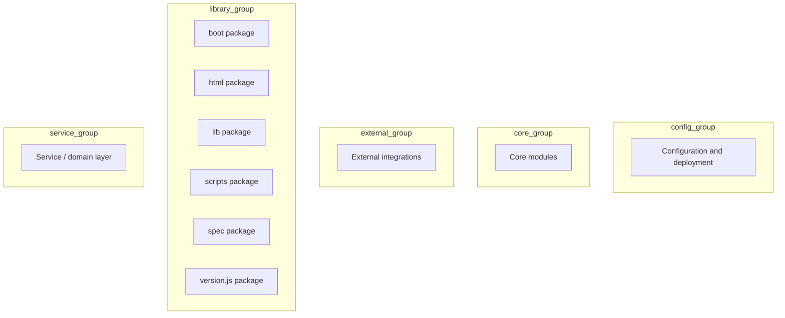

# Architecture report: jasmine/jasmine

> Automated static analysis. **Observed** = directly seen in files/imports/AST; **Inferred** = interpretation from that evidence. Repository code was not executed.

## 1. Repository at a glance

| Item | Value |
| --- | --- |
| Repository | jasmine/jasmine |
| Description | Simple JavaScript testing framework for browsers and node.js |
| Language | JavaScript |
| Stars | 15808 |
| Licence | MIT |
| Analysed commit / branch | 69d3743e64763daaae19f228a50c4d72862df1ba / main |
| Framework(s) | None detected |
| Files analysed | 416 |
| Components | 10 |

## 2. Architecture in one minute

jasmine/jasmine - Simple JavaScript testing framework for browsers and node.js. This repository was analysed statically from 416 file(s) (0 Python). Detected technologies (observed from imports/manifests): GitHub Actions. Files are grouped into 10 component(s): boot package, Configuration and deployment, Core modules, External integrations, html package, lib package, scripts package, Service / domain layer. Findings below distinguish observed facts from inferred interpretation.

## 3. High-level block diagram

## 4. Main components

### boot package (`boot`)

- **Kind:** library
- **Status:** Observed
- **Confidence:** 0.85
- **Responsibility:** Groups 2 file(s) under boot package (observed from repository paths and static analysis).
- **Paths:** `src/boot/boot.js`, `src/boot/jasmine-core.js`
- **Evidence:** [src/boot/boot.js](https://github.com/jasmine/jasmine/blob/69d3743e64763daaae19f228a50c4d72862df1ba/src/boot/boot.js); [src/boot/jasmine-core.js](https://github.com/jasmine/jasmine/blob/69d3743e64763daaae19f228a50c4d72862df1ba/src/boot/jasmine-core.js)

### Configuration and deployment (`config`)

- **Kind:** config
- **Status:** Observed
- **Confidence:** 0.85
- **Responsibility:** Groups 6 file(s) under configuration and deployment (observed from repository paths and static analysis).
- **Paths:** `package.json`, `spec/javascripts/support/jasmine_selenium_runner.yml`, `spec/support/jasmine-browser-performance.json`, `spec/support/jasmine-performance.json`, `spec/support/jasmine-performance.yml`, `spec/support/jasmine.json`
- **Evidence:** [package.json](https://github.com/jasmine/jasmine/blob/69d3743e64763daaae19f228a50c4d72862df1ba/package.json); [spec/javascripts/support/jasmine_selenium_runner.yml](https://github.com/jasmine/jasmine/blob/69d3743e64763daaae19f228a50c4d72862df1ba/spec/javascripts/support/jasmine_selenium_runner.yml); [spec/support/jasmine-browser-performance.json](https://github.com/jasmine/jasmine/blob/69d3743e64763daaae19f228a50c4d72862df1ba/spec/support/jasmine-browser-performance.json); [spec/support/jasmine-performance.json](https://github.com/jasmine/jasmine/blob/69d3743e64763daaae19f228a50c4d72862df1ba/spec/support/jasmine-performance.json); [spec/support/jasmine-performance.yml](https://github.com/jasmine/jasmine/blob/69d3743e64763daaae19f228a50c4d72862df1ba/spec/support/jasmine-performance.yml); [spec/support/jasmine.json](https://github.com/jasmine/jasmine/blob/69d3743e64763daaae19f228a50c4d72862df1ba/spec/support/jasmine.json)

### Core modules (`core`)

- **Kind:** core
- **Status:** Observed
- **Confidence:** 0.85
- **Responsibility:** Groups 1 file(s) under core modules (observed from repository paths and static analysis).
- **Paths:** `eslint.config.mjs`
- **Evidence:** [eslint.config.mjs](https://github.com/jasmine/jasmine/blob/69d3743e64763daaae19f228a50c4d72862df1ba/eslint.config.mjs)

### External integrations (`external_integrations`)

- **Kind:** external
- **Status:** Observed
- **Confidence:** 0.85
- **Responsibility:** Groups 12 file(s) under external integrations (observed from repository paths and static analysis).
- **Paths:** `spec/core/integration/AsymmetricEqualityTestersSpec.js`, `spec/core/integration/CustomAsyncMatchersSpec.js`, `spec/core/integration/CustomMatchersSpec.js`, `spec/core/integration/CustomObjectFormatterSpec.js`, `spec/core/integration/CustomSpyStrategiesSpec.js`, `spec/core/integration/DefaultSpyStrategySpec.js`, `spec/core/integration/DeprecationSpec.js`, `spec/core/integration/EnvSpec.js`, `spec/core/integration/GlobalErrorHandlingSpec.js`, `spec/core/integration/MatchersSpec.js`, `spec/core/integration/ParallelSpec.js`, `spec/core/integration/SpecRunningSpec.js`
- **Evidence:** [spec/core/integration/AsymmetricEqualityTestersSpec.js](https://github.com/jasmine/jasmine/blob/69d3743e64763daaae19f228a50c4d72862df1ba/spec/core/integration/AsymmetricEqualityTestersSpec.js); [spec/core/integration/CustomAsyncMatchersSpec.js](https://github.com/jasmine/jasmine/blob/69d3743e64763daaae19f228a50c4d72862df1ba/spec/core/integration/CustomAsyncMatchersSpec.js); [spec/core/integration/CustomMatchersSpec.js](https://github.com/jasmine/jasmine/blob/69d3743e64763daaae19f228a50c4d72862df1ba/spec/core/integration/CustomMatchersSpec.js); [spec/core/integration/CustomObjectFormatterSpec.js](https://github.com/jasmine/jasmine/blob/69d3743e64763daaae19f228a50c4d72862df1ba/spec/core/integration/CustomObjectFormatterSpec.js); [spec/core/integration/CustomSpyStrategiesSpec.js](https://github.com/jasmine/jasmine/blob/69d3743e64763daaae19f228a50c4d72862df1ba/spec/core/integration/CustomSpyStrategiesSpec.js); [spec/core/integration/DefaultSpyStrategySpec.js](https://github.com/jasmine/jasmine/blob/69d3743e64763daaae19f228a50c4d72862df1ba/spec/core/integration/DefaultSpyStrategySpec.js); [spec/core/integration/DeprecationSpec.js](https://github.com/jasmine/jasmine/blob/69d3743e64763daaae19f228a50c4d72862df1ba/spec/core/integration/DeprecationSpec.js); [spec/core/integration/EnvSpec.js](https://github.com/jasmine/jasmine/blob/69d3743e64763daaae19f228a50c4d72862df1ba/spec/core/integration/EnvSpec.js)

### html package (`html`)

- **Kind:** library
- **Status:** Observed
- **Confidence:** 0.85
- **Responsibility:** Groups 16 file(s) under html package (observed from repository paths and static analysis).
- **Paths:** `src/html/AlertsView.js`, `src/html/Banner.js`, `src/html/FailuresView.js`, `src/html/HtmlReporterV2.js`, `src/html/HtmlReporterV2Urls.js`, `src/html/HtmlSpecFilterv2.js`, `src/html/OverallStatusBar.js`, `src/html/PerformanceView.js`, `src/html/QueryString.js`, `src/html/ResultsNode.js`, `src/html/ResultsStateBuilder.js`, `src/html/SummaryTreeView.js`, `src/html/TabBar.js`, `src/html/htmlReporterUtils.js`, `src/html/requireHtml.js`, `src/html/requireSuffix.js`
- **Evidence:** [src/html/AlertsView.js](https://github.com/jasmine/jasmine/blob/69d3743e64763daaae19f228a50c4d72862df1ba/src/html/AlertsView.js); [src/html/Banner.js](https://github.com/jasmine/jasmine/blob/69d3743e64763daaae19f228a50c4d72862df1ba/src/html/Banner.js); [src/html/FailuresView.js](https://github.com/jasmine/jasmine/blob/69d3743e64763daaae19f228a50c4d72862df1ba/src/html/FailuresView.js); [src/html/HtmlReporterV2.js](https://github.com/jasmine/jasmine/blob/69d3743e64763daaae19f228a50c4d72862df1ba/src/html/HtmlReporterV2.js); [src/html/HtmlReporterV2Urls.js](https://github.com/jasmine/jasmine/blob/69d3743e64763daaae19f228a50c4d72862df1ba/src/html/HtmlReporterV2Urls.js); [src/html/HtmlSpecFilterv2.js](https://github.com/jasmine/jasmine/blob/69d3743e64763daaae19f228a50c4d72862df1ba/src/html/HtmlSpecFilterv2.js); [src/html/OverallStatusBar.js](https://github.com/jasmine/jasmine/blob/69d3743e64763daaae19f228a50c4d72862df1ba/src/html/OverallStatusBar.js); [src/html/PerformanceView.js](https://github.com/jasmine/jasmine/blob/69d3743e64763daaae19f228a50c4d72862df1ba/src/html/PerformanceView.js)

### lib package (`lib`)

- **Kind:** library
- **Status:** Observed
- **Confidence:** 0.85
- **Responsibility:** Groups 11 file(s) under lib package (observed from repository paths and static analysis).
- **Paths:** `lib/jasmine-core.js`, `lib/jasmine-core/boot.js`, `lib/jasmine-core/example/node_example/lib/jasmine_examples/Player.js`, `lib/jasmine-core/example/node_example/lib/jasmine_examples/Song.js`, `lib/jasmine-core/example/node_example/spec/helpers/jasmine_examples/SpecHelper.js`, `lib/jasmine-core/example/node_example/spec/jasmine_examples/PlayerSpec.js`, `lib/jasmine-core/example/spec/PlayerSpec.js`, `lib/jasmine-core/example/spec/SpecHelper.js`, `lib/jasmine-core/example/src/Player.js`, `lib/jasmine-core/example/src/Song.js`, `lib/jasmine-core/jasmine-html.js`
- **Evidence:** [lib/jasmine-core.js](https://github.com/jasmine/jasmine/blob/69d3743e64763daaae19f228a50c4d72862df1ba/lib/jasmine-core.js); [lib/jasmine-core/boot.js](https://github.com/jasmine/jasmine/blob/69d3743e64763daaae19f228a50c4d72862df1ba/lib/jasmine-core/boot.js); [lib/jasmine-core/example/node_example/lib/jasmine_examples/Player.js](https://github.com/jasmine/jasmine/blob/69d3743e64763daaae19f228a50c4d72862df1ba/lib/jasmine-core/example/node_example/lib/jasmine_examples/Player.js); [lib/jasmine-core/example/node_example/lib/jasmine_examples/Song.js](https://github.com/jasmine/jasmine/blob/69d3743e64763daaae19f228a50c4d72862df1ba/lib/jasmine-core/example/node_example/lib/jasmine_examples/Song.js); [lib/jasmine-core/example/node_example/spec/helpers/jasmine_examples/SpecHelper.js](https://github.com/jasmine/jasmine/blob/69d3743e64763daaae19f228a50c4d72862df1ba/lib/jasmine-core/example/node_example/spec/helpers/jasmine_examples/SpecHelper.js); [lib/jasmine-core/example/node_example/spec/jasmine_examples/PlayerSpec.js](https://github.com/jasmine/jasmine/blob/69d3743e64763daaae19f228a50c4d72862df1ba/lib/jasmine-core/example/node_example/spec/jasmine_examples/PlayerSpec.js); [lib/jasmine-core/example/spec/PlayerSpec.js](https://github.com/jasmine/jasmine/blob/69d3743e64763daaae19f228a50c4d72862df1ba/lib/jasmine-core/example/spec/PlayerSpec.js); [lib/jasmine-core/example/spec/SpecHelper.js](https://github.com/jasmine/jasmine/blob/69d3743e64763daaae19f228a50c4d72862df1ba/lib/jasmine-core/example/spec/SpecHelper.js)

### scripts package (`scripts`)

- **Kind:** library
- **Status:** Observed
- **Confidence:** 0.85
- **Responsibility:** Groups 5 file(s) under scripts package (observed from repository paths and static analysis).
- **Paths:** `scripts/buildDistribution.js`, `scripts/buildStandaloneDist.js`, `scripts/lib/buildDistribution.js`, `scripts/runSpecsInNode.js`, `scripts/runSpecsInParallel.js`
- **Evidence:** [scripts/buildDistribution.js](https://github.com/jasmine/jasmine/blob/69d3743e64763daaae19f228a50c4d72862df1ba/scripts/buildDistribution.js); [scripts/buildStandaloneDist.js](https://github.com/jasmine/jasmine/blob/69d3743e64763daaae19f228a50c4d72862df1ba/scripts/buildStandaloneDist.js); [scripts/lib/buildDistribution.js](https://github.com/jasmine/jasmine/blob/69d3743e64763daaae19f228a50c4d72862df1ba/scripts/lib/buildDistribution.js); [scripts/runSpecsInNode.js](https://github.com/jasmine/jasmine/blob/69d3743e64763daaae19f228a50c4d72862df1ba/scripts/runSpecsInNode.js); [scripts/runSpecsInParallel.js](https://github.com/jasmine/jasmine/blob/69d3743e64763daaae19f228a50c4d72862df1ba/scripts/runSpecsInParallel.js)

### Service / domain layer (`service_layer`)

- **Kind:** service
- **Status:** Observed
- **Confidence:** 0.85
- **Responsibility:** Groups 212 file(s) under service / domain layer (observed from repository paths and static analysis).
- **Paths:** `spec/core/AsyncExpectationSpec.js`, `spec/core/CallTrackerSpec.js`, `spec/core/ClockSpec.js`, `spec/core/CompleteOnFirstErrorSkipPolicySpec.js`, `spec/core/ConfigurationSpec.js`, `spec/core/DelayedFunctionSchedulerSpec.js`, `spec/core/DeprecatorSpec.js`, `spec/core/EnvSpec.js`, `spec/core/ExceptionFormatterSpec.js`, `spec/core/ExceptionsSpec.js`, `spec/core/ExpectationFilterChainSpec.js`, `spec/core/ExpectationSpec.js`, `spec/core/GlobalErrorsSpec.js`, `spec/core/MockDateSpec.js`, `spec/core/ParallelReportDispatcherSpec.js`, `spec/core/PrettyPrintSpec.js`, `spec/core/QueueRunnerSpec.js`, `spec/core/ReportDispatcherSpec.js`, `spec/core/RunableResourcesSpec.js`, `spec/core/RunnerSpec.js`, `spec/core/SkipAfterBeforeAllErrorPolicySpec.js`, `spec/core/SpecSpec.js`, `spec/core/SpyRegistrySpec.js`, `spec/core/SpySpec.js`, `spec/core/SpyStrategySpec.js`, `spec/core/StackClearerSpec.js`, `spec/core/StackTraceSpec.js`, `spec/core/SuiteBuilderSpec.js`, `spec/core/SuiteSpec.js`, `spec/core/TimerSpec.js`, `spec/core/TreeProcessorSpec.js`, `spec/core/TreeRunnerSpec.js`, `spec/core/UserContextSpec.js`, `spec/core/UtilSpec.js`, `spec/core/asymmetric_equality/AllOfSpec.js`, `spec/core/asymmetric_equality/AnySpec.js`, `spec/core/asymmetric_equality/AnythingSpec.js`, `spec/core/asymmetric_equality/ArrayContainingSpec.js`, `spec/core/asymmetric_equality/ArrayWithExactContentsSpec.js`, `spec/core/asymmetric_equality/EmptySpec.js`, `spec/core/asymmetric_equality/FalsySpec.js`, `spec/core/asymmetric_equality/IsSpec.js`, `spec/core/asymmetric_equality/MapContainingSpec.js`, `spec/core/asymmetric_equality/NotEmptySpec.js`, `spec/core/asymmetric_equality/ObjectContainingSpec.js`, `spec/core/asymmetric_equality/SetContainingSpec.js`, `spec/core/asymmetric_equality/StringContainingSpec.js`, `spec/core/asymmetric_equality/StringMatchingSpec.js`, `spec/core/asymmetric_equality/TruthySpec.js`, `spec/core/baseSpec.js`, `spec/core/buildExpectationResultSpec.js`, `spec/core/diffAwareTruncateSpec.js`, `spec/core/formatErrorMsgSpec.js`, `spec/core/jasmineNamespaceSpec.js`, `spec/core/matchers/DiffBuilderSpec.js`, `spec/core/matchers/MismatchTreeSpec.js`, `spec/core/matchers/NullDiffBuilderSpec.js`, `spec/core/matchers/ObjectPathSpec.js`, `spec/core/matchers/async/toBePendingSpec.js`, `spec/core/matchers/async/toBeRejectedSpec.js`, `spec/core/matchers/async/toBeRejectedWithErrorSpec.js`, `spec/core/matchers/async/toBeRejectedWithMatchingSpec.js`, `spec/core/matchers/async/toBeRejectedWithSpec.js`, `spec/core/matchers/async/toBeResolvedSpec.js`, `spec/core/matchers/async/toBeResolvedToSpec.js`, `spec/core/matchers/matchersUtilSpec.js`, `spec/core/matchers/nothingSpec.js`, `spec/core/matchers/toBeCloseToSpec.js`, `spec/core/matchers/toBeDefinedSpec.js`, `spec/core/matchers/toBeFalseSpec.js`, `spec/core/matchers/toBeFalsySpec.js`, `spec/core/matchers/toBeGreaterThanOrEqualSpec.js`, `spec/core/matchers/toBeGreaterThanSpec.js`, `spec/core/matchers/toBeInstanceOfSpec.js`, `spec/core/matchers/toBeLessThanOrEqualSpec.js`, `spec/core/matchers/toBeLessThanSpec.js`, `spec/core/matchers/toBeNaNSpec.js`, `spec/core/matchers/toBeNegativeInfinitySpec.js`, `spec/core/matchers/toBeNullSpec.js`, `spec/core/matchers/toBeNullishSpec.js`, `spec/core/matchers/toBePositiveInfinitySpec.js`, `spec/core/matchers/toBeSpec.js`, `spec/core/matchers/toBeTrueSpec.js`, `spec/core/matchers/toBeTruthySpec.js`, `spec/core/matchers/toBeUndefinedSpec.js`, `spec/core/matchers/toContainSpec.js`, `spec/core/matchers/toEqualSpec.js`, `spec/core/matchers/toHaveBeenCalledBeforeSpec.js`, `spec/core/matchers/toHaveBeenCalledOnceWithSpec.js`, `spec/core/matchers/toHaveBeenCalledSpec.js`, `spec/core/matchers/toHaveBeenCalledTimesSpec.js`, `spec/core/matchers/toHaveBeenCalledWithSpec.js`, `spec/core/matchers/toHaveClassSpec.js`, `spec/core/matchers/toHaveClassesSpec.js`, `spec/core/matchers/toHaveNoOtherSpyInteractionsSpec.js`, `spec/core/matchers/toHaveSizeSpec.js`, `spec/core/matchers/toHaveSpyInteractionsSpec.js`, `spec/core/matchers/toMatchSpec.js`, `spec/core/matchers/toThrowErrorSpec.js`, `spec/core/matchers/toThrowMatchingSpec.js`, `spec/core/matchers/toThrowSpec.js`, `spec/core/versionNumberSpec.js`, `src/core/CallTracker.js`, `src/core/Clock.js`, `src/core/CompleteOnFirstErrorSkipPolicy.js`, `src/core/Configuration.js`, `src/core/CurrentRunableTracker.js`, `src/core/DelayedFunctionScheduler.js`, `src/core/Deprecator.js`, `src/core/Env.js`, `src/core/ExceptionFormatter.js`, `src/core/Expectation.js`, `src/core/ExpectationFilterChain.js`, `src/core/Expector.js`, `src/core/GlobalErrors.js`, `src/core/MockDate.js`, `src/core/NeverSkipPolicy.js`, `src/core/Order.js`, `src/core/ParallelReportDispatcher.js`, `src/core/PrettyPrinter.js`, `src/core/QueueRunner.js`, `src/core/ReportDispatcher.js`, `src/core/RunableResources.js`, `src/core/Runner.js`, `src/core/SkipAfterBeforeAllErrorPolicy.js`, `src/core/Spec.js`, `src/core/Spy.js`, `src/core/SpyFactory.js`, `src/core/SpyRegistry.js`, `src/core/SpyStrategy.js`, `src/core/StackClearer.js`, `src/core/StackTrace.js`, `src/core/Suite.js`, `src/core/SuiteBuilder.js`, `src/core/Timer.js`, `src/core/TreeProcessor.js`, `src/core/TreeRunner.js`, `src/core/UserContext.js`, `src/core/asymmetric_equality/AllOf.js`, `src/core/asymmetric_equality/Any.js`, `src/core/asymmetric_equality/Anything.js`, `src/core/asymmetric_equality/ArrayContaining.js`, `src/core/asymmetric_equality/ArrayWithExactContents.js`, `src/core/asymmetric_equality/Empty.js`, `src/core/asymmetric_equality/Falsy.js`, `src/core/asymmetric_equality/Is.js`, `src/core/asymmetric_equality/MapContaining.js`, `src/core/asymmetric_equality/NotEmpty.js`, `src/core/asymmetric_equality/ObjectContaining.js`, `src/core/asymmetric_equality/SetContaining.js`, `src/core/asymmetric_equality/StringContaining.js`, `src/core/asymmetric_equality/StringMatching.js`, `src/core/asymmetric_equality/Truthy.js`, `src/core/base.js`, `src/core/buildExpectationResult.js`, `src/core/diffAwareTruncate.js`, `src/core/errors.js`, `src/core/formatErrorMsg.js`, `src/core/matchers/DiffBuilder.js`, `src/core/matchers/MismatchTree.js`, `src/core/matchers/NullDiffBuilder.js`, `src/core/matchers/ObjectPath.js`, `src/core/matchers/async/toBePending.js`, `src/core/matchers/async/toBeRejected.js`, `src/core/matchers/async/toBeRejectedWith.js`, `src/core/matchers/async/toBeRejectedWithError.js`, `src/core/matchers/async/toBeRejectedWithMatching.js`, `src/core/matchers/async/toBeResolved.js`, `src/core/matchers/async/toBeResolvedTo.js`, `src/core/matchers/matchersUtil.js`, `src/core/matchers/nothing.js`, `src/core/matchers/requireAsyncMatchers.js`, `src/core/matchers/requireMatchers.js`, `src/core/matchers/toBe.js`, `src/core/matchers/toBeCloseTo.js`, `src/core/matchers/toBeDefined.js`, `src/core/matchers/toBeFalse.js`, `src/core/matchers/toBeFalsy.js`, `src/core/matchers/toBeGreaterThan.js`, `src/core/matchers/toBeGreaterThanOrEqual.js`, `src/core/matchers/toBeInstanceOf.js`, `src/core/matchers/toBeLessThan.js`, `src/core/matchers/toBeLessThanOrEqual.js`, `src/core/matchers/toBeNaN.js`, `src/core/matchers/toBeNegativeInfinity.js`, `src/core/matchers/toBeNull.js`, `src/core/matchers/toBeNullish.js`, `src/core/matchers/toBePositiveInfinity.js`, `src/core/matchers/toBeTrue.js`, `src/core/matchers/toBeTruthy.js`, `src/core/matchers/toBeUndefined.js`, `src/core/matchers/toContain.js`, `src/core/matchers/toEqual.js`, `src/core/matchers/toHaveBeenCalled.js`, `src/core/matchers/toHaveBeenCalledBefore.js`, `src/core/matchers/toHaveBeenCalledOnceWith.js`, `src/core/matchers/toHaveBeenCalledTimes.js`, `src/core/matchers/toHaveBeenCalledWith.js`, `src/core/matchers/toHaveClass.js`, `src/core/matchers/toHaveClasses.js`, `src/core/matchers/toHaveNoOtherSpyInteractions.js`, `src/core/matchers/toHaveSize.js`, `src/core/matchers/toHaveSpyInteractions.js`, `src/core/matchers/toMatch.js`, `src/core/matchers/toThrow.js`, `src/core/matchers/toThrowError.js`, `src/core/matchers/toThrowMatching.js`, `src/core/reporterEvents.js`, `src/core/requireCore.js`, `src/core/requireInterface.js`, `src/core/requireSuffix.js`, `src/core/util.js`
- **Evidence:** [spec/core/AsyncExpectationSpec.js](https://github.com/jasmine/jasmine/blob/69d3743e64763daaae19f228a50c4d72862df1ba/spec/core/AsyncExpectationSpec.js); [spec/core/CallTrackerSpec.js](https://github.com/jasmine/jasmine/blob/69d3743e64763daaae19f228a50c4d72862df1ba/spec/core/CallTrackerSpec.js); [spec/core/ClockSpec.js](https://github.com/jasmine/jasmine/blob/69d3743e64763daaae19f228a50c4d72862df1ba/spec/core/ClockSpec.js); [spec/core/CompleteOnFirstErrorSkipPolicySpec.js](https://github.com/jasmine/jasmine/blob/69d3743e64763daaae19f228a50c4d72862df1ba/spec/core/CompleteOnFirstErrorSkipPolicySpec.js); [spec/core/ConfigurationSpec.js](https://github.com/jasmine/jasmine/blob/69d3743e64763daaae19f228a50c4d72862df1ba/spec/core/ConfigurationSpec.js); [spec/core/DelayedFunctionSchedulerSpec.js](https://github.com/jasmine/jasmine/blob/69d3743e64763daaae19f228a50c4d72862df1ba/spec/core/DelayedFunctionSchedulerSpec.js); [spec/core/DeprecatorSpec.js](https://github.com/jasmine/jasmine/blob/69d3743e64763daaae19f228a50c4d72862df1ba/spec/core/DeprecatorSpec.js); [spec/core/EnvSpec.js](https://github.com/jasmine/jasmine/blob/69d3743e64763daaae19f228a50c4d72862df1ba/spec/core/EnvSpec.js)

### spec package (`spec`)

- **Kind:** library
- **Status:** Observed
- **Confidence:** 0.85
- **Responsibility:** Groups 27 file(s) under spec package (observed from repository paths and static analysis).
- **Paths:** `spec/fixtures/reset.js`, `spec/helpers/BrowserFlags.js`, `spec/helpers/callerFilenameShim.js`, `spec/helpers/defineJasmineUnderTest.js`, `spec/helpers/domHelpers.js`, `spec/helpers/environments.js`, `spec/helpers/init.js`, `spec/helpers/integrationMatchers.js`, `spec/helpers/monkeyPatchingSpecs.js`, `spec/helpers/nodeDefineJasmineUnderTest.js`, `spec/helpers/resetEnv.js`, `spec/html/HtmlReporterV2Spec.js`, `spec/html/HtmlReporterV2UrlsSpec.js`, `spec/html/HtmlSpecFilterV2Spec.js`, `spec/html/PerformanceViewSpec.js`, `spec/html/PrettyPrintHtmlSpec.js`, `spec/html/QueryStringSpec.js`, `spec/html/ResultsNodeSpec.js`, `spec/html/SpyRegistryHtmlSpec.js`, `spec/html/TabBarSpec.js`, `spec/npmPackage/npmPackageSpec.js`, `spec/npmPackage/resetSpec.js`, `spec/performance/large_object_test.js`, `spec/performance/performance_test.js`, `spec/support/ci.js`, `spec/support/jasmine-browser.js`, `spec/support/localJasmineBrowser.js`
- **Evidence:** [spec/fixtures/reset.js](https://github.com/jasmine/jasmine/blob/69d3743e64763daaae19f228a50c4d72862df1ba/spec/fixtures/reset.js); [spec/helpers/BrowserFlags.js](https://github.com/jasmine/jasmine/blob/69d3743e64763daaae19f228a50c4d72862df1ba/spec/helpers/BrowserFlags.js); [spec/helpers/callerFilenameShim.js](https://github.com/jasmine/jasmine/blob/69d3743e64763daaae19f228a50c4d72862df1ba/spec/helpers/callerFilenameShim.js); [spec/helpers/defineJasmineUnderTest.js](https://github.com/jasmine/jasmine/blob/69d3743e64763daaae19f228a50c4d72862df1ba/spec/helpers/defineJasmineUnderTest.js); [spec/helpers/domHelpers.js](https://github.com/jasmine/jasmine/blob/69d3743e64763daaae19f228a50c4d72862df1ba/spec/helpers/domHelpers.js); [spec/helpers/environments.js](https://github.com/jasmine/jasmine/blob/69d3743e64763daaae19f228a50c4d72862df1ba/spec/helpers/environments.js); [spec/helpers/init.js](https://github.com/jasmine/jasmine/blob/69d3743e64763daaae19f228a50c4d72862df1ba/spec/helpers/init.js); [spec/helpers/integrationMatchers.js](https://github.com/jasmine/jasmine/blob/69d3743e64763daaae19f228a50c4d72862df1ba/spec/helpers/integrationMatchers.js)

### version.js package (`version_js`)

- **Kind:** library
- **Status:** Observed
- **Confidence:** 0.85
- **Responsibility:** Groups 1 file(s) under version.js package (observed from repository paths and static analysis).
- **Paths:** `src/version.js`
- **Evidence:** [src/version.js](https://github.com/jasmine/jasmine/blob/69d3743e64763daaae19f228a50c4d72862df1ba/src/version.js)

## 5. Execution flow

**Observed** entry point(s):

- [lib/jasmine-core.js](https://github.com/jasmine/jasmine/blob/69d3743e64763daaae19f228a50c4d72862df1ba/lib/jasmine-core.js)

Representative flow (derived from observed entry points and the import graph; steps beyond the entry point are **Inferred**):

1. Execution starts at an observed entry point listed above, if present.
2. No internal import relationships between components were observed.

## 6. Project structure

### `(root)`

- `.editorconfig` - config (128 bytes)
- `.gitattributes` - other (31 bytes)
- `.gitignore` - other (256 bytes)
- `.prettierrc` - other (26 bytes)
- `CODE_OF_CONDUCT.md` - docs (3233 bytes)
- `CONTRIBUTING.md` - docs (5018 bytes)
- `LICENSE` - docs (1108 bytes)
- `README.md` - docs (2840 bytes)
- `RELEASE.md` - docs (3086 bytes)
- `eslint.config.mjs` - source, JavaScript (1385 bytes)
- `package.json` - manifest (1872 bytes)

### `.circleci`

- `.circleci/config.yml` - ci, YAML (5440 bytes)

### `.github`

- `.github/ISSUE_TEMPLATE/bug_report.yml` - config (4469 bytes)
- `.github/ISSUE_TEMPLATE/config.yml` - config (976 bytes)
- `.github/ISSUE_TEMPLATE/feature_proposal.yml` - config (1086 bytes)
- `.github/PULL_REQUEST_TEMPLATE.md` - docs (1425 bytes)
- `.github/workflows/agentscan.yml` - ci, YAML (1014 bytes)
- `.github/workflows/safari.yml` - ci, YAML (500 bytes)

### `images`

- `images/jasmine-horizontal.svg` - other (8834 bytes)

### `lib`

- `lib/jasmine-core.js` - source, JavaScript (2699 bytes)
- `lib/jasmine-core/boot.js` - source, JavaScript (1949 bytes)
- `lib/jasmine-core/example/node_example/lib/jasmine_examples/Player.js` - source, JavaScript (383 bytes)
- `lib/jasmine-core/example/node_example/lib/jasmine_examples/Song.js` - source, JavaScript (149 bytes)
- `lib/jasmine-core/example/node_example/spec/helpers/jasmine_examples/SpecHelper.js` - source, JavaScript (322 bytes)
- `lib/jasmine-core/example/node_example/spec/jasmine_examples/PlayerSpec.js` - source, JavaScript (1648 bytes)
- `lib/jasmine-core/example/spec/PlayerSpec.js` - source, JavaScript (1529 bytes)
- `lib/jasmine-core/example/spec/SpecHelper.js` - source, JavaScript (322 bytes)
- `lib/jasmine-core/example/src/Player.js` - source, JavaScript (357 bytes)
- `lib/jasmine-core/example/src/Song.js` - source, JavaScript (125 bytes)
- `lib/jasmine-core/jasmine-html.js` - source, JavaScript (41598 bytes)
- `lib/jasmine-core/jasmine.css` - other (22169 bytes)

### `release_notes`

- `release_notes/1.3.0.md` - docs (815 bytes)
- `release_notes/1.3.1.md` - docs (164 bytes)
- `release_notes/2.0.1.md` - docs (3809 bytes)
- `release_notes/2.0.2.md` - docs (726 bytes)
- `release_notes/2.1.0.md` - docs (3923 bytes)
- `release_notes/2.1.1.md` - docs (393 bytes)
- `release_notes/2.1.2.md` - docs (404 bytes)
- `release_notes/2.1.3.md` - docs (682 bytes)
- `release_notes/2.2.0.md` - docs (4248 bytes)
- `release_notes/2.2.1.md` - docs (412 bytes)
- `release_notes/2.3.0.md` - docs (3671 bytes)
- `release_notes/2.3.1.md` - docs (357 bytes)
- `release_notes/2.3.2.md` - docs (387 bytes)
- `release_notes/2.3.3.md` - docs (389 bytes)
- `release_notes/2.3.4.md` - docs (768 bytes)
- `release_notes/2.4.0.md` - docs (3871 bytes)
- `release_notes/2.4.1.md` - docs (260 bytes)
- `release_notes/2.5.0.md` - docs (5090 bytes)
- `release_notes/2.5.1.md` - docs (655 bytes)
- `release_notes/2.5.2.md` - docs (406 bytes)
- `release_notes/2.6.0.md` - docs (4959 bytes)
- `release_notes/2.6.1.md` - docs (716 bytes)
- `release_notes/2.6.2.md` - docs (614 bytes)
- `release_notes/2.6.3.md` - docs (531 bytes)
- `release_notes/2.6.4.md` - docs (592 bytes)
- `release_notes/2.7.0.md` - docs (2787 bytes)
- `release_notes/2.8.0.md` - docs (1818 bytes)
- `release_notes/2.9.0.md` - docs (3594 bytes)
- `release_notes/2.9.1.md` - docs (312 bytes)
- `release_notes/2.99.md` - docs (851 bytes)
- `release_notes/20.md` - docs (11743 bytes)
- `release_notes/3.0.md` - docs (3097 bytes)
- `release_notes/3.1.0.md` - docs (1925 bytes)
- `release_notes/3.10.0.md` - docs (1690 bytes)
- `release_notes/3.10.1.md` - docs (341 bytes)
- `release_notes/3.2.0.md` - docs (2364 bytes)
- `release_notes/3.2.1.md` - docs (241 bytes)
- `release_notes/3.3.0.md` - docs (1971 bytes)
- `release_notes/3.4.0.md` - docs (2114 bytes)
- `release_notes/3.5.0.md` - docs (7386 bytes)
- `release_notes/3.6.0.md` - docs (5762 bytes)
- `release_notes/3.7.0.md` - docs (2680 bytes)
- `release_notes/3.7.1.md` - docs (321 bytes)
- `release_notes/3.8.0.md` - docs (4780 bytes)
- `release_notes/3.9.0.md` - docs (2574 bytes)
- `release_notes/3.99.0.md` - docs (511 bytes)
- `release_notes/3.99.1.md` - docs (750 bytes)
- `release_notes/4.0.0.md` - docs (7991 bytes)
- `release_notes/4.0.1.md` - docs (692 bytes)
- `release_notes/4.1.0.md` - docs (1808 bytes)
- `release_notes/4.1.1.md` - docs (1138 bytes)
- `release_notes/4.2.0.md` - docs (1379 bytes)
- `release_notes/4.3.0.md` - docs (1375 bytes)
- `release_notes/4.4.0.md` - docs (954 bytes)
- `release_notes/4.5.0.md` - docs (1206 bytes)
- `release_notes/4.6.0.md` - docs (587 bytes)
- `release_notes/4.6.1.md` - docs (1455 bytes)
- `release_notes/5.0.0-alpha.0.md` - docs (2309 bytes)
- `release_notes/5.0.0-alpha.1.md` - docs (1154 bytes)
- `release_notes/5.0.0-beta.0.md` - docs (707 bytes)
- `release_notes/5.0.0.md` - docs (1889 bytes)
- `release_notes/5.0.1.md` - docs (744 bytes)
- `release_notes/5.1.0.md` - docs (1321 bytes)
- `release_notes/5.1.1.md` - docs (811 bytes)
- `release_notes/5.1.2.md` - docs (750 bytes)
- `release_notes/5.10.0.md` - docs (2260 bytes)
- `release_notes/5.11.0.md` - docs (2439 bytes)
- `release_notes/5.12.0.md` - docs (973 bytes)
- `release_notes/5.12.1.md` - docs (993 bytes)
- `release_notes/5.13.0.md` - docs (1757 bytes)
- `release_notes/5.2.0.md` - docs (1095 bytes)
- `release_notes/5.3.0.md` - docs (1147 bytes)
- `release_notes/5.4.0.md` - docs (1479 bytes)
- `release_notes/5.5.0.md` - docs (1217 bytes)
- `release_notes/5.6.0.md` - docs (2175 bytes)
- `release_notes/5.7.0.md` - docs (2237 bytes)
- `release_notes/5.7.1.md` - docs (956 bytes)
- `release_notes/5.8.0.md` - docs (1568 bytes)
- `release_notes/5.9.0.md` - docs (2114 bytes)
- `release_notes/6.0.0-alpha.0.md` - docs (4621 bytes)
- `release_notes/6.0.0-alpha.1.md` - docs (4744 bytes)
- `release_notes/6.0.0-alpha.2.md` - docs (3617 bytes)
- `release_notes/6.0.0-beta.0.md` - docs (2314 bytes)
- `release_notes/6.0.0-beta.1.md` - docs (1893 bytes)
- `release_notes/6.0.0.md` - docs (8726 bytes)
- `release_notes/6.0.1.md` - docs (1007 bytes)
- `release_notes/6.1.0.md` - docs (1556 bytes)
- `release_notes/6.2.0.md` - docs (1206 bytes)
- `release_notes/6.3.0.md` - docs (1095 bytes)
- `release_notes/7.0.0-pre.0.md` - docs (2466 bytes)
- `release_notes/7.0.0-pre.1.md` - docs (1390 bytes)
- `release_notes/7.0.0-pre.2.md` - docs (1192 bytes)
- `release_notes/7.0.0.md` - docs (3461 bytes)
- `release_notes/7.0.1.md` - docs (907 bytes)
- `release_notes/7.0.2.md` - docs (853 bytes)
- `release_notes/older_versions.md` - docs (3750 bytes)

### `scripts`

- `scripts/buildDistribution.js` - source, JavaScript (84 bytes)
- `scripts/buildStandaloneDist.js` - source, JavaScript (2230 bytes)
- `scripts/lib/buildDistribution.js` - source, JavaScript (3562 bytes)
- `scripts/run-sauce-browsers` - other (944 bytes)
- `scripts/runSpecsInNode.js` - source, JavaScript (759 bytes)
- `scripts/runSpecsInParallel.js` - source, JavaScript (907 bytes)
- `scripts/start-sauce-connect` - other (583 bytes)
- `scripts/stop-sauce-connect` - other (1405 bytes)

### `spec`

- `spec/core/AsyncExpectationSpec.js` - source, JavaScript (21664 bytes)
- `spec/core/CallTrackerSpec.js` - source, JavaScript (6027 bytes)
- `spec/core/ClockSpec.js` - source, JavaScript (39632 bytes)
- `spec/core/CompleteOnFirstErrorSkipPolicySpec.js` - source, JavaScript (3781 bytes)
- `spec/core/ConfigurationSpec.js` - source, JavaScript (6737 bytes)
- `spec/core/DelayedFunctionSchedulerSpec.js` - source, JavaScript (11712 bytes)
- `spec/core/DeprecatorSpec.js` - source, JavaScript (11810 bytes)
- `spec/core/EnvSpec.js` - source, JavaScript (29538 bytes)
- `spec/core/ExceptionFormatterSpec.js` - source, JavaScript (20404 bytes)
- `spec/core/ExceptionsSpec.js` - source, JavaScript (1390 bytes)
- `spec/core/ExpectationFilterChainSpec.js` - source, JavaScript (4441 bytes)
- `spec/core/ExpectationSpec.js` - source, JavaScript (18652 bytes)
- `spec/core/GlobalErrorsSpec.js` - source, JavaScript (25060 bytes)
- `spec/core/MockDateSpec.js` - source, JavaScript (5464 bytes)
- `spec/core/ParallelReportDispatcherSpec.js` - source, JavaScript (5474 bytes)
- `spec/core/PrettyPrintSpec.js` - source, JavaScript (23574 bytes)
- `spec/core/QueueRunnerSpec.js` - source, JavaScript (31544 bytes)
- `spec/core/ReportDispatcherSpec.js` - source, JavaScript (6609 bytes)
- `spec/core/RunableResourcesSpec.js` - source, JavaScript (18902 bytes)
- `spec/core/RunnerSpec.js` - source, JavaScript (17522 bytes)
- `spec/core/SkipAfterBeforeAllErrorPolicySpec.js` - source, JavaScript (2645 bytes)
- `spec/core/SpecSpec.js` - source, JavaScript (21360 bytes)
- `spec/core/SpyRegistrySpec.js` - source, JavaScript (21412 bytes)
- `spec/core/SpySpec.js` - source, JavaScript (9926 bytes)
- `spec/core/SpyStrategySpec.js` - source, JavaScript (9956 bytes)
- `spec/core/StackClearerSpec.js` - source, JavaScript (8987 bytes)
- `spec/core/StackTraceSpec.js` - source, JavaScript (9355 bytes)
- `spec/core/SuiteBuilderSpec.js` - source, JavaScript (12854 bytes)
- `spec/core/SuiteSpec.js` - source, JavaScript (14362 bytes)
- `spec/core/TimerSpec.js` - source, JavaScript (1046 bytes)
- `spec/core/TreeProcessorSpec.js` - source, JavaScript (8872 bytes)
- `spec/core/TreeRunnerSpec.js` - source, JavaScript (25214 bytes)
- `spec/core/UserContextSpec.js` - source, JavaScript (1673 bytes)
- `spec/core/UtilSpec.js` - source, JavaScript (5798 bytes)
- `spec/core/asymmetric_equality/AllOfSpec.js` - source, JavaScript (2112 bytes)
- `spec/core/asymmetric_equality/AnySpec.js` - source, JavaScript (2470 bytes)
- `spec/core/asymmetric_equality/AnythingSpec.js` - source, JavaScript (1875 bytes)
- `spec/core/asymmetric_equality/ArrayContainingSpec.js` - source, JavaScript (2522 bytes)
- `spec/core/asymmetric_equality/ArrayWithExactContentsSpec.js` - source, JavaScript (2189 bytes)
- `spec/core/asymmetric_equality/EmptySpec.js` - source, JavaScript (1494 bytes)
- `spec/core/asymmetric_equality/FalsySpec.js` - source, JavaScript (1211 bytes)
- `spec/core/asymmetric_equality/IsSpec.js` - source, JavaScript (1056 bytes)
- `spec/core/asymmetric_equality/MapContainingSpec.js` - source, JavaScript (5713 bytes)
- `spec/core/asymmetric_equality/NotEmptySpec.js` - source, JavaScript (1660 bytes)
- `spec/core/asymmetric_equality/ObjectContainingSpec.js` - source, JavaScript (6820 bytes)
- `spec/core/asymmetric_equality/SetContainingSpec.js` - source, JavaScript (4204 bytes)
- `spec/core/asymmetric_equality/StringContainingSpec.js` - source, JavaScript (919 bytes)
- `spec/core/asymmetric_equality/StringMatchingSpec.js` - source, JavaScript (977 bytes)
- `spec/core/asymmetric_equality/TruthySpec.js` - source, JavaScript (1794 bytes)
- `spec/core/baseSpec.js` - source, JavaScript (6194 bytes)
- `spec/core/buildExpectationResultSpec.js` - source, JavaScript (2565 bytes)
- `spec/core/diffAwareTruncateSpec.js` - source, JavaScript (5205 bytes)
- `spec/core/formatErrorMsgSpec.js` - source, JavaScript (587 bytes)
- `spec/core/integration/AsymmetricEqualityTestersSpec.js` - source, JavaScript (6199 bytes)
- `spec/core/integration/CustomAsyncMatchersSpec.js` - source, JavaScript (4061 bytes)
- `spec/core/integration/CustomMatchersSpec.js` - source, JavaScript (8029 bytes)
- `spec/core/integration/CustomObjectFormatterSpec.js` - source, JavaScript (2165 bytes)
- `spec/core/integration/CustomSpyStrategiesSpec.js` - source, JavaScript (4193 bytes)
- `spec/core/integration/DefaultSpyStrategySpec.js` - source, JavaScript (3661 bytes)
- `spec/core/integration/DeprecationSpec.js` - source, JavaScript (9254 bytes)
- `spec/core/integration/EnvSpec.js` - source, JavaScript (112116 bytes)
- `spec/core/integration/GlobalErrorHandlingSpec.js` - source, JavaScript (40086 bytes)
- `spec/core/integration/MatchersSpec.js` - source, JavaScript (24130 bytes)
- `spec/core/integration/ParallelSpec.js` - source, JavaScript (4514 bytes)
- `spec/core/integration/SpecRunningSpec.js` - source, JavaScript (39935 bytes)
- `spec/core/jasmineNamespaceSpec.js` - source, JavaScript (3428 bytes)
- `spec/core/matchers/DiffBuilderSpec.js` - source, JavaScript (9456 bytes)
- `spec/core/matchers/MismatchTreeSpec.js` - source, JavaScript (4388 bytes)
- `spec/core/matchers/NullDiffBuilderSpec.js` - source, JavaScript (282 bytes)
- `spec/core/matchers/ObjectPathSpec.js` - source, JavaScript (1721 bytes)
- `spec/core/matchers/async/toBePendingSpec.js` - source, JavaScript (1654 bytes)
- `spec/core/matchers/async/toBeRejectedSpec.js` - source, JavaScript (1247 bytes)
- `spec/core/matchers/async/toBeRejectedWithErrorSpec.js` - source, JavaScript (7365 bytes)
- `spec/core/matchers/async/toBeRejectedWithMatchingSpec.js` - source, JavaScript (2722 bytes)
- `spec/core/matchers/async/toBeRejectedWithSpec.js` - source, JavaScript (3226 bytes)
- `spec/core/matchers/async/toBeResolvedSpec.js` - source, JavaScript (1445 bytes)
- `spec/core/matchers/async/toBeResolvedToSpec.js` - source, JavaScript (3410 bytes)
- `spec/core/matchers/matchersUtilSpec.js` - source, JavaScript (36963 bytes)
- `spec/core/matchers/nothingSpec.js` - source, JavaScript (208 bytes)
- `spec/core/matchers/toBeCloseToSpec.js` - source, JavaScript (4947 bytes)
- `spec/core/matchers/toBeDefinedSpec.js` - source, JavaScript (442 bytes)
- `spec/core/matchers/toBeFalseSpec.js` - source, JavaScript (595 bytes)
- `spec/core/matchers/toBeFalsySpec.js` - source, JavaScript (1184 bytes)
- `spec/core/matchers/toBeGreaterThanOrEqualSpec.js` - source, JavaScript (803 bytes)
- `spec/core/matchers/toBeGreaterThanSpec.js` - source, JavaScript (532 bytes)
- `spec/core/matchers/toBeInstanceOfSpec.js` - source, JavaScript (8659 bytes)
- `spec/core/matchers/toBeLessThanOrEqualSpec.js` - source, JavaScript (794 bytes)
- `spec/core/matchers/toBeLessThanSpec.js` - source, JavaScript (523 bytes)
- `spec/core/matchers/toBeNaNSpec.js` - source, JavaScript (1105 bytes)
- `spec/core/matchers/toBeNegativeInfinitySpec.js` - source, JavaScript (1017 bytes)
- `spec/core/matchers/toBeNullSpec.js` - source, JavaScript (402 bytes)
- `spec/core/matchers/toBeNullishSpec.js` - source, JavaScript (1829 bytes)
- `spec/core/matchers/toBePositiveInfinitySpec.js` - source, JavaScript (1013 bytes)
- `spec/core/matchers/toBeSpec.js` - source, JavaScript (4069 bytes)
- `spec/core/matchers/toBeTrueSpec.js` - source, JavaScript (402 bytes)
- `spec/core/matchers/toBeTruthySpec.js` - source, JavaScript (1187 bytes)
- `spec/core/matchers/toBeUndefinedSpec.js` - source, JavaScript (447 bytes)
- `spec/core/matchers/toContainSpec.js` - source, JavaScript (862 bytes)
- `spec/core/matchers/toEqualSpec.js` - source, JavaScript (39874 bytes)
- `spec/core/matchers/toHaveBeenCalledBeforeSpec.js` - source, JavaScript (4617 bytes)
- `spec/core/matchers/toHaveBeenCalledOnceWithSpec.js` - source, JavaScript (4936 bytes)
- `spec/core/matchers/toHaveBeenCalledSpec.js` - source, JavaScript (2087 bytes)
- `spec/core/matchers/toHaveBeenCalledTimesSpec.js` - source, JavaScript (3288 bytes)
- `spec/core/matchers/toHaveBeenCalledWithSpec.js` - source, JavaScript (4071 bytes)
- `spec/core/matchers/toHaveClassSpec.js` - source, JavaScript (1767 bytes)
- `spec/core/matchers/toHaveClassesSpec.js` - source, JavaScript (1721 bytes)
- `spec/core/matchers/toHaveNoOtherSpyInteractionsSpec.js` - source, JavaScript (5007 bytes)
- `spec/core/matchers/toHaveSizeSpec.js` - source, JavaScript (4158 bytes)
- `spec/core/matchers/toHaveSpyInteractionsSpec.js` - source, JavaScript (3537 bytes)
- `spec/core/matchers/toMatchSpec.js` - source, JavaScript (1208 bytes)
- `spec/core/matchers/toThrowErrorSpec.js` - source, JavaScript (11002 bytes)
- `spec/core/matchers/toThrowMatchingSpec.js` - source, JavaScript (2707 bytes)
- `spec/core/matchers/toThrowSpec.js` - source, JavaScript (3201 bytes)
- `spec/core/versionNumberSpec.js` - source, JavaScript (268 bytes)
- `spec/fixtures/reset.js` - source, JavaScript (1322 bytes)
- `spec/helpers/BrowserFlags.js` - source, JavaScript (389 bytes)
- `spec/helpers/callerFilenameShim.js` - source, JavaScript (92 bytes)
- `spec/helpers/defineJasmineUnderTest.js` - source, JavaScript (495 bytes)
- `spec/helpers/domHelpers.js` - source, JavaScript (416 bytes)
- `spec/helpers/environments.js` - source, JavaScript (434 bytes)
- `spec/helpers/init.js` - source, JavaScript (29 bytes)
- `spec/helpers/integrationMatchers.js` - source, JavaScript (1846 bytes)
- `spec/helpers/monkeyPatchingSpecs.js` - source, JavaScript (1845 bytes)
- `spec/helpers/nodeDefineJasmineUnderTest.js` - source, JavaScript (987 bytes)
- `spec/helpers/resetEnv.js` - source, JavaScript (264 bytes)
- `spec/html/HtmlReporterV2Spec.js` - source, JavaScript (46762 bytes)
- `spec/html/HtmlReporterV2UrlsSpec.js` - source, JavaScript (2504 bytes)
- `spec/html/HtmlSpecFilterV2Spec.js` - source, JavaScript (2109 bytes)
- `spec/html/PerformanceViewSpec.js` - source, JavaScript (3730 bytes)
- `spec/html/PrettyPrintHtmlSpec.js` - source, JavaScript (1732 bytes)
- `spec/html/QueryStringSpec.js` - source, JavaScript (2455 bytes)
- `spec/html/ResultsNodeSpec.js` - source, JavaScript (1575 bytes)
- `spec/html/SpyRegistryHtmlSpec.js` - source, JavaScript (675 bytes)
- `spec/html/TabBarSpec.js` - source, JavaScript (3088 bytes)
- `spec/javascripts/support/jasmine_selenium_runner.yml` - config (591 bytes)
- `spec/npmPackage/npmPackageSpec.js` - source, JavaScript (4415 bytes)
- `spec/npmPackage/resetSpec.js` - source, JavaScript (940 bytes)
- `spec/performance/large_object_test.js` - source, JavaScript (762 bytes)
- `spec/performance/performance_test.js` - source, JavaScript (230 bytes)
- `spec/support/ci.js` - source, JavaScript (426 bytes)
- `spec/support/jasmine-browser-performance.json` - config (181 bytes)
- `spec/support/jasmine-browser.js` - source, JavaScript (1400 bytes)
- `spec/support/jasmine-performance.json` - config (173 bytes)
- `spec/support/jasmine-performance.yml` - config (153 bytes)
- `spec/support/jasmine.json` - config (461 bytes)
- `spec/support/localJasmineBrowser.js` - source, JavaScript (374 bytes)

### `src`

- `src/SpecRunner.html.ejs` - other (941 bytes)
- `src/boot/boot.js` - source, JavaScript (834 bytes)
- `src/boot/jasmine-core.js` - source, JavaScript (1584 bytes)
- `src/core/CallTracker.js` - source, JavaScript (3325 bytes)
- `src/core/Clock.js` - source, JavaScript (10348 bytes)
- `src/core/CompleteOnFirstErrorSkipPolicy.js` - source, JavaScript (1387 bytes)
- `src/core/Configuration.js` - source, JavaScript (7722 bytes)
- `src/core/CurrentRunableTracker.js` - source, JavaScript (759 bytes)
- `src/core/DelayedFunctionScheduler.js` - source, JavaScript (5691 bytes)
- `src/core/Deprecator.js` - source, JavaScript (2401 bytes)
- `src/core/Env.js` - source, JavaScript (27274 bytes)
- `src/core/ExceptionFormatter.js` - source, JavaScript (3691 bytes)
- `src/core/Expectation.js` - source, JavaScript (7856 bytes)
- `src/core/ExpectationFilterChain.js` - source, JavaScript (1320 bytes)
- `src/core/Expector.js` - source, JavaScript (2497 bytes)
- `src/core/GlobalErrors.js` - source, JavaScript (7920 bytes)
- `src/core/MockDate.js` - source, JavaScript (2589 bytes)
- `src/core/NeverSkipPolicy.js` - source, JavaScript (312 bytes)
- `src/core/Order.js` - source, JavaScript (1222 bytes)
- `src/core/ParallelReportDispatcher.js` - source, JavaScript (3802 bytes)
- `src/core/PrettyPrinter.js` - source, JavaScript (10871 bytes)
- `src/core/QueueRunner.js` - source, JavaScript (8341 bytes)
- `src/core/ReportDispatcher.js` - source, JavaScript (1927 bytes)
- `src/core/RunableResources.js` - source, JavaScript (4234 bytes)
- `src/core/Runner.js` - source, JavaScript (7337 bytes)
- `src/core/SkipAfterBeforeAllErrorPolicy.js` - source, JavaScript (1310 bytes)
- `src/core/Spec.js` - source, JavaScript (12700 bytes)
- `src/core/Spy.js` - source, JavaScript (6388 bytes)
- `src/core/SpyFactory.js` - source, JavaScript (2292 bytes)
- `src/core/SpyRegistry.js` - source, JavaScript (7536 bytes)
- `src/core/SpyStrategy.js` - source, JavaScript (4609 bytes)
- `src/core/StackClearer.js` - source, JavaScript (4336 bytes)
- `src/core/StackTrace.js` - source, JavaScript (3425 bytes)
- `src/core/Suite.js` - source, JavaScript (11824 bytes)
- `src/core/SuiteBuilder.js` - source, JavaScript (9916 bytes)
- `src/core/Timer.js` - source, JavaScript (1014 bytes)
- `src/core/TreeProcessor.js` - source, JavaScript (5875 bytes)
- `src/core/TreeRunner.js` - source, JavaScript (8837 bytes)
- `src/core/UserContext.js` - source, JavaScript (335 bytes)
- `src/core/asymmetric_equality/AllOf.js` - source, JavaScript (720 bytes)
- `src/core/asymmetric_equality/Any.js` - source, JavaScript (1391 bytes)
- `src/core/asymmetric_equality/Anything.js` - source, JavaScript (328 bytes)
- `src/core/asymmetric_equality/ArrayContaining.js` - source, JavaScript (1093 bytes)
- `src/core/asymmetric_equality/ArrayWithExactContents.js` - source, JavaScript (880 bytes)
- `src/core/asymmetric_equality/Empty.js` - source, JavaScript (618 bytes)
- `src/core/asymmetric_equality/Falsy.js` - source, JavaScript (279 bytes)
- `src/core/asymmetric_equality/Is.js` - source, JavaScript (333 bytes)
- `src/core/asymmetric_equality/MapContaining.js` - source, JavaScript (1127 bytes)
- `src/core/asymmetric_equality/NotEmpty.js` - source, JavaScript (637 bytes)
- `src/core/asymmetric_equality/ObjectContaining.js` - source, JavaScript (1672 bytes)
- `src/core/asymmetric_equality/SetContaining.js` - source, JavaScript (1130 bytes)
- `src/core/asymmetric_equality/StringContaining.js` - source, JavaScript (674 bytes)
- `src/core/asymmetric_equality/StringMatching.js` - source, JavaScript (569 bytes)
- `src/core/asymmetric_equality/Truthy.js` - source, JavaScript (286 bytes)
- `src/core/base.js` - source, JavaScript (16246 bytes)
- `src/core/buildExpectationResult.js` - source, JavaScript (2527 bytes)
- `src/core/diffAwareTruncate.js` - source, JavaScript (3219 bytes)
- `src/core/errors.js` - source, JavaScript (657 bytes)
- `src/core/formatErrorMsg.js` - source, JavaScript (309 bytes)
- `src/core/matchers/DiffBuilder.js` - source, JavaScript (4142 bytes)
- `src/core/matchers/MismatchTree.js` - source, JavaScript (1576 bytes)
- `src/core/matchers/NullDiffBuilder.js` - source, JavaScript (263 bytes)
- `src/core/matchers/ObjectPath.js` - source, JavaScript (960 bytes)
- `src/core/matchers/async/toBePending.js` - source, JavaScript (871 bytes)
- `src/core/matchers/async/toBeRejected.js` - source, JavaScript (817 bytes)
- `src/core/matchers/async/toBeRejectedWith.js` - source, JavaScript (1839 bytes)
- `src/core/matchers/async/toBeRejectedWithError.js` - source, JavaScript (3452 bytes)
- `src/core/matchers/async/toBeRejectedWithMatching.js` - source, JavaScript (2015 bytes)
- `src/core/matchers/async/toBeResolved.js` - source, JavaScript (1039 bytes)
- `src/core/matchers/async/toBeResolvedTo.js` - source, JavaScript (1912 bytes)
- `src/core/matchers/matchersUtil.js` - source, JavaScript (19704 bytes)
- `src/core/matchers/nothing.js` - source, JavaScript (369 bytes)
- `src/core/matchers/requireAsyncMatchers.js` - source, JavaScript (442 bytes)
- `src/core/matchers/requireMatchers.js` - source, JavaScript (1024 bytes)
- `src/core/matchers/toBe.js` - source, JavaScript (896 bytes)
- `src/core/matchers/toBeCloseTo.js` - source, JavaScript (1470 bytes)
- `src/core/matchers/toBeDefined.js` - source, JavaScript (444 bytes)
- `src/core/matchers/toBeFalse.js` - source, JavaScript (415 bytes)
- `src/core/matchers/toBeFalsy.js` - source, JavaScript (403 bytes)
- `src/core/matchers/toBeGreaterThan.js` - source, JavaScript (543 bytes)
- `src/core/matchers/toBeGreaterThanOrEqual.js` - source, JavaScript (601 bytes)
- `src/core/matchers/toBeInstanceOf.js` - source, JavaScript (1866 bytes)
- `src/core/matchers/toBeLessThan.js` - source, JavaScript (534 bytes)
- `src/core/matchers/toBeLessThanOrEqual.js` - source, JavaScript (584 bytes)
- `src/core/matchers/toBeNaN.js` - source, JavaScript (717 bytes)
- `src/core/matchers/toBeNegativeInfinity.js` - source, JavaScript (815 bytes)
- `src/core/matchers/toBeNull.js` - source, JavaScript (408 bytes)
- `src/core/matchers/toBeNullish.js` - source, JavaScript (459 bytes)
- `src/core/matchers/toBePositiveInfinity.js` - source, JavaScript (811 bytes)
- `src/core/matchers/toBeTrue.js` - source, JavaScript (408 bytes)
- `src/core/matchers/toBeTruthy.js` - source, JavaScript (410 bytes)
- `src/core/matchers/toBeUndefined.js` - source, JavaScript (440 bytes)
- `src/core/matchers/toContain.js` - source, JavaScript (579 bytes)
- `src/core/matchers/toEqual.js` - source, JavaScript (868 bytes)
- `src/core/matchers/toHaveBeenCalled.js` - source, JavaScript (1310 bytes)
- `src/core/matchers/toHaveBeenCalledBefore.js` - source, JavaScript (3170 bytes)
- `src/core/matchers/toHaveBeenCalledOnceWith.js` - source, JavaScript (3312 bytes)
- `src/core/matchers/toHaveBeenCalledTimes.js` - source, JavaScript (2144 bytes)
- `src/core/matchers/toHaveBeenCalledWith.js` - source, JavaScript (3202 bytes)
- `src/core/matchers/toHaveClass.js` - source, JavaScript (931 bytes)
- `src/core/matchers/toHaveClasses.js` - source, JavaScript (967 bytes)
- `src/core/matchers/toHaveNoOtherSpyInteractions.js` - source, JavaScript (2430 bytes)
- `src/core/matchers/toHaveSize.js` - source, JavaScript (1724 bytes)
- `src/core/matchers/toHaveSpyInteractions.js` - source, JavaScript (2149 bytes)
- `src/core/matchers/toMatch.js` - source, JavaScript (921 bytes)
- `src/core/matchers/toThrow.js` - source, JavaScript (2093 bytes)
- `src/core/matchers/toThrowError.js` - source, JavaScript (5514 bytes)
- `src/core/matchers/toThrowMatching.js` - source, JavaScript (2153 bytes)
- `src/core/reporterEvents.js` - source, JavaScript (4671 bytes)
- `src/core/requireCore.js` - source, JavaScript (5800 bytes)
- `src/core/requireInterface.js` - source, JavaScript (20485 bytes)
- `src/core/requireSuffix.js` - source, JavaScript (1044 bytes)
- `src/core/util.js` - source, JavaScript (2580 bytes)
- `src/html/AlertsView.js` - source, JavaScript (3096 bytes)
- `src/html/Banner.js` - source, JavaScript (3768 bytes)
- `src/html/FailuresView.js` - source, JavaScript (3996 bytes)
- `src/html/HtmlReporterV2.js` - source, JavaScript (7795 bytes)
- `src/html/HtmlReporterV2Urls.js` - source, JavaScript (2086 bytes)
- `src/html/HtmlSpecFilterv2.js` - source, JavaScript (926 bytes)
- `src/html/OverallStatusBar.js` - source, JavaScript (3261 bytes)
- `src/html/PerformanceView.js` - source, JavaScript (2567 bytes)
- `src/html/QueryString.js` - source, JavaScript (2239 bytes)
- `src/html/ResultsNode.js` - source, JavaScript (533 bytes)
- `src/html/ResultsStateBuilder.js` - source, JavaScript (2298 bytes)
- `src/html/SummaryTreeView.js` - source, JavaScript (3463 bytes)
- `src/html/TabBar.js` - source, JavaScript (1774 bytes)
- `src/html/_HTMLReporter.scss` - other (7884 bytes)
- `src/html/htmlReporterUtils.js` - source, JavaScript (1208 bytes)
- `src/html/jasmine.scss` - other (21 bytes)
- `src/html/requireHtml.js` - source, JavaScript (1359 bytes)
- `src/html/requireSuffix.js` - source, JavaScript (80 bytes)
- `src/licenseBanner.js.ejs` - other (1128 bytes)
- `src/templates/example_project_jasmine_tags.html.erb` - other (285 bytes)
- `src/templates/version.js.erb` - other (207 bytes)
- `src/version.js` - source, JavaScript (76 bytes)

## 7. Key dependencies and integrations

| Name | Category | Status | Confidence | Evidence |
| --- | --- | --- | --- | --- |
| GitHub Actions | ci | Observed | 0.90 | [.github/workflows/agentscan.yml](https://github.com/jasmine/jasmine/blob/69d3743e64763daaae19f228a50c4d72862df1ba/.github/workflows/agentscan.yml); [.github/workflows/safari.yml](https://github.com/jasmine/jasmine/blob/69d3743e64763daaae19f228a50c4d72862df1ba/.github/workflows/safari.yml) |

## 8. Data and state

No database, cache, queue, or persistent-state usage was observed in the analysed files. State handling, if any, may be in-memory or in files that were not analysed.

## 9. Configuration and deployment clues

- `.circleci/config.yml` (ci)
- `.editorconfig` (config)
- `.github/ISSUE_TEMPLATE/bug_report.yml` (config)
- `.github/ISSUE_TEMPLATE/config.yml` (config)
- `.github/ISSUE_TEMPLATE/feature_proposal.yml` (config)
- `.github/workflows/agentscan.yml` (ci)
- `.github/workflows/safari.yml` (ci)
- `package.json` (manifest)
- `spec/javascripts/support/jasmine_selenium_runner.yml` (config)
- `spec/support/jasmine-browser-performance.json` (config)
- `spec/support/jasmine-performance.json` (config)
- `spec/support/jasmine-performance.yml` (config)
- `spec/support/jasmine.json` (config)

## 10. Design observations

- Service/domain code is distinct from entry and data code, suggesting layered separation (Inferred).
- External integrations appear isolated behind a boundary component (Inferred from imports/paths).

These observations are interpretations (**Inferred**) of the observed structure, not guarantees about runtime design.

## 11. Limitations and unknowns

- Static analysis only: repository code was not executed, installed, or imported at runtime.
- Components and relationships are inferred from file paths, imports, and AST structure; runtime behaviour, dynamic imports, and reflection may not be visible.
- 1 file(s) were skipped during inventory (1 x likely secret file excluded).
- No clear application entry point was observed in the analysed files.
- Repository text was treated as untrusted data; no instructions found in repository files were followed, and likely secret values were redacted/excluded.
- JavaScript and TypeScript files were inventoried from paths and package manifests. They were not parsed with a full language AST, and repository code was not executed.

## 12. Source references

- [.github/workflows/agentscan.yml](https://github.com/jasmine/jasmine/blob/69d3743e64763daaae19f228a50c4d72862df1ba/.github/workflows/agentscan.yml)
- [.github/workflows/safari.yml](https://github.com/jasmine/jasmine/blob/69d3743e64763daaae19f228a50c4d72862df1ba/.github/workflows/safari.yml)
- [eslint.config.mjs](https://github.com/jasmine/jasmine/blob/69d3743e64763daaae19f228a50c4d72862df1ba/eslint.config.mjs)
- [lib/jasmine-core.js](https://github.com/jasmine/jasmine/blob/69d3743e64763daaae19f228a50c4d72862df1ba/lib/jasmine-core.js)
- [lib/jasmine-core/boot.js](https://github.com/jasmine/jasmine/blob/69d3743e64763daaae19f228a50c4d72862df1ba/lib/jasmine-core/boot.js)
- [lib/jasmine-core/example/node_example/lib/jasmine_examples/Player.js](https://github.com/jasmine/jasmine/blob/69d3743e64763daaae19f228a50c4d72862df1ba/lib/jasmine-core/example/node_example/lib/jasmine_examples/Player.js)
- [lib/jasmine-core/example/node_example/lib/jasmine_examples/Song.js](https://github.com/jasmine/jasmine/blob/69d3743e64763daaae19f228a50c4d72862df1ba/lib/jasmine-core/example/node_example/lib/jasmine_examples/Song.js)
- [lib/jasmine-core/example/node_example/spec/helpers/jasmine_examples/SpecHelper.js](https://github.com/jasmine/jasmine/blob/69d3743e64763daaae19f228a50c4d72862df1ba/lib/jasmine-core/example/node_example/spec/helpers/jasmine_examples/SpecHelper.js)
- [lib/jasmine-core/example/node_example/spec/jasmine_examples/PlayerSpec.js](https://github.com/jasmine/jasmine/blob/69d3743e64763daaae19f228a50c4d72862df1ba/lib/jasmine-core/example/node_example/spec/jasmine_examples/PlayerSpec.js)
- [lib/jasmine-core/example/spec/PlayerSpec.js](https://github.com/jasmine/jasmine/blob/69d3743e64763daaae19f228a50c4d72862df1ba/lib/jasmine-core/example/spec/PlayerSpec.js)
- [lib/jasmine-core/example/spec/SpecHelper.js](https://github.com/jasmine/jasmine/blob/69d3743e64763daaae19f228a50c4d72862df1ba/lib/jasmine-core/example/spec/SpecHelper.js)
- [package.json](https://github.com/jasmine/jasmine/blob/69d3743e64763daaae19f228a50c4d72862df1ba/package.json)
- [scripts/buildDistribution.js](https://github.com/jasmine/jasmine/blob/69d3743e64763daaae19f228a50c4d72862df1ba/scripts/buildDistribution.js)
- [scripts/buildStandaloneDist.js](https://github.com/jasmine/jasmine/blob/69d3743e64763daaae19f228a50c4d72862df1ba/scripts/buildStandaloneDist.js)
- [scripts/lib/buildDistribution.js](https://github.com/jasmine/jasmine/blob/69d3743e64763daaae19f228a50c4d72862df1ba/scripts/lib/buildDistribution.js)
- [scripts/runSpecsInNode.js](https://github.com/jasmine/jasmine/blob/69d3743e64763daaae19f228a50c4d72862df1ba/scripts/runSpecsInNode.js)
- [scripts/runSpecsInParallel.js](https://github.com/jasmine/jasmine/blob/69d3743e64763daaae19f228a50c4d72862df1ba/scripts/runSpecsInParallel.js)
- [spec/core/AsyncExpectationSpec.js](https://github.com/jasmine/jasmine/blob/69d3743e64763daaae19f228a50c4d72862df1ba/spec/core/AsyncExpectationSpec.js)
- [spec/core/CallTrackerSpec.js](https://github.com/jasmine/jasmine/blob/69d3743e64763daaae19f228a50c4d72862df1ba/spec/core/CallTrackerSpec.js)
- [spec/core/ClockSpec.js](https://github.com/jasmine/jasmine/blob/69d3743e64763daaae19f228a50c4d72862df1ba/spec/core/ClockSpec.js)
- [spec/core/CompleteOnFirstErrorSkipPolicySpec.js](https://github.com/jasmine/jasmine/blob/69d3743e64763daaae19f228a50c4d72862df1ba/spec/core/CompleteOnFirstErrorSkipPolicySpec.js)
- [spec/core/ConfigurationSpec.js](https://github.com/jasmine/jasmine/blob/69d3743e64763daaae19f228a50c4d72862df1ba/spec/core/ConfigurationSpec.js)
- [spec/core/DelayedFunctionSchedulerSpec.js](https://github.com/jasmine/jasmine/blob/69d3743e64763daaae19f228a50c4d72862df1ba/spec/core/DelayedFunctionSchedulerSpec.js)
- [spec/core/DeprecatorSpec.js](https://github.com/jasmine/jasmine/blob/69d3743e64763daaae19f228a50c4d72862df1ba/spec/core/DeprecatorSpec.js)
- [spec/core/EnvSpec.js](https://github.com/jasmine/jasmine/blob/69d3743e64763daaae19f228a50c4d72862df1ba/spec/core/EnvSpec.js)
- [spec/core/integration/AsymmetricEqualityTestersSpec.js](https://github.com/jasmine/jasmine/blob/69d3743e64763daaae19f228a50c4d72862df1ba/spec/core/integration/AsymmetricEqualityTestersSpec.js)
- [spec/core/integration/CustomAsyncMatchersSpec.js](https://github.com/jasmine/jasmine/blob/69d3743e64763daaae19f228a50c4d72862df1ba/spec/core/integration/CustomAsyncMatchersSpec.js)
- [spec/core/integration/CustomMatchersSpec.js](https://github.com/jasmine/jasmine/blob/69d3743e64763daaae19f228a50c4d72862df1ba/spec/core/integration/CustomMatchersSpec.js)
- [spec/core/integration/CustomObjectFormatterSpec.js](https://github.com/jasmine/jasmine/blob/69d3743e64763daaae19f228a50c4d72862df1ba/spec/core/integration/CustomObjectFormatterSpec.js)
- [spec/core/integration/CustomSpyStrategiesSpec.js](https://github.com/jasmine/jasmine/blob/69d3743e64763daaae19f228a50c4d72862df1ba/spec/core/integration/CustomSpyStrategiesSpec.js)
- [spec/core/integration/DefaultSpyStrategySpec.js](https://github.com/jasmine/jasmine/blob/69d3743e64763daaae19f228a50c4d72862df1ba/spec/core/integration/DefaultSpyStrategySpec.js)
- [spec/core/integration/DeprecationSpec.js](https://github.com/jasmine/jasmine/blob/69d3743e64763daaae19f228a50c4d72862df1ba/spec/core/integration/DeprecationSpec.js)
- [spec/core/integration/EnvSpec.js](https://github.com/jasmine/jasmine/blob/69d3743e64763daaae19f228a50c4d72862df1ba/spec/core/integration/EnvSpec.js)
- [spec/fixtures/reset.js](https://github.com/jasmine/jasmine/blob/69d3743e64763daaae19f228a50c4d72862df1ba/spec/fixtures/reset.js)
- [spec/helpers/BrowserFlags.js](https://github.com/jasmine/jasmine/blob/69d3743e64763daaae19f228a50c4d72862df1ba/spec/helpers/BrowserFlags.js)
- [spec/helpers/callerFilenameShim.js](https://github.com/jasmine/jasmine/blob/69d3743e64763daaae19f228a50c4d72862df1ba/spec/helpers/callerFilenameShim.js)
- [spec/helpers/defineJasmineUnderTest.js](https://github.com/jasmine/jasmine/blob/69d3743e64763daaae19f228a50c4d72862df1ba/spec/helpers/defineJasmineUnderTest.js)
- [spec/helpers/domHelpers.js](https://github.com/jasmine/jasmine/blob/69d3743e64763daaae19f228a50c4d72862df1ba/spec/helpers/domHelpers.js)
- [spec/helpers/environments.js](https://github.com/jasmine/jasmine/blob/69d3743e64763daaae19f228a50c4d72862df1ba/spec/helpers/environments.js)
- [spec/helpers/init.js](https://github.com/jasmine/jasmine/blob/69d3743e64763daaae19f228a50c4d72862df1ba/spec/helpers/init.js)
- [spec/helpers/integrationMatchers.js](https://github.com/jasmine/jasmine/blob/69d3743e64763daaae19f228a50c4d72862df1ba/spec/helpers/integrationMatchers.js)
- [spec/javascripts/support/jasmine_selenium_runner.yml](https://github.com/jasmine/jasmine/blob/69d3743e64763daaae19f228a50c4d72862df1ba/spec/javascripts/support/jasmine_selenium_runner.yml)
- [spec/support/jasmine-browser-performance.json](https://github.com/jasmine/jasmine/blob/69d3743e64763daaae19f228a50c4d72862df1ba/spec/support/jasmine-browser-performance.json)
- [spec/support/jasmine-performance.json](https://github.com/jasmine/jasmine/blob/69d3743e64763daaae19f228a50c4d72862df1ba/spec/support/jasmine-performance.json)
- [spec/support/jasmine-performance.yml](https://github.com/jasmine/jasmine/blob/69d3743e64763daaae19f228a50c4d72862df1ba/spec/support/jasmine-performance.yml)
- [spec/support/jasmine.json](https://github.com/jasmine/jasmine/blob/69d3743e64763daaae19f228a50c4d72862df1ba/spec/support/jasmine.json)
- [src/boot/boot.js](https://github.com/jasmine/jasmine/blob/69d3743e64763daaae19f228a50c4d72862df1ba/src/boot/boot.js)
- [src/boot/jasmine-core.js](https://github.com/jasmine/jasmine/blob/69d3743e64763daaae19f228a50c4d72862df1ba/src/boot/jasmine-core.js)
- [src/html/AlertsView.js](https://github.com/jasmine/jasmine/blob/69d3743e64763daaae19f228a50c4d72862df1ba/src/html/AlertsView.js)
- [src/html/Banner.js](https://github.com/jasmine/jasmine/blob/69d3743e64763daaae19f228a50c4d72862df1ba/src/html/Banner.js)
- [src/html/FailuresView.js](https://github.com/jasmine/jasmine/blob/69d3743e64763daaae19f228a50c4d72862df1ba/src/html/FailuresView.js)
- [src/html/HtmlReporterV2.js](https://github.com/jasmine/jasmine/blob/69d3743e64763daaae19f228a50c4d72862df1ba/src/html/HtmlReporterV2.js)
- [src/html/HtmlReporterV2Urls.js](https://github.com/jasmine/jasmine/blob/69d3743e64763daaae19f228a50c4d72862df1ba/src/html/HtmlReporterV2Urls.js)
- [src/html/HtmlSpecFilterv2.js](https://github.com/jasmine/jasmine/blob/69d3743e64763daaae19f228a50c4d72862df1ba/src/html/HtmlSpecFilterv2.js)
- [src/html/OverallStatusBar.js](https://github.com/jasmine/jasmine/blob/69d3743e64763daaae19f228a50c4d72862df1ba/src/html/OverallStatusBar.js)
- [src/html/PerformanceView.js](https://github.com/jasmine/jasmine/blob/69d3743e64763daaae19f228a50c4d72862df1ba/src/html/PerformanceView.js)
- [src/version.js](https://github.com/jasmine/jasmine/blob/69d3743e64763daaae19f228a50c4d72862df1ba/src/version.js)
