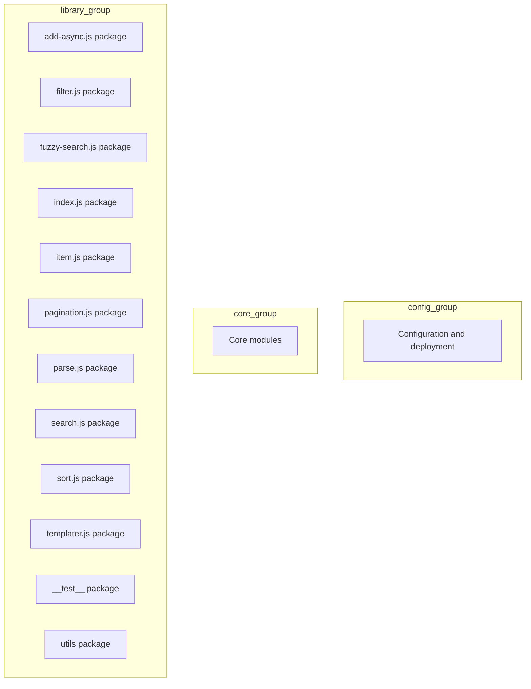

# Architecture report: javve/list.js

> Automated static analysis. **Observed** = directly seen in files/imports/AST; **Inferred** = interpretation from that evidence. Repository code was not executed.

## 1. Repository at a glance

| Item | Value |
| --- | --- |
| Repository | javve/list.js |
| Description | The perfect library for adding search, sort, filters and flexibility to tables, lists and various HTML elements. Built to be invisible and work on existing HTML. |
| Language | JavaScript |
| Stars | 11201 |
| Licence | MIT |
| Analysed commit / branch | 44ae2396072a617f6a418b5d10c5adbcbc34842f / master |
| Framework(s) | None detected |
| Files analysed | 112 |
| Components | 14 |

## 2. Architecture in one minute

javve/list.js - The perfect library for adding search, sort, filters and flexibility to tables, lists and various HTML elements. Built to be invisible and work on existing HTML.. This repository was analysed statically from 112 file(s) (0 Python). Detected technologies (observed from imports/manifests): GitHub Actions, Jest, webpack. Files are grouped into 14 component(s): add-async.js package, Configuration and deployment, Core modules, filter.js package, fuzzy-search.js package, index.js package, item.js package, pagination.js package. Findings below distinguish observed facts from inferred interpretation.

## 3. High-level block diagram

## 4. Main components

### add-async.js package (`add_async_js`)

- **Kind:** library
- **Status:** Observed
- **Confidence:** 0.85
- **Responsibility:** Groups 1 file(s) under add-async.js package (observed from repository paths and static analysis).
- **Paths:** `src/add-async.js`
- **Evidence:** [src/add-async.js](https://github.com/javve/list.js/blob/44ae2396072a617f6a418b5d10c5adbcbc34842f/src/add-async.js)

### Configuration and deployment (`config`)

- **Kind:** config
- **Status:** Observed
- **Confidence:** 0.85
- **Responsibility:** Groups 2 file(s) under configuration and deployment (observed from repository paths and static analysis).
- **Paths:** `bower.json`, `package.json`
- **Evidence:** [bower.json](https://github.com/javve/list.js/blob/44ae2396072a617f6a418b5d10c5adbcbc34842f/bower.json); [package.json](https://github.com/javve/list.js/blob/44ae2396072a617f6a418b5d10c5adbcbc34842f/package.json)

### Core modules (`core`)

- **Kind:** core
- **Status:** Observed
- **Confidence:** 0.85
- **Responsibility:** Groups 2 file(s) under core modules (observed from repository paths and static analysis).
- **Paths:** `prettier.config.js`, `webpack.config.js`
- **Evidence:** [prettier.config.js](https://github.com/javve/list.js/blob/44ae2396072a617f6a418b5d10c5adbcbc34842f/prettier.config.js); [webpack.config.js](https://github.com/javve/list.js/blob/44ae2396072a617f6a418b5d10c5adbcbc34842f/webpack.config.js)

### filter.js package (`filter_js`)

- **Kind:** library
- **Status:** Observed
- **Confidence:** 0.85
- **Responsibility:** Groups 1 file(s) under filter.js package (observed from repository paths and static analysis).
- **Paths:** `src/filter.js`
- **Evidence:** [src/filter.js](https://github.com/javve/list.js/blob/44ae2396072a617f6a418b5d10c5adbcbc34842f/src/filter.js)

### fuzzy-search.js package (`fuzzy_search_js`)

- **Kind:** library
- **Status:** Observed
- **Confidence:** 0.85
- **Responsibility:** Groups 1 file(s) under fuzzy-search.js package (observed from repository paths and static analysis).
- **Paths:** `src/fuzzy-search.js`
- **Evidence:** [src/fuzzy-search.js](https://github.com/javve/list.js/blob/44ae2396072a617f6a418b5d10c5adbcbc34842f/src/fuzzy-search.js)

### index.js package (`index_js`)

- **Kind:** library
- **Status:** Observed
- **Confidence:** 0.85
- **Responsibility:** Groups 1 file(s) under index.js package (observed from repository paths and static analysis).
- **Paths:** `src/index.js`
- **Evidence:** [src/index.js](https://github.com/javve/list.js/blob/44ae2396072a617f6a418b5d10c5adbcbc34842f/src/index.js)

### item.js package (`item_js`)

- **Kind:** library
- **Status:** Observed
- **Confidence:** 0.85
- **Responsibility:** Groups 1 file(s) under item.js package (observed from repository paths and static analysis).
- **Paths:** `src/item.js`
- **Evidence:** [src/item.js](https://github.com/javve/list.js/blob/44ae2396072a617f6a418b5d10c5adbcbc34842f/src/item.js)

### pagination.js package (`pagination_js`)

- **Kind:** library
- **Status:** Observed
- **Confidence:** 0.85
- **Responsibility:** Groups 1 file(s) under pagination.js package (observed from repository paths and static analysis).
- **Paths:** `src/pagination.js`
- **Evidence:** [src/pagination.js](https://github.com/javve/list.js/blob/44ae2396072a617f6a418b5d10c5adbcbc34842f/src/pagination.js)

### parse.js package (`parse_js`)

- **Kind:** library
- **Status:** Observed
- **Confidence:** 0.85
- **Responsibility:** Groups 1 file(s) under parse.js package (observed from repository paths and static analysis).
- **Paths:** `src/parse.js`
- **Evidence:** [src/parse.js](https://github.com/javve/list.js/blob/44ae2396072a617f6a418b5d10c5adbcbc34842f/src/parse.js)

### search.js package (`search_js`)

- **Kind:** library
- **Status:** Observed
- **Confidence:** 0.85
- **Responsibility:** Groups 1 file(s) under search.js package (observed from repository paths and static analysis).
- **Paths:** `src/search.js`
- **Evidence:** [src/search.js](https://github.com/javve/list.js/blob/44ae2396072a617f6a418b5d10c5adbcbc34842f/src/search.js)

### sort.js package (`sort_js`)

- **Kind:** library
- **Status:** Observed
- **Confidence:** 0.85
- **Responsibility:** Groups 1 file(s) under sort.js package (observed from repository paths and static analysis).
- **Paths:** `src/sort.js`
- **Evidence:** [src/sort.js](https://github.com/javve/list.js/blob/44ae2396072a617f6a418b5d10c5adbcbc34842f/src/sort.js)

### templater.js package (`templater_js`)

- **Kind:** library
- **Status:** Observed
- **Confidence:** 0.85
- **Responsibility:** Groups 1 file(s) under templater.js package (observed from repository paths and static analysis).
- **Paths:** `src/templater.js`
- **Evidence:** [src/templater.js](https://github.com/javve/list.js/blob/44ae2396072a617f6a418b5d10c5adbcbc34842f/src/templater.js)

### __test__ package (`test`)

- **Kind:** library
- **Status:** Observed
- **Confidence:** 0.85
- **Responsibility:** Groups 24 file(s) under __test__ package (observed from repository paths and static analysis).
- **Paths:** `__test__/add-get-remove.test.js`, `__test__/buttons.test.js`, `__test__/create.test.js`, `__test__/defaults.test.js`, `__test__/filter.test.js`, `__test__/fixtures-fuzzysearch.js`, `__test__/fixtures-pagination.js`, `__test__/fixtures.js`, `__test__/fuzzysearch.test.js`, `__test__/item.test.js`, `__test__/off.test.js`, `__test__/on.test.js`, `__test__/pagination.test.js`, `__test__/parse.test.js`, `__test__/re-index.test.js`, `__test__/search-filter.test.js`, `__test__/search.test.js`, `__test__/show.test.js`, `__test__/sort.test.js`, `__test__/trigger.test.js`, `__test__/usage/main.js`, `__test__/usage/require.js`, `__test__/utils.classes.test.js`, `__test__/utils.get-by-class.test.js`
- **Evidence:** [__test__/add-get-remove.test.js](https://github.com/javve/list.js/blob/44ae2396072a617f6a418b5d10c5adbcbc34842f/__test__/add-get-remove.test.js); [__test__/buttons.test.js](https://github.com/javve/list.js/blob/44ae2396072a617f6a418b5d10c5adbcbc34842f/__test__/buttons.test.js); [__test__/create.test.js](https://github.com/javve/list.js/blob/44ae2396072a617f6a418b5d10c5adbcbc34842f/__test__/create.test.js); [__test__/defaults.test.js](https://github.com/javve/list.js/blob/44ae2396072a617f6a418b5d10c5adbcbc34842f/__test__/defaults.test.js); [__test__/filter.test.js](https://github.com/javve/list.js/blob/44ae2396072a617f6a418b5d10c5adbcbc34842f/__test__/filter.test.js); [__test__/fixtures-fuzzysearch.js](https://github.com/javve/list.js/blob/44ae2396072a617f6a418b5d10c5adbcbc34842f/__test__/fixtures-fuzzysearch.js); [__test__/fixtures-pagination.js](https://github.com/javve/list.js/blob/44ae2396072a617f6a418b5d10c5adbcbc34842f/__test__/fixtures-pagination.js); [__test__/fixtures.js](https://github.com/javve/list.js/blob/44ae2396072a617f6a418b5d10c5adbcbc34842f/__test__/fixtures.js)

### utils package (`utils`)

- **Kind:** library
- **Status:** Observed
- **Confidence:** 0.85
- **Responsibility:** Groups 9 file(s) under utils package (observed from repository paths and static analysis).
- **Paths:** `src/utils/classes.js`, `src/utils/events.js`, `src/utils/extend.js`, `src/utils/fuzzy.js`, `src/utils/get-attribute.js`, `src/utils/get-by-class.js`, `src/utils/index-of.js`, `src/utils/to-array.js`, `src/utils/to-string.js`
- **Evidence:** [src/utils/classes.js](https://github.com/javve/list.js/blob/44ae2396072a617f6a418b5d10c5adbcbc34842f/src/utils/classes.js); [src/utils/events.js](https://github.com/javve/list.js/blob/44ae2396072a617f6a418b5d10c5adbcbc34842f/src/utils/events.js); [src/utils/extend.js](https://github.com/javve/list.js/blob/44ae2396072a617f6a418b5d10c5adbcbc34842f/src/utils/extend.js); [src/utils/fuzzy.js](https://github.com/javve/list.js/blob/44ae2396072a617f6a418b5d10c5adbcbc34842f/src/utils/fuzzy.js); [src/utils/get-attribute.js](https://github.com/javve/list.js/blob/44ae2396072a617f6a418b5d10c5adbcbc34842f/src/utils/get-attribute.js); [src/utils/get-by-class.js](https://github.com/javve/list.js/blob/44ae2396072a617f6a418b5d10c5adbcbc34842f/src/utils/get-by-class.js); [src/utils/index-of.js](https://github.com/javve/list.js/blob/44ae2396072a617f6a418b5d10c5adbcbc34842f/src/utils/index-of.js); [src/utils/to-array.js](https://github.com/javve/list.js/blob/44ae2396072a617f6a418b5d10c5adbcbc34842f/src/utils/to-array.js)

## 5. Execution flow

**Observed** entry point(s):

- [__test__/usage/main.js](https://github.com/javve/list.js/blob/44ae2396072a617f6a418b5d10c5adbcbc34842f/__test__/usage/main.js)
- [src/index.js](https://github.com/javve/list.js/blob/44ae2396072a617f6a418b5d10c5adbcbc34842f/src/index.js)

Representative flow (derived from observed entry points and the import graph; steps beyond the entry point are **Inferred**):

1. Execution starts at an observed entry point listed above, if present.
2. No internal import relationships between components were observed.

## 6. Project structure

### `(root)`

- `.browserslistrc` - other (4 bytes)
- `.codecov.yml` - config (26 bytes)
- `.gitignore` - other (93 bytes)
- `.npmignore` - other (128 bytes)
- `.nvmrc` - other (7 bytes)
- `.prettierignore` - other (8 bytes)
- `CHANGELOG.md` - docs (13516 bytes)
- `LICENSE` - docs (1108 bytes)
- `README.md` - docs (4342 bytes)
- `Release.md` - docs (158 bytes)
- `WISHLIST.md` - docs (1126 bytes)
- `bower.json` - config (507 bytes)
- `package.json` - manifest (1891 bytes)
- `prettier.config.js` - source, JavaScript (75 bytes)
- `webpack.config.js` - source, JavaScript (966 bytes)

### `.circleci`

- `.circleci/config.yml` - ci, YAML (668 bytes)

### `.github`

- `.github/workflows/ci.yml` - ci, YAML (427 bytes)

### `__test__`

- `__test__/add-get-remove.test.js` - source, JavaScript (5389 bytes)
- `__test__/buttons.test.js` - source, JavaScript (7346 bytes)
- `__test__/create.test.js` - source, JavaScript (12861 bytes)
- `__test__/defaults.test.js` - source, JavaScript (2493 bytes)
- `__test__/filter.test.js` - source, JavaScript (3290 bytes)
- `__test__/fixtures-fuzzysearch.js` - source, JavaScript (1187 bytes)
- `__test__/fixtures-pagination.js` - source, JavaScript (2110 bytes)
- `__test__/fixtures.js` - source, JavaScript (1135 bytes)
- `__test__/fuzzysearch.test.js` - source, JavaScript (2049 bytes)
- `__test__/item.test.js` - source, JavaScript (4450 bytes)
- `__test__/off.test.js` - source, JavaScript (1143 bytes)
- `__test__/on.test.js` - source, JavaScript (2842 bytes)
- `__test__/pagination.test.js` - source, JavaScript (16824 bytes)
- `__test__/parse.test.js` - source, JavaScript (4683 bytes)
- `__test__/re-index.test.js` - source, JavaScript (1109 bytes)
- `__test__/search-filter.test.js` - source, JavaScript (2213 bytes)
- `__test__/search.test.js` - source, JavaScript (7248 bytes)
- `__test__/show.test.js` - source, JavaScript (6499 bytes)
- `__test__/sort.test.js` - source, JavaScript (15113 bytes)
- `__test__/trigger.test.js` - source, JavaScript (452 bytes)
- `__test__/usage/amd.html` - other (751 bytes)
- `__test__/usage/classic.html` - other (1674 bytes)
- `__test__/usage/fuzzy-search-pagination.html` - other (1185 bytes)
- `__test__/usage/main.js` - source, JavaScript (182 bytes)
- `__test__/usage/require.js` - source, JavaScript (69111 bytes)
- `__test__/usage/style.css` - other (1768 bytes)
- `__test__/utils.classes.test.js` - source, JavaScript (1279 bytes)
- `__test__/utils.get-by-class.test.js` - source, JavaScript (794 bytes)

### `docs`

- `docs/.bundle/config` - docs (33 bytes)
- `docs/.ruby-version` - docs (5 bytes)
- `docs/CNAME` - docs (10 bytes)
- `docs/Gemfile` - docs (80 bytes)
- `docs/Gemfile.lock` - docs (7222 bytes)
- `docs/README.md` - docs (13 bytes)
- `docs/_config.yml` - config (599 bytes)
- `docs/_data/pkg.json` - config (1891 bytes)
- `docs/_examples/add-get-remove.html` - docs (187 bytes)
- `docs/_examples/data-attributes-custom-attributes.html` - docs (200 bytes)
- `docs/_examples/existing-list-add.html` - docs (167 bytes)
- `docs/_examples/existing-list.html` - docs (164 bytes)
- `docs/_examples/fuzzy-search.html` - docs (176 bytes)
- `docs/_examples/new-list.html` - docs (156 bytes)
- `docs/_examples/pagination.html` - docs (172 bytes)
- `docs/_examples/table.html` - docs (166 bytes)
- `docs/_includes/author.html` - docs (1435 bytes)
- `docs/_includes/carbon.html` - docs (148 bytes)
- `docs/_includes/codepen.html` - docs (609 bytes)
- `docs/_includes/examples/annotated-example.html` - docs (4126 bytes)
- `docs/_includes/menu.html` - docs (1603 bytes)
- `docs/_layouts/default.html` - docs (5745 bytes)
- `docs/_sass/_base.scss` - docs (2977 bytes)
- `docs/_sass/_carbonads.scss` - docs (1825 bytes)
- `docs/_sass/_docs.scss` - docs (1721 bytes)
- `docs/_sass/_menu.scss` - docs (1279 bytes)
- `docs/_sass/_mixins.scss` - docs (261 bytes)
- `docs/_sass/_normalize.scss` - docs (7546 bytes)
- `docs/api.html` - docs (15698 bytes)
- `docs/assets/css/style.scss` - docs (12221 bytes)
- `docs/assets/javascripts/main.js` - docs (308 bytes)
- `docs/docs/fuzzysearch.html` - docs (3387 bytes)
- `docs/docs/index.html` - docs (4263 bytes)
- `docs/docs/item-api.html` - docs (2935 bytes)
- `docs/docs/pagination.html` - docs (3703 bytes)
- `docs/docs/plugins/build.html` - docs (1580 bytes)
- `docs/docs/plugins/fuzzysearch.html` - docs (4109 bytes)
- `docs/docs/plugins/index.html` - docs (1407 bytes)
- `docs/docs/plugins/pagination.html` - docs (4718 bytes)
- `docs/docs/search-sort.html` - docs (4450 bytes)
- `docs/faq.html` - docs (684 bytes)
- `docs/feed.xml` - docs (1291 bytes)
- `docs/index.html` - docs (2401 bytes)
- `docs/overview/changelog.html` - docs (189 bytes)
- `docs/overview/contribute.html` - docs (1171 bytes)
- `docs/overview/download.html` - docs (1168 bytes)
- `docs/overview/index.html` - docs (1474 bytes)
- `docs/overview/press.html` - docs (4027 bytes)

### `src`

- `src/add-async.js` - source, JavaScript (403 bytes)
- `src/filter.js` - source, JavaScript (748 bytes)
- `src/fuzzy-search.js` - source, JavaScript (2017 bytes)
- `src/index.js` - source, JavaScript (6397 bytes)
- `src/item.js` - source, JavaScript (1602 bytes)
- `src/pagination.js` - source, JavaScript (3701 bytes)
- `src/parse.js` - source, JavaScript (1256 bytes)
- `src/search.js` - source, JavaScript (4343 bytes)
- `src/sort.js` - source, JavaScript (3387 bytes)
- `src/templater.js` - source, JavaScript (5463 bytes)
- `src/utils/classes.js` - source, JavaScript (2859 bytes)
- `src/utils/events.js` - source, JavaScript (1833 bytes)
- `src/utils/extend.js` - source, JavaScript (444 bytes)
- `src/utils/fuzzy.js` - source, JavaScript (4513 bytes)
- `src/utils/get-attribute.js` - source, JavaScript (645 bytes)
- `src/utils/get-by-class.js` - source, JavaScript (1870 bytes)
- `src/utils/index-of.js` - source, JavaScript (205 bytes)
- `src/utils/to-array.js` - source, JavaScript (1171 bytes)
- `src/utils/to-string.js` - source, JavaScript (121 bytes)

## 7. Key dependencies and integrations

| Name | Category | Status | Confidence | Evidence |
| --- | --- | --- | --- | --- |
| GitHub Actions | ci | Observed | 0.85 | [.github/workflows/ci.yml](https://github.com/javve/list.js/blob/44ae2396072a617f6a418b5d10c5adbcbc34842f/.github/workflows/ci.yml) |
| Jest | tooling | Observed | 0.85 | [package.json:32](https://github.com/javve/list.js/blob/44ae2396072a617f6a418b5d10c5adbcbc34842f/package.json#L32) |
| webpack | tooling | Observed | 0.85 | [package.json:35](https://github.com/javve/list.js/blob/44ae2396072a617f6a418b5d10c5adbcbc34842f/package.json#L35) |

## 8. Data and state

No database, cache, queue, or persistent-state usage was observed in the analysed files. State handling, if any, may be in-memory or in files that were not analysed.

## 9. Configuration and deployment clues

- `.circleci/config.yml` (ci)
- `.codecov.yml` (config)
- `.github/workflows/ci.yml` (ci)
- `bower.json` (config)
- `docs/_config.yml` (config)
- `docs/_data/pkg.json` (config)
- `package.json` (manifest)

## 10. Design observations

- No strong design patterns could be established from the available evidence.

These observations are interpretations (**Inferred**) of the observed structure, not guarantees about runtime design.

## 11. Limitations and unknowns

- Static analysis only: repository code was not executed, installed, or imported at runtime.
- Components and relationships are inferred from file paths, imports, and AST structure; runtime behaviour, dynamic imports, and reflection may not be visible.
- 6 file(s) were skipped during inventory (6 x vendored/generated directory excluded).
- No clear application entry point was observed in the analysed files.
- Repository text was treated as untrusted data; no instructions found in repository files were followed, and likely secret values were redacted/excluded.
- JavaScript and TypeScript files were inventoried from paths and package manifests. They were not parsed with a full language AST, and repository code was not executed.

## 12. Source references

- [.github/workflows/ci.yml](https://github.com/javve/list.js/blob/44ae2396072a617f6a418b5d10c5adbcbc34842f/.github/workflows/ci.yml)
- [__test__/add-get-remove.test.js](https://github.com/javve/list.js/blob/44ae2396072a617f6a418b5d10c5adbcbc34842f/__test__/add-get-remove.test.js)
- [__test__/buttons.test.js](https://github.com/javve/list.js/blob/44ae2396072a617f6a418b5d10c5adbcbc34842f/__test__/buttons.test.js)
- [__test__/create.test.js](https://github.com/javve/list.js/blob/44ae2396072a617f6a418b5d10c5adbcbc34842f/__test__/create.test.js)
- [__test__/defaults.test.js](https://github.com/javve/list.js/blob/44ae2396072a617f6a418b5d10c5adbcbc34842f/__test__/defaults.test.js)
- [__test__/filter.test.js](https://github.com/javve/list.js/blob/44ae2396072a617f6a418b5d10c5adbcbc34842f/__test__/filter.test.js)
- [__test__/fixtures-fuzzysearch.js](https://github.com/javve/list.js/blob/44ae2396072a617f6a418b5d10c5adbcbc34842f/__test__/fixtures-fuzzysearch.js)
- [__test__/fixtures-pagination.js](https://github.com/javve/list.js/blob/44ae2396072a617f6a418b5d10c5adbcbc34842f/__test__/fixtures-pagination.js)
- [__test__/fixtures.js](https://github.com/javve/list.js/blob/44ae2396072a617f6a418b5d10c5adbcbc34842f/__test__/fixtures.js)
- [__test__/usage/main.js](https://github.com/javve/list.js/blob/44ae2396072a617f6a418b5d10c5adbcbc34842f/__test__/usage/main.js)
- [bower.json](https://github.com/javve/list.js/blob/44ae2396072a617f6a418b5d10c5adbcbc34842f/bower.json)
- [package.json](https://github.com/javve/list.js/blob/44ae2396072a617f6a418b5d10c5adbcbc34842f/package.json)
- [package.json:32](https://github.com/javve/list.js/blob/44ae2396072a617f6a418b5d10c5adbcbc34842f/package.json#L32)
- [package.json:35](https://github.com/javve/list.js/blob/44ae2396072a617f6a418b5d10c5adbcbc34842f/package.json#L35)
- [prettier.config.js](https://github.com/javve/list.js/blob/44ae2396072a617f6a418b5d10c5adbcbc34842f/prettier.config.js)
- [src/add-async.js](https://github.com/javve/list.js/blob/44ae2396072a617f6a418b5d10c5adbcbc34842f/src/add-async.js)
- [src/filter.js](https://github.com/javve/list.js/blob/44ae2396072a617f6a418b5d10c5adbcbc34842f/src/filter.js)
- [src/fuzzy-search.js](https://github.com/javve/list.js/blob/44ae2396072a617f6a418b5d10c5adbcbc34842f/src/fuzzy-search.js)
- [src/index.js](https://github.com/javve/list.js/blob/44ae2396072a617f6a418b5d10c5adbcbc34842f/src/index.js)
- [src/item.js](https://github.com/javve/list.js/blob/44ae2396072a617f6a418b5d10c5adbcbc34842f/src/item.js)
- [src/pagination.js](https://github.com/javve/list.js/blob/44ae2396072a617f6a418b5d10c5adbcbc34842f/src/pagination.js)
- [src/parse.js](https://github.com/javve/list.js/blob/44ae2396072a617f6a418b5d10c5adbcbc34842f/src/parse.js)
- [src/search.js](https://github.com/javve/list.js/blob/44ae2396072a617f6a418b5d10c5adbcbc34842f/src/search.js)
- [src/sort.js](https://github.com/javve/list.js/blob/44ae2396072a617f6a418b5d10c5adbcbc34842f/src/sort.js)
- [src/templater.js](https://github.com/javve/list.js/blob/44ae2396072a617f6a418b5d10c5adbcbc34842f/src/templater.js)
- [src/utils/classes.js](https://github.com/javve/list.js/blob/44ae2396072a617f6a418b5d10c5adbcbc34842f/src/utils/classes.js)
- [src/utils/events.js](https://github.com/javve/list.js/blob/44ae2396072a617f6a418b5d10c5adbcbc34842f/src/utils/events.js)
- [src/utils/extend.js](https://github.com/javve/list.js/blob/44ae2396072a617f6a418b5d10c5adbcbc34842f/src/utils/extend.js)
- [src/utils/fuzzy.js](https://github.com/javve/list.js/blob/44ae2396072a617f6a418b5d10c5adbcbc34842f/src/utils/fuzzy.js)
- [src/utils/get-attribute.js](https://github.com/javve/list.js/blob/44ae2396072a617f6a418b5d10c5adbcbc34842f/src/utils/get-attribute.js)
- [src/utils/get-by-class.js](https://github.com/javve/list.js/blob/44ae2396072a617f6a418b5d10c5adbcbc34842f/src/utils/get-by-class.js)
- [src/utils/index-of.js](https://github.com/javve/list.js/blob/44ae2396072a617f6a418b5d10c5adbcbc34842f/src/utils/index-of.js)
- [src/utils/to-array.js](https://github.com/javve/list.js/blob/44ae2396072a617f6a418b5d10c5adbcbc34842f/src/utils/to-array.js)
- [webpack.config.js](https://github.com/javve/list.js/blob/44ae2396072a617f6a418b5d10c5adbcbc34842f/webpack.config.js)
