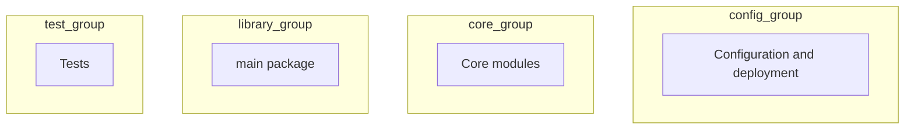

# Architecture report: jgraph/drawio-desktop

> Automated static analysis. **Observed** = directly seen in files/imports/AST; **Inferred** = interpretation from that evidence. Repository code was not executed.

## 1. Repository at a glance

| Item | Value |
| --- | --- |
| Repository | jgraph/drawio-desktop |
| Description | Official electron build of draw.io |
| Language | JavaScript |
| Stars | 63996 |
| Licence | GPL-3.0 |
| Analysed commit / branch | 0623fb3c1523639b06600d5c33e3a127bf82aa1c / dev |
| Framework(s) | Electron |
| Files analysed | 66 |
| Components | 4 |

## 2. Architecture in one minute

jgraph/drawio-desktop - Official electron build of draw.io. This repository was analysed statically from 66 file(s) (0 Python). Detected technologies (observed from imports/manifests): GitHub Actions, Electron, Docker. Files are grouped into 4 component(s): Configuration and deployment, Core modules, main package, Tests. Findings below distinguish observed facts from inferred interpretation.

## 3. High-level block diagram

## 4. Main components

### Configuration and deployment (`config`)

- **Kind:** config
- **Status:** Observed
- **Confidence:** 0.85
- **Responsibility:** Groups 6 file(s) under configuration and deployment (observed from repository paths and static analysis).
- **Paths:** `electron-builder-appx.json`, `electron-builder-linux-mac.json`, `electron-builder-snap.json`, `electron-builder-win-arm64.json`, `electron-builder-win.json`, `package.json`
- **Evidence:** [electron-builder-appx.json](https://github.com/jgraph/drawio-desktop/blob/0623fb3c1523639b06600d5c33e3a127bf82aa1c/electron-builder-appx.json); [electron-builder-linux-mac.json](https://github.com/jgraph/drawio-desktop/blob/0623fb3c1523639b06600d5c33e3a127bf82aa1c/electron-builder-linux-mac.json); [electron-builder-snap.json](https://github.com/jgraph/drawio-desktop/blob/0623fb3c1523639b06600d5c33e3a127bf82aa1c/electron-builder-snap.json); [electron-builder-win-arm64.json](https://github.com/jgraph/drawio-desktop/blob/0623fb3c1523639b06600d5c33e3a127bf82aa1c/electron-builder-win-arm64.json); [electron-builder-win.json](https://github.com/jgraph/drawio-desktop/blob/0623fb3c1523639b06600d5c33e3a127bf82aa1c/electron-builder-win.json); [package.json](https://github.com/jgraph/drawio-desktop/blob/0623fb3c1523639b06600d5c33e3a127bf82aa1c/package.json)

### Core modules (`core`)

- **Kind:** core
- **Status:** Observed
- **Confidence:** 0.85
- **Responsibility:** Groups 2 file(s) under core modules (observed from repository paths and static analysis).
- **Paths:** `preload.js`, `sync.cjs`
- **Evidence:** [preload.js](https://github.com/jgraph/drawio-desktop/blob/0623fb3c1523639b06600d5c33e3a127bf82aa1c/preload.js); [sync.cjs](https://github.com/jgraph/drawio-desktop/blob/0623fb3c1523639b06600d5c33e3a127bf82aa1c/sync.cjs)

### main package (`main`)

- **Kind:** library
- **Status:** Observed
- **Confidence:** 0.85
- **Responsibility:** Groups 18 file(s) under main package (observed from repository paths and static analysis).
- **Paths:** `src/main/args.js`, `src/main/backup-file.js`, `src/main/config-paths.js`, `src/main/disableUpdate.js`, `src/main/electron-preload.js`, `src/main/electron.js`, `src/main/export-files.js`, `src/main/file-watcher.js`, `src/main/html-export.js`, `src/main/pdf-xml.js`, `src/main/png-xml.js`, `src/main/print-options.js`, `src/main/progress-bar.js`, `src/main/system-path.js`, `src/main/update-channel.js`, `src/main/update-mode.js`, `src/main/url-params.js`, `src/main/window-bounds.js`
- **Evidence:** [src/main/args.js](https://github.com/jgraph/drawio-desktop/blob/0623fb3c1523639b06600d5c33e3a127bf82aa1c/src/main/args.js); [src/main/backup-file.js](https://github.com/jgraph/drawio-desktop/blob/0623fb3c1523639b06600d5c33e3a127bf82aa1c/src/main/backup-file.js); [src/main/config-paths.js](https://github.com/jgraph/drawio-desktop/blob/0623fb3c1523639b06600d5c33e3a127bf82aa1c/src/main/config-paths.js); [src/main/disableUpdate.js](https://github.com/jgraph/drawio-desktop/blob/0623fb3c1523639b06600d5c33e3a127bf82aa1c/src/main/disableUpdate.js); [src/main/electron-preload.js](https://github.com/jgraph/drawio-desktop/blob/0623fb3c1523639b06600d5c33e3a127bf82aa1c/src/main/electron-preload.js); [src/main/electron.js](https://github.com/jgraph/drawio-desktop/blob/0623fb3c1523639b06600d5c33e3a127bf82aa1c/src/main/electron.js); [src/main/export-files.js](https://github.com/jgraph/drawio-desktop/blob/0623fb3c1523639b06600d5c33e3a127bf82aa1c/src/main/export-files.js); [src/main/file-watcher.js](https://github.com/jgraph/drawio-desktop/blob/0623fb3c1523639b06600d5c33e3a127bf82aa1c/src/main/file-watcher.js)

### Tests (`tests`)

- **Kind:** test
- **Status:** Observed
- **Confidence:** 0.85
- **Responsibility:** Groups 15 file(s) under tests (observed from repository paths and static analysis).
- **Paths:** `src/test/backup-file.test.js`, `src/test/cli-args.test.js`, `src/test/config-paths.test.js`, `src/test/export-files.test.js`, `src/test/file-watcher.test.js`, `src/test/html-export.test.js`, `src/test/msi-project-created.test.js`, `src/test/pdf-xml.test.js`, `src/test/png-xml.test.js`, `src/test/print-options.test.js`, `src/test/system-path.test.js`, `src/test/update-channel.test.js`, `src/test/update-mode.test.js`, `src/test/url-params.test.js`, `src/test/window-bounds.test.js`
- **Evidence:** [src/test/backup-file.test.js](https://github.com/jgraph/drawio-desktop/blob/0623fb3c1523639b06600d5c33e3a127bf82aa1c/src/test/backup-file.test.js); [src/test/cli-args.test.js](https://github.com/jgraph/drawio-desktop/blob/0623fb3c1523639b06600d5c33e3a127bf82aa1c/src/test/cli-args.test.js); [src/test/config-paths.test.js](https://github.com/jgraph/drawio-desktop/blob/0623fb3c1523639b06600d5c33e3a127bf82aa1c/src/test/config-paths.test.js); [src/test/export-files.test.js](https://github.com/jgraph/drawio-desktop/blob/0623fb3c1523639b06600d5c33e3a127bf82aa1c/src/test/export-files.test.js); [src/test/file-watcher.test.js](https://github.com/jgraph/drawio-desktop/blob/0623fb3c1523639b06600d5c33e3a127bf82aa1c/src/test/file-watcher.test.js); [src/test/html-export.test.js](https://github.com/jgraph/drawio-desktop/blob/0623fb3c1523639b06600d5c33e3a127bf82aa1c/src/test/html-export.test.js); [src/test/msi-project-created.test.js](https://github.com/jgraph/drawio-desktop/blob/0623fb3c1523639b06600d5c33e3a127bf82aa1c/src/test/msi-project-created.test.js); [src/test/pdf-xml.test.js](https://github.com/jgraph/drawio-desktop/blob/0623fb3c1523639b06600d5c33e3a127bf82aa1c/src/test/pdf-xml.test.js)

## 5. Execution flow

**Observed** entry point(s):

- [src/main/electron.js](https://github.com/jgraph/drawio-desktop/blob/0623fb3c1523639b06600d5c33e3a127bf82aa1c/src/main/electron.js)

Representative flow (derived from observed entry points and the import graph; steps beyond the entry point are **Inferred**):

1. Execution starts at an observed entry point listed above, if present.
2. No internal import relationships between components were observed.

## 6. Project structure

### `(root)`

- `.gitignore` - other (96 bytes)
- `.gitmodules` - other (94 bytes)
- `.nvmrc` - other (3 bytes)
- `CLAUDE.md` - docs (24881 bytes)
- `CODE_OF_CONDUCT.md` - docs (2414 bytes)
- `DEVELOPMENT.md` - docs (3942 bytes)
- `LICENSE` - docs (35149 bytes)
- `README.md` - docs (7553 bytes)
- `SECURITY.md` - docs (1658 bytes)
- `electron-builder-appx.json` - config (1763 bytes)
- `electron-builder-linux-mac.json` - config (3891 bytes)
- `electron-builder-snap.json` - config (1754 bytes)
- `electron-builder-win-arm64.json` - config (2122 bytes)
- `electron-builder-win.json` - config (2143 bytes)
- `package.json` - manifest (2145 bytes)
- `preload.js` - source, JavaScript (159 bytes)
- `sync.cjs` - source, JavaScript (961 bytes)

### `.github`

- `.github/FUNDING.yml` - config (62 bytes)
- `.github/ISSUE_TEMPLATE/bug_report.md` - docs (1219 bytes)
- `.github/ISSUE_TEMPLATE/feature_request.md` - docs (826 bytes)
- `.github/bug_report.md` - docs (1270 bytes)
- `.github/feature_request.md` - docs (818 bytes)
- `.github/workflows/electron-builder-win.yml` - ci, YAML (13327 bytes)
- `.github/workflows/electron-builder.yml` - ci, YAML (7522 bytes)
- `.github/workflows/flathub-release.yml` - ci, YAML (9003 bytes)
- `.github/workflows/hash-gen.yml` - ci, YAML (2967 bytes)
- `.github/workflows/personal-build.yml` - ci, YAML (2522 bytes)
- `.github/workflows/prepare-release.yml` - ci, YAML (16597 bytes)
- `.github/workflows/stale.yml` - ci, YAML (1347 bytes)
- `.github/workflows/store-credentials-check.yml` - ci, YAML (2818 bytes)

### `doc`

- `doc/.gitignore` - other (35 bytes)
- `doc/BUILDING_FOR_PERSONAL_USE.md` - docs (9036 bytes)
- `doc/RELEASE_PROCESS.md` - docs (21203 bytes)

### `src`

- `src/main/args.js` - source, JavaScript (14367 bytes)
- `src/main/backup-file.js` - source, JavaScript (1004 bytes)
- `src/main/config-paths.js` - source, JavaScript (10869 bytes)
- `src/main/disableUpdate.js` - source, JavaScript (48 bytes)
- `src/main/electron-preload.js` - source, JavaScript (3201 bytes)
- `src/main/electron.js` - source, JavaScript (114091 bytes)
- `src/main/export-files.js` - source, JavaScript (2913 bytes)
- `src/main/file-watcher.js` - source, JavaScript (2162 bytes)
- `src/main/html-export.js` - source, JavaScript (3255 bytes)
- `src/main/pdf-xml.js` - source, JavaScript (5010 bytes)
- `src/main/png-xml.js` - source, JavaScript (2220 bytes)
- `src/main/print-options.js` - source, JavaScript (1490 bytes)
- `src/main/progress-bar.js` - source, JavaScript (4391 bytes)
- `src/main/system-path.js` - source, JavaScript (629 bytes)
- `src/main/update-channel.js` - source, JavaScript (592 bytes)
- `src/main/update-mode.js` - source, JavaScript (1560 bytes)
- `src/main/url-params.js` - source, JavaScript (1949 bytes)
- `src/main/window-bounds.js` - source, JavaScript (2733 bytes)
- `src/test/backup-file.test.js` - test, JavaScript (18469 bytes)
- `src/test/cli-args.test.js` - test, JavaScript (27030 bytes)
- `src/test/config-paths.test.js` - test, JavaScript (14153 bytes)
- `src/test/export-files.test.js` - test, JavaScript (9627 bytes)
- `src/test/file-watcher.test.js` - test, JavaScript (5753 bytes)
- `src/test/html-export.test.js` - test, JavaScript (4795 bytes)
- `src/test/msi-project-created.test.js` - test, JavaScript (3438 bytes)
- `src/test/pdf-xml.test.js` - test, JavaScript (9198 bytes)
- `src/test/png-xml.test.js` - test, JavaScript (5527 bytes)
- `src/test/print-options.test.js` - test, JavaScript (2933 bytes)
- `src/test/system-path.test.js` - test, JavaScript (1750 bytes)
- `src/test/update-channel.test.js` - test, JavaScript (1824 bytes)
- `src/test/update-mode.test.js` - test, JavaScript (2453 bytes)
- `src/test/url-params.test.js` - test, JavaScript (3940 bytes)
- `src/test/window-bounds.test.js` - test, JavaScript (5629 bytes)

## 7. Key dependencies and integrations

| Name | Category | Status | Confidence | Evidence |
| --- | --- | --- | --- | --- |
| GitHub Actions | ci | Observed | 0.90 | [.github/workflows/electron-builder-win.yml](https://github.com/jgraph/drawio-desktop/blob/0623fb3c1523639b06600d5c33e3a127bf82aa1c/.github/workflows/electron-builder-win.yml); [.github/workflows/electron-builder.yml](https://github.com/jgraph/drawio-desktop/blob/0623fb3c1523639b06600d5c33e3a127bf82aa1c/.github/workflows/electron-builder.yml); [.github/workflows/flathub-release.yml](https://github.com/jgraph/drawio-desktop/blob/0623fb3c1523639b06600d5c33e3a127bf82aa1c/.github/workflows/flathub-release.yml); [.github/workflows/hash-gen.yml](https://github.com/jgraph/drawio-desktop/blob/0623fb3c1523639b06600d5c33e3a127bf82aa1c/.github/workflows/hash-gen.yml) |
| Electron | framework | Observed | 0.85 | [package.json:5](https://github.com/jgraph/drawio-desktop/blob/0623fb3c1523639b06600d5c33e3a127bf82aa1c/package.json#L5) |
| Docker | tooling | Observed | 0.70 | [.github/workflows/electron-builder.yml:136](https://github.com/jgraph/drawio-desktop/blob/0623fb3c1523639b06600d5c33e3a127bf82aa1c/.github/workflows/electron-builder.yml#L136) |

## 8. Data and state

No database, cache, queue, or persistent-state usage was observed in the analysed files. State handling, if any, may be in-memory or in files that were not analysed.

## 9. Configuration and deployment clues

- `.github/FUNDING.yml` (config)
- `.github/workflows/electron-builder-win.yml` (ci)
- `.github/workflows/electron-builder.yml` (ci)
- `.github/workflows/flathub-release.yml` (ci)
- `.github/workflows/hash-gen.yml` (ci)
- `.github/workflows/personal-build.yml` (ci)
- `.github/workflows/prepare-release.yml` (ci)
- `.github/workflows/stale.yml` (ci)
- `.github/workflows/store-credentials-check.yml` (ci)
- `electron-builder-appx.json` (config)
- `electron-builder-linux-mac.json` (config)
- `electron-builder-snap.json` (config)
- `electron-builder-win-arm64.json` (config)
- `electron-builder-win.json` (config)
- `package.json` (manifest)

## 10. Design observations

- Tests are present alongside source code (Observed from test file paths).

These observations are interpretations (**Inferred**) of the observed structure, not guarantees about runtime design.

## 11. Limitations and unknowns

- Static analysis only: repository code was not executed, installed, or imported at runtime.
- Components and relationships are inferred from file paths, imports, and AST structure; runtime behaviour, dynamic imports, and reflection may not be visible.
- 12 file(s) were skipped during inventory (1 x lockfile excluded; 11 x vendored/generated directory excluded).
- No clear application entry point was observed in the analysed files.
- Repository text was treated as untrusted data; no instructions found in repository files were followed, and likely secret values were redacted/excluded.
- JavaScript and TypeScript files were inventoried from paths and package manifests. They were not parsed with a full language AST, and repository code was not executed.

## 12. Source references

- [.github/workflows/electron-builder-win.yml](https://github.com/jgraph/drawio-desktop/blob/0623fb3c1523639b06600d5c33e3a127bf82aa1c/.github/workflows/electron-builder-win.yml)
- [.github/workflows/electron-builder.yml](https://github.com/jgraph/drawio-desktop/blob/0623fb3c1523639b06600d5c33e3a127bf82aa1c/.github/workflows/electron-builder.yml)
- [.github/workflows/electron-builder.yml:136](https://github.com/jgraph/drawio-desktop/blob/0623fb3c1523639b06600d5c33e3a127bf82aa1c/.github/workflows/electron-builder.yml#L136)
- [.github/workflows/flathub-release.yml](https://github.com/jgraph/drawio-desktop/blob/0623fb3c1523639b06600d5c33e3a127bf82aa1c/.github/workflows/flathub-release.yml)
- [.github/workflows/hash-gen.yml](https://github.com/jgraph/drawio-desktop/blob/0623fb3c1523639b06600d5c33e3a127bf82aa1c/.github/workflows/hash-gen.yml)
- [.github/workflows/personal-build.yml](https://github.com/jgraph/drawio-desktop/blob/0623fb3c1523639b06600d5c33e3a127bf82aa1c/.github/workflows/personal-build.yml)
- [.github/workflows/prepare-release.yml](https://github.com/jgraph/drawio-desktop/blob/0623fb3c1523639b06600d5c33e3a127bf82aa1c/.github/workflows/prepare-release.yml)
- [.github/workflows/stale.yml](https://github.com/jgraph/drawio-desktop/blob/0623fb3c1523639b06600d5c33e3a127bf82aa1c/.github/workflows/stale.yml)
- [.github/workflows/store-credentials-check.yml](https://github.com/jgraph/drawio-desktop/blob/0623fb3c1523639b06600d5c33e3a127bf82aa1c/.github/workflows/store-credentials-check.yml)
- [electron-builder-appx.json](https://github.com/jgraph/drawio-desktop/blob/0623fb3c1523639b06600d5c33e3a127bf82aa1c/electron-builder-appx.json)
- [electron-builder-linux-mac.json](https://github.com/jgraph/drawio-desktop/blob/0623fb3c1523639b06600d5c33e3a127bf82aa1c/electron-builder-linux-mac.json)
- [electron-builder-snap.json](https://github.com/jgraph/drawio-desktop/blob/0623fb3c1523639b06600d5c33e3a127bf82aa1c/electron-builder-snap.json)
- [electron-builder-win-arm64.json](https://github.com/jgraph/drawio-desktop/blob/0623fb3c1523639b06600d5c33e3a127bf82aa1c/electron-builder-win-arm64.json)
- [electron-builder-win.json](https://github.com/jgraph/drawio-desktop/blob/0623fb3c1523639b06600d5c33e3a127bf82aa1c/electron-builder-win.json)
- [package.json](https://github.com/jgraph/drawio-desktop/blob/0623fb3c1523639b06600d5c33e3a127bf82aa1c/package.json)
- [package.json:5](https://github.com/jgraph/drawio-desktop/blob/0623fb3c1523639b06600d5c33e3a127bf82aa1c/package.json#L5)
- [preload.js](https://github.com/jgraph/drawio-desktop/blob/0623fb3c1523639b06600d5c33e3a127bf82aa1c/preload.js)
- [src/main/args.js](https://github.com/jgraph/drawio-desktop/blob/0623fb3c1523639b06600d5c33e3a127bf82aa1c/src/main/args.js)
- [src/main/backup-file.js](https://github.com/jgraph/drawio-desktop/blob/0623fb3c1523639b06600d5c33e3a127bf82aa1c/src/main/backup-file.js)
- [src/main/config-paths.js](https://github.com/jgraph/drawio-desktop/blob/0623fb3c1523639b06600d5c33e3a127bf82aa1c/src/main/config-paths.js)
- [src/main/disableUpdate.js](https://github.com/jgraph/drawio-desktop/blob/0623fb3c1523639b06600d5c33e3a127bf82aa1c/src/main/disableUpdate.js)
- [src/main/electron-preload.js](https://github.com/jgraph/drawio-desktop/blob/0623fb3c1523639b06600d5c33e3a127bf82aa1c/src/main/electron-preload.js)
- [src/main/electron.js](https://github.com/jgraph/drawio-desktop/blob/0623fb3c1523639b06600d5c33e3a127bf82aa1c/src/main/electron.js)
- [src/main/export-files.js](https://github.com/jgraph/drawio-desktop/blob/0623fb3c1523639b06600d5c33e3a127bf82aa1c/src/main/export-files.js)
- [src/main/file-watcher.js](https://github.com/jgraph/drawio-desktop/blob/0623fb3c1523639b06600d5c33e3a127bf82aa1c/src/main/file-watcher.js)
- [src/test/backup-file.test.js](https://github.com/jgraph/drawio-desktop/blob/0623fb3c1523639b06600d5c33e3a127bf82aa1c/src/test/backup-file.test.js)
- [src/test/cli-args.test.js](https://github.com/jgraph/drawio-desktop/blob/0623fb3c1523639b06600d5c33e3a127bf82aa1c/src/test/cli-args.test.js)
- [src/test/config-paths.test.js](https://github.com/jgraph/drawio-desktop/blob/0623fb3c1523639b06600d5c33e3a127bf82aa1c/src/test/config-paths.test.js)
- [src/test/export-files.test.js](https://github.com/jgraph/drawio-desktop/blob/0623fb3c1523639b06600d5c33e3a127bf82aa1c/src/test/export-files.test.js)
- [src/test/file-watcher.test.js](https://github.com/jgraph/drawio-desktop/blob/0623fb3c1523639b06600d5c33e3a127bf82aa1c/src/test/file-watcher.test.js)
- [src/test/html-export.test.js](https://github.com/jgraph/drawio-desktop/blob/0623fb3c1523639b06600d5c33e3a127bf82aa1c/src/test/html-export.test.js)
- [src/test/msi-project-created.test.js](https://github.com/jgraph/drawio-desktop/blob/0623fb3c1523639b06600d5c33e3a127bf82aa1c/src/test/msi-project-created.test.js)
- [src/test/pdf-xml.test.js](https://github.com/jgraph/drawio-desktop/blob/0623fb3c1523639b06600d5c33e3a127bf82aa1c/src/test/pdf-xml.test.js)
- [sync.cjs](https://github.com/jgraph/drawio-desktop/blob/0623fb3c1523639b06600d5c33e3a127bf82aa1c/sync.cjs)
