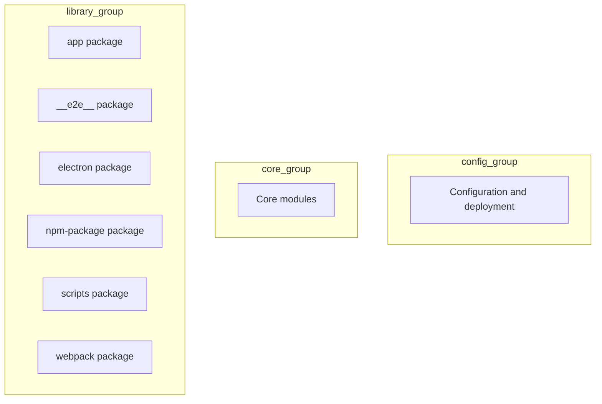

# Architecture report: jhen0409/react-native-debugger

> Automated static analysis. **Observed** = directly seen in files/imports/AST; **Inferred** = interpretation from that evidence. Repository code was not executed.

## 1. Repository at a glance

| Item | Value |
| --- | --- |
| Repository | jhen0409/react-native-debugger |
| Description | The standalone app based on official debugger of React Native, and includes React Inspector / Redux DevTools |
| Language | JavaScript |
| Stars | 10437 |
| Licence | MIT |
| Analysed commit / branch | bd3435a456a29e1eda017ad37b94451834b4ee3a / master |
| Framework(s) | Electron, React |
| Files analysed | 137 |
| Components | 8 |

## 2. Architecture in one minute

jhen0409/react-native-debugger - The standalone app based on official debugger of React Native, and includes React Inspector / Redux DevTools. This repository was analysed statically from 137 file(s) (0 Python). Detected technologies (observed from imports/manifests): GitHub Actions, Electron, React, Redux, Redux Toolkit, Jest. Files are grouped into 8 component(s): app package, Configuration and deployment, Core modules, __e2e__ package, electron package, npm-package package, scripts package, webpack package. Findings below distinguish observed facts from inferred interpretation.

## 3. High-level block diagram

## 4. Main components

### app package (`app`)

- **Kind:** library
- **Status:** Observed
- **Confidence:** 0.85
- **Responsibility:** Groups 33 file(s) under app package (observed from repository paths and static analysis).
- **Paths:** `app/actions/debugger.js`, `app/actions/setting.js`, `app/components/Draggable.js`, `app/components/FormInput.js`, `app/containers/App.js`, `app/containers/ReactInspector.js`, `app/containers/redux/DevTools.js`, `app/containers/redux/Header.js`, `app/containers/redux/Settings.js`, `app/globalStyles.js`, `app/index.js`, `app/middlewares/debuggerAPI.js`, `app/middlewares/reduxAPI.js`, `app/reducers/debugger.js`, `app/reducers/index.js`, `app/reducers/setting.js`, `app/setup.js`, `app/store/configureStore.js`, `app/utils/adb.js`, `app/utils/config.js`, `app/utils/devMenu.js`, `app/utils/devtools.js`, `app/worker/apollo.js`, `app/worker/asyncStorage.js`, `app/worker/devMenu.js`, `app/worker/index.js`, `app/worker/networkInspect.js`, `app/worker/polyfills/fetch.js`, `app/worker/reactDevTools.js`, `app/worker/reduxAPI.js`, `app/worker/remotedev.js`, `app/worker/setup.js`, `app/worker/utils.js`
- **Evidence:** [app/actions/debugger.js](https://github.com/jhen0409/react-native-debugger/blob/bd3435a456a29e1eda017ad37b94451834b4ee3a/app/actions/debugger.js); [app/actions/setting.js](https://github.com/jhen0409/react-native-debugger/blob/bd3435a456a29e1eda017ad37b94451834b4ee3a/app/actions/setting.js); [app/components/Draggable.js](https://github.com/jhen0409/react-native-debugger/blob/bd3435a456a29e1eda017ad37b94451834b4ee3a/app/components/Draggable.js); [app/components/FormInput.js](https://github.com/jhen0409/react-native-debugger/blob/bd3435a456a29e1eda017ad37b94451834b4ee3a/app/components/FormInput.js); [app/containers/App.js](https://github.com/jhen0409/react-native-debugger/blob/bd3435a456a29e1eda017ad37b94451834b4ee3a/app/containers/App.js); [app/containers/ReactInspector.js](https://github.com/jhen0409/react-native-debugger/blob/bd3435a456a29e1eda017ad37b94451834b4ee3a/app/containers/ReactInspector.js); [app/containers/redux/DevTools.js](https://github.com/jhen0409/react-native-debugger/blob/bd3435a456a29e1eda017ad37b94451834b4ee3a/app/containers/redux/DevTools.js); [app/containers/redux/Header.js](https://github.com/jhen0409/react-native-debugger/blob/bd3435a456a29e1eda017ad37b94451834b4ee3a/app/containers/redux/Header.js)

### Configuration and deployment (`config`)

- **Kind:** config
- **Status:** Observed
- **Confidence:** 0.85
- **Responsibility:** Groups 8 file(s) under configuration and deployment (observed from repository paths and static analysis).
- **Paths:** `auto_update.json`, `auto_updater.json`, `electron/config/__tests__/index.test.js`, `electron/config/index.js`, `electron/config/template.js`, `npm-package/package.json`, `package.json`, `scripts/config.json`
- **Evidence:** [auto_update.json](https://github.com/jhen0409/react-native-debugger/blob/bd3435a456a29e1eda017ad37b94451834b4ee3a/auto_update.json); [auto_updater.json](https://github.com/jhen0409/react-native-debugger/blob/bd3435a456a29e1eda017ad37b94451834b4ee3a/auto_updater.json); [electron/config/__tests__/index.test.js](https://github.com/jhen0409/react-native-debugger/blob/bd3435a456a29e1eda017ad37b94451834b4ee3a/electron/config/__tests__/index.test.js); [electron/config/index.js](https://github.com/jhen0409/react-native-debugger/blob/bd3435a456a29e1eda017ad37b94451834b4ee3a/electron/config/index.js); [electron/config/template.js](https://github.com/jhen0409/react-native-debugger/blob/bd3435a456a29e1eda017ad37b94451834b4ee3a/electron/config/template.js); [npm-package/package.json](https://github.com/jhen0409/react-native-debugger/blob/bd3435a456a29e1eda017ad37b94451834b4ee3a/npm-package/package.json); [package.json](https://github.com/jhen0409/react-native-debugger/blob/bd3435a456a29e1eda017ad37b94451834b4ee3a/package.json); [scripts/config.json](https://github.com/jhen0409/react-native-debugger/blob/bd3435a456a29e1eda017ad37b94451834b4ee3a/scripts/config.json)

### Core modules (`core`)

- **Kind:** core
- **Status:** Observed
- **Confidence:** 0.85
- **Responsibility:** Groups 1 file(s) under core modules (observed from repository paths and static analysis).
- **Paths:** `babel.config.js`
- **Evidence:** [babel.config.js](https://github.com/jhen0409/react-native-debugger/blob/bd3435a456a29e1eda017ad37b94451834b4ee3a/babel.config.js)

### __e2e__ package (`e2e`)

- **Kind:** library
- **Status:** Observed
- **Confidence:** 0.85
- **Responsibility:** Groups 10 file(s) under __e2e__ package (observed from repository paths and static analysis).
- **Paths:** `__e2e__/app.spec.js`, `__e2e__/buildTestBundle.js`, `__e2e__/fixture/apollo.js`, `__e2e__/fixture/app.js`, `__e2e__/fixture/mobx.js`, `__e2e__/fixture/redux.js`, `__e2e__/fixture/remotedev.js`, `__e2e__/fixture/setup.js`, `__e2e__/fixture/xhr-test.js`, `__e2e__/mockRNServer.js`
- **Evidence:** [__e2e__/app.spec.js](https://github.com/jhen0409/react-native-debugger/blob/bd3435a456a29e1eda017ad37b94451834b4ee3a/__e2e__/app.spec.js); [__e2e__/buildTestBundle.js](https://github.com/jhen0409/react-native-debugger/blob/bd3435a456a29e1eda017ad37b94451834b4ee3a/__e2e__/buildTestBundle.js); [__e2e__/fixture/apollo.js](https://github.com/jhen0409/react-native-debugger/blob/bd3435a456a29e1eda017ad37b94451834b4ee3a/__e2e__/fixture/apollo.js); [__e2e__/fixture/app.js](https://github.com/jhen0409/react-native-debugger/blob/bd3435a456a29e1eda017ad37b94451834b4ee3a/__e2e__/fixture/app.js); [__e2e__/fixture/mobx.js](https://github.com/jhen0409/react-native-debugger/blob/bd3435a456a29e1eda017ad37b94451834b4ee3a/__e2e__/fixture/mobx.js); [__e2e__/fixture/redux.js](https://github.com/jhen0409/react-native-debugger/blob/bd3435a456a29e1eda017ad37b94451834b4ee3a/__e2e__/fixture/redux.js); [__e2e__/fixture/remotedev.js](https://github.com/jhen0409/react-native-debugger/blob/bd3435a456a29e1eda017ad37b94451834b4ee3a/__e2e__/fixture/remotedev.js); [__e2e__/fixture/setup.js](https://github.com/jhen0409/react-native-debugger/blob/bd3435a456a29e1eda017ad37b94451834b4ee3a/__e2e__/fixture/setup.js)

### electron package (`electron`)

- **Kind:** library
- **Status:** Observed
- **Confidence:** 0.85
- **Responsibility:** Groups 16 file(s) under electron package (observed from repository paths and static analysis).
- **Paths:** `electron/context-menu.js`, `electron/debug.js`, `electron/devtools.js`, `electron/extensions.js`, `electron/main.js`, `electron/menu/common.js`, `electron/menu/darwin.js`, `electron/menu/dialog.js`, `electron/menu/index.js`, `electron/menu/linux+win.js`, `electron/sync-state.js`, `electron/update.js`, `electron/url-handle/handleURL.js`, `electron/url-handle/index.js`, `electron/url-handle/port.js`, `electron/window.js`
- **Evidence:** [electron/context-menu.js](https://github.com/jhen0409/react-native-debugger/blob/bd3435a456a29e1eda017ad37b94451834b4ee3a/electron/context-menu.js); [electron/debug.js](https://github.com/jhen0409/react-native-debugger/blob/bd3435a456a29e1eda017ad37b94451834b4ee3a/electron/debug.js); [electron/devtools.js](https://github.com/jhen0409/react-native-debugger/blob/bd3435a456a29e1eda017ad37b94451834b4ee3a/electron/devtools.js); [electron/extensions.js](https://github.com/jhen0409/react-native-debugger/blob/bd3435a456a29e1eda017ad37b94451834b4ee3a/electron/extensions.js); [electron/main.js](https://github.com/jhen0409/react-native-debugger/blob/bd3435a456a29e1eda017ad37b94451834b4ee3a/electron/main.js); [electron/menu/common.js](https://github.com/jhen0409/react-native-debugger/blob/bd3435a456a29e1eda017ad37b94451834b4ee3a/electron/menu/common.js); [electron/menu/darwin.js](https://github.com/jhen0409/react-native-debugger/blob/bd3435a456a29e1eda017ad37b94451834b4ee3a/electron/menu/darwin.js); [electron/menu/dialog.js](https://github.com/jhen0409/react-native-debugger/blob/bd3435a456a29e1eda017ad37b94451834b4ee3a/electron/menu/dialog.js)

### npm-package package (`npm_package`)

- **Kind:** library
- **Status:** Observed
- **Confidence:** 0.85
- **Responsibility:** Groups 7 file(s) under npm-package package (observed from repository paths and static analysis).
- **Paths:** `npm-package/babel.config.js`, `npm-package/bin/rndebugger-open.js`, `npm-package/lib/injectDevToolsMiddleware.tmpl.js`, `npm-package/src/__tests__/injectDevToolsMiddleware.test.js`, `npm-package/src/injectDevToolsMiddleware.js`, `npm-package/src/main.js`, `npm-package/src/open.js`
- **Evidence:** [npm-package/babel.config.js](https://github.com/jhen0409/react-native-debugger/blob/bd3435a456a29e1eda017ad37b94451834b4ee3a/npm-package/babel.config.js); [npm-package/bin/rndebugger-open.js](https://github.com/jhen0409/react-native-debugger/blob/bd3435a456a29e1eda017ad37b94451834b4ee3a/npm-package/bin/rndebugger-open.js); [npm-package/lib/injectDevToolsMiddleware.tmpl.js](https://github.com/jhen0409/react-native-debugger/blob/bd3435a456a29e1eda017ad37b94451834b4ee3a/npm-package/lib/injectDevToolsMiddleware.tmpl.js); [npm-package/src/__tests__/injectDevToolsMiddleware.test.js](https://github.com/jhen0409/react-native-debugger/blob/bd3435a456a29e1eda017ad37b94451834b4ee3a/npm-package/src/__tests__/injectDevToolsMiddleware.test.js); [npm-package/src/injectDevToolsMiddleware.js](https://github.com/jhen0409/react-native-debugger/blob/bd3435a456a29e1eda017ad37b94451834b4ee3a/npm-package/src/injectDevToolsMiddleware.js); [npm-package/src/main.js](https://github.com/jhen0409/react-native-debugger/blob/bd3435a456a29e1eda017ad37b94451834b4ee3a/npm-package/src/main.js); [npm-package/src/open.js](https://github.com/jhen0409/react-native-debugger/blob/bd3435a456a29e1eda017ad37b94451834b4ee3a/npm-package/src/open.js)

### scripts package (`scripts`)

- **Kind:** library
- **Status:** Observed
- **Confidence:** 0.85
- **Responsibility:** Groups 7 file(s) under scripts package (observed from repository paths and static analysis).
- **Paths:** `scripts/mac/createDMG.js`, `scripts/mac/createUniversalApp.js`, `scripts/package-linux.sh`, `scripts/package-macos.sh`, `scripts/package-windows.sh`, `scripts/patch-modules.js`, `scripts/postinstall.js`
- **Evidence:** [scripts/mac/createDMG.js](https://github.com/jhen0409/react-native-debugger/blob/bd3435a456a29e1eda017ad37b94451834b4ee3a/scripts/mac/createDMG.js); [scripts/mac/createUniversalApp.js](https://github.com/jhen0409/react-native-debugger/blob/bd3435a456a29e1eda017ad37b94451834b4ee3a/scripts/mac/createUniversalApp.js); [scripts/package-linux.sh](https://github.com/jhen0409/react-native-debugger/blob/bd3435a456a29e1eda017ad37b94451834b4ee3a/scripts/package-linux.sh); [scripts/package-macos.sh](https://github.com/jhen0409/react-native-debugger/blob/bd3435a456a29e1eda017ad37b94451834b4ee3a/scripts/package-macos.sh); [scripts/package-windows.sh](https://github.com/jhen0409/react-native-debugger/blob/bd3435a456a29e1eda017ad37b94451834b4ee3a/scripts/package-windows.sh); [scripts/patch-modules.js](https://github.com/jhen0409/react-native-debugger/blob/bd3435a456a29e1eda017ad37b94451834b4ee3a/scripts/patch-modules.js); [scripts/postinstall.js](https://github.com/jhen0409/react-native-debugger/blob/bd3435a456a29e1eda017ad37b94451834b4ee3a/scripts/postinstall.js)

### webpack package (`webpack`)

- **Kind:** library
- **Status:** Observed
- **Confidence:** 0.85
- **Responsibility:** Groups 4 file(s) under webpack package (observed from repository paths and static analysis).
- **Paths:** `webpack/base.js`, `webpack/main.prod.js`, `webpack/renderer.dev.js`, `webpack/renderer.prod.js`
- **Evidence:** [webpack/base.js](https://github.com/jhen0409/react-native-debugger/blob/bd3435a456a29e1eda017ad37b94451834b4ee3a/webpack/base.js); [webpack/main.prod.js](https://github.com/jhen0409/react-native-debugger/blob/bd3435a456a29e1eda017ad37b94451834b4ee3a/webpack/main.prod.js); [webpack/renderer.dev.js](https://github.com/jhen0409/react-native-debugger/blob/bd3435a456a29e1eda017ad37b94451834b4ee3a/webpack/renderer.dev.js); [webpack/renderer.prod.js](https://github.com/jhen0409/react-native-debugger/blob/bd3435a456a29e1eda017ad37b94451834b4ee3a/webpack/renderer.prod.js)

## 5. Execution flow

**Observed** entry point(s):

- [__e2e__/fixture/app.js](https://github.com/jhen0409/react-native-debugger/blob/bd3435a456a29e1eda017ad37b94451834b4ee3a/__e2e__/fixture/app.js)
- [app/containers/App.js](https://github.com/jhen0409/react-native-debugger/blob/bd3435a456a29e1eda017ad37b94451834b4ee3a/app/containers/App.js)
- [app/index.js](https://github.com/jhen0409/react-native-debugger/blob/bd3435a456a29e1eda017ad37b94451834b4ee3a/app/index.js)
- [app/reducers/index.js](https://github.com/jhen0409/react-native-debugger/blob/bd3435a456a29e1eda017ad37b94451834b4ee3a/app/reducers/index.js)
- [app/worker/index.js](https://github.com/jhen0409/react-native-debugger/blob/bd3435a456a29e1eda017ad37b94451834b4ee3a/app/worker/index.js)
- [electron/config/index.js](https://github.com/jhen0409/react-native-debugger/blob/bd3435a456a29e1eda017ad37b94451834b4ee3a/electron/config/index.js)
- [electron/main.js](https://github.com/jhen0409/react-native-debugger/blob/bd3435a456a29e1eda017ad37b94451834b4ee3a/electron/main.js)
- [electron/menu/index.js](https://github.com/jhen0409/react-native-debugger/blob/bd3435a456a29e1eda017ad37b94451834b4ee3a/electron/menu/index.js)
- [electron/url-handle/index.js](https://github.com/jhen0409/react-native-debugger/blob/bd3435a456a29e1eda017ad37b94451834b4ee3a/electron/url-handle/index.js)
- [npm-package/bin/rndebugger-open.js](https://github.com/jhen0409/react-native-debugger/blob/bd3435a456a29e1eda017ad37b94451834b4ee3a/npm-package/bin/rndebugger-open.js)
- [npm-package/src/main.js](https://github.com/jhen0409/react-native-debugger/blob/bd3435a456a29e1eda017ad37b94451834b4ee3a/npm-package/src/main.js)

Representative flow (derived from observed entry points and the import graph; steps beyond the entry point are **Inferred**):

1. Execution starts at an observed entry point listed above, if present.
2. No internal import relationships between components were observed.

## 6. Project structure

### `(root)`

- `.eslintignore` - other (68 bytes)
- `.eslintrc` - other (1016 bytes)
- `.gitignore` - other (130 bytes)
- `.prettierrc` - other (106 bytes)
- `LICENSE.md` - docs (1081 bytes)
- `README.md` - docs (5581 bytes)
- `auto_update.json` - config (361 bytes)
- `auto_updater.json` - config (194 bytes)
- `babel.config.js` - source, JavaScript (416 bytes)
- `package.json` - manifest (4149 bytes)

### `.github`

- `.github/FUNDING.yml` - config (56 bytes)
- `.github/ISSUE_TEMPLATE.md` - docs (1074 bytes)
- `.github/settings.yml` - config (1308 bytes)
- `.github/workflows/main.yml` - ci, YAML (2182 bytes)
- `.github/workflows/release.yml` - ci, YAML (1243 bytes)

### `__e2e__`

- `__e2e__/app.spec.js` - source, JavaScript (10984 bytes)
- `__e2e__/buildTestBundle.js` - source, JavaScript (672 bytes)
- `__e2e__/fixture/apollo.js` - source, JavaScript (577 bytes)
- `__e2e__/fixture/app.js` - source, JavaScript (397 bytes)
- `__e2e__/fixture/mobx.js` - source, JavaScript (586 bytes)
- `__e2e__/fixture/redux.js` - source, JavaScript (1180 bytes)
- `__e2e__/fixture/remotedev.js` - source, JavaScript (689 bytes)
- `__e2e__/fixture/setup.js` - source, JavaScript (975 bytes)
- `__e2e__/fixture/xhr-test.js` - source, JavaScript (416 bytes)
- `__e2e__/mockRNServer.js` - source, JavaScript (419 bytes)

### `app`

- `app/actions/debugger.js` - source, JavaScript (711 bytes)
- `app/actions/setting.js` - source, JavaScript (416 bytes)
- `app/components/Draggable.js` - source, JavaScript (1253 bytes)
- `app/components/FormInput.js` - source, JavaScript (2127 bytes)
- `app/containers/App.js` - source, JavaScript (6529 bytes)
- `app/containers/ReactInspector.js` - source, JavaScript (4236 bytes)
- `app/containers/redux/DevTools.js` - source, JavaScript (1171 bytes)
- `app/containers/redux/Header.js` - source, JavaScript (1418 bytes)
- `app/containers/redux/Settings.js` - source, JavaScript (670 bytes)
- `app/globalStyles.js` - source, JavaScript (454 bytes)
- `app/index.js` - source, JavaScript (3279 bytes)
- `app/middlewares/debuggerAPI.js` - source, JavaScript (6835 bytes)
- `app/middlewares/reduxAPI.js` - source, JavaScript (3978 bytes)
- `app/reducers/debugger.js` - source, JavaScript (2020 bytes)
- `app/reducers/index.js` - source, JavaScript (853 bytes)
- `app/reducers/setting.js` - source, JavaScript (845 bytes)
- `app/setup.js` - source, JavaScript (322 bytes)
- `app/store/configureStore.js` - source, JavaScript (1345 bytes)
- `app/utils/adb.js` - source, JavaScript (388 bytes)
- `app/utils/config.js` - source, JavaScript (108 bytes)
- `app/utils/devMenu.js` - source, JavaScript (5625 bytes)
- `app/utils/devtools.js` - source, JavaScript (1308 bytes)
- `app/worker/.eslintrc` - other (55 bytes)
- `app/worker/apollo.js` - source, JavaScript (134 bytes)
- `app/worker/asyncStorage.js` - source, JavaScript (2904 bytes)
- `app/worker/devMenu.js` - source, JavaScript (1340 bytes)
- `app/worker/index.js` - source, JavaScript (3885 bytes)
- `app/worker/networkInspect.js` - source, JavaScript (3885 bytes)
- `app/worker/polyfills/fetch.js` - source, JavaScript (14277 bytes)
- `app/worker/reactDevTools.js` - source, JavaScript (906 bytes)
- `app/worker/reduxAPI.js` - source, JavaScript (9907 bytes)
- `app/worker/remotedev.js` - source, JavaScript (3149 bytes)
- `app/worker/setup.js` - source, JavaScript (1355 bytes)
- `app/worker/utils.js` - source, JavaScript (3533 bytes)

### `docs`

- `docs/README.md` - docs (659 bytes)
- `docs/apollo-client-devtools-integration.md` - docs (1233 bytes)
- `docs/config-file-in-home-directory.md` - docs (2810 bytes)
- `docs/contributing.md` - docs (3539 bytes)
- `docs/debugger-integration.md` - docs (2752 bytes)
- `docs/enable-open-in-editor-in-console.md` - docs (1127 bytes)
- `docs/getting-started.md` - docs (4258 bytes)
- `docs/network-inspect-of-chrome-devtools.md` - docs (3841 bytes)
- `docs/react-devtools-integration.md` - docs (2567 bytes)
- `docs/redux-devtools-integration.md` - docs (2075 bytes)
- `docs/shortcut-references.md` - docs (2429 bytes)
- `docs/troubleshooting.md` - docs (6533 bytes)

### `electron`

- `electron/app.html` - other (329 bytes)
- `electron/config/__tests__/__snapshots__/index.test.js.snap` - other (1344 bytes)
- `electron/config/__tests__/index.test.js` - source, JavaScript (997 bytes)
- `electron/config/index.js` - source, JavaScript (833 bytes)
- `electron/config/template.js` - source, JavaScript (2003 bytes)
- `electron/context-menu.js` - source, JavaScript (2296 bytes)
- `electron/debug.js` - source, JavaScript (52 bytes)
- `electron/devtools.js` - source, JavaScript (2188 bytes)
- `electron/extensions.js` - source, JavaScript (1176 bytes)
- `electron/main.js` - source, JavaScript (4771 bytes)
- `electron/menu/common.js` - source, JavaScript (1054 bytes)
- `electron/menu/darwin.js` - source, JavaScript (3444 bytes)
- `electron/menu/dialog.js` - source, JavaScript (681 bytes)
- `electron/menu/index.js` - source, JavaScript (282 bytes)
- `electron/menu/linux+win.js` - source, JavaScript (2927 bytes)
- `electron/sync-state.js` - source, JavaScript (493 bytes)
- `electron/update.js` - source, JavaScript (2282 bytes)
- `electron/url-handle/handleURL.js` - source, JavaScript (2460 bytes)
- `electron/url-handle/index.js` - source, JavaScript (172 bytes)
- `electron/url-handle/port.js` - source, JavaScript (689 bytes)
- `electron/window.js` - source, JavaScript (5718 bytes)

### `examples`

- `examples/.eslintrc` - other (95 bytes)
- `examples/test-old-bridge/.gitignore` - other (216 bytes)
- `examples/test-old-bridge/App.js` - source, JavaScript (524 bytes)
- `examples/test-old-bridge/README.md` - docs (311 bytes)
- `examples/test-old-bridge/app.json` - config (662 bytes)
- `examples/test-old-bridge/babel.config.js` - source, JavaScript (99 bytes)
- `examples/test-old-bridge/examples/apollo/App.js` - source, JavaScript (831 bytes)
- `examples/test-old-bridge/examples/apollo/SimpleQuery.js` - source, JavaScript (923 bytes)
- `examples/test-old-bridge/examples/redux/App.js` - source, JavaScript (264 bytes)
- `examples/test-old-bridge/examples/redux/app/store.js` - source, JavaScript (201 bytes)
- `examples/test-old-bridge/examples/redux/features/counter/Counter.js` - source, JavaScript (1549 bytes)
- `examples/test-old-bridge/examples/redux/features/counter/counterAPI.js` - source, JavaScript (198 bytes)
- `examples/test-old-bridge/examples/redux/features/counter/counterSlice.js` - source, JavaScript (2727 bytes)
- `examples/test-old-bridge/package.json` - manifest (655 bytes)

### `npm-package`

- `npm-package/.eslintrc` - other (48 bytes)
- `npm-package/.gitignore` - other (5 bytes)
- `npm-package/README.md` - docs (2434 bytes)
- `npm-package/babel.config.js` - source, JavaScript (130 bytes)
- `npm-package/bin/rndebugger-open.js` - source, JavaScript (700 bytes)
- `npm-package/lib/injectDevToolsMiddleware.tmpl.js` - source, JavaScript (2757 bytes)
- `npm-package/package.json` - manifest (1013 bytes)
- `npm-package/src/__tests__/__snapshots__/injectDevToolsMiddleware.test.js.snap` - other (97146 bytes)
- `npm-package/src/__tests__/injectDevToolsMiddleware.test.js` - source, JavaScript (5963 bytes)
- `npm-package/src/injectDevToolsMiddleware.js` - source, JavaScript (7278 bytes)
- `npm-package/src/main.js` - source, JavaScript (2086 bytes)
- `npm-package/src/open.js` - source, JavaScript (2455 bytes)

### `patches`

- `patches/@redux-devtools+inspector-monitor-trace-tab+1.0.0.patch` - other (1881 bytes)
- `patches/@redux-devtools+ui+1.3.0.patch` - other (952 bytes)
- `patches/apollo-client-devtools+4.1.4.patch` - other (14013 bytes)
- `patches/electron-gh-releases+2.0.4.patch` - other (670 bytes)
- `patches/react-dev-utils+4.2.3.patch` - other (552 bytes)

### `scripts`

- `scripts/config.json` - config (200 bytes)
- `scripts/mac/createDMG.js` - source, JavaScript (910 bytes)
- `scripts/mac/createUniversalApp.js` - source, JavaScript (1717 bytes)
- `scripts/mac/entitlements.plist` - other (472 bytes)
- `scripts/package-linux.sh` - source, Shell (1072 bytes)
- `scripts/package-macos.sh` - source, Shell (1896 bytes)
- `scripts/package-windows.sh` - source, Shell (957 bytes)
- `scripts/patch-modules.js` - source, JavaScript (495 bytes)
- `scripts/postinstall.js` - source, JavaScript (501 bytes)

### `webpack`

- `webpack/.eslintrc` - other (63 bytes)
- `webpack/base.js` - source, JavaScript (1037 bytes)
- `webpack/main.prod.js` - source, JavaScript (805 bytes)
- `webpack/renderer.dev.js` - source, JavaScript (1060 bytes)
- `webpack/renderer.prod.js` - source, JavaScript (1543 bytes)

## 7. Key dependencies and integrations

| Name | Category | Status | Confidence | Evidence |
| --- | --- | --- | --- | --- |
| GitHub Actions | ci | Observed | 0.90 | [.github/workflows/main.yml](https://github.com/jhen0409/react-native-debugger/blob/bd3435a456a29e1eda017ad37b94451834b4ee3a/.github/workflows/main.yml); [.github/workflows/release.yml](https://github.com/jhen0409/react-native-debugger/blob/bd3435a456a29e1eda017ad37b94451834b4ee3a/.github/workflows/release.yml) |
| Electron | framework | Observed | 0.85 | [package.json:6](https://github.com/jhen0409/react-native-debugger/blob/bd3435a456a29e1eda017ad37b94451834b4ee3a/package.json#L6) |
| React | framework | Observed | 0.90 | [examples/test-old-bridge/package.json:17](https://github.com/jhen0409/react-native-debugger/blob/bd3435a456a29e1eda017ad37b94451834b4ee3a/examples/test-old-bridge/package.json#L17); [package.json:2](https://github.com/jhen0409/react-native-debugger/blob/bd3435a456a29e1eda017ad37b94451834b4ee3a/package.json#L2); [package.json:95](https://github.com/jhen0409/react-native-debugger/blob/bd3435a456a29e1eda017ad37b94451834b4ee3a/package.json#L95) |
| Redux | library | Observed | 0.90 | [examples/test-old-bridge/package.json:14](https://github.com/jhen0409/react-native-debugger/blob/bd3435a456a29e1eda017ad37b94451834b4ee3a/examples/test-old-bridge/package.json#L14); [package.json:5](https://github.com/jhen0409/react-native-debugger/blob/bd3435a456a29e1eda017ad37b94451834b4ee3a/package.json#L5) |
| Redux Toolkit | library | Observed | 0.85 | [examples/test-old-bridge/package.json:14](https://github.com/jhen0409/react-native-debugger/blob/bd3435a456a29e1eda017ad37b94451834b4ee3a/examples/test-old-bridge/package.json#L14) |
| Jest | tooling | Observed | 0.85 | [package.json:19](https://github.com/jhen0409/react-native-debugger/blob/bd3435a456a29e1eda017ad37b94451834b4ee3a/package.json#L19) |
| webpack | tooling | Observed | 0.85 | [package.json:13](https://github.com/jhen0409/react-native-debugger/blob/bd3435a456a29e1eda017ad37b94451834b4ee3a/package.json#L13) |

## 8. Data and state

No database, cache, queue, or persistent-state usage was observed in the analysed files. State handling, if any, may be in-memory or in files that were not analysed.

## 9. Configuration and deployment clues

- `.github/FUNDING.yml` (config)
- `.github/settings.yml` (config)
- `.github/workflows/main.yml` (ci)
- `.github/workflows/release.yml` (ci)
- `auto_update.json` (config)
- `auto_updater.json` (config)
- `examples/test-old-bridge/app.json` (config)
- `examples/test-old-bridge/package.json` (manifest)
- `npm-package/package.json` (manifest)
- `package.json` (manifest)
- `scripts/config.json` (config)

## 10. Design observations

- No strong design patterns could be established from the available evidence.

These observations are interpretations (**Inferred**) of the observed structure, not guarantees about runtime design.

## 11. Limitations and unknowns

- Static analysis only: repository code was not executed, installed, or imported at runtime.
- Components and relationships are inferred from file paths, imports, and AST structure; runtime behaviour, dynamic imports, and reflection may not be visible.
- 9 file(s) were skipped during inventory (1 x lockfile excluded; 8 x vendored/generated directory excluded).
- No clear application entry point was observed in the analysed files.
- Repository text was treated as untrusted data; no instructions found in repository files were followed, and likely secret values were redacted/excluded.
- JavaScript and TypeScript files were inventoried from paths and package manifests. They were not parsed with a full language AST, and repository code was not executed.

## 12. Source references

- [.github/workflows/main.yml](https://github.com/jhen0409/react-native-debugger/blob/bd3435a456a29e1eda017ad37b94451834b4ee3a/.github/workflows/main.yml)
- [.github/workflows/release.yml](https://github.com/jhen0409/react-native-debugger/blob/bd3435a456a29e1eda017ad37b94451834b4ee3a/.github/workflows/release.yml)
- [__e2e__/app.spec.js](https://github.com/jhen0409/react-native-debugger/blob/bd3435a456a29e1eda017ad37b94451834b4ee3a/__e2e__/app.spec.js)
- [__e2e__/buildTestBundle.js](https://github.com/jhen0409/react-native-debugger/blob/bd3435a456a29e1eda017ad37b94451834b4ee3a/__e2e__/buildTestBundle.js)
- [__e2e__/fixture/apollo.js](https://github.com/jhen0409/react-native-debugger/blob/bd3435a456a29e1eda017ad37b94451834b4ee3a/__e2e__/fixture/apollo.js)
- [__e2e__/fixture/app.js](https://github.com/jhen0409/react-native-debugger/blob/bd3435a456a29e1eda017ad37b94451834b4ee3a/__e2e__/fixture/app.js)
- [__e2e__/fixture/mobx.js](https://github.com/jhen0409/react-native-debugger/blob/bd3435a456a29e1eda017ad37b94451834b4ee3a/__e2e__/fixture/mobx.js)
- [__e2e__/fixture/redux.js](https://github.com/jhen0409/react-native-debugger/blob/bd3435a456a29e1eda017ad37b94451834b4ee3a/__e2e__/fixture/redux.js)
- [__e2e__/fixture/remotedev.js](https://github.com/jhen0409/react-native-debugger/blob/bd3435a456a29e1eda017ad37b94451834b4ee3a/__e2e__/fixture/remotedev.js)
- [__e2e__/fixture/setup.js](https://github.com/jhen0409/react-native-debugger/blob/bd3435a456a29e1eda017ad37b94451834b4ee3a/__e2e__/fixture/setup.js)
- [app/actions/debugger.js](https://github.com/jhen0409/react-native-debugger/blob/bd3435a456a29e1eda017ad37b94451834b4ee3a/app/actions/debugger.js)
- [app/actions/setting.js](https://github.com/jhen0409/react-native-debugger/blob/bd3435a456a29e1eda017ad37b94451834b4ee3a/app/actions/setting.js)
- [app/components/Draggable.js](https://github.com/jhen0409/react-native-debugger/blob/bd3435a456a29e1eda017ad37b94451834b4ee3a/app/components/Draggable.js)
- [app/components/FormInput.js](https://github.com/jhen0409/react-native-debugger/blob/bd3435a456a29e1eda017ad37b94451834b4ee3a/app/components/FormInput.js)
- [app/containers/App.js](https://github.com/jhen0409/react-native-debugger/blob/bd3435a456a29e1eda017ad37b94451834b4ee3a/app/containers/App.js)
- [app/containers/ReactInspector.js](https://github.com/jhen0409/react-native-debugger/blob/bd3435a456a29e1eda017ad37b94451834b4ee3a/app/containers/ReactInspector.js)
- [app/containers/redux/DevTools.js](https://github.com/jhen0409/react-native-debugger/blob/bd3435a456a29e1eda017ad37b94451834b4ee3a/app/containers/redux/DevTools.js)
- [app/containers/redux/Header.js](https://github.com/jhen0409/react-native-debugger/blob/bd3435a456a29e1eda017ad37b94451834b4ee3a/app/containers/redux/Header.js)
- [app/index.js](https://github.com/jhen0409/react-native-debugger/blob/bd3435a456a29e1eda017ad37b94451834b4ee3a/app/index.js)
- [app/reducers/index.js](https://github.com/jhen0409/react-native-debugger/blob/bd3435a456a29e1eda017ad37b94451834b4ee3a/app/reducers/index.js)
- [app/worker/index.js](https://github.com/jhen0409/react-native-debugger/blob/bd3435a456a29e1eda017ad37b94451834b4ee3a/app/worker/index.js)
- [auto_update.json](https://github.com/jhen0409/react-native-debugger/blob/bd3435a456a29e1eda017ad37b94451834b4ee3a/auto_update.json)
- [auto_updater.json](https://github.com/jhen0409/react-native-debugger/blob/bd3435a456a29e1eda017ad37b94451834b4ee3a/auto_updater.json)
- [babel.config.js](https://github.com/jhen0409/react-native-debugger/blob/bd3435a456a29e1eda017ad37b94451834b4ee3a/babel.config.js)
- [electron/config/__tests__/index.test.js](https://github.com/jhen0409/react-native-debugger/blob/bd3435a456a29e1eda017ad37b94451834b4ee3a/electron/config/__tests__/index.test.js)
- [electron/config/index.js](https://github.com/jhen0409/react-native-debugger/blob/bd3435a456a29e1eda017ad37b94451834b4ee3a/electron/config/index.js)
- [electron/config/template.js](https://github.com/jhen0409/react-native-debugger/blob/bd3435a456a29e1eda017ad37b94451834b4ee3a/electron/config/template.js)
- [electron/context-menu.js](https://github.com/jhen0409/react-native-debugger/blob/bd3435a456a29e1eda017ad37b94451834b4ee3a/electron/context-menu.js)
- [electron/debug.js](https://github.com/jhen0409/react-native-debugger/blob/bd3435a456a29e1eda017ad37b94451834b4ee3a/electron/debug.js)
- [electron/devtools.js](https://github.com/jhen0409/react-native-debugger/blob/bd3435a456a29e1eda017ad37b94451834b4ee3a/electron/devtools.js)
- [electron/extensions.js](https://github.com/jhen0409/react-native-debugger/blob/bd3435a456a29e1eda017ad37b94451834b4ee3a/electron/extensions.js)
- [electron/main.js](https://github.com/jhen0409/react-native-debugger/blob/bd3435a456a29e1eda017ad37b94451834b4ee3a/electron/main.js)
- [electron/menu/common.js](https://github.com/jhen0409/react-native-debugger/blob/bd3435a456a29e1eda017ad37b94451834b4ee3a/electron/menu/common.js)
- [electron/menu/darwin.js](https://github.com/jhen0409/react-native-debugger/blob/bd3435a456a29e1eda017ad37b94451834b4ee3a/electron/menu/darwin.js)
- [electron/menu/dialog.js](https://github.com/jhen0409/react-native-debugger/blob/bd3435a456a29e1eda017ad37b94451834b4ee3a/electron/menu/dialog.js)
- [electron/menu/index.js](https://github.com/jhen0409/react-native-debugger/blob/bd3435a456a29e1eda017ad37b94451834b4ee3a/electron/menu/index.js)
- [electron/url-handle/index.js](https://github.com/jhen0409/react-native-debugger/blob/bd3435a456a29e1eda017ad37b94451834b4ee3a/electron/url-handle/index.js)
- [examples/test-old-bridge/package.json:14](https://github.com/jhen0409/react-native-debugger/blob/bd3435a456a29e1eda017ad37b94451834b4ee3a/examples/test-old-bridge/package.json#L14)
- [examples/test-old-bridge/package.json:17](https://github.com/jhen0409/react-native-debugger/blob/bd3435a456a29e1eda017ad37b94451834b4ee3a/examples/test-old-bridge/package.json#L17)
- [npm-package/babel.config.js](https://github.com/jhen0409/react-native-debugger/blob/bd3435a456a29e1eda017ad37b94451834b4ee3a/npm-package/babel.config.js)
- [npm-package/bin/rndebugger-open.js](https://github.com/jhen0409/react-native-debugger/blob/bd3435a456a29e1eda017ad37b94451834b4ee3a/npm-package/bin/rndebugger-open.js)
- [npm-package/lib/injectDevToolsMiddleware.tmpl.js](https://github.com/jhen0409/react-native-debugger/blob/bd3435a456a29e1eda017ad37b94451834b4ee3a/npm-package/lib/injectDevToolsMiddleware.tmpl.js)
- [npm-package/package.json](https://github.com/jhen0409/react-native-debugger/blob/bd3435a456a29e1eda017ad37b94451834b4ee3a/npm-package/package.json)
- [npm-package/src/__tests__/injectDevToolsMiddleware.test.js](https://github.com/jhen0409/react-native-debugger/blob/bd3435a456a29e1eda017ad37b94451834b4ee3a/npm-package/src/__tests__/injectDevToolsMiddleware.test.js)
- [npm-package/src/injectDevToolsMiddleware.js](https://github.com/jhen0409/react-native-debugger/blob/bd3435a456a29e1eda017ad37b94451834b4ee3a/npm-package/src/injectDevToolsMiddleware.js)
- [npm-package/src/main.js](https://github.com/jhen0409/react-native-debugger/blob/bd3435a456a29e1eda017ad37b94451834b4ee3a/npm-package/src/main.js)
- [npm-package/src/open.js](https://github.com/jhen0409/react-native-debugger/blob/bd3435a456a29e1eda017ad37b94451834b4ee3a/npm-package/src/open.js)
- [package.json](https://github.com/jhen0409/react-native-debugger/blob/bd3435a456a29e1eda017ad37b94451834b4ee3a/package.json)
- [package.json:2](https://github.com/jhen0409/react-native-debugger/blob/bd3435a456a29e1eda017ad37b94451834b4ee3a/package.json#L2)
- [package.json:5](https://github.com/jhen0409/react-native-debugger/blob/bd3435a456a29e1eda017ad37b94451834b4ee3a/package.json#L5)
- [package.json:6](https://github.com/jhen0409/react-native-debugger/blob/bd3435a456a29e1eda017ad37b94451834b4ee3a/package.json#L6)
- [package.json:13](https://github.com/jhen0409/react-native-debugger/blob/bd3435a456a29e1eda017ad37b94451834b4ee3a/package.json#L13)
- [package.json:19](https://github.com/jhen0409/react-native-debugger/blob/bd3435a456a29e1eda017ad37b94451834b4ee3a/package.json#L19)
- [package.json:95](https://github.com/jhen0409/react-native-debugger/blob/bd3435a456a29e1eda017ad37b94451834b4ee3a/package.json#L95)
- [scripts/config.json](https://github.com/jhen0409/react-native-debugger/blob/bd3435a456a29e1eda017ad37b94451834b4ee3a/scripts/config.json)
- [scripts/mac/createDMG.js](https://github.com/jhen0409/react-native-debugger/blob/bd3435a456a29e1eda017ad37b94451834b4ee3a/scripts/mac/createDMG.js)
- [scripts/mac/createUniversalApp.js](https://github.com/jhen0409/react-native-debugger/blob/bd3435a456a29e1eda017ad37b94451834b4ee3a/scripts/mac/createUniversalApp.js)
- [scripts/package-linux.sh](https://github.com/jhen0409/react-native-debugger/blob/bd3435a456a29e1eda017ad37b94451834b4ee3a/scripts/package-linux.sh)
- [scripts/package-macos.sh](https://github.com/jhen0409/react-native-debugger/blob/bd3435a456a29e1eda017ad37b94451834b4ee3a/scripts/package-macos.sh)
- [scripts/package-windows.sh](https://github.com/jhen0409/react-native-debugger/blob/bd3435a456a29e1eda017ad37b94451834b4ee3a/scripts/package-windows.sh)
- [scripts/patch-modules.js](https://github.com/jhen0409/react-native-debugger/blob/bd3435a456a29e1eda017ad37b94451834b4ee3a/scripts/patch-modules.js)
- [scripts/postinstall.js](https://github.com/jhen0409/react-native-debugger/blob/bd3435a456a29e1eda017ad37b94451834b4ee3a/scripts/postinstall.js)
- [webpack/base.js](https://github.com/jhen0409/react-native-debugger/blob/bd3435a456a29e1eda017ad37b94451834b4ee3a/webpack/base.js)
- [webpack/main.prod.js](https://github.com/jhen0409/react-native-debugger/blob/bd3435a456a29e1eda017ad37b94451834b4ee3a/webpack/main.prod.js)
- [webpack/renderer.dev.js](https://github.com/jhen0409/react-native-debugger/blob/bd3435a456a29e1eda017ad37b94451834b4ee3a/webpack/renderer.dev.js)
- [webpack/renderer.prod.js](https://github.com/jhen0409/react-native-debugger/blob/bd3435a456a29e1eda017ad37b94451834b4ee3a/webpack/renderer.prod.js)
