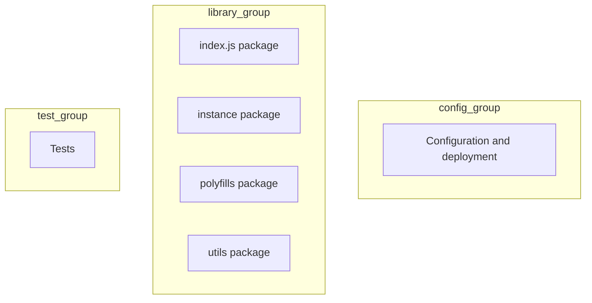

# Architecture report: jlmakes/scrollreveal

> Automated static analysis. **Observed** = directly seen in files/imports/AST; **Inferred** = interpretation from that evidence. Repository code was not executed.

## 1. Repository at a glance

| Item | Value |
| --- | --- |
| Repository | jlmakes/scrollreveal |
| Description | Animate elements as they scroll into view. |
| Language | JavaScript |
| Stars | 22469 |
| Licence | Not detected |
| Analysed commit / branch | 411043d3fd1d13d21a824f9c3e24e3f180197bd5 / master |
| Framework(s) | None detected |
| Files analysed | 50 |
| Components | 6 |

## 2. Architecture in one minute

jlmakes/scrollreveal - Animate elements as they scroll into view.. This repository was analysed statically from 50 file(s) (0 Python). Detected technologies (observed from imports/manifests): no known frameworks/libraries. Files are grouped into 6 component(s): Configuration and deployment, index.js package, instance package, polyfills package, Tests, utils package. Findings below distinguish observed facts from inferred interpretation.

## 3. High-level block diagram

## 4. Main components

### Configuration and deployment (`config`)

- **Kind:** config
- **Status:** Observed
- **Confidence:** 0.85
- **Responsibility:** Groups 1 file(s) under configuration and deployment (observed from repository paths and static analysis).
- **Paths:** `package.json`
- **Evidence:** [package.json](https://github.com/jlmakes/scrollreveal/blob/411043d3fd1d13d21a824f9c3e24e3f180197bd5/package.json)

### index.js package (`index_js`)

- **Kind:** library
- **Status:** Observed
- **Confidence:** 0.85
- **Responsibility:** Groups 1 file(s) under index.js package (observed from repository paths and static analysis).
- **Paths:** `src/index.js`
- **Evidence:** [src/index.js](https://github.com/jlmakes/scrollreveal/blob/411043d3fd1d13d21a824f9c3e24e3f180197bd5/src/index.js)

### instance package (`instance`)

- **Kind:** library
- **Status:** Observed
- **Confidence:** 0.85
- **Responsibility:** Groups 13 file(s) under instance package (observed from repository paths and static analysis).
- **Paths:** `src/instance/constructor.js`, `src/instance/defaults.js`, `src/instance/functions/animate.js`, `src/instance/functions/delegate.js`, `src/instance/functions/initialize.js`, `src/instance/functions/rinse.js`, `src/instance/functions/sequence.js`, `src/instance/functions/style.js`, `src/instance/methods/clean.js`, `src/instance/methods/destroy.js`, `src/instance/methods/reveal.js`, `src/instance/methods/sync.js`, `src/instance/mount.js`
- **Evidence:** [src/instance/constructor.js](https://github.com/jlmakes/scrollreveal/blob/411043d3fd1d13d21a824f9c3e24e3f180197bd5/src/instance/constructor.js); [src/instance/defaults.js](https://github.com/jlmakes/scrollreveal/blob/411043d3fd1d13d21a824f9c3e24e3f180197bd5/src/instance/defaults.js); [src/instance/functions/animate.js](https://github.com/jlmakes/scrollreveal/blob/411043d3fd1d13d21a824f9c3e24e3f180197bd5/src/instance/functions/animate.js); [src/instance/functions/delegate.js](https://github.com/jlmakes/scrollreveal/blob/411043d3fd1d13d21a824f9c3e24e3f180197bd5/src/instance/functions/delegate.js); [src/instance/functions/initialize.js](https://github.com/jlmakes/scrollreveal/blob/411043d3fd1d13d21a824f9c3e24e3f180197bd5/src/instance/functions/initialize.js); [src/instance/functions/rinse.js](https://github.com/jlmakes/scrollreveal/blob/411043d3fd1d13d21a824f9c3e24e3f180197bd5/src/instance/functions/rinse.js); [src/instance/functions/sequence.js](https://github.com/jlmakes/scrollreveal/blob/411043d3fd1d13d21a824f9c3e24e3f180197bd5/src/instance/functions/sequence.js); [src/instance/functions/style.js](https://github.com/jlmakes/scrollreveal/blob/411043d3fd1d13d21a824f9c3e24e3f180197bd5/src/instance/functions/style.js)

### polyfills package (`polyfills`)

- **Kind:** library
- **Status:** Observed
- **Confidence:** 0.85
- **Responsibility:** Groups 1 file(s) under polyfills package (observed from repository paths and static analysis).
- **Paths:** `src/polyfills/math-sign.js`
- **Evidence:** [src/polyfills/math-sign.js](https://github.com/jlmakes/scrollreveal/blob/411043d3fd1d13d21a824f9c3e24e3f180197bd5/src/polyfills/math-sign.js)

### Tests (`tests`)

- **Kind:** test
- **Status:** Observed
- **Confidence:** 0.85
- **Responsibility:** Groups 14 file(s) under tests (observed from repository paths and static analysis).
- **Paths:** `test/instance/constructor.spec.js`, `test/karma.conf.js`, `test/polyfills/math-sign.spec.js`, `test/sauce.conf.js`, `test/timeout.spec.js`, `test/utils/deep-assign.spec.js`, `test/utils/each.spec.js`, `test/utils/get-prefixed-css-prop.spec.js`, `test/utils/is-mobile.spec.js`, `test/utils/is-object.spec.js`, `test/utils/is-transform-supported.spec.js`, `test/utils/is-transition-supported.spec.js`, `test/utils/logger.spec.js`, `test/utils/next-unique-id.spec.js`
- **Evidence:** [test/instance/constructor.spec.js](https://github.com/jlmakes/scrollreveal/blob/411043d3fd1d13d21a824f9c3e24e3f180197bd5/test/instance/constructor.spec.js); [test/karma.conf.js](https://github.com/jlmakes/scrollreveal/blob/411043d3fd1d13d21a824f9c3e24e3f180197bd5/test/karma.conf.js); [test/polyfills/math-sign.spec.js](https://github.com/jlmakes/scrollreveal/blob/411043d3fd1d13d21a824f9c3e24e3f180197bd5/test/polyfills/math-sign.spec.js); [test/sauce.conf.js](https://github.com/jlmakes/scrollreveal/blob/411043d3fd1d13d21a824f9c3e24e3f180197bd5/test/sauce.conf.js); [test/timeout.spec.js](https://github.com/jlmakes/scrollreveal/blob/411043d3fd1d13d21a824f9c3e24e3f180197bd5/test/timeout.spec.js); [test/utils/deep-assign.spec.js](https://github.com/jlmakes/scrollreveal/blob/411043d3fd1d13d21a824f9c3e24e3f180197bd5/test/utils/deep-assign.spec.js); [test/utils/each.spec.js](https://github.com/jlmakes/scrollreveal/blob/411043d3fd1d13d21a824f9c3e24e3f180197bd5/test/utils/each.spec.js); [test/utils/get-prefixed-css-prop.spec.js](https://github.com/jlmakes/scrollreveal/blob/411043d3fd1d13d21a824f9c3e24e3f180197bd5/test/utils/get-prefixed-css-prop.spec.js)

### utils package (`utils`)

- **Kind:** library
- **Status:** Observed
- **Confidence:** 0.85
- **Responsibility:** Groups 12 file(s) under utils package (observed from repository paths and static analysis).
- **Paths:** `src/utils/deep-assign.js`, `src/utils/each.js`, `src/utils/get-geometry.js`, `src/utils/get-prefixed-css-prop.js`, `src/utils/get-scrolled.js`, `src/utils/is-element-visible.js`, `src/utils/is-mobile.js`, `src/utils/is-object.js`, `src/utils/is-transform-supported.js`, `src/utils/is-transition-supported.js`, `src/utils/logger.js`, `src/utils/next-unique-id.js`
- **Evidence:** [src/utils/deep-assign.js](https://github.com/jlmakes/scrollreveal/blob/411043d3fd1d13d21a824f9c3e24e3f180197bd5/src/utils/deep-assign.js); [src/utils/each.js](https://github.com/jlmakes/scrollreveal/blob/411043d3fd1d13d21a824f9c3e24e3f180197bd5/src/utils/each.js); [src/utils/get-geometry.js](https://github.com/jlmakes/scrollreveal/blob/411043d3fd1d13d21a824f9c3e24e3f180197bd5/src/utils/get-geometry.js); [src/utils/get-prefixed-css-prop.js](https://github.com/jlmakes/scrollreveal/blob/411043d3fd1d13d21a824f9c3e24e3f180197bd5/src/utils/get-prefixed-css-prop.js); [src/utils/get-scrolled.js](https://github.com/jlmakes/scrollreveal/blob/411043d3fd1d13d21a824f9c3e24e3f180197bd5/src/utils/get-scrolled.js); [src/utils/is-element-visible.js](https://github.com/jlmakes/scrollreveal/blob/411043d3fd1d13d21a824f9c3e24e3f180197bd5/src/utils/is-element-visible.js); [src/utils/is-mobile.js](https://github.com/jlmakes/scrollreveal/blob/411043d3fd1d13d21a824f9c3e24e3f180197bd5/src/utils/is-mobile.js); [src/utils/is-object.js](https://github.com/jlmakes/scrollreveal/blob/411043d3fd1d13d21a824f9c3e24e3f180197bd5/src/utils/is-object.js)

## 5. Execution flow

**Observed** entry point(s):

- [src/index.js](https://github.com/jlmakes/scrollreveal/blob/411043d3fd1d13d21a824f9c3e24e3f180197bd5/src/index.js)

Representative flow (derived from observed entry points and the import graph; steps beyond the entry point are **Inferred**):

1. Execution starts at an observed entry point listed above, if present.
2. No internal import relationships between components were observed.

## 6. Project structure

### `(root)`

- `.eslintrc.json` - config (476 bytes)
- `.gitattributes` - other (12 bytes)
- `.gitignore` - other (70 bytes)
- `.travis.yml` - ci, YAML (271 bytes)
- `CHANGELOG.md` - docs (20578 bytes)
- `README.md` - docs (3540 bytes)
- `package.json` - manifest (2448 bytes)

### `.github`

- `.github/ISSUE_TEMPLATE.md` - docs (476 bytes)
- `.github/PULL_REQUEST_TEMPLATE.md` - docs (449 bytes)

### `src`

- `src/index.js` - source, JavaScript (92 bytes)
- `src/instance/constructor.js` - source, JavaScript (2907 bytes)
- `src/instance/defaults.js` - source, JavaScript (475 bytes)
- `src/instance/functions/animate.js` - source, JavaScript (2361 bytes)
- `src/instance/functions/delegate.js` - source, JavaScript (1488 bytes)
- `src/instance/functions/initialize.js` - source, JavaScript (1172 bytes)
- `src/instance/functions/rinse.js` - source, JavaScript (1792 bytes)
- `src/instance/functions/sequence.js` - source, JavaScript (2953 bytes)
- `src/instance/functions/style.js` - source, JavaScript (6595 bytes)
- `src/instance/methods/clean.js` - source, JavaScript (840 bytes)
- `src/instance/methods/destroy.js` - source, JavaScript (748 bytes)
- `src/instance/methods/reveal.js` - source, JavaScript (3976 bytes)
- `src/instance/methods/sync.js` - source, JavaScript (411 bytes)
- `src/instance/mount.js` - source, JavaScript (459 bytes)
- `src/polyfills/math-sign.js` - source, JavaScript (90 bytes)
- `src/utils/deep-assign.js` - source, JavaScript (491 bytes)
- `src/utils/each.js` - source, JavaScript (414 bytes)
- `src/utils/get-geometry.js` - source, JavaScript (750 bytes)
- `src/utils/get-prefixed-css-prop.js` - source, JavaScript (712 bytes)
- `src/utils/get-scrolled.js` - source, JavaScript (276 bytes)
- `src/utils/is-element-visible.js` - source, JavaScript (1216 bytes)
- `src/utils/is-mobile.js` - source, JavaScript (114 bytes)
- `src/utils/is-object.js` - source, JavaScript (185 bytes)
- `src/utils/is-transform-supported.js` - source, JavaScript (156 bytes)
- `src/utils/is-transition-supported.js` - source, JavaScript (159 bytes)
- `src/utils/logger.js` - source, JavaScript (280 bytes)
- `src/utils/next-unique-id.js` - source, JavaScript (97 bytes)

### `test`

- `test/instance/constructor.spec.js` - test, JavaScript (4780 bytes)
- `test/karma.conf.js` - test, JavaScript (2137 bytes)
- `test/polyfills/math-sign.spec.js` - test, JavaScript (1100 bytes)
- `test/sauce.conf.js` - test, JavaScript (2027 bytes)
- `test/timeout.spec.js` - test, JavaScript (300 bytes)
- `test/utils/deep-assign.spec.js` - test, JavaScript (1519 bytes)
- `test/utils/each.spec.js` - test, JavaScript (1952 bytes)
- `test/utils/get-prefixed-css-prop.spec.js` - test, JavaScript (1455 bytes)
- `test/utils/is-mobile.spec.js` - test, JavaScript (1301 bytes)
- `test/utils/is-object.spec.js` - test, JavaScript (759 bytes)
- `test/utils/is-transform-supported.spec.js` - test, JavaScript (241 bytes)
- `test/utils/is-transition-supported.spec.js` - test, JavaScript (245 bytes)
- `test/utils/logger.spec.js` - test, JavaScript (990 bytes)
- `test/utils/next-unique-id.spec.js` - test, JavaScript (455 bytes)

## 7. Key dependencies and integrations

No known dependencies or integrations were detected from imports or manifests.

## 8. Data and state

No database, cache, queue, or persistent-state usage was observed in the analysed files. State handling, if any, may be in-memory or in files that were not analysed.

## 9. Configuration and deployment clues

- `.eslintrc.json` (config)
- `.travis.yml` (ci)
- `package.json` (manifest)

## 10. Design observations

- Tests are present alongside source code (Observed from test file paths).

These observations are interpretations (**Inferred**) of the observed structure, not guarantees about runtime design.

## 11. Limitations and unknowns

- Static analysis only: repository code was not executed, installed, or imported at runtime.
- Components and relationships are inferred from file paths, imports, and AST structure; runtime behaviour, dynamic imports, and reflection may not be visible.
- 4 file(s) were skipped during inventory (4 x vendored/generated directory excluded).
- No clear application entry point was observed in the analysed files.
- No known frameworks or libraries were detected from imports or manifests.
- Repository text was treated as untrusted data; no instructions found in repository files were followed, and likely secret values were redacted/excluded.
- JavaScript and TypeScript files were inventoried from paths and package manifests. They were not parsed with a full language AST, and repository code was not executed.

## 12. Source references

- [package.json](https://github.com/jlmakes/scrollreveal/blob/411043d3fd1d13d21a824f9c3e24e3f180197bd5/package.json)
- [src/index.js](https://github.com/jlmakes/scrollreveal/blob/411043d3fd1d13d21a824f9c3e24e3f180197bd5/src/index.js)
- [src/instance/constructor.js](https://github.com/jlmakes/scrollreveal/blob/411043d3fd1d13d21a824f9c3e24e3f180197bd5/src/instance/constructor.js)
- [src/instance/defaults.js](https://github.com/jlmakes/scrollreveal/blob/411043d3fd1d13d21a824f9c3e24e3f180197bd5/src/instance/defaults.js)
- [src/instance/functions/animate.js](https://github.com/jlmakes/scrollreveal/blob/411043d3fd1d13d21a824f9c3e24e3f180197bd5/src/instance/functions/animate.js)
- [src/instance/functions/delegate.js](https://github.com/jlmakes/scrollreveal/blob/411043d3fd1d13d21a824f9c3e24e3f180197bd5/src/instance/functions/delegate.js)
- [src/instance/functions/initialize.js](https://github.com/jlmakes/scrollreveal/blob/411043d3fd1d13d21a824f9c3e24e3f180197bd5/src/instance/functions/initialize.js)
- [src/instance/functions/rinse.js](https://github.com/jlmakes/scrollreveal/blob/411043d3fd1d13d21a824f9c3e24e3f180197bd5/src/instance/functions/rinse.js)
- [src/instance/functions/sequence.js](https://github.com/jlmakes/scrollreveal/blob/411043d3fd1d13d21a824f9c3e24e3f180197bd5/src/instance/functions/sequence.js)
- [src/instance/functions/style.js](https://github.com/jlmakes/scrollreveal/blob/411043d3fd1d13d21a824f9c3e24e3f180197bd5/src/instance/functions/style.js)
- [src/polyfills/math-sign.js](https://github.com/jlmakes/scrollreveal/blob/411043d3fd1d13d21a824f9c3e24e3f180197bd5/src/polyfills/math-sign.js)
- [src/utils/deep-assign.js](https://github.com/jlmakes/scrollreveal/blob/411043d3fd1d13d21a824f9c3e24e3f180197bd5/src/utils/deep-assign.js)
- [src/utils/each.js](https://github.com/jlmakes/scrollreveal/blob/411043d3fd1d13d21a824f9c3e24e3f180197bd5/src/utils/each.js)
- [src/utils/get-geometry.js](https://github.com/jlmakes/scrollreveal/blob/411043d3fd1d13d21a824f9c3e24e3f180197bd5/src/utils/get-geometry.js)
- [src/utils/get-prefixed-css-prop.js](https://github.com/jlmakes/scrollreveal/blob/411043d3fd1d13d21a824f9c3e24e3f180197bd5/src/utils/get-prefixed-css-prop.js)
- [src/utils/get-scrolled.js](https://github.com/jlmakes/scrollreveal/blob/411043d3fd1d13d21a824f9c3e24e3f180197bd5/src/utils/get-scrolled.js)
- [src/utils/is-element-visible.js](https://github.com/jlmakes/scrollreveal/blob/411043d3fd1d13d21a824f9c3e24e3f180197bd5/src/utils/is-element-visible.js)
- [src/utils/is-mobile.js](https://github.com/jlmakes/scrollreveal/blob/411043d3fd1d13d21a824f9c3e24e3f180197bd5/src/utils/is-mobile.js)
- [src/utils/is-object.js](https://github.com/jlmakes/scrollreveal/blob/411043d3fd1d13d21a824f9c3e24e3f180197bd5/src/utils/is-object.js)
- [test/instance/constructor.spec.js](https://github.com/jlmakes/scrollreveal/blob/411043d3fd1d13d21a824f9c3e24e3f180197bd5/test/instance/constructor.spec.js)
- [test/karma.conf.js](https://github.com/jlmakes/scrollreveal/blob/411043d3fd1d13d21a824f9c3e24e3f180197bd5/test/karma.conf.js)
- [test/polyfills/math-sign.spec.js](https://github.com/jlmakes/scrollreveal/blob/411043d3fd1d13d21a824f9c3e24e3f180197bd5/test/polyfills/math-sign.spec.js)
- [test/sauce.conf.js](https://github.com/jlmakes/scrollreveal/blob/411043d3fd1d13d21a824f9c3e24e3f180197bd5/test/sauce.conf.js)
- [test/timeout.spec.js](https://github.com/jlmakes/scrollreveal/blob/411043d3fd1d13d21a824f9c3e24e3f180197bd5/test/timeout.spec.js)
- [test/utils/deep-assign.spec.js](https://github.com/jlmakes/scrollreveal/blob/411043d3fd1d13d21a824f9c3e24e3f180197bd5/test/utils/deep-assign.spec.js)
- [test/utils/each.spec.js](https://github.com/jlmakes/scrollreveal/blob/411043d3fd1d13d21a824f9c3e24e3f180197bd5/test/utils/each.spec.js)
- [test/utils/get-prefixed-css-prop.spec.js](https://github.com/jlmakes/scrollreveal/blob/411043d3fd1d13d21a824f9c3e24e3f180197bd5/test/utils/get-prefixed-css-prop.spec.js)
