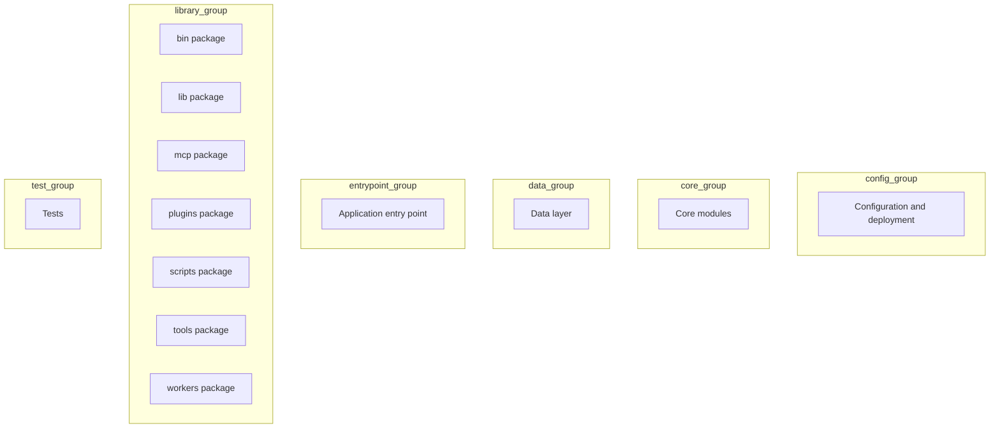

# Architecture report: jo-inc/camofox-browser

> Automated static analysis. **Observed** = directly seen in files/imports/AST; **Inferred** = interpretation from that evidence. Repository code was not executed.

## 1. Repository at a glance

| Item | Value |
| --- | --- |
| Repository | jo-inc/camofox-browser |
| Description | Stealth headless browser for AI agents — bypass Cloudflare, bot detection, and anti-scraping. Drop-in Puppeteer/Playwright replacement. |
| Language | JavaScript |
| Stars | 12279 |
| Licence | MIT |
| Analysed commit / branch | 31376c27db94204ffdc635ae71a7f61328e91a5e / master |
| Framework(s) | Express |
| Files analysed | 259 |
| Components | 12 |

## 2. Architecture in one minute

jo-inc/camofox-browser - Stealth headless browser for AI agents — bypass Cloudflare, bot detection, and anti-scraping. Drop-in Puppeteer/Playwright replacement.. This repository was analysed statically from 259 file(s) (1 Python). Detected technologies (observed from imports/manifests): GitHub Actions, Express, Docker, Jest, TypeScript. Files are grouped into 12 component(s): bin package, Configuration and deployment, Core modules, Data layer, Application entry point, lib package, mcp package, plugins package. Observed entry point(s): tools/windows-utm/build-fat-bootstrap.py. Findings below distinguish observed facts from inferred interpretation.

## 3. High-level block diagram

## 4. Main components

### bin package (`bin`)

- **Kind:** library
- **Status:** Observed
- **Confidence:** 0.85
- **Responsibility:** Groups 1 file(s) under bin package (observed from repository paths and static analysis).
- **Paths:** `bin/camofox-browser.js`
- **Evidence:** [bin/camofox-browser.js](https://github.com/jo-inc/camofox-browser/blob/31376c27db94204ffdc635ae71a7f61328e91a5e/bin/camofox-browser.js)

### Configuration and deployment (`config`)

- **Kind:** config
- **Status:** Observed
- **Confidence:** 0.85
- **Responsibility:** Groups 11 file(s) under configuration and deployment (observed from repository paths and static analysis).
- **Paths:** `Dockerfile`, `Dockerfile.ci`, `camofox.config.json`, `mcp/package.json`, `openapi.json`, `openclaw.plugin.json`, `package.json`, `plugins/vnc/plugin.json`, `railway.toml`, `tsconfig.json`, `workers/crash-reporter/wrangler.toml`
- **Evidence:** [Dockerfile](https://github.com/jo-inc/camofox-browser/blob/31376c27db94204ffdc635ae71a7f61328e91a5e/Dockerfile); [Dockerfile.ci](https://github.com/jo-inc/camofox-browser/blob/31376c27db94204ffdc635ae71a7f61328e91a5e/Dockerfile.ci); [camofox.config.json](https://github.com/jo-inc/camofox-browser/blob/31376c27db94204ffdc635ae71a7f61328e91a5e/camofox.config.json); [mcp/package.json](https://github.com/jo-inc/camofox-browser/blob/31376c27db94204ffdc635ae71a7f61328e91a5e/mcp/package.json); [openapi.json](https://github.com/jo-inc/camofox-browser/blob/31376c27db94204ffdc635ae71a7f61328e91a5e/openapi.json); [openclaw.plugin.json](https://github.com/jo-inc/camofox-browser/blob/31376c27db94204ffdc635ae71a7f61328e91a5e/openclaw.plugin.json); [package.json](https://github.com/jo-inc/camofox-browser/blob/31376c27db94204ffdc635ae71a7f61328e91a5e/package.json); [plugins/vnc/plugin.json](https://github.com/jo-inc/camofox-browser/blob/31376c27db94204ffdc635ae71a7f61328e91a5e/plugins/vnc/plugin.json)

### Core modules (`core`)

- **Kind:** core
- **Status:** Observed
- **Confidence:** 0.85
- **Responsibility:** Groups 7 file(s) under core modules (observed from repository paths and static analysis).
- **Paths:** `jest.config.cjs`, `jest.config.e2e.cjs`, `plugin.js`, `plugin.ts`, `postinstall.js`, `release.sh`, `run.sh`
- **Evidence:** [jest.config.cjs](https://github.com/jo-inc/camofox-browser/blob/31376c27db94204ffdc635ae71a7f61328e91a5e/jest.config.cjs); [jest.config.e2e.cjs](https://github.com/jo-inc/camofox-browser/blob/31376c27db94204ffdc635ae71a7f61328e91a5e/jest.config.e2e.cjs); [plugin.js](https://github.com/jo-inc/camofox-browser/blob/31376c27db94204ffdc635ae71a7f61328e91a5e/plugin.js); [plugin.ts](https://github.com/jo-inc/camofox-browser/blob/31376c27db94204ffdc635ae71a7f61328e91a5e/plugin.ts); [postinstall.js](https://github.com/jo-inc/camofox-browser/blob/31376c27db94204ffdc635ae71a7f61328e91a5e/postinstall.js); [release.sh](https://github.com/jo-inc/camofox-browser/blob/31376c27db94204ffdc635ae71a7f61328e91a5e/release.sh); [run.sh](https://github.com/jo-inc/camofox-browser/blob/31376c27db94204ffdc635ae71a7f61328e91a5e/run.sh)

### Data layer (`data_layer`)

- **Kind:** data
- **Status:** Observed
- **Confidence:** 0.85
- **Responsibility:** Groups 3 file(s) under data layer (observed from repository paths and static analysis).
- **Paths:** `plugins/persistence/index.js`, `plugins/persistence/persistence.test.js`, `plugins/persistence/plugin.test.js`
- **Evidence:** [plugins/persistence/index.js](https://github.com/jo-inc/camofox-browser/blob/31376c27db94204ffdc635ae71a7f61328e91a5e/plugins/persistence/index.js); [plugins/persistence/persistence.test.js](https://github.com/jo-inc/camofox-browser/blob/31376c27db94204ffdc635ae71a7f61328e91a5e/plugins/persistence/persistence.test.js); [plugins/persistence/plugin.test.js](https://github.com/jo-inc/camofox-browser/blob/31376c27db94204ffdc635ae71a7f61328e91a5e/plugins/persistence/plugin.test.js)

### Application entry point (`entrypoint`)

- **Kind:** entrypoint
- **Status:** Observed
- **Confidence:** 0.85
- **Responsibility:** Groups 1 file(s) under application entry point (observed from repository paths and static analysis). Observed top-level functions: build, lfn_entries, main, short_name, udf_tree.
- **Paths:** `tools/windows-utm/build-fat-bootstrap.py`
- **Evidence:** [tools/windows-utm/build-fat-bootstrap.py:9](https://github.com/jo-inc/camofox-browser/blob/31376c27db94204ffdc635ae71a7f61328e91a5e/tools/windows-utm/build-fat-bootstrap.py#L9)

### lib package (`lib`)

- **Kind:** library
- **Status:** Observed
- **Confidence:** 0.85
- **Responsibility:** Groups 49 file(s) under lib package (observed from repository paths and static analysis).
- **Paths:** `lib/aria-annotate.js`, `lib/auth.js`, `lib/browser-errors.js`, `lib/browser-identity.js`, `lib/browser-key.js`, `lib/browser-processes.js`, `lib/camoufox-download.js`, `lib/camoufox-executable.js`, `lib/config.js`, `lib/cookies.js`, `lib/downloads.js`, `lib/extract.js`, `lib/fingerprint-os.js`, `lib/fly.js`, `lib/google-serp.js`, `lib/health-probe.js`, `lib/images.js`, `lib/inflight.js`, `lib/interaction-params.js`, `lib/interactive-roles.js`, `lib/launcher.js`, `lib/macros.js`, `lib/mcp-tool-contracts.mjs`, `lib/metrics.js`, `lib/new-page-recovery.js`, `lib/openapi.js`, `lib/page-lease.js`, `lib/page-structure.js`, `lib/persistence.js`, `lib/plugin-capabilities.js`, `lib/plugins.js`, `lib/popup-sizing.js`, `lib/process-ownership.js`, `lib/proxy.js`, `lib/reporter.js`, `lib/request-utils.js`, `lib/resources.js`, `lib/search-fallbacks.js`, `lib/select-option.js`, `lib/sentry.js`, `lib/snapshot.js`, `lib/storage-state.js`, `lib/tmp-cleanup.js`, `lib/tracing.js`, `lib/trusted-drag.js`, `lib/upload-paths.js`, `lib/viewport-transport-shim.js`, `lib/visible-selector.js`, `lib/windows-processes.js`
- **Evidence:** [lib/aria-annotate.js](https://github.com/jo-inc/camofox-browser/blob/31376c27db94204ffdc635ae71a7f61328e91a5e/lib/aria-annotate.js); [lib/auth.js](https://github.com/jo-inc/camofox-browser/blob/31376c27db94204ffdc635ae71a7f61328e91a5e/lib/auth.js); [lib/browser-errors.js](https://github.com/jo-inc/camofox-browser/blob/31376c27db94204ffdc635ae71a7f61328e91a5e/lib/browser-errors.js); [lib/browser-identity.js](https://github.com/jo-inc/camofox-browser/blob/31376c27db94204ffdc635ae71a7f61328e91a5e/lib/browser-identity.js); [lib/browser-key.js](https://github.com/jo-inc/camofox-browser/blob/31376c27db94204ffdc635ae71a7f61328e91a5e/lib/browser-key.js); [lib/browser-processes.js](https://github.com/jo-inc/camofox-browser/blob/31376c27db94204ffdc635ae71a7f61328e91a5e/lib/browser-processes.js); [lib/camoufox-download.js](https://github.com/jo-inc/camofox-browser/blob/31376c27db94204ffdc635ae71a7f61328e91a5e/lib/camoufox-download.js); [lib/camoufox-executable.js](https://github.com/jo-inc/camofox-browser/blob/31376c27db94204ffdc635ae71a7f61328e91a5e/lib/camoufox-executable.js)

### mcp package (`mcp`)

- **Kind:** library
- **Status:** Observed
- **Confidence:** 0.85
- **Responsibility:** Groups 4 file(s) under mcp package (observed from repository paths and static analysis).
- **Paths:** `mcp/lib/config.mjs`, `mcp/lib/cookies.mjs`, `mcp/lib/tool-contracts.mjs`, `mcp/server.mjs`
- **Evidence:** [mcp/lib/config.mjs](https://github.com/jo-inc/camofox-browser/blob/31376c27db94204ffdc635ae71a7f61328e91a5e/mcp/lib/config.mjs); [mcp/lib/cookies.mjs](https://github.com/jo-inc/camofox-browser/blob/31376c27db94204ffdc635ae71a7f61328e91a5e/mcp/lib/cookies.mjs); [mcp/lib/tool-contracts.mjs](https://github.com/jo-inc/camofox-browser/blob/31376c27db94204ffdc635ae71a7f61328e91a5e/mcp/lib/tool-contracts.mjs); [mcp/server.mjs](https://github.com/jo-inc/camofox-browser/blob/31376c27db94204ffdc635ae71a7f61328e91a5e/mcp/server.mjs)

### plugins package (`plugins`)

- **Kind:** library
- **Status:** Observed
- **Confidence:** 0.85
- **Responsibility:** Groups 13 file(s) under plugins package (observed from repository paths and static analysis).
- **Paths:** `plugins/vnc/index.js`, `plugins/vnc/spawn.js`, `plugins/vnc/vnc-launcher.js`, `plugins/vnc/vnc-launcher.test.js`, `plugins/vnc/vnc-watcher-lib.sh`, `plugins/vnc/vnc-watcher.sh`, `plugins/vnc/vnc-watcher.test.js`, `plugins/vnc/vnc.test.js`, `plugins/youtube/index.js`, `plugins/youtube/post-install.sh`, `plugins/youtube/post-install.test.js`, `plugins/youtube/youtube.js`, `plugins/youtube/youtube.test.js`
- **Evidence:** [plugins/vnc/index.js](https://github.com/jo-inc/camofox-browser/blob/31376c27db94204ffdc635ae71a7f61328e91a5e/plugins/vnc/index.js); [plugins/vnc/spawn.js](https://github.com/jo-inc/camofox-browser/blob/31376c27db94204ffdc635ae71a7f61328e91a5e/plugins/vnc/spawn.js); [plugins/vnc/vnc-launcher.js](https://github.com/jo-inc/camofox-browser/blob/31376c27db94204ffdc635ae71a7f61328e91a5e/plugins/vnc/vnc-launcher.js); [plugins/vnc/vnc-launcher.test.js](https://github.com/jo-inc/camofox-browser/blob/31376c27db94204ffdc635ae71a7f61328e91a5e/plugins/vnc/vnc-launcher.test.js); [plugins/vnc/vnc-watcher-lib.sh](https://github.com/jo-inc/camofox-browser/blob/31376c27db94204ffdc635ae71a7f61328e91a5e/plugins/vnc/vnc-watcher-lib.sh); [plugins/vnc/vnc-watcher.sh](https://github.com/jo-inc/camofox-browser/blob/31376c27db94204ffdc635ae71a7f61328e91a5e/plugins/vnc/vnc-watcher.sh); [plugins/vnc/vnc-watcher.test.js](https://github.com/jo-inc/camofox-browser/blob/31376c27db94204ffdc635ae71a7f61328e91a5e/plugins/vnc/vnc-watcher.test.js); [plugins/vnc/vnc.test.js](https://github.com/jo-inc/camofox-browser/blob/31376c27db94204ffdc635ae71a7f61328e91a5e/plugins/vnc/vnc.test.js)

### scripts package (`scripts`)

- **Kind:** library
- **Status:** Observed
- **Confidence:** 0.85
- **Responsibility:** Groups 13 file(s) under scripts package (observed from repository paths and static analysis).
- **Paths:** `scripts/exec.js`, `scripts/generate-openapi.js`, `scripts/install-plugin-deps.sh`, `scripts/lib/npm-command.mjs`, `scripts/mcp-call.mjs`, `scripts/mcp-run.mjs`, `scripts/plugin.js`, `scripts/plugin.test.js`, `scripts/postinstall.js`, `scripts/postinstall.test.js`, `scripts/sync-version.js`, `scripts/test-mcp-package.mjs`, `scripts/test-mcp.mjs`
- **Evidence:** [scripts/exec.js](https://github.com/jo-inc/camofox-browser/blob/31376c27db94204ffdc635ae71a7f61328e91a5e/scripts/exec.js); [scripts/generate-openapi.js](https://github.com/jo-inc/camofox-browser/blob/31376c27db94204ffdc635ae71a7f61328e91a5e/scripts/generate-openapi.js); [scripts/install-plugin-deps.sh](https://github.com/jo-inc/camofox-browser/blob/31376c27db94204ffdc635ae71a7f61328e91a5e/scripts/install-plugin-deps.sh); [scripts/lib/npm-command.mjs](https://github.com/jo-inc/camofox-browser/blob/31376c27db94204ffdc635ae71a7f61328e91a5e/scripts/lib/npm-command.mjs); [scripts/mcp-call.mjs](https://github.com/jo-inc/camofox-browser/blob/31376c27db94204ffdc635ae71a7f61328e91a5e/scripts/mcp-call.mjs); [scripts/mcp-run.mjs](https://github.com/jo-inc/camofox-browser/blob/31376c27db94204ffdc635ae71a7f61328e91a5e/scripts/mcp-run.mjs); [scripts/plugin.js](https://github.com/jo-inc/camofox-browser/blob/31376c27db94204ffdc635ae71a7f61328e91a5e/scripts/plugin.js); [scripts/plugin.test.js](https://github.com/jo-inc/camofox-browser/blob/31376c27db94204ffdc635ae71a7f61328e91a5e/scripts/plugin.test.js)

### Tests (`tests`)

- **Kind:** test
- **Status:** Observed
- **Confidence:** 0.85
- **Responsibility:** Groups 122 file(s) under tests (observed from repository paths and static analysis).
- **Paths:** `tests/e2e/clickRefs.test.js`, `tests/e2e/concurrency.test.js`, `tests/e2e/downloadsImages.test.js`, `tests/e2e/drag.test.js`, `tests/e2e/evaluateNavigationRace.test.js`, `tests/e2e/formSubmission.test.js`, `tests/e2e/globalSetup.js`, `tests/e2e/globalTeardown.js`, `tests/e2e/macroNavigation.test.js`, `tests/e2e/navigation.test.js`, `tests/e2e/screenshot.test.js`, `tests/e2e/scroll.test.js`, `tests/e2e/sharedEnv.js`, `tests/e2e/snapshot-truncation.test.js`, `tests/e2e/snapshotLinks.test.js`, `tests/e2e/snapshotScreenshot.test.js`, `tests/e2e/tabCreateCleanup.test.js`, `tests/e2e/tabLifecycle.test.js`, `tests/e2e/typingEnter.test.js`, `tests/e2e/upload.test.js`, `tests/e2e/viewport.test.js`, `tests/helpers/client.js`, `tests/helpers/startServer.js`, `tests/helpers/test-env.js`, `tests/helpers/testSite.js`, `tests/live/amazonProductPrices.test.js`, `tests/live/googleSearch.test.js`, `tests/live/macroExpansion.test.js`, `tests/unit/accessKey.test.js`, `tests/unit/amazonSearchNavigation.test.js`, `tests/unit/ariaAnnotate.test.js`, `tests/unit/auth.test.js`, `tests/unit/autoCloseOldReports.test.js`, `tests/unit/autoCookieImport.test.js`, `tests/unit/browserErrors.test.js`, `tests/unit/browserIdentity.test.js`, `tests/unit/browserKey.test.js`, `tests/unit/browserProcesses.test.js`, `tests/unit/browserRestart410.test.js`, `tests/unit/browserRestartWindow.test.js`, `tests/unit/camoufoxDownload.test.js`, `tests/unit/camoufoxExecutable.test.js`, `tests/unit/camoufoxVersionConsistency.test.js`, `tests/unit/clickBoundingBoxTimeout.test.js`, `tests/unit/clientRetry.test.js`, `tests/unit/config.test.js`, `tests/unit/consentDismissal.test.js`, `tests/unit/cookies.test.js`, `tests/unit/crashRelay.test.js`, `tests/unit/crashRelayWorker.test.js`, `tests/unit/downloads.test.js`, `tests/unit/dragEndpoint.test.js`, `tests/unit/evaluateErrors.test.js`, `tests/unit/expressCompatibility.test.js`, `tests/unit/extract.test.js`, `tests/unit/fingerprintOs.test.js`, `tests/unit/flyReplay.test.js`, `tests/unit/googleSerp.test.js`, `tests/unit/healthProbe.test.js`, `tests/unit/healthSemantics.test.js`, `tests/unit/idleShutdown.test.js`, `tests/unit/inflight.test.js`, `tests/unit/inline-pdf-response.test.js`, `tests/unit/interactionEndpoints.test.js`, `tests/unit/interactionParams.test.js`, `tests/unit/interactiveRoles.test.js`, `tests/unit/launchCompat.test.js`, `tests/unit/macros.test.js`, `tests/unit/mcp-contracts.test.js`, `tests/unit/mcpHttpParity.test.js`, `tests/unit/memoryPressure.test.js`, `tests/unit/nativeBinding.test.js`, `tests/unit/navHealthRecovery.test.js`, `tests/unit/navigateAbort.test.js`, `tests/unit/navigationTimeout.test.js`, `tests/unit/netscapeParser.test.js`, `tests/unit/newPageRecovery.test.js`, `tests/unit/noSecrets.test.js`, `tests/unit/npmCommand.test.js`, `tests/unit/openapi.test.js`, `tests/unit/openclawManifest.test.js`, `tests/unit/openclawPlugin.test.js`, `tests/unit/operationalFailures.test.js`, `tests/unit/pageLease.test.js`, `tests/unit/pluginCapabilities.test.js`, `tests/unit/pluginTypeEvent.test.js`, `tests/unit/plugins.test.js`, `tests/unit/popupSelfClose.test.js`, `tests/unit/popupSizing.test.js`, `tests/unit/processOwnership.test.js`, `tests/unit/proxy.test.js`, `tests/unit/proxyNavigationErrors.test.js`, `tests/unit/proxyRotation.test.js`, `tests/unit/reporter.test.js`, `tests/unit/resources.test.js`, `tests/unit/screenshotToolResult.test.js`, `tests/unit/searchFallbacks.test.js`, `tests/unit/security.test.js`, `tests/unit/selectOption.test.js`, `tests/unit/serverShutdownEvent.test.js`, `tests/unit/sessionCleanup.test.js`, `tests/unit/sessionDestroyingEvent.test.js`, `tests/unit/shutdownBudget.test.js`, `tests/unit/snapshot.test.js`, `tests/unit/syncVersion.test.js`, `tests/unit/tabCreateWarming.test.js`, `tests/unit/tabIdUuid.test.js`, `tests/unit/tabLeak.test.js`, `tests/unit/tabLifecycleContract.test.js`, `tests/unit/tabRecycling.test.js`, `tests/unit/timeoutContinuation.test.js`, `tests/unit/tmpCleanup.test.js`, `tests/unit/tracing.test.js`, `tests/unit/tracingApi.test.js`, `tests/unit/typeKeyboardMode.test.js`, `tests/unit/uploadEndpoint.test.js`, `tests/unit/uploadPaths.test.js`, `tests/unit/viewport.test.js`, `tests/unit/viewportTransportShim.test.js`, `tests/unit/visibleSelector.test.js`, `tests/unit/windowsProcesses.test.js`, `tests/vnc-linux-smoke.sh`
- **Evidence:** [tests/e2e/clickRefs.test.js](https://github.com/jo-inc/camofox-browser/blob/31376c27db94204ffdc635ae71a7f61328e91a5e/tests/e2e/clickRefs.test.js); [tests/e2e/concurrency.test.js](https://github.com/jo-inc/camofox-browser/blob/31376c27db94204ffdc635ae71a7f61328e91a5e/tests/e2e/concurrency.test.js); [tests/e2e/downloadsImages.test.js](https://github.com/jo-inc/camofox-browser/blob/31376c27db94204ffdc635ae71a7f61328e91a5e/tests/e2e/downloadsImages.test.js); [tests/e2e/drag.test.js](https://github.com/jo-inc/camofox-browser/blob/31376c27db94204ffdc635ae71a7f61328e91a5e/tests/e2e/drag.test.js); [tests/e2e/evaluateNavigationRace.test.js](https://github.com/jo-inc/camofox-browser/blob/31376c27db94204ffdc635ae71a7f61328e91a5e/tests/e2e/evaluateNavigationRace.test.js); [tests/e2e/formSubmission.test.js](https://github.com/jo-inc/camofox-browser/blob/31376c27db94204ffdc635ae71a7f61328e91a5e/tests/e2e/formSubmission.test.js); [tests/e2e/globalSetup.js](https://github.com/jo-inc/camofox-browser/blob/31376c27db94204ffdc635ae71a7f61328e91a5e/tests/e2e/globalSetup.js); [tests/e2e/globalTeardown.js](https://github.com/jo-inc/camofox-browser/blob/31376c27db94204ffdc635ae71a7f61328e91a5e/tests/e2e/globalTeardown.js)

### tools package (`tools`)

- **Kind:** library
- **Status:** Observed
- **Confidence:** 0.85
- **Responsibility:** Groups 3 file(s) under tools package (observed from repository paths and static analysis).
- **Paths:** `tools/windows-utm/build-installer-autoboot-iso.sh`, `tools/windows-utm/build-provisioning-iso.sh`, `tools/windows-utm/create-vm.sh`
- **Evidence:** [tools/windows-utm/build-installer-autoboot-iso.sh](https://github.com/jo-inc/camofox-browser/blob/31376c27db94204ffdc635ae71a7f61328e91a5e/tools/windows-utm/build-installer-autoboot-iso.sh); [tools/windows-utm/build-provisioning-iso.sh](https://github.com/jo-inc/camofox-browser/blob/31376c27db94204ffdc635ae71a7f61328e91a5e/tools/windows-utm/build-provisioning-iso.sh); [tools/windows-utm/create-vm.sh](https://github.com/jo-inc/camofox-browser/blob/31376c27db94204ffdc635ae71a7f61328e91a5e/tools/windows-utm/create-vm.sh)

### workers package (`workers`)

- **Kind:** library
- **Status:** Observed
- **Confidence:** 0.85
- **Responsibility:** Groups 1 file(s) under workers package (observed from repository paths and static analysis).
- **Paths:** `workers/crash-reporter/index.ts`
- **Evidence:** [workers/crash-reporter/index.ts](https://github.com/jo-inc/camofox-browser/blob/31376c27db94204ffdc635ae71a7f61328e91a5e/workers/crash-reporter/index.ts)

## 5. Execution flow

**Observed** entry point(s):

- [bin/camofox-browser.js](https://github.com/jo-inc/camofox-browser/blob/31376c27db94204ffdc635ae71a7f61328e91a5e/bin/camofox-browser.js)
- [mcp/server.mjs](https://github.com/jo-inc/camofox-browser/blob/31376c27db94204ffdc635ae71a7f61328e91a5e/mcp/server.mjs)
- [plugins/persistence/index.js](https://github.com/jo-inc/camofox-browser/blob/31376c27db94204ffdc635ae71a7f61328e91a5e/plugins/persistence/index.js)
- [plugins/vnc/index.js](https://github.com/jo-inc/camofox-browser/blob/31376c27db94204ffdc635ae71a7f61328e91a5e/plugins/vnc/index.js)
- [plugins/youtube/index.js](https://github.com/jo-inc/camofox-browser/blob/31376c27db94204ffdc635ae71a7f61328e91a5e/plugins/youtube/index.js)
- [tools/windows-utm/build-fat-bootstrap.py:152](https://github.com/jo-inc/camofox-browser/blob/31376c27db94204ffdc635ae71a7f61328e91a5e/tools/windows-utm/build-fat-bootstrap.py#L152)
- [workers/crash-reporter/index.ts](https://github.com/jo-inc/camofox-browser/blob/31376c27db94204ffdc635ae71a7f61328e91a5e/workers/crash-reporter/index.ts)

Representative flow (derived from observed entry points and the import graph; steps beyond the entry point are **Inferred**):

1. Execution starts at an observed entry point listed above, if present.
2. No internal import relationships between components were observed.

## 6. Project structure

### `(root)`

- `.gitattributes` - other (265 bytes)
- `.gitignore` - other (500 bytes)
- `AGENTS.md` - docs (24578 bytes)
- `CONTRIBUTING.md` - docs (1572 bytes)
- `Dockerfile` - container (7839 bytes)
- `Dockerfile.ci` - container (3620 bytes)
- `LICENSE` - docs (1064 bytes)
- `Makefile` - other (1961 bytes)
- `README.md` - docs (41172 bytes)
- `build.ps1` - other (5256 bytes)
- `camofox.config.json` - config (301 bytes)
- `jest.config.cjs` - source, JavaScript (984 bytes)
- `jest.config.e2e.cjs` - source, JavaScript (534 bytes)
- `openapi.json` - config (115750 bytes)
- `openclaw.plugin.json` - config (4469 bytes)
- `package.json` - manifest (8449 bytes)
- `plugin.js` - source, JavaScript (13359 bytes)
- `plugin.ts` - source, TypeScript (13258 bytes)
- `postinstall.js` - source, JavaScript (3239 bytes)
- `railway.toml` - config (304 bytes)
- `release.sh` - source, Shell (2513 bytes)
- `run.sh` - source, Shell (1038 bytes)
- `tsconfig.json` - config (248 bytes)

### `.github`

- `.github/CODEOWNERS` - other (59 bytes)
- `.github/FUNDING.yml` - config (19 bytes)
- `.github/workflows/agenthook-notify.yml` - ci, YAML (2326 bytes)
- `.github/workflows/auto-close-old-reports.yml` - ci, YAML (7300 bytes)
- `.github/workflows/ci.yml` - ci, YAML (4708 bytes)
- `.github/workflows/clawhub-publish.yml` - ci, YAML (952 bytes)
- `.github/workflows/docker.yml` - ci, YAML (1502 bytes)
- `.github/workflows/mirror-camoufox.yml` - ci, YAML (6022 bytes)
- `.github/workflows/publish.yml` - ci, YAML (3508 bytes)
- `.github/workflows/telemetry-deploy.yml` - ci, YAML (1098 bytes)

### `bin`

- `bin/camofox-browser.js` - source, JavaScript (43 bytes)

### `changelog`

- `changelog/1.4.0.md` - docs (1915 bytes)

### `docs`

- `docs/api.html` - docs (28928 bytes)
- `docs/openapi.json` - config (70408 bytes)

### `lib`

- `lib/aria-annotate.js` - source, JavaScript (2115 bytes)
- `lib/auth.js` - source, JavaScript (5281 bytes)
- `lib/browser-errors.js` - source, JavaScript (7322 bytes)
- `lib/browser-identity.js` - source, JavaScript (304 bytes)
- `lib/browser-key.js` - source, JavaScript (862 bytes)
- `lib/browser-processes.js` - source, JavaScript (1929 bytes)
- `lib/camoufox-download.js` - source, JavaScript (1552 bytes)
- `lib/camoufox-executable.js` - source, JavaScript (8044 bytes)
- `lib/config.js` - source, JavaScript (12302 bytes)
- `lib/cookies.js` - source, JavaScript (282 bytes)
- `lib/downloads.js` - source, JavaScript (13494 bytes)
- `lib/extract.js` - source, JavaScript (2379 bytes)
- `lib/fingerprint-os.js` - source, JavaScript (1186 bytes)
- `lib/fly.js` - source, JavaScript (1790 bytes)
- `lib/google-serp.js` - source, JavaScript (1307 bytes)
- `lib/health-probe.js` - source, JavaScript (1029 bytes)
- `lib/images.js` - source, JavaScript (3332 bytes)
- `lib/inflight.js` - source, JavaScript (321 bytes)
- `lib/interaction-params.js` - source, JavaScript (3838 bytes)
- `lib/interactive-roles.js` - source, JavaScript (353 bytes)
- `lib/launcher.js` - source, JavaScript (1360 bytes)
- `lib/macros.js` - source, JavaScript (1772 bytes)
- `lib/mcp-tool-contracts.mjs` - source, JavaScript (214 bytes)
- `lib/metrics.js` - source, JavaScript (6050 bytes)
- `lib/new-page-recovery.js` - source, JavaScript (2606 bytes)
- `lib/openapi.js` - source, JavaScript (3791 bytes)
- `lib/page-lease.js` - source, JavaScript (824 bytes)
- `lib/page-structure.js` - source, JavaScript (10992 bytes)
- `lib/persistence.js` - source, JavaScript (2973 bytes)
- `lib/plugin-capabilities.js` - source, JavaScript (793 bytes)
- `lib/plugins.js` - source, JavaScript (8336 bytes)
- `lib/popup-sizing.js` - source, JavaScript (2013 bytes)
- `lib/process-ownership.js` - source, JavaScript (3684 bytes)
- `lib/proxy.js` - source, JavaScript (8850 bytes)
- `lib/reporter.js` - source, JavaScript (48517 bytes)
- `lib/request-utils.js` - source, JavaScript (5034 bytes)
- `lib/resources.js` - source, JavaScript (5656 bytes)
- `lib/search-fallbacks.js` - source, JavaScript (412 bytes)
- `lib/select-option.js` - source, JavaScript (338 bytes)
- `lib/sentry.js` - source, JavaScript (1877 bytes)
- `lib/snapshot.js` - source, JavaScript (1593 bytes)
- `lib/storage-state.js` - source, JavaScript (1528 bytes)
- `lib/tmp-cleanup.js` - source, JavaScript (4030 bytes)
- `lib/tracing.js` - source, JavaScript (3511 bytes)
- `lib/trusted-drag.js` - source, JavaScript (4199 bytes)
- `lib/upload-paths.js` - source, JavaScript (1732 bytes)
- `lib/viewport-transport-shim.js` - source, JavaScript (4616 bytes)
- `lib/visible-selector.js` - source, JavaScript (528 bytes)
- `lib/windows-processes.js` - source, JavaScript (4345 bytes)

### `mcp`

- `mcp/README.md` - docs (10983 bytes)
- `mcp/lib/config.mjs` - source, JavaScript (741 bytes)
- `mcp/lib/cookies.mjs` - source, JavaScript (5396 bytes)
- `mcp/lib/tool-contracts.mjs` - source, JavaScript (37051 bytes)
- `mcp/package.json` - manifest (1441 bytes)
- `mcp/server.mjs` - source, JavaScript (4462 bytes)

### `plugins`

- `plugins/persistence/AGENTS.md` - docs (2472 bytes)
- `plugins/persistence/README.md` - docs (2445 bytes)
- `plugins/persistence/index.js` - source, JavaScript (7476 bytes)
- `plugins/persistence/persistence.test.js` - source, JavaScript (4241 bytes)
- `plugins/persistence/plugin.test.js` - source, JavaScript (10432 bytes)
- `plugins/vnc/AGENTS.md` - docs (2418 bytes)
- `plugins/vnc/README.md` - docs (7044 bytes)
- `plugins/vnc/apt.txt` - docs (171 bytes)
- `plugins/vnc/index.js` - source, JavaScript (6315 bytes)
- `plugins/vnc/plugin.json` - config (35 bytes)
- `plugins/vnc/spawn.js` - source, JavaScript (267 bytes)
- `plugins/vnc/vnc-launcher.js` - source, JavaScript (3351 bytes)
- `plugins/vnc/vnc-launcher.test.js` - source, JavaScript (1196 bytes)
- `plugins/vnc/vnc-watcher-lib.sh` - source, Shell (2532 bytes)
- `plugins/vnc/vnc-watcher.sh` - source, Shell (5006 bytes)
- `plugins/vnc/vnc-watcher.test.js` - source, JavaScript (4939 bytes)
- `plugins/vnc/vnc.test.js` - source, JavaScript (12265 bytes)
- `plugins/youtube/AGENTS.md` - docs (867 bytes)
- `plugins/youtube/apt.txt` - docs (16 bytes)
- `plugins/youtube/index.js` - source, JavaScript (9327 bytes)
- `plugins/youtube/post-install.sh` - source, Shell (506 bytes)
- `plugins/youtube/post-install.test.js` - source, JavaScript (2612 bytes)
- `plugins/youtube/youtube.js` - source, JavaScript (8235 bytes)
- `plugins/youtube/youtube.test.js` - source, JavaScript (1264 bytes)

### `scripts`

- `scripts/exec.js` - source, JavaScript (306 bytes)
- `scripts/generate-openapi.js` - source, JavaScript (715 bytes)
- `scripts/install-plugin-deps.sh` - source, Shell (2502 bytes)
- `scripts/lib/npm-command.mjs` - source, JavaScript (1154 bytes)
- `scripts/mcp-call.mjs` - source, JavaScript (2745 bytes)
- `scripts/mcp-run.mjs` - source, JavaScript (3417 bytes)
- `scripts/plugin.js` - source, JavaScript (11222 bytes)
- `scripts/plugin.test.js` - source, JavaScript (3963 bytes)
- `scripts/postinstall.js` - source, JavaScript (422 bytes)
- `scripts/postinstall.test.js` - source, JavaScript (2852 bytes)
- `scripts/sync-version.js` - source, JavaScript (1973 bytes)
- `scripts/test-mcp-package.mjs` - source, JavaScript (2701 bytes)
- `scripts/test-mcp.mjs` - source, JavaScript (5173 bytes)

### `tests`

- `tests/e2e/clickRefs.test.js` - test, JavaScript (2657 bytes)
- `tests/e2e/concurrency.test.js` - test, JavaScript (4346 bytes)
- `tests/e2e/downloadsImages.test.js` - test, JavaScript (3424 bytes)
- `tests/e2e/drag.test.js` - test, JavaScript (1962 bytes)
- `tests/e2e/evaluateNavigationRace.test.js` - test, JavaScript (2096 bytes)
- `tests/e2e/formSubmission.test.js` - test, JavaScript (3772 bytes)
- `tests/e2e/globalSetup.js` - test, JavaScript (2885 bytes)
- `tests/e2e/globalTeardown.js` - test, JavaScript (1128 bytes)
- `tests/e2e/macroNavigation.test.js` - test, JavaScript (2572 bytes)
- `tests/e2e/navigation.test.js` - test, JavaScript (6782 bytes)
- `tests/e2e/screenshot.test.js` - test, JavaScript (5922 bytes)
- `tests/e2e/scroll.test.js` - test, JavaScript (1867 bytes)
- `tests/e2e/sharedEnv.js` - test, JavaScript (415 bytes)
- `tests/e2e/snapshot-truncation.test.js` - test, JavaScript (5851 bytes)
- `tests/e2e/snapshotLinks.test.js` - test, JavaScript (5555 bytes)
- `tests/e2e/snapshotScreenshot.test.js` - test, JavaScript (6905 bytes)
- `tests/e2e/tabCreateCleanup.test.js` - test, JavaScript (2419 bytes)
- `tests/e2e/tabLifecycle.test.js` - test, JavaScript (4231 bytes)
- `tests/e2e/typingEnter.test.js` - test, JavaScript (4284 bytes)
- `tests/e2e/upload.test.js` - test, JavaScript (1595 bytes)
- `tests/e2e/viewport.test.js` - test, JavaScript (2201 bytes)
- `tests/helpers/client.js` - test, JavaScript (9006 bytes)
- `tests/helpers/startServer.js` - test, JavaScript (2154 bytes)
- `tests/helpers/test-env.js` - test, JavaScript (326 bytes)
- `tests/helpers/testSite.js` - test, JavaScript (16129 bytes)
- `tests/live/amazonProductPrices.test.js` - test, JavaScript (2158 bytes)
- `tests/live/googleSearch.test.js` - test, JavaScript (3204 bytes)
- `tests/live/macroExpansion.test.js` - test, JavaScript (4143 bytes)
- `tests/unit/accessKey.test.js` - test, JavaScript (18188 bytes)
- `tests/unit/amazonSearchNavigation.test.js` - test, JavaScript (1607 bytes)
- `tests/unit/ariaAnnotate.test.js` - test, JavaScript (2187 bytes)
- `tests/unit/auth.test.js` - test, JavaScript (7438 bytes)
- `tests/unit/autoCloseOldReports.test.js` - test, JavaScript (5323 bytes)
- `tests/unit/autoCookieImport.test.js` - test, JavaScript (4248 bytes)
- `tests/unit/browserErrors.test.js` - test, JavaScript (6679 bytes)
- `tests/unit/browserIdentity.test.js` - test, JavaScript (1132 bytes)
- `tests/unit/browserKey.test.js` - test, JavaScript (853 bytes)
- `tests/unit/browserProcesses.test.js` - test, JavaScript (1746 bytes)
- `tests/unit/browserRestart410.test.js` - test, JavaScript (2671 bytes)
- `tests/unit/browserRestartWindow.test.js` - test, JavaScript (4009 bytes)
- `tests/unit/camoufoxDownload.test.js` - test, JavaScript (778 bytes)
- `tests/unit/camoufoxExecutable.test.js` - test, JavaScript (6463 bytes)
- `tests/unit/camoufoxVersionConsistency.test.js` - test, JavaScript (1550 bytes)
- `tests/unit/clickBoundingBoxTimeout.test.js` - test, JavaScript (4016 bytes)
- `tests/unit/clientRetry.test.js` - test, JavaScript (656 bytes)
- `tests/unit/config.test.js` - test, JavaScript (8626 bytes)
- `tests/unit/consentDismissal.test.js` - test, JavaScript (1633 bytes)
- `tests/unit/cookies.test.js` - test, JavaScript (9187 bytes)
- `tests/unit/crashRelay.test.js` - test, JavaScript (9489 bytes)
- `tests/unit/crashRelayWorker.test.js` - test, JavaScript (8060 bytes)
- `tests/unit/downloads.test.js` - test, JavaScript (11945 bytes)
- `tests/unit/dragEndpoint.test.js` - test, JavaScript (7899 bytes)
- `tests/unit/evaluateErrors.test.js` - test, JavaScript (5964 bytes)
- `tests/unit/expressCompatibility.test.js` - test, JavaScript (572 bytes)
- `tests/unit/extract.test.js` - test, JavaScript (15534 bytes)
- `tests/unit/fingerprintOs.test.js` - test, JavaScript (1326 bytes)
- `tests/unit/flyReplay.test.js` - test, JavaScript (2640 bytes)
- `tests/unit/googleSerp.test.js` - test, JavaScript (3893 bytes)
- `tests/unit/healthProbe.test.js` - test, JavaScript (3558 bytes)
- `tests/unit/healthSemantics.test.js` - test, JavaScript (2959 bytes)
- `tests/unit/idleShutdown.test.js` - test, JavaScript (5091 bytes)
- `tests/unit/inflight.test.js` - test, JavaScript (2071 bytes)
- `tests/unit/inline-pdf-response.test.js` - test, JavaScript (4715 bytes)
- `tests/unit/interactionEndpoints.test.js` - test, JavaScript (4822 bytes)
- `tests/unit/interactionParams.test.js` - test, JavaScript (4478 bytes)
- `tests/unit/interactiveRoles.test.js` - test, JavaScript (343 bytes)
- `tests/unit/launchCompat.test.js` - test, JavaScript (5153 bytes)
- `tests/unit/macros.test.js` - test, JavaScript (4854 bytes)
- `tests/unit/mcp-contracts.test.js` - test, JavaScript (27469 bytes)
- `tests/unit/mcpHttpParity.test.js` - test, JavaScript (5246 bytes)
- `tests/unit/memoryPressure.test.js` - test, JavaScript (10714 bytes)
- `tests/unit/nativeBinding.test.js` - test, JavaScript (307 bytes)
- `tests/unit/navHealthRecovery.test.js` - test, JavaScript (5976 bytes)
- `tests/unit/navigateAbort.test.js` - test, JavaScript (4048 bytes)
- `tests/unit/navigationTimeout.test.js` - test, JavaScript (12389 bytes)
- `tests/unit/netscapeParser.test.js` - test, JavaScript (6515 bytes)
- `tests/unit/newPageRecovery.test.js` - test, JavaScript (5691 bytes)
- `tests/unit/noSecrets.test.js` - test, JavaScript (3948 bytes)
- `tests/unit/npmCommand.test.js` - test, JavaScript (2223 bytes)
- `tests/unit/openapi.test.js` - test, JavaScript (6996 bytes)
- `tests/unit/openclawManifest.test.js` - test, JavaScript (1737 bytes)
- `tests/unit/openclawPlugin.test.js` - test, JavaScript (1386 bytes)
- `tests/unit/operationalFailures.test.js` - test, JavaScript (1713 bytes)
- `tests/unit/pageLease.test.js` - test, JavaScript (2177 bytes)
- `tests/unit/pluginCapabilities.test.js` - test, JavaScript (926 bytes)
- `tests/unit/pluginTypeEvent.test.js` - test, JavaScript (1489 bytes)
- `tests/unit/plugins.test.js` - test, JavaScript (9300 bytes)
- `tests/unit/popupSelfClose.test.js` - test, JavaScript (4926 bytes)
- `tests/unit/popupSizing.test.js` - test, JavaScript (3165 bytes)
- `tests/unit/processOwnership.test.js` - test, JavaScript (4545 bytes)
- `tests/unit/proxy.test.js` - test, JavaScript (10380 bytes)
- `tests/unit/proxyNavigationErrors.test.js` - test, JavaScript (742 bytes)
- `tests/unit/proxyRotation.test.js` - test, JavaScript (5415 bytes)
- `tests/unit/reporter.test.js` - test, JavaScript (48726 bytes)
- `tests/unit/resources.test.js` - test, JavaScript (366 bytes)
- `tests/unit/screenshotToolResult.test.js` - test, JavaScript (6678 bytes)
- `tests/unit/searchFallbacks.test.js` - test, JavaScript (2243 bytes)
- `tests/unit/security.test.js` - test, JavaScript (8771 bytes)
- `tests/unit/selectOption.test.js` - test, JavaScript (889 bytes)
- `tests/unit/serverShutdownEvent.test.js` - test, JavaScript (4427 bytes)
- `tests/unit/sessionCleanup.test.js` - test, JavaScript (13316 bytes)
- `tests/unit/sessionDestroyingEvent.test.js` - test, JavaScript (11666 bytes)
- `tests/unit/shutdownBudget.test.js` - test, JavaScript (754 bytes)
- `tests/unit/snapshot.test.js` - test, JavaScript (5768 bytes)
- `tests/unit/syncVersion.test.js` - test, JavaScript (2160 bytes)
- `tests/unit/tabCreateWarming.test.js` - test, JavaScript (7566 bytes)
- `tests/unit/tabIdUuid.test.js` - test, JavaScript (1650 bytes)
- `tests/unit/tabLeak.test.js` - test, JavaScript (13769 bytes)
- `tests/unit/tabLifecycleContract.test.js` - test, JavaScript (7477 bytes)
- `tests/unit/tabRecycling.test.js` - test, JavaScript (6793 bytes)
- `tests/unit/timeoutContinuation.test.js` - test, JavaScript (5389 bytes)
- `tests/unit/tmpCleanup.test.js` - test, JavaScript (9972 bytes)
- `tests/unit/tracing.test.js` - test, JavaScript (4355 bytes)
- `tests/unit/tracingApi.test.js` - test, JavaScript (14504 bytes)
- `tests/unit/typeKeyboardMode.test.js` - test, JavaScript (6495 bytes)
- `tests/unit/uploadEndpoint.test.js` - test, JavaScript (6228 bytes)
- `tests/unit/uploadPaths.test.js` - test, JavaScript (2930 bytes)
- `tests/unit/viewport.test.js` - test, JavaScript (3627 bytes)
- `tests/unit/viewportTransportShim.test.js` - test, JavaScript (8065 bytes)
- `tests/unit/visibleSelector.test.js` - test, JavaScript (833 bytes)
- `tests/unit/windowsProcesses.test.js` - test, JavaScript (4075 bytes)
- `tests/vnc-linux-smoke.sh` - test, Shell (2266 bytes)

### `tools`

- `tools/windows-utm/.gitignore` - other (134 bytes)
- `tools/windows-utm/README.md` - docs (3737 bytes)
- `tools/windows-utm/build-fat-bootstrap.py` - source, Python (8623 bytes)
- `tools/windows-utm/build-installer-autoboot-iso.sh` - source, Shell (2939 bytes)
- `tools/windows-utm/build-provisioning-iso.sh` - source, Shell (9118 bytes)
- `tools/windows-utm/create-vm.sh` - source, Shell (5350 bytes)

### `workers`

- `workers/crash-reporter/index.ts` - source, TypeScript (10281 bytes)
- `workers/crash-reporter/wrangler.toml` - config (159 bytes)

## 7. Key dependencies and integrations

| Name | Category | Status | Confidence | Evidence |
| --- | --- | --- | --- | --- |
| GitHub Actions | ci | Observed | 0.90 | [.github/workflows/agenthook-notify.yml](https://github.com/jo-inc/camofox-browser/blob/31376c27db94204ffdc635ae71a7f61328e91a5e/.github/workflows/agenthook-notify.yml); [.github/workflows/auto-close-old-reports.yml](https://github.com/jo-inc/camofox-browser/blob/31376c27db94204ffdc635ae71a7f61328e91a5e/.github/workflows/auto-close-old-reports.yml); [.github/workflows/ci.yml](https://github.com/jo-inc/camofox-browser/blob/31376c27db94204ffdc635ae71a7f61328e91a5e/.github/workflows/ci.yml); [.github/workflows/clawhub-publish.yml](https://github.com/jo-inc/camofox-browser/blob/31376c27db94204ffdc635ae71a7f61328e91a5e/.github/workflows/clawhub-publish.yml) |
| Express | framework | Observed | 0.85 | [package.json:221](https://github.com/jo-inc/camofox-browser/blob/31376c27db94204ffdc635ae71a7f61328e91a5e/package.json#L221) |
| Docker | tooling | Observed | 0.90 | [.github/workflows/docker.yml:1](https://github.com/jo-inc/camofox-browser/blob/31376c27db94204ffdc635ae71a7f61328e91a5e/.github/workflows/docker.yml#L1); [Dockerfile](https://github.com/jo-inc/camofox-browser/blob/31376c27db94204ffdc635ae71a7f61328e91a5e/Dockerfile); [Dockerfile.ci](https://github.com/jo-inc/camofox-browser/blob/31376c27db94204ffdc635ae71a7f61328e91a5e/Dockerfile.ci) |
| Jest | tooling | Observed | 0.85 | [package.json:206](https://github.com/jo-inc/camofox-browser/blob/31376c27db94204ffdc635ae71a7f61328e91a5e/package.json#L206) |
| TypeScript | tooling | Observed | 0.85 | [package.json:234](https://github.com/jo-inc/camofox-browser/blob/31376c27db94204ffdc635ae71a7f61328e91a5e/package.json#L234) |

## 8. Data and state

- Data component `data_layer` (Observed): Groups 3 file(s) under data layer (observed from repository paths and static analysis).

## 9. Configuration and deployment clues

- `.github/FUNDING.yml` (config)
- `.github/workflows/agenthook-notify.yml` (ci)
- `.github/workflows/auto-close-old-reports.yml` (ci)
- `.github/workflows/ci.yml` (ci)
- `.github/workflows/clawhub-publish.yml` (ci)
- `.github/workflows/docker.yml` (ci)
- `.github/workflows/mirror-camoufox.yml` (ci)
- `.github/workflows/publish.yml` (ci)
- `.github/workflows/telemetry-deploy.yml` (ci)
- `Dockerfile` (container)
- `Dockerfile.ci` (container)
- `camofox.config.json` (config)
- `docs/openapi.json` (config)
- `mcp/package.json` (manifest)
- `openapi.json` (config)
- `openclaw.plugin.json` (config)
- `package.json` (manifest)
- `plugins/vnc/plugin.json` (config)
- `railway.toml` (config)
- `tsconfig.json` (config)
- `workers/crash-reporter/wrangler.toml` (config)

## 10. Design observations

- An entry/API layer is separated from other code (Inferred from paths and decorators).
- Data-related code is grouped separately, suggesting a data-layer boundary (Inferred).
- Tests are present alongside source code (Observed from test file paths).

These observations are interpretations (**Inferred**) of the observed structure, not guarantees about runtime design.

## 11. Limitations and unknowns

- Static analysis only: repository code was not executed, installed, or imported at runtime.
- Components and relationships are inferred from file paths, imports, and AST structure; runtime behaviour, dynamic imports, and reflection may not be visible.
- 1 file(s) were skipped during inventory (1 x lockfile excluded).
- Repository text was treated as untrusted data; no instructions found in repository files were followed, and likely secret values were redacted/excluded.

## 12. Source references

- [.github/workflows/agenthook-notify.yml](https://github.com/jo-inc/camofox-browser/blob/31376c27db94204ffdc635ae71a7f61328e91a5e/.github/workflows/agenthook-notify.yml)
- [.github/workflows/auto-close-old-reports.yml](https://github.com/jo-inc/camofox-browser/blob/31376c27db94204ffdc635ae71a7f61328e91a5e/.github/workflows/auto-close-old-reports.yml)
- [.github/workflows/ci.yml](https://github.com/jo-inc/camofox-browser/blob/31376c27db94204ffdc635ae71a7f61328e91a5e/.github/workflows/ci.yml)
- [.github/workflows/clawhub-publish.yml](https://github.com/jo-inc/camofox-browser/blob/31376c27db94204ffdc635ae71a7f61328e91a5e/.github/workflows/clawhub-publish.yml)
- [.github/workflows/docker.yml](https://github.com/jo-inc/camofox-browser/blob/31376c27db94204ffdc635ae71a7f61328e91a5e/.github/workflows/docker.yml)
- [.github/workflows/docker.yml:1](https://github.com/jo-inc/camofox-browser/blob/31376c27db94204ffdc635ae71a7f61328e91a5e/.github/workflows/docker.yml#L1)
- [.github/workflows/mirror-camoufox.yml](https://github.com/jo-inc/camofox-browser/blob/31376c27db94204ffdc635ae71a7f61328e91a5e/.github/workflows/mirror-camoufox.yml)
- [.github/workflows/publish.yml](https://github.com/jo-inc/camofox-browser/blob/31376c27db94204ffdc635ae71a7f61328e91a5e/.github/workflows/publish.yml)
- [.github/workflows/telemetry-deploy.yml](https://github.com/jo-inc/camofox-browser/blob/31376c27db94204ffdc635ae71a7f61328e91a5e/.github/workflows/telemetry-deploy.yml)
- [Dockerfile](https://github.com/jo-inc/camofox-browser/blob/31376c27db94204ffdc635ae71a7f61328e91a5e/Dockerfile)
- [Dockerfile.ci](https://github.com/jo-inc/camofox-browser/blob/31376c27db94204ffdc635ae71a7f61328e91a5e/Dockerfile.ci)
- [bin/camofox-browser.js](https://github.com/jo-inc/camofox-browser/blob/31376c27db94204ffdc635ae71a7f61328e91a5e/bin/camofox-browser.js)
- [camofox.config.json](https://github.com/jo-inc/camofox-browser/blob/31376c27db94204ffdc635ae71a7f61328e91a5e/camofox.config.json)
- [jest.config.cjs](https://github.com/jo-inc/camofox-browser/blob/31376c27db94204ffdc635ae71a7f61328e91a5e/jest.config.cjs)
- [jest.config.e2e.cjs](https://github.com/jo-inc/camofox-browser/blob/31376c27db94204ffdc635ae71a7f61328e91a5e/jest.config.e2e.cjs)
- [lib/aria-annotate.js](https://github.com/jo-inc/camofox-browser/blob/31376c27db94204ffdc635ae71a7f61328e91a5e/lib/aria-annotate.js)
- [lib/auth.js](https://github.com/jo-inc/camofox-browser/blob/31376c27db94204ffdc635ae71a7f61328e91a5e/lib/auth.js)
- [lib/browser-errors.js](https://github.com/jo-inc/camofox-browser/blob/31376c27db94204ffdc635ae71a7f61328e91a5e/lib/browser-errors.js)
- [lib/browser-identity.js](https://github.com/jo-inc/camofox-browser/blob/31376c27db94204ffdc635ae71a7f61328e91a5e/lib/browser-identity.js)
- [lib/browser-key.js](https://github.com/jo-inc/camofox-browser/blob/31376c27db94204ffdc635ae71a7f61328e91a5e/lib/browser-key.js)
- [lib/browser-processes.js](https://github.com/jo-inc/camofox-browser/blob/31376c27db94204ffdc635ae71a7f61328e91a5e/lib/browser-processes.js)
- [lib/camoufox-download.js](https://github.com/jo-inc/camofox-browser/blob/31376c27db94204ffdc635ae71a7f61328e91a5e/lib/camoufox-download.js)
- [lib/camoufox-executable.js](https://github.com/jo-inc/camofox-browser/blob/31376c27db94204ffdc635ae71a7f61328e91a5e/lib/camoufox-executable.js)
- [mcp/lib/config.mjs](https://github.com/jo-inc/camofox-browser/blob/31376c27db94204ffdc635ae71a7f61328e91a5e/mcp/lib/config.mjs)
- [mcp/lib/cookies.mjs](https://github.com/jo-inc/camofox-browser/blob/31376c27db94204ffdc635ae71a7f61328e91a5e/mcp/lib/cookies.mjs)
- [mcp/lib/tool-contracts.mjs](https://github.com/jo-inc/camofox-browser/blob/31376c27db94204ffdc635ae71a7f61328e91a5e/mcp/lib/tool-contracts.mjs)
- [mcp/package.json](https://github.com/jo-inc/camofox-browser/blob/31376c27db94204ffdc635ae71a7f61328e91a5e/mcp/package.json)
- [mcp/server.mjs](https://github.com/jo-inc/camofox-browser/blob/31376c27db94204ffdc635ae71a7f61328e91a5e/mcp/server.mjs)
- [openapi.json](https://github.com/jo-inc/camofox-browser/blob/31376c27db94204ffdc635ae71a7f61328e91a5e/openapi.json)
- [openclaw.plugin.json](https://github.com/jo-inc/camofox-browser/blob/31376c27db94204ffdc635ae71a7f61328e91a5e/openclaw.plugin.json)
- [package.json](https://github.com/jo-inc/camofox-browser/blob/31376c27db94204ffdc635ae71a7f61328e91a5e/package.json)
- [package.json:206](https://github.com/jo-inc/camofox-browser/blob/31376c27db94204ffdc635ae71a7f61328e91a5e/package.json#L206)
- [package.json:221](https://github.com/jo-inc/camofox-browser/blob/31376c27db94204ffdc635ae71a7f61328e91a5e/package.json#L221)
- [package.json:234](https://github.com/jo-inc/camofox-browser/blob/31376c27db94204ffdc635ae71a7f61328e91a5e/package.json#L234)
- [plugin.js](https://github.com/jo-inc/camofox-browser/blob/31376c27db94204ffdc635ae71a7f61328e91a5e/plugin.js)
- [plugin.ts](https://github.com/jo-inc/camofox-browser/blob/31376c27db94204ffdc635ae71a7f61328e91a5e/plugin.ts)
- [plugins/persistence/index.js](https://github.com/jo-inc/camofox-browser/blob/31376c27db94204ffdc635ae71a7f61328e91a5e/plugins/persistence/index.js)
- [plugins/persistence/persistence.test.js](https://github.com/jo-inc/camofox-browser/blob/31376c27db94204ffdc635ae71a7f61328e91a5e/plugins/persistence/persistence.test.js)
- [plugins/persistence/plugin.test.js](https://github.com/jo-inc/camofox-browser/blob/31376c27db94204ffdc635ae71a7f61328e91a5e/plugins/persistence/plugin.test.js)
- [plugins/vnc/index.js](https://github.com/jo-inc/camofox-browser/blob/31376c27db94204ffdc635ae71a7f61328e91a5e/plugins/vnc/index.js)
- [plugins/vnc/plugin.json](https://github.com/jo-inc/camofox-browser/blob/31376c27db94204ffdc635ae71a7f61328e91a5e/plugins/vnc/plugin.json)
- [plugins/vnc/spawn.js](https://github.com/jo-inc/camofox-browser/blob/31376c27db94204ffdc635ae71a7f61328e91a5e/plugins/vnc/spawn.js)
- [plugins/vnc/vnc-launcher.js](https://github.com/jo-inc/camofox-browser/blob/31376c27db94204ffdc635ae71a7f61328e91a5e/plugins/vnc/vnc-launcher.js)
- [plugins/vnc/vnc-launcher.test.js](https://github.com/jo-inc/camofox-browser/blob/31376c27db94204ffdc635ae71a7f61328e91a5e/plugins/vnc/vnc-launcher.test.js)
- [plugins/vnc/vnc-watcher-lib.sh](https://github.com/jo-inc/camofox-browser/blob/31376c27db94204ffdc635ae71a7f61328e91a5e/plugins/vnc/vnc-watcher-lib.sh)
- [plugins/vnc/vnc-watcher.sh](https://github.com/jo-inc/camofox-browser/blob/31376c27db94204ffdc635ae71a7f61328e91a5e/plugins/vnc/vnc-watcher.sh)
- [plugins/vnc/vnc-watcher.test.js](https://github.com/jo-inc/camofox-browser/blob/31376c27db94204ffdc635ae71a7f61328e91a5e/plugins/vnc/vnc-watcher.test.js)
- [plugins/vnc/vnc.test.js](https://github.com/jo-inc/camofox-browser/blob/31376c27db94204ffdc635ae71a7f61328e91a5e/plugins/vnc/vnc.test.js)
- [plugins/youtube/index.js](https://github.com/jo-inc/camofox-browser/blob/31376c27db94204ffdc635ae71a7f61328e91a5e/plugins/youtube/index.js)
- [postinstall.js](https://github.com/jo-inc/camofox-browser/blob/31376c27db94204ffdc635ae71a7f61328e91a5e/postinstall.js)
- [release.sh](https://github.com/jo-inc/camofox-browser/blob/31376c27db94204ffdc635ae71a7f61328e91a5e/release.sh)
- [run.sh](https://github.com/jo-inc/camofox-browser/blob/31376c27db94204ffdc635ae71a7f61328e91a5e/run.sh)
- [scripts/exec.js](https://github.com/jo-inc/camofox-browser/blob/31376c27db94204ffdc635ae71a7f61328e91a5e/scripts/exec.js)
- [scripts/generate-openapi.js](https://github.com/jo-inc/camofox-browser/blob/31376c27db94204ffdc635ae71a7f61328e91a5e/scripts/generate-openapi.js)
- [scripts/install-plugin-deps.sh](https://github.com/jo-inc/camofox-browser/blob/31376c27db94204ffdc635ae71a7f61328e91a5e/scripts/install-plugin-deps.sh)
- [scripts/lib/npm-command.mjs](https://github.com/jo-inc/camofox-browser/blob/31376c27db94204ffdc635ae71a7f61328e91a5e/scripts/lib/npm-command.mjs)
- [scripts/mcp-call.mjs](https://github.com/jo-inc/camofox-browser/blob/31376c27db94204ffdc635ae71a7f61328e91a5e/scripts/mcp-call.mjs)
- [scripts/mcp-run.mjs](https://github.com/jo-inc/camofox-browser/blob/31376c27db94204ffdc635ae71a7f61328e91a5e/scripts/mcp-run.mjs)
- [scripts/plugin.js](https://github.com/jo-inc/camofox-browser/blob/31376c27db94204ffdc635ae71a7f61328e91a5e/scripts/plugin.js)
- [scripts/plugin.test.js](https://github.com/jo-inc/camofox-browser/blob/31376c27db94204ffdc635ae71a7f61328e91a5e/scripts/plugin.test.js)
- [tests/e2e/clickRefs.test.js](https://github.com/jo-inc/camofox-browser/blob/31376c27db94204ffdc635ae71a7f61328e91a5e/tests/e2e/clickRefs.test.js)
- [tests/e2e/concurrency.test.js](https://github.com/jo-inc/camofox-browser/blob/31376c27db94204ffdc635ae71a7f61328e91a5e/tests/e2e/concurrency.test.js)
- [tests/e2e/downloadsImages.test.js](https://github.com/jo-inc/camofox-browser/blob/31376c27db94204ffdc635ae71a7f61328e91a5e/tests/e2e/downloadsImages.test.js)
- [tests/e2e/drag.test.js](https://github.com/jo-inc/camofox-browser/blob/31376c27db94204ffdc635ae71a7f61328e91a5e/tests/e2e/drag.test.js)
- [tests/e2e/evaluateNavigationRace.test.js](https://github.com/jo-inc/camofox-browser/blob/31376c27db94204ffdc635ae71a7f61328e91a5e/tests/e2e/evaluateNavigationRace.test.js)
- [tests/e2e/formSubmission.test.js](https://github.com/jo-inc/camofox-browser/blob/31376c27db94204ffdc635ae71a7f61328e91a5e/tests/e2e/formSubmission.test.js)
- [tests/e2e/globalSetup.js](https://github.com/jo-inc/camofox-browser/blob/31376c27db94204ffdc635ae71a7f61328e91a5e/tests/e2e/globalSetup.js)
- [tests/e2e/globalTeardown.js](https://github.com/jo-inc/camofox-browser/blob/31376c27db94204ffdc635ae71a7f61328e91a5e/tests/e2e/globalTeardown.js)
- [tools/windows-utm/build-fat-bootstrap.py:9](https://github.com/jo-inc/camofox-browser/blob/31376c27db94204ffdc635ae71a7f61328e91a5e/tools/windows-utm/build-fat-bootstrap.py#L9)
- [tools/windows-utm/build-fat-bootstrap.py:152](https://github.com/jo-inc/camofox-browser/blob/31376c27db94204ffdc635ae71a7f61328e91a5e/tools/windows-utm/build-fat-bootstrap.py#L152)
- [tools/windows-utm/build-installer-autoboot-iso.sh](https://github.com/jo-inc/camofox-browser/blob/31376c27db94204ffdc635ae71a7f61328e91a5e/tools/windows-utm/build-installer-autoboot-iso.sh)
- [tools/windows-utm/build-provisioning-iso.sh](https://github.com/jo-inc/camofox-browser/blob/31376c27db94204ffdc635ae71a7f61328e91a5e/tools/windows-utm/build-provisioning-iso.sh)
- [tools/windows-utm/create-vm.sh](https://github.com/jo-inc/camofox-browser/blob/31376c27db94204ffdc635ae71a7f61328e91a5e/tools/windows-utm/create-vm.sh)
- [workers/crash-reporter/index.ts](https://github.com/jo-inc/camofox-browser/blob/31376c27db94204ffdc635ae71a7f61328e91a5e/workers/crash-reporter/index.ts)
