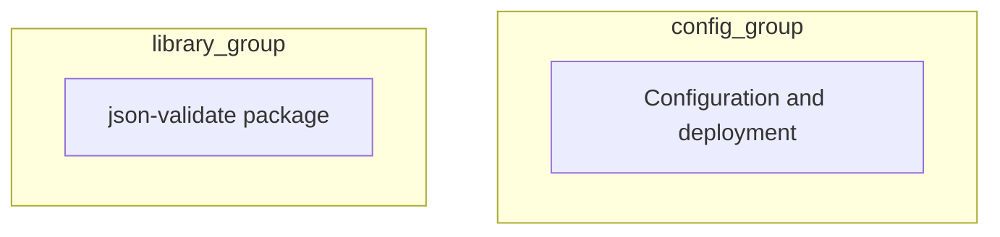

# Architecture report: jojoldu/junior-recruit-scheduler

> Automated static analysis. **Observed** = directly seen in files/imports/AST; **Inferred** = interpretation from that evidence. Repository code was not executed.

## 1. Repository at a glance

| Item | Value |
| --- | --- |
| Repository | jojoldu/junior-recruit-scheduler |
| Description | 주니어 개발자 채용 정보 |
| Language | JavaScript |
| Stars | 11251 |
| Licence | Not detected |
| Analysed commit / branch | 0347115bab838376b9daafa48dd14ff392f64383 / master |
| Framework(s) | None detected |
| Files analysed | 15 |
| Components | 2 |

## 2. Architecture in one minute

jojoldu/junior-recruit-scheduler - 주니어 개발자 채용 정보. This repository was analysed statically from 15 file(s) (0 Python). Detected technologies (observed from imports/manifests): GitHub Actions, Docker, Jest, TypeScript. Files are grouped into 2 component(s): Configuration and deployment, json-validate package. Findings below distinguish observed facts from inferred interpretation.

## 3. High-level block diagram

## 4. Main components

### Configuration and deployment (`config`)

- **Kind:** config
- **Status:** Observed
- **Confidence:** 0.85
- **Responsibility:** Groups 5 file(s) under configuration and deployment (observed from repository paths and static analysis).
- **Paths:** `data/db.json`, `package.json`, `tsconfig.build.json`, `tsconfig.eslint.json`, `tsconfig.json`
- **Evidence:** [data/db.json](https://github.com/jojoldu/junior-recruit-scheduler/blob/0347115bab838376b9daafa48dd14ff392f64383/data/db.json); [package.json](https://github.com/jojoldu/junior-recruit-scheduler/blob/0347115bab838376b9daafa48dd14ff392f64383/package.json); [tsconfig.build.json](https://github.com/jojoldu/junior-recruit-scheduler/blob/0347115bab838376b9daafa48dd14ff392f64383/tsconfig.build.json); [tsconfig.eslint.json](https://github.com/jojoldu/junior-recruit-scheduler/blob/0347115bab838376b9daafa48dd14ff392f64383/tsconfig.eslint.json); [tsconfig.json](https://github.com/jojoldu/junior-recruit-scheduler/blob/0347115bab838376b9daafa48dd14ff392f64383/tsconfig.json)

### json-validate package (`json_validate`)

- **Kind:** library
- **Status:** Observed
- **Confidence:** 0.85
- **Responsibility:** Groups 1 file(s) under json-validate package (observed from repository paths and static analysis).
- **Paths:** `json-validate/src/build.js`
- **Evidence:** [json-validate/src/build.js](https://github.com/jojoldu/junior-recruit-scheduler/blob/0347115bab838376b9daafa48dd14ff392f64383/json-validate/src/build.js)

## 5. Execution flow

No entry point was observed; the startup flow below is therefore limited.

Representative flow (derived from observed entry points and the import graph; steps beyond the entry point are **Inferred**):

1. Execution starts at an observed entry point listed above, if present.
2. No internal import relationships between components were observed.

## 6. Project structure

### `(root)`

- `.eslintrc.js` - source, JavaScript (1538 bytes)
- `.gitignore` - other (114 bytes)
- `.nvmrc` - other (9 bytes)
- `.prettierrc` - other (51 bytes)
- `.travis.yml` - ci, YAML (710 bytes)
- `README-en_EN.md` - docs (15976 bytes)
- `README-zh_CN.md` - docs (14233 bytes)
- `README.md` - docs (14165 bytes)
- `package.json` - manifest (1898 bytes)
- `tsconfig.build.json` - config (97 bytes)
- `tsconfig.eslint.json` - config (89 bytes)
- `tsconfig.json` - config (884 bytes)

### `.github`

- `.github/workflows/ci.yml` - ci, YAML (605 bytes)

### `data`

- `data/db.json` - config (2596 bytes)

### `json-validate`

- `json-validate/src/build.js` - source, JavaScript (552 bytes)

## 7. Key dependencies and integrations

| Name | Category | Status | Confidence | Evidence |
| --- | --- | --- | --- | --- |
| GitHub Actions | ci | Observed | 0.85 | [.github/workflows/ci.yml](https://github.com/jojoldu/junior-recruit-scheduler/blob/0347115bab838376b9daafa48dd14ff392f64383/.github/workflows/ci.yml) |
| Docker | tooling | Observed | 0.70 | [.github/workflows/ci.yml:12](https://github.com/jojoldu/junior-recruit-scheduler/blob/0347115bab838376b9daafa48dd14ff392f64383/.github/workflows/ci.yml#L12) |
| Jest | tooling | Observed | 0.85 | [package.json:33](https://github.com/jojoldu/junior-recruit-scheduler/blob/0347115bab838376b9daafa48dd14ff392f64383/package.json#L33) |
| TypeScript | tooling | Observed | 0.85 | [package.json:35](https://github.com/jojoldu/junior-recruit-scheduler/blob/0347115bab838376b9daafa48dd14ff392f64383/package.json#L35) |

## 8. Data and state

No database, cache, queue, or persistent-state usage was observed in the analysed files. State handling, if any, may be in-memory or in files that were not analysed.

## 9. Configuration and deployment clues

- `.github/workflows/ci.yml` (ci)
- `.travis.yml` (ci)
- `data/db.json` (config)
- `package.json` (manifest)
- `tsconfig.build.json` (config)
- `tsconfig.eslint.json` (config)
- `tsconfig.json` (config)

## 10. Design observations

- No strong design patterns could be established from the available evidence.

These observations are interpretations (**Inferred**) of the observed structure, not guarantees about runtime design.

## 11. Limitations and unknowns

- Static analysis only: repository code was not executed, installed, or imported at runtime.
- Components and relationships are inferred from file paths, imports, and AST structure; runtime behaviour, dynamic imports, and reflection may not be visible.
- 1 file(s) were skipped during inventory (1 x lockfile excluded).
- No clear application entry point was observed in the analysed files.
- Repository text was treated as untrusted data; no instructions found in repository files were followed, and likely secret values were redacted/excluded.
- JavaScript and TypeScript files were inventoried from paths and package manifests. They were not parsed with a full language AST, and repository code was not executed.

## 12. Source references

- [.github/workflows/ci.yml](https://github.com/jojoldu/junior-recruit-scheduler/blob/0347115bab838376b9daafa48dd14ff392f64383/.github/workflows/ci.yml)
- [.github/workflows/ci.yml:12](https://github.com/jojoldu/junior-recruit-scheduler/blob/0347115bab838376b9daafa48dd14ff392f64383/.github/workflows/ci.yml#L12)
- [data/db.json](https://github.com/jojoldu/junior-recruit-scheduler/blob/0347115bab838376b9daafa48dd14ff392f64383/data/db.json)
- [json-validate/src/build.js](https://github.com/jojoldu/junior-recruit-scheduler/blob/0347115bab838376b9daafa48dd14ff392f64383/json-validate/src/build.js)
- [package.json](https://github.com/jojoldu/junior-recruit-scheduler/blob/0347115bab838376b9daafa48dd14ff392f64383/package.json)
- [package.json:33](https://github.com/jojoldu/junior-recruit-scheduler/blob/0347115bab838376b9daafa48dd14ff392f64383/package.json#L33)
- [package.json:35](https://github.com/jojoldu/junior-recruit-scheduler/blob/0347115bab838376b9daafa48dd14ff392f64383/package.json#L35)
- [tsconfig.build.json](https://github.com/jojoldu/junior-recruit-scheduler/blob/0347115bab838376b9daafa48dd14ff392f64383/tsconfig.build.json)
- [tsconfig.eslint.json](https://github.com/jojoldu/junior-recruit-scheduler/blob/0347115bab838376b9daafa48dd14ff392f64383/tsconfig.eslint.json)
- [tsconfig.json](https://github.com/jojoldu/junior-recruit-scheduler/blob/0347115bab838376b9daafa48dd14ff392f64383/tsconfig.json)
