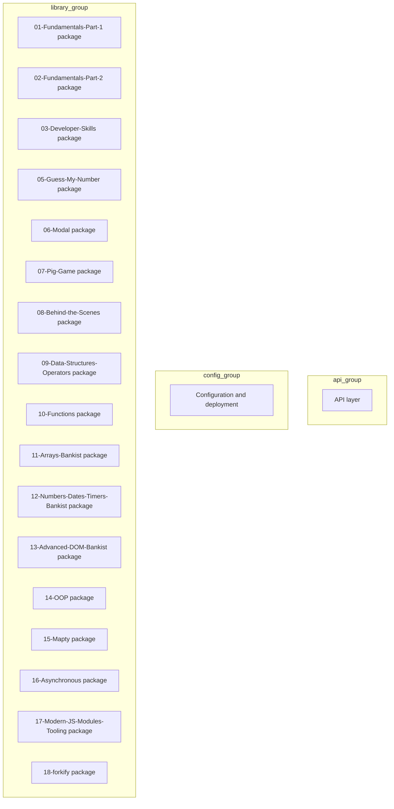

# Architecture report: jonasschmedtmann/complete-javascript-course

> Automated static analysis. **Observed** = directly seen in files/imports/AST; **Inferred** = interpretation from that evidence. Repository code was not executed.

## 1. Repository at a glance

| Item | Value |
| --- | --- |
| Repository | jonasschmedtmann/complete-javascript-course |
| Description | Starter files, final projects, and FAQ for my Complete JavaScript course |
| Language | JavaScript |
| Stars | 17286 |
| Licence | Not detected |
| Analysed commit / branch | 76b8b79b2994dd00298b2be105aa6bc721e40a22 / master |
| Framework(s) | None detected |
| Files analysed | 154 |
| Components | 19 |

## 2. Architecture in one minute

jonasschmedtmann/complete-javascript-course - Starter files, final projects, and FAQ for my Complete JavaScript course. This repository was analysed statically from 154 file(s) (0 Python). Detected technologies (observed from imports/manifests): no known frameworks/libraries. Files are grouped into 19 component(s): API layer, 01-Fundamentals-Part-1 package, 02-Fundamentals-Part-2 package, 03-Developer-Skills package, 05-Guess-My-Number package, 06-Modal package, 07-Pig-Game package, 08-Behind-the-Scenes package. Findings below distinguish observed facts from inferred interpretation.

## 3. High-level block diagram

## 4. Main components

### API layer (`api_layer`)

- **Kind:** api
- **Status:** Observed
- **Confidence:** 0.85
- **Responsibility:** Groups 8 file(s) under api layer (observed from repository paths and static analysis).
- **Paths:** `18-forkify/final/src/js/views/View.js`, `18-forkify/final/src/js/views/addRecipeView.js`, `18-forkify/final/src/js/views/bookmarksView.js`, `18-forkify/final/src/js/views/paginationView.js`, `18-forkify/final/src/js/views/previewView.js`, `18-forkify/final/src/js/views/recipeView.js`, `18-forkify/final/src/js/views/resultsView.js`, `18-forkify/final/src/js/views/searchView.js`
- **Evidence:** [18-forkify/final/src/js/views/View.js](https://github.com/jonasschmedtmann/complete-javascript-course/blob/76b8b79b2994dd00298b2be105aa6bc721e40a22/18-forkify/final/src/js/views/View.js); [18-forkify/final/src/js/views/addRecipeView.js](https://github.com/jonasschmedtmann/complete-javascript-course/blob/76b8b79b2994dd00298b2be105aa6bc721e40a22/18-forkify/final/src/js/views/addRecipeView.js); [18-forkify/final/src/js/views/bookmarksView.js](https://github.com/jonasschmedtmann/complete-javascript-course/blob/76b8b79b2994dd00298b2be105aa6bc721e40a22/18-forkify/final/src/js/views/bookmarksView.js); [18-forkify/final/src/js/views/paginationView.js](https://github.com/jonasschmedtmann/complete-javascript-course/blob/76b8b79b2994dd00298b2be105aa6bc721e40a22/18-forkify/final/src/js/views/paginationView.js); [18-forkify/final/src/js/views/previewView.js](https://github.com/jonasschmedtmann/complete-javascript-course/blob/76b8b79b2994dd00298b2be105aa6bc721e40a22/18-forkify/final/src/js/views/previewView.js); [18-forkify/final/src/js/views/recipeView.js](https://github.com/jonasschmedtmann/complete-javascript-course/blob/76b8b79b2994dd00298b2be105aa6bc721e40a22/18-forkify/final/src/js/views/recipeView.js); [18-forkify/final/src/js/views/resultsView.js](https://github.com/jonasschmedtmann/complete-javascript-course/blob/76b8b79b2994dd00298b2be105aa6bc721e40a22/18-forkify/final/src/js/views/resultsView.js); [18-forkify/final/src/js/views/searchView.js](https://github.com/jonasschmedtmann/complete-javascript-course/blob/76b8b79b2994dd00298b2be105aa6bc721e40a22/18-forkify/final/src/js/views/searchView.js)

### 01-Fundamentals-Part-1 package (`c_01_fundamentals_part_1`)

- **Kind:** library
- **Status:** Observed
- **Confidence:** 0.85
- **Responsibility:** Groups 1 file(s) under 01-fundamentals-part-1 package (observed from repository paths and static analysis).
- **Paths:** `01-Fundamentals-Part-1/final/script.js`
- **Evidence:** [01-Fundamentals-Part-1/final/script.js](https://github.com/jonasschmedtmann/complete-javascript-course/blob/76b8b79b2994dd00298b2be105aa6bc721e40a22/01-Fundamentals-Part-1/final/script.js)

### 02-Fundamentals-Part-2 package (`c_02_fundamentals_part_2`)

- **Kind:** library
- **Status:** Observed
- **Confidence:** 0.85
- **Responsibility:** Groups 2 file(s) under 02-fundamentals-part-2 package (observed from repository paths and static analysis).
- **Paths:** `02-Fundamentals-Part-2/final/script.js`, `02-Fundamentals-Part-2/starter/script.js`
- **Evidence:** [02-Fundamentals-Part-2/final/script.js](https://github.com/jonasschmedtmann/complete-javascript-course/blob/76b8b79b2994dd00298b2be105aa6bc721e40a22/02-Fundamentals-Part-2/final/script.js); [02-Fundamentals-Part-2/starter/script.js](https://github.com/jonasschmedtmann/complete-javascript-course/blob/76b8b79b2994dd00298b2be105aa6bc721e40a22/02-Fundamentals-Part-2/starter/script.js)

### 03-Developer-Skills package (`c_03_developer_skills`)

- **Kind:** library
- **Status:** Observed
- **Confidence:** 0.85
- **Responsibility:** Groups 2 file(s) under 03-developer-skills package (observed from repository paths and static analysis).
- **Paths:** `03-Developer-Skills/final/script.js`, `03-Developer-Skills/starter/script.js`
- **Evidence:** [03-Developer-Skills/final/script.js](https://github.com/jonasschmedtmann/complete-javascript-course/blob/76b8b79b2994dd00298b2be105aa6bc721e40a22/03-Developer-Skills/final/script.js); [03-Developer-Skills/starter/script.js](https://github.com/jonasschmedtmann/complete-javascript-course/blob/76b8b79b2994dd00298b2be105aa6bc721e40a22/03-Developer-Skills/starter/script.js)

### 05-Guess-My-Number package (`c_05_guess_my_number`)

- **Kind:** library
- **Status:** Observed
- **Confidence:** 0.85
- **Responsibility:** Groups 2 file(s) under 05-guess-my-number package (observed from repository paths and static analysis).
- **Paths:** `05-Guess-My-Number/final/script.js`, `05-Guess-My-Number/starter/script.js`
- **Evidence:** [05-Guess-My-Number/final/script.js](https://github.com/jonasschmedtmann/complete-javascript-course/blob/76b8b79b2994dd00298b2be105aa6bc721e40a22/05-Guess-My-Number/final/script.js); [05-Guess-My-Number/starter/script.js](https://github.com/jonasschmedtmann/complete-javascript-course/blob/76b8b79b2994dd00298b2be105aa6bc721e40a22/05-Guess-My-Number/starter/script.js)

### 06-Modal package (`c_06_modal`)

- **Kind:** library
- **Status:** Observed
- **Confidence:** 0.85
- **Responsibility:** Groups 2 file(s) under 06-modal package (observed from repository paths and static analysis).
- **Paths:** `06-Modal/final/script.js`, `06-Modal/starter/script.js`
- **Evidence:** [06-Modal/final/script.js](https://github.com/jonasschmedtmann/complete-javascript-course/blob/76b8b79b2994dd00298b2be105aa6bc721e40a22/06-Modal/final/script.js); [06-Modal/starter/script.js](https://github.com/jonasschmedtmann/complete-javascript-course/blob/76b8b79b2994dd00298b2be105aa6bc721e40a22/06-Modal/starter/script.js)

### 07-Pig-Game package (`c_07_pig_game`)

- **Kind:** library
- **Status:** Observed
- **Confidence:** 0.85
- **Responsibility:** Groups 2 file(s) under 07-pig-game package (observed from repository paths and static analysis).
- **Paths:** `07-Pig-Game/final/script.js`, `07-Pig-Game/starter/script.js`
- **Evidence:** [07-Pig-Game/final/script.js](https://github.com/jonasschmedtmann/complete-javascript-course/blob/76b8b79b2994dd00298b2be105aa6bc721e40a22/07-Pig-Game/final/script.js); [07-Pig-Game/starter/script.js](https://github.com/jonasschmedtmann/complete-javascript-course/blob/76b8b79b2994dd00298b2be105aa6bc721e40a22/07-Pig-Game/starter/script.js)

### 08-Behind-the-Scenes package (`c_08_behind_the_scenes`)

- **Kind:** library
- **Status:** Observed
- **Confidence:** 0.85
- **Responsibility:** Groups 2 file(s) under 08-behind-the-scenes package (observed from repository paths and static analysis).
- **Paths:** `08-Behind-the-Scenes/final/script.js`, `08-Behind-the-Scenes/starter/script.js`
- **Evidence:** [08-Behind-the-Scenes/final/script.js](https://github.com/jonasschmedtmann/complete-javascript-course/blob/76b8b79b2994dd00298b2be105aa6bc721e40a22/08-Behind-the-Scenes/final/script.js); [08-Behind-the-Scenes/starter/script.js](https://github.com/jonasschmedtmann/complete-javascript-course/blob/76b8b79b2994dd00298b2be105aa6bc721e40a22/08-Behind-the-Scenes/starter/script.js)

### 09-Data-Structures-Operators package (`c_09_data_structures_operators`)

- **Kind:** library
- **Status:** Observed
- **Confidence:** 0.85
- **Responsibility:** Groups 2 file(s) under 09-data-structures-operators package (observed from repository paths and static analysis).
- **Paths:** `09-Data-Structures-Operators/final/script.js`, `09-Data-Structures-Operators/starter/script.js`
- **Evidence:** [09-Data-Structures-Operators/final/script.js](https://github.com/jonasschmedtmann/complete-javascript-course/blob/76b8b79b2994dd00298b2be105aa6bc721e40a22/09-Data-Structures-Operators/final/script.js); [09-Data-Structures-Operators/starter/script.js](https://github.com/jonasschmedtmann/complete-javascript-course/blob/76b8b79b2994dd00298b2be105aa6bc721e40a22/09-Data-Structures-Operators/starter/script.js)

### 10-Functions package (`c_10_functions`)

- **Kind:** library
- **Status:** Observed
- **Confidence:** 0.85
- **Responsibility:** Groups 2 file(s) under 10-functions package (observed from repository paths and static analysis).
- **Paths:** `10-Functions/final/script.js`, `10-Functions/starter/script.js`
- **Evidence:** [10-Functions/final/script.js](https://github.com/jonasschmedtmann/complete-javascript-course/blob/76b8b79b2994dd00298b2be105aa6bc721e40a22/10-Functions/final/script.js); [10-Functions/starter/script.js](https://github.com/jonasschmedtmann/complete-javascript-course/blob/76b8b79b2994dd00298b2be105aa6bc721e40a22/10-Functions/starter/script.js)

### 11-Arrays-Bankist package (`c_11_arrays_bankist`)

- **Kind:** library
- **Status:** Observed
- **Confidence:** 0.85
- **Responsibility:** Groups 2 file(s) under 11-arrays-bankist package (observed from repository paths and static analysis).
- **Paths:** `11-Arrays-Bankist/final/script.js`, `11-Arrays-Bankist/starter/script.js`
- **Evidence:** [11-Arrays-Bankist/final/script.js](https://github.com/jonasschmedtmann/complete-javascript-course/blob/76b8b79b2994dd00298b2be105aa6bc721e40a22/11-Arrays-Bankist/final/script.js); [11-Arrays-Bankist/starter/script.js](https://github.com/jonasschmedtmann/complete-javascript-course/blob/76b8b79b2994dd00298b2be105aa6bc721e40a22/11-Arrays-Bankist/starter/script.js)

### 12-Numbers-Dates-Timers-Bankist package (`c_12_numbers_dates_timers_bankist`)

- **Kind:** library
- **Status:** Observed
- **Confidence:** 0.85
- **Responsibility:** Groups 2 file(s) under 12-numbers-dates-timers-bankist package (observed from repository paths and static analysis).
- **Paths:** `12-Numbers-Dates-Timers-Bankist/final/script.js`, `12-Numbers-Dates-Timers-Bankist/starter/script.js`
- **Evidence:** [12-Numbers-Dates-Timers-Bankist/final/script.js](https://github.com/jonasschmedtmann/complete-javascript-course/blob/76b8b79b2994dd00298b2be105aa6bc721e40a22/12-Numbers-Dates-Timers-Bankist/final/script.js); [12-Numbers-Dates-Timers-Bankist/starter/script.js](https://github.com/jonasschmedtmann/complete-javascript-course/blob/76b8b79b2994dd00298b2be105aa6bc721e40a22/12-Numbers-Dates-Timers-Bankist/starter/script.js)

### 13-Advanced-DOM-Bankist package (`c_13_advanced_dom_bankist`)

- **Kind:** library
- **Status:** Observed
- **Confidence:** 0.85
- **Responsibility:** Groups 2 file(s) under 13-advanced-dom-bankist package (observed from repository paths and static analysis).
- **Paths:** `13-Advanced-DOM-Bankist/final/script.js`, `13-Advanced-DOM-Bankist/starter/script.js`
- **Evidence:** [13-Advanced-DOM-Bankist/final/script.js](https://github.com/jonasschmedtmann/complete-javascript-course/blob/76b8b79b2994dd00298b2be105aa6bc721e40a22/13-Advanced-DOM-Bankist/final/script.js); [13-Advanced-DOM-Bankist/starter/script.js](https://github.com/jonasschmedtmann/complete-javascript-course/blob/76b8b79b2994dd00298b2be105aa6bc721e40a22/13-Advanced-DOM-Bankist/starter/script.js)

### 14-OOP package (`c_14_oop`)

- **Kind:** library
- **Status:** Observed
- **Confidence:** 0.85
- **Responsibility:** Groups 2 file(s) under 14-oop package (observed from repository paths and static analysis).
- **Paths:** `14-OOP/final/script.js`, `14-OOP/starter/script.js`
- **Evidence:** [14-OOP/final/script.js](https://github.com/jonasschmedtmann/complete-javascript-course/blob/76b8b79b2994dd00298b2be105aa6bc721e40a22/14-OOP/final/script.js); [14-OOP/starter/script.js](https://github.com/jonasschmedtmann/complete-javascript-course/blob/76b8b79b2994dd00298b2be105aa6bc721e40a22/14-OOP/starter/script.js)

### 15-Mapty package (`c_15_mapty`)

- **Kind:** library
- **Status:** Observed
- **Confidence:** 0.85
- **Responsibility:** Groups 3 file(s) under 15-mapty package (observed from repository paths and static analysis).
- **Paths:** `15-Mapty/final/other.js`, `15-Mapty/final/script.js`, `15-Mapty/starter/script.js`
- **Evidence:** [15-Mapty/final/other.js](https://github.com/jonasschmedtmann/complete-javascript-course/blob/76b8b79b2994dd00298b2be105aa6bc721e40a22/15-Mapty/final/other.js); [15-Mapty/final/script.js](https://github.com/jonasschmedtmann/complete-javascript-course/blob/76b8b79b2994dd00298b2be105aa6bc721e40a22/15-Mapty/final/script.js); [15-Mapty/starter/script.js](https://github.com/jonasschmedtmann/complete-javascript-course/blob/76b8b79b2994dd00298b2be105aa6bc721e40a22/15-Mapty/starter/script.js)

### 16-Asynchronous package (`c_16_asynchronous`)

- **Kind:** library
- **Status:** Observed
- **Confidence:** 0.85
- **Responsibility:** Groups 2 file(s) under 16-asynchronous package (observed from repository paths and static analysis).
- **Paths:** `16-Asynchronous/final/script.js`, `16-Asynchronous/starter/script.js`
- **Evidence:** [16-Asynchronous/final/script.js](https://github.com/jonasschmedtmann/complete-javascript-course/blob/76b8b79b2994dd00298b2be105aa6bc721e40a22/16-Asynchronous/final/script.js); [16-Asynchronous/starter/script.js](https://github.com/jonasschmedtmann/complete-javascript-course/blob/76b8b79b2994dd00298b2be105aa6bc721e40a22/16-Asynchronous/starter/script.js)

### 17-Modern-JS-Modules-Tooling package (`c_17_modern_js_modules_tooling`)

- **Kind:** library
- **Status:** Observed
- **Confidence:** 0.85
- **Responsibility:** Groups 5 file(s) under 17-modern-js-modules-tooling package (observed from repository paths and static analysis).
- **Paths:** `17-Modern-JS-Modules-Tooling/final/clean.js`, `17-Modern-JS-Modules-Tooling/final/script.js`, `17-Modern-JS-Modules-Tooling/final/shoppingCart.js`, `17-Modern-JS-Modules-Tooling/starter/clean.js`, `17-Modern-JS-Modules-Tooling/starter/script.js`
- **Evidence:** [17-Modern-JS-Modules-Tooling/final/clean.js](https://github.com/jonasschmedtmann/complete-javascript-course/blob/76b8b79b2994dd00298b2be105aa6bc721e40a22/17-Modern-JS-Modules-Tooling/final/clean.js); [17-Modern-JS-Modules-Tooling/final/script.js](https://github.com/jonasschmedtmann/complete-javascript-course/blob/76b8b79b2994dd00298b2be105aa6bc721e40a22/17-Modern-JS-Modules-Tooling/final/script.js); [17-Modern-JS-Modules-Tooling/final/shoppingCart.js](https://github.com/jonasschmedtmann/complete-javascript-course/blob/76b8b79b2994dd00298b2be105aa6bc721e40a22/17-Modern-JS-Modules-Tooling/final/shoppingCart.js); [17-Modern-JS-Modules-Tooling/starter/clean.js](https://github.com/jonasschmedtmann/complete-javascript-course/blob/76b8b79b2994dd00298b2be105aa6bc721e40a22/17-Modern-JS-Modules-Tooling/starter/clean.js); [17-Modern-JS-Modules-Tooling/starter/script.js](https://github.com/jonasschmedtmann/complete-javascript-course/blob/76b8b79b2994dd00298b2be105aa6bc721e40a22/17-Modern-JS-Modules-Tooling/starter/script.js)

### 18-forkify package (`c_18_forkify`)

- **Kind:** library
- **Status:** Observed
- **Confidence:** 0.85
- **Responsibility:** Groups 5 file(s) under 18-forkify package (observed from repository paths and static analysis).
- **Paths:** `18-forkify/final/src/js/config.js`, `18-forkify/final/src/js/controller.js`, `18-forkify/final/src/js/helpers.js`, `18-forkify/final/src/js/model.js`, `18-forkify/starter/src/js/controller.js`
- **Evidence:** [18-forkify/final/src/js/config.js](https://github.com/jonasschmedtmann/complete-javascript-course/blob/76b8b79b2994dd00298b2be105aa6bc721e40a22/18-forkify/final/src/js/config.js); [18-forkify/final/src/js/controller.js](https://github.com/jonasschmedtmann/complete-javascript-course/blob/76b8b79b2994dd00298b2be105aa6bc721e40a22/18-forkify/final/src/js/controller.js); [18-forkify/final/src/js/helpers.js](https://github.com/jonasschmedtmann/complete-javascript-course/blob/76b8b79b2994dd00298b2be105aa6bc721e40a22/18-forkify/final/src/js/helpers.js); [18-forkify/final/src/js/model.js](https://github.com/jonasschmedtmann/complete-javascript-course/blob/76b8b79b2994dd00298b2be105aa6bc721e40a22/18-forkify/final/src/js/model.js); [18-forkify/starter/src/js/controller.js](https://github.com/jonasschmedtmann/complete-javascript-course/blob/76b8b79b2994dd00298b2be105aa6bc721e40a22/18-forkify/starter/src/js/controller.js)

### Configuration and deployment (`config`)

- **Kind:** config
- **Status:** Observed
- **Confidence:** 0.85
- **Responsibility:** Groups 2 file(s) under configuration and deployment (observed from repository paths and static analysis).
- **Paths:** `17-Modern-JS-Modules-Tooling/final/package.json`, `18-forkify/final/package.json`
- **Evidence:** [17-Modern-JS-Modules-Tooling/final/package.json](https://github.com/jonasschmedtmann/complete-javascript-course/blob/76b8b79b2994dd00298b2be105aa6bc721e40a22/17-Modern-JS-Modules-Tooling/final/package.json); [18-forkify/final/package.json](https://github.com/jonasschmedtmann/complete-javascript-course/blob/76b8b79b2994dd00298b2be105aa6bc721e40a22/18-forkify/final/package.json)

## 5. Execution flow

**Observed** entry point(s):

- [17-Modern-JS-Modules-Tooling/final/script.js](https://github.com/jonasschmedtmann/complete-javascript-course/blob/76b8b79b2994dd00298b2be105aa6bc721e40a22/17-Modern-JS-Modules-Tooling/final/script.js)

Representative flow (derived from observed entry points and the import graph; steps beyond the entry point are **Inferred**):

1. Execution starts at an observed entry point listed above, if present.
2. No internal import relationships between components were observed.

## 6. Project structure

### `(root)`

- `README.md` - docs (5024 bytes)

### `01-Fundamentals-Part-1`

- `01-Fundamentals-Part-1/final/index.html` - other (772 bytes)
- `01-Fundamentals-Part-1/final/script.js` - source, JavaScript (12715 bytes)
- `01-Fundamentals-Part-1/starter/index.html` - other (733 bytes)

### `02-Fundamentals-Part-2`

- `02-Fundamentals-Part-2/final/index.html` - other (771 bytes)
- `02-Fundamentals-Part-2/final/script.js` - source, JavaScript (16874 bytes)
- `02-Fundamentals-Part-2/starter/index.html` - other (771 bytes)
- `02-Fundamentals-Part-2/starter/script.js` - source, JavaScript (0 bytes)

### `03-Developer-Skills`

- `03-Developer-Skills/final/.prettierrc` - other (52 bytes)
- `03-Developer-Skills/final/index.html` - other (765 bytes)
- `03-Developer-Skills/final/script.js` - source, JavaScript (6293 bytes)
- `03-Developer-Skills/starter/index.html` - other (765 bytes)
- `03-Developer-Skills/starter/script.js` - source, JavaScript (76 bytes)

### `04-HTML-CSS`

- `04-HTML-CSS/final/index.html` - other (1011 bytes)
- `04-HTML-CSS/final/style.css` - other (630 bytes)

### `05-Guess-My-Number`

- `05-Guess-My-Number/final/.prettierrc` - other (52 bytes)
- `05-Guess-My-Number/final/index.html` - other (1001 bytes)
- `05-Guess-My-Number/final/script.js` - source, JavaScript (3905 bytes)
- `05-Guess-My-Number/final/style.css` - other (1706 bytes)
- `05-Guess-My-Number/starter/.prettierrc` - other (52 bytes)
- `05-Guess-My-Number/starter/index.html` - other (1001 bytes)
- `05-Guess-My-Number/starter/script.js` - source, JavaScript (14 bytes)
- `05-Guess-My-Number/starter/style.css` - other (1706 bytes)

### `06-Modal`

- `06-Modal/final/.prettierrc` - other (52 bytes)
- `06-Modal/final/index.html` - other (1218 bytes)
- `06-Modal/final/script.js` - source, JavaScript (834 bytes)
- `06-Modal/final/style.css` - other (1304 bytes)
- `06-Modal/starter/.prettierrc` - other (52 bytes)
- `06-Modal/starter/index.html` - other (1218 bytes)
- `06-Modal/starter/script.js` - source, JavaScript (14 bytes)
- `06-Modal/starter/style.css` - other (1304 bytes)

### `07-Pig-Game`

- `07-Pig-Game/final/.prettierrc` - other (52 bytes)
- `07-Pig-Game/final/index.html` - other (1243 bytes)
- `07-Pig-Game/final/script.js` - source, JavaScript (2785 bytes)
- `07-Pig-Game/final/style.css` - other (2773 bytes)
- `07-Pig-Game/starter/.prettierrc` - other (52 bytes)
- `07-Pig-Game/starter/index.html` - other (1243 bytes)
- `07-Pig-Game/starter/script.js` - source, JavaScript (14 bytes)
- `07-Pig-Game/starter/style.css` - other (2743 bytes)

### `08-Behind-the-Scenes`

- `08-Behind-the-Scenes/final/.prettierrc` - other (52 bytes)
- `08-Behind-the-Scenes/final/index.html` - other (779 bytes)
- `08-Behind-the-Scenes/final/script.js` - source, JavaScript (4283 bytes)
- `08-Behind-the-Scenes/starter/.prettierrc` - other (52 bytes)
- `08-Behind-the-Scenes/starter/index.html` - other (779 bytes)
- `08-Behind-the-Scenes/starter/script.js` - source, JavaScript (14 bytes)

### `09-Data-Structures-Operators`

- `09-Data-Structures-Operators/final/.prettierrc` - other (52 bytes)
- `09-Data-Structures-Operators/final/index.html` - other (933 bytes)
- `09-Data-Structures-Operators/final/script.js` - source, JavaScript (25763 bytes)
- `09-Data-Structures-Operators/starter/.prettierrc` - other (52 bytes)
- `09-Data-Structures-Operators/starter/index.html` - other (933 bytes)
- `09-Data-Structures-Operators/starter/script.js` - source, JavaScript (1007 bytes)

### `10-Functions`

- `10-Functions/final/.prettierrc` - other (52 bytes)
- `10-Functions/final/index.html` - other (1080 bytes)
- `10-Functions/final/script.js` - source, JavaScript (10013 bytes)
- `10-Functions/starter/.prettierrc` - other (52 bytes)
- `10-Functions/starter/index.html` - other (1080 bytes)
- `10-Functions/starter/script.js` - source, JavaScript (14 bytes)

### `11-Arrays-Bankist`

- `11-Arrays-Bankist/final/.prettierrc` - other (52 bytes)
- `11-Arrays-Bankist/final/index.html` - other (4213 bytes)
- `11-Arrays-Bankist/final/script.js` - source, JavaScript (28671 bytes)
- `11-Arrays-Bankist/final/style.css` - other (4682 bytes)
- `11-Arrays-Bankist/starter/.prettierrc` - other (52 bytes)
- `11-Arrays-Bankist/starter/index.html` - other (4213 bytes)
- `11-Arrays-Bankist/starter/script.js` - source, JavaScript (2483 bytes)
- `11-Arrays-Bankist/starter/style.css` - other (4682 bytes)

### `12-Numbers-Dates-Timers-Bankist`

- `12-Numbers-Dates-Timers-Bankist/final/.prettierrc` - other (52 bytes)
- `12-Numbers-Dates-Timers-Bankist/final/index.html` - other (4213 bytes)
- `12-Numbers-Dates-Timers-Bankist/final/script.js` - source, JavaScript (16503 bytes)
- `12-Numbers-Dates-Timers-Bankist/final/style.css` - other (4682 bytes)
- `12-Numbers-Dates-Timers-Bankist/starter/.prettierrc` - other (52 bytes)
- `12-Numbers-Dates-Timers-Bankist/starter/index.html` - other (4213 bytes)
- `12-Numbers-Dates-Timers-Bankist/starter/script.js` - source, JavaScript (6973 bytes)
- `12-Numbers-Dates-Timers-Bankist/starter/style.css` - other (4682 bytes)

### `13-Advanced-DOM-Bankist`

- `13-Advanced-DOM-Bankist/final/.prettierrc` - other (52 bytes)
- `13-Advanced-DOM-Bankist/final/img/icons.svg` - other (144738 bytes)
- `13-Advanced-DOM-Bankist/final/index.html` - other (12890 bytes)
- `13-Advanced-DOM-Bankist/final/script.js` - source, JavaScript (13760 bytes)
- `13-Advanced-DOM-Bankist/final/style.css` - other (10905 bytes)
- `13-Advanced-DOM-Bankist/starter/.prettierrc` - other (52 bytes)
- `13-Advanced-DOM-Bankist/starter/img/icons.svg` - other (144738 bytes)
- `13-Advanced-DOM-Bankist/starter/index.html` - other (13057 bytes)
- `13-Advanced-DOM-Bankist/starter/script.js` - source, JavaScript (875 bytes)
- `13-Advanced-DOM-Bankist/starter/style.css` - other (10905 bytes)

### `14-OOP`

- `14-OOP/final/.prettierrc` - other (52 bytes)
- `14-OOP/final/index.html` - other (807 bytes)
- `14-OOP/final/script.js` - source, JavaScript (15011 bytes)
- `14-OOP/starter/.prettierrc` - other (52 bytes)
- `14-OOP/starter/index.html` - other (807 bytes)
- `14-OOP/starter/script.js` - source, JavaScript (14 bytes)

### `15-Mapty`

- `15-Mapty/final/.prettierrc` - other (52 bytes)
- `15-Mapty/final/index.html` - other (4904 bytes)
- `15-Mapty/final/other.js` - source, JavaScript (48 bytes)
- `15-Mapty/final/script.js` - source, JavaScript (8958 bytes)
- `15-Mapty/final/style.css` - other (3659 bytes)
- `15-Mapty/starter/.prettierrc` - other (52 bytes)
- `15-Mapty/starter/index.html` - other (4379 bytes)
- `15-Mapty/starter/script.js` - source, JavaScript (635 bytes)
- `15-Mapty/starter/style.css` - other (3659 bytes)

### `16-Asynchronous`

- `16-Asynchronous/final/.prettierrc` - other (52 bytes)
- `16-Asynchronous/final/index.html` - other (1036 bytes)
- `16-Asynchronous/final/script.js` - source, JavaScript (22499 bytes)
- `16-Asynchronous/final/style.css` - other (1925 bytes)
- `16-Asynchronous/starter/.prettierrc` - other (52 bytes)
- `16-Asynchronous/starter/index.html` - other (1036 bytes)
- `16-Asynchronous/starter/script.js` - source, JavaScript (456 bytes)
- `16-Asynchronous/starter/style.css` - other (1925 bytes)

### `17-Modern-JS-Modules-Tooling`

- `17-Modern-JS-Modules-Tooling/final/.prettierrc` - other (52 bytes)
- `17-Modern-JS-Modules-Tooling/final/clean.js` - source, JavaScript (2533 bytes)
- `17-Modern-JS-Modules-Tooling/final/index.html` - other (929 bytes)
- `17-Modern-JS-Modules-Tooling/final/package.json` - manifest (438 bytes)
- `17-Modern-JS-Modules-Tooling/final/script.js` - source, JavaScript (3390 bytes)
- `17-Modern-JS-Modules-Tooling/final/shoppingCart.js` - source, JavaScript (651 bytes)
- `17-Modern-JS-Modules-Tooling/starter/.prettierrc` - other (52 bytes)
- `17-Modern-JS-Modules-Tooling/starter/clean.js` - source, JavaScript (1546 bytes)
- `17-Modern-JS-Modules-Tooling/starter/index.html` - other (809 bytes)
- `17-Modern-JS-Modules-Tooling/starter/script.js` - source, JavaScript (0 bytes)

### `18-forkify`

- `18-forkify/final/.gitignore` - other (42 bytes)
- `18-forkify/final/.prettierrc` - other (52 bytes)
- `18-forkify/final/README.md` - docs (66 bytes)
- `18-forkify/final/index.html` - other (11268 bytes)
- `18-forkify/final/package.json` - manifest (472 bytes)
- `18-forkify/final/src/img/icons.svg` - other (13266 bytes)
- `18-forkify/final/src/js/config.js` - source, JavaScript (203 bytes)
- `18-forkify/final/src/js/controller.js` - source, JavaScript (3566 bytes)
- `18-forkify/final/src/js/helpers.js` - source, JavaScript (1643 bytes)
- `18-forkify/final/src/js/model.js` - source, JavaScript (4262 bytes)
- `18-forkify/final/src/js/views/View.js` - source, JavaScript (2734 bytes)
- `18-forkify/final/src/js/views/addRecipeView.js` - source, JavaScript (1283 bytes)
- `18-forkify/final/src/js/views/bookmarksView.js` - source, JavaScript (570 bytes)
- `18-forkify/final/src/js/views/paginationView.js` - source, JavaScript (2094 bytes)
- `18-forkify/final/src/js/views/previewView.js` - source, JavaScript (1006 bytes)
- `18-forkify/final/src/js/views/recipeView.js` - source, JavaScript (4343 bytes)
- `18-forkify/final/src/js/views/resultsView.js` - source, JavaScript (456 bytes)
- `18-forkify/final/src/js/views/searchView.js` - source, JavaScript (471 bytes)
- `18-forkify/final/src/sass/_base.scss` - other (1489 bytes)
- `18-forkify/final/src/sass/_components.scss` - other (2990 bytes)
- `18-forkify/final/src/sass/_header.scss` - other (2307 bytes)
- `18-forkify/final/src/sass/_preview.scss` - other (1922 bytes)
- `18-forkify/final/src/sass/_recipe.scss` - other (3133 bytes)
- `18-forkify/final/src/sass/_searchResults.scss` - other (555 bytes)
- `18-forkify/final/src/sass/_upload.scss` - other (1716 bytes)
- `18-forkify/final/src/sass/main.scss` - other (136 bytes)
- `18-forkify/starter/.prettierrc` - other (52 bytes)
- `18-forkify/starter/index.html` - other (11263 bytes)
- `18-forkify/starter/src/img/icons.svg` - other (13266 bytes)
- `18-forkify/starter/src/js/controller.js` - source, JavaScript (397 bytes)
- `18-forkify/starter/src/sass/_base.scss` - other (1489 bytes)
- `18-forkify/starter/src/sass/_components.scss` - other (2990 bytes)
- `18-forkify/starter/src/sass/_header.scss` - other (2307 bytes)
- `18-forkify/starter/src/sass/_preview.scss` - other (1922 bytes)
- `18-forkify/starter/src/sass/_recipe.scss` - other (3133 bytes)
- `18-forkify/starter/src/sass/_searchResults.scss` - other (555 bytes)
- `18-forkify/starter/src/sass/_upload.scss` - other (1716 bytes)
- `18-forkify/starter/src/sass/main.scss` - other (136 bytes)

## 7. Key dependencies and integrations

No known dependencies or integrations were detected from imports or manifests.

## 8. Data and state

No database, cache, queue, or persistent-state usage was observed in the analysed files. State handling, if any, may be in-memory or in files that were not analysed.

## 9. Configuration and deployment clues

- `17-Modern-JS-Modules-Tooling/final/package.json` (manifest)
- `18-forkify/final/package.json` (manifest)

## 10. Design observations

- An entry/API layer is separated from other code (Inferred from paths and decorators).

These observations are interpretations (**Inferred**) of the observed structure, not guarantees about runtime design.

## 11. Limitations and unknowns

- Static analysis only: repository code was not executed, installed, or imported at runtime.
- Components and relationships are inferred from file paths, imports, and AST structure; runtime behaviour, dynamic imports, and reflection may not be visible.
- 2 file(s) were skipped during inventory (2 x vendored/generated directory excluded).
- No clear application entry point was observed in the analysed files.
- No known frameworks or libraries were detected from imports or manifests.
- Repository text was treated as untrusted data; no instructions found in repository files were followed, and likely secret values were redacted/excluded.
- JavaScript and TypeScript files were inventoried from paths and package manifests. They were not parsed with a full language AST, and repository code was not executed.

## 12. Source references

- [01-Fundamentals-Part-1/final/script.js](https://github.com/jonasschmedtmann/complete-javascript-course/blob/76b8b79b2994dd00298b2be105aa6bc721e40a22/01-Fundamentals-Part-1/final/script.js)
- [02-Fundamentals-Part-2/final/script.js](https://github.com/jonasschmedtmann/complete-javascript-course/blob/76b8b79b2994dd00298b2be105aa6bc721e40a22/02-Fundamentals-Part-2/final/script.js)
- [02-Fundamentals-Part-2/starter/script.js](https://github.com/jonasschmedtmann/complete-javascript-course/blob/76b8b79b2994dd00298b2be105aa6bc721e40a22/02-Fundamentals-Part-2/starter/script.js)
- [03-Developer-Skills/final/script.js](https://github.com/jonasschmedtmann/complete-javascript-course/blob/76b8b79b2994dd00298b2be105aa6bc721e40a22/03-Developer-Skills/final/script.js)
- [03-Developer-Skills/starter/script.js](https://github.com/jonasschmedtmann/complete-javascript-course/blob/76b8b79b2994dd00298b2be105aa6bc721e40a22/03-Developer-Skills/starter/script.js)
- [05-Guess-My-Number/final/script.js](https://github.com/jonasschmedtmann/complete-javascript-course/blob/76b8b79b2994dd00298b2be105aa6bc721e40a22/05-Guess-My-Number/final/script.js)
- [05-Guess-My-Number/starter/script.js](https://github.com/jonasschmedtmann/complete-javascript-course/blob/76b8b79b2994dd00298b2be105aa6bc721e40a22/05-Guess-My-Number/starter/script.js)
- [06-Modal/final/script.js](https://github.com/jonasschmedtmann/complete-javascript-course/blob/76b8b79b2994dd00298b2be105aa6bc721e40a22/06-Modal/final/script.js)
- [06-Modal/starter/script.js](https://github.com/jonasschmedtmann/complete-javascript-course/blob/76b8b79b2994dd00298b2be105aa6bc721e40a22/06-Modal/starter/script.js)
- [07-Pig-Game/final/script.js](https://github.com/jonasschmedtmann/complete-javascript-course/blob/76b8b79b2994dd00298b2be105aa6bc721e40a22/07-Pig-Game/final/script.js)
- [07-Pig-Game/starter/script.js](https://github.com/jonasschmedtmann/complete-javascript-course/blob/76b8b79b2994dd00298b2be105aa6bc721e40a22/07-Pig-Game/starter/script.js)
- [08-Behind-the-Scenes/final/script.js](https://github.com/jonasschmedtmann/complete-javascript-course/blob/76b8b79b2994dd00298b2be105aa6bc721e40a22/08-Behind-the-Scenes/final/script.js)
- [08-Behind-the-Scenes/starter/script.js](https://github.com/jonasschmedtmann/complete-javascript-course/blob/76b8b79b2994dd00298b2be105aa6bc721e40a22/08-Behind-the-Scenes/starter/script.js)
- [09-Data-Structures-Operators/final/script.js](https://github.com/jonasschmedtmann/complete-javascript-course/blob/76b8b79b2994dd00298b2be105aa6bc721e40a22/09-Data-Structures-Operators/final/script.js)
- [09-Data-Structures-Operators/starter/script.js](https://github.com/jonasschmedtmann/complete-javascript-course/blob/76b8b79b2994dd00298b2be105aa6bc721e40a22/09-Data-Structures-Operators/starter/script.js)
- [10-Functions/final/script.js](https://github.com/jonasschmedtmann/complete-javascript-course/blob/76b8b79b2994dd00298b2be105aa6bc721e40a22/10-Functions/final/script.js)
- [10-Functions/starter/script.js](https://github.com/jonasschmedtmann/complete-javascript-course/blob/76b8b79b2994dd00298b2be105aa6bc721e40a22/10-Functions/starter/script.js)
- [11-Arrays-Bankist/final/script.js](https://github.com/jonasschmedtmann/complete-javascript-course/blob/76b8b79b2994dd00298b2be105aa6bc721e40a22/11-Arrays-Bankist/final/script.js)
- [11-Arrays-Bankist/starter/script.js](https://github.com/jonasschmedtmann/complete-javascript-course/blob/76b8b79b2994dd00298b2be105aa6bc721e40a22/11-Arrays-Bankist/starter/script.js)
- [12-Numbers-Dates-Timers-Bankist/final/script.js](https://github.com/jonasschmedtmann/complete-javascript-course/blob/76b8b79b2994dd00298b2be105aa6bc721e40a22/12-Numbers-Dates-Timers-Bankist/final/script.js)
- [12-Numbers-Dates-Timers-Bankist/starter/script.js](https://github.com/jonasschmedtmann/complete-javascript-course/blob/76b8b79b2994dd00298b2be105aa6bc721e40a22/12-Numbers-Dates-Timers-Bankist/starter/script.js)
- [13-Advanced-DOM-Bankist/final/script.js](https://github.com/jonasschmedtmann/complete-javascript-course/blob/76b8b79b2994dd00298b2be105aa6bc721e40a22/13-Advanced-DOM-Bankist/final/script.js)
- [13-Advanced-DOM-Bankist/starter/script.js](https://github.com/jonasschmedtmann/complete-javascript-course/blob/76b8b79b2994dd00298b2be105aa6bc721e40a22/13-Advanced-DOM-Bankist/starter/script.js)
- [14-OOP/final/script.js](https://github.com/jonasschmedtmann/complete-javascript-course/blob/76b8b79b2994dd00298b2be105aa6bc721e40a22/14-OOP/final/script.js)
- [14-OOP/starter/script.js](https://github.com/jonasschmedtmann/complete-javascript-course/blob/76b8b79b2994dd00298b2be105aa6bc721e40a22/14-OOP/starter/script.js)
- [15-Mapty/final/other.js](https://github.com/jonasschmedtmann/complete-javascript-course/blob/76b8b79b2994dd00298b2be105aa6bc721e40a22/15-Mapty/final/other.js)
- [15-Mapty/final/script.js](https://github.com/jonasschmedtmann/complete-javascript-course/blob/76b8b79b2994dd00298b2be105aa6bc721e40a22/15-Mapty/final/script.js)
- [15-Mapty/starter/script.js](https://github.com/jonasschmedtmann/complete-javascript-course/blob/76b8b79b2994dd00298b2be105aa6bc721e40a22/15-Mapty/starter/script.js)
- [16-Asynchronous/final/script.js](https://github.com/jonasschmedtmann/complete-javascript-course/blob/76b8b79b2994dd00298b2be105aa6bc721e40a22/16-Asynchronous/final/script.js)
- [16-Asynchronous/starter/script.js](https://github.com/jonasschmedtmann/complete-javascript-course/blob/76b8b79b2994dd00298b2be105aa6bc721e40a22/16-Asynchronous/starter/script.js)
- [17-Modern-JS-Modules-Tooling/final/clean.js](https://github.com/jonasschmedtmann/complete-javascript-course/blob/76b8b79b2994dd00298b2be105aa6bc721e40a22/17-Modern-JS-Modules-Tooling/final/clean.js)
- [17-Modern-JS-Modules-Tooling/final/package.json](https://github.com/jonasschmedtmann/complete-javascript-course/blob/76b8b79b2994dd00298b2be105aa6bc721e40a22/17-Modern-JS-Modules-Tooling/final/package.json)
- [17-Modern-JS-Modules-Tooling/final/script.js](https://github.com/jonasschmedtmann/complete-javascript-course/blob/76b8b79b2994dd00298b2be105aa6bc721e40a22/17-Modern-JS-Modules-Tooling/final/script.js)
- [17-Modern-JS-Modules-Tooling/final/shoppingCart.js](https://github.com/jonasschmedtmann/complete-javascript-course/blob/76b8b79b2994dd00298b2be105aa6bc721e40a22/17-Modern-JS-Modules-Tooling/final/shoppingCart.js)
- [17-Modern-JS-Modules-Tooling/starter/clean.js](https://github.com/jonasschmedtmann/complete-javascript-course/blob/76b8b79b2994dd00298b2be105aa6bc721e40a22/17-Modern-JS-Modules-Tooling/starter/clean.js)
- [17-Modern-JS-Modules-Tooling/starter/script.js](https://github.com/jonasschmedtmann/complete-javascript-course/blob/76b8b79b2994dd00298b2be105aa6bc721e40a22/17-Modern-JS-Modules-Tooling/starter/script.js)
- [18-forkify/final/package.json](https://github.com/jonasschmedtmann/complete-javascript-course/blob/76b8b79b2994dd00298b2be105aa6bc721e40a22/18-forkify/final/package.json)
- [18-forkify/final/src/js/config.js](https://github.com/jonasschmedtmann/complete-javascript-course/blob/76b8b79b2994dd00298b2be105aa6bc721e40a22/18-forkify/final/src/js/config.js)
- [18-forkify/final/src/js/controller.js](https://github.com/jonasschmedtmann/complete-javascript-course/blob/76b8b79b2994dd00298b2be105aa6bc721e40a22/18-forkify/final/src/js/controller.js)
- [18-forkify/final/src/js/helpers.js](https://github.com/jonasschmedtmann/complete-javascript-course/blob/76b8b79b2994dd00298b2be105aa6bc721e40a22/18-forkify/final/src/js/helpers.js)
- [18-forkify/final/src/js/model.js](https://github.com/jonasschmedtmann/complete-javascript-course/blob/76b8b79b2994dd00298b2be105aa6bc721e40a22/18-forkify/final/src/js/model.js)
- [18-forkify/final/src/js/views/View.js](https://github.com/jonasschmedtmann/complete-javascript-course/blob/76b8b79b2994dd00298b2be105aa6bc721e40a22/18-forkify/final/src/js/views/View.js)
- [18-forkify/final/src/js/views/addRecipeView.js](https://github.com/jonasschmedtmann/complete-javascript-course/blob/76b8b79b2994dd00298b2be105aa6bc721e40a22/18-forkify/final/src/js/views/addRecipeView.js)
- [18-forkify/final/src/js/views/bookmarksView.js](https://github.com/jonasschmedtmann/complete-javascript-course/blob/76b8b79b2994dd00298b2be105aa6bc721e40a22/18-forkify/final/src/js/views/bookmarksView.js)
- [18-forkify/final/src/js/views/paginationView.js](https://github.com/jonasschmedtmann/complete-javascript-course/blob/76b8b79b2994dd00298b2be105aa6bc721e40a22/18-forkify/final/src/js/views/paginationView.js)
- [18-forkify/final/src/js/views/previewView.js](https://github.com/jonasschmedtmann/complete-javascript-course/blob/76b8b79b2994dd00298b2be105aa6bc721e40a22/18-forkify/final/src/js/views/previewView.js)
- [18-forkify/final/src/js/views/recipeView.js](https://github.com/jonasschmedtmann/complete-javascript-course/blob/76b8b79b2994dd00298b2be105aa6bc721e40a22/18-forkify/final/src/js/views/recipeView.js)
- [18-forkify/final/src/js/views/resultsView.js](https://github.com/jonasschmedtmann/complete-javascript-course/blob/76b8b79b2994dd00298b2be105aa6bc721e40a22/18-forkify/final/src/js/views/resultsView.js)
- [18-forkify/final/src/js/views/searchView.js](https://github.com/jonasschmedtmann/complete-javascript-course/blob/76b8b79b2994dd00298b2be105aa6bc721e40a22/18-forkify/final/src/js/views/searchView.js)
- [18-forkify/starter/src/js/controller.js](https://github.com/jonasschmedtmann/complete-javascript-course/blob/76b8b79b2994dd00298b2be105aa6bc721e40a22/18-forkify/starter/src/js/controller.js)
