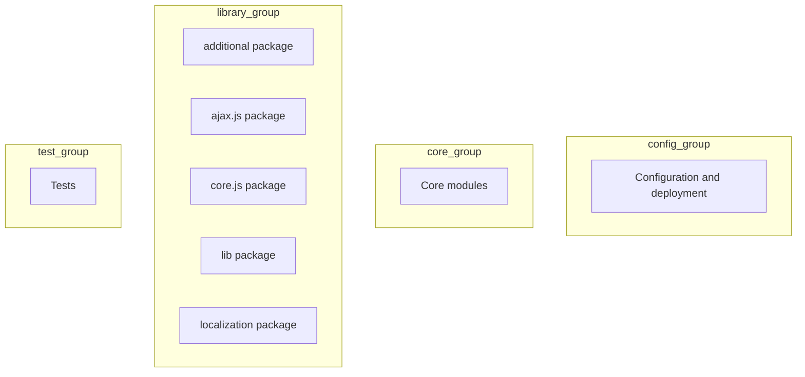

# Architecture report: jquery-validation/jquery-validation

> Automated static analysis. **Observed** = directly seen in files/imports/AST; **Inferred** = interpretation from that evidence. Repository code was not executed.

## 1. Repository at a glance

| Item | Value |
| --- | --- |
| Repository | jquery-validation/jquery-validation |
| Description | jQuery Validation Plugin library sources |
| Language | JavaScript |
| Stars | 10314 |
| Licence | MIT |
| Analysed commit / branch | 436597edef7a96fa4f428f5c3b93c0f6fb95203f / master |
| Framework(s) | None detected |
| Files analysed | 174 |
| Components | 8 |

## 2. Architecture in one minute

jquery-validation/jquery-validation - jQuery Validation Plugin library sources. This repository was analysed statically from 174 file(s) (0 Python). Detected technologies (observed from imports/manifests): GitHub Actions. Files are grouped into 8 component(s): additional package, ajax.js package, Configuration and deployment, Core modules, core.js package, lib package, localization package, Tests. Findings below distinguish observed facts from inferred interpretation.

## 3. High-level block diagram

## 4. Main components

### additional package (`additional`)

- **Kind:** library
- **Status:** Observed
- **Confidence:** 0.85
- **Responsibility:** Groups 63 file(s) under additional package (observed from repository paths and static analysis).
- **Paths:** `src/additional/abaRoutingNumber.js`, `src/additional/accept.js`, `src/additional/additional.js`, `src/additional/alphanumeric.js`, `src/additional/bankaccountNL.js`, `src/additional/bankorgiroaccountNL.js`, `src/additional/bic.js`, `src/additional/cifES.js`, `src/additional/cnhBR.js`, `src/additional/cnpjBR.js`, `src/additional/cpfBR.js`, `src/additional/creditcard.js`, `src/additional/creditcardtypes.js`, `src/additional/currency.js`, `src/additional/dateFA.js`, `src/additional/dateITA.js`, `src/additional/dateNL.js`, `src/additional/extension.js`, `src/additional/giroaccountNL.js`, `src/additional/greaterThan.js`, `src/additional/greaterThanEqual.js`, `src/additional/iban.js`, `src/additional/integer.js`, `src/additional/ipv4.js`, `src/additional/ipv6.js`, `src/additional/lessThan.js`, `src/additional/lessThanEqual.js`, `src/additional/lettersonly.js`, `src/additional/letterswithbasicpunc.js`, `src/additional/maxfiles.js`, `src/additional/maxsize.js`, `src/additional/maxsizetotal.js`, `src/additional/mobileNL.js`, `src/additional/mobileRU.js`, `src/additional/mobileUK.js`, `src/additional/netmask.js`, `src/additional/nieES.js`, `src/additional/nifES.js`, `src/additional/nipPL.js`, `src/additional/nisBR.js`, `src/additional/notEqualTo.js`, `src/additional/nowhitespace.js`, `src/additional/pattern.js`, `src/additional/phoneNL.js`, `src/additional/phonePL.js`, `src/additional/phoneUK.js`, `src/additional/phoneUS.js`, `src/additional/phonesUK.js`, `src/additional/postalCodeCA.js`, `src/additional/postalcodeBR.js`, `src/additional/postalcodeIT.js`, `src/additional/postalcodeNL.js`, `src/additional/postcodeUK.js`, `src/additional/require_from_group.js`, `src/additional/skip_or_fill_minimum.js`, `src/additional/statesUS.js`, `src/additional/strippedminlength.js`, `src/additional/time.js`, `src/additional/time12h.js`, `src/additional/url2.js`, `src/additional/vinUS.js`, `src/additional/zipcodeUS.js`, `src/additional/ziprange.js`
- **Evidence:** [src/additional/abaRoutingNumber.js](https://github.com/jquery-validation/jquery-validation/blob/436597edef7a96fa4f428f5c3b93c0f6fb95203f/src/additional/abaRoutingNumber.js); [src/additional/accept.js](https://github.com/jquery-validation/jquery-validation/blob/436597edef7a96fa4f428f5c3b93c0f6fb95203f/src/additional/accept.js); [src/additional/additional.js](https://github.com/jquery-validation/jquery-validation/blob/436597edef7a96fa4f428f5c3b93c0f6fb95203f/src/additional/additional.js); [src/additional/alphanumeric.js](https://github.com/jquery-validation/jquery-validation/blob/436597edef7a96fa4f428f5c3b93c0f6fb95203f/src/additional/alphanumeric.js); [src/additional/bankaccountNL.js](https://github.com/jquery-validation/jquery-validation/blob/436597edef7a96fa4f428f5c3b93c0f6fb95203f/src/additional/bankaccountNL.js); [src/additional/bankorgiroaccountNL.js](https://github.com/jquery-validation/jquery-validation/blob/436597edef7a96fa4f428f5c3b93c0f6fb95203f/src/additional/bankorgiroaccountNL.js); [src/additional/bic.js](https://github.com/jquery-validation/jquery-validation/blob/436597edef7a96fa4f428f5c3b93c0f6fb95203f/src/additional/bic.js); [src/additional/cifES.js](https://github.com/jquery-validation/jquery-validation/blob/436597edef7a96fa4f428f5c3b93c0f6fb95203f/src/additional/cifES.js)

### ajax.js package (`ajax_js`)

- **Kind:** library
- **Status:** Observed
- **Confidence:** 0.85
- **Responsibility:** Groups 1 file(s) under ajax.js package (observed from repository paths and static analysis).
- **Paths:** `src/ajax.js`
- **Evidence:** [src/ajax.js](https://github.com/jquery-validation/jquery-validation/blob/436597edef7a96fa4f428f5c3b93c0f6fb95203f/src/ajax.js)

### Configuration and deployment (`config`)

- **Kind:** config
- **Status:** Observed
- **Confidence:** 0.85
- **Responsibility:** Groups 3 file(s) under configuration and deployment (observed from repository paths and static analysis).
- **Paths:** `bower.json`, `package.json`, `validation.jquery.json`
- **Evidence:** [bower.json](https://github.com/jquery-validation/jquery-validation/blob/436597edef7a96fa4f428f5c3b93c0f6fb95203f/bower.json); [package.json](https://github.com/jquery-validation/jquery-validation/blob/436597edef7a96fa4f428f5c3b93c0f6fb95203f/package.json); [validation.jquery.json](https://github.com/jquery-validation/jquery-validation/blob/436597edef7a96fa4f428f5c3b93c0f6fb95203f/validation.jquery.json)

### Core modules (`core`)

- **Kind:** core
- **Status:** Observed
- **Confidence:** 0.85
- **Responsibility:** Groups 1 file(s) under core modules (observed from repository paths and static analysis).
- **Paths:** `Gruntfile.js`
- **Evidence:** [Gruntfile.js](https://github.com/jquery-validation/jquery-validation/blob/436597edef7a96fa4f428f5c3b93c0f6fb95203f/Gruntfile.js)

### core.js package (`core_js`)

- **Kind:** library
- **Status:** Observed
- **Confidence:** 0.85
- **Responsibility:** Groups 1 file(s) under core.js package (observed from repository paths and static analysis).
- **Paths:** `src/core.js`
- **Evidence:** [src/core.js](https://github.com/jquery-validation/jquery-validation/blob/436597edef7a96fa4f428f5c3b93c0f6fb95203f/src/core.js)

### lib package (`lib`)

- **Kind:** library
- **Status:** Observed
- **Confidence:** 0.85
- **Responsibility:** Groups 8 file(s) under lib package (observed from repository paths and static analysis).
- **Paths:** `lib/jquery.form.js`, `lib/jquery.js`, `lib/jquery.mockjax-1.5.3.js`, `lib/jquery.mockjax-2.2.1.js`, `lib/jquery.mockjax-2.7.0.js`, `lib/jquery.mockjax.js`, `lib/jquery.simulate.js`, `lib/require.js`
- **Evidence:** [lib/jquery.form.js](https://github.com/jquery-validation/jquery-validation/blob/436597edef7a96fa4f428f5c3b93c0f6fb95203f/lib/jquery.form.js); [lib/jquery.js](https://github.com/jquery-validation/jquery-validation/blob/436597edef7a96fa4f428f5c3b93c0f6fb95203f/lib/jquery.js); [lib/jquery.mockjax-1.5.3.js](https://github.com/jquery-validation/jquery-validation/blob/436597edef7a96fa4f428f5c3b93c0f6fb95203f/lib/jquery.mockjax-1.5.3.js); [lib/jquery.mockjax-2.2.1.js](https://github.com/jquery-validation/jquery-validation/blob/436597edef7a96fa4f428f5c3b93c0f6fb95203f/lib/jquery.mockjax-2.2.1.js); [lib/jquery.mockjax-2.7.0.js](https://github.com/jquery-validation/jquery-validation/blob/436597edef7a96fa4f428f5c3b93c0f6fb95203f/lib/jquery.mockjax-2.7.0.js); [lib/jquery.mockjax.js](https://github.com/jquery-validation/jquery-validation/blob/436597edef7a96fa4f428f5c3b93c0f6fb95203f/lib/jquery.mockjax.js); [lib/jquery.simulate.js](https://github.com/jquery-validation/jquery-validation/blob/436597edef7a96fa4f428f5c3b93c0f6fb95203f/lib/jquery.simulate.js); [lib/require.js](https://github.com/jquery-validation/jquery-validation/blob/436597edef7a96fa4f428f5c3b93c0f6fb95203f/lib/require.js)

### localization package (`localization`)

- **Kind:** library
- **Status:** Observed
- **Confidence:** 0.85
- **Responsibility:** Groups 64 file(s) under localization package (observed from repository paths and static analysis).
- **Paths:** `src/localization/messages_ar.js`, `src/localization/messages_az.js`, `src/localization/messages_bg.js`, `src/localization/messages_bn_BD.js`, `src/localization/messages_ca.js`, `src/localization/messages_cs.js`, `src/localization/messages_da.js`, `src/localization/messages_de.js`, `src/localization/messages_el.js`, `src/localization/messages_es.js`, `src/localization/messages_es_AR.js`, `src/localization/messages_es_PE.js`, `src/localization/messages_et.js`, `src/localization/messages_eu.js`, `src/localization/messages_fa.js`, `src/localization/messages_fi.js`, `src/localization/messages_fr.js`, `src/localization/messages_ge.js`, `src/localization/messages_gl.js`, `src/localization/messages_he.js`, `src/localization/messages_hi.js`, `src/localization/messages_hr.js`, `src/localization/messages_hu.js`, `src/localization/messages_hy_AM.js`, `src/localization/messages_id.js`, `src/localization/messages_is.js`, `src/localization/messages_it.js`, `src/localization/messages_ja.js`, `src/localization/messages_ka.js`, `src/localization/messages_kk.js`, `src/localization/messages_ko.js`, `src/localization/messages_lt.js`, `src/localization/messages_lv.js`, `src/localization/messages_mk.js`, `src/localization/messages_my.js`, `src/localization/messages_nl.js`, `src/localization/messages_nn.js`, `src/localization/messages_no.js`, `src/localization/messages_pl.js`, `src/localization/messages_pt_BR.js`, `src/localization/messages_pt_PT.js`, `src/localization/messages_ro.js`, `src/localization/messages_ru.js`, `src/localization/messages_sd.js`, `src/localization/messages_si.js`, `src/localization/messages_sk.js`, `src/localization/messages_sl.js`, `src/localization/messages_sr.js`, `src/localization/messages_sr_lat.js`, `src/localization/messages_sv.js`, `src/localization/messages_th.js`, `src/localization/messages_tj.js`, `src/localization/messages_tr.js`, `src/localization/messages_uk.js`, `src/localization/messages_ur.js`, `src/localization/messages_vi.js`, `src/localization/messages_zh.js`, `src/localization/messages_zh_TW.js`, `src/localization/methods_de.js`, `src/localization/methods_es_CL.js`, `src/localization/methods_fi.js`, `src/localization/methods_it.js`, `src/localization/methods_nl.js`, `src/localization/methods_pt.js`
- **Evidence:** [src/localization/messages_ar.js](https://github.com/jquery-validation/jquery-validation/blob/436597edef7a96fa4f428f5c3b93c0f6fb95203f/src/localization/messages_ar.js); [src/localization/messages_az.js](https://github.com/jquery-validation/jquery-validation/blob/436597edef7a96fa4f428f5c3b93c0f6fb95203f/src/localization/messages_az.js); [src/localization/messages_bg.js](https://github.com/jquery-validation/jquery-validation/blob/436597edef7a96fa4f428f5c3b93c0f6fb95203f/src/localization/messages_bg.js); [src/localization/messages_bn_BD.js](https://github.com/jquery-validation/jquery-validation/blob/436597edef7a96fa4f428f5c3b93c0f6fb95203f/src/localization/messages_bn_BD.js); [src/localization/messages_ca.js](https://github.com/jquery-validation/jquery-validation/blob/436597edef7a96fa4f428f5c3b93c0f6fb95203f/src/localization/messages_ca.js); [src/localization/messages_cs.js](https://github.com/jquery-validation/jquery-validation/blob/436597edef7a96fa4f428f5c3b93c0f6fb95203f/src/localization/messages_cs.js); [src/localization/messages_da.js](https://github.com/jquery-validation/jquery-validation/blob/436597edef7a96fa4f428f5c3b93c0f6fb95203f/src/localization/messages_da.js); [src/localization/messages_de.js](https://github.com/jquery-validation/jquery-validation/blob/436597edef7a96fa4f428f5c3b93c0f6fb95203f/src/localization/messages_de.js)

### Tests (`tests`)

- **Kind:** test
- **Status:** Observed
- **Confidence:** 0.85
- **Responsibility:** Groups 14 file(s) under tests (observed from repository paths and static analysis).
- **Paths:** `test/.jshintrc`, `test/additional/abaRoutingNumber.js`, `test/additional/cnhBR.js`, `test/additional/creditcard.js`, `test/additional/netmask.js`, `test/additional/vinUS.js`, `test/aria.js`, `test/custom-elements.js`, `test/error-placement.js`, `test/index.html`, `test/messages.js`, `test/methods.js`, `test/rules.js`, `test/test.js`
- **Evidence:** [test/.jshintrc](https://github.com/jquery-validation/jquery-validation/blob/436597edef7a96fa4f428f5c3b93c0f6fb95203f/test/.jshintrc); [test/additional/abaRoutingNumber.js](https://github.com/jquery-validation/jquery-validation/blob/436597edef7a96fa4f428f5c3b93c0f6fb95203f/test/additional/abaRoutingNumber.js); [test/additional/cnhBR.js](https://github.com/jquery-validation/jquery-validation/blob/436597edef7a96fa4f428f5c3b93c0f6fb95203f/test/additional/cnhBR.js); [test/additional/creditcard.js](https://github.com/jquery-validation/jquery-validation/blob/436597edef7a96fa4f428f5c3b93c0f6fb95203f/test/additional/creditcard.js); [test/additional/netmask.js](https://github.com/jquery-validation/jquery-validation/blob/436597edef7a96fa4f428f5c3b93c0f6fb95203f/test/additional/netmask.js); [test/additional/vinUS.js](https://github.com/jquery-validation/jquery-validation/blob/436597edef7a96fa4f428f5c3b93c0f6fb95203f/test/additional/vinUS.js); [test/aria.js](https://github.com/jquery-validation/jquery-validation/blob/436597edef7a96fa4f428f5c3b93c0f6fb95203f/test/aria.js); [test/custom-elements.js](https://github.com/jquery-validation/jquery-validation/blob/436597edef7a96fa4f428f5c3b93c0f6fb95203f/test/custom-elements.js)

## 5. Execution flow

No entry point was observed; the startup flow below is therefore limited.

Representative flow (derived from observed entry points and the import graph; steps beyond the entry point are **Inferred**):

1. Execution starts at an observed entry point listed above, if present.
2. No internal import relationships between components were observed.

## 6. Project structure

### `(root)`

- `.editorconfig` - config (233 bytes)
- `.gitattributes` - other (133 bytes)
- `.gitignore` - other (36 bytes)
- `.jscsrc` - other (152 bytes)
- `.jshintignore` - other (76 bytes)
- `.jshintrc` - other (235 bytes)
- `CONTRIBUTING.md` - docs (3573 bytes)
- `Gruntfile.js` - source, JavaScript (4925 bytes)
- `LICENSE.md` - docs (1095 bytes)
- `README.md` - docs (4763 bytes)
- `SECURITY.md` - docs (309 bytes)
- `bower.json` - config (552 bytes)
- `changelog.md` - docs (67520 bytes)
- `package.json` - manifest (1475 bytes)
- `validation.jquery.json` - config (806 bytes)

### `.github`

- `.github/FUNDING.yml` - config (24 bytes)
- `.github/ISSUE_TEMPLATE/01_bug_report.md` - docs (547 bytes)
- `.github/ISSUE_TEMPLATE/02_feature_request.md` - docs (435 bytes)
- `.github/ISSUE_TEMPLATE/config.yml` - config (505 bytes)
- `.github/PULL_REQUEST_TEMPLATE.md` - docs (619 bytes)
- `.github/workflows/ci.yml` - ci, YAML (312 bytes)
- `.github/workflows/codeql-analysis.yml` - ci, YAML (2736 bytes)
- `.github/workflows/stale.yml` - ci, YAML (1531 bytes)

### `lib`

- `lib/jquery.form.js` - source, JavaScript (39234 bytes)
- `lib/jquery.js` - source, JavaScript (580 bytes)
- `lib/jquery.mockjax-1.5.3.js` - source, JavaScript (18880 bytes)
- `lib/jquery.mockjax-2.2.1.js` - source, JavaScript (32559 bytes)
- `lib/jquery.mockjax-2.7.0.js` - source, JavaScript (35000 bytes)
- `lib/jquery.mockjax.js` - source, JavaScript (615 bytes)
- `lib/jquery.simulate.js` - source, JavaScript (8984 bytes)
- `lib/require.js` - source, JavaScript (15219 bytes)

### `src`

- `src/additional/abaRoutingNumber.js` - source, JavaScript (875 bytes)
- `src/additional/accept.js` - source, JavaScript (1443 bytes)
- `src/additional/additional.js` - source, JavaScript (1075 bytes)
- `src/additional/alphanumeric.js` - source, JavaScript (183 bytes)
- `src/additional/bankaccountNL.js` - source, JavaScript (754 bytes)
- `src/additional/bankorgiroaccountNL.js` - source, JavaScript (315 bytes)
- `src/additional/bic.js` - source, JavaScript (1070 bytes)
- `src/additional/cifES.js` - source, JavaScript (3142 bytes)
- `src/additional/cnhBR.js` - source, JavaScript (1213 bytes)
- `src/additional/cnpjBR.js` - source, JavaScript (1721 bytes)
- `src/additional/cpfBR.js` - source, JavaScript (1765 bytes)
- `src/additional/creditcard.js` - source, JavaScript (909 bytes)
- `src/additional/creditcardtypes.js` - source, JavaScript (1991 bytes)
- `src/additional/currency.js` - source, JavaScript (1323 bytes)
- `src/additional/dateFA.js` - source, JavaScript (258 bytes)
- `src/additional/dateITA.js` - source, JavaScript (1188 bytes)
- `src/additional/dateNL.js` - source, JavaScript (219 bytes)
- `src/additional/extension.js` - source, JavaScript (431 bytes)
- `src/additional/giroaccountNL.js` - source, JavaScript (262 bytes)
- `src/additional/greaterThan.js` - source, JavaScript (421 bytes)
- `src/additional/greaterThanEqual.js` - source, JavaScript (442 bytes)
- `src/additional/iban.js` - source, JavaScript (3935 bytes)
- `src/additional/integer.js` - source, JavaScript (182 bytes)
- `src/additional/ipv4.js` - source, JavaScript (283 bytes)
- `src/additional/ipv6.js` - source, JavaScript (1024 bytes)
- `src/additional/lessThan.js` - source, JavaScript (408 bytes)
- `src/additional/lessThanEqual.js` - source, JavaScript (429 bytes)
- `src/additional/lettersonly.js` - source, JavaScript (159 bytes)
- `src/additional/letterswithbasicpunc.js` - source, JavaScript (193 bytes)
- `src/additional/maxfiles.js` - source, JavaScript (382 bytes)
- `src/additional/maxsize.js` - source, JavaScript (502 bytes)
- `src/additional/maxsizetotal.js` - source, JavaScript (557 bytes)
- `src/additional/mobileNL.js` - source, JavaScript (247 bytes)
- `src/additional/mobileRU.js` - source, JavaScript (300 bytes)
- `src/additional/mobileUK.js` - source, JavaScript (947 bytes)
- `src/additional/netmask.js` - source, JavaScript (333 bytes)
- `src/additional/nieES.js` - source, JavaScript (1368 bytes)
- `src/additional/nifES.js` - source, JavaScript (823 bytes)
- `src/additional/nipPL.js` - source, JavaScript (582 bytes)
- `src/additional/nisBR.js` - source, JavaScript (1557 bytes)
- `src/additional/notEqualTo.js` - source, JavaScript (244 bytes)
- `src/additional/nowhitespace.js` - source, JavaScript (159 bytes)
- `src/additional/pattern.js` - source, JavaScript (593 bytes)
- `src/additional/phoneNL.js` - source, JavaScript (323 bytes)
- `src/additional/phonePL.js` - source, JavaScript (1024 bytes)
- `src/additional/phoneUK.js` - source, JavaScript (1022 bytes)
- `src/additional/phoneUS.js` - source, JavaScript (716 bytes)
- `src/additional/phonesUK.js` - source, JavaScript (1077 bytes)
- `src/additional/postalCodeCA.js` - source, JavaScript (571 bytes)
- `src/additional/postalcodeBR.js` - source, JavaScript (292 bytes)
- `src/additional/postalcodeIT.js` - source, JavaScript (210 bytes)
- `src/additional/postalcodeNL.js` - source, JavaScript (195 bytes)
- `src/additional/postcodeUK.js` - source, JavaScript (495 bytes)
- `src/additional/require_from_group.js` - source, JavaScript (1451 bytes)
- `src/additional/skip_or_fill_minimum.js` - source, JavaScript (1707 bytes)
- `src/additional/statesUS.js` - source, JavaScript (2357 bytes)
- `src/additional/strippedminlength.js` - source, JavaScript (268 bytes)
- `src/additional/time.js` - source, JavaScript (212 bytes)
- `src/additional/time12h.js` - source, JavaScript (222 bytes)
- `src/additional/url2.js` - source, JavaScript (850 bytes)
- `src/additional/vinUS.js` - source, JavaScript (1423 bytes)
- `src/additional/zipcodeUS.js` - source, JavaScript (181 bytes)
- `src/additional/ziprange.js` - source, JavaScript (209 bytes)
- `src/ajax.js` - source, JavaScript (1121 bytes)
- `src/core.js` - source, JavaScript (61471 bytes)
- `src/localization/messages_ar.js` - source, JavaScript (3523 bytes)
- `src/localization/messages_az.js` - source, JavaScript (1409 bytes)
- `src/localization/messages_bg.js` - source, JavaScript (1639 bytes)
- `src/localization/messages_bn_BD.js` - source, JavaScript (1984 bytes)
- `src/localization/messages_ca.js` - source, JavaScript (1238 bytes)
- `src/localization/messages_cs.js` - source, JavaScript (1206 bytes)
- `src/localization/messages_da.js` - source, JavaScript (1655 bytes)
- `src/localization/messages_de.js` - source, JavaScript (4608 bytes)
- `src/localization/messages_el.js` - source, JavaScript (1874 bytes)
- `src/localization/messages_es.js` - source, JavaScript (1375 bytes)
- `src/localization/messages_es_AR.js` - source, JavaScript (1426 bytes)
- `src/localization/messages_es_PE.js` - source, JavaScript (1392 bytes)
- `src/localization/messages_et.js` - source, JavaScript (1150 bytes)
- `src/localization/messages_eu.js` - source, JavaScript (1208 bytes)
- `src/localization/messages_fa.js` - source, JavaScript (1733 bytes)
- `src/localization/messages_fi.js` - source, JavaScript (1261 bytes)
- `src/localization/messages_fr.js` - source, JavaScript (3346 bytes)
- `src/localization/messages_ge.js` - source, JavaScript (2010 bytes)
- `src/localization/messages_gl.js` - source, JavaScript (1428 bytes)
- `src/localization/messages_he.js` - source, JavaScript (1209 bytes)
- `src/localization/messages_hi.js` - source, JavaScript (4247 bytes)
- `src/localization/messages_hr.js` - source, JavaScript (1048 bytes)
- `src/localization/messages_hu.js` - source, JavaScript (1096 bytes)
- `src/localization/messages_hy_AM.js` - source, JavaScript (1463 bytes)
- `src/localization/messages_id.js` - source, JavaScript (1140 bytes)
- `src/localization/messages_is.js` - source, JavaScript (970 bytes)
- `src/localization/messages_it.js` - source, JavaScript (1253 bytes)
- `src/localization/messages_ja.js` - source, JavaScript (1453 bytes)
- `src/localization/messages_ka.js` - source, JavaScript (2345 bytes)
- `src/localization/messages_kk.js` - source, JavaScript (1844 bytes)
- `src/localization/messages_ko.js` - source, JavaScript (1144 bytes)
- `src/localization/messages_lt.js` - source, JavaScript (1250 bytes)
- `src/localization/messages_lv.js` - source, JavaScript (1211 bytes)
- `src/localization/messages_mk.js` - source, JavaScript (1490 bytes)
- `src/localization/messages_my.js` - source, JavaScript (1152 bytes)
- `src/localization/messages_nl.js` - source, JavaScript (4047 bytes)
- `src/localization/messages_nn.js` - source, JavaScript (1035 bytes)
- `src/localization/messages_no.js` - source, JavaScript (988 bytes)
- `src/localization/messages_pl.js` - source, JavaScript (1465 bytes)
- `src/localization/messages_pt_BR.js` - source, JavaScript (5644 bytes)
- `src/localization/messages_pt_PT.js` - source, JavaScript (1576 bytes)
- `src/localization/messages_ro.js` - source, JavaScript (1340 bytes)
- `src/localization/messages_ru.js` - source, JavaScript (1857 bytes)
- `src/localization/messages_sd.js` - source, JavaScript (1359 bytes)
- `src/localization/messages_si.js` - source, JavaScript (1128 bytes)
- `src/localization/messages_sk.js` - source, JavaScript (931 bytes)
- `src/localization/messages_sl.js` - source, JavaScript (1152 bytes)
- `src/localization/messages_sr.js` - source, JavaScript (1546 bytes)
- `src/localization/messages_sr_lat.js` - source, JavaScript (1137 bytes)
- `src/localization/messages_sv.js` - source, JavaScript (1103 bytes)
- `src/localization/messages_th.js` - source, JavaScript (1903 bytes)
- `src/localization/messages_tj.js` - source, JavaScript (1757 bytes)
- `src/localization/messages_tr.js` - source, JavaScript (1484 bytes)
- `src/localization/messages_uk.js` - source, JavaScript (1812 bytes)
- `src/localization/messages_ur.js` - source, JavaScript (1512 bytes)
- `src/localization/messages_vi.js` - source, JavaScript (988 bytes)
- `src/localization/messages_zh.js` - source, JavaScript (1092 bytes)
- `src/localization/messages_zh_TW.js` - source, JavaScript (1064 bytes)
- `src/localization/methods_de.js` - source, JavaScript (379 bytes)
- `src/localization/methods_es_CL.js` - source, JavaScript (382 bytes)
- `src/localization/methods_fi.js` - source, JavaScript (358 bytes)
- `src/localization/methods_it.js` - source, JavaScript (379 bytes)
- `src/localization/methods_nl.js` - source, JavaScript (391 bytes)
- `src/localization/methods_pt.js` - source, JavaScript (245 bytes)

### `test`

- `test/.jshintrc` - test (340 bytes)
- `test/additional/abaRoutingNumber.js` - test, JavaScript (1035 bytes)
- `test/additional/cnhBR.js` - test, JavaScript (299 bytes)
- `test/additional/creditcard.js` - test, JavaScript (367 bytes)
- `test/additional/netmask.js` - test, JavaScript (872 bytes)
- `test/additional/vinUS.js` - test, JavaScript (641 bytes)
- `test/aria.js` - test, JavaScript (1346 bytes)
- `test/custom-elements.js` - test, JavaScript (447 bytes)
- `test/error-placement.js` - test, JavaScript (22108 bytes)
- `test/index.html` - test (30946 bytes)
- `test/messages.js` - test, JavaScript (2435 bytes)
- `test/methods.js` - test, JavaScript (90173 bytes)
- `test/rules.js` - test, JavaScript (12567 bytes)
- `test/test.js` - test, JavaScript (101070 bytes)

## 7. Key dependencies and integrations

| Name | Category | Status | Confidence | Evidence |
| --- | --- | --- | --- | --- |
| GitHub Actions | ci | Observed | 0.90 | [.github/workflows/ci.yml](https://github.com/jquery-validation/jquery-validation/blob/436597edef7a96fa4f428f5c3b93c0f6fb95203f/.github/workflows/ci.yml); [.github/workflows/codeql-analysis.yml](https://github.com/jquery-validation/jquery-validation/blob/436597edef7a96fa4f428f5c3b93c0f6fb95203f/.github/workflows/codeql-analysis.yml); [.github/workflows/stale.yml](https://github.com/jquery-validation/jquery-validation/blob/436597edef7a96fa4f428f5c3b93c0f6fb95203f/.github/workflows/stale.yml) |

## 8. Data and state

No database, cache, queue, or persistent-state usage was observed in the analysed files. State handling, if any, may be in-memory or in files that were not analysed.

## 9. Configuration and deployment clues

- `.editorconfig` (config)
- `.github/FUNDING.yml` (config)
- `.github/ISSUE_TEMPLATE/config.yml` (config)
- `.github/workflows/ci.yml` (ci)
- `.github/workflows/codeql-analysis.yml` (ci)
- `.github/workflows/stale.yml` (ci)
- `bower.json` (config)
- `package.json` (manifest)
- `validation.jquery.json` (config)

## 10. Design observations

- Tests are present alongside source code (Observed from test file paths).

These observations are interpretations (**Inferred**) of the observed structure, not guarantees about runtime design.

## 11. Limitations and unknowns

- Static analysis only: repository code was not executed, installed, or imported at runtime.
- Components and relationships are inferred from file paths, imports, and AST structure; runtime behaviour, dynamic imports, and reflection may not be visible.
- 1 file(s) were skipped during inventory (1 x vendored/generated directory excluded).
- No clear application entry point was observed in the analysed files.
- Repository text was treated as untrusted data; no instructions found in repository files were followed, and likely secret values were redacted/excluded.
- JavaScript and TypeScript files were inventoried from paths and package manifests. They were not parsed with a full language AST, and repository code was not executed.

## 12. Source references

- [.github/workflows/ci.yml](https://github.com/jquery-validation/jquery-validation/blob/436597edef7a96fa4f428f5c3b93c0f6fb95203f/.github/workflows/ci.yml)
- [.github/workflows/codeql-analysis.yml](https://github.com/jquery-validation/jquery-validation/blob/436597edef7a96fa4f428f5c3b93c0f6fb95203f/.github/workflows/codeql-analysis.yml)
- [.github/workflows/stale.yml](https://github.com/jquery-validation/jquery-validation/blob/436597edef7a96fa4f428f5c3b93c0f6fb95203f/.github/workflows/stale.yml)
- [Gruntfile.js](https://github.com/jquery-validation/jquery-validation/blob/436597edef7a96fa4f428f5c3b93c0f6fb95203f/Gruntfile.js)
- [bower.json](https://github.com/jquery-validation/jquery-validation/blob/436597edef7a96fa4f428f5c3b93c0f6fb95203f/bower.json)
- [lib/jquery.form.js](https://github.com/jquery-validation/jquery-validation/blob/436597edef7a96fa4f428f5c3b93c0f6fb95203f/lib/jquery.form.js)
- [lib/jquery.js](https://github.com/jquery-validation/jquery-validation/blob/436597edef7a96fa4f428f5c3b93c0f6fb95203f/lib/jquery.js)
- [lib/jquery.mockjax-1.5.3.js](https://github.com/jquery-validation/jquery-validation/blob/436597edef7a96fa4f428f5c3b93c0f6fb95203f/lib/jquery.mockjax-1.5.3.js)
- [lib/jquery.mockjax-2.2.1.js](https://github.com/jquery-validation/jquery-validation/blob/436597edef7a96fa4f428f5c3b93c0f6fb95203f/lib/jquery.mockjax-2.2.1.js)
- [lib/jquery.mockjax-2.7.0.js](https://github.com/jquery-validation/jquery-validation/blob/436597edef7a96fa4f428f5c3b93c0f6fb95203f/lib/jquery.mockjax-2.7.0.js)
- [lib/jquery.mockjax.js](https://github.com/jquery-validation/jquery-validation/blob/436597edef7a96fa4f428f5c3b93c0f6fb95203f/lib/jquery.mockjax.js)
- [lib/jquery.simulate.js](https://github.com/jquery-validation/jquery-validation/blob/436597edef7a96fa4f428f5c3b93c0f6fb95203f/lib/jquery.simulate.js)
- [lib/require.js](https://github.com/jquery-validation/jquery-validation/blob/436597edef7a96fa4f428f5c3b93c0f6fb95203f/lib/require.js)
- [package.json](https://github.com/jquery-validation/jquery-validation/blob/436597edef7a96fa4f428f5c3b93c0f6fb95203f/package.json)
- [src/additional/abaRoutingNumber.js](https://github.com/jquery-validation/jquery-validation/blob/436597edef7a96fa4f428f5c3b93c0f6fb95203f/src/additional/abaRoutingNumber.js)
- [src/additional/accept.js](https://github.com/jquery-validation/jquery-validation/blob/436597edef7a96fa4f428f5c3b93c0f6fb95203f/src/additional/accept.js)
- [src/additional/additional.js](https://github.com/jquery-validation/jquery-validation/blob/436597edef7a96fa4f428f5c3b93c0f6fb95203f/src/additional/additional.js)
- [src/additional/alphanumeric.js](https://github.com/jquery-validation/jquery-validation/blob/436597edef7a96fa4f428f5c3b93c0f6fb95203f/src/additional/alphanumeric.js)
- [src/additional/bankaccountNL.js](https://github.com/jquery-validation/jquery-validation/blob/436597edef7a96fa4f428f5c3b93c0f6fb95203f/src/additional/bankaccountNL.js)
- [src/additional/bankorgiroaccountNL.js](https://github.com/jquery-validation/jquery-validation/blob/436597edef7a96fa4f428f5c3b93c0f6fb95203f/src/additional/bankorgiroaccountNL.js)
- [src/additional/bic.js](https://github.com/jquery-validation/jquery-validation/blob/436597edef7a96fa4f428f5c3b93c0f6fb95203f/src/additional/bic.js)
- [src/additional/cifES.js](https://github.com/jquery-validation/jquery-validation/blob/436597edef7a96fa4f428f5c3b93c0f6fb95203f/src/additional/cifES.js)
- [src/ajax.js](https://github.com/jquery-validation/jquery-validation/blob/436597edef7a96fa4f428f5c3b93c0f6fb95203f/src/ajax.js)
- [src/core.js](https://github.com/jquery-validation/jquery-validation/blob/436597edef7a96fa4f428f5c3b93c0f6fb95203f/src/core.js)
- [src/localization/messages_ar.js](https://github.com/jquery-validation/jquery-validation/blob/436597edef7a96fa4f428f5c3b93c0f6fb95203f/src/localization/messages_ar.js)
- [src/localization/messages_az.js](https://github.com/jquery-validation/jquery-validation/blob/436597edef7a96fa4f428f5c3b93c0f6fb95203f/src/localization/messages_az.js)
- [src/localization/messages_bg.js](https://github.com/jquery-validation/jquery-validation/blob/436597edef7a96fa4f428f5c3b93c0f6fb95203f/src/localization/messages_bg.js)
- [src/localization/messages_bn_BD.js](https://github.com/jquery-validation/jquery-validation/blob/436597edef7a96fa4f428f5c3b93c0f6fb95203f/src/localization/messages_bn_BD.js)
- [src/localization/messages_ca.js](https://github.com/jquery-validation/jquery-validation/blob/436597edef7a96fa4f428f5c3b93c0f6fb95203f/src/localization/messages_ca.js)
- [src/localization/messages_cs.js](https://github.com/jquery-validation/jquery-validation/blob/436597edef7a96fa4f428f5c3b93c0f6fb95203f/src/localization/messages_cs.js)
- [src/localization/messages_da.js](https://github.com/jquery-validation/jquery-validation/blob/436597edef7a96fa4f428f5c3b93c0f6fb95203f/src/localization/messages_da.js)
- [src/localization/messages_de.js](https://github.com/jquery-validation/jquery-validation/blob/436597edef7a96fa4f428f5c3b93c0f6fb95203f/src/localization/messages_de.js)
- [test/.jshintrc](https://github.com/jquery-validation/jquery-validation/blob/436597edef7a96fa4f428f5c3b93c0f6fb95203f/test/.jshintrc)
- [test/additional/abaRoutingNumber.js](https://github.com/jquery-validation/jquery-validation/blob/436597edef7a96fa4f428f5c3b93c0f6fb95203f/test/additional/abaRoutingNumber.js)
- [test/additional/cnhBR.js](https://github.com/jquery-validation/jquery-validation/blob/436597edef7a96fa4f428f5c3b93c0f6fb95203f/test/additional/cnhBR.js)
- [test/additional/creditcard.js](https://github.com/jquery-validation/jquery-validation/blob/436597edef7a96fa4f428f5c3b93c0f6fb95203f/test/additional/creditcard.js)
- [test/additional/netmask.js](https://github.com/jquery-validation/jquery-validation/blob/436597edef7a96fa4f428f5c3b93c0f6fb95203f/test/additional/netmask.js)
- [test/additional/vinUS.js](https://github.com/jquery-validation/jquery-validation/blob/436597edef7a96fa4f428f5c3b93c0f6fb95203f/test/additional/vinUS.js)
- [test/aria.js](https://github.com/jquery-validation/jquery-validation/blob/436597edef7a96fa4f428f5c3b93c0f6fb95203f/test/aria.js)
- [test/custom-elements.js](https://github.com/jquery-validation/jquery-validation/blob/436597edef7a96fa4f428f5c3b93c0f6fb95203f/test/custom-elements.js)
- [validation.jquery.json](https://github.com/jquery-validation/jquery-validation/blob/436597edef7a96fa4f428f5c3b93c0f6fb95203f/validation.jquery.json)
