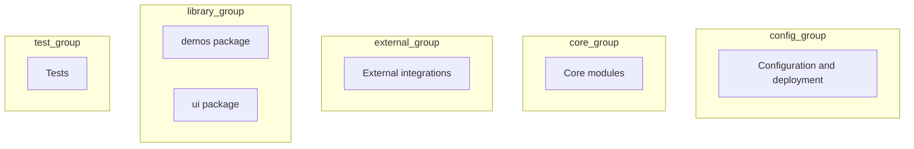

# Architecture report: jquery/jquery-ui

> Automated static analysis. **Observed** = directly seen in files/imports/AST; **Inferred** = interpretation from that evidence. Repository code was not executed.

## 1. Repository at a glance

| Item | Value |
| --- | --- |
| Repository | jquery/jquery-ui |
| Description | The official jQuery user interface library. |
| Language | JavaScript |
| Stars | 11336 |
| Licence | Other |
| Analysed commit / branch | dcf10556bbcfdf3e10e3ea30966482e201191411 / main |
| Framework(s) | None detected |
| Files analysed | 616 |
| Components | 6 |

## 2. Architecture in one minute

jquery/jquery-ui - The official jQuery user interface library.. This repository was analysed statically from 616 file(s) (0 Python). Detected technologies (observed from imports/manifests): GitHub Actions. Files are grouped into 6 component(s): Configuration and deployment, Core modules, demos package, External integrations, Tests, ui package. Findings below distinguish observed facts from inferred interpretation.

## 3. High-level block diagram

## 4. Main components

### Configuration and deployment (`config`)

- **Kind:** config
- **Status:** Observed
- **Confidence:** 0.85
- **Responsibility:** Groups 5 file(s) under configuration and deployment (observed from repository paths and static analysis).
- **Paths:** `bower.json`, `jtr-git.yml`, `jtr-stable.yml`, `jtr.yml`, `package.json`
- **Evidence:** [bower.json](https://github.com/jquery/jquery-ui/blob/dcf10556bbcfdf3e10e3ea30966482e201191411/bower.json); [jtr-git.yml](https://github.com/jquery/jquery-ui/blob/dcf10556bbcfdf3e10e3ea30966482e201191411/jtr-git.yml); [jtr-stable.yml](https://github.com/jquery/jquery-ui/blob/dcf10556bbcfdf3e10e3ea30966482e201191411/jtr-stable.yml); [jtr.yml](https://github.com/jquery/jquery-ui/blob/dcf10556bbcfdf3e10e3ea30966482e201191411/jtr.yml); [package.json](https://github.com/jquery/jquery-ui/blob/dcf10556bbcfdf3e10e3ea30966482e201191411/package.json)

### Core modules (`core`)

- **Kind:** core
- **Status:** Observed
- **Confidence:** 0.85
- **Responsibility:** Groups 2 file(s) under core modules (observed from repository paths and static analysis).
- **Paths:** `Gruntfile.js`, `eslint.config.mjs`
- **Evidence:** [Gruntfile.js](https://github.com/jquery/jquery-ui/blob/dcf10556bbcfdf3e10e3ea30966482e201191411/Gruntfile.js); [eslint.config.mjs](https://github.com/jquery/jquery-ui/blob/dcf10556bbcfdf3e10e3ea30966482e201191411/eslint.config.mjs)

### demos package (`demos`)

- **Kind:** library
- **Status:** Observed
- **Confidence:** 0.85
- **Responsibility:** Groups 2 file(s) under demos package (observed from repository paths and static analysis).
- **Paths:** `demos/bootstrap.js`, `demos/search.js`
- **Evidence:** [demos/bootstrap.js](https://github.com/jquery/jquery-ui/blob/dcf10556bbcfdf3e10e3ea30966482e201191411/demos/bootstrap.js); [demos/search.js](https://github.com/jquery/jquery-ui/blob/dcf10556bbcfdf3e10e3ea30966482e201191411/demos/search.js)

### External integrations (`external_integrations`)

- **Kind:** external
- **Status:** Observed
- **Confidence:** 0.85
- **Responsibility:** Groups 9 file(s) under external integrations (observed from repository paths and static analysis).
- **Paths:** `external/globalize/globalize.culture.de-DE.js`, `external/globalize/globalize.culture.ja-JP.js`, `external/globalize/globalize.js`, `external/jquery-migrate-1.x/jquery-migrate.js`, `external/jquery-migrate-3.x/jquery-migrate.js`, `external/jquery-migrate-4.x/jquery-migrate.js`, `external/jquery-mousewheel/jquery.mousewheel.js`, `external/jquery-simulate/jquery.simulate.js`, `external/requirejs/require.js`
- **Evidence:** [external/globalize/globalize.culture.de-DE.js](https://github.com/jquery/jquery-ui/blob/dcf10556bbcfdf3e10e3ea30966482e201191411/external/globalize/globalize.culture.de-DE.js); [external/globalize/globalize.culture.ja-JP.js](https://github.com/jquery/jquery-ui/blob/dcf10556bbcfdf3e10e3ea30966482e201191411/external/globalize/globalize.culture.ja-JP.js); [external/globalize/globalize.js](https://github.com/jquery/jquery-ui/blob/dcf10556bbcfdf3e10e3ea30966482e201191411/external/globalize/globalize.js); [external/jquery-migrate-1.x/jquery-migrate.js](https://github.com/jquery/jquery-ui/blob/dcf10556bbcfdf3e10e3ea30966482e201191411/external/jquery-migrate-1.x/jquery-migrate.js); [external/jquery-migrate-3.x/jquery-migrate.js](https://github.com/jquery/jquery-ui/blob/dcf10556bbcfdf3e10e3ea30966482e201191411/external/jquery-migrate-3.x/jquery-migrate.js); [external/jquery-migrate-4.x/jquery-migrate.js](https://github.com/jquery/jquery-ui/blob/dcf10556bbcfdf3e10e3ea30966482e201191411/external/jquery-migrate-4.x/jquery-migrate.js); [external/jquery-mousewheel/jquery.mousewheel.js](https://github.com/jquery/jquery-ui/blob/dcf10556bbcfdf3e10e3ea30966482e201191411/external/jquery-mousewheel/jquery.mousewheel.js); [external/jquery-simulate/jquery.simulate.js](https://github.com/jquery/jquery-ui/blob/dcf10556bbcfdf3e10e3ea30966482e201191411/external/jquery-simulate/jquery.simulate.js)

### Tests (`tests`)

- **Kind:** test
- **Status:** Observed
- **Confidence:** 0.85
- **Responsibility:** Groups 235 file(s) under tests (observed from repository paths and static analysis).
- **Paths:** `tests/index.css`, `tests/index.html`, `tests/index.js`, `tests/lib/bootstrap.js`, `tests/lib/common.js`, `tests/lib/css.js`, `tests/lib/grunt-contrib-qunit-bridges/bridge-wrapper.js.intro`, `tests/lib/grunt-contrib-qunit-bridges/bridge-wrapper.js.outro`, `tests/lib/helper.js`, `tests/lib/qunit-assert-domequal.js`, `tests/lib/qunit.js`, `tests/lib/testIframe.js`, `tests/unit/accordion/accordion.html`, `tests/unit/accordion/all.html`, `tests/unit/accordion/common.js`, `tests/unit/accordion/core.js`, `tests/unit/accordion/events.js`, `tests/unit/accordion/helper.js`, `tests/unit/accordion/methods.js`, `tests/unit/accordion/options.js`, `tests/unit/all.html`, `tests/unit/autocomplete/all.html`, `tests/unit/autocomplete/autocomplete.html`, `tests/unit/autocomplete/common.js`, `tests/unit/autocomplete/core.js`, `tests/unit/autocomplete/events.js`, `tests/unit/autocomplete/methods.js`, `tests/unit/autocomplete/options.js`, `tests/unit/autocomplete/remote_object_array_labels.txt`, `tests/unit/autocomplete/remote_object_array_values.txt`, `tests/unit/autocomplete/remote_string_array.txt`, `tests/unit/button/all.html`, `tests/unit/button/button.html`, `tests/unit/button/common-deprecated.js`, `tests/unit/button/common.js`, `tests/unit/button/core.js`, `tests/unit/button/deprecated.html`, `tests/unit/button/deprecated.js`, `tests/unit/button/events.js`, `tests/unit/button/methods.js`, `tests/unit/button/options.js`, `tests/unit/checkboxradio/all.html`, `tests/unit/checkboxradio/checkboxradio.html`, `tests/unit/checkboxradio/common.js`, `tests/unit/checkboxradio/core.js`, `tests/unit/checkboxradio/events.js`, `tests/unit/checkboxradio/methods.js`, `tests/unit/checkboxradio/options.js`, `tests/unit/controlgroup/all.html`, `tests/unit/controlgroup/common.js`, `tests/unit/controlgroup/controlgroup.html`, `tests/unit/controlgroup/core.js`, `tests/unit/controlgroup/methods.js`, `tests/unit/controlgroup/options.js`, `tests/unit/core/all.html`, `tests/unit/core/core.html`, `tests/unit/core/core.js`, `tests/unit/core/selector.js`, `tests/unit/datepicker/all.html`, `tests/unit/datepicker/common.js`, `tests/unit/datepicker/core.js`, `tests/unit/datepicker/datepicker.html`, `tests/unit/datepicker/events.js`, `tests/unit/datepicker/helper.js`, `tests/unit/datepicker/methods.js`, `tests/unit/datepicker/options.js`, `tests/unit/dialog/all.html`, `tests/unit/dialog/common-deprecated.js`, `tests/unit/dialog/common.js`, `tests/unit/dialog/core.js`, `tests/unit/dialog/deprecated.html`, `tests/unit/dialog/deprecated.js`, `tests/unit/dialog/dialog.html`, `tests/unit/dialog/events.js`, `tests/unit/dialog/helper.js`, `tests/unit/dialog/methods.js`, `tests/unit/dialog/options.js`, `tests/unit/draggable/all.html`, `tests/unit/draggable/common.js`, `tests/unit/draggable/core.js`, `tests/unit/draggable/draggable.html`, `tests/unit/draggable/events.js`, `tests/unit/draggable/helper.js`, `tests/unit/draggable/methods.js`, `tests/unit/draggable/options.js`, `tests/unit/droppable/all.html`, `tests/unit/droppable/common-deprecated.js`, `tests/unit/droppable/common.js`, `tests/unit/droppable/core.js`, `tests/unit/droppable/deprecated.html`, `tests/unit/droppable/deprecated.js`, `tests/unit/droppable/droppable.html`, `tests/unit/droppable/events.js`, `tests/unit/droppable/helper.js`, `tests/unit/droppable/methods.js`, `tests/unit/droppable/options.js`, `tests/unit/effects/all.html`, `tests/unit/effects/core.js`, `tests/unit/effects/effects.html`, `tests/unit/effects/scale.js`, `tests/unit/form-reset-mixin/all.html`, `tests/unit/form-reset-mixin/core.js`, `tests/unit/form-reset-mixin/form-reset-mixin.html`, `tests/unit/index.html`, `tests/unit/jquery-patch/all.html`, `tests/unit/jquery-patch/core.js`, `tests/unit/jquery-patch/jquery-patch.html`, `tests/unit/menu/all.html`, `tests/unit/menu/common.js`, `tests/unit/menu/core.js`, `tests/unit/menu/events.js`, `tests/unit/menu/helper.js`, `tests/unit/menu/menu.html`, `tests/unit/menu/methods.js`, `tests/unit/menu/options.js`, `tests/unit/position/all.html`, `tests/unit/position/core.js`, `tests/unit/position/position.html`, `tests/unit/progressbar/all.html`, `tests/unit/progressbar/common.js`, `tests/unit/progressbar/core.js`, `tests/unit/progressbar/events.js`, `tests/unit/progressbar/methods.js`, `tests/unit/progressbar/options.js`, `tests/unit/progressbar/progressbar.html`, `tests/unit/resizable/all.html`, `tests/unit/resizable/common.js`, `tests/unit/resizable/core.js`, `tests/unit/resizable/events.js`, `tests/unit/resizable/helper.js`, `tests/unit/resizable/methods.js`, `tests/unit/resizable/options.js`, `tests/unit/resizable/resizable.html`, `tests/unit/selectable/all.html`, `tests/unit/selectable/common.js`, `tests/unit/selectable/core.js`, `tests/unit/selectable/events.js`, `tests/unit/selectable/methods.js`, `tests/unit/selectable/options.js`, `tests/unit/selectable/selectable.html`, `tests/unit/selectmenu/all.html`, `tests/unit/selectmenu/common.js`, `tests/unit/selectmenu/core.js`, `tests/unit/selectmenu/events.js`, `tests/unit/selectmenu/methods.js`, `tests/unit/selectmenu/options.js`, `tests/unit/selectmenu/selectmenu.html`, `tests/unit/slider/all.html`, `tests/unit/slider/common.js`, `tests/unit/slider/core.js`, `tests/unit/slider/events.js`, `tests/unit/slider/methods.js`, `tests/unit/slider/options.js`, `tests/unit/slider/slider.html`, `tests/unit/sortable/all.html`, `tests/unit/sortable/common.js`, `tests/unit/sortable/core.js`, `tests/unit/sortable/events.js`, `tests/unit/sortable/helper.js`, `tests/unit/sortable/methods.js`, `tests/unit/sortable/options.js`, `tests/unit/sortable/sortable.html`, `tests/unit/spinner/all.html`, `tests/unit/spinner/common-deprecated.js`, `tests/unit/spinner/common.js`, `tests/unit/spinner/core.js`, `tests/unit/spinner/deprecated.html`, `tests/unit/spinner/deprecated.js`, `tests/unit/spinner/events.js`, `tests/unit/spinner/helper.js`, `tests/unit/spinner/methods.js`, `tests/unit/spinner/mousewheel-wheel.html`, `tests/unit/spinner/options.js`, `tests/unit/spinner/spinner.html`, `tests/unit/subsuite.js`, `tests/unit/tabs/all.html`, `tests/unit/tabs/common.js`, `tests/unit/tabs/core.js`, `tests/unit/tabs/data/test.html`, `tests/unit/tabs/events.js`, `tests/unit/tabs/helper.js`, `tests/unit/tabs/methods.js`, `tests/unit/tabs/options.js`, `tests/unit/tabs/tabs.html`, `tests/unit/tooltip/all.html`, `tests/unit/tooltip/common-deprecated.js`, `tests/unit/tooltip/common.js`, `tests/unit/tooltip/core.js`, `tests/unit/tooltip/deprecated.html`, `tests/unit/tooltip/deprecated.js`, `tests/unit/tooltip/events.js`, `tests/unit/tooltip/helper.js`, `tests/unit/tooltip/methods.js`, `tests/unit/tooltip/options.js`, `tests/unit/tooltip/tooltip.html`, `tests/unit/widget/all.html`, `tests/unit/widget/animation.js`, `tests/unit/widget/classes.js`, `tests/unit/widget/core.js`, `tests/unit/widget/extend.js`, `tests/unit/widget/widget.html`, `tests/visual/accordion/icons.html`, `tests/visual/addClass/queue.html`, `tests/visual/checkboxradio/checkboxradio.html`, `tests/visual/compound/accordion_tabs.html`, `tests/visual/compound/datepicker_dialog.html`, `tests/visual/compound/dialog_widgets.html`, `tests/visual/compound/draggable_accordion.html`, `tests/visual/compound/draggable_accordion_accordion_tabs_draggable.html`, `tests/visual/compound/draggable_resizable.html`, `tests/visual/compound/sortable_accordion_sortable_tabs.html`, `tests/visual/compound/tabs_selectmenu.html`, `tests/visual/compound/tabs_tabs.html`, `tests/visual/compound/tabs_tooltips.html`, `tests/visual/dialog/animated.html`, `tests/visual/dialog/complex-dialogs.html`, `tests/visual/dialog/form.html`, `tests/visual/dialog/performance.html`, `tests/visual/dialog/stacking.html`, `tests/visual/draggable/replaced.html`, `tests/visual/effects/all.html`, `tests/visual/effects/clip.html`, `tests/visual/effects/effects.css`, `tests/visual/effects/effects.js`, `tests/visual/effects/scale.html`, `tests/visual/effects/shake.html`, `tests/visual/index.html`, `tests/visual/menu/menu.html`, `tests/visual/position/position.html`, `tests/visual/position/position_feedback.html`, `tests/visual/selectmenu/selectmenu.html`, `tests/visual/slider/range_slider.html`, `tests/visual/tooltip/animations.html`, `tests/visual/tooltip/tooltip.html`, `tests/visual/visual.css`
- **Evidence:** [tests/index.css](https://github.com/jquery/jquery-ui/blob/dcf10556bbcfdf3e10e3ea30966482e201191411/tests/index.css); [tests/index.html](https://github.com/jquery/jquery-ui/blob/dcf10556bbcfdf3e10e3ea30966482e201191411/tests/index.html); [tests/index.js](https://github.com/jquery/jquery-ui/blob/dcf10556bbcfdf3e10e3ea30966482e201191411/tests/index.js); [tests/lib/bootstrap.js](https://github.com/jquery/jquery-ui/blob/dcf10556bbcfdf3e10e3ea30966482e201191411/tests/lib/bootstrap.js); [tests/lib/common.js](https://github.com/jquery/jquery-ui/blob/dcf10556bbcfdf3e10e3ea30966482e201191411/tests/lib/common.js); [tests/lib/css.js](https://github.com/jquery/jquery-ui/blob/dcf10556bbcfdf3e10e3ea30966482e201191411/tests/lib/css.js); [tests/lib/grunt-contrib-qunit-bridges/bridge-wrapper.js.intro](https://github.com/jquery/jquery-ui/blob/dcf10556bbcfdf3e10e3ea30966482e201191411/tests/lib/grunt-contrib-qunit-bridges/bridge-wrapper.js.intro); [tests/lib/grunt-contrib-qunit-bridges/bridge-wrapper.js.outro](https://github.com/jquery/jquery-ui/blob/dcf10556bbcfdf3e10e3ea30966482e201191411/tests/lib/grunt-contrib-qunit-bridges/bridge-wrapper.js.outro)

### ui package (`ui`)

- **Kind:** library
- **Status:** Observed
- **Confidence:** 0.85
- **Responsibility:** Groups 126 file(s) under ui package (observed from repository paths and static analysis).
- **Paths:** `ui/data.js`, `ui/disable-selection.js`, `ui/effect.js`, `ui/effects/effect-blind.js`, `ui/effects/effect-bounce.js`, `ui/effects/effect-clip.js`, `ui/effects/effect-drop.js`, `ui/effects/effect-explode.js`, `ui/effects/effect-fade.js`, `ui/effects/effect-fold.js`, `ui/effects/effect-highlight.js`, `ui/effects/effect-puff.js`, `ui/effects/effect-pulsate.js`, `ui/effects/effect-scale.js`, `ui/effects/effect-shake.js`, `ui/effects/effect-size.js`, `ui/effects/effect-slide.js`, `ui/effects/effect-transfer.js`, `ui/focusable.js`, `ui/form-reset-mixin.js`, `ui/i18n/datepicker-af.js`, `ui/i18n/datepicker-ar-DZ.js`, `ui/i18n/datepicker-ar.js`, `ui/i18n/datepicker-az.js`, `ui/i18n/datepicker-be.js`, `ui/i18n/datepicker-bg.js`, `ui/i18n/datepicker-bs.js`, `ui/i18n/datepicker-ca.js`, `ui/i18n/datepicker-cs.js`, `ui/i18n/datepicker-cy-GB.js`, `ui/i18n/datepicker-da.js`, `ui/i18n/datepicker-de-AT.js`, `ui/i18n/datepicker-de.js`, `ui/i18n/datepicker-el.js`, `ui/i18n/datepicker-en-AU.js`, `ui/i18n/datepicker-en-GB.js`, `ui/i18n/datepicker-en-NZ.js`, `ui/i18n/datepicker-eo.js`, `ui/i18n/datepicker-es.js`, `ui/i18n/datepicker-et.js`, `ui/i18n/datepicker-eu.js`, `ui/i18n/datepicker-fa.js`, `ui/i18n/datepicker-fi.js`, `ui/i18n/datepicker-fo.js`, `ui/i18n/datepicker-fr-CA.js`, `ui/i18n/datepicker-fr-CH.js`, `ui/i18n/datepicker-fr.js`, `ui/i18n/datepicker-gl.js`, `ui/i18n/datepicker-he.js`, `ui/i18n/datepicker-hi.js`, `ui/i18n/datepicker-hr.js`, `ui/i18n/datepicker-hu.js`, `ui/i18n/datepicker-hy.js`, `ui/i18n/datepicker-id.js`, `ui/i18n/datepicker-is.js`, `ui/i18n/datepicker-it-CH.js`, `ui/i18n/datepicker-it.js`, `ui/i18n/datepicker-ja.js`, `ui/i18n/datepicker-ka.js`, `ui/i18n/datepicker-kk.js`, `ui/i18n/datepicker-km.js`, `ui/i18n/datepicker-ko.js`, `ui/i18n/datepicker-ky.js`, `ui/i18n/datepicker-lb.js`, `ui/i18n/datepicker-lt.js`, `ui/i18n/datepicker-lv.js`, `ui/i18n/datepicker-mk.js`, `ui/i18n/datepicker-ml.js`, `ui/i18n/datepicker-ms.js`, `ui/i18n/datepicker-nb.js`, `ui/i18n/datepicker-nl-BE.js`, `ui/i18n/datepicker-nl.js`, `ui/i18n/datepicker-nn.js`, `ui/i18n/datepicker-no.js`, `ui/i18n/datepicker-pl.js`, `ui/i18n/datepicker-pt-BR.js`, `ui/i18n/datepicker-pt.js`, `ui/i18n/datepicker-rm.js`, `ui/i18n/datepicker-ro.js`, `ui/i18n/datepicker-ru.js`, `ui/i18n/datepicker-sk.js`, `ui/i18n/datepicker-sl.js`, `ui/i18n/datepicker-sq.js`, `ui/i18n/datepicker-sr-SR.js`, `ui/i18n/datepicker-sr.js`, `ui/i18n/datepicker-sv.js`, `ui/i18n/datepicker-ta.js`, `ui/i18n/datepicker-th.js`, `ui/i18n/datepicker-tj.js`, `ui/i18n/datepicker-tr.js`, `ui/i18n/datepicker-uk.js`, `ui/i18n/datepicker-vi.js`, `ui/i18n/datepicker-zh-CN.js`, `ui/i18n/datepicker-zh-HK.js`, `ui/i18n/datepicker-zh-TW.js`, `ui/jquery-patch.js`, `ui/jquery-var-for-color.js`, `ui/keycode.js`, `ui/labels.js`, `ui/plugin.js`, `ui/position.js`, `ui/scroll-parent.js`, `ui/tabbable.js`, `ui/unique-id.js`, `ui/version.js`, `ui/widget.js`, `ui/widgets/accordion.js`, `ui/widgets/autocomplete.js`, `ui/widgets/button.js`, `ui/widgets/checkboxradio.js`, `ui/widgets/controlgroup.js`, `ui/widgets/datepicker.js`, `ui/widgets/dialog.js`, `ui/widgets/draggable.js`, `ui/widgets/droppable.js`, `ui/widgets/menu.js`, `ui/widgets/mouse.js`, `ui/widgets/progressbar.js`, `ui/widgets/resizable.js`, `ui/widgets/selectable.js`, `ui/widgets/selectmenu.js`, `ui/widgets/slider.js`, `ui/widgets/sortable.js`, `ui/widgets/spinner.js`, `ui/widgets/tabs.js`, `ui/widgets/tooltip.js`
- **Evidence:** [ui/data.js](https://github.com/jquery/jquery-ui/blob/dcf10556bbcfdf3e10e3ea30966482e201191411/ui/data.js); [ui/disable-selection.js](https://github.com/jquery/jquery-ui/blob/dcf10556bbcfdf3e10e3ea30966482e201191411/ui/disable-selection.js); [ui/effect.js](https://github.com/jquery/jquery-ui/blob/dcf10556bbcfdf3e10e3ea30966482e201191411/ui/effect.js); [ui/effects/effect-blind.js](https://github.com/jquery/jquery-ui/blob/dcf10556bbcfdf3e10e3ea30966482e201191411/ui/effects/effect-blind.js); [ui/effects/effect-bounce.js](https://github.com/jquery/jquery-ui/blob/dcf10556bbcfdf3e10e3ea30966482e201191411/ui/effects/effect-bounce.js); [ui/effects/effect-clip.js](https://github.com/jquery/jquery-ui/blob/dcf10556bbcfdf3e10e3ea30966482e201191411/ui/effects/effect-clip.js); [ui/effects/effect-drop.js](https://github.com/jquery/jquery-ui/blob/dcf10556bbcfdf3e10e3ea30966482e201191411/ui/effects/effect-drop.js); [ui/effects/effect-explode.js](https://github.com/jquery/jquery-ui/blob/dcf10556bbcfdf3e10e3ea30966482e201191411/ui/effects/effect-explode.js)

## 5. Execution flow

**Observed** entry point(s):

- [ui/widget.js](https://github.com/jquery/jquery-ui/blob/dcf10556bbcfdf3e10e3ea30966482e201191411/ui/widget.js)

Representative flow (derived from observed entry points and the import graph; steps beyond the entry point are **Inferred**):

1. Execution starts at an observed entry point listed above, if present.
2. No internal import relationships between components were observed.

## 6. Project structure

### `(root)`

- `.csslintrc` - other (302 bytes)
- `.editorconfig` - config (370 bytes)
- `.gitattributes` - other (127 bytes)
- `.gitignore` - other (61 bytes)
- `.mailmap` - other (5614 bytes)
- `.npmignore` - other (143 bytes)
- `AUTHORS.txt` - docs (14848 bytes)
- `CONTRIBUTING.md` - docs (4504 bytes)
- `Gruntfile.js` - source, JavaScript (11516 bytes)
- `LICENSE.txt` - docs (1818 bytes)
- `README.md` - docs (2647 bytes)
- `SECURITY.md` - docs (436 bytes)
- `bower.json` - config (1362 bytes)
- `eslint.config.mjs` - source, JavaScript (2720 bytes)
- `jtr-git.yml` - config (821 bytes)
- `jtr-stable.yml` - config (858 bytes)
- `jtr.yml` - config (752 bytes)
- `package.json` - manifest (1907 bytes)

### `.github`

- `.github/dependabot.yml` - config (275 bytes)
- `.github/workflows/browser-tests.yml` - ci, YAML (2978 bytes)
- `.github/workflows/codeql-analysis.yml` - ci, YAML (2143 bytes)
- `.github/workflows/filestash.yml` - ci, YAML (1333 bytes)
- `.github/workflows/node.js.yml` - ci, YAML (818 bytes)

### `demos`

- `demos/accordion/collapsible.html` - other (2280 bytes)
- `demos/accordion/custom-icons.html` - other (2709 bytes)
- `demos/accordion/default.html` - other (2385 bytes)
- `demos/accordion/fillspace.html` - other (2824 bytes)
- `demos/accordion/index.html` - other (551 bytes)
- `demos/accordion/no-auto-height.html` - other (1664 bytes)
- `demos/accordion/sortable.html` - other (2618 bytes)
- `demos/autocomplete/categories.html` - other (1903 bytes)
- `demos/autocomplete/combobox.html` - other (5856 bytes)
- `demos/autocomplete/custom-data.html` - other (2226 bytes)
- `demos/autocomplete/default.html` - other (1214 bytes)
- `demos/autocomplete/folding.html` - other (1633 bytes)
- `demos/autocomplete/index.html` - other (912 bytes)
- `demos/autocomplete/london.xml` - other (2429 bytes)
- `demos/autocomplete/maxheight.html` - other (1308 bytes)
- `demos/autocomplete/multiple-remote.html` - other (2162 bytes)
- `demos/autocomplete/multiple.html` - other (2274 bytes)
- `demos/autocomplete/remote-jsonp.html` - other (1784 bytes)
- `demos/autocomplete/remote-with-cache.html` - other (1485 bytes)
- `demos/autocomplete/remote.html` - other (1675 bytes)
- `demos/autocomplete/xml.html` - other (1987 bytes)
- `demos/bootstrap.js` - source, JavaScript (2688 bytes)
- `demos/button/default.html` - other (1360 bytes)
- `demos/button/icons.html` - other (2159 bytes)
- `demos/button/index.html` - other (317 bytes)
- `demos/checkboxradio/default.html` - other (2030 bytes)
- `demos/checkboxradio/index.html` - other (444 bytes)
- `demos/checkboxradio/no-icons.html` - other (2070 bytes)
- `demos/checkboxradio/product-selector.html` - other (4751 bytes)
- `demos/checkboxradio/radiogroup.html` - other (949 bytes)
- `demos/controlgroup/default.html` - other (2941 bytes)
- `demos/controlgroup/index.html` - other (381 bytes)
- `demos/controlgroup/splitbutton.html` - other (1324 bytes)
- `demos/controlgroup/toolbar.html` - other (7738 bytes)
- `demos/datepicker/alt-field.html` - other (984 bytes)
- `demos/datepicker/animation.html` - other (1550 bytes)
- `demos/datepicker/buttonbar.html` - other (871 bytes)
- `demos/datepicker/date-formats.html` - other (1283 bytes)
- `demos/datepicker/date-range.html` - other (1294 bytes)
- `demos/datepicker/default.html` - other (871 bytes)
- `demos/datepicker/dropdown-month-year.html` - other (821 bytes)
- `demos/datepicker/icon-trigger.html` - other (819 bytes)
- `demos/datepicker/index.html` - other (1065 bytes)
- `demos/datepicker/inline.html` - other (669 bytes)
- `demos/datepicker/localization.html` - other (1451 bytes)
- `demos/datepicker/min-max.html` - other (950 bytes)
- `demos/datepicker/multiple-calendars.html` - other (736 bytes)
- `demos/datepicker/other-months.html` - other (758 bytes)
- `demos/datepicker/show-week.html` - other (898 bytes)
- `demos/demos.css` - other (235 bytes)
- `demos/dialog/animated.html` - other (1174 bytes)
- `demos/dialog/default.html` - other (964 bytes)
- `demos/dialog/index.html` - other (505 bytes)
- `demos/dialog/modal-confirmation.html` - other (1426 bytes)
- `demos/dialog/modal-form.html` - other (5037 bytes)
- `demos/dialog/modal-message.html` - other (1397 bytes)
- `demos/draggable/constrain-movement.html` - other (1927 bytes)
- `demos/draggable/cursor-style.html` - other (1612 bytes)
- `demos/draggable/default.html` - other (825 bytes)
- `demos/draggable/events.html` - other (2401 bytes)
- `demos/draggable/handle.html` - other (1542 bytes)
- `demos/draggable/index.html` - other (773 bytes)
- `demos/draggable/revert.html` - other (1010 bytes)
- `demos/draggable/scroll.html` - other (1416 bytes)
- `demos/draggable/snap-to.html` - other (2063 bytes)
- `demos/draggable/sortable.html` - other (1269 bytes)
- `demos/draggable/visual-feedback.html` - other (2494 bytes)
- `demos/droppable/accepted-elements.html` - other (1446 bytes)
- `demos/droppable/default.html` - other (1121 bytes)
- `demos/droppable/index.html` - other (592 bytes)
- `demos/droppable/photo-manager.html` - other (6521 bytes)
- `demos/droppable/propagation.html` - other (2210 bytes)
- `demos/droppable/revert.html` - other (1500 bytes)
- `demos/droppable/visual-feedback.html` - other (1975 bytes)
- `demos/effect/addClass.html` - other (1410 bytes)
- `demos/effect/animate.html` - other (1552 bytes)
- `demos/effect/default.html` - other (2629 bytes)
- `demos/effect/easing.html` - other (2962 bytes)
- `demos/effect/hide.html` - other (2586 bytes)
- `demos/effect/index.html` - other (719 bytes)
- `demos/effect/removeClass.html` - other (1407 bytes)
- `demos/effect/show.html` - other (2613 bytes)
- `demos/effect/switchClass.html` - other (1342 bytes)
- `demos/effect/toggle.html` - other (2428 bytes)
- `demos/effect/toggleClass.html` - other (1283 bytes)
- `demos/index.html` - other (1168 bytes)
- `demos/menu/categories.html` - other (1101 bytes)
- `demos/menu/default.html` - other (1507 bytes)
- `demos/menu/icons.html` - other (1390 bytes)
- `demos/menu/index.html` - other (366 bytes)
- `demos/position/cycler.html` - other (2647 bytes)
- `demos/position/default.html` - other (3178 bytes)
- `demos/position/index.html` - other (328 bytes)
- `demos/progressbar/default.html` - other (599 bytes)
- `demos/progressbar/download.html` - other (2588 bytes)
- `demos/progressbar/indeterminate.html` - other (1494 bytes)
- `demos/progressbar/index.html` - other (441 bytes)
- `demos/progressbar/label.html` - other (1284 bytes)
- `demos/resizable/animate.html` - other (996 bytes)
- `demos/resizable/aspect-ratio.html` - other (968 bytes)
- `demos/resizable/constrain-area.html` - other (1158 bytes)
- `demos/resizable/default.html` - other (871 bytes)
- `demos/resizable/helper.html` - other (924 bytes)
- `demos/resizable/index.html` - other (794 bytes)
- `demos/resizable/max-min.html` - other (1016 bytes)
- `demos/resizable/snap-to-grid.html` - other (880 bytes)
- `demos/resizable/synchronous-resize.html` - other (1131 bytes)
- `demos/resizable/textarea.html` - other (746 bytes)
- `demos/resizable/visual-feedback.html` - other (944 bytes)
- `demos/search.js` - source, JavaScript (25754 bytes)
- `demos/selectable/default.html` - other (1342 bytes)
- `demos/selectable/display-grid.html` - other (1450 bytes)
- `demos/selectable/index.html` - other (387 bytes)
- `demos/selectable/serialize.html` - other (1601 bytes)
- `demos/selectmenu/custom_render.html` - other (4004 bytes)
- `demos/selectmenu/default.html` - other (2655 bytes)
- `demos/selectmenu/index.html` - other (424 bytes)
- `demos/selectmenu/product-selection.html` - other (1877 bytes)
- `demos/slider/colorpicker.html` - other (2241 bytes)
- `demos/slider/custom-handle.html` - other (1030 bytes)
- `demos/slider/default.html` - other (643 bytes)
- `demos/slider/hotelrooms.html` - other (1277 bytes)
- `demos/slider/index.html` - other (869 bytes)
- `demos/slider/multiple-vertical.html` - other (1655 bytes)
- `demos/slider/range-vertical.html` - other (1242 bytes)
- `demos/slider/range.html` - other (1196 bytes)
- `demos/slider/rangemax.html` - other (1041 bytes)
- `demos/slider/rangemin.html` - other (1043 bytes)
- `demos/slider/slider-vertical.html` - other (1128 bytes)
- `demos/slider/steps.html` - other (1048 bytes)
- `demos/sortable/connect-lists.html` - other (1760 bytes)
- `demos/sortable/default.html` - other (1725 bytes)
- `demos/sortable/display-grid.html` - other (1371 bytes)
- `demos/sortable/empty-lists.html` - other (1837 bytes)
- `demos/sortable/index.html` - other (617 bytes)
- `demos/sortable/items.html` - other (1945 bytes)
- `demos/sortable/placeholder.html` - other (1573 bytes)
- `demos/sortable/portlets.html` - other (2659 bytes)
- `demos/spinner/currency.html` - other (1230 bytes)
- `demos/spinner/decimal.html` - other (1463 bytes)
- `demos/spinner/default.html` - other (1390 bytes)
- `demos/spinner/index.html` - other (496 bytes)
- `demos/spinner/latlong.html` - other (1231 bytes)
- `demos/spinner/overflow.html` - other (940 bytes)
- `demos/spinner/time.html` - other (1768 bytes)
- `demos/tabs/ajax.html` - other (2281 bytes)
- `demos/tabs/ajax/content1.html` - other (2219 bytes)
- `demos/tabs/ajax/content2.html` - other (2156 bytes)
- `demos/tabs/ajax/content3-slow.html` - other (2175 bytes)
- `demos/tabs/collapsible.html` - other (3013 bytes)
- `demos/tabs/default.html` - other (3130 bytes)
- `demos/tabs/index.html` - other (549 bytes)
- `demos/tabs/manipulation.html` - other (4046 bytes)
- `demos/tabs/mouseover.html` - other (3197 bytes)
- `demos/tabs/sortable.html` - other (3668 bytes)
- `demos/tabs/vertical.html` - other (3911 bytes)
- `demos/tooltip/ajax/content1.html` - other (57 bytes)
- `demos/tooltip/ajax/content2.html` - other (63 bytes)
- `demos/tooltip/custom-animation.html` - other (1500 bytes)
- `demos/tooltip/custom-content.html` - other (2518 bytes)
- `demos/tooltip/custom-style.html` - other (2372 bytes)
- `demos/tooltip/default.html` - other (1407 bytes)
- `demos/tooltip/forms.html` - other (1615 bytes)
- `demos/tooltip/index.html` - other (629 bytes)
- `demos/tooltip/tracking.html` - other (1492 bytes)
- `demos/tooltip/video-player.html` - other (3249 bytes)
- `demos/widget/default.html` - other (4737 bytes)
- `demos/widget/index.html` - other (275 bytes)

### `external`

- `external/globalize/LICENSE` - docs (1095 bytes)
- `external/globalize/globalize.culture.de-DE.js` - source, JavaScript (1898 bytes)
- `external/globalize/globalize.culture.ja-JP.js` - source, JavaScript (2859 bytes)
- `external/globalize/globalize.js` - source, JavaScript (45705 bytes)
- `external/jquery-1.12.4/LICENSE.txt` - docs (1606 bytes)
- `external/jquery-2.2.4/LICENSE.txt` - docs (1606 bytes)
- `external/jquery-3.0.0/LICENSE.txt` - docs (1606 bytes)
- `external/jquery-3.1.0/LICENSE.txt` - docs (1606 bytes)
- `external/jquery-3.1.1/LICENSE.txt` - docs (1606 bytes)
- `external/jquery-3.2.0/LICENSE.txt` - docs (1605 bytes)
- `external/jquery-3.2.1/LICENSE.txt` - docs (1605 bytes)
- `external/jquery-3.3.0/LICENSE.txt` - docs (1605 bytes)
- `external/jquery-3.3.1/LICENSE.txt` - docs (1605 bytes)
- `external/jquery-3.4.0/LICENSE.txt` - docs (1095 bytes)
- `external/jquery-3.4.1/LICENSE.txt` - docs (1095 bytes)
- `external/jquery-3.5.0/LICENSE.txt` - docs (1095 bytes)
- `external/jquery-3.5.1/LICENSE.txt` - docs (1095 bytes)
- `external/jquery-3.6.0/LICENSE.txt` - docs (1097 bytes)
- `external/jquery-3.6.1/LICENSE.txt` - docs (1097 bytes)
- `external/jquery-3.6.2/LICENSE.txt` - docs (1097 bytes)
- `external/jquery-3.6.3/LICENSE.txt` - docs (1097 bytes)
- `external/jquery-3.6.4/LICENSE.txt` - docs (1097 bytes)
- `external/jquery-3.7.0/LICENSE.txt` - docs (1097 bytes)
- `external/jquery-3.7.1/LICENSE.txt` - docs (1097 bytes)
- `external/jquery-4.0.0/LICENSE.txt` - docs (1097 bytes)
- `external/jquery-custom/MIT-LICENSE.txt` - docs (1099 bytes)
- `external/jquery-migrate-1.x/LICENSE.txt` - docs (1614 bytes)
- `external/jquery-migrate-1.x/jquery-migrate.js` - source, JavaScript (23497 bytes)
- `external/jquery-migrate-3.x/LICENSE.txt` - docs (1615 bytes)
- `external/jquery-migrate-3.x/jquery-migrate.js` - source, JavaScript (49427 bytes)
- `external/jquery-migrate-4.x/LICENSE.txt` - docs (1615 bytes)
- `external/jquery-migrate-4.x/jquery-migrate.js` - source, JavaScript (33330 bytes)
- `external/jquery-mousewheel/LICENSE.txt` - docs (1618 bytes)
- `external/jquery-mousewheel/jquery.mousewheel.js` - source, JavaScript (8510 bytes)
- `external/jquery-simulate/LICENSE.txt` - docs (1615 bytes)
- `external/jquery-simulate/jquery.simulate.js` - source, JavaScript (8710 bytes)
- `external/jquery/LICENSE.txt` - docs (1097 bytes)
- `external/jquery/MIT-LICENSE.txt` - docs (1099 bytes)
- `external/qunit/LICENSE.txt` - docs (1097 bytes)
- `external/qunit/MIT-LICENSE.txt` - docs (1099 bytes)
- `external/qunit/qunit.css` - other (9714 bytes)
- `external/requirejs/require.js` - source, JavaScript (86533 bytes)

### `tests`

- `tests/index.css` - test (198 bytes)
- `tests/index.html` - test (1098 bytes)
- `tests/index.js` - test, JavaScript (193 bytes)
- `tests/lib/bootstrap.js` - test, JavaScript (4520 bytes)
- `tests/lib/common.js` - test, JavaScript (2723 bytes)
- `tests/lib/css.js` - test, JavaScript (583 bytes)
- `tests/lib/grunt-contrib-qunit-bridges/bridge-wrapper.js.intro` - test (623 bytes)
- `tests/lib/grunt-contrib-qunit-bridges/bridge-wrapper.js.outro` - test (6 bytes)
- `tests/lib/helper.js` - test, JavaScript (2837 bytes)
- `tests/lib/qunit-assert-domequal.js` - test, JavaScript (5164 bytes)
- `tests/lib/qunit.js` - test, JavaScript (1099 bytes)
- `tests/lib/testIframe.js` - test, JavaScript (254 bytes)
- `tests/unit/accordion/accordion.html` - test (2832 bytes)
- `tests/unit/accordion/all.html` - test (642 bytes)
- `tests/unit/accordion/common.js` - test, JavaScript (881 bytes)
- `tests/unit/accordion/core.js` - test, JavaScript (10270 bytes)
- `tests/unit/accordion/events.js` - test, JavaScript (5653 bytes)
- `tests/unit/accordion/helper.js` - test, JavaScript (965 bytes)
- `tests/unit/accordion/methods.js` - test, JavaScript (4173 bytes)
- `tests/unit/accordion/options.js` - test, JavaScript (16255 bytes)
- `tests/unit/all.html` - test (1709 bytes)
- `tests/unit/autocomplete/all.html` - test (648 bytes)
- `tests/unit/autocomplete/autocomplete.html` - test (709 bytes)
- `tests/unit/autocomplete/common.js` - test, JavaScript (601 bytes)
- `tests/unit/autocomplete/core.js` - test, JavaScript (15077 bytes)
- `tests/unit/autocomplete/events.js` - test, JavaScript (5546 bytes)
- `tests/unit/autocomplete/methods.js` - test, JavaScript (1676 bytes)
- `tests/unit/autocomplete/options.js` - test, JavaScript (9634 bytes)
- `tests/unit/autocomplete/remote_object_array_labels.txt` - test (106 bytes)
- `tests/unit/autocomplete/remote_object_array_values.txt` - test (106 bytes)
- `tests/unit/autocomplete/remote_string_array.txt` - test (36 bytes)
- `tests/unit/button/all.html` - test (636 bytes)
- `tests/unit/button/button.html` - test (736 bytes)
- `tests/unit/button/common-deprecated.js` - test, JavaScript (372 bytes)
- `tests/unit/button/common.js` - test, JavaScript (305 bytes)
- `tests/unit/button/core.js` - test, JavaScript (628 bytes)
- `tests/unit/button/deprecated.html` - test (2989 bytes)
- `tests/unit/button/deprecated.js` - test, JavaScript (7217 bytes)
- `tests/unit/button/events.js` - test, JavaScript (611 bytes)
- `tests/unit/button/methods.js` - test, JavaScript (1154 bytes)
- `tests/unit/button/options.js` - test, JavaScript (7379 bytes)
- `tests/unit/checkboxradio/all.html` - test (650 bytes)
- `tests/unit/checkboxradio/checkboxradio.html` - test (3782 bytes)
- `tests/unit/checkboxradio/common.js` - test, JavaScript (354 bytes)
- `tests/unit/checkboxradio/core.js` - test, JavaScript (4646 bytes)
- `tests/unit/checkboxradio/events.js` - test, JavaScript (1248 bytes)
- `tests/unit/checkboxradio/methods.js` - test, JavaScript (4000 bytes)
- `tests/unit/checkboxradio/options.js` - test, JavaScript (6724 bytes)
- `tests/unit/controlgroup/all.html` - test (649 bytes)
- `tests/unit/controlgroup/common.js` - test, JavaScript (632 bytes)
- `tests/unit/controlgroup/controlgroup.html` - test (2444 bytes)
- `tests/unit/controlgroup/core.js` - test, JavaScript (7640 bytes)
- `tests/unit/controlgroup/methods.js` - test, JavaScript (5643 bytes)
- `tests/unit/controlgroup/options.js` - test, JavaScript (3522 bytes)
- `tests/unit/core/all.html` - test (632 bytes)
- `tests/unit/core/core.html` - test (7002 bytes)
- `tests/unit/core/core.js` - test, JavaScript (5906 bytes)
- `tests/unit/core/selector.js` - test, JavaScript (12857 bytes)
- `tests/unit/datepicker/all.html` - test (644 bytes)
- `tests/unit/datepicker/common.js` - test, JavaScript (91 bytes)
- `tests/unit/datepicker/core.js` - test, JavaScript (26496 bytes)
- `tests/unit/datepicker/datepicker.html` - test (537 bytes)
- `tests/unit/datepicker/events.js` - test, JavaScript (7022 bytes)
- `tests/unit/datepicker/helper.js` - test, JavaScript (1162 bytes)
- `tests/unit/datepicker/methods.js` - test, JavaScript (8293 bytes)
- `tests/unit/datepicker/options.js` - test, JavaScript (61489 bytes)
- `tests/unit/dialog/all.html` - test (636 bytes)
- `tests/unit/dialog/common-deprecated.js` - test, JavaScript (938 bytes)
- `tests/unit/dialog/common.js` - test, JavaScript (919 bytes)
- `tests/unit/dialog/core.js` - test, JavaScript (13755 bytes)
- `tests/unit/dialog/deprecated.html` - test (1176 bytes)
- `tests/unit/dialog/deprecated.js` - test, JavaScript (2048 bytes)
- `tests/unit/dialog/dialog.html` - test (1153 bytes)
- `tests/unit/dialog/events.js` - test, JavaScript (13824 bytes)
- `tests/unit/dialog/helper.js` - test, JavaScript (1699 bytes)
- `tests/unit/dialog/methods.js` - test, JavaScript (10082 bytes)
- `tests/unit/dialog/options.js` - test, JavaScript (21152 bytes)
- `tests/unit/draggable/all.html` - test (642 bytes)
- `tests/unit/draggable/common.js` - test, JavaScript (874 bytes)
- `tests/unit/draggable/core.js` - test, JavaScript (13716 bytes)
- `tests/unit/draggable/draggable.html` - test (2301 bytes)
- `tests/unit/draggable/events.js` - test, JavaScript (3601 bytes)
- `tests/unit/draggable/helper.js` - test, JavaScript (4341 bytes)
- `tests/unit/draggable/methods.js` - test, JavaScript (3741 bytes)
- `tests/unit/draggable/options.js` - test, JavaScript (44543 bytes)
- `tests/unit/droppable/all.html` - test (642 bytes)
- `tests/unit/droppable/common-deprecated.js` - test, JavaScript (420 bytes)
- `tests/unit/droppable/common.js` - test, JavaScript (377 bytes)
- `tests/unit/droppable/core.js` - test, JavaScript (871 bytes)
- `tests/unit/droppable/deprecated.html` - test (696 bytes)
- `tests/unit/droppable/deprecated.js` - test, JavaScript (25 bytes)
- `tests/unit/droppable/droppable.html` - test (673 bytes)
- `tests/unit/droppable/events.js` - test, JavaScript (1627 bytes)
- `tests/unit/droppable/helper.js` - test, JavaScript (419 bytes)
- `tests/unit/droppable/methods.js` - test, JavaScript (3290 bytes)
- `tests/unit/droppable/options.js` - test, JavaScript (5618 bytes)
- `tests/unit/effects/all.html` - test (638 bytes)
- `tests/unit/effects/core.js` - test, JavaScript (12312 bytes)
- `tests/unit/effects/effects.html` - test (1660 bytes)
- `tests/unit/effects/scale.js` - test, JavaScript (2174 bytes)
- `tests/unit/form-reset-mixin/all.html` - test (656 bytes)
- `tests/unit/form-reset-mixin/core.js` - test, JavaScript (2397 bytes)
- `tests/unit/form-reset-mixin/form-reset-mixin.html` - test (493 bytes)
- `tests/unit/index.html` - test (2217 bytes)
- `tests/unit/jquery-patch/all.html` - test (662 bytes)
- `tests/unit/jquery-patch/core.js` - test, JavaScript (7294 bytes)
- `tests/unit/jquery-patch/jquery-patch.html` - test (503 bytes)
- `tests/unit/menu/all.html` - test (632 bytes)
- `tests/unit/menu/common.js` - test, JavaScript (387 bytes)
- `tests/unit/menu/core.js` - test, JavaScript (3953 bytes)
- `tests/unit/menu/events.js` - test, JavaScript (26552 bytes)
- `tests/unit/menu/helper.js` - test, JavaScript (575 bytes)
- `tests/unit/menu/menu.html` - test (9558 bytes)
- `tests/unit/menu/methods.js` - test, JavaScript (3575 bytes)
- `tests/unit/menu/options.js` - test, JavaScript (3823 bytes)
- `tests/unit/position/all.html` - test (640 bytes)
- `tests/unit/position/core.js` - test, JavaScript (16474 bytes)
- `tests/unit/position/position.html` - test (1652 bytes)
- `tests/unit/progressbar/all.html` - test (646 bytes)
- `tests/unit/progressbar/common.js` - test, JavaScript (395 bytes)
- `tests/unit/progressbar/core.js` - test, JavaScript (2721 bytes)
- `tests/unit/progressbar/events.js` - test, JavaScript (1646 bytes)
- `tests/unit/progressbar/methods.js` - test, JavaScript (1493 bytes)
- `tests/unit/progressbar/options.js` - test, JavaScript (2385 bytes)
- `tests/unit/progressbar/progressbar.html` - test (444 bytes)
- `tests/unit/resizable/all.html` - test (642 bytes)
- `tests/unit/resizable/common.js` - test, JavaScript (698 bytes)
- `tests/unit/resizable/core.js` - test, JavaScript (10512 bytes)
- `tests/unit/resizable/events.js` - test, JavaScript (6449 bytes)
- `tests/unit/resizable/helper.js` - test, JavaScript (408 bytes)
- `tests/unit/resizable/methods.js` - test, JavaScript (805 bytes)
- `tests/unit/resizable/options.js` - test, JavaScript (21714 bytes)
- `tests/unit/resizable/resizable.html` - test (1138 bytes)
- `tests/unit/selectable/all.html` - test (644 bytes)
- `tests/unit/selectable/common.js` - test, JavaScript (467 bytes)
- `tests/unit/selectable/core.js` - test, JavaScript (29 bytes)
- `tests/unit/selectable/events.js` - test, JavaScript (1515 bytes)
- `tests/unit/selectable/methods.js` - test, JavaScript (3021 bytes)
- `tests/unit/selectable/options.js` - test, JavaScript (1428 bytes)
- `tests/unit/selectable/selectable.html` - test (541 bytes)
- `tests/unit/selectmenu/all.html` - test (644 bytes)
- `tests/unit/selectmenu/common.js` - test, JavaScript (544 bytes)
- `tests/unit/selectmenu/core.js` - test, JavaScript (15658 bytes)
- `tests/unit/selectmenu/events.js` - test, JavaScript (3821 bytes)
- `tests/unit/selectmenu/methods.js` - test, JavaScript (7229 bytes)
- `tests/unit/selectmenu/options.js` - test, JavaScript (4043 bytes)
- `tests/unit/selectmenu/selectmenu.html` - test (1969 bytes)
- `tests/unit/slider/all.html` - test (636 bytes)
- `tests/unit/slider/common.js` - test, JavaScript (589 bytes)
- `tests/unit/slider/core.js` - test, JavaScript (8304 bytes)
- `tests/unit/slider/events.js` - test, JavaScript (6960 bytes)
- `tests/unit/slider/methods.js` - test, JavaScript (5658 bytes)
- `tests/unit/slider/options.js` - test, JavaScript (12483 bytes)
- `tests/unit/slider/slider.html` - test (694 bytes)
- `tests/unit/sortable/all.html` - test (640 bytes)
- `tests/unit/sortable/common.js` - test, JavaScript (916 bytes)
- `tests/unit/sortable/core.js` - test, JavaScript (2632 bytes)
- `tests/unit/sortable/events.js` - test, JavaScript (10714 bytes)
- `tests/unit/sortable/helper.js` - test, JavaScript (301 bytes)
- `tests/unit/sortable/methods.js` - test, JavaScript (4056 bytes)
- `tests/unit/sortable/options.js` - test, JavaScript (16271 bytes)
- `tests/unit/sortable/sortable.html` - test (2085 bytes)
- `tests/unit/spinner/all.html` - test (638 bytes)
- `tests/unit/spinner/common-deprecated.js` - test, JavaScript (553 bytes)
- `tests/unit/spinner/common.js` - test, JavaScript (553 bytes)
- `tests/unit/spinner/core.js` - test, JavaScript (10390 bytes)
- `tests/unit/spinner/deprecated.html` - test (492 bytes)
- `tests/unit/spinner/deprecated.js` - test, JavaScript (1140 bytes)
- `tests/unit/spinner/events.js` - test, JavaScript (7972 bytes)
- `tests/unit/spinner/helper.js` - test, JavaScript (319 bytes)
- `tests/unit/spinner/methods.js` - test, JavaScript (6590 bytes)
- `tests/unit/spinner/mousewheel-wheel.html` - test (1463 bytes)
- `tests/unit/spinner/options.js` - test, JavaScript (8113 bytes)
- `tests/unit/spinner/spinner.html` - test (469 bytes)
- `tests/unit/subsuite.js` - test, JavaScript (633 bytes)
- `tests/unit/tabs/all.html` - test (632 bytes)
- `tests/unit/tabs/common.js` - test, JavaScript (519 bytes)
- `tests/unit/tabs/core.js` - test, JavaScript (42432 bytes)
- `tests/unit/tabs/data/test.html` - test (38 bytes)
- `tests/unit/tabs/events.js` - test, JavaScript (11856 bytes)
- `tests/unit/tabs/helper.js` - test, JavaScript (2046 bytes)
- `tests/unit/tabs/methods.js` - test, JavaScript (9369 bytes)
- `tests/unit/tabs/options.js` - test, JavaScript (11638 bytes)
- `tests/unit/tabs/tabs.html` - test (3128 bytes)
- `tests/unit/tooltip/all.html` - test (638 bytes)
- `tests/unit/tooltip/common-deprecated.js` - test, JavaScript (498 bytes)
- `tests/unit/tooltip/common.js` - test, JavaScript (476 bytes)
- `tests/unit/tooltip/core.js` - test, JavaScript (8669 bytes)
- `tests/unit/tooltip/deprecated.html` - test (873 bytes)
- `tests/unit/tooltip/deprecated.js` - test, JavaScript (523 bytes)
- `tests/unit/tooltip/events.js` - test, JavaScript (1856 bytes)
- `tests/unit/tooltip/helper.js` - test, JavaScript (529 bytes)
- `tests/unit/tooltip/methods.js` - test, JavaScript (5288 bytes)
- `tests/unit/tooltip/options.js` - test, JavaScript (6894 bytes)
- `tests/unit/tooltip/tooltip.html` - test (850 bytes)
- `tests/unit/widget/all.html` - test (636 bytes)
- `tests/unit/widget/animation.js` - test, JavaScript (5836 bytes)
- `tests/unit/widget/classes.js` - test, JavaScript (7274 bytes)
- `tests/unit/widget/core.js` - test, JavaScript (47697 bytes)
- `tests/unit/widget/extend.js` - test, JavaScript (5534 bytes)
- `tests/unit/widget/widget.html` - test (496 bytes)
- `tests/visual/accordion/icons.html` - test (2120 bytes)
- `tests/visual/addClass/queue.html` - test (1099 bytes)
- `tests/visual/checkboxradio/checkboxradio.html` - test (2027 bytes)
- `tests/visual/compound/accordion_tabs.html` - test (1971 bytes)
- `tests/visual/compound/datepicker_dialog.html` - test (550 bytes)
- `tests/visual/compound/dialog_widgets.html` - test (2790 bytes)
- `tests/visual/compound/draggable_accordion.html` - test (1720 bytes)
- `tests/visual/compound/draggable_accordion_accordion_tabs_draggable.html` - test (2711 bytes)
- `tests/visual/compound/draggable_resizable.html` - test (1304 bytes)
- `tests/visual/compound/sortable_accordion_sortable_tabs.html` - test (2469 bytes)
- `tests/visual/compound/tabs_selectmenu.html` - test (1010 bytes)
- `tests/visual/compound/tabs_tabs.html` - test (1565 bytes)
- `tests/visual/compound/tabs_tooltips.html` - test (796 bytes)
- `tests/visual/dialog/animated.html` - test (1094 bytes)
- `tests/visual/dialog/complex-dialogs.html` - test (3067 bytes)
- `tests/visual/dialog/form.html` - test (2372 bytes)
- `tests/visual/dialog/performance.html` - test (2007 bytes)
- `tests/visual/dialog/stacking.html` - test (1260 bytes)
- `tests/visual/draggable/replaced.html` - test (701 bytes)
- `tests/visual/effects/all.html` - test (2848 bytes)
- `tests/visual/effects/clip.html` - test (5737 bytes)
- `tests/visual/effects/effects.css` - test (626 bytes)
- `tests/visual/effects/effects.js` - test, JavaScript (2676 bytes)
- `tests/visual/effects/scale.html` - test (3639 bytes)
- `tests/visual/effects/shake.html` - test (2504 bytes)
- `tests/visual/index.html` - test (2888 bytes)
- `tests/visual/menu/menu.html` - test (8669 bytes)
- `tests/visual/position/position.html` - test (3491 bytes)
- `tests/visual/position/position_feedback.html` - test (3296 bytes)
- `tests/visual/selectmenu/selectmenu.html` - test (8694 bytes)
- `tests/visual/slider/range_slider.html` - test (1017 bytes)
- `tests/visual/tooltip/animations.html` - test (1051 bytes)
- `tests/visual/tooltip/tooltip.html` - test (5685 bytes)
- `tests/visual/visual.css` - test (136 bytes)

### `themes`

- `themes/base/accordion.css` - other (494 bytes)
- `themes/base/all.css` - other (280 bytes)
- `themes/base/autocomplete.css` - other (321 bytes)
- `themes/base/base.css` - other (796 bytes)
- `themes/base/button.css` - other (1409 bytes)
- `themes/base/checkboxradio.css` - other (794 bytes)
- `themes/base/controlgroup.css` - other (1472 bytes)
- `themes/base/core.css` - other (1534 bytes)
- `themes/base/datepicker.css` - other (3793 bytes)
- `themes/base/dialog.css` - other (1758 bytes)
- `themes/base/draggable.css` - other (232 bytes)
- `themes/base/menu.css` - other (991 bytes)
- `themes/base/progressbar.css` - other (2904 bytes)
- `themes/base/resizable.css` - other (1177 bytes)
- `themes/base/selectable.css` - other (316 bytes)
- `themes/base/selectmenu.css` - other (921 bytes)
- `themes/base/slider.css` - other (1191 bytes)
- `themes/base/sortable.css` - other (230 bytes)
- `themes/base/spinner.css` - other (969 bytes)
- `themes/base/tabs.css` - other (1222 bytes)
- `themes/base/theme.css` - other (17731 bytes)
- `themes/base/tooltip.css` - other (360 bytes)

### `ui`

- `ui/data.js` - source, JavaScript (807 bytes)
- `ui/disable-selection.js` - source, JavaScript (1084 bytes)
- `ui/effect.js` - source, JavaScript (24073 bytes)
- `ui/effects/effect-blind.js` - source, JavaScript (1646 bytes)
- `ui/effects/effect-bounce.js` - source, JavaScript (2662 bytes)
- `ui/effects/effect-clip.js` - source, JavaScript (1579 bytes)
- `ui/effects/effect-drop.js` - source, JavaScript (1597 bytes)
- `ui/effects/effect-explode.js` - source, JavaScript (2869 bytes)
- `ui/effects/effect-fade.js` - source, JavaScript (970 bytes)
- `ui/effects/effect-fold.js` - source, JavaScript (2187 bytes)
- `ui/effects/effect-highlight.js` - source, JavaScript (1245 bytes)
- `ui/effects/effect-puff.js` - source, JavaScript (997 bytes)
- `ui/effects/effect-pulsate.js` - source, JavaScript (1569 bytes)
- `ui/effects/effect-scale.js` - source, JavaScript (1375 bytes)
- `ui/effects/effect-shake.js` - source, JavaScript (1886 bytes)
- `ui/effects/effect-size.js` - source, JavaScript (5420 bytes)
- `ui/effects/effect-slide.js` - source, JavaScript (1969 bytes)
- `ui/effects/effect-transfer.js` - source, JavaScript (889 bytes)
- `ui/focusable.js` - source, JavaScript (2004 bytes)
- `ui/form-reset-mixin.js` - source, JavaScript (1831 bytes)
- `ui/i18n/datepicker-af.js` - source, JavaScript (1207 bytes)
- `ui/i18n/datepicker-ar-DZ.js` - source, JavaScript (1532 bytes)
- `ui/i18n/datepicker-ar.js` - source, JavaScript (1499 bytes)
- `ui/i18n/datepicker-az.js` - source, JavaScript (1241 bytes)
- `ui/i18n/datepicker-be.js` - source, JavaScript (1467 bytes)
- `ui/i18n/datepicker-bg.js` - source, JavaScript (1425 bytes)
- `ui/i18n/datepicker-bs.js` - source, JavaScript (1183 bytes)
- `ui/i18n/datepicker-ca.js` - source, JavaScript (1207 bytes)
- `ui/i18n/datepicker-cs.js` - source, JavaScript (1232 bytes)
- `ui/i18n/datepicker-cy-GB.js` - source, JavaScript (1248 bytes)
- `ui/i18n/datepicker-da.js` - source, JavaScript (1212 bytes)
- `ui/i18n/datepicker-de-AT.js` - source, JavaScript (1227 bytes)
- `ui/i18n/datepicker-de.js` - source, JavaScript (1202 bytes)
- `ui/i18n/datepicker-el.js` - source, JavaScript (1518 bytes)
- `ui/i18n/datepicker-en-AU.js` - source, JavaScript (1226 bytes)
- `ui/i18n/datepicker-en-GB.js` - source, JavaScript (1203 bytes)
- `ui/i18n/datepicker-en-NZ.js` - source, JavaScript (1228 bytes)
- `ui/i18n/datepicker-eo.js` - source, JavaScript (1214 bytes)
- `ui/i18n/datepicker-es.js` - source, JavaScript (1209 bytes)
- `ui/i18n/datepicker-et.js` - source, JavaScript (1277 bytes)
- `ui/i18n/datepicker-eu.js` - source, JavaScript (1164 bytes)
- `ui/i18n/datepicker-fa.js` - source, JavaScript (1420 bytes)
- `ui/i18n/datepicker-fi.js` - source, JavaScript (1266 bytes)
- `ui/i18n/datepicker-fo.js` - source, JavaScript (1254 bytes)
- `ui/i18n/datepicker-fr-CA.js` - source, JavaScript (1221 bytes)
- `ui/i18n/datepicker-fr-CH.js` - source, JavaScript (1258 bytes)
- `ui/i18n/datepicker-fr.js` - source, JavaScript (1341 bytes)
- `ui/i18n/datepicker-gl.js` - source, JavaScript (1211 bytes)
- `ui/i18n/datepicker-he.js` - source, JavaScript (1325 bytes)
- `ui/i18n/datepicker-hi.js` - source, JavaScript (1618 bytes)
- `ui/i18n/datepicker-hr.js` - source, JavaScript (1208 bytes)
- `ui/i18n/datepicker-hu.js` - source, JavaScript (1187 bytes)
- `ui/i18n/datepicker-hy.js` - source, JavaScript (1495 bytes)
- `ui/i18n/datepicker-id.js` - source, JavaScript (1266 bytes)
- `ui/i18n/datepicker-is.js` - source, JavaScript (1281 bytes)
- `ui/i18n/datepicker-it-CH.js` - source, JavaScript (1257 bytes)
- `ui/i18n/datepicker-it.js` - source, JavaScript (1233 bytes)
- `ui/i18n/datepicker-ja.js` - source, JavaScript (1223 bytes)
- `ui/i18n/datepicker-ka.js` - source, JavaScript (1761 bytes)
- `ui/i18n/datepicker-kk.js` - source, JavaScript (1438 bytes)
- `ui/i18n/datepicker-km.js` - source, JavaScript (1645 bytes)
- `ui/i18n/datepicker-ko.js` - source, JavaScript (1264 bytes)
- `ui/i18n/datepicker-ky.js` - source, JavaScript (1416 bytes)
- `ui/i18n/datepicker-lb.js` - source, JavaScript (1260 bytes)
- `ui/i18n/datepicker-lt.js` - source, JavaScript (1297 bytes)
- `ui/i18n/datepicker-lv.js` - source, JavaScript (1290 bytes)
- `ui/i18n/datepicker-mk.js` - source, JavaScript (1408 bytes)
- `ui/i18n/datepicker-ml.js` - source, JavaScript (1747 bytes)
- `ui/i18n/datepicker-ms.js` - source, JavaScript (1212 bytes)
- `ui/i18n/datepicker-nb.js` - source, JavaScript (1244 bytes)
- `ui/i18n/datepicker-nl-BE.js` - source, JavaScript (1238 bytes)
- `ui/i18n/datepicker-nl.js` - source, JavaScript (1231 bytes)
- `ui/i18n/datepicker-nn.js` - source, JavaScript (1241 bytes)
- `ui/i18n/datepicker-no.js` - source, JavaScript (1236 bytes)
- `ui/i18n/datepicker-pl.js` - source, JavaScript (1238 bytes)
- `ui/i18n/datepicker-pt-BR.js` - source, JavaScript (1299 bytes)
- `ui/i18n/datepicker-pt.js` - source, JavaScript (1216 bytes)
- `ui/i18n/datepicker-rm.js` - source, JavaScript (1278 bytes)
- `ui/i18n/datepicker-ro.js` - source, JavaScript (1287 bytes)
- `ui/i18n/datepicker-ru.js` - source, JavaScript (1438 bytes)
- `ui/i18n/datepicker-sk.js` - source, JavaScript (1226 bytes)
- `ui/i18n/datepicker-sl.js` - source, JavaScript (1264 bytes)
- `ui/i18n/datepicker-sq.js` - source, JavaScript (1208 bytes)
- `ui/i18n/datepicker-sr-SR.js` - source, JavaScript (1205 bytes)
- `ui/i18n/datepicker-sr.js` - source, JavaScript (1390 bytes)
- `ui/i18n/datepicker-sv.js` - source, JavaScript (1222 bytes)
- `ui/i18n/datepicker-ta.js` - source, JavaScript (1859 bytes)
- `ui/i18n/datepicker-th.js` - source, JavaScript (1583 bytes)
- `ui/i18n/datepicker-tj.js` - source, JavaScript (1395 bytes)
- `ui/i18n/datepicker-tr.js` - source, JavaScript (1205 bytes)
- `ui/i18n/datepicker-uk.js` - source, JavaScript (1544 bytes)
- `ui/i18n/datepicker-vi.js` - source, JavaScript (1377 bytes)
- `ui/i18n/datepicker-zh-CN.js` - source, JavaScript (1322 bytes)
- `ui/i18n/datepicker-zh-HK.js` - source, JavaScript (1320 bytes)
- `ui/i18n/datepicker-zh-TW.js` - source, JavaScript (1322 bytes)
- `ui/jquery-patch.js` - source, JavaScript (1301 bytes)
- `ui/jquery-var-for-color.js` - source, JavaScript (530 bytes)
- `ui/keycode.js` - source, JavaScript (825 bytes)
- `ui/labels.js` - source, JavaScript (1649 bytes)
- `ui/plugin.js` - source, JavaScript (1020 bytes)
- `ui/position.js` - source, JavaScript (15132 bytes)
- `ui/scroll-parent.js` - source, JavaScript (1285 bytes)
- `ui/tabbable.js` - source, JavaScript (888 bytes)
- `ui/unique-id.js` - source, JavaScript (981 bytes)
- `ui/version.js` - source, JavaScript (324 bytes)
- `ui/widget.js` - source, JavaScript (20401 bytes)
- `ui/widgets/accordion.js` - source, JavaScript (15858 bytes)
- `ui/widgets/autocomplete.js` - source, JavaScript (16185 bytes)
- `ui/widgets/button.js` - source, JavaScript (11676 bytes)
- `ui/widgets/checkboxradio.js` - source, JavaScript (7599 bytes)
- `ui/widgets/controlgroup.js` - source, JavaScript (8630 bytes)
- `ui/widgets/datepicker.js` - source, JavaScript (83431 bytes)
- `ui/widgets/dialog.js` - source, JavaScript (23342 bytes)
- `ui/widgets/draggable.js` - source, JavaScript (35496 bytes)
- `ui/widgets/droppable.js` - source, JavaScript (12902 bytes)
- `ui/widgets/menu.js` - source, JavaScript (18911 bytes)
- `ui/widgets/mouse.js` - source, JavaScript (5629 bytes)
- `ui/widgets/progressbar.js` - source, JavaScript (4186 bytes)
- `ui/widgets/resizable.js` - source, JavaScript (32069 bytes)
- `ui/widgets/selectable.js` - source, JavaScript (8133 bytes)
- `ui/widgets/selectmenu.js` - source, JavaScript (15618 bytes)
- `ui/widgets/slider.js` - source, JavaScript (19603 bytes)
- `ui/widgets/sortable.js` - source, JavaScript (47372 bytes)
- `ui/widgets/spinner.js` - source, JavaScript (14368 bytes)
- `ui/widgets/tabs.js` - source, JavaScript (23502 bytes)
- `ui/widgets/tooltip.js` - source, JavaScript (14294 bytes)

## 7. Key dependencies and integrations

| Name | Category | Status | Confidence | Evidence |
| --- | --- | --- | --- | --- |
| GitHub Actions | ci | Observed | 0.90 | [.github/workflows/browser-tests.yml](https://github.com/jquery/jquery-ui/blob/dcf10556bbcfdf3e10e3ea30966482e201191411/.github/workflows/browser-tests.yml); [.github/workflows/codeql-analysis.yml](https://github.com/jquery/jquery-ui/blob/dcf10556bbcfdf3e10e3ea30966482e201191411/.github/workflows/codeql-analysis.yml); [.github/workflows/filestash.yml](https://github.com/jquery/jquery-ui/blob/dcf10556bbcfdf3e10e3ea30966482e201191411/.github/workflows/filestash.yml); [.github/workflows/node.js.yml](https://github.com/jquery/jquery-ui/blob/dcf10556bbcfdf3e10e3ea30966482e201191411/.github/workflows/node.js.yml) |

## 8. Data and state

No database, cache, queue, or persistent-state usage was observed in the analysed files. State handling, if any, may be in-memory or in files that were not analysed.

## 9. Configuration and deployment clues

- `.editorconfig` (config)
- `.github/dependabot.yml` (config)
- `.github/workflows/browser-tests.yml` (ci)
- `.github/workflows/codeql-analysis.yml` (ci)
- `.github/workflows/filestash.yml` (ci)
- `.github/workflows/node.js.yml` (ci)
- `bower.json` (config)
- `jtr-git.yml` (config)
- `jtr-stable.yml` (config)
- `jtr.yml` (config)
- `package.json` (manifest)

## 10. Design observations

- Tests are present alongside source code (Observed from test file paths).
- External integrations appear isolated behind a boundary component (Inferred from imports/paths).

These observations are interpretations (**Inferred**) of the observed structure, not guarantees about runtime design.

## 11. Limitations and unknowns

- Static analysis only: repository code was not executed, installed, or imported at runtime.
- Components and relationships are inferred from file paths, imports, and AST structure; runtime behaviour, dynamic imports, and reflection may not be visible.
- 15 file(s) were skipped during inventory (1 x likely secret file excluded; 1 x lockfile excluded; 13 x vendored/generated directory excluded).
- No clear application entry point was observed in the analysed files.
- Repository text was treated as untrusted data; no instructions found in repository files were followed, and likely secret values were redacted/excluded.
- JavaScript and TypeScript files were inventoried from paths and package manifests. They were not parsed with a full language AST, and repository code was not executed.

## 12. Source references

- [.github/workflows/browser-tests.yml](https://github.com/jquery/jquery-ui/blob/dcf10556bbcfdf3e10e3ea30966482e201191411/.github/workflows/browser-tests.yml)
- [.github/workflows/codeql-analysis.yml](https://github.com/jquery/jquery-ui/blob/dcf10556bbcfdf3e10e3ea30966482e201191411/.github/workflows/codeql-analysis.yml)
- [.github/workflows/filestash.yml](https://github.com/jquery/jquery-ui/blob/dcf10556bbcfdf3e10e3ea30966482e201191411/.github/workflows/filestash.yml)
- [.github/workflows/node.js.yml](https://github.com/jquery/jquery-ui/blob/dcf10556bbcfdf3e10e3ea30966482e201191411/.github/workflows/node.js.yml)
- [Gruntfile.js](https://github.com/jquery/jquery-ui/blob/dcf10556bbcfdf3e10e3ea30966482e201191411/Gruntfile.js)
- [bower.json](https://github.com/jquery/jquery-ui/blob/dcf10556bbcfdf3e10e3ea30966482e201191411/bower.json)
- [demos/bootstrap.js](https://github.com/jquery/jquery-ui/blob/dcf10556bbcfdf3e10e3ea30966482e201191411/demos/bootstrap.js)
- [demos/search.js](https://github.com/jquery/jquery-ui/blob/dcf10556bbcfdf3e10e3ea30966482e201191411/demos/search.js)
- [eslint.config.mjs](https://github.com/jquery/jquery-ui/blob/dcf10556bbcfdf3e10e3ea30966482e201191411/eslint.config.mjs)
- [external/globalize/globalize.culture.de-DE.js](https://github.com/jquery/jquery-ui/blob/dcf10556bbcfdf3e10e3ea30966482e201191411/external/globalize/globalize.culture.de-DE.js)
- [external/globalize/globalize.culture.ja-JP.js](https://github.com/jquery/jquery-ui/blob/dcf10556bbcfdf3e10e3ea30966482e201191411/external/globalize/globalize.culture.ja-JP.js)
- [external/globalize/globalize.js](https://github.com/jquery/jquery-ui/blob/dcf10556bbcfdf3e10e3ea30966482e201191411/external/globalize/globalize.js)
- [external/jquery-migrate-1.x/jquery-migrate.js](https://github.com/jquery/jquery-ui/blob/dcf10556bbcfdf3e10e3ea30966482e201191411/external/jquery-migrate-1.x/jquery-migrate.js)
- [external/jquery-migrate-3.x/jquery-migrate.js](https://github.com/jquery/jquery-ui/blob/dcf10556bbcfdf3e10e3ea30966482e201191411/external/jquery-migrate-3.x/jquery-migrate.js)
- [external/jquery-migrate-4.x/jquery-migrate.js](https://github.com/jquery/jquery-ui/blob/dcf10556bbcfdf3e10e3ea30966482e201191411/external/jquery-migrate-4.x/jquery-migrate.js)
- [external/jquery-mousewheel/jquery.mousewheel.js](https://github.com/jquery/jquery-ui/blob/dcf10556bbcfdf3e10e3ea30966482e201191411/external/jquery-mousewheel/jquery.mousewheel.js)
- [external/jquery-simulate/jquery.simulate.js](https://github.com/jquery/jquery-ui/blob/dcf10556bbcfdf3e10e3ea30966482e201191411/external/jquery-simulate/jquery.simulate.js)
- [jtr-git.yml](https://github.com/jquery/jquery-ui/blob/dcf10556bbcfdf3e10e3ea30966482e201191411/jtr-git.yml)
- [jtr-stable.yml](https://github.com/jquery/jquery-ui/blob/dcf10556bbcfdf3e10e3ea30966482e201191411/jtr-stable.yml)
- [jtr.yml](https://github.com/jquery/jquery-ui/blob/dcf10556bbcfdf3e10e3ea30966482e201191411/jtr.yml)
- [package.json](https://github.com/jquery/jquery-ui/blob/dcf10556bbcfdf3e10e3ea30966482e201191411/package.json)
- [tests/index.css](https://github.com/jquery/jquery-ui/blob/dcf10556bbcfdf3e10e3ea30966482e201191411/tests/index.css)
- [tests/index.html](https://github.com/jquery/jquery-ui/blob/dcf10556bbcfdf3e10e3ea30966482e201191411/tests/index.html)
- [tests/index.js](https://github.com/jquery/jquery-ui/blob/dcf10556bbcfdf3e10e3ea30966482e201191411/tests/index.js)
- [tests/lib/bootstrap.js](https://github.com/jquery/jquery-ui/blob/dcf10556bbcfdf3e10e3ea30966482e201191411/tests/lib/bootstrap.js)
- [tests/lib/common.js](https://github.com/jquery/jquery-ui/blob/dcf10556bbcfdf3e10e3ea30966482e201191411/tests/lib/common.js)
- [tests/lib/css.js](https://github.com/jquery/jquery-ui/blob/dcf10556bbcfdf3e10e3ea30966482e201191411/tests/lib/css.js)
- [tests/lib/grunt-contrib-qunit-bridges/bridge-wrapper.js.intro](https://github.com/jquery/jquery-ui/blob/dcf10556bbcfdf3e10e3ea30966482e201191411/tests/lib/grunt-contrib-qunit-bridges/bridge-wrapper.js.intro)
- [tests/lib/grunt-contrib-qunit-bridges/bridge-wrapper.js.outro](https://github.com/jquery/jquery-ui/blob/dcf10556bbcfdf3e10e3ea30966482e201191411/tests/lib/grunt-contrib-qunit-bridges/bridge-wrapper.js.outro)
- [ui/data.js](https://github.com/jquery/jquery-ui/blob/dcf10556bbcfdf3e10e3ea30966482e201191411/ui/data.js)
- [ui/disable-selection.js](https://github.com/jquery/jquery-ui/blob/dcf10556bbcfdf3e10e3ea30966482e201191411/ui/disable-selection.js)
- [ui/effect.js](https://github.com/jquery/jquery-ui/blob/dcf10556bbcfdf3e10e3ea30966482e201191411/ui/effect.js)
- [ui/effects/effect-blind.js](https://github.com/jquery/jquery-ui/blob/dcf10556bbcfdf3e10e3ea30966482e201191411/ui/effects/effect-blind.js)
- [ui/effects/effect-bounce.js](https://github.com/jquery/jquery-ui/blob/dcf10556bbcfdf3e10e3ea30966482e201191411/ui/effects/effect-bounce.js)
- [ui/effects/effect-clip.js](https://github.com/jquery/jquery-ui/blob/dcf10556bbcfdf3e10e3ea30966482e201191411/ui/effects/effect-clip.js)
- [ui/effects/effect-drop.js](https://github.com/jquery/jquery-ui/blob/dcf10556bbcfdf3e10e3ea30966482e201191411/ui/effects/effect-drop.js)
- [ui/effects/effect-explode.js](https://github.com/jquery/jquery-ui/blob/dcf10556bbcfdf3e10e3ea30966482e201191411/ui/effects/effect-explode.js)
- [ui/widget.js](https://github.com/jquery/jquery-ui/blob/dcf10556bbcfdf3e10e3ea30966482e201191411/ui/widget.js)
