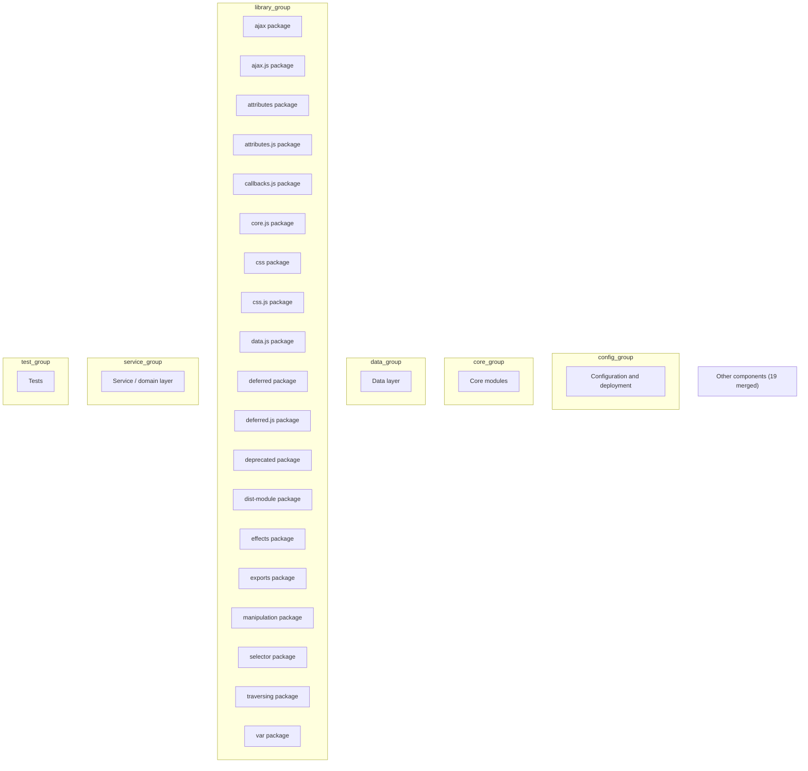

# Architecture report: jquery/jquery

> Automated static analysis. **Observed** = directly seen in files/imports/AST; **Inferred** = interpretation from that evidence. Repository code was not executed.

## 1. Repository at a glance

| Item | Value |
| --- | --- |
| Repository | jquery/jquery |
| Description | jQuery JavaScript Library |
| Language | JavaScript |
| Stars | 59946 |
| Licence | MIT |
| Analysed commit / branch | feaa9fcdb68cdeadf013d97d8fd40848d4618578 / main |
| Framework(s) | None detected |
| Files analysed | 321 |
| Components | 43 |

## 2. Architecture in one minute

jquery/jquery - jQuery JavaScript Library. This repository was analysed statically from 321 file(s) (0 Python). Detected technologies (observed from imports/manifests): GitHub Actions, webpack. Files are grouped into 43 component(s): ajax package, ajax.js package, attributes package, attributes.js package, callbacks.js package, Configuration and deployment, Core modules, core.js package. Findings below distinguish observed facts from inferred interpretation.

## 3. High-level block diagram

## 4. Main components

### ajax package (`ajax`)

- **Kind:** library
- **Status:** Observed
- **Confidence:** 0.85
- **Responsibility:** Groups 8 file(s) under ajax package (observed from repository paths and static analysis).
- **Paths:** `src/ajax/binary.js`, `src/ajax/jsonp.js`, `src/ajax/load.js`, `src/ajax/script.js`, `src/ajax/var/location.js`, `src/ajax/var/nonce.js`, `src/ajax/var/rquery.js`, `src/ajax/xhr.js`
- **Evidence:** [src/ajax/binary.js](https://github.com/jquery/jquery/blob/feaa9fcdb68cdeadf013d97d8fd40848d4618578/src/ajax/binary.js); [src/ajax/jsonp.js](https://github.com/jquery/jquery/blob/feaa9fcdb68cdeadf013d97d8fd40848d4618578/src/ajax/jsonp.js); [src/ajax/load.js](https://github.com/jquery/jquery/blob/feaa9fcdb68cdeadf013d97d8fd40848d4618578/src/ajax/load.js); [src/ajax/script.js](https://github.com/jquery/jquery/blob/feaa9fcdb68cdeadf013d97d8fd40848d4618578/src/ajax/script.js); [src/ajax/var/location.js](https://github.com/jquery/jquery/blob/feaa9fcdb68cdeadf013d97d8fd40848d4618578/src/ajax/var/location.js); [src/ajax/var/nonce.js](https://github.com/jquery/jquery/blob/feaa9fcdb68cdeadf013d97d8fd40848d4618578/src/ajax/var/nonce.js); [src/ajax/var/rquery.js](https://github.com/jquery/jquery/blob/feaa9fcdb68cdeadf013d97d8fd40848d4618578/src/ajax/var/rquery.js); [src/ajax/xhr.js](https://github.com/jquery/jquery/blob/feaa9fcdb68cdeadf013d97d8fd40848d4618578/src/ajax/xhr.js)

### ajax.js package (`ajax_js`)

- **Kind:** library
- **Status:** Observed
- **Confidence:** 0.85
- **Responsibility:** Groups 1 file(s) under ajax.js package (observed from repository paths and static analysis).
- **Paths:** `src/ajax.js`
- **Evidence:** [src/ajax.js](https://github.com/jquery/jquery/blob/feaa9fcdb68cdeadf013d97d8fd40848d4618578/src/ajax.js)

### attributes package (`attributes`)

- **Kind:** library
- **Status:** Observed
- **Confidence:** 0.85
- **Responsibility:** Groups 4 file(s) under attributes package (observed from repository paths and static analysis).
- **Paths:** `src/attributes/attr.js`, `src/attributes/classes.js`, `src/attributes/prop.js`, `src/attributes/val.js`
- **Evidence:** [src/attributes/attr.js](https://github.com/jquery/jquery/blob/feaa9fcdb68cdeadf013d97d8fd40848d4618578/src/attributes/attr.js); [src/attributes/classes.js](https://github.com/jquery/jquery/blob/feaa9fcdb68cdeadf013d97d8fd40848d4618578/src/attributes/classes.js); [src/attributes/prop.js](https://github.com/jquery/jquery/blob/feaa9fcdb68cdeadf013d97d8fd40848d4618578/src/attributes/prop.js); [src/attributes/val.js](https://github.com/jquery/jquery/blob/feaa9fcdb68cdeadf013d97d8fd40848d4618578/src/attributes/val.js)

### attributes.js package (`attributes_js`)

- **Kind:** library
- **Status:** Observed
- **Confidence:** 0.85
- **Responsibility:** Groups 1 file(s) under attributes.js package (observed from repository paths and static analysis).
- **Paths:** `src/attributes.js`
- **Evidence:** [src/attributes.js](https://github.com/jquery/jquery/blob/feaa9fcdb68cdeadf013d97d8fd40848d4618578/src/attributes.js)

### callbacks.js package (`callbacks_js`)

- **Kind:** library
- **Status:** Observed
- **Confidence:** 0.85
- **Responsibility:** Groups 1 file(s) under callbacks.js package (observed from repository paths and static analysis).
- **Paths:** `src/callbacks.js`
- **Evidence:** [src/callbacks.js](https://github.com/jquery/jquery/blob/feaa9fcdb68cdeadf013d97d8fd40848d4618578/src/callbacks.js)

### Configuration and deployment (`config`)

- **Kind:** config
- **Status:** Observed
- **Confidence:** 0.85
- **Responsibility:** Groups 3 file(s) under configuration and deployment (observed from repository paths and static analysis).
- **Paths:** `dist-module/package.json`, `jtr-isolate.yml`, `package.json`
- **Evidence:** [dist-module/package.json](https://github.com/jquery/jquery/blob/feaa9fcdb68cdeadf013d97d8fd40848d4618578/dist-module/package.json); [jtr-isolate.yml](https://github.com/jquery/jquery/blob/feaa9fcdb68cdeadf013d97d8fd40848d4618578/jtr-isolate.yml); [package.json](https://github.com/jquery/jquery/blob/feaa9fcdb68cdeadf013d97d8fd40848d4618578/package.json)

### Core modules (`core`)

- **Kind:** core
- **Status:** Observed
- **Confidence:** 0.85
- **Responsibility:** Groups 1 file(s) under core modules (observed from repository paths and static analysis).
- **Paths:** `eslint.config.js`
- **Evidence:** [eslint.config.js](https://github.com/jquery/jquery/blob/feaa9fcdb68cdeadf013d97d8fd40848d4618578/eslint.config.js)

### core.js package (`core_js`)

- **Kind:** library
- **Status:** Observed
- **Confidence:** 0.85
- **Responsibility:** Groups 1 file(s) under core.js package (observed from repository paths and static analysis).
- **Paths:** `src/core.js`
- **Evidence:** [src/core.js](https://github.com/jquery/jquery/blob/feaa9fcdb68cdeadf013d97d8fd40848d4618578/src/core.js)

### css package (`css`)

- **Kind:** library
- **Status:** Observed
- **Confidence:** 0.85
- **Responsibility:** Groups 13 file(s) under css package (observed from repository paths and static analysis).
- **Paths:** `src/css/adjustCSS.js`, `src/css/cssCamelCase.js`, `src/css/curCSS.js`, `src/css/finalPropName.js`, `src/css/hiddenVisibleSelectors.js`, `src/css/isAutoPx.js`, `src/css/showHide.js`, `src/css/support.js`, `src/css/var/cssExpand.js`, `src/css/var/getStyles.js`, `src/css/var/isHiddenWithinTree.js`, `src/css/var/rnumnonpx.js`, `src/css/var/swap.js`
- **Evidence:** [src/css/adjustCSS.js](https://github.com/jquery/jquery/blob/feaa9fcdb68cdeadf013d97d8fd40848d4618578/src/css/adjustCSS.js); [src/css/cssCamelCase.js](https://github.com/jquery/jquery/blob/feaa9fcdb68cdeadf013d97d8fd40848d4618578/src/css/cssCamelCase.js); [src/css/curCSS.js](https://github.com/jquery/jquery/blob/feaa9fcdb68cdeadf013d97d8fd40848d4618578/src/css/curCSS.js); [src/css/finalPropName.js](https://github.com/jquery/jquery/blob/feaa9fcdb68cdeadf013d97d8fd40848d4618578/src/css/finalPropName.js); [src/css/hiddenVisibleSelectors.js](https://github.com/jquery/jquery/blob/feaa9fcdb68cdeadf013d97d8fd40848d4618578/src/css/hiddenVisibleSelectors.js); [src/css/isAutoPx.js](https://github.com/jquery/jquery/blob/feaa9fcdb68cdeadf013d97d8fd40848d4618578/src/css/isAutoPx.js); [src/css/showHide.js](https://github.com/jquery/jquery/blob/feaa9fcdb68cdeadf013d97d8fd40848d4618578/src/css/showHide.js); [src/css/support.js](https://github.com/jquery/jquery/blob/feaa9fcdb68cdeadf013d97d8fd40848d4618578/src/css/support.js)

### css.js package (`css_js`)

- **Kind:** library
- **Status:** Observed
- **Confidence:** 0.85
- **Responsibility:** Groups 1 file(s) under css.js package (observed from repository paths and static analysis).
- **Paths:** `src/css.js`
- **Evidence:** [src/css.js](https://github.com/jquery/jquery/blob/feaa9fcdb68cdeadf013d97d8fd40848d4618578/src/css.js)

### data.js package (`data_js`)

- **Kind:** library
- **Status:** Observed
- **Confidence:** 0.85
- **Responsibility:** Groups 1 file(s) under data.js package (observed from repository paths and static analysis).
- **Paths:** `src/data.js`
- **Evidence:** [src/data.js](https://github.com/jquery/jquery/blob/feaa9fcdb68cdeadf013d97d8fd40848d4618578/src/data.js)

### Data layer (`data_layer`)

- **Kind:** data
- **Status:** Observed
- **Confidence:** 0.85
- **Responsibility:** Groups 4 file(s) under data layer (observed from repository paths and static analysis).
- **Paths:** `src/data/Data.js`, `src/data/var/acceptData.js`, `src/data/var/dataPriv.js`, `src/data/var/dataUser.js`
- **Evidence:** [src/data/Data.js](https://github.com/jquery/jquery/blob/feaa9fcdb68cdeadf013d97d8fd40848d4618578/src/data/Data.js); [src/data/var/acceptData.js](https://github.com/jquery/jquery/blob/feaa9fcdb68cdeadf013d97d8fd40848d4618578/src/data/var/acceptData.js); [src/data/var/dataPriv.js](https://github.com/jquery/jquery/blob/feaa9fcdb68cdeadf013d97d8fd40848d4618578/src/data/var/dataPriv.js); [src/data/var/dataUser.js](https://github.com/jquery/jquery/blob/feaa9fcdb68cdeadf013d97d8fd40848d4618578/src/data/var/dataUser.js)

### deferred package (`deferred`)

- **Kind:** library
- **Status:** Observed
- **Confidence:** 0.85
- **Responsibility:** Groups 1 file(s) under deferred package (observed from repository paths and static analysis).
- **Paths:** `src/deferred/exceptionHook.js`
- **Evidence:** [src/deferred/exceptionHook.js](https://github.com/jquery/jquery/blob/feaa9fcdb68cdeadf013d97d8fd40848d4618578/src/deferred/exceptionHook.js)

### deferred.js package (`deferred_js`)

- **Kind:** library
- **Status:** Observed
- **Confidence:** 0.85
- **Responsibility:** Groups 1 file(s) under deferred.js package (observed from repository paths and static analysis).
- **Paths:** `src/deferred.js`
- **Evidence:** [src/deferred.js](https://github.com/jquery/jquery/blob/feaa9fcdb68cdeadf013d97d8fd40848d4618578/src/deferred.js)

### deprecated package (`deprecated`)

- **Kind:** library
- **Status:** Observed
- **Confidence:** 0.85
- **Responsibility:** Groups 2 file(s) under deprecated package (observed from repository paths and static analysis).
- **Paths:** `src/deprecated/ajax-event-alias.js`, `src/deprecated/event.js`
- **Evidence:** [src/deprecated/ajax-event-alias.js](https://github.com/jquery/jquery/blob/feaa9fcdb68cdeadf013d97d8fd40848d4618578/src/deprecated/ajax-event-alias.js); [src/deprecated/event.js](https://github.com/jquery/jquery/blob/feaa9fcdb68cdeadf013d97d8fd40848d4618578/src/deprecated/event.js)

### deprecated.js package (`deprecated_js`)

- **Kind:** library
- **Status:** Observed
- **Confidence:** 0.85
- **Responsibility:** Groups 1 file(s) under deprecated.js package (observed from repository paths and static analysis).
- **Paths:** `src/deprecated.js`
- **Evidence:** [src/deprecated.js](https://github.com/jquery/jquery/blob/feaa9fcdb68cdeadf013d97d8fd40848d4618578/src/deprecated.js)

### dimensions.js package (`dimensions_js`)

- **Kind:** library
- **Status:** Observed
- **Confidence:** 0.85
- **Responsibility:** Groups 1 file(s) under dimensions.js package (observed from repository paths and static analysis).
- **Paths:** `src/dimensions.js`
- **Evidence:** [src/dimensions.js](https://github.com/jquery/jquery/blob/feaa9fcdb68cdeadf013d97d8fd40848d4618578/src/dimensions.js)

### dist-module package (`dist_module`)

- **Kind:** library
- **Status:** Observed
- **Confidence:** 0.85
- **Responsibility:** Groups 2 file(s) under dist-module package (observed from repository paths and static analysis).
- **Paths:** `dist-module/wrappers/jquery.node-module-wrapper.js`, `dist-module/wrappers/jquery.node-module-wrapper.slim.js`
- **Evidence:** [dist-module/wrappers/jquery.node-module-wrapper.js](https://github.com/jquery/jquery/blob/feaa9fcdb68cdeadf013d97d8fd40848d4618578/dist-module/wrappers/jquery.node-module-wrapper.js); [dist-module/wrappers/jquery.node-module-wrapper.slim.js](https://github.com/jquery/jquery/blob/feaa9fcdb68cdeadf013d97d8fd40848d4618578/dist-module/wrappers/jquery.node-module-wrapper.slim.js)

### effects package (`effects`)

- **Kind:** library
- **Status:** Observed
- **Confidence:** 0.85
- **Responsibility:** Groups 2 file(s) under effects package (observed from repository paths and static analysis).
- **Paths:** `src/effects/Tween.js`, `src/effects/animatedSelector.js`
- **Evidence:** [src/effects/Tween.js](https://github.com/jquery/jquery/blob/feaa9fcdb68cdeadf013d97d8fd40848d4618578/src/effects/Tween.js); [src/effects/animatedSelector.js](https://github.com/jquery/jquery/blob/feaa9fcdb68cdeadf013d97d8fd40848d4618578/src/effects/animatedSelector.js)

### effects.js package (`effects_js`)

- **Kind:** library
- **Status:** Observed
- **Confidence:** 0.85
- **Responsibility:** Groups 1 file(s) under effects.js package (observed from repository paths and static analysis).
- **Paths:** `src/effects.js`
- **Evidence:** [src/effects.js](https://github.com/jquery/jquery/blob/feaa9fcdb68cdeadf013d97d8fd40848d4618578/src/effects.js)

### event package (`event`)

- **Kind:** library
- **Status:** Observed
- **Confidence:** 0.85
- **Responsibility:** Groups 1 file(s) under event package (observed from repository paths and static analysis).
- **Paths:** `src/event/trigger.js`
- **Evidence:** [src/event/trigger.js](https://github.com/jquery/jquery/blob/feaa9fcdb68cdeadf013d97d8fd40848d4618578/src/event/trigger.js)

### event.js package (`event_js`)

- **Kind:** library
- **Status:** Observed
- **Confidence:** 0.85
- **Responsibility:** Groups 1 file(s) under event.js package (observed from repository paths and static analysis).
- **Paths:** `src/event.js`
- **Evidence:** [src/event.js](https://github.com/jquery/jquery/blob/feaa9fcdb68cdeadf013d97d8fd40848d4618578/src/event.js)

### exports package (`exports`)

- **Kind:** library
- **Status:** Observed
- **Confidence:** 0.85
- **Responsibility:** Groups 2 file(s) under exports package (observed from repository paths and static analysis).
- **Paths:** `src/exports/amd.js`, `src/exports/global.js`
- **Evidence:** [src/exports/amd.js](https://github.com/jquery/jquery/blob/feaa9fcdb68cdeadf013d97d8fd40848d4618578/src/exports/amd.js); [src/exports/global.js](https://github.com/jquery/jquery/blob/feaa9fcdb68cdeadf013d97d8fd40848d4618578/src/exports/global.js)

### jquery.js package (`jquery_js`)

- **Kind:** library
- **Status:** Observed
- **Confidence:** 0.85
- **Responsibility:** Groups 1 file(s) under jquery.js package (observed from repository paths and static analysis).
- **Paths:** `src/jquery.js`
- **Evidence:** [src/jquery.js](https://github.com/jquery/jquery/blob/feaa9fcdb68cdeadf013d97d8fd40848d4618578/src/jquery.js)

### manipulation package (`manipulation`)

- **Kind:** library
- **Status:** Observed
- **Confidence:** 0.85
- **Responsibility:** Groups 8 file(s) under manipulation package (observed from repository paths and static analysis).
- **Paths:** `src/manipulation/_evalUrl.js`, `src/manipulation/buildFragment.js`, `src/manipulation/domManip.js`, `src/manipulation/getAll.js`, `src/manipulation/setGlobalEval.js`, `src/manipulation/var/rscriptType.js`, `src/manipulation/var/rtagName.js`, `src/manipulation/wrapMap.js`
- **Evidence:** [src/manipulation/_evalUrl.js](https://github.com/jquery/jquery/blob/feaa9fcdb68cdeadf013d97d8fd40848d4618578/src/manipulation/_evalUrl.js); [src/manipulation/buildFragment.js](https://github.com/jquery/jquery/blob/feaa9fcdb68cdeadf013d97d8fd40848d4618578/src/manipulation/buildFragment.js); [src/manipulation/domManip.js](https://github.com/jquery/jquery/blob/feaa9fcdb68cdeadf013d97d8fd40848d4618578/src/manipulation/domManip.js); [src/manipulation/getAll.js](https://github.com/jquery/jquery/blob/feaa9fcdb68cdeadf013d97d8fd40848d4618578/src/manipulation/getAll.js); [src/manipulation/setGlobalEval.js](https://github.com/jquery/jquery/blob/feaa9fcdb68cdeadf013d97d8fd40848d4618578/src/manipulation/setGlobalEval.js); [src/manipulation/var/rscriptType.js](https://github.com/jquery/jquery/blob/feaa9fcdb68cdeadf013d97d8fd40848d4618578/src/manipulation/var/rscriptType.js); [src/manipulation/var/rtagName.js](https://github.com/jquery/jquery/blob/feaa9fcdb68cdeadf013d97d8fd40848d4618578/src/manipulation/var/rtagName.js); [src/manipulation/wrapMap.js](https://github.com/jquery/jquery/blob/feaa9fcdb68cdeadf013d97d8fd40848d4618578/src/manipulation/wrapMap.js)

### manipulation.js package (`manipulation_js`)

- **Kind:** library
- **Status:** Observed
- **Confidence:** 0.85
- **Responsibility:** Groups 1 file(s) under manipulation.js package (observed from repository paths and static analysis).
- **Paths:** `src/manipulation.js`
- **Evidence:** [src/manipulation.js](https://github.com/jquery/jquery/blob/feaa9fcdb68cdeadf013d97d8fd40848d4618578/src/manipulation.js)

### offset.js package (`offset_js`)

- **Kind:** library
- **Status:** Observed
- **Confidence:** 0.85
- **Responsibility:** Groups 1 file(s) under offset.js package (observed from repository paths and static analysis).
- **Paths:** `src/offset.js`
- **Evidence:** [src/offset.js](https://github.com/jquery/jquery/blob/feaa9fcdb68cdeadf013d97d8fd40848d4618578/src/offset.js)

### queue package (`queue`)

- **Kind:** library
- **Status:** Observed
- **Confidence:** 0.85
- **Responsibility:** Groups 1 file(s) under queue package (observed from repository paths and static analysis).
- **Paths:** `src/queue/delay.js`
- **Evidence:** [src/queue/delay.js](https://github.com/jquery/jquery/blob/feaa9fcdb68cdeadf013d97d8fd40848d4618578/src/queue/delay.js)

### queue.js package (`queue_js`)

- **Kind:** library
- **Status:** Observed
- **Confidence:** 0.85
- **Responsibility:** Groups 1 file(s) under queue.js package (observed from repository paths and static analysis).
- **Paths:** `src/queue.js`
- **Evidence:** [src/queue.js](https://github.com/jquery/jquery/blob/feaa9fcdb68cdeadf013d97d8fd40848d4618578/src/queue.js)

### selector package (`selector`)

- **Kind:** library
- **Status:** Observed
- **Confidence:** 0.85
- **Responsibility:** Groups 21 file(s) under selector package (observed from repository paths and static analysis).
- **Paths:** `src/selector/createCache.js`, `src/selector/escapeSelector.js`, `src/selector/filterMatchExpr.js`, `src/selector/preFilter.js`, `src/selector/rbuggyQSA.js`, `src/selector/selectorError.js`, `src/selector/testContext.js`, `src/selector/toSelector.js`, `src/selector/tokenize.js`, `src/selector/unescapeSelector.js`, `src/selector/uniqueSort.js`, `src/selector/var/attributes.js`, `src/selector/var/escape.js`, `src/selector/var/identifier.js`, `src/selector/var/matches.js`, `src/selector/var/pseudos.js`, `src/selector/var/rcomma.js`, `src/selector/var/rdescend.js`, `src/selector/var/rleadingCombinator.js`, `src/selector/var/rpseudo.js`, `src/selector/var/rsibling.js`
- **Evidence:** [src/selector/createCache.js](https://github.com/jquery/jquery/blob/feaa9fcdb68cdeadf013d97d8fd40848d4618578/src/selector/createCache.js); [src/selector/escapeSelector.js](https://github.com/jquery/jquery/blob/feaa9fcdb68cdeadf013d97d8fd40848d4618578/src/selector/escapeSelector.js); [src/selector/filterMatchExpr.js](https://github.com/jquery/jquery/blob/feaa9fcdb68cdeadf013d97d8fd40848d4618578/src/selector/filterMatchExpr.js); [src/selector/preFilter.js](https://github.com/jquery/jquery/blob/feaa9fcdb68cdeadf013d97d8fd40848d4618578/src/selector/preFilter.js); [src/selector/rbuggyQSA.js](https://github.com/jquery/jquery/blob/feaa9fcdb68cdeadf013d97d8fd40848d4618578/src/selector/rbuggyQSA.js); [src/selector/selectorError.js](https://github.com/jquery/jquery/blob/feaa9fcdb68cdeadf013d97d8fd40848d4618578/src/selector/selectorError.js); [src/selector/testContext.js](https://github.com/jquery/jquery/blob/feaa9fcdb68cdeadf013d97d8fd40848d4618578/src/selector/testContext.js); [src/selector/toSelector.js](https://github.com/jquery/jquery/blob/feaa9fcdb68cdeadf013d97d8fd40848d4618578/src/selector/toSelector.js)

### selector.js package (`selector_js`)

- **Kind:** library
- **Status:** Observed
- **Confidence:** 0.85
- **Responsibility:** Groups 1 file(s) under selector.js package (observed from repository paths and static analysis).
- **Paths:** `src/selector.js`
- **Evidence:** [src/selector.js](https://github.com/jquery/jquery/blob/feaa9fcdb68cdeadf013d97d8fd40848d4618578/src/selector.js)

### selector-native.js package (`selector_native_js`)

- **Kind:** library
- **Status:** Observed
- **Confidence:** 0.85
- **Responsibility:** Groups 1 file(s) under selector-native.js package (observed from repository paths and static analysis).
- **Paths:** `src/selector-native.js`
- **Evidence:** [src/selector-native.js](https://github.com/jquery/jquery/blob/feaa9fcdb68cdeadf013d97d8fd40848d4618578/src/selector-native.js)

### serialize.js package (`serialize_js`)

- **Kind:** library
- **Status:** Observed
- **Confidence:** 0.85
- **Responsibility:** Groups 1 file(s) under serialize.js package (observed from repository paths and static analysis).
- **Paths:** `src/serialize.js`
- **Evidence:** [src/serialize.js](https://github.com/jquery/jquery/blob/feaa9fcdb68cdeadf013d97d8fd40848d4618578/src/serialize.js)

### Service / domain layer (`service_layer`)

- **Kind:** service
- **Status:** Observed
- **Confidence:** 0.85
- **Responsibility:** Groups 16 file(s) under service / domain layer (observed from repository paths and static analysis).
- **Paths:** `src/core/DOMEval.js`, `src/core/access.js`, `src/core/camelCase.js`, `src/core/init.js`, `src/core/isArrayLike.js`, `src/core/isAttached.js`, `src/core/isObviousHtml.js`, `src/core/nodeName.js`, `src/core/parseHTML.js`, `src/core/parseXML.js`, `src/core/ready-no-deferred.js`, `src/core/ready.js`, `src/core/readyException.js`, `src/core/stripAndCollapse.js`, `src/core/toType.js`, `src/core/var/rsingleTag.js`
- **Evidence:** [src/core/DOMEval.js](https://github.com/jquery/jquery/blob/feaa9fcdb68cdeadf013d97d8fd40848d4618578/src/core/DOMEval.js); [src/core/access.js](https://github.com/jquery/jquery/blob/feaa9fcdb68cdeadf013d97d8fd40848d4618578/src/core/access.js); [src/core/camelCase.js](https://github.com/jquery/jquery/blob/feaa9fcdb68cdeadf013d97d8fd40848d4618578/src/core/camelCase.js); [src/core/init.js](https://github.com/jquery/jquery/blob/feaa9fcdb68cdeadf013d97d8fd40848d4618578/src/core/init.js); [src/core/isArrayLike.js](https://github.com/jquery/jquery/blob/feaa9fcdb68cdeadf013d97d8fd40848d4618578/src/core/isArrayLike.js); [src/core/isAttached.js](https://github.com/jquery/jquery/blob/feaa9fcdb68cdeadf013d97d8fd40848d4618578/src/core/isAttached.js); [src/core/isObviousHtml.js](https://github.com/jquery/jquery/blob/feaa9fcdb68cdeadf013d97d8fd40848d4618578/src/core/isObviousHtml.js); [src/core/nodeName.js](https://github.com/jquery/jquery/blob/feaa9fcdb68cdeadf013d97d8fd40848d4618578/src/core/nodeName.js)

### Tests (`tests`)

- **Kind:** test
- **Status:** Observed
- **Confidence:** 0.85
- **Responsibility:** Groups 150 file(s) under tests (observed from repository paths and static analysis).
- **Paths:** `test/bundler_smoke_tests/lib/run-rollup.js`, `test/bundler_smoke_tests/lib/run-webpack.js`, `test/bundler_smoke_tests/lib/utils.js`, `test/bundler_smoke_tests/rollup-commonjs.config.js`, `test/bundler_smoke_tests/rollup-pure-esm.config.js`, `test/bundler_smoke_tests/run-jsdom-tests.js`, `test/bundler_smoke_tests/src-esm-commonjs/jquery-require.cjs`, `test/bundler_smoke_tests/src-esm-commonjs/main.js`, `test/bundler_smoke_tests/src-pure-esm/main.js`, `test/bundler_smoke_tests/test.html`, `test/bundler_smoke_tests/webpack.config.cjs`, `test/data/1x1.svg`, `test/data/ajax/onunload.html`, `test/data/ajax/unreleasedXHR.html`, `test/data/ajax/xmlDocCrossDomainDetection.xhtml`, `test/data/badcall.js`, `test/data/badjson.js`, `test/data/cleanScript.html`, `test/data/core/.babelrc.json`, `test/data/core/aliased.html`, `test/data/core/dynamic_ready.html`, `test/data/core/globaleval-context.html`, `test/data/core/jquery-iterability-transpiled-es6.js`, `test/data/core/jquery-iterability-transpiled.html`, `test/data/core/onready.html`, `test/data/csp-ajax-script-downloaded.js`, `test/data/csp-ajax-script.html`, `test/data/csp-ajax-script.js`, `test/data/csp-nonce-external.html`, `test/data/csp-nonce-external.js`, `test/data/csp-nonce-globaleval.html`, `test/data/csp-nonce-globaleval.js`, `test/data/csp-nonce.html`, `test/data/csp-nonce.js`, `test/data/csp.include.html`, `test/data/css/cssComputeStyleTests.html`, `test/data/css/cssWidthBeforeDocReady.html`, `test/data/css/cssWidthBrowserZoom.html`, `test/data/css/xmlDocCss.xhtml`, `test/data/dashboard.xml`, `test/data/data/dataAttrs.html`, `test/data/dimensions/documentLarge.html`, `test/data/event/focusElem.html`, `test/data/event/focusinCrossFrame.html`, `test/data/event/interactiveReady.html`, `test/data/event/onbeforeunload.html`, `test/data/event/promiseReady.html`, `test/data/event/syncReady.html`, `test/data/event/triggerunload.html`, `test/data/frame.html`, `test/data/iframe.html`, `test/data/iframeTest.js`, `test/data/inner_module.js`, `test/data/inner_nomodule.js`, `test/data/json_obj.js`, `test/data/manipulation/iframe-denied.html`, `test/data/manipulation/scripts-context.html`, `test/data/manipulation/set-global-scripttest.js`, `test/data/mock.php`, `test/data/module.js`, `test/data/name.html`, `test/data/nomodule.js`, `test/data/offset/absolute.html`, `test/data/offset/body.html`, `test/data/offset/boxes.html`, `test/data/offset/fixed.html`, `test/data/offset/relative.html`, `test/data/offset/scroll.html`, `test/data/offset/static.html`, `test/data/offset/table.html`, `test/data/qunit-fixture.html`, `test/data/readywait.html`, `test/data/selector/cache.html`, `test/data/selector/html5_selector.html`, `test/data/selector/mixed_sort.html`, `test/data/support/bodyBackground.html`, `test/data/support/bootstrap.html`, `test/data/support/csp.js`, `test/data/support/csp.log`, `test/data/support/getComputedSupport.js`, `test/data/support/zoom.html`, `test/data/test.include.html`, `test/data/test2.html`, `test/data/test3.html`, `test/data/testinit.js`, `test/data/testrunner.js`, `test/data/testsuite.css`, `test/data/text.txt`, `test/data/trusted-html.html`, `test/data/trusted-types-attributes.html`, `test/data/trusted-types-attributes.js`, `test/data/with_fries.xml`, `test/delegatetest.html`, `test/hovertest.html`, `test/index.html`, `test/integration/data/gh-1764-fullscreen-iframe.css`, `test/integration/data/gh-1764-fullscreen-iframe.html`, `test/integration/data/gh-1764-fullscreen.js`, `test/integration/gh-1764-fullscreen.html`, `test/integration/gh-2343-ie-radio-click.html`, `test/jquery.js`, `test/middleware-mockserver.cjs`, `test/networkerror.html`, `test/node_smoke_tests/commonjs/factory/document_missing.cjs`, `test/node_smoke_tests/commonjs/factory/document_passed.cjs`, `test/node_smoke_tests/commonjs/factory/iterable_with_native_symbol.cjs`, `test/node_smoke_tests/commonjs/lib/ensure_global_not_created.cjs`, `test/node_smoke_tests/commonjs/lib/ensure_iterability_es6.cjs`, `test/node_smoke_tests/commonjs/lib/ensure_jquery.cjs`, `test/node_smoke_tests/commonjs/lib/jquery-module-specifier.cjs`, `test/node_smoke_tests/commonjs/regular/window_present_originally.cjs`, `test/node_smoke_tests/dual/factory/import-and-require-factory.js`, `test/node_smoke_tests/dual/lib/jquery-require-factory.cjs`, `test/node_smoke_tests/dual/lib/jquery-require.cjs`, `test/node_smoke_tests/dual/regular/import-and-require.js`, `test/node_smoke_tests/module/factory/document_missing.js`, `test/node_smoke_tests/module/factory/document_passed.js`, `test/node_smoke_tests/module/factory/iterable_with_native_symbol.js`, `test/node_smoke_tests/module/lib/ensure_global_not_created.js`, `test/node_smoke_tests/module/lib/ensure_iterability_es6.js`, `test/node_smoke_tests/module/lib/ensure_jquery.js`, `test/node_smoke_tests/module/lib/jquery-module-specifier.js`, `test/node_smoke_tests/module/regular/window_present_originally.js`, `test/promises_aplus_adapters/deferred.cjs`, `test/promises_aplus_adapters/when.cjs`, `test/unit/ajax.js`, `test/unit/animation.js`, `test/unit/attributes.js`, `test/unit/basic.js`, `test/unit/callbacks.js`, `test/unit/core.js`, `test/unit/css.js`, `test/unit/data.js`, `test/unit/deferred.js`, `test/unit/deprecated.js`, `test/unit/dimensions.js`, `test/unit/effects.js`, `test/unit/event.js`, `test/unit/exports.js`, `test/unit/manipulation.js`, `test/unit/offset.js`, `test/unit/queue.js`, `test/unit/ready.js`, `test/unit/selector.js`, `test/unit/serialize.js`, `test/unit/support.js`, `test/unit/traversing.js`, `test/unit/tween.js`, `test/unit/wrap.js`, `test/xhtml.php`
- **Evidence:** [test/bundler_smoke_tests/lib/run-rollup.js](https://github.com/jquery/jquery/blob/feaa9fcdb68cdeadf013d97d8fd40848d4618578/test/bundler_smoke_tests/lib/run-rollup.js); [test/bundler_smoke_tests/lib/run-webpack.js](https://github.com/jquery/jquery/blob/feaa9fcdb68cdeadf013d97d8fd40848d4618578/test/bundler_smoke_tests/lib/run-webpack.js); [test/bundler_smoke_tests/lib/utils.js](https://github.com/jquery/jquery/blob/feaa9fcdb68cdeadf013d97d8fd40848d4618578/test/bundler_smoke_tests/lib/utils.js); [test/bundler_smoke_tests/rollup-commonjs.config.js](https://github.com/jquery/jquery/blob/feaa9fcdb68cdeadf013d97d8fd40848d4618578/test/bundler_smoke_tests/rollup-commonjs.config.js); [test/bundler_smoke_tests/rollup-pure-esm.config.js](https://github.com/jquery/jquery/blob/feaa9fcdb68cdeadf013d97d8fd40848d4618578/test/bundler_smoke_tests/rollup-pure-esm.config.js); [test/bundler_smoke_tests/run-jsdom-tests.js](https://github.com/jquery/jquery/blob/feaa9fcdb68cdeadf013d97d8fd40848d4618578/test/bundler_smoke_tests/run-jsdom-tests.js); [test/bundler_smoke_tests/src-esm-commonjs/jquery-require.cjs](https://github.com/jquery/jquery/blob/feaa9fcdb68cdeadf013d97d8fd40848d4618578/test/bundler_smoke_tests/src-esm-commonjs/jquery-require.cjs); [test/bundler_smoke_tests/src-esm-commonjs/main.js](https://github.com/jquery/jquery/blob/feaa9fcdb68cdeadf013d97d8fd40848d4618578/test/bundler_smoke_tests/src-esm-commonjs/main.js)

### traversing package (`traversing`)

- **Kind:** library
- **Status:** Observed
- **Confidence:** 0.85
- **Responsibility:** Groups 4 file(s) under traversing package (observed from repository paths and static analysis).
- **Paths:** `src/traversing/findFilter.js`, `src/traversing/var/dir.js`, `src/traversing/var/rneedsContext.js`, `src/traversing/var/siblings.js`
- **Evidence:** [src/traversing/findFilter.js](https://github.com/jquery/jquery/blob/feaa9fcdb68cdeadf013d97d8fd40848d4618578/src/traversing/findFilter.js); [src/traversing/var/dir.js](https://github.com/jquery/jquery/blob/feaa9fcdb68cdeadf013d97d8fd40848d4618578/src/traversing/var/dir.js); [src/traversing/var/rneedsContext.js](https://github.com/jquery/jquery/blob/feaa9fcdb68cdeadf013d97d8fd40848d4618578/src/traversing/var/rneedsContext.js); [src/traversing/var/siblings.js](https://github.com/jquery/jquery/blob/feaa9fcdb68cdeadf013d97d8fd40848d4618578/src/traversing/var/siblings.js)

### traversing.js package (`traversing_js`)

- **Kind:** library
- **Status:** Observed
- **Confidence:** 0.85
- **Responsibility:** Groups 1 file(s) under traversing.js package (observed from repository paths and static analysis).
- **Paths:** `src/traversing.js`
- **Evidence:** [src/traversing.js](https://github.com/jquery/jquery/blob/feaa9fcdb68cdeadf013d97d8fd40848d4618578/src/traversing.js)

### var package (`var`)

- **Kind:** library
- **Status:** Observed
- **Confidence:** 0.85
- **Responsibility:** Groups 27 file(s) under var package (observed from repository paths and static analysis).
- **Paths:** `src/var/ObjectFunctionString.js`, `src/var/arr.js`, `src/var/class2type.js`, `src/var/createElement.js`, `src/var/document.js`, `src/var/documentElement.js`, `src/var/flat.js`, `src/var/fnToString.js`, `src/var/getProto.js`, `src/var/hasOwn.js`, `src/var/indexOf.js`, `src/var/isIE.js`, `src/var/isWindow.js`, `src/var/pnum.js`, `src/var/pop.js`, `src/var/push.js`, `src/var/rcheckableType.js`, `src/var/rcssNum.js`, `src/var/rdoubleDash.js`, `src/var/rnothtmlwhite.js`, `src/var/rtrimCSS.js`, `src/var/slice.js`, `src/var/sort.js`, `src/var/splice.js`, `src/var/support.js`, `src/var/toString.js`, `src/var/whitespace.js`
- **Evidence:** [src/var/ObjectFunctionString.js](https://github.com/jquery/jquery/blob/feaa9fcdb68cdeadf013d97d8fd40848d4618578/src/var/ObjectFunctionString.js); [src/var/arr.js](https://github.com/jquery/jquery/blob/feaa9fcdb68cdeadf013d97d8fd40848d4618578/src/var/arr.js); [src/var/class2type.js](https://github.com/jquery/jquery/blob/feaa9fcdb68cdeadf013d97d8fd40848d4618578/src/var/class2type.js); [src/var/createElement.js](https://github.com/jquery/jquery/blob/feaa9fcdb68cdeadf013d97d8fd40848d4618578/src/var/createElement.js); [src/var/document.js](https://github.com/jquery/jquery/blob/feaa9fcdb68cdeadf013d97d8fd40848d4618578/src/var/document.js); [src/var/documentElement.js](https://github.com/jquery/jquery/blob/feaa9fcdb68cdeadf013d97d8fd40848d4618578/src/var/documentElement.js); [src/var/flat.js](https://github.com/jquery/jquery/blob/feaa9fcdb68cdeadf013d97d8fd40848d4618578/src/var/flat.js); [src/var/fnToString.js](https://github.com/jquery/jquery/blob/feaa9fcdb68cdeadf013d97d8fd40848d4618578/src/var/fnToString.js)

### wrap.js package (`wrap_js`)

- **Kind:** library
- **Status:** Observed
- **Confidence:** 0.85
- **Responsibility:** Groups 1 file(s) under wrap.js package (observed from repository paths and static analysis).
- **Paths:** `src/wrap.js`
- **Evidence:** [src/wrap.js](https://github.com/jquery/jquery/blob/feaa9fcdb68cdeadf013d97d8fd40848d4618578/src/wrap.js)

### wrapper-esm.js package (`wrapper_esm_js`)

- **Kind:** library
- **Status:** Observed
- **Confidence:** 0.85
- **Responsibility:** Groups 1 file(s) under wrapper-esm.js package (observed from repository paths and static analysis).
- **Paths:** `src/wrapper-esm.js`
- **Evidence:** [src/wrapper-esm.js](https://github.com/jquery/jquery/blob/feaa9fcdb68cdeadf013d97d8fd40848d4618578/src/wrapper-esm.js)

### wrapper-factory-esm.js package (`wrapper_factory_esm_js`)

- **Kind:** library
- **Status:** Observed
- **Confidence:** 0.85
- **Responsibility:** Groups 1 file(s) under wrapper-factory-esm.js package (observed from repository paths and static analysis).
- **Paths:** `src/wrapper-factory-esm.js`
- **Evidence:** [src/wrapper-factory-esm.js](https://github.com/jquery/jquery/blob/feaa9fcdb68cdeadf013d97d8fd40848d4618578/src/wrapper-factory-esm.js)

### wrapper-factory.js package (`wrapper_factory_js`)

- **Kind:** library
- **Status:** Observed
- **Confidence:** 0.85
- **Responsibility:** Groups 1 file(s) under wrapper-factory.js package (observed from repository paths and static analysis).
- **Paths:** `src/wrapper-factory.js`
- **Evidence:** [src/wrapper-factory.js](https://github.com/jquery/jquery/blob/feaa9fcdb68cdeadf013d97d8fd40848d4618578/src/wrapper-factory.js)

### wrapper.js package (`wrapper_js`)

- **Kind:** library
- **Status:** Observed
- **Confidence:** 0.85
- **Responsibility:** Groups 1 file(s) under wrapper.js package (observed from repository paths and static analysis).
- **Paths:** `src/wrapper.js`
- **Evidence:** [src/wrapper.js](https://github.com/jquery/jquery/blob/feaa9fcdb68cdeadf013d97d8fd40848d4618578/src/wrapper.js)

## 5. Execution flow

No entry point was observed; the startup flow below is therefore limited.

Representative flow (derived from observed entry points and the import graph; steps beyond the entry point are **Inferred**):

1. Execution starts at an observed entry point listed above, if present.
2. No internal import relationships between components were observed.

## 6. Project structure

### `(root)`

- `.editorconfig` - config (278 bytes)
- `.gitattributes` - other (207 bytes)
- `.gitignore` - other (609 bytes)
- `.mailmap` - other (5935 bytes)
- `.npmignore` - other (167 bytes)
- `.release-it.cjs` - source, JavaScript (1489 bytes)
- `AUTHORS.txt` - docs (14252 bytes)
- `CODE_OF_CONDUCT.md` - docs (160 bytes)
- `CONTRIBUTING.md` - docs (10774 bytes)
- `LICENSE.txt` - docs (1097 bytes)
- `README.md` - docs (15044 bytes)
- `SECURITY.md` - docs (1486 bytes)
- `changelog.md` - docs (38189 bytes)
- `eslint.config.js` - source, JavaScript (7531 bytes)
- `jtr-isolate.yml` - config (371 bytes)
- `package.json` - manifest (7341 bytes)

### `.github`

- `.github/ISSUE_TEMPLATE.md` - docs (974 bytes)
- `.github/PULL_REQUEST_TEMPLATE.md` - docs (501 bytes)
- `.github/dependabot.yml` - config (794 bytes)
- `.github/workflows/browser-tests-beta.yml` - ci, YAML (9565 bytes)
- `.github/workflows/browser-tests.yml` - ci, YAML (3191 bytes)
- `.github/workflows/browserstack-dispatch.yml` - ci, YAML (1753 bytes)
- `.github/workflows/browserstack.yml` - ci, YAML (2143 bytes)
- `.github/workflows/codeql-analysis.yml` - ci, YAML (2143 bytes)
- `.github/workflows/filestash.yml` - ci, YAML (2503 bytes)
- `.github/workflows/lock-threads.yml` - ci, YAML (454 bytes)
- `.github/workflows/node.js.yml` - ci, YAML (1179 bytes)
- `.github/workflows/verify-release.yml` - ci, YAML (1193 bytes)

### `.husky`

- `.husky/commit-msg` - other (38 bytes)
- `.husky/pre-push` - other (36 bytes)

### `dist-module`

- `dist-module/package.json` - manifest (23 bytes)
- `dist-module/wrappers/jquery.node-module-wrapper.js` - source, JavaScript (166 bytes)
- `dist-module/wrappers/jquery.node-module-wrapper.slim.js` - source, JavaScript (171 bytes)

### `src`

- `src/ajax.js` - source, JavaScript (23698 bytes)
- `src/ajax/binary.js` - source, JavaScript (643 bytes)
- `src/ajax/jsonp.js` - source, JavaScript (2563 bytes)
- `src/ajax/load.js` - source, JavaScript (1912 bytes)
- `src/ajax/script.js` - source, JavaScript (2569 bytes)
- `src/ajax/var/location.js` - source, JavaScript (39 bytes)
- `src/ajax/var/nonce.js` - source, JavaScript (41 bytes)
- `src/ajax/var/rquery.js` - source, JavaScript (26 bytes)
- `src/ajax/xhr.js` - source, JavaScript (2814 bytes)
- `src/attributes.js` - source, JavaScript (243 bytes)
- `src/attributes/attr.js` - source, JavaScript (2688 bytes)
- `src/attributes/classes.js` - source, JavaScript (3623 bytes)
- `src/attributes/prop.js` - source, JavaScript (3004 bytes)
- `src/attributes/val.js` - source, JavaScript (3770 bytes)
- `src/callbacks.js` - source, JavaScript (5550 bytes)
- `src/core.js` - source, JavaScript (9794 bytes)
- `src/core/DOMEval.js` - source, JavaScript (490 bytes)
- `src/core/access.js` - source, JavaScript (1259 bytes)
- `src/core/camelCase.js` - source, JavaScript (309 bytes)
- `src/core/init.js` - source, JavaScript (3429 bytes)
- `src/core/isArrayLike.js` - source, JavaScript (374 bytes)
- `src/core/isAttached.js` - source, JavaScript (602 bytes)
- `src/core/isObviousHtml.js` - source, JavaScript (133 bytes)
- `src/core/nodeName.js` - source, JavaScript (120 bytes)
- `src/core/parseHTML.js` - source, JavaScript (1265 bytes)
- `src/core/parseXML.js` - source, JavaScript (669 bytes)
- `src/core/ready-no-deferred.js` - source, JavaScript (2072 bytes)
- `src/core/ready.js` - source, JavaScript (1945 bytes)
- `src/core/readyException.js` - source, JavaScript (139 bytes)
- `src/core/stripAndCollapse.js` - source, JavaScript (308 bytes)
- `src/core/toType.js` - source, JavaScript (277 bytes)
- `src/core/var/rsingleTag.js` - source, JavaScript (212 bytes)
- `src/css.js` - source, JavaScript (11546 bytes)
- `src/css/adjustCSS.js` - source, JavaScript (2012 bytes)
- `src/css/cssCamelCase.js` - source, JavaScript (396 bytes)
- `src/css/curCSS.js` - source, JavaScript (2391 bytes)
- `src/css/finalPropName.js` - source, JavaScript (649 bytes)
- `src/css/hiddenVisibleSelectors.js` - source, JavaScript (298 bytes)
- `src/css/isAutoPx.js` - source, JavaScript (1621 bytes)
- `src/css/showHide.js` - source, JavaScript (2299 bytes)
- `src/css/support.js` - source, JavaScript (2872 bytes)
- `src/css/var/cssExpand.js` - source, JavaScript (61 bytes)
- `src/css/var/getStyles.js` - source, JavaScript (522 bytes)
- `src/css/var/isHiddenWithinTree.js` - source, JavaScript (988 bytes)
- `src/css/var/rnumnonpx.js` - source, JavaScript (118 bytes)
- `src/css/var/swap.js` - source, JavaScript (462 bytes)
- `src/data.js` - source, JavaScript (4277 bytes)
- `src/data/Data.js` - source, JavaScript (3992 bytes)
- `src/data/var/acceptData.js` - source, JavaScript (285 bytes)
- `src/data/var/dataPriv.js` - source, JavaScript (70 bytes)
- `src/data/var/dataUser.js` - source, JavaScript (70 bytes)
- `src/deferred.js` - source, JavaScript (10924 bytes)
- `src/deferred/exceptionHook.js` - source, JavaScript (654 bytes)
- `src/deprecated.js` - source, JavaScript (1246 bytes)
- `src/deprecated/ajax-event-alias.js` - source, JavaScript (286 bytes)
- `src/deprecated/event.js` - source, JavaScript (1149 bytes)
- `src/dimensions.js` - source, JavaScript (1789 bytes)
- `src/effects.js` - source, JavaScript (17369 bytes)
- `src/effects/Tween.js` - source, JavaScript (3046 bytes)
- `src/effects/animatedSelector.js` - source, JavaScript (234 bytes)
- `src/event.js` - source, JavaScript (25834 bytes)
- `src/event/trigger.js` - source, JavaScript (5476 bytes)
- `src/exports/amd.js` - source, JavaScript (995 bytes)
- `src/exports/global.js` - source, JavaScript (564 bytes)
- `src/jquery.js` - source, JavaScript (978 bytes)
- `src/manipulation.js` - source, JavaScript (8509 bytes)
- `src/manipulation/_evalUrl.js` - source, JavaScript (725 bytes)
- `src/manipulation/buildFragment.js` - source, JavaScript (2510 bytes)
- `src/manipulation/domManip.js` - source, JavaScript (3026 bytes)
- `src/manipulation/getAll.js` - source, JavaScript (675 bytes)
- `src/manipulation/setGlobalEval.js` - source, JavaScript (337 bytes)
- `src/manipulation/var/rscriptType.js` - source, JavaScript (63 bytes)
- `src/manipulation/var/rtagName.js` - source, JavaScript (269 bytes)
- `src/manipulation/wrapMap.js` - source, JavaScript (534 bytes)
- `src/offset.js` - source, JavaScript (5968 bytes)
- `src/queue.js` - source, JavaScript (3110 bytes)
- `src/queue/delay.js` - source, JavaScript (500 bytes)
- `src/selector-native.js` - source, JavaScript (4827 bytes)
- `src/selector.js` - source, JavaScript (40412 bytes)
- `src/selector/createCache.js` - source, JavaScript (718 bytes)
- `src/selector/escapeSelector.js` - source, JavaScript (1071 bytes)
- `src/selector/filterMatchExpr.js` - source, JavaScript (668 bytes)
- `src/selector/preFilter.js` - source, JavaScript (2414 bytes)
- `src/selector/rbuggyQSA.js` - source, JavaScript (538 bytes)
- `src/selector/selectorError.js` - source, JavaScript (145 bytes)
- `src/selector/testContext.js` - source, JavaScript (316 bytes)
- `src/selector/toSelector.js` - source, JavaScript (173 bytes)
- `src/selector/tokenize.js` - source, JavaScript (1918 bytes)
- `src/selector/unescapeSelector.js` - source, JavaScript (1237 bytes)
- `src/selector/uniqueSort.js` - source, JavaScript (2671 bytes)
- `src/selector/var/attributes.js` - source, JavaScript (525 bytes)
- `src/selector/var/escape.js` - source, JavaScript (205 bytes)
- `src/selector/var/identifier.js` - source, JavaScript (344 bytes)
- `src/selector/var/matches.js` - source, JavaScript (196 bytes)
- `src/selector/var/pseudos.js` - source, JavaScript (480 bytes)
- `src/selector/var/rcomma.js` - source, JavaScript (133 bytes)
- `src/selector/var/rdescend.js` - source, JavaScript (110 bytes)
- `src/selector/var/rleadingCombinator.js` - source, JavaScript (171 bytes)
- `src/selector/var/rpseudo.js` - source, JavaScript (85 bytes)
- `src/selector/var/rsibling.js` - source, JavaScript (30 bytes)
- `src/serialize.js` - source, JavaScript (3514 bytes)
- `src/traversing.js` - source, JavaScript (4771 bytes)
- `src/traversing/findFilter.js` - source, JavaScript (2341 bytes)
- `src/traversing/var/dir.js` - source, JavaScript (345 bytes)
- `src/traversing/var/rneedsContext.js` - source, JavaScript (129 bytes)
- `src/traversing/var/siblings.js` - source, JavaScript (183 bytes)
- `src/var/ObjectFunctionString.js` - source, JavaScript (108 bytes)
- `src/var/arr.js` - source, JavaScript (21 bytes)
- `src/var/class2type.js` - source, JavaScript (55 bytes)
- `src/var/createElement.js` - source, JavaScript (395 bytes)
- `src/var/document.js` - source, JavaScript (39 bytes)
- `src/var/documentElement.js` - source, JavaScript (98 bytes)
- `src/var/flat.js` - source, JavaScript (250 bytes)
- `src/var/fnToString.js` - source, JavaScript (80 bytes)
- `src/var/getProto.js` - source, JavaScript (45 bytes)
- `src/var/hasOwn.js` - source, JavaScript (94 bytes)
- `src/var/indexOf.js` - source, JavaScript (67 bytes)
- `src/var/isIE.js` - source, JavaScript (84 bytes)
- `src/var/isWindow.js` - source, JavaScript (79 bytes)
- `src/var/pnum.js` - source, JavaScript (64 bytes)
- `src/var/pop.js` - source, JavaScript (59 bytes)
- `src/var/push.js` - source, JavaScript (61 bytes)
- `src/var/rcheckableType.js` - source, JavaScript (53 bytes)
- `src/var/rcssNum.js` - source, JavaScript (121 bytes)
- `src/var/rdoubleDash.js` - source, JavaScript (32 bytes)
- `src/var/rnothtmlwhite.js` - source, JavaScript (172 bytes)
- `src/var/rtrimCSS.js` - source, JavaScript (160 bytes)
- `src/var/slice.js` - source, JavaScript (63 bytes)
- `src/var/sort.js` - source, JavaScript (61 bytes)
- `src/var/splice.js` - source, JavaScript (65 bytes)
- `src/var/support.js` - source, JavaScript (87 bytes)
- `src/var/toString.js` - source, JavaScript (90 bytes)
- `src/var/whitespace.js` - source, JavaScript (99 bytes)
- `src/wrap.js` - source, JavaScript (1485 bytes)
- `src/wrapper-esm.js` - source, JavaScript (666 bytes)
- `src/wrapper-factory-esm.js` - source, JavaScript (812 bytes)
- `src/wrapper-factory.js` - source, JavaScript (847 bytes)
- `src/wrapper.js` - source, JavaScript (846 bytes)

### `test`

- `test/bundler_smoke_tests/lib/run-rollup.js` - test, JavaScript (1400 bytes)
- `test/bundler_smoke_tests/lib/run-webpack.js` - test, JavaScript (532 bytes)
- `test/bundler_smoke_tests/lib/utils.js` - test, JavaScript (359 bytes)
- `test/bundler_smoke_tests/rollup-commonjs.config.js` - test, JavaScript (443 bytes)
- `test/bundler_smoke_tests/rollup-pure-esm.config.js` - test, JavaScript (377 bytes)
- `test/bundler_smoke_tests/run-jsdom-tests.js` - test, JavaScript (1833 bytes)
- `test/bundler_smoke_tests/src-esm-commonjs/jquery-require.cjs` - test, JavaScript (406 bytes)
- `test/bundler_smoke_tests/src-esm-commonjs/main.js` - test, JavaScript (1639 bytes)
- `test/bundler_smoke_tests/src-pure-esm/main.js` - test, JavaScript (982 bytes)
- `test/bundler_smoke_tests/test.html` - test (212 bytes)
- `test/bundler_smoke_tests/webpack.config.cjs` - test, JavaScript (162 bytes)
- `test/data/1x1.svg` - test (225 bytes)
- `test/data/ajax/onunload.html` - test (703 bytes)
- `test/data/ajax/unreleasedXHR.html` - test (654 bytes)
- `test/data/ajax/xmlDocCrossDomainDetection.xhtml` - test (790 bytes)
- `test/data/badcall.js` - test, JavaScript (13 bytes)
- `test/data/badjson.js` - test, JavaScript (17 bytes)
- `test/data/cleanScript.html` - test (206 bytes)
- `test/data/core/.babelrc.json` - test (91 bytes)
- `test/data/core/aliased.html` - test (551 bytes)
- `test/data/core/dynamic_ready.html` - test (842 bytes)
- `test/data/core/globaleval-context.html` - test (275 bytes)
- `test/data/core/jquery-iterability-transpiled-es6.js` - test, JavaScript (232 bytes)
- `test/data/core/jquery-iterability-transpiled.html` - test (469 bytes)
- `test/data/core/onready.html` - test (549 bytes)
- `test/data/csp-ajax-script-downloaded.js` - test, JavaScript (38 bytes)
- `test/data/csp-ajax-script.html` - test (347 bytes)
- `test/data/csp-ajax-script.js` - test, JavaScript (442 bytes)
- `test/data/csp-nonce-external.html` - test (455 bytes)
- `test/data/csp-nonce-external.js` - test, JavaScript (120 bytes)
- `test/data/csp-nonce-globaleval.html` - test (459 bytes)
- `test/data/csp-nonce-globaleval.js` - test, JavaScript (101 bytes)
- `test/data/csp-nonce.html` - test (404 bytes)
- `test/data/csp-nonce.js` - test, JavaScript (214 bytes)
- `test/data/csp.include.html` - test (368 bytes)
- `test/data/css/cssComputeStyleTests.html` - test (628 bytes)
- `test/data/css/cssWidthBeforeDocReady.html` - test (374 bytes)
- `test/data/css/cssWidthBrowserZoom.html` - test (514 bytes)
- `test/data/css/xmlDocCss.xhtml` - test (640 bytes)
- `test/data/dashboard.xml` - test (298 bytes)
- `test/data/data/dataAttrs.html` - test (449 bytes)
- `test/data/dimensions/documentLarge.html` - test (540 bytes)
- `test/data/event/focusElem.html` - test (401 bytes)
- `test/data/event/focusinCrossFrame.html` - test (484 bytes)
- `test/data/event/interactiveReady.html` - test (738 bytes)
- `test/data/event/onbeforeunload.html` - test (481 bytes)
- `test/data/event/promiseReady.html` - test (533 bytes)
- `test/data/event/syncReady.html` - test (771 bytes)
- `test/data/event/triggerunload.html` - test (454 bytes)
- `test/data/frame.html` - test (168 bytes)
- `test/data/iframe.html` - test (109 bytes)
- `test/data/iframeTest.js` - test, JavaScript (254 bytes)
- `test/data/inner_module.js` - test, JavaScript (97 bytes)
- `test/data/inner_nomodule.js` - test, JavaScript (106 bytes)
- `test/data/json_obj.js` - test, JavaScript (41 bytes)
- `test/data/manipulation/iframe-denied.html` - test (911 bytes)
- `test/data/manipulation/scripts-context.html` - test (275 bytes)
- `test/data/manipulation/set-global-scripttest.js` - test, JavaScript (47 bytes)
- `test/data/mock.php` - test, PHP (9823 bytes)
- `test/data/module.js` - test, JavaScript (91 bytes)
- `test/data/name.html` - test (94 bytes)
- `test/data/nomodule.js` - test, JavaScript (100 bytes)
- `test/data/offset/absolute.html` - test (1860 bytes)
- `test/data/offset/body.html` - test (925 bytes)
- `test/data/offset/boxes.html` - test (3007 bytes)
- `test/data/offset/fixed.html` - test (1356 bytes)
- `test/data/offset/relative.html` - test (1632 bytes)
- `test/data/offset/scroll.html` - test (1560 bytes)
- `test/data/offset/static.html` - test (1512 bytes)
- `test/data/offset/table.html` - test (1315 bytes)
- `test/data/qunit-fixture.html` - test (13613 bytes)
- `test/data/readywait.html` - test (1814 bytes)
- `test/data/selector/cache.html` - test (582 bytes)
- `test/data/selector/html5_selector.html` - test (2066 bytes)
- `test/data/selector/mixed_sort.html` - test (570 bytes)
- `test/data/support/bodyBackground.html` - test (743 bytes)
- `test/data/support/bootstrap.html` - test (455 bytes)
- `test/data/support/csp.js` - test, JavaScript (84 bytes)
- `test/data/support/csp.log` - test (0 bytes)
- `test/data/support/getComputedSupport.js` - test, JavaScript (257 bytes)
- `test/data/support/zoom.html` - test (415 bytes)
- `test/data/test.include.html` - test (247 bytes)
- `test/data/test2.html` - test (139 bytes)
- `test/data/test3.html` - test (245 bytes)
- `test/data/testinit.js` - test, JavaScript (12980 bytes)
- `test/data/testrunner.js` - test, JavaScript (2261 bytes)
- `test/data/testsuite.css` - test (2057 bytes)
- `test/data/text.txt` - test (287 bytes)
- `test/data/trusted-html.html` - test (2180 bytes)
- `test/data/trusted-types-attributes.html` - test (1500 bytes)
- `test/data/trusted-types-attributes.js` - test, JavaScript (35 bytes)
- `test/data/with_fries.xml` - test (740 bytes)
- `test/delegatetest.html` - test (6011 bytes)
- `test/hovertest.html` - test (3966 bytes)
- `test/index.html` - test (2009 bytes)
- `test/integration/data/gh-1764-fullscreen-iframe.css` - test (197 bytes)
- `test/integration/data/gh-1764-fullscreen-iframe.html` - test (572 bytes)
- `test/integration/data/gh-1764-fullscreen.js` - test, JavaScript (3085 bytes)
- `test/integration/gh-1764-fullscreen.html` - test (817 bytes)
- `test/integration/gh-2343-ie-radio-click.html` - test (844 bytes)
- `test/jquery.js` - test, JavaScript (2120 bytes)
- `test/middleware-mockserver.cjs` - test, JavaScript (12102 bytes)
- `test/networkerror.html` - test (1560 bytes)
- `test/node_smoke_tests/commonjs/factory/document_missing.cjs` - test, JavaScript (493 bytes)
- `test/node_smoke_tests/commonjs/factory/document_passed.cjs` - test, JavaScript (553 bytes)
- `test/node_smoke_tests/commonjs/factory/iterable_with_native_symbol.cjs` - test, JavaScript (448 bytes)
- `test/node_smoke_tests/commonjs/lib/ensure_global_not_created.cjs` - test, JavaScript (506 bytes)
- `test/node_smoke_tests/commonjs/lib/ensure_iterability_es6.cjs` - test, JavaScript (645 bytes)
- `test/node_smoke_tests/commonjs/lib/ensure_jquery.cjs` - test, JavaScript (339 bytes)
- `test/node_smoke_tests/commonjs/lib/jquery-module-specifier.cjs` - test, JavaScript (750 bytes)
- `test/node_smoke_tests/commonjs/regular/window_present_originally.cjs` - test, JavaScript (566 bytes)
- `test/node_smoke_tests/dual/factory/import-and-require-factory.js` - test, JavaScript (597 bytes)
- `test/node_smoke_tests/dual/lib/jquery-require-factory.cjs` - test, JavaScript (118 bytes)
- `test/node_smoke_tests/dual/lib/jquery-require.cjs` - test, JavaScript (78 bytes)
- `test/node_smoke_tests/dual/regular/import-and-require.js` - test, JavaScript (454 bytes)
- `test/node_smoke_tests/module/factory/document_missing.js` - test, JavaScript (444 bytes)
- `test/node_smoke_tests/module/factory/document_passed.js` - test, JavaScript (496 bytes)
- `test/node_smoke_tests/module/factory/iterable_with_native_symbol.js` - test, JavaScript (416 bytes)
- `test/node_smoke_tests/module/lib/ensure_global_not_created.js` - test, JavaScript (442 bytes)
- `test/node_smoke_tests/module/lib/ensure_iterability_es6.js` - test, JavaScript (608 bytes)
- `test/node_smoke_tests/module/lib/ensure_jquery.js` - test, JavaScript (288 bytes)
- `test/node_smoke_tests/module/lib/jquery-module-specifier.js` - test, JavaScript (961 bytes)
- `test/node_smoke_tests/module/regular/window_present_originally.js` - test, JavaScript (513 bytes)
- `test/promises_aplus_adapters/deferred.cjs` - test, JavaScript (396 bytes)
- `test/promises_aplus_adapters/when.cjs` - test, JavaScript (1037 bytes)
- `test/unit/ajax.js` - test, JavaScript (122603 bytes)
- `test/unit/animation.js` - test, JavaScript (8431 bytes)
- `test/unit/attributes.js` - test, JavaScript (77772 bytes)
- `test/unit/basic.js` - test, JavaScript (9402 bytes)
- `test/unit/callbacks.js` - test, JavaScript (11819 bytes)
- `test/unit/core.js` - test, JavaScript (58380 bytes)
- `test/unit/css.js` - test, JavaScript (69459 bytes)
- `test/unit/data.js` - test, JavaScript (34947 bytes)
- `test/unit/deferred.js` - test, JavaScript (32874 bytes)
- `test/unit/deprecated.js` - test, JavaScript (6260 bytes)
- `test/unit/dimensions.js` - test, JavaScript (39077 bytes)
- `test/unit/effects.js` - test, JavaScript (83970 bytes)
- `test/unit/event.js` - test, JavaScript (106360 bytes)
- `test/unit/exports.js` - test, JavaScript (212 bytes)
- `test/unit/manipulation.js` - test, JavaScript (116568 bytes)
- `test/unit/offset.js` - test, JavaScript (32291 bytes)
- `test/unit/queue.js` - test, JavaScript (8849 bytes)
- `test/unit/ready.js` - test, JavaScript (4864 bytes)
- `test/unit/selector.js` - test, JavaScript (119996 bytes)
- `test/unit/serialize.js` - test, JavaScript (13938 bytes)
- `test/unit/support.js` - test, JavaScript (5204 bytes)
- `test/unit/traversing.js` - test, JavaScript (54136 bytes)
- `test/unit/tween.js` - test, JavaScript (10425 bytes)
- `test/unit/wrap.js` - test, JavaScript (14830 bytes)
- `test/xhtml.php` - test, PHP (136 bytes)

## 7. Key dependencies and integrations

| Name | Category | Status | Confidence | Evidence |
| --- | --- | --- | --- | --- |
| GitHub Actions | ci | Observed | 0.90 | [.github/workflows/browser-tests-beta.yml](https://github.com/jquery/jquery/blob/feaa9fcdb68cdeadf013d97d8fd40848d4618578/.github/workflows/browser-tests-beta.yml); [.github/workflows/browser-tests.yml](https://github.com/jquery/jquery/blob/feaa9fcdb68cdeadf013d97d8fd40848d4618578/.github/workflows/browser-tests.yml); [.github/workflows/browserstack-dispatch.yml](https://github.com/jquery/jquery/blob/feaa9fcdb68cdeadf013d97d8fd40848d4618578/.github/workflows/browserstack-dispatch.yml); [.github/workflows/browserstack.yml](https://github.com/jquery/jquery/blob/feaa9fcdb68cdeadf013d97d8fd40848d4618578/.github/workflows/browserstack.yml) |
| webpack | tooling | Observed | 0.85 | [package.json:139](https://github.com/jquery/jquery/blob/feaa9fcdb68cdeadf013d97d8fd40848d4618578/package.json#L139) |

## 8. Data and state

- Data component `data_layer` (Observed): Groups 4 file(s) under data layer (observed from repository paths and static analysis).

## 9. Configuration and deployment clues

- `.editorconfig` (config)
- `.github/dependabot.yml` (config)
- `.github/workflows/browser-tests-beta.yml` (ci)
- `.github/workflows/browser-tests.yml` (ci)
- `.github/workflows/browserstack-dispatch.yml` (ci)
- `.github/workflows/browserstack.yml` (ci)
- `.github/workflows/codeql-analysis.yml` (ci)
- `.github/workflows/filestash.yml` (ci)
- `.github/workflows/lock-threads.yml` (ci)
- `.github/workflows/node.js.yml` (ci)
- `.github/workflows/verify-release.yml` (ci)
- `dist-module/package.json` (manifest)
- `jtr-isolate.yml` (config)
- `package.json` (manifest)

## 10. Design observations

- Data-related code is grouped separately, suggesting a data-layer boundary (Inferred).
- Service/domain code is distinct from entry and data code, suggesting layered separation (Inferred).
- Tests are present alongside source code (Observed from test file paths).

These observations are interpretations (**Inferred**) of the observed structure, not guarantees about runtime design.

## 11. Limitations and unknowns

- Static analysis only: repository code was not executed, installed, or imported at runtime.
- Components and relationships are inferred from file paths, imports, and AST structure; runtime behaviour, dynamic imports, and reflection may not be visible.
- 27 file(s) were skipped during inventory (1 x likely secret file excluded; 26 x vendored/generated directory excluded).
- No clear application entry point was observed in the analysed files.
- Repository text was treated as untrusted data; no instructions found in repository files were followed, and likely secret values were redacted/excluded.
- JavaScript and TypeScript files were inventoried from paths and package manifests. They were not parsed with a full language AST, and repository code was not executed.

## 12. Source references

- [.github/workflows/browser-tests-beta.yml](https://github.com/jquery/jquery/blob/feaa9fcdb68cdeadf013d97d8fd40848d4618578/.github/workflows/browser-tests-beta.yml)
- [.github/workflows/browser-tests.yml](https://github.com/jquery/jquery/blob/feaa9fcdb68cdeadf013d97d8fd40848d4618578/.github/workflows/browser-tests.yml)
- [.github/workflows/browserstack-dispatch.yml](https://github.com/jquery/jquery/blob/feaa9fcdb68cdeadf013d97d8fd40848d4618578/.github/workflows/browserstack-dispatch.yml)
- [.github/workflows/browserstack.yml](https://github.com/jquery/jquery/blob/feaa9fcdb68cdeadf013d97d8fd40848d4618578/.github/workflows/browserstack.yml)
- [.github/workflows/codeql-analysis.yml](https://github.com/jquery/jquery/blob/feaa9fcdb68cdeadf013d97d8fd40848d4618578/.github/workflows/codeql-analysis.yml)
- [.github/workflows/filestash.yml](https://github.com/jquery/jquery/blob/feaa9fcdb68cdeadf013d97d8fd40848d4618578/.github/workflows/filestash.yml)
- [.github/workflows/lock-threads.yml](https://github.com/jquery/jquery/blob/feaa9fcdb68cdeadf013d97d8fd40848d4618578/.github/workflows/lock-threads.yml)
- [.github/workflows/node.js.yml](https://github.com/jquery/jquery/blob/feaa9fcdb68cdeadf013d97d8fd40848d4618578/.github/workflows/node.js.yml)
- [dist-module/package.json](https://github.com/jquery/jquery/blob/feaa9fcdb68cdeadf013d97d8fd40848d4618578/dist-module/package.json)
- [dist-module/wrappers/jquery.node-module-wrapper.js](https://github.com/jquery/jquery/blob/feaa9fcdb68cdeadf013d97d8fd40848d4618578/dist-module/wrappers/jquery.node-module-wrapper.js)
- [dist-module/wrappers/jquery.node-module-wrapper.slim.js](https://github.com/jquery/jquery/blob/feaa9fcdb68cdeadf013d97d8fd40848d4618578/dist-module/wrappers/jquery.node-module-wrapper.slim.js)
- [eslint.config.js](https://github.com/jquery/jquery/blob/feaa9fcdb68cdeadf013d97d8fd40848d4618578/eslint.config.js)
- [jtr-isolate.yml](https://github.com/jquery/jquery/blob/feaa9fcdb68cdeadf013d97d8fd40848d4618578/jtr-isolate.yml)
- [package.json](https://github.com/jquery/jquery/blob/feaa9fcdb68cdeadf013d97d8fd40848d4618578/package.json)
- [package.json:139](https://github.com/jquery/jquery/blob/feaa9fcdb68cdeadf013d97d8fd40848d4618578/package.json#L139)
- [src/ajax.js](https://github.com/jquery/jquery/blob/feaa9fcdb68cdeadf013d97d8fd40848d4618578/src/ajax.js)
- [src/ajax/binary.js](https://github.com/jquery/jquery/blob/feaa9fcdb68cdeadf013d97d8fd40848d4618578/src/ajax/binary.js)
- [src/ajax/jsonp.js](https://github.com/jquery/jquery/blob/feaa9fcdb68cdeadf013d97d8fd40848d4618578/src/ajax/jsonp.js)
- [src/ajax/load.js](https://github.com/jquery/jquery/blob/feaa9fcdb68cdeadf013d97d8fd40848d4618578/src/ajax/load.js)
- [src/ajax/script.js](https://github.com/jquery/jquery/blob/feaa9fcdb68cdeadf013d97d8fd40848d4618578/src/ajax/script.js)
- [src/ajax/var/location.js](https://github.com/jquery/jquery/blob/feaa9fcdb68cdeadf013d97d8fd40848d4618578/src/ajax/var/location.js)
- [src/ajax/var/nonce.js](https://github.com/jquery/jquery/blob/feaa9fcdb68cdeadf013d97d8fd40848d4618578/src/ajax/var/nonce.js)
- [src/ajax/var/rquery.js](https://github.com/jquery/jquery/blob/feaa9fcdb68cdeadf013d97d8fd40848d4618578/src/ajax/var/rquery.js)
- [src/ajax/xhr.js](https://github.com/jquery/jquery/blob/feaa9fcdb68cdeadf013d97d8fd40848d4618578/src/ajax/xhr.js)
- [src/attributes.js](https://github.com/jquery/jquery/blob/feaa9fcdb68cdeadf013d97d8fd40848d4618578/src/attributes.js)
- [src/attributes/attr.js](https://github.com/jquery/jquery/blob/feaa9fcdb68cdeadf013d97d8fd40848d4618578/src/attributes/attr.js)
- [src/attributes/classes.js](https://github.com/jquery/jquery/blob/feaa9fcdb68cdeadf013d97d8fd40848d4618578/src/attributes/classes.js)
- [src/attributes/prop.js](https://github.com/jquery/jquery/blob/feaa9fcdb68cdeadf013d97d8fd40848d4618578/src/attributes/prop.js)
- [src/attributes/val.js](https://github.com/jquery/jquery/blob/feaa9fcdb68cdeadf013d97d8fd40848d4618578/src/attributes/val.js)
- [src/callbacks.js](https://github.com/jquery/jquery/blob/feaa9fcdb68cdeadf013d97d8fd40848d4618578/src/callbacks.js)
- [src/core.js](https://github.com/jquery/jquery/blob/feaa9fcdb68cdeadf013d97d8fd40848d4618578/src/core.js)
- [src/core/DOMEval.js](https://github.com/jquery/jquery/blob/feaa9fcdb68cdeadf013d97d8fd40848d4618578/src/core/DOMEval.js)
- [src/core/access.js](https://github.com/jquery/jquery/blob/feaa9fcdb68cdeadf013d97d8fd40848d4618578/src/core/access.js)
- [src/core/camelCase.js](https://github.com/jquery/jquery/blob/feaa9fcdb68cdeadf013d97d8fd40848d4618578/src/core/camelCase.js)
- [src/core/init.js](https://github.com/jquery/jquery/blob/feaa9fcdb68cdeadf013d97d8fd40848d4618578/src/core/init.js)
- [src/core/isArrayLike.js](https://github.com/jquery/jquery/blob/feaa9fcdb68cdeadf013d97d8fd40848d4618578/src/core/isArrayLike.js)
- [src/core/isAttached.js](https://github.com/jquery/jquery/blob/feaa9fcdb68cdeadf013d97d8fd40848d4618578/src/core/isAttached.js)
- [src/core/isObviousHtml.js](https://github.com/jquery/jquery/blob/feaa9fcdb68cdeadf013d97d8fd40848d4618578/src/core/isObviousHtml.js)
- [src/core/nodeName.js](https://github.com/jquery/jquery/blob/feaa9fcdb68cdeadf013d97d8fd40848d4618578/src/core/nodeName.js)
- [src/css.js](https://github.com/jquery/jquery/blob/feaa9fcdb68cdeadf013d97d8fd40848d4618578/src/css.js)
- [src/css/adjustCSS.js](https://github.com/jquery/jquery/blob/feaa9fcdb68cdeadf013d97d8fd40848d4618578/src/css/adjustCSS.js)
- [src/css/cssCamelCase.js](https://github.com/jquery/jquery/blob/feaa9fcdb68cdeadf013d97d8fd40848d4618578/src/css/cssCamelCase.js)
- [src/css/curCSS.js](https://github.com/jquery/jquery/blob/feaa9fcdb68cdeadf013d97d8fd40848d4618578/src/css/curCSS.js)
- [src/css/finalPropName.js](https://github.com/jquery/jquery/blob/feaa9fcdb68cdeadf013d97d8fd40848d4618578/src/css/finalPropName.js)
- [src/css/hiddenVisibleSelectors.js](https://github.com/jquery/jquery/blob/feaa9fcdb68cdeadf013d97d8fd40848d4618578/src/css/hiddenVisibleSelectors.js)
- [src/css/isAutoPx.js](https://github.com/jquery/jquery/blob/feaa9fcdb68cdeadf013d97d8fd40848d4618578/src/css/isAutoPx.js)
- [src/css/showHide.js](https://github.com/jquery/jquery/blob/feaa9fcdb68cdeadf013d97d8fd40848d4618578/src/css/showHide.js)
- [src/css/support.js](https://github.com/jquery/jquery/blob/feaa9fcdb68cdeadf013d97d8fd40848d4618578/src/css/support.js)
- [src/data.js](https://github.com/jquery/jquery/blob/feaa9fcdb68cdeadf013d97d8fd40848d4618578/src/data.js)
- [src/data/Data.js](https://github.com/jquery/jquery/blob/feaa9fcdb68cdeadf013d97d8fd40848d4618578/src/data/Data.js)
- [src/data/var/acceptData.js](https://github.com/jquery/jquery/blob/feaa9fcdb68cdeadf013d97d8fd40848d4618578/src/data/var/acceptData.js)
- [src/data/var/dataPriv.js](https://github.com/jquery/jquery/blob/feaa9fcdb68cdeadf013d97d8fd40848d4618578/src/data/var/dataPriv.js)
- [src/data/var/dataUser.js](https://github.com/jquery/jquery/blob/feaa9fcdb68cdeadf013d97d8fd40848d4618578/src/data/var/dataUser.js)
- [src/deferred.js](https://github.com/jquery/jquery/blob/feaa9fcdb68cdeadf013d97d8fd40848d4618578/src/deferred.js)
- [src/deferred/exceptionHook.js](https://github.com/jquery/jquery/blob/feaa9fcdb68cdeadf013d97d8fd40848d4618578/src/deferred/exceptionHook.js)
- [src/deprecated.js](https://github.com/jquery/jquery/blob/feaa9fcdb68cdeadf013d97d8fd40848d4618578/src/deprecated.js)
- [src/deprecated/ajax-event-alias.js](https://github.com/jquery/jquery/blob/feaa9fcdb68cdeadf013d97d8fd40848d4618578/src/deprecated/ajax-event-alias.js)
- [src/deprecated/event.js](https://github.com/jquery/jquery/blob/feaa9fcdb68cdeadf013d97d8fd40848d4618578/src/deprecated/event.js)
- [src/dimensions.js](https://github.com/jquery/jquery/blob/feaa9fcdb68cdeadf013d97d8fd40848d4618578/src/dimensions.js)
- [src/effects.js](https://github.com/jquery/jquery/blob/feaa9fcdb68cdeadf013d97d8fd40848d4618578/src/effects.js)
- [src/effects/Tween.js](https://github.com/jquery/jquery/blob/feaa9fcdb68cdeadf013d97d8fd40848d4618578/src/effects/Tween.js)
- [src/effects/animatedSelector.js](https://github.com/jquery/jquery/blob/feaa9fcdb68cdeadf013d97d8fd40848d4618578/src/effects/animatedSelector.js)
- [src/event.js](https://github.com/jquery/jquery/blob/feaa9fcdb68cdeadf013d97d8fd40848d4618578/src/event.js)
- [src/event/trigger.js](https://github.com/jquery/jquery/blob/feaa9fcdb68cdeadf013d97d8fd40848d4618578/src/event/trigger.js)
- [src/exports/amd.js](https://github.com/jquery/jquery/blob/feaa9fcdb68cdeadf013d97d8fd40848d4618578/src/exports/amd.js)
- [src/exports/global.js](https://github.com/jquery/jquery/blob/feaa9fcdb68cdeadf013d97d8fd40848d4618578/src/exports/global.js)
- [src/jquery.js](https://github.com/jquery/jquery/blob/feaa9fcdb68cdeadf013d97d8fd40848d4618578/src/jquery.js)
- [src/manipulation.js](https://github.com/jquery/jquery/blob/feaa9fcdb68cdeadf013d97d8fd40848d4618578/src/manipulation.js)
- [src/manipulation/_evalUrl.js](https://github.com/jquery/jquery/blob/feaa9fcdb68cdeadf013d97d8fd40848d4618578/src/manipulation/_evalUrl.js)
- [src/manipulation/buildFragment.js](https://github.com/jquery/jquery/blob/feaa9fcdb68cdeadf013d97d8fd40848d4618578/src/manipulation/buildFragment.js)
- [src/manipulation/domManip.js](https://github.com/jquery/jquery/blob/feaa9fcdb68cdeadf013d97d8fd40848d4618578/src/manipulation/domManip.js)
- [src/manipulation/getAll.js](https://github.com/jquery/jquery/blob/feaa9fcdb68cdeadf013d97d8fd40848d4618578/src/manipulation/getAll.js)
- [src/manipulation/setGlobalEval.js](https://github.com/jquery/jquery/blob/feaa9fcdb68cdeadf013d97d8fd40848d4618578/src/manipulation/setGlobalEval.js)
- [src/manipulation/var/rscriptType.js](https://github.com/jquery/jquery/blob/feaa9fcdb68cdeadf013d97d8fd40848d4618578/src/manipulation/var/rscriptType.js)
- [src/manipulation/var/rtagName.js](https://github.com/jquery/jquery/blob/feaa9fcdb68cdeadf013d97d8fd40848d4618578/src/manipulation/var/rtagName.js)
- [src/manipulation/wrapMap.js](https://github.com/jquery/jquery/blob/feaa9fcdb68cdeadf013d97d8fd40848d4618578/src/manipulation/wrapMap.js)
- [src/offset.js](https://github.com/jquery/jquery/blob/feaa9fcdb68cdeadf013d97d8fd40848d4618578/src/offset.js)
- [src/queue.js](https://github.com/jquery/jquery/blob/feaa9fcdb68cdeadf013d97d8fd40848d4618578/src/queue.js)
- [src/queue/delay.js](https://github.com/jquery/jquery/blob/feaa9fcdb68cdeadf013d97d8fd40848d4618578/src/queue/delay.js)
- [src/selector-native.js](https://github.com/jquery/jquery/blob/feaa9fcdb68cdeadf013d97d8fd40848d4618578/src/selector-native.js)
- [src/selector.js](https://github.com/jquery/jquery/blob/feaa9fcdb68cdeadf013d97d8fd40848d4618578/src/selector.js)
- [src/selector/createCache.js](https://github.com/jquery/jquery/blob/feaa9fcdb68cdeadf013d97d8fd40848d4618578/src/selector/createCache.js)
- [src/selector/escapeSelector.js](https://github.com/jquery/jquery/blob/feaa9fcdb68cdeadf013d97d8fd40848d4618578/src/selector/escapeSelector.js)
- [src/selector/filterMatchExpr.js](https://github.com/jquery/jquery/blob/feaa9fcdb68cdeadf013d97d8fd40848d4618578/src/selector/filterMatchExpr.js)
- [src/selector/preFilter.js](https://github.com/jquery/jquery/blob/feaa9fcdb68cdeadf013d97d8fd40848d4618578/src/selector/preFilter.js)
- [src/selector/rbuggyQSA.js](https://github.com/jquery/jquery/blob/feaa9fcdb68cdeadf013d97d8fd40848d4618578/src/selector/rbuggyQSA.js)
- [src/selector/selectorError.js](https://github.com/jquery/jquery/blob/feaa9fcdb68cdeadf013d97d8fd40848d4618578/src/selector/selectorError.js)
- [src/selector/testContext.js](https://github.com/jquery/jquery/blob/feaa9fcdb68cdeadf013d97d8fd40848d4618578/src/selector/testContext.js)
- [src/selector/toSelector.js](https://github.com/jquery/jquery/blob/feaa9fcdb68cdeadf013d97d8fd40848d4618578/src/selector/toSelector.js)
- [src/serialize.js](https://github.com/jquery/jquery/blob/feaa9fcdb68cdeadf013d97d8fd40848d4618578/src/serialize.js)
- [src/traversing.js](https://github.com/jquery/jquery/blob/feaa9fcdb68cdeadf013d97d8fd40848d4618578/src/traversing.js)
- [src/traversing/findFilter.js](https://github.com/jquery/jquery/blob/feaa9fcdb68cdeadf013d97d8fd40848d4618578/src/traversing/findFilter.js)
- [src/traversing/var/dir.js](https://github.com/jquery/jquery/blob/feaa9fcdb68cdeadf013d97d8fd40848d4618578/src/traversing/var/dir.js)
- [src/traversing/var/rneedsContext.js](https://github.com/jquery/jquery/blob/feaa9fcdb68cdeadf013d97d8fd40848d4618578/src/traversing/var/rneedsContext.js)
- [src/traversing/var/siblings.js](https://github.com/jquery/jquery/blob/feaa9fcdb68cdeadf013d97d8fd40848d4618578/src/traversing/var/siblings.js)
- [src/var/ObjectFunctionString.js](https://github.com/jquery/jquery/blob/feaa9fcdb68cdeadf013d97d8fd40848d4618578/src/var/ObjectFunctionString.js)
- [src/var/arr.js](https://github.com/jquery/jquery/blob/feaa9fcdb68cdeadf013d97d8fd40848d4618578/src/var/arr.js)
- [src/var/class2type.js](https://github.com/jquery/jquery/blob/feaa9fcdb68cdeadf013d97d8fd40848d4618578/src/var/class2type.js)
- [src/var/createElement.js](https://github.com/jquery/jquery/blob/feaa9fcdb68cdeadf013d97d8fd40848d4618578/src/var/createElement.js)
- [src/var/document.js](https://github.com/jquery/jquery/blob/feaa9fcdb68cdeadf013d97d8fd40848d4618578/src/var/document.js)
- [src/var/documentElement.js](https://github.com/jquery/jquery/blob/feaa9fcdb68cdeadf013d97d8fd40848d4618578/src/var/documentElement.js)
- [src/var/flat.js](https://github.com/jquery/jquery/blob/feaa9fcdb68cdeadf013d97d8fd40848d4618578/src/var/flat.js)
- [src/var/fnToString.js](https://github.com/jquery/jquery/blob/feaa9fcdb68cdeadf013d97d8fd40848d4618578/src/var/fnToString.js)
- [src/wrap.js](https://github.com/jquery/jquery/blob/feaa9fcdb68cdeadf013d97d8fd40848d4618578/src/wrap.js)
- [src/wrapper-esm.js](https://github.com/jquery/jquery/blob/feaa9fcdb68cdeadf013d97d8fd40848d4618578/src/wrapper-esm.js)
- [src/wrapper-factory-esm.js](https://github.com/jquery/jquery/blob/feaa9fcdb68cdeadf013d97d8fd40848d4618578/src/wrapper-factory-esm.js)
- [src/wrapper-factory.js](https://github.com/jquery/jquery/blob/feaa9fcdb68cdeadf013d97d8fd40848d4618578/src/wrapper-factory.js)
- [src/wrapper.js](https://github.com/jquery/jquery/blob/feaa9fcdb68cdeadf013d97d8fd40848d4618578/src/wrapper.js)
- [test/bundler_smoke_tests/lib/run-rollup.js](https://github.com/jquery/jquery/blob/feaa9fcdb68cdeadf013d97d8fd40848d4618578/test/bundler_smoke_tests/lib/run-rollup.js)
- [test/bundler_smoke_tests/lib/run-webpack.js](https://github.com/jquery/jquery/blob/feaa9fcdb68cdeadf013d97d8fd40848d4618578/test/bundler_smoke_tests/lib/run-webpack.js)
- [test/bundler_smoke_tests/lib/utils.js](https://github.com/jquery/jquery/blob/feaa9fcdb68cdeadf013d97d8fd40848d4618578/test/bundler_smoke_tests/lib/utils.js)
- [test/bundler_smoke_tests/rollup-commonjs.config.js](https://github.com/jquery/jquery/blob/feaa9fcdb68cdeadf013d97d8fd40848d4618578/test/bundler_smoke_tests/rollup-commonjs.config.js)
- [test/bundler_smoke_tests/rollup-pure-esm.config.js](https://github.com/jquery/jquery/blob/feaa9fcdb68cdeadf013d97d8fd40848d4618578/test/bundler_smoke_tests/rollup-pure-esm.config.js)
- [test/bundler_smoke_tests/run-jsdom-tests.js](https://github.com/jquery/jquery/blob/feaa9fcdb68cdeadf013d97d8fd40848d4618578/test/bundler_smoke_tests/run-jsdom-tests.js)
- [test/bundler_smoke_tests/src-esm-commonjs/jquery-require.cjs](https://github.com/jquery/jquery/blob/feaa9fcdb68cdeadf013d97d8fd40848d4618578/test/bundler_smoke_tests/src-esm-commonjs/jquery-require.cjs)
- [test/bundler_smoke_tests/src-esm-commonjs/main.js](https://github.com/jquery/jquery/blob/feaa9fcdb68cdeadf013d97d8fd40848d4618578/test/bundler_smoke_tests/src-esm-commonjs/main.js)
