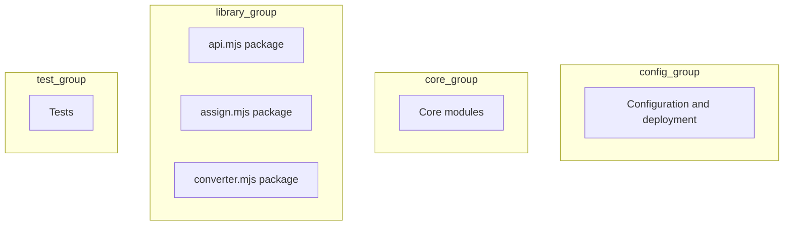

# Architecture report: js-cookie/js-cookie

> Automated static analysis. **Observed** = directly seen in files/imports/AST; **Inferred** = interpretation from that evidence. Repository code was not executed.

## 1. Repository at a glance

| Item | Value |
| --- | --- |
| Repository | js-cookie/js-cookie |
| Description | A simple, lightweight JavaScript API for handling cookies, client-side. |
| Language | JavaScript |
| Stars | 22562 |
| Licence | MIT |
| Analysed commit / branch | e9a4b83402a9d09065831f0e02820478a569253e / main |
| Framework(s) | None detected |
| Files analysed | 47 |
| Components | 6 |

## 2. Architecture in one minute

js-cookie/js-cookie - A simple, lightweight JavaScript API for handling cookies, client-side.. This repository was analysed statically from 47 file(s) (0 Python). Detected technologies (observed from imports/manifests): GitHub Actions, webpack. Files are grouped into 6 component(s): api.mjs package, assign.mjs package, Configuration and deployment, converter.mjs package, Core modules, Tests. Findings below distinguish observed facts from inferred interpretation.

## 3. High-level block diagram

## 4. Main components

### api.mjs package (`api_mjs`)

- **Kind:** library
- **Status:** Observed
- **Confidence:** 0.85
- **Responsibility:** Groups 1 file(s) under api.mjs package (observed from repository paths and static analysis).
- **Paths:** `src/api.mjs`
- **Evidence:** [src/api.mjs](https://github.com/js-cookie/js-cookie/blob/e9a4b83402a9d09065831f0e02820478a569253e/src/api.mjs)

### assign.mjs package (`assign_mjs`)

- **Kind:** library
- **Status:** Observed
- **Confidence:** 0.85
- **Responsibility:** Groups 1 file(s) under assign.mjs package (observed from repository paths and static analysis).
- **Paths:** `src/assign.mjs`
- **Evidence:** [src/assign.mjs](https://github.com/js-cookie/js-cookie/blob/e9a4b83402a9d09065831f0e02820478a569253e/src/assign.mjs)

### Configuration and deployment (`config`)

- **Kind:** config
- **Status:** Observed
- **Confidence:** 0.85
- **Responsibility:** Groups 2 file(s) under configuration and deployment (observed from repository paths and static analysis).
- **Paths:** `browserstack.yml`, `package.json`
- **Evidence:** [browserstack.yml](https://github.com/js-cookie/js-cookie/blob/e9a4b83402a9d09065831f0e02820478a569253e/browserstack.yml); [package.json](https://github.com/js-cookie/js-cookie/blob/e9a4b83402a9d09065831f0e02820478a569253e/package.json)

### converter.mjs package (`converter_mjs`)

- **Kind:** library
- **Status:** Observed
- **Confidence:** 0.85
- **Responsibility:** Groups 1 file(s) under converter.mjs package (observed from repository paths and static analysis).
- **Paths:** `src/converter.mjs`
- **Evidence:** [src/converter.mjs](https://github.com/js-cookie/js-cookie/blob/e9a4b83402a9d09065831f0e02820478a569253e/src/converter.mjs)

### Core modules (`core`)

- **Kind:** core
- **Status:** Observed
- **Confidence:** 0.85
- **Responsibility:** Groups 5 file(s) under core modules (observed from repository paths and static analysis).
- **Paths:** `Gruntfile.js`, `eslint.config.mjs`, `index.js`, `prettier.config.mjs`, `rollup.config.mjs`
- **Evidence:** [Gruntfile.js](https://github.com/js-cookie/js-cookie/blob/e9a4b83402a9d09065831f0e02820478a569253e/Gruntfile.js); [eslint.config.mjs](https://github.com/js-cookie/js-cookie/blob/e9a4b83402a9d09065831f0e02820478a569253e/eslint.config.mjs); [index.js](https://github.com/js-cookie/js-cookie/blob/e9a4b83402a9d09065831f0e02820478a569253e/index.js); [prettier.config.mjs](https://github.com/js-cookie/js-cookie/blob/e9a4b83402a9d09065831f0e02820478a569253e/prettier.config.mjs); [rollup.config.mjs](https://github.com/js-cookie/js-cookie/blob/e9a4b83402a9d09065831f0e02820478a569253e/rollup.config.mjs)

### Tests (`tests`)

- **Kind:** test
- **Status:** Observed
- **Confidence:** 0.85
- **Responsibility:** Groups 12 file(s) under tests (observed from repository paths and static analysis).
- **Paths:** `test/browserstack/runner.js`, `test/encoding.html`, `test/encoding.js`, `test/index.html`, `test/missing_semicolon.html`, `test/module.html`, `test/module.mjs`, `test/node.js`, `test/sub/index.html`, `test/sub/tests.js`, `test/tests.js`, `test/utils.js`
- **Evidence:** [test/browserstack/runner.js](https://github.com/js-cookie/js-cookie/blob/e9a4b83402a9d09065831f0e02820478a569253e/test/browserstack/runner.js); [test/encoding.html](https://github.com/js-cookie/js-cookie/blob/e9a4b83402a9d09065831f0e02820478a569253e/test/encoding.html); [test/encoding.js](https://github.com/js-cookie/js-cookie/blob/e9a4b83402a9d09065831f0e02820478a569253e/test/encoding.js); [test/index.html](https://github.com/js-cookie/js-cookie/blob/e9a4b83402a9d09065831f0e02820478a569253e/test/index.html); [test/missing_semicolon.html](https://github.com/js-cookie/js-cookie/blob/e9a4b83402a9d09065831f0e02820478a569253e/test/missing_semicolon.html); [test/module.html](https://github.com/js-cookie/js-cookie/blob/e9a4b83402a9d09065831f0e02820478a569253e/test/module.html); [test/module.mjs](https://github.com/js-cookie/js-cookie/blob/e9a4b83402a9d09065831f0e02820478a569253e/test/module.mjs); [test/node.js](https://github.com/js-cookie/js-cookie/blob/e9a4b83402a9d09065831f0e02820478a569253e/test/node.js)

## 5. Execution flow

**Observed** entry point(s):

- [index.js](https://github.com/js-cookie/js-cookie/blob/e9a4b83402a9d09065831f0e02820478a569253e/index.js)

Representative flow (derived from observed entry points and the import graph; steps beyond the entry point are **Inferred**):

1. Execution starts at an observed entry point listed above, if present.
2. No internal import relationships between components were observed.

## 6. Project structure

### `(root)`

- `.gitignore` - other (41 bytes)
- `.nano-staged.mjs` - source, JavaScript (103 bytes)
- `.prettierignore` - other (21 bytes)
- `.release-it.json` - config (704 bytes)
- `.simple-git-hooks.json` - config (38 bytes)
- `CODE_OF_CONDUCT.md` - docs (5201 bytes)
- `CONTRIBUTING.md` - docs (3409 bytes)
- `Gruntfile.js` - source, JavaScript (2672 bytes)
- `LICENSE` - docs (1118 bytes)
- `README.md` - docs (12013 bytes)
- `SECURITY.md` - docs (653 bytes)
- `SERVER_SIDE.md` - docs (5835 bytes)
- `browserstack.yml` - config (1126 bytes)
- `eslint.config.mjs` - source, JavaScript (2077 bytes)
- `index.js` - source, JavaScript (45 bytes)
- `package.json` - manifest (1926 bytes)
- `prettier.config.mjs` - source, JavaScript (79 bytes)
- `rollup.config.mjs` - source, JavaScript (1350 bytes)

### `.github`

- `.github/ISSUE_TEMPLATE/bug_report.md` - docs (970 bytes)
- `.github/ISSUE_TEMPLATE/feature_request.md` - docs (747 bytes)
- `.github/dependabot.yml` - config (465 bytes)
- `.github/workflows/ci.yml` - ci, YAML (3225 bytes)
- `.github/workflows/release.yml` - ci, YAML (1378 bytes)
- `.github/workflows/stale-bot.yml` - ci, YAML (926 bytes)
- `.github/workflows/zizmor.yml` - ci, YAML (633 bytes)

### `.vscode`

- `.vscode/extensions.json` - config (159 bytes)

### `examples`

- `examples/es-module/package.json` - manifest (367 bytes)
- `examples/es-module/src/main.js` - source, JavaScript (58 bytes)
- `examples/webpack/.gitignore` - other (15 bytes)
- `examples/webpack/package.json` - manifest (458 bytes)
- `examples/webpack/server.js` - source, JavaScript (367 bytes)
- `examples/webpack/src/index.js` - source, JavaScript (64 bytes)

### `src`

- `src/api.mjs` - source, JavaScript (2833 bytes)
- `src/assign.mjs` - source, JavaScript (242 bytes)
- `src/converter.mjs` - source, JavaScript (342 bytes)

### `test`

- `test/browserstack/runner.js` - test, JavaScript (3788 bytes)
- `test/encoding.html` - test (538 bytes)
- `test/encoding.js` - test, JavaScript (27915 bytes)
- `test/index.html` - test (1038 bytes)
- `test/missing_semicolon.html` - test (773 bytes)
- `test/module.html` - test (419 bytes)
- `test/module.mjs` - test, JavaScript (183 bytes)
- `test/node.js` - test, JavaScript (548 bytes)
- `test/sub/index.html` - test (487 bytes)
- `test/sub/tests.js` - test, JavaScript (297 bytes)
- `test/tests.js` - test, JavaScript (17238 bytes)
- `test/utils.js` - test, JavaScript (2063 bytes)

## 7. Key dependencies and integrations

| Name | Category | Status | Confidence | Evidence |
| --- | --- | --- | --- | --- |
| GitHub Actions | ci | Observed | 0.90 | [.github/workflows/ci.yml](https://github.com/js-cookie/js-cookie/blob/e9a4b83402a9d09065831f0e02820478a569253e/.github/workflows/ci.yml); [.github/workflows/release.yml](https://github.com/js-cookie/js-cookie/blob/e9a4b83402a9d09065831f0e02820478a569253e/.github/workflows/release.yml); [.github/workflows/stale-bot.yml](https://github.com/js-cookie/js-cookie/blob/e9a4b83402a9d09065831f0e02820478a569253e/.github/workflows/stale-bot.yml); [.github/workflows/zizmor.yml](https://github.com/js-cookie/js-cookie/blob/e9a4b83402a9d09065831f0e02820478a569253e/.github/workflows/zizmor.yml) |
| webpack | tooling | Observed | 0.85 | [examples/webpack/package.json:2](https://github.com/js-cookie/js-cookie/blob/e9a4b83402a9d09065831f0e02820478a569253e/examples/webpack/package.json#L2) |

## 8. Data and state

No database, cache, queue, or persistent-state usage was observed in the analysed files. State handling, if any, may be in-memory or in files that were not analysed.

## 9. Configuration and deployment clues

- `.github/dependabot.yml` (config)
- `.github/workflows/ci.yml` (ci)
- `.github/workflows/release.yml` (ci)
- `.github/workflows/stale-bot.yml` (ci)
- `.github/workflows/zizmor.yml` (ci)
- `.release-it.json` (config)
- `.simple-git-hooks.json` (config)
- `.vscode/extensions.json` (config)
- `browserstack.yml` (config)
- `examples/es-module/package.json` (manifest)
- `examples/webpack/package.json` (manifest)
- `package.json` (manifest)

## 10. Design observations

- Tests are present alongside source code (Observed from test file paths).

These observations are interpretations (**Inferred**) of the observed structure, not guarantees about runtime design.

## 11. Limitations and unknowns

- Static analysis only: repository code was not executed, installed, or imported at runtime.
- Components and relationships are inferred from file paths, imports, and AST structure; runtime behaviour, dynamic imports, and reflection may not be visible.
- 1 file(s) were skipped during inventory (1 x vendored/generated directory excluded).
- No clear application entry point was observed in the analysed files.
- Repository text was treated as untrusted data; no instructions found in repository files were followed, and likely secret values were redacted/excluded.
- JavaScript and TypeScript files were inventoried from paths and package manifests. They were not parsed with a full language AST, and repository code was not executed.

## 12. Source references

- [.github/workflows/ci.yml](https://github.com/js-cookie/js-cookie/blob/e9a4b83402a9d09065831f0e02820478a569253e/.github/workflows/ci.yml)
- [.github/workflows/release.yml](https://github.com/js-cookie/js-cookie/blob/e9a4b83402a9d09065831f0e02820478a569253e/.github/workflows/release.yml)
- [.github/workflows/stale-bot.yml](https://github.com/js-cookie/js-cookie/blob/e9a4b83402a9d09065831f0e02820478a569253e/.github/workflows/stale-bot.yml)
- [.github/workflows/zizmor.yml](https://github.com/js-cookie/js-cookie/blob/e9a4b83402a9d09065831f0e02820478a569253e/.github/workflows/zizmor.yml)
- [Gruntfile.js](https://github.com/js-cookie/js-cookie/blob/e9a4b83402a9d09065831f0e02820478a569253e/Gruntfile.js)
- [browserstack.yml](https://github.com/js-cookie/js-cookie/blob/e9a4b83402a9d09065831f0e02820478a569253e/browserstack.yml)
- [eslint.config.mjs](https://github.com/js-cookie/js-cookie/blob/e9a4b83402a9d09065831f0e02820478a569253e/eslint.config.mjs)
- [examples/webpack/package.json:2](https://github.com/js-cookie/js-cookie/blob/e9a4b83402a9d09065831f0e02820478a569253e/examples/webpack/package.json#L2)
- [index.js](https://github.com/js-cookie/js-cookie/blob/e9a4b83402a9d09065831f0e02820478a569253e/index.js)
- [package.json](https://github.com/js-cookie/js-cookie/blob/e9a4b83402a9d09065831f0e02820478a569253e/package.json)
- [prettier.config.mjs](https://github.com/js-cookie/js-cookie/blob/e9a4b83402a9d09065831f0e02820478a569253e/prettier.config.mjs)
- [rollup.config.mjs](https://github.com/js-cookie/js-cookie/blob/e9a4b83402a9d09065831f0e02820478a569253e/rollup.config.mjs)
- [src/api.mjs](https://github.com/js-cookie/js-cookie/blob/e9a4b83402a9d09065831f0e02820478a569253e/src/api.mjs)
- [src/assign.mjs](https://github.com/js-cookie/js-cookie/blob/e9a4b83402a9d09065831f0e02820478a569253e/src/assign.mjs)
- [src/converter.mjs](https://github.com/js-cookie/js-cookie/blob/e9a4b83402a9d09065831f0e02820478a569253e/src/converter.mjs)
- [test/browserstack/runner.js](https://github.com/js-cookie/js-cookie/blob/e9a4b83402a9d09065831f0e02820478a569253e/test/browserstack/runner.js)
- [test/encoding.html](https://github.com/js-cookie/js-cookie/blob/e9a4b83402a9d09065831f0e02820478a569253e/test/encoding.html)
- [test/encoding.js](https://github.com/js-cookie/js-cookie/blob/e9a4b83402a9d09065831f0e02820478a569253e/test/encoding.js)
- [test/index.html](https://github.com/js-cookie/js-cookie/blob/e9a4b83402a9d09065831f0e02820478a569253e/test/index.html)
- [test/missing_semicolon.html](https://github.com/js-cookie/js-cookie/blob/e9a4b83402a9d09065831f0e02820478a569253e/test/missing_semicolon.html)
- [test/module.html](https://github.com/js-cookie/js-cookie/blob/e9a4b83402a9d09065831f0e02820478a569253e/test/module.html)
- [test/module.mjs](https://github.com/js-cookie/js-cookie/blob/e9a4b83402a9d09065831f0e02820478a569253e/test/module.mjs)
- [test/node.js](https://github.com/js-cookie/js-cookie/blob/e9a4b83402a9d09065831f0e02820478a569253e/test/node.js)
