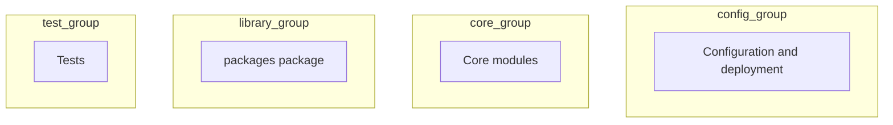

# Architecture report: jsdoc/jsdoc

> Automated static analysis. **Observed** = directly seen in files/imports/AST; **Inferred** = interpretation from that evidence. Repository code was not executed.

## 1. Repository at a glance

| Item | Value |
| --- | --- |
| Repository | jsdoc/jsdoc |
| Description | An API documentation generator for JavaScript. |
| Language | JavaScript |
| Stars | 15473 |
| Licence | Apache-2.0 |
| Analysed commit / branch | 536d8502494e4ee6722627ce88996f87cb4544d6 / main |
| Framework(s) | None detected |
| Files analysed | 653 |
| Components | 4 |

## 2. Architecture in one minute

jsdoc/jsdoc - An API documentation generator for JavaScript.. This repository was analysed statically from 653 file(s) (0 Python). Detected technologies (observed from imports/manifests): GitHub Actions. Files are grouped into 4 component(s): Configuration and deployment, Core modules, packages package, Tests. Findings below distinguish observed facts from inferred interpretation.

## 3. High-level block diagram

## 4. Main components

### Configuration and deployment (`config`)

- **Kind:** config
- **Status:** Observed
- **Confidence:** 0.85
- **Responsibility:** Groups 20 file(s) under configuration and deployment (observed from repository paths and static analysis).
- **Paths:** `lerna.json`, `package.json`, `packages/jsdoc-ast/package.json`, `packages/jsdoc-cli/package.json`, `packages/jsdoc-core/package.json`, `packages/jsdoc-doclet/package.json`, `packages/jsdoc-eslint-config/package.json`, `packages/jsdoc-name/package.json`, `packages/jsdoc-parse/package.json`, `packages/jsdoc-plugins/package.json`, `packages/jsdoc-prettier-config/package.json`, `packages/jsdoc-salty/package.json`, `packages/jsdoc-tag/package.json`, `packages/jsdoc-task-runner/package.json`, `packages/jsdoc-template-legacy/package.json`, `packages/jsdoc-test-matchers/package.json`, `packages/jsdoc-util/package.json`, `packages/jsdoc-web-assets/package.json`, `packages/jsdoc-web-assets/scripts/.babelrc.json`, `packages/jsdoc/package.json`
- **Evidence:** [lerna.json](https://github.com/jsdoc/jsdoc/blob/536d8502494e4ee6722627ce88996f87cb4544d6/lerna.json); [package.json](https://github.com/jsdoc/jsdoc/blob/536d8502494e4ee6722627ce88996f87cb4544d6/package.json); [packages/jsdoc-ast/package.json](https://github.com/jsdoc/jsdoc/blob/536d8502494e4ee6722627ce88996f87cb4544d6/packages/jsdoc-ast/package.json); [packages/jsdoc-cli/package.json](https://github.com/jsdoc/jsdoc/blob/536d8502494e4ee6722627ce88996f87cb4544d6/packages/jsdoc-cli/package.json); [packages/jsdoc-core/package.json](https://github.com/jsdoc/jsdoc/blob/536d8502494e4ee6722627ce88996f87cb4544d6/packages/jsdoc-core/package.json); [packages/jsdoc-doclet/package.json](https://github.com/jsdoc/jsdoc/blob/536d8502494e4ee6722627ce88996f87cb4544d6/packages/jsdoc-doclet/package.json); [packages/jsdoc-eslint-config/package.json](https://github.com/jsdoc/jsdoc/blob/536d8502494e4ee6722627ce88996f87cb4544d6/packages/jsdoc-eslint-config/package.json); [packages/jsdoc-name/package.json](https://github.com/jsdoc/jsdoc/blob/536d8502494e4ee6722627ce88996f87cb4544d6/packages/jsdoc-name/package.json)

### Core modules (`core`)

- **Kind:** core
- **Status:** Observed
- **Confidence:** 0.85
- **Responsibility:** Groups 2 file(s) under core modules (observed from repository paths and static analysis).
- **Paths:** `Herebyfile.js`, `eslint.config.js`
- **Evidence:** [Herebyfile.js](https://github.com/jsdoc/jsdoc/blob/536d8502494e4ee6722627ce88996f87cb4544d6/Herebyfile.js); [eslint.config.js](https://github.com/jsdoc/jsdoc/blob/536d8502494e4ee6722627ce88996f87cb4544d6/eslint.config.js)

### packages package (`packages`)

- **Kind:** library
- **Status:** Observed
- **Confidence:** 0.85
- **Responsibility:** Groups 78 file(s) under packages package (observed from repository paths and static analysis).
- **Paths:** `packages/jsdoc-ast/index.js`, `packages/jsdoc-ast/lib/ast-builder.js`, `packages/jsdoc-ast/lib/ast-node.js`, `packages/jsdoc-ast/lib/syntax.js`, `packages/jsdoc-ast/lib/walker.js`, `packages/jsdoc-cli/index.js`, `packages/jsdoc-cli/lib/engine.js`, `packages/jsdoc-cli/lib/flags.js`, `packages/jsdoc-cli/lib/help.js`, `packages/jsdoc-cli/lib/logger.js`, `packages/jsdoc-core/index.js`, `packages/jsdoc-core/lib/api.js`, `packages/jsdoc-core/lib/config.js`, `packages/jsdoc-core/lib/env.js`, `packages/jsdoc-core/lib/plugins.js`, `packages/jsdoc-doclet/index.js`, `packages/jsdoc-doclet/lib/augment.js`, `packages/jsdoc-doclet/lib/borrow.js`, `packages/jsdoc-doclet/lib/doclet-store.js`, `packages/jsdoc-doclet/lib/doclet.js`, `packages/jsdoc-doclet/lib/package.js`, `packages/jsdoc-doclet/lib/schema.js`, `packages/jsdoc-eslint-config/index.js`, `packages/jsdoc-name/index.js`, `packages/jsdoc-name/lib/name.js`, `packages/jsdoc-parse/index.js`, `packages/jsdoc-parse/lib/handlers.js`, `packages/jsdoc-parse/lib/parser.js`, `packages/jsdoc-parse/lib/visitor.js`, `packages/jsdoc-plugins/comment-convert.js`, `packages/jsdoc-plugins/comments-only.js`, `packages/jsdoc-plugins/escape-html.js`, `packages/jsdoc-plugins/event-dumper.js`, `packages/jsdoc-plugins/overload-helper.js`, `packages/jsdoc-plugins/partial.js`, `packages/jsdoc-plugins/rails-template.js`, `packages/jsdoc-plugins/source-tag.js`, `packages/jsdoc-plugins/summarize.js`, `packages/jsdoc-plugins/underscore.js`, `packages/jsdoc-prettier-config/index.js`, `packages/jsdoc-salty/index.js`, `packages/jsdoc-salty/lib/salty.js`, `packages/jsdoc-tag/index.js`, `packages/jsdoc-tag/lib/definitions/closure.js`, `packages/jsdoc-tag/lib/definitions/core.js`, `packages/jsdoc-tag/lib/definitions/index.js`, `packages/jsdoc-tag/lib/definitions/internal.js`, `packages/jsdoc-tag/lib/definitions/jsdoc.js`, `packages/jsdoc-tag/lib/definitions/util.js`, `packages/jsdoc-tag/lib/dictionary.js`, `packages/jsdoc-tag/lib/inline.js`, `packages/jsdoc-tag/lib/tag.js`, `packages/jsdoc-tag/lib/type.js`, `packages/jsdoc-tag/lib/validator.js`, `packages/jsdoc-task-runner/index.js`, `packages/jsdoc-task-runner/lib/task-runner.js`, `packages/jsdoc-task-runner/lib/task.js`, `packages/jsdoc-task-runner/lib/validators.js`, `packages/jsdoc-template-legacy/lib/markdown.js`, `packages/jsdoc-template-legacy/lib/template.js`, `packages/jsdoc-template-legacy/lib/templateHelper.js`, `packages/jsdoc-template-legacy/plugins/markdown.js`, `packages/jsdoc-template-legacy/publish.js`, `packages/jsdoc-template-legacy/static/scripts/linenumber.js`, `packages/jsdoc-test-matchers/index.js`, `packages/jsdoc-util/index.js`, `packages/jsdoc-util/lib/cast.js`, `packages/jsdoc-util/lib/log.js`, `packages/jsdoc-web-assets/scripts/copy-url-animations.js`, `packages/jsdoc-web-assets/scripts/copy-url.js`, `packages/jsdoc-web-assets/scripts/fouce.js`, `packages/jsdoc-web-assets/scripts/icons.js`, `packages/jsdoc-web-assets/scripts/index.js`, `packages/jsdoc-web-assets/scripts/navbar.js`, `packages/jsdoc-web-assets/scripts/outline.js`, `packages/jsdoc-web-assets/scripts/toc.js`, `packages/jsdoc-web-assets/static/scripts/jsdoc.js`, `packages/jsdoc/jsdoc.js`
- **Evidence:** [packages/jsdoc-ast/index.js](https://github.com/jsdoc/jsdoc/blob/536d8502494e4ee6722627ce88996f87cb4544d6/packages/jsdoc-ast/index.js); [packages/jsdoc-ast/lib/ast-builder.js](https://github.com/jsdoc/jsdoc/blob/536d8502494e4ee6722627ce88996f87cb4544d6/packages/jsdoc-ast/lib/ast-builder.js); [packages/jsdoc-ast/lib/ast-node.js](https://github.com/jsdoc/jsdoc/blob/536d8502494e4ee6722627ce88996f87cb4544d6/packages/jsdoc-ast/lib/ast-node.js); [packages/jsdoc-ast/lib/syntax.js](https://github.com/jsdoc/jsdoc/blob/536d8502494e4ee6722627ce88996f87cb4544d6/packages/jsdoc-ast/lib/syntax.js); [packages/jsdoc-ast/lib/walker.js](https://github.com/jsdoc/jsdoc/blob/536d8502494e4ee6722627ce88996f87cb4544d6/packages/jsdoc-ast/lib/walker.js); [packages/jsdoc-cli/index.js](https://github.com/jsdoc/jsdoc/blob/536d8502494e4ee6722627ce88996f87cb4544d6/packages/jsdoc-cli/index.js); [packages/jsdoc-cli/lib/engine.js](https://github.com/jsdoc/jsdoc/blob/536d8502494e4ee6722627ce88996f87cb4544d6/packages/jsdoc-cli/lib/engine.js); [packages/jsdoc-cli/lib/flags.js](https://github.com/jsdoc/jsdoc/blob/536d8502494e4ee6722627ce88996f87cb4544d6/packages/jsdoc-cli/lib/flags.js)

### Tests (`tests`)

- **Kind:** test
- **Status:** Observed
- **Confidence:** 0.85
- **Responsibility:** Groups 451 file(s) under tests (observed from repository paths and static analysis).
- **Paths:** `packages/jsdoc-ast/test/specs/index.js`, `packages/jsdoc-ast/test/specs/lib/ast-builder.js`, `packages/jsdoc-ast/test/specs/lib/ast-node.js`, `packages/jsdoc-ast/test/specs/lib/syntax.js`, `packages/jsdoc-ast/test/specs/lib/walker.js`, `packages/jsdoc-cli/test/fixtures/configs/conf.json`, `packages/jsdoc-cli/test/fixtures/ignored-doclet.js`, `packages/jsdoc-cli/test/specs/index.js`, `packages/jsdoc-cli/test/specs/lib/engine.js`, `packages/jsdoc-cli/test/specs/lib/flags.js`, `packages/jsdoc-cli/test/specs/lib/help.js`, `packages/jsdoc-cli/test/specs/lib/logger.js`, `packages/jsdoc-core/test/fixtures/plugin-source-file.js`, `packages/jsdoc-core/test/fixtures/plugin-test-ast-visitor.js`, `packages/jsdoc-core/test/fixtures/plugin-test-handlers.js`, `packages/jsdoc-core/test/fixtures/plugin-test-tags.js`, `packages/jsdoc-core/test/fixtures/plugin-test-visitors.js`, `packages/jsdoc-core/test/fixtures/source-files/README.md`, `packages/jsdoc-core/test/fixtures/source-files/bar.js`, `packages/jsdoc-core/test/fixtures/source-files/baz.cjs`, `packages/jsdoc-core/test/fixtures/source-files/foo.js`, `packages/jsdoc-core/test/fixtures/source-files/package.json`, `packages/jsdoc-core/test/fixtures/source-files/subdir/qux.js`, `packages/jsdoc-core/test/fixtures/templates/bad-publish-template.js`, `packages/jsdoc-core/test/fixtures/templates/fake-template.js`, `packages/jsdoc-core/test/fixtures/templates/no-publish-template.js`, `packages/jsdoc-core/test/specs/index.js`, `packages/jsdoc-core/test/specs/lib/api.js`, `packages/jsdoc-core/test/specs/lib/config.js`, `packages/jsdoc-core/test/specs/lib/env.js`, `packages/jsdoc-core/test/specs/lib/plugins.js`, `packages/jsdoc-doclet/test/specs/index.js`, `packages/jsdoc-doclet/test/specs/lib/augment.js`, `packages/jsdoc-doclet/test/specs/lib/borrow.js`, `packages/jsdoc-doclet/test/specs/lib/doclet-store.js`, `packages/jsdoc-doclet/test/specs/lib/doclet.js`, `packages/jsdoc-doclet/test/specs/lib/package.js`, `packages/jsdoc-doclet/test/specs/lib/schema.js`, `packages/jsdoc-name/test/specs/index.js`, `packages/jsdoc-name/test/specs/lib/name.js`, `packages/jsdoc-parse/test/fixtures/es6.js`, `packages/jsdoc-parse/test/fixtures/eventorder.js`, `packages/jsdoc-parse/test/specs/index.js`, `packages/jsdoc-parse/test/specs/lib/handlers.js`, `packages/jsdoc-parse/test/specs/lib/parser.js`, `packages/jsdoc-parse/test/specs/lib/visitor.js`, `packages/jsdoc-plugins/test/fixtures/markdown.js`, `packages/jsdoc-plugins/test/fixtures/overload-helper.js`, `packages/jsdoc-plugins/test/fixtures/rails-template.js.erb`, `packages/jsdoc-plugins/test/fixtures/underscore.js`, `packages/jsdoc-plugins/test/specs/comment-convert.js`, `packages/jsdoc-plugins/test/specs/escape-html.js`, `packages/jsdoc-plugins/test/specs/overload-helper.js`, `packages/jsdoc-plugins/test/specs/rails-template.js`, `packages/jsdoc-plugins/test/specs/source-tag.js`, `packages/jsdoc-plugins/test/specs/summarize.js`, `packages/jsdoc-plugins/test/specs/underscore.js`, `packages/jsdoc-salty/test/specs/index.js`, `packages/jsdoc-salty/test/specs/lib/salty.js`, `packages/jsdoc-tag/test/specs/index.js`, `packages/jsdoc-tag/test/specs/lib/definitions/index.js`, `packages/jsdoc-tag/test/specs/lib/dictionary.js`, `packages/jsdoc-tag/test/specs/lib/inline.js`, `packages/jsdoc-tag/test/specs/lib/tag.js`, `packages/jsdoc-tag/test/specs/lib/type.js`, `packages/jsdoc-tag/test/specs/lib/validator.js`, `packages/jsdoc-task-runner/test/specs/index.js`, `packages/jsdoc-task-runner/test/specs/lib/task-runner.js`, `packages/jsdoc-task-runner/test/specs/lib/task.js`, `packages/jsdoc-template-legacy/test/specs/lib/templateHelper.js`, `packages/jsdoc-util/test/specs/index.js`, `packages/jsdoc-util/test/specs/lib/cast.js`, `packages/jsdoc-util/test/specs/lib/log.js`, `packages/jsdoc/test/.eslintrc.cjs`, `packages/jsdoc/test/README.md`, `packages/jsdoc/test/fixtures/abstracttag.js`, `packages/jsdoc/test/fixtures/accesstag.js`, `packages/jsdoc/test/fixtures/alias.js`, `packages/jsdoc/test/fixtures/alias2.js`, `packages/jsdoc/test/fixtures/alias3.js`, `packages/jsdoc/test/fixtures/alias4.js`, `packages/jsdoc/test/fixtures/alias5.js`, `packages/jsdoc/test/fixtures/alias6.js`, `packages/jsdoc/test/fixtures/aliasexports.js`, `packages/jsdoc/test/fixtures/aliasfores6export.js`, `packages/jsdoc/test/fixtures/aliasfores6export2.js`, `packages/jsdoc/test/fixtures/aliasglobal.js`, `packages/jsdoc/test/fixtures/aliasglobal2.js`, `packages/jsdoc/test/fixtures/aliasresolve.js`, `packages/jsdoc/test/fixtures/aliasresolve2.js`, `packages/jsdoc/test/fixtures/also.js`, `packages/jsdoc/test/fixtures/also2.js`, `packages/jsdoc/test/fixtures/anonymousclass.js`, `packages/jsdoc/test/fixtures/anonymousclassparam.js`, `packages/jsdoc/test/fixtures/arrowfunction.js`, `packages/jsdoc/test/fixtures/asyncfunction.js`, `packages/jsdoc/test/fixtures/asynctag.js`, `packages/jsdoc/test/fixtures/augmentall.js`, `packages/jsdoc/test/fixtures/augmentall2.js`, `packages/jsdoc/test/fixtures/augmentstag.js`, `packages/jsdoc/test/fixtures/augmentstag2.js`, `packages/jsdoc/test/fixtures/augmentstag3.js`, `packages/jsdoc/test/fixtures/augmentstag4.js`, `packages/jsdoc/test/fixtures/augmentstag5.js`, `packages/jsdoc/test/fixtures/augmentstag6.js`, `packages/jsdoc/test/fixtures/authortag.js`, `packages/jsdoc/test/fixtures/borrowstag.js`, `packages/jsdoc/test/fixtures/borrowstag2.js`, `packages/jsdoc/test/fixtures/borrowstag3.js`, `packages/jsdoc/test/fixtures/callbacktag.js`, `packages/jsdoc/test/fixtures/classdesctag.js`, `packages/jsdoc/test/fixtures/classproperties.js`, `packages/jsdoc/test/fixtures/classtag.js`, `packages/jsdoc/test/fixtures/classtag2.js`, `packages/jsdoc/test/fixtures/classwithoutname.js`, `packages/jsdoc/test/fixtures/constanttag.js`, `packages/jsdoc/test/fixtures/constanttag2.js`, `packages/jsdoc/test/fixtures/constructortag.js`, `packages/jsdoc/test/fixtures/constructstag.js`, `packages/jsdoc/test/fixtures/constructstag2.js`, `packages/jsdoc/test/fixtures/constructstag3.js`, `packages/jsdoc/test/fixtures/constructstag4.js`, `packages/jsdoc/test/fixtures/constructstag5.js`, `packages/jsdoc/test/fixtures/copyrighttag.js`, `packages/jsdoc/test/fixtures/defaultparams.js`, `packages/jsdoc/test/fixtures/defaultparams2.js`, `packages/jsdoc/test/fixtures/defaulttag.js`, `packages/jsdoc/test/fixtures/definetag.js`, `packages/jsdoc/test/fixtures/deprecatedtag.js`, `packages/jsdoc/test/fixtures/descriptiontag.js`, `packages/jsdoc/test/fixtures/destructuring.js`, `packages/jsdoc/test/fixtures/dicttag.js`, `packages/jsdoc/test/fixtures/doclet.js`, `packages/jsdoc/test/fixtures/emptycomments.js`, `packages/jsdoc/test/fixtures/enumtag.js`, `packages/jsdoc/test/fixtures/enumtag2.js`, `packages/jsdoc/test/fixtures/enumtag3.js`, `packages/jsdoc/test/fixtures/eventfirestag.js`, `packages/jsdoc/test/fixtures/exampletag.js`, `packages/jsdoc/test/fixtures/exceptiontag.js`, `packages/jsdoc/test/fixtures/exportclass.js`, `packages/jsdoc/test/fixtures/exportdefault.js`, `packages/jsdoc/test/fixtures/exportdefaultclass.js`, `packages/jsdoc/test/fixtures/exports.js`, `packages/jsdoc/test/fixtures/exportstag.js`, `packages/jsdoc/test/fixtures/exportstag2.js`, `packages/jsdoc/test/fixtures/exportstag3.js`, `packages/jsdoc/test/fixtures/exportstag4.js`, `packages/jsdoc/test/fixtures/exportstag5.js`, `packages/jsdoc/test/fixtures/exportstag6.js`, `packages/jsdoc/test/fixtures/exportstag7.js`, `packages/jsdoc/test/fixtures/exportstag8.js`, `packages/jsdoc/test/fixtures/exporttag.js`, `packages/jsdoc/test/fixtures/externaltag.js`, `packages/jsdoc/test/fixtures/externaltag2.js`, `packages/jsdoc/test/fixtures/externaltag3.js`, `packages/jsdoc/test/fixtures/externstag.js`, `packages/jsdoc/test/fixtures/file.js`, `packages/jsdoc/test/fixtures/fileoverviewtag.js`, `packages/jsdoc/test/fixtures/funcexpression.js`, `packages/jsdoc/test/fixtures/funcexpression2.js`, `packages/jsdoc/test/fixtures/funcexpression3.js`, `packages/jsdoc/test/fixtures/functiontag.js`, `packages/jsdoc/test/fixtures/generators.js`, `packages/jsdoc/test/fixtures/generatortag.js`, `packages/jsdoc/test/fixtures/getset.js`, `packages/jsdoc/test/fixtures/getset2.js`, `packages/jsdoc/test/fixtures/globaltag.js`, `packages/jsdoc/test/fixtures/hideconstructortag.js`, `packages/jsdoc/test/fixtures/ignoretag.js`, `packages/jsdoc/test/fixtures/ignoretag2.js`, `packages/jsdoc/test/fixtures/implicitcasttag.js`, `packages/jsdoc/test/fixtures/inheritdoctag.js`, `packages/jsdoc/test/fixtures/inlinecomment.js`, `packages/jsdoc/test/fixtures/inlineparamcomment.js`, `packages/jsdoc/test/fixtures/inlineparamcomment2.js`, `packages/jsdoc/test/fixtures/inner.js`, `packages/jsdoc/test/fixtures/innerscope.js`, `packages/jsdoc/test/fixtures/innerscope2.js`, `packages/jsdoc/test/fixtures/instanceproperty.js`, `packages/jsdoc/test/fixtures/interface-assignment.js`, `packages/jsdoc/test/fixtures/interface-implements.js`, `packages/jsdoc/test/fixtures/interface-implements2.js`, `packages/jsdoc/test/fixtures/interfacetag2.js`, `packages/jsdoc/test/fixtures/interfacetag3.js`, `packages/jsdoc/test/fixtures/jsx.js`, `packages/jsdoc/test/fixtures/kindtag.js`, `packages/jsdoc/test/fixtures/lends.js`, `packages/jsdoc/test/fixtures/lends2.js`, `packages/jsdoc/test/fixtures/lends3.js`, `packages/jsdoc/test/fixtures/lends4.js`, `packages/jsdoc/test/fixtures/lends5.js`, `packages/jsdoc/test/fixtures/lends6.js`, `packages/jsdoc/test/fixtures/lendsglobal.js`, `packages/jsdoc/test/fixtures/letkeyword.js`, `packages/jsdoc/test/fixtures/licensetag.js`, `packages/jsdoc/test/fixtures/linktag.js`, `packages/jsdoc/test/fixtures/listenstag.js`, `packages/jsdoc/test/fixtures/markdowntest.md`, `packages/jsdoc/test/fixtures/memberoftag.js`, `packages/jsdoc/test/fixtures/memberoftag2.js`, `packages/jsdoc/test/fixtures/memberoftag3.js`, `packages/jsdoc/test/fixtures/memberoftag4.js`, `packages/jsdoc/test/fixtures/memberoftag5.js`, `packages/jsdoc/test/fixtures/memberoftagforced.js`, `packages/jsdoc/test/fixtures/membertag.js`, `packages/jsdoc/test/fixtures/methoddefinition.js`, `packages/jsdoc/test/fixtures/mixintag.js`, `packages/jsdoc/test/fixtures/mixintag2.js`, `packages/jsdoc/test/fixtures/modifiestag.js`, `packages/jsdoc/test/fixtures/moduleclasses.js`, `packages/jsdoc/test/fixtures/moduleexport.js`, `packages/jsdoc/test/fixtures/moduleinner.js`, `packages/jsdoc/test/fixtures/moduleisconstructor.js`, `packages/jsdoc/test/fixtures/moduleisconstructor2.js`, `packages/jsdoc/test/fixtures/moduleisfunction.js`, `packages/jsdoc/test/fixtures/modulememberof.js`, `packages/jsdoc/test/fixtures/modules/data/mod-1.js`, `packages/jsdoc/test/fixtures/modules/data/mod-2.js`, `packages/jsdoc/test/fixtures/modules/data/mod-3.js`, `packages/jsdoc/test/fixtures/moduletag.js`, `packages/jsdoc/test/fixtures/moduletag10.js`, `packages/jsdoc/test/fixtures/moduletag11.js`, `packages/jsdoc/test/fixtures/moduletag2.js`, `packages/jsdoc/test/fixtures/moduletag3.js`, `packages/jsdoc/test/fixtures/moduletag4.js`, `packages/jsdoc/test/fixtures/moduletag5.js`, `packages/jsdoc/test/fixtures/moduletag6.js`, `packages/jsdoc/test/fixtures/moduletag7.js`, `packages/jsdoc/test/fixtures/moduletag8.js`, `packages/jsdoc/test/fixtures/moduletag9.js`, `packages/jsdoc/test/fixtures/namespacetag.js`, `packages/jsdoc/test/fixtures/nametag.js`, `packages/jsdoc/test/fixtures/noaliastag.js`, `packages/jsdoc/test/fixtures/nocollapsetag.js`, `packages/jsdoc/test/fixtures/nocompiletag.js`, `packages/jsdoc/test/fixtures/nosideeffectstag.js`, `packages/jsdoc/test/fixtures/numericpropertytag.js`, `packages/jsdoc/test/fixtures/objectkeys.js`, `packages/jsdoc/test/fixtures/objectlit.js`, `packages/jsdoc/test/fixtures/objectlit2.js`, `packages/jsdoc/test/fixtures/objectlit3.js`, `packages/jsdoc/test/fixtures/objectpropertykeys.js`, `packages/jsdoc/test/fixtures/overridetag.js`, `packages/jsdoc/test/fixtures/overridetag2.js`, `packages/jsdoc/test/fixtures/packagetag.js`, `packages/jsdoc/test/fixtures/packagetag2.js`, `packages/jsdoc/test/fixtures/paramtag.js`, `packages/jsdoc/test/fixtures/paramtag2.js`, `packages/jsdoc/test/fixtures/paramtaginvalidtype.js`, `packages/jsdoc/test/fixtures/paramtagsametype.js`, `packages/jsdoc/test/fixtures/polymerbehaviortag.js`, `packages/jsdoc/test/fixtures/polymertag.js`, `packages/jsdoc/test/fixtures/preservetag.js`, `packages/jsdoc/test/fixtures/privatetag.js`, `packages/jsdoc/test/fixtures/privatetag2.js`, `packages/jsdoc/test/fixtures/projecttag.js`, `packages/jsdoc/test/fixtures/propertytag.js`, `packages/jsdoc/test/fixtures/protectedtag.js`, `packages/jsdoc/test/fixtures/protectedtag2.js`, `packages/jsdoc/test/fixtures/publictag.js`, `packages/jsdoc/test/fixtures/publictag2.js`, `packages/jsdoc/test/fixtures/quotename.js`, `packages/jsdoc/test/fixtures/quotename2.js`, `packages/jsdoc/test/fixtures/readonlytag.js`, `packages/jsdoc/test/fixtures/requirestag.js`, `packages/jsdoc/test/fixtures/restparams.js`, `packages/jsdoc/test/fixtures/restparams2.js`, `packages/jsdoc/test/fixtures/returnstag.js`, `packages/jsdoc/test/fixtures/scopetags.js`, `packages/jsdoc/test/fixtures/seetag.js`, `packages/jsdoc/test/fixtures/sincetag.js`, `packages/jsdoc/test/fixtures/specialchars.js`, `packages/jsdoc/test/fixtures/specialnames.js`, `packages/jsdoc/test/fixtures/starbangstar.js`, `packages/jsdoc/test/fixtures/structtag.js`, `packages/jsdoc/test/fixtures/summarytag.js`, `packages/jsdoc/test/fixtures/suppresstag.js`, `packages/jsdoc/test/fixtures/templatetag.js`, `packages/jsdoc/test/fixtures/testPlugin1.js`, `packages/jsdoc/test/fixtures/testPlugin2.js`, `packages/jsdoc/test/fixtures/this-and-objectlit.js`, `packages/jsdoc/test/fixtures/this.js`, `packages/jsdoc/test/fixtures/this2.js`, `packages/jsdoc/test/fixtures/this3.js`, `packages/jsdoc/test/fixtures/this4.js`, `packages/jsdoc/test/fixtures/this5.js`, `packages/jsdoc/test/fixtures/this6.js`, `packages/jsdoc/test/fixtures/thistag.js`, `packages/jsdoc/test/fixtures/thistag2.js`, `packages/jsdoc/test/fixtures/todotag.js`, `packages/jsdoc/test/fixtures/trailingcomment.js`, `packages/jsdoc/test/fixtures/trailingcomment2.js`, `packages/jsdoc/test/fixtures/typedeftag.js`, `packages/jsdoc/test/fixtures/typedeftag2.js`, `packages/jsdoc/test/fixtures/typekind.js`, `packages/jsdoc/test/fixtures/typetag.js`, `packages/jsdoc/test/fixtures/typetag2.js`, `packages/jsdoc/test/fixtures/typetaginline.js`, `packages/jsdoc/test/fixtures/typetagwithnewline.js`, `packages/jsdoc/test/fixtures/undocumentedtag.js`, `packages/jsdoc/test/fixtures/unrestrictedtag.js`, `packages/jsdoc/test/fixtures/utf8.js`, `packages/jsdoc/test/fixtures/var.js`, `packages/jsdoc/test/fixtures/variations.js`, `packages/jsdoc/test/fixtures/variationtag.js`, `packages/jsdoc/test/fixtures/versiontag.js`, `packages/jsdoc/test/fixtures/virtual.js`, `packages/jsdoc/test/fixtures/virtual2.js`, `packages/jsdoc/test/fixtures/virtual3.js`, `packages/jsdoc/test/fixtures/yieldstag.js`, `packages/jsdoc/test/helpers/jsdoc.js`, `packages/jsdoc/test/index.js`, `packages/jsdoc/test/specs/add-matchers.cjs`, `packages/jsdoc/test/specs/documentation/alias.js`, `packages/jsdoc/test/specs/documentation/aliasfores6export.js`, `packages/jsdoc/test/specs/documentation/also.js`, `packages/jsdoc/test/specs/documentation/anonymousclass.js`, `packages/jsdoc/test/specs/documentation/anonymousclassparam.js`, `packages/jsdoc/test/specs/documentation/arrowfunction.js`, `packages/jsdoc/test/specs/documentation/asyncfunction.js`, `packages/jsdoc/test/specs/documentation/callback.js`, `packages/jsdoc/test/specs/documentation/classproperties.js`, `packages/jsdoc/test/specs/documentation/classwithoutname.js`, `packages/jsdoc/test/specs/documentation/const.js`, `packages/jsdoc/test/specs/documentation/defaultparams.js`, `packages/jsdoc/test/specs/documentation/emptycomments.js`, `packages/jsdoc/test/specs/documentation/exportclass.js`, `packages/jsdoc/test/specs/documentation/exportdefault.js`, `packages/jsdoc/test/specs/documentation/exportdefaultclass.js`, `packages/jsdoc/test/specs/documentation/exports.js`, `packages/jsdoc/test/specs/documentation/funcexpression.js`, `packages/jsdoc/test/specs/documentation/generators.js`, `packages/jsdoc/test/specs/documentation/getset.js`, `packages/jsdoc/test/specs/documentation/inlinecomment.js`, `packages/jsdoc/test/specs/documentation/inlineparamcomment.js`, `packages/jsdoc/test/specs/documentation/inner.js`, `packages/jsdoc/test/specs/documentation/innerscope.js`, `packages/jsdoc/test/specs/documentation/instanceproperty.js`, `packages/jsdoc/test/specs/documentation/jsx.js`, `packages/jsdoc/test/specs/documentation/lends.js`, `packages/jsdoc/test/specs/documentation/letkeyword.js`, `packages/jsdoc/test/specs/documentation/methoddefinition.js`, `packages/jsdoc/test/specs/documentation/mixins.js`, `packages/jsdoc/test/specs/documentation/moduleclasses.js`, `packages/jsdoc/test/specs/documentation/moduleexport.js`, `packages/jsdoc/test/specs/documentation/moduleinner.js`, `packages/jsdoc/test/specs/documentation/moduleisconstructor.js`, `packages/jsdoc/test/specs/documentation/moduleisfunction.js`, `packages/jsdoc/test/specs/documentation/modulememberof.js`, `packages/jsdoc/test/specs/documentation/modules.js`, `packages/jsdoc/test/specs/documentation/objectkeys.js`, `packages/jsdoc/test/specs/documentation/objectlit.js`, `packages/jsdoc/test/specs/documentation/objectpropertykeys.js`, `packages/jsdoc/test/specs/documentation/quotename.js`, `packages/jsdoc/test/specs/documentation/restparams.js`, `packages/jsdoc/test/specs/documentation/specialchars.js`, `packages/jsdoc/test/specs/documentation/specialnames.js`, `packages/jsdoc/test/specs/documentation/starbangstar.js`, `packages/jsdoc/test/specs/documentation/this.js`, `packages/jsdoc/test/specs/documentation/trailingcomment.js`, `packages/jsdoc/test/specs/documentation/typetaginline.js`, `packages/jsdoc/test/specs/documentation/typetagwithnewline.js`, `packages/jsdoc/test/specs/documentation/var.js`, `packages/jsdoc/test/specs/documentation/variations.js`, `packages/jsdoc/test/specs/documentation/virtual.js`, `packages/jsdoc/test/specs/tags/abstracttag.js`, `packages/jsdoc/test/specs/tags/accesstag.js`, `packages/jsdoc/test/specs/tags/aliastag.js`, `packages/jsdoc/test/specs/tags/asynctag.js`, `packages/jsdoc/test/specs/tags/augmentstag.js`, `packages/jsdoc/test/specs/tags/authortag.js`, `packages/jsdoc/test/specs/tags/borrowstag.js`, `packages/jsdoc/test/specs/tags/classdesctag.js`, `packages/jsdoc/test/specs/tags/classtag.js`, `packages/jsdoc/test/specs/tags/constanttag.js`, `packages/jsdoc/test/specs/tags/constructortag.js`, `packages/jsdoc/test/specs/tags/constructstag.js`, `packages/jsdoc/test/specs/tags/copyrighttag.js`, `packages/jsdoc/test/specs/tags/defaulttag.js`, `packages/jsdoc/test/specs/tags/definetag.js`, `packages/jsdoc/test/specs/tags/deprecatedtag.js`, `packages/jsdoc/test/specs/tags/descriptiontag.js`, `packages/jsdoc/test/specs/tags/dicttag.js`, `packages/jsdoc/test/specs/tags/enumtag.js`, `packages/jsdoc/test/specs/tags/eventfirestag.js`, `packages/jsdoc/test/specs/tags/exampletag.js`, `packages/jsdoc/test/specs/tags/exceptiontag.js`, `packages/jsdoc/test/specs/tags/exportstag.js`, `packages/jsdoc/test/specs/tags/exporttag.js`, `packages/jsdoc/test/specs/tags/externaltag.js`, `packages/jsdoc/test/specs/tags/externstag.js`, `packages/jsdoc/test/specs/tags/fileoverviewtag.js`, `packages/jsdoc/test/specs/tags/filetag.js`, `packages/jsdoc/test/specs/tags/functiontag.js`, `packages/jsdoc/test/specs/tags/generatortag.js`, `packages/jsdoc/test/specs/tags/globaltag.js`, `packages/jsdoc/test/specs/tags/hideconstructortag.js`, `packages/jsdoc/test/specs/tags/ignoretag.js`, `packages/jsdoc/test/specs/tags/implementstag.js`, `packages/jsdoc/test/specs/tags/implicitcasttag.js`, `packages/jsdoc/test/specs/tags/inheritdoctag.js`, `packages/jsdoc/test/specs/tags/interfacetag.js`, `packages/jsdoc/test/specs/tags/kindtag.js`, `packages/jsdoc/test/specs/tags/lendstag.js`, `packages/jsdoc/test/specs/tags/licensetag.js`, `packages/jsdoc/test/specs/tags/listenstag.js`, `packages/jsdoc/test/specs/tags/memberoftag.js`, `packages/jsdoc/test/specs/tags/membertag.js`, `packages/jsdoc/test/specs/tags/mixestag.js`, `packages/jsdoc/test/specs/tags/mixintag.js`, `packages/jsdoc/test/specs/tags/modifiestag.js`, `packages/jsdoc/test/specs/tags/moduletag.js`, `packages/jsdoc/test/specs/tags/namespacetag.js`, `packages/jsdoc/test/specs/tags/nametag.js`, `packages/jsdoc/test/specs/tags/noaliastag.js`, `packages/jsdoc/test/specs/tags/nocollapsetag.js`, `packages/jsdoc/test/specs/tags/nocompiletag.js`, `packages/jsdoc/test/specs/tags/nosideeffectstag.js`, `packages/jsdoc/test/specs/tags/overridetag.js`, `packages/jsdoc/test/specs/tags/overviewtag.js`, `packages/jsdoc/test/specs/tags/packagetag.js`, `packages/jsdoc/test/specs/tags/paramtag.js`, `packages/jsdoc/test/specs/tags/polymerbehaviortag.js`, `packages/jsdoc/test/specs/tags/polymertag.js`, `packages/jsdoc/test/specs/tags/preservetag.js`, `packages/jsdoc/test/specs/tags/privatetag.js`, `packages/jsdoc/test/specs/tags/propertytag.js`, `packages/jsdoc/test/specs/tags/protectedtag.js`, `packages/jsdoc/test/specs/tags/publictag.js`, `packages/jsdoc/test/specs/tags/readonlytag.js`, `packages/jsdoc/test/specs/tags/requirestag.js`, `packages/jsdoc/test/specs/tags/returnstag.js`, `packages/jsdoc/test/specs/tags/scopetags.js`, `packages/jsdoc/test/specs/tags/seetag.js`, `packages/jsdoc/test/specs/tags/sincetag.js`, `packages/jsdoc/test/specs/tags/structtag.js`, `packages/jsdoc/test/specs/tags/summarytag.js`, `packages/jsdoc/test/specs/tags/suppresstag.js`, `packages/jsdoc/test/specs/tags/templatetag.js`, `packages/jsdoc/test/specs/tags/thistag.js`, `packages/jsdoc/test/specs/tags/todotag.js`, `packages/jsdoc/test/specs/tags/typedeftag.js`, `packages/jsdoc/test/specs/tags/typekind.js`, `packages/jsdoc/test/specs/tags/typetag.js`, `packages/jsdoc/test/specs/tags/undocumentedtag.js`, `packages/jsdoc/test/specs/tags/unrestrictedtag.js`, `packages/jsdoc/test/specs/tags/variationtag.js`, `packages/jsdoc/test/specs/tags/versiontag.js`, `packages/jsdoc/test/specs/tags/yieldstag.js`, `packages/jsdoc/test/specs/validate.js`
- **Evidence:** [packages/jsdoc-ast/test/specs/index.js](https://github.com/jsdoc/jsdoc/blob/536d8502494e4ee6722627ce88996f87cb4544d6/packages/jsdoc-ast/test/specs/index.js); [packages/jsdoc-ast/test/specs/lib/ast-builder.js](https://github.com/jsdoc/jsdoc/blob/536d8502494e4ee6722627ce88996f87cb4544d6/packages/jsdoc-ast/test/specs/lib/ast-builder.js); [packages/jsdoc-ast/test/specs/lib/ast-node.js](https://github.com/jsdoc/jsdoc/blob/536d8502494e4ee6722627ce88996f87cb4544d6/packages/jsdoc-ast/test/specs/lib/ast-node.js); [packages/jsdoc-ast/test/specs/lib/syntax.js](https://github.com/jsdoc/jsdoc/blob/536d8502494e4ee6722627ce88996f87cb4544d6/packages/jsdoc-ast/test/specs/lib/syntax.js); [packages/jsdoc-ast/test/specs/lib/walker.js](https://github.com/jsdoc/jsdoc/blob/536d8502494e4ee6722627ce88996f87cb4544d6/packages/jsdoc-ast/test/specs/lib/walker.js); [packages/jsdoc-cli/test/fixtures/configs/conf.json](https://github.com/jsdoc/jsdoc/blob/536d8502494e4ee6722627ce88996f87cb4544d6/packages/jsdoc-cli/test/fixtures/configs/conf.json); [packages/jsdoc-cli/test/fixtures/ignored-doclet.js](https://github.com/jsdoc/jsdoc/blob/536d8502494e4ee6722627ce88996f87cb4544d6/packages/jsdoc-cli/test/fixtures/ignored-doclet.js); [packages/jsdoc-cli/test/specs/index.js](https://github.com/jsdoc/jsdoc/blob/536d8502494e4ee6722627ce88996f87cb4544d6/packages/jsdoc-cli/test/specs/index.js)

## 5. Execution flow

**Observed** entry point(s):

- [packages/jsdoc-ast/index.js](https://github.com/jsdoc/jsdoc/blob/536d8502494e4ee6722627ce88996f87cb4544d6/packages/jsdoc-ast/index.js)
- [packages/jsdoc-cli/index.js](https://github.com/jsdoc/jsdoc/blob/536d8502494e4ee6722627ce88996f87cb4544d6/packages/jsdoc-cli/index.js)
- [packages/jsdoc-core/index.js](https://github.com/jsdoc/jsdoc/blob/536d8502494e4ee6722627ce88996f87cb4544d6/packages/jsdoc-core/index.js)
- [packages/jsdoc-doclet/index.js](https://github.com/jsdoc/jsdoc/blob/536d8502494e4ee6722627ce88996f87cb4544d6/packages/jsdoc-doclet/index.js)
- [packages/jsdoc-eslint-config/index.js](https://github.com/jsdoc/jsdoc/blob/536d8502494e4ee6722627ce88996f87cb4544d6/packages/jsdoc-eslint-config/index.js)
- [packages/jsdoc-name/index.js](https://github.com/jsdoc/jsdoc/blob/536d8502494e4ee6722627ce88996f87cb4544d6/packages/jsdoc-name/index.js)
- [packages/jsdoc-parse/index.js](https://github.com/jsdoc/jsdoc/blob/536d8502494e4ee6722627ce88996f87cb4544d6/packages/jsdoc-parse/index.js)
- [packages/jsdoc-prettier-config/index.js](https://github.com/jsdoc/jsdoc/blob/536d8502494e4ee6722627ce88996f87cb4544d6/packages/jsdoc-prettier-config/index.js)
- [packages/jsdoc-salty/index.js](https://github.com/jsdoc/jsdoc/blob/536d8502494e4ee6722627ce88996f87cb4544d6/packages/jsdoc-salty/index.js)
- [packages/jsdoc-tag/index.js](https://github.com/jsdoc/jsdoc/blob/536d8502494e4ee6722627ce88996f87cb4544d6/packages/jsdoc-tag/index.js)
- [packages/jsdoc-template-legacy/publish.js](https://github.com/jsdoc/jsdoc/blob/536d8502494e4ee6722627ce88996f87cb4544d6/packages/jsdoc-template-legacy/publish.js)
- [packages/jsdoc/jsdoc.js](https://github.com/jsdoc/jsdoc/blob/536d8502494e4ee6722627ce88996f87cb4544d6/packages/jsdoc/jsdoc.js)

Representative flow (derived from observed entry points and the import graph; steps beyond the entry point are **Inferred**):

1. Execution starts at an observed entry point listed above, if present.
2. No internal import relationships between components were observed.

## 6. Project structure

### `(root)`

- `.editorconfig` - config (202 bytes)
- `.gitignore` - other (714 bytes)
- `.license-check.json` - config (1026 bytes)
- `.license-header.txt` - docs (568 bytes)
- `.licensee.json` - config (982 bytes)
- `.npmignore` - other (272 bytes)
- `.prettierignore` - other (242 bytes)
- `.prettierrc.cjs` - source, JavaScript (658 bytes)
- `.renovaterc.json` - config (231 bytes)
- `CHANGES.md` - docs (45204 bytes)
- `CODE_OF_CONDUCT.md` - docs (3227 bytes)
- `CONTRIBUTING.md` - docs (3430 bytes)
- `Herebyfile.js` - source, JavaScript (7145 bytes)
- `LICENSE` - docs (11358 bytes)
- `README.md` - docs (3634 bytes)
- `eslint.config.js` - source, JavaScript (1329 bytes)
- `lerna.json` - config (31 bytes)
- `package.json` - manifest (2559 bytes)

### `.github`

- `.github/ISSUE_TEMPLATE.md` - docs (1094 bytes)
- `.github/PULL_REQUEST_TEMPLATE.md` - docs (1088 bytes)
- `.github/workflows/ci.yaml` - ci, YAML (1951 bytes)

### `.husky`

- `.husky/install.js` - source, JavaScript (803 bytes)
- `.husky/pre-commit` - other (16 bytes)

### `packages`

- `packages/jsdoc-ast/.npmignore` - other (253 bytes)
- `packages/jsdoc-ast/LICENSE` - docs (11358 bytes)
- `packages/jsdoc-ast/README.md` - docs (75 bytes)
- `packages/jsdoc-ast/index.js` - source, JavaScript (872 bytes)
- `packages/jsdoc-ast/lib/ast-builder.js` - source, JavaScript (1986 bytes)
- `packages/jsdoc-ast/lib/ast-node.js` - source, JavaScript (15921 bytes)
- `packages/jsdoc-ast/lib/syntax.js` - source, JavaScript (4229 bytes)
- `packages/jsdoc-ast/lib/walker.js` - source, JavaScript (17093 bytes)
- `packages/jsdoc-ast/package.json` - manifest (997 bytes)
- `packages/jsdoc-ast/test/specs/index.js` - test, JavaScript (1524 bytes)
- `packages/jsdoc-ast/test/specs/lib/ast-builder.js` - test, JavaScript (1629 bytes)
- `packages/jsdoc-ast/test/specs/lib/ast-node.js` - test, JavaScript (20796 bytes)
- `packages/jsdoc-ast/test/specs/lib/syntax.js` - test, JavaScript (892 bytes)
- `packages/jsdoc-ast/test/specs/lib/walker.js` - test, JavaScript (1260 bytes)
- `packages/jsdoc-cli/.npmignore` - other (253 bytes)
- `packages/jsdoc-cli/LICENSE` - docs (11358 bytes)
- `packages/jsdoc-cli/README.md` - docs (126 bytes)
- `packages/jsdoc-cli/index.js` - source, JavaScript (648 bytes)
- `packages/jsdoc-cli/lib/engine.js` - source, JavaScript (8524 bytes)
- `packages/jsdoc-cli/lib/flags.js` - source, JavaScript (5940 bytes)
- `packages/jsdoc-cli/lib/help.js` - source, JavaScript (4573 bytes)
- `packages/jsdoc-cli/lib/logger.js` - source, JavaScript (3860 bytes)
- `packages/jsdoc-cli/package.json` - manifest (954 bytes)
- `packages/jsdoc-cli/test/fixtures/configs/conf.json` - test (66 bytes)
- `packages/jsdoc-cli/test/fixtures/ignored-doclet.js` - test, JavaScript (119 bytes)
- `packages/jsdoc-cli/test/specs/index.js` - test, JavaScript (774 bytes)
- `packages/jsdoc-cli/test/specs/lib/engine.js` - test, JavaScript (18530 bytes)
- `packages/jsdoc-cli/test/specs/lib/flags.js` - test, JavaScript (1872 bytes)
- `packages/jsdoc-cli/test/specs/lib/help.js` - test, JavaScript (675 bytes)
- `packages/jsdoc-cli/test/specs/lib/logger.js` - test, JavaScript (6308 bytes)
- `packages/jsdoc-core/.npmignore` - other (253 bytes)
- `packages/jsdoc-core/LICENSE` - docs (11358 bytes)
- `packages/jsdoc-core/README.md` - docs (47 bytes)
- `packages/jsdoc-core/index.js` - source, JavaScript (891 bytes)
- `packages/jsdoc-core/lib/api.js` - source, JavaScript (7479 bytes)
- `packages/jsdoc-core/lib/config.js` - source, JavaScript (6525 bytes)
- `packages/jsdoc-core/lib/env.js` - source, JavaScript (2833 bytes)
- `packages/jsdoc-core/lib/plugins.js` - source, JavaScript (1508 bytes)
- `packages/jsdoc-core/package.json` - manifest (1059 bytes)
- `packages/jsdoc-core/test/fixtures/plugin-source-file.js` - test, JavaScript (87 bytes)
- `packages/jsdoc-core/test/fixtures/plugin-test-ast-visitor.js` - test, JavaScript (825 bytes)
- `packages/jsdoc-core/test/fixtures/plugin-test-handlers.js` - test, JavaScript (1022 bytes)
- `packages/jsdoc-core/test/fixtures/plugin-test-tags.js` - test, JavaScript (727 bytes)
- `packages/jsdoc-core/test/fixtures/plugin-test-visitors.js` - test, JavaScript (847 bytes)
- `packages/jsdoc-core/test/fixtures/source-files/README.md` - test (589 bytes)
- `packages/jsdoc-core/test/fixtures/source-files/bar.js` - test, JavaScript (586 bytes)
- `packages/jsdoc-core/test/fixtures/source-files/baz.cjs` - test, JavaScript (586 bytes)
- `packages/jsdoc-core/test/fixtures/source-files/foo.js` - test, JavaScript (586 bytes)
- `packages/jsdoc-core/test/fixtures/source-files/package.json` - test (0 bytes)
- `packages/jsdoc-core/test/fixtures/source-files/subdir/qux.js` - test, JavaScript (586 bytes)
- `packages/jsdoc-core/test/fixtures/templates/bad-publish-template.js` - test, JavaScript (617 bytes)
- `packages/jsdoc-core/test/fixtures/templates/fake-template.js` - test, JavaScript (714 bytes)
- `packages/jsdoc-core/test/fixtures/templates/no-publish-template.js` - test, JavaScript (613 bytes)
- `packages/jsdoc-core/test/specs/index.js` - test, JavaScript (1282 bytes)
- `packages/jsdoc-core/test/specs/lib/api.js` - test, JavaScript (8131 bytes)
- `packages/jsdoc-core/test/specs/lib/config.js` - test, JavaScript (5119 bytes)
- `packages/jsdoc-core/test/specs/lib/env.js` - test, JavaScript (2356 bytes)
- `packages/jsdoc-core/test/specs/lib/plugins.js` - test, JavaScript (3144 bytes)
- `packages/jsdoc-doclet/.npmignore` - other (253 bytes)
- `packages/jsdoc-doclet/LICENSE` - docs (11358 bytes)
- `packages/jsdoc-doclet/README.md` - docs (108 bytes)
- `packages/jsdoc-doclet/index.js` - source, JavaScript (1188 bytes)
- `packages/jsdoc-doclet/lib/augment.js` - source, JavaScript (17725 bytes)
- `packages/jsdoc-doclet/lib/borrow.js` - source, JavaScript (2374 bytes)
- `packages/jsdoc-doclet/lib/doclet-store.js` - source, JavaScript (15510 bytes)
- `packages/jsdoc-doclet/lib/doclet.js` - source, JavaScript (25607 bytes)
- `packages/jsdoc-doclet/lib/package.js` - source, JavaScript (7549 bytes)
- `packages/jsdoc-doclet/lib/schema.js` - source, JavaScript (13195 bytes)
- `packages/jsdoc-doclet/package.json` - manifest (1034 bytes)
- `packages/jsdoc-doclet/test/specs/index.js` - test, JavaScript (1847 bytes)
- `packages/jsdoc-doclet/test/specs/lib/augment.js` - test, JavaScript (2444 bytes)
- `packages/jsdoc-doclet/test/specs/lib/borrow.js` - test, JavaScript (608 bytes)
- `packages/jsdoc-doclet/test/specs/lib/doclet-store.js` - test, JavaScript (37806 bytes)
- `packages/jsdoc-doclet/test/specs/lib/doclet.js` - test, JavaScript (19778 bytes)
- `packages/jsdoc-doclet/test/specs/lib/package.js` - test, JavaScript (8135 bytes)
- `packages/jsdoc-doclet/test/specs/lib/schema.js` - test, JavaScript (1873 bytes)
- `packages/jsdoc-eslint-config/.npmignore` - other (253 bytes)
- `packages/jsdoc-eslint-config/LICENSE` - docs (11358 bytes)
- `packages/jsdoc-eslint-config/README.md` - docs (75 bytes)
- `packages/jsdoc-eslint-config/index.js` - source, JavaScript (8912 bytes)
- `packages/jsdoc-eslint-config/package.json` - manifest (1131 bytes)
- `packages/jsdoc-name/.npmignore` - other (253 bytes)
- `packages/jsdoc-name/LICENSE` - docs (11358 bytes)
- `packages/jsdoc-name/README.md` - docs (62 bytes)
- `packages/jsdoc-name/index.js` - source, JavaScript (618 bytes)
- `packages/jsdoc-name/lib/name.js` - source, JavaScript (16678 bytes)
- `packages/jsdoc-name/package.json` - manifest (898 bytes)
- `packages/jsdoc-name/test/specs/index.js` - test, JavaScript (978 bytes)
- `packages/jsdoc-name/test/specs/lib/name.js` - test, JavaScript (14395 bytes)
- `packages/jsdoc-parse/.npmignore` - other (253 bytes)
- `packages/jsdoc-parse/LICENSE` - docs (11358 bytes)
- `packages/jsdoc-parse/README.md` - docs (70 bytes)
- `packages/jsdoc-parse/index.js` - source, JavaScript (846 bytes)
- `packages/jsdoc-parse/lib/handlers.js` - source, JavaScript (12528 bytes)
- `packages/jsdoc-parse/lib/parser.js` - source, JavaScript (19280 bytes)
- `packages/jsdoc-parse/lib/visitor.js` - source, JavaScript (23519 bytes)
- `packages/jsdoc-parse/package.json` - manifest (1006 bytes)
- `packages/jsdoc-parse/test/fixtures/es6.js` - test, JavaScript (833 bytes)
- `packages/jsdoc-parse/test/fixtures/eventorder.js` - test, JavaScript (449 bytes)
- `packages/jsdoc-parse/test/specs/index.js` - test, JavaScript (1424 bytes)
- `packages/jsdoc-parse/test/specs/lib/handlers.js` - test, JavaScript (2278 bytes)
- `packages/jsdoc-parse/test/specs/lib/parser.js` - test, JavaScript (12078 bytes)
- `packages/jsdoc-parse/test/specs/lib/visitor.js` - test, JavaScript (5302 bytes)
- `packages/jsdoc-plugins/.npmignore` - other (253 bytes)
- `packages/jsdoc-plugins/LICENSE` - docs (11358 bytes)
- `packages/jsdoc-plugins/README.md` - docs (46 bytes)
- `packages/jsdoc-plugins/comment-convert.js` - source, JavaScript (1218 bytes)
- `packages/jsdoc-plugins/comments-only.js` - source, JavaScript (1125 bytes)
- `packages/jsdoc-plugins/escape-html.js` - source, JavaScript (977 bytes)
- `packages/jsdoc-plugins/event-dumper.js` - source, JavaScript (3072 bytes)
- `packages/jsdoc-plugins/overload-helper.js` - source, JavaScript (5807 bytes)
- `packages/jsdoc-plugins/package.json` - manifest (741 bytes)
- `packages/jsdoc-plugins/partial.js` - source, JavaScript (1229 bytes)
- `packages/jsdoc-plugins/rails-template.js` - source, JavaScript (1103 bytes)
- `packages/jsdoc-plugins/source-tag.js` - source, JavaScript (1898 bytes)
- `packages/jsdoc-plugins/summarize.js` - source, JavaScript (2520 bytes)
- `packages/jsdoc-plugins/test/fixtures/markdown.js` - test, JavaScript (652 bytes)
- `packages/jsdoc-plugins/test/fixtures/overload-helper.js` - test, JavaScript (1478 bytes)
- `packages/jsdoc-plugins/test/fixtures/rails-template.js.erb` - test (386 bytes)
- `packages/jsdoc-plugins/test/fixtures/underscore.js` - test, JavaScript (475 bytes)
- `packages/jsdoc-plugins/test/specs/comment-convert.js` - test, JavaScript (1261 bytes)
- `packages/jsdoc-plugins/test/specs/escape-html.js` - test, JavaScript (1330 bytes)
- `packages/jsdoc-plugins/test/specs/overload-helper.js` - test, JavaScript (4079 bytes)
- `packages/jsdoc-plugins/test/specs/rails-template.js` - test, JavaScript (1530 bytes)
- `packages/jsdoc-plugins/test/specs/source-tag.js` - test, JavaScript (1384 bytes)
- `packages/jsdoc-plugins/test/specs/summarize.js` - test, JavaScript (4017 bytes)
- `packages/jsdoc-plugins/test/specs/underscore.js` - test, JavaScript (1780 bytes)
- `packages/jsdoc-plugins/underscore.js` - source, JavaScript (1027 bytes)
- `packages/jsdoc-prettier-config/.npmignore` - other (253 bytes)
- `packages/jsdoc-prettier-config/LICENSE` - docs (11358 bytes)
- `packages/jsdoc-prettier-config/README.md` - docs (87 bytes)
- `packages/jsdoc-prettier-config/index.js` - source, JavaScript (716 bytes)
- `packages/jsdoc-prettier-config/package.json` - manifest (853 bytes)
- `packages/jsdoc-salty/.npmignore` - other (253 bytes)
- `packages/jsdoc-salty/LICENSE` - docs (11358 bytes)
- `packages/jsdoc-salty/README.md` - docs (7495 bytes)
- `packages/jsdoc-salty/index.js` - source, JavaScript (685 bytes)
- `packages/jsdoc-salty/lib/salty.js` - source, JavaScript (6468 bytes)
- `packages/jsdoc-salty/package.json` - manifest (736 bytes)
- `packages/jsdoc-salty/test/specs/index.js` - test, JavaScript (997 bytes)
- `packages/jsdoc-salty/test/specs/lib/salty.js` - test, JavaScript (7895 bytes)
- `packages/jsdoc-tag/.npmignore` - other (253 bytes)
- `packages/jsdoc-tag/LICENSE` - docs (11358 bytes)
- `packages/jsdoc-tag/README.md` - docs (68 bytes)
- `packages/jsdoc-tag/index.js` - source, JavaScript (994 bytes)
- `packages/jsdoc-tag/lib/definitions/closure.js` - source, JavaScript (4519 bytes)
- `packages/jsdoc-tag/lib/definitions/core.js` - source, JavaScript (15356 bytes)
- `packages/jsdoc-tag/lib/definitions/index.js` - source, JavaScript (961 bytes)
- `packages/jsdoc-tag/lib/definitions/internal.js` - source, JavaScript (1745 bytes)
- `packages/jsdoc-tag/lib/definitions/jsdoc.js` - source, JavaScript (623 bytes)
- `packages/jsdoc-tag/lib/definitions/util.js` - source, JavaScript (4927 bytes)
- `packages/jsdoc-tag/lib/dictionary.js` - source, JavaScript (4156 bytes)
- `packages/jsdoc-tag/lib/inline.js` - source, JavaScript (6107 bytes)
- `packages/jsdoc-tag/lib/tag.js` - source, JavaScript (5660 bytes)
- `packages/jsdoc-tag/lib/type.js` - source, JavaScript (9832 bytes)
- `packages/jsdoc-tag/lib/validator.js` - source, JavaScript (1956 bytes)
- `packages/jsdoc-tag/package.json` - manifest (1116 bytes)
- `packages/jsdoc-tag/test/specs/index.js` - test, JavaScript (1772 bytes)
- `packages/jsdoc-tag/test/specs/lib/definitions/index.js` - test, JavaScript (1204 bytes)
- `packages/jsdoc-tag/test/specs/lib/dictionary.js` - test, JavaScript (7769 bytes)
- `packages/jsdoc-tag/test/specs/lib/inline.js` - test, JavaScript (10265 bytes)
- `packages/jsdoc-tag/test/specs/lib/tag.js` - test, JavaScript (7848 bytes)
- `packages/jsdoc-tag/test/specs/lib/type.js` - test, JavaScript (9190 bytes)
- `packages/jsdoc-tag/test/specs/lib/validator.js` - test, JavaScript (4277 bytes)
- `packages/jsdoc-task-runner/.npmignore` - other (253 bytes)
- `packages/jsdoc-task-runner/LICENSE` - docs (11358 bytes)
- `packages/jsdoc-task-runner/README.md` - docs (57 bytes)
- `packages/jsdoc-task-runner/index.js` - source, JavaScript (742 bytes)
- `packages/jsdoc-task-runner/lib/task-runner.js` - source, JavaScript (7724 bytes)
- `packages/jsdoc-task-runner/lib/task.js` - source, JavaScript (1704 bytes)
- `packages/jsdoc-task-runner/lib/validators.js` - source, JavaScript (1719 bytes)
- `packages/jsdoc-task-runner/package.json` - manifest (949 bytes)
- `packages/jsdoc-task-runner/test/specs/index.js` - test, JavaScript (1099 bytes)
- `packages/jsdoc-task-runner/test/specs/lib/task-runner.js` - test, JavaScript (18345 bytes)
- `packages/jsdoc-task-runner/test/specs/lib/task.js` - test, JavaScript (5530 bytes)
- `packages/jsdoc-template-legacy/.npmignore` - other (253 bytes)
- `packages/jsdoc-template-legacy/LICENSE` - docs (11358 bytes)
- `packages/jsdoc-template-legacy/README.md` - docs (60 bytes)
- `packages/jsdoc-template-legacy/lib/markdown.js` - source, JavaScript (2941 bytes)
- `packages/jsdoc-template-legacy/lib/template.js` - source, JavaScript (2457 bytes)
- `packages/jsdoc-template-legacy/lib/templateHelper.js` - source, JavaScript (28134 bytes)
- `packages/jsdoc-template-legacy/package.json` - manifest (1444 bytes)
- `packages/jsdoc-template-legacy/plugins/markdown.js` - source, JavaScript (1984 bytes)
- `packages/jsdoc-template-legacy/publish.js` - source, JavaScript (21661 bytes)
- `packages/jsdoc-template-legacy/static/scripts/linenumber.js` - source, JavaScript (1182 bytes)
- `packages/jsdoc-template-legacy/static/styles/jsdoc-default.css` - other (5627 bytes)
- `packages/jsdoc-template-legacy/test/specs/lib/templateHelper.js` - test, JavaScript (56565 bytes)
- `packages/jsdoc-template-legacy/tmpl/augments.tmpl` - other (844 bytes)
- `packages/jsdoc-template-legacy/tmpl/container.tmpl` - other (7616 bytes)
- `packages/jsdoc-template-legacy/tmpl/details.tmpl` - other (5089 bytes)
- `packages/jsdoc-template-legacy/tmpl/example.tmpl` - other (677 bytes)
- `packages/jsdoc-template-legacy/tmpl/examples.tmpl` - other (913 bytes)
- `packages/jsdoc-template-legacy/tmpl/exceptions.tmpl` - other (1318 bytes)
- `packages/jsdoc-template-legacy/tmpl/layout.tmpl` - other (1515 bytes)
- `packages/jsdoc-template-legacy/tmpl/mainpage.tmpl` - other (760 bytes)
- `packages/jsdoc-template-legacy/tmpl/members.tmpl` - other (1526 bytes)
- `packages/jsdoc-template-legacy/tmpl/method.tmpl` - other (4272 bytes)
- `packages/jsdoc-template-legacy/tmpl/modifies.tmpl` - other (821 bytes)
- `packages/jsdoc-template-legacy/tmpl/params.tmpl` - other (4130 bytes)
- `packages/jsdoc-template-legacy/tmpl/properties.tmpl` - other (3505 bytes)
- `packages/jsdoc-template-legacy/tmpl/returns.tmpl` - other (912 bytes)
- `packages/jsdoc-template-legacy/tmpl/source.tmpl` - other (800 bytes)
- `packages/jsdoc-template-legacy/tmpl/type.tmpl` - other (836 bytes)
- `packages/jsdoc-test-matchers/.npmignore` - other (253 bytes)
- `packages/jsdoc-test-matchers/LICENSE` - docs (11358 bytes)
- `packages/jsdoc-test-matchers/README.md` - docs (103 bytes)
- `packages/jsdoc-test-matchers/index.js` - source, JavaScript (5259 bytes)
- `packages/jsdoc-test-matchers/package.json` - manifest (796 bytes)
- `packages/jsdoc-util/.npmignore` - other (253 bytes)
- `packages/jsdoc-util/LICENSE` - docs (11358 bytes)
- `packages/jsdoc-util/README.md` - docs (44 bytes)
- `packages/jsdoc-util/index.js` - source, JavaScript (806 bytes)
- `packages/jsdoc-util/lib/cast.js` - source, JavaScript (2581 bytes)
- `packages/jsdoc-util/lib/log.js` - source, JavaScript (2085 bytes)
- `packages/jsdoc-util/package.json` - manifest (793 bytes)
- `packages/jsdoc-util/test/specs/index.js` - test, JavaScript (1041 bytes)
- `packages/jsdoc-util/test/specs/lib/cast.js` - test, JavaScript (2179 bytes)
- `packages/jsdoc-util/test/specs/lib/log.js` - test, JavaScript (1382 bytes)
- `packages/jsdoc-web-assets/package.json` - manifest (639 bytes)
- `packages/jsdoc-web-assets/scripts/.babelrc.json` - config (83 bytes)
- `packages/jsdoc-web-assets/scripts/copy-url-animations.js` - source, JavaScript (2302 bytes)
- `packages/jsdoc-web-assets/scripts/copy-url.js` - source, JavaScript (7008 bytes)
- `packages/jsdoc-web-assets/scripts/fouce.js` - source, JavaScript (1198 bytes)
- `packages/jsdoc-web-assets/scripts/icons.js` - source, JavaScript (1190 bytes)
- `packages/jsdoc-web-assets/scripts/index.js` - source, JavaScript (752 bytes)
- `packages/jsdoc-web-assets/scripts/navbar.js` - source, JavaScript (3325 bytes)
- `packages/jsdoc-web-assets/scripts/outline.js` - source, JavaScript (8823 bytes)
- `packages/jsdoc-web-assets/scripts/toc.js` - source, JavaScript (2767 bytes)
- `packages/jsdoc-web-assets/static/css/baseline.css` - other (80629 bytes)
- `packages/jsdoc-web-assets/static/scripts/jsdoc.js` - source, JavaScript (145430 bytes)
- `packages/jsdoc-web-assets/styles/_pico-jsdoc.scss` - other (1365 bytes)
- `packages/jsdoc-web-assets/styles/badges.scss` - other (2589 bytes)
- `packages/jsdoc-web-assets/styles/baseline.scss` - other (8325 bytes)
- `packages/jsdoc-web-assets/styles/code.scss` - other (1853 bytes)
- `packages/jsdoc-web-assets/styles/fouce.scss` - other (850 bytes)
- `packages/jsdoc-web-assets/styles/hljs.scss` - other (1824 bytes)
- `packages/jsdoc-web-assets/styles/mixins.scss` - other (1345 bytes)
- `packages/jsdoc-web-assets/styles/navbar.scss` - other (1158 bytes)
- `packages/jsdoc-web-assets/styles/themes/hljs/tomorrow.css` - other (914 bytes)
- `packages/jsdoc-web-assets/styles/toc.scss` - other (4395 bytes)
- `packages/jsdoc-web-assets/styles/variables/colors.scss` - other (11900 bytes)
- `packages/jsdoc-web-assets/styles/variables/fonts.scss` - other (1341 bytes)
- `packages/jsdoc-web-assets/styles/variables/footer.scss` - other (606 bytes)
- `packages/jsdoc-web-assets/styles/variables/navbar.scss` - other (1524 bytes)
- `packages/jsdoc-web-assets/styles/variables/spacers.scss` - other (851 bytes)
- `packages/jsdoc/.eslintignore` - other (79 bytes)
- `packages/jsdoc/.npmignore` - other (253 bytes)
- `packages/jsdoc/LICENSE` - docs (11358 bytes)
- `packages/jsdoc/README.md` - docs (159 bytes)
- `packages/jsdoc/conf.json.EXAMPLE` - other (345 bytes)
- `packages/jsdoc/jsdoc.js` - source, JavaScript (2410 bytes)
- `packages/jsdoc/package.json` - manifest (921 bytes)
- `packages/jsdoc/test/.eslintrc.cjs` - test, JavaScript (703 bytes)
- `packages/jsdoc/test/README.md` - test (642 bytes)
- `packages/jsdoc/test/fixtures/abstracttag.js` - test, JavaScript (185 bytes)
- `packages/jsdoc/test/fixtures/accesstag.js` - test, JavaScript (441 bytes)
- `packages/jsdoc/test/fixtures/alias.js` - test, JavaScript (204 bytes)
- `packages/jsdoc/test/fixtures/alias2.js` - test, JavaScript (138 bytes)
- `packages/jsdoc/test/fixtures/alias3.js` - test, JavaScript (196 bytes)
- `packages/jsdoc/test/fixtures/alias4.js` - test, JavaScript (200 bytes)
- `packages/jsdoc/test/fixtures/alias5.js` - test, JavaScript (858 bytes)
- `packages/jsdoc/test/fixtures/alias6.js` - test, JavaScript (103 bytes)
- `packages/jsdoc/test/fixtures/aliasexports.js` - test, JavaScript (150 bytes)
- `packages/jsdoc/test/fixtures/aliasfores6export.js` - test, JavaScript (276 bytes)
- `packages/jsdoc/test/fixtures/aliasfores6export2.js` - test, JavaScript (458 bytes)
- `packages/jsdoc/test/fixtures/aliasglobal.js` - test, JavaScript (86 bytes)
- `packages/jsdoc/test/fixtures/aliasglobal2.js` - test, JavaScript (333 bytes)
- `packages/jsdoc/test/fixtures/aliasresolve.js` - test, JavaScript (210 bytes)
- `packages/jsdoc/test/fixtures/aliasresolve2.js` - test, JavaScript (190 bytes)
- `packages/jsdoc/test/fixtures/also.js` - test, JavaScript (973 bytes)
- `packages/jsdoc/test/fixtures/also2.js` - test, JavaScript (360 bytes)
- `packages/jsdoc/test/fixtures/anonymousclass.js` - test, JavaScript (327 bytes)
- `packages/jsdoc/test/fixtures/anonymousclassparam.js` - test, JavaScript (86 bytes)
- `packages/jsdoc/test/fixtures/arrowfunction.js` - test, JavaScript (405 bytes)
- `packages/jsdoc/test/fixtures/asyncfunction.js` - test, JavaScript (806 bytes)
- `packages/jsdoc/test/fixtures/asynctag.js` - test, JavaScript (64 bytes)
- `packages/jsdoc/test/fixtures/augmentall.js` - test, JavaScript (386 bytes)
- `packages/jsdoc/test/fixtures/augmentall2.js` - test, JavaScript (412 bytes)
- `packages/jsdoc/test/fixtures/augmentstag.js` - test, JavaScript (759 bytes)
- `packages/jsdoc/test/fixtures/augmentstag2.js` - test, JavaScript (140 bytes)
- `packages/jsdoc/test/fixtures/augmentstag3.js` - test, JavaScript (330 bytes)
- `packages/jsdoc/test/fixtures/augmentstag4.js` - test, JavaScript (463 bytes)
- `packages/jsdoc/test/fixtures/augmentstag5.js` - test, JavaScript (863 bytes)
- `packages/jsdoc/test/fixtures/augmentstag6.js` - test, JavaScript (298 bytes)
- `packages/jsdoc/test/fixtures/authortag.js` - test, JavaScript (200 bytes)
- `packages/jsdoc/test/fixtures/borrowstag.js` - test, JavaScript (180 bytes)
- `packages/jsdoc/test/fixtures/borrowstag2.js` - test, JavaScript (257 bytes)
- `packages/jsdoc/test/fixtures/borrowstag3.js` - test, JavaScript (369 bytes)
- `packages/jsdoc/test/fixtures/callbacktag.js` - test, JavaScript (333 bytes)
- `packages/jsdoc/test/fixtures/classdesctag.js` - test, JavaScript (271 bytes)
- `packages/jsdoc/test/fixtures/classproperties.js` - test, JavaScript (172 bytes)
- `packages/jsdoc/test/fixtures/classtag.js` - test, JavaScript (156 bytes)
- `packages/jsdoc/test/fixtures/classtag2.js` - test, JavaScript (1077 bytes)
- `packages/jsdoc/test/fixtures/classwithoutname.js` - test, JavaScript (201 bytes)
- `packages/jsdoc/test/fixtures/constanttag.js` - test, JavaScript (243 bytes)
- `packages/jsdoc/test/fixtures/constanttag2.js` - test, JavaScript (70 bytes)
- `packages/jsdoc/test/fixtures/constructortag.js` - test, JavaScript (258 bytes)
- `packages/jsdoc/test/fixtures/constructstag.js` - test, JavaScript (380 bytes)
- `packages/jsdoc/test/fixtures/constructstag2.js` - test, JavaScript (213 bytes)
- `packages/jsdoc/test/fixtures/constructstag3.js` - test, JavaScript (448 bytes)
- `packages/jsdoc/test/fixtures/constructstag4.js` - test, JavaScript (466 bytes)
- `packages/jsdoc/test/fixtures/constructstag5.js` - test, JavaScript (324 bytes)
- `packages/jsdoc/test/fixtures/copyrighttag.js` - test, JavaScript (82 bytes)
- `packages/jsdoc/test/fixtures/defaultparams.js` - test, JavaScript (1699 bytes)
- `packages/jsdoc/test/fixtures/defaultparams2.js` - test, JavaScript (274 bytes)
- `packages/jsdoc/test/fixtures/defaulttag.js` - test, JavaScript (619 bytes)
- `packages/jsdoc/test/fixtures/definetag.js` - test, JavaScript (136 bytes)
- `packages/jsdoc/test/fixtures/deprecatedtag.js` - test, JavaScript (96 bytes)
- `packages/jsdoc/test/fixtures/descriptiontag.js` - test, JavaScript (90 bytes)
- `packages/jsdoc/test/fixtures/destructuring.js` - test, JavaScript (127 bytes)
- `packages/jsdoc/test/fixtures/dicttag.js` - test, JavaScript (51 bytes)
- `packages/jsdoc/test/fixtures/doclet.js` - test, JavaScript (418 bytes)
- `packages/jsdoc/test/fixtures/emptycomments.js` - test, JavaScript (455 bytes)
- `packages/jsdoc/test/fixtures/enumtag.js` - test, JavaScript (301 bytes)
- `packages/jsdoc/test/fixtures/enumtag2.js` - test, JavaScript (498 bytes)
- `packages/jsdoc/test/fixtures/enumtag3.js` - test, JavaScript (154 bytes)
- `packages/jsdoc/test/fixtures/eventfirestag.js` - test, JavaScript (449 bytes)
- `packages/jsdoc/test/fixtures/exampletag.js` - test, JavaScript (195 bytes)
- `packages/jsdoc/test/fixtures/exceptiontag.js` - test, JavaScript (360 bytes)
- `packages/jsdoc/test/fixtures/exportclass.js` - test, JavaScript (84 bytes)
- `packages/jsdoc/test/fixtures/exportdefault.js` - test, JavaScript (61 bytes)
- `packages/jsdoc/test/fixtures/exportdefaultclass.js` - test, JavaScript (117 bytes)
- `packages/jsdoc/test/fixtures/exports.js` - test, JavaScript (574 bytes)
- `packages/jsdoc/test/fixtures/exportstag.js` - test, JavaScript (386 bytes)
- `packages/jsdoc/test/fixtures/exportstag2.js` - test, JavaScript (345 bytes)
- `packages/jsdoc/test/fixtures/exportstag3.js` - test, JavaScript (505 bytes)
- `packages/jsdoc/test/fixtures/exportstag4.js` - test, JavaScript (222 bytes)
- `packages/jsdoc/test/fixtures/exportstag5.js` - test, JavaScript (299 bytes)
- `packages/jsdoc/test/fixtures/exportstag6.js` - test, JavaScript (354 bytes)
- `packages/jsdoc/test/fixtures/exportstag7.js` - test, JavaScript (322 bytes)
- `packages/jsdoc/test/fixtures/exportstag8.js` - test, JavaScript (70 bytes)
- `packages/jsdoc/test/fixtures/exporttag.js` - test, JavaScript (167 bytes)
- `packages/jsdoc/test/fixtures/externaltag.js` - test, JavaScript (615 bytes)
- `packages/jsdoc/test/fixtures/externaltag2.js` - test, JavaScript (285 bytes)
- `packages/jsdoc/test/fixtures/externaltag3.js` - test, JavaScript (462 bytes)
- `packages/jsdoc/test/fixtures/externstag.js` - test, JavaScript (51 bytes)
- `packages/jsdoc/test/fixtures/file.js` - test, JavaScript (103 bytes)
- `packages/jsdoc/test/fixtures/fileoverviewtag.js` - test, JavaScript (48 bytes)
- `packages/jsdoc/test/fixtures/funcexpression.js` - test, JavaScript (131 bytes)
- `packages/jsdoc/test/fixtures/funcexpression2.js` - test, JavaScript (127 bytes)
- `packages/jsdoc/test/fixtures/funcexpression3.js` - test, JavaScript (162 bytes)
- `packages/jsdoc/test/fixtures/functiontag.js` - test, JavaScript (71 bytes)
- `packages/jsdoc/test/fixtures/generators.js` - test, JavaScript (503 bytes)
- `packages/jsdoc/test/fixtures/generatortag.js` - test, JavaScript (88 bytes)
- `packages/jsdoc/test/fixtures/getset.js` - test, JavaScript (686 bytes)
- `packages/jsdoc/test/fixtures/getset2.js` - test, JavaScript (242 bytes)
- `packages/jsdoc/test/fixtures/globaltag.js` - test, JavaScript (188 bytes)
- `packages/jsdoc/test/fixtures/hideconstructortag.js` - test, JavaScript (1477 bytes)
- `packages/jsdoc/test/fixtures/ignoretag.js` - test, JavaScript (40 bytes)
- `packages/jsdoc/test/fixtures/ignoretag2.js` - test, JavaScript (69 bytes)
- `packages/jsdoc/test/fixtures/implicitcasttag.js` - test, JavaScript (81 bytes)
- `packages/jsdoc/test/fixtures/inheritdoctag.js` - test, JavaScript (845 bytes)
- `packages/jsdoc/test/fixtures/inlinecomment.js` - test, JavaScript (100 bytes)
- `packages/jsdoc/test/fixtures/inlineparamcomment.js` - test, JavaScript (69 bytes)
- `packages/jsdoc/test/fixtures/inlineparamcomment2.js` - test, JavaScript (97 bytes)
- `packages/jsdoc/test/fixtures/inner.js` - test, JavaScript (129 bytes)
- `packages/jsdoc/test/fixtures/innerscope.js` - test, JavaScript (272 bytes)
- `packages/jsdoc/test/fixtures/innerscope2.js` - test, JavaScript (284 bytes)
- `packages/jsdoc/test/fixtures/instanceproperty.js` - test, JavaScript (135 bytes)
- `packages/jsdoc/test/fixtures/interface-assignment.js` - test, JavaScript (262 bytes)
- `packages/jsdoc/test/fixtures/interface-implements.js` - test, JavaScript (1073 bytes)
- `packages/jsdoc/test/fixtures/interface-implements2.js` - test, JavaScript (296 bytes)
- `packages/jsdoc/test/fixtures/interfacetag2.js` - test, JavaScript (78 bytes)
- `packages/jsdoc/test/fixtures/interfacetag3.js` - test, JavaScript (86 bytes)
- `packages/jsdoc/test/fixtures/jsx.js` - test, JavaScript (108 bytes)
- `packages/jsdoc/test/fixtures/kindtag.js` - test, JavaScript (29 bytes)
- `packages/jsdoc/test/fixtures/lends.js` - test, JavaScript (365 bytes)
- `packages/jsdoc/test/fixtures/lends2.js` - test, JavaScript (389 bytes)
- `packages/jsdoc/test/fixtures/lends3.js` - test, JavaScript (377 bytes)
- `packages/jsdoc/test/fixtures/lends4.js` - test, JavaScript (406 bytes)
- `packages/jsdoc/test/fixtures/lends5.js` - test, JavaScript (334 bytes)
- `packages/jsdoc/test/fixtures/lends6.js` - test, JavaScript (730 bytes)
- `packages/jsdoc/test/fixtures/lendsglobal.js` - test, JavaScript (233 bytes)
- `packages/jsdoc/test/fixtures/letkeyword.js` - test, JavaScript (287 bytes)
- `packages/jsdoc/test/fixtures/licensetag.js` - test, JavaScript (30 bytes)
- `packages/jsdoc/test/fixtures/linktag.js` - test, JavaScript (182 bytes)
- `packages/jsdoc/test/fixtures/listenstag.js` - test, JavaScript (594 bytes)
- `packages/jsdoc/test/fixtures/markdowntest.md` - test (83 bytes)
- `packages/jsdoc/test/fixtures/memberoftag.js` - test, JavaScript (147 bytes)
- `packages/jsdoc/test/fixtures/memberoftag2.js` - test, JavaScript (176 bytes)
- `packages/jsdoc/test/fixtures/memberoftag3.js` - test, JavaScript (356 bytes)
- `packages/jsdoc/test/fixtures/memberoftag4.js` - test, JavaScript (263 bytes)
- `packages/jsdoc/test/fixtures/memberoftag5.js` - test, JavaScript (239 bytes)
- `packages/jsdoc/test/fixtures/memberoftagforced.js` - test, JavaScript (821 bytes)
- `packages/jsdoc/test/fixtures/membertag.js` - test, JavaScript (99 bytes)
- `packages/jsdoc/test/fixtures/methoddefinition.js` - test, JavaScript (114 bytes)
- `packages/jsdoc/test/fixtures/mixintag.js` - test, JavaScript (481 bytes)
- `packages/jsdoc/test/fixtures/mixintag2.js` - test, JavaScript (977 bytes)
- `packages/jsdoc/test/fixtures/modifiestag.js` - test, JavaScript (87 bytes)
- `packages/jsdoc/test/fixtures/moduleclasses.js` - test, JavaScript (300 bytes)
- `packages/jsdoc/test/fixtures/moduleexport.js` - test, JavaScript (163 bytes)
- `packages/jsdoc/test/fixtures/moduleinner.js` - test, JavaScript (340 bytes)
- `packages/jsdoc/test/fixtures/moduleisconstructor.js` - test, JavaScript (444 bytes)
- `packages/jsdoc/test/fixtures/moduleisconstructor2.js` - test, JavaScript (431 bytes)
- `packages/jsdoc/test/fixtures/moduleisfunction.js` - test, JavaScript (163 bytes)
- `packages/jsdoc/test/fixtures/modulememberof.js` - test, JavaScript (94 bytes)
- `packages/jsdoc/test/fixtures/modules/data/mod-1.js` - test, JavaScript (74 bytes)
- `packages/jsdoc/test/fixtures/modules/data/mod-2.js` - test, JavaScript (89 bytes)
- `packages/jsdoc/test/fixtures/modules/data/mod-3.js` - test, JavaScript (315 bytes)
- `packages/jsdoc/test/fixtures/moduletag.js` - test, JavaScript (126 bytes)
- `packages/jsdoc/test/fixtures/moduletag10.js` - test, JavaScript (50 bytes)
- `packages/jsdoc/test/fixtures/moduletag11.js` - test, JavaScript (181 bytes)
- `packages/jsdoc/test/fixtures/moduletag2.js` - test, JavaScript (213 bytes)
- `packages/jsdoc/test/fixtures/moduletag3.js` - test, JavaScript (390 bytes)
- `packages/jsdoc/test/fixtures/moduletag4.js` - test, JavaScript (577 bytes)
- `packages/jsdoc/test/fixtures/moduletag5.js` - test, JavaScript (36 bytes)
- `packages/jsdoc/test/fixtures/moduletag6.js` - test, JavaScript (106 bytes)
- `packages/jsdoc/test/fixtures/moduletag7.js` - test, JavaScript (125 bytes)
- `packages/jsdoc/test/fixtures/moduletag8.js` - test, JavaScript (427 bytes)
- `packages/jsdoc/test/fixtures/moduletag9.js` - test, JavaScript (41 bytes)
- `packages/jsdoc/test/fixtures/namespacetag.js` - test, JavaScript (176 bytes)
- `packages/jsdoc/test/fixtures/nametag.js` - test, JavaScript (309 bytes)
- `packages/jsdoc/test/fixtures/noaliastag.js` - test, JavaScript (34 bytes)
- `packages/jsdoc/test/fixtures/nocollapsetag.js` - test, JavaScript (84 bytes)
- `packages/jsdoc/test/fixtures/nocompiletag.js` - test, JavaScript (18 bytes)
- `packages/jsdoc/test/fixtures/nosideeffectstag.js` - test, JavaScript (83 bytes)
- `packages/jsdoc/test/fixtures/numericpropertytag.js` - test, JavaScript (204 bytes)
- `packages/jsdoc/test/fixtures/objectkeys.js` - test, JavaScript (43 bytes)
- `packages/jsdoc/test/fixtures/objectlit.js` - test, JavaScript (128 bytes)
- `packages/jsdoc/test/fixtures/objectlit2.js` - test, JavaScript (110 bytes)
- `packages/jsdoc/test/fixtures/objectlit3.js` - test, JavaScript (255 bytes)
- `packages/jsdoc/test/fixtures/objectpropertykeys.js` - test, JavaScript (371 bytes)
- `packages/jsdoc/test/fixtures/overridetag.js` - test, JavaScript (839 bytes)
- `packages/jsdoc/test/fixtures/overridetag2.js` - test, JavaScript (838 bytes)
- `packages/jsdoc/test/fixtures/packagetag.js` - test, JavaScript (78 bytes)
- `packages/jsdoc/test/fixtures/packagetag2.js` - test, JavaScript (146 bytes)
- `packages/jsdoc/test/fixtures/paramtag.js` - test, JavaScript (802 bytes)
- `packages/jsdoc/test/fixtures/paramtag2.js` - test, JavaScript (142 bytes)
- `packages/jsdoc/test/fixtures/paramtaginvalidtype.js` - test, JavaScript (128 bytes)
- `packages/jsdoc/test/fixtures/paramtagsametype.js` - test, JavaScript (256 bytes)
- `packages/jsdoc/test/fixtures/polymerbehaviortag.js` - test, JavaScript (52 bytes)
- `packages/jsdoc/test/fixtures/polymertag.js` - test, JavaScript (58 bytes)
- `packages/jsdoc/test/fixtures/preservetag.js` - test, JavaScript (51 bytes)
- `packages/jsdoc/test/fixtures/privatetag.js` - test, JavaScript (94 bytes)
- `packages/jsdoc/test/fixtures/privatetag2.js` - test, JavaScript (146 bytes)
- `packages/jsdoc/test/fixtures/projecttag.js` - test, JavaScript (260 bytes)
- `packages/jsdoc/test/fixtures/propertytag.js` - test, JavaScript (371 bytes)
- `packages/jsdoc/test/fixtures/protectedtag.js` - test, JavaScript (368 bytes)
- `packages/jsdoc/test/fixtures/protectedtag2.js` - test, JavaScript (237 bytes)
- `packages/jsdoc/test/fixtures/publictag.js` - test, JavaScript (67 bytes)
- `packages/jsdoc/test/fixtures/publictag2.js` - test, JavaScript (68 bytes)
- `packages/jsdoc/test/fixtures/quotename.js` - test, JavaScript (223 bytes)
- `packages/jsdoc/test/fixtures/quotename2.js` - test, JavaScript (158 bytes)
- `packages/jsdoc/test/fixtures/readonlytag.js` - test, JavaScript (91 bytes)
- `packages/jsdoc/test/fixtures/requirestag.js` - test, JavaScript (287 bytes)
- `packages/jsdoc/test/fixtures/restparams.js` - test, JavaScript (543 bytes)
- `packages/jsdoc/test/fixtures/restparams2.js` - test, JavaScript (227 bytes)
- `packages/jsdoc/test/fixtures/returnstag.js` - test, JavaScript (333 bytes)
- `packages/jsdoc/test/fixtures/scopetags.js` - test, JavaScript (207 bytes)
- `packages/jsdoc/test/fixtures/seetag.js` - test, JavaScript (108 bytes)
- `packages/jsdoc/test/fixtures/sincetag.js` - test, JavaScript (45 bytes)
- `packages/jsdoc/test/fixtures/specialchars.js` - test, JavaScript (194 bytes)
- `packages/jsdoc/test/fixtures/specialnames.js` - test, JavaScript (306 bytes)
- `packages/jsdoc/test/fixtures/starbangstar.js` - test, JavaScript (236 bytes)
- `packages/jsdoc/test/fixtures/structtag.js` - test, JavaScript (70 bytes)
- `packages/jsdoc/test/fixtures/summarytag.js` - test, JavaScript (69 bytes)
- `packages/jsdoc/test/fixtures/suppresstag.js` - test, JavaScript (85 bytes)
- `packages/jsdoc/test/fixtures/templatetag.js` - test, JavaScript (80 bytes)
- `packages/jsdoc/test/fixtures/testPlugin1.js` - test, JavaScript (850 bytes)
- `packages/jsdoc/test/fixtures/testPlugin2.js` - test, JavaScript (650 bytes)
- `packages/jsdoc/test/fixtures/this-and-objectlit.js` - test, JavaScript (196 bytes)
- `packages/jsdoc/test/fixtures/this.js` - test, JavaScript (218 bytes)
- `packages/jsdoc/test/fixtures/this2.js` - test, JavaScript (386 bytes)
- `packages/jsdoc/test/fixtures/this3.js` - test, JavaScript (104 bytes)
- `packages/jsdoc/test/fixtures/this4.js` - test, JavaScript (156 bytes)
- `packages/jsdoc/test/fixtures/this5.js` - test, JavaScript (187 bytes)
- `packages/jsdoc/test/fixtures/this6.js` - test, JavaScript (249 bytes)
- `packages/jsdoc/test/fixtures/thistag.js` - test, JavaScript (163 bytes)
- `packages/jsdoc/test/fixtures/thistag2.js` - test, JavaScript (241 bytes)
- `packages/jsdoc/test/fixtures/todotag.js` - test, JavaScript (80 bytes)
- `packages/jsdoc/test/fixtures/trailingcomment.js` - test, JavaScript (58 bytes)
- `packages/jsdoc/test/fixtures/trailingcomment2.js` - test, JavaScript (36 bytes)
- `packages/jsdoc/test/fixtures/typedeftag.js` - test, JavaScript (288 bytes)
- `packages/jsdoc/test/fixtures/typedeftag2.js` - test, JavaScript (51 bytes)
- `packages/jsdoc/test/fixtures/typekind.js` - test, JavaScript (307 bytes)
- `packages/jsdoc/test/fixtures/typetag.js` - test, JavaScript (167 bytes)
- `packages/jsdoc/test/fixtures/typetag2.js` - test, JavaScript (77 bytes)
- `packages/jsdoc/test/fixtures/typetaginline.js` - test, JavaScript (764 bytes)
- `packages/jsdoc/test/fixtures/typetagwithnewline.js` - test, JavaScript (265 bytes)
- `packages/jsdoc/test/fixtures/undocumentedtag.js` - test, JavaScript (52 bytes)
- `packages/jsdoc/test/fixtures/unrestrictedtag.js` - test, JavaScript (75 bytes)
- `packages/jsdoc/test/fixtures/utf8.js` - test, JavaScript (114 bytes)
- `packages/jsdoc/test/fixtures/var.js` - test, JavaScript (145 bytes)
- `packages/jsdoc/test/fixtures/variations.js` - test, JavaScript (665 bytes)
- `packages/jsdoc/test/fixtures/variationtag.js` - test, JavaScript (253 bytes)
- `packages/jsdoc/test/fixtures/versiontag.js` - test, JavaScript (47 bytes)
- `packages/jsdoc/test/fixtures/virtual.js` - test, JavaScript (39 bytes)
- `packages/jsdoc/test/fixtures/virtual2.js` - test, JavaScript (629 bytes)
- `packages/jsdoc/test/fixtures/virtual3.js` - test, JavaScript (198 bytes)
- `packages/jsdoc/test/fixtures/yieldstag.js` - test, JavaScript (405 bytes)
- `packages/jsdoc/test/helpers/jsdoc.js` - test, JavaScript (3179 bytes)
- `packages/jsdoc/test/index.js` - test, JavaScript (1959 bytes)
- `packages/jsdoc/test/specs/add-matchers.cjs` - test, JavaScript (692 bytes)
- `packages/jsdoc/test/specs/documentation/alias.js` - test, JavaScript (5849 bytes)
- `packages/jsdoc/test/specs/documentation/aliasfores6export.js` - test, JavaScript (2770 bytes)
- `packages/jsdoc/test/specs/documentation/also.js` - test, JavaScript (3161 bytes)
- `packages/jsdoc/test/specs/documentation/anonymousclass.js` - test, JavaScript (1591 bytes)
- `packages/jsdoc/test/specs/documentation/anonymousclassparam.js` - test, JavaScript (833 bytes)
- `packages/jsdoc/test/specs/documentation/arrowfunction.js` - test, JavaScript (1672 bytes)
- `packages/jsdoc/test/specs/documentation/asyncfunction.js` - test, JavaScript (1218 bytes)
- `packages/jsdoc/test/specs/documentation/callback.js` - test, JavaScript (1284 bytes)
- `packages/jsdoc/test/specs/documentation/classproperties.js` - test, JavaScript (1576 bytes)
- `packages/jsdoc/test/specs/documentation/classwithoutname.js` - test, JavaScript (1052 bytes)
- `packages/jsdoc/test/specs/documentation/const.js` - test, JavaScript (1206 bytes)
- `packages/jsdoc/test/specs/documentation/defaultparams.js` - test, JavaScript (3073 bytes)
- `packages/jsdoc/test/specs/documentation/emptycomments.js` - test, JavaScript (883 bytes)
- `packages/jsdoc/test/specs/documentation/exportclass.js` - test, JavaScript (1021 bytes)
- `packages/jsdoc/test/specs/documentation/exportdefault.js` - test, JavaScript (939 bytes)
- `packages/jsdoc/test/specs/documentation/exportdefaultclass.js` - test, JavaScript (1033 bytes)
- `packages/jsdoc/test/specs/documentation/exports.js` - test, JavaScript (1543 bytes)
- `packages/jsdoc/test/specs/documentation/funcexpression.js` - test, JavaScript (1599 bytes)
- `packages/jsdoc/test/specs/documentation/generators.js` - test, JavaScript (1234 bytes)
- `packages/jsdoc/test/specs/documentation/getset.js` - test, JavaScript (2448 bytes)
- `packages/jsdoc/test/specs/documentation/inlinecomment.js` - test, JavaScript (1165 bytes)
- `packages/jsdoc/test/specs/documentation/inlineparamcomment.js` - test, JavaScript (1510 bytes)
- `packages/jsdoc/test/specs/documentation/inner.js` - test, JavaScript (1459 bytes)
- `packages/jsdoc/test/specs/documentation/innerscope.js` - test, JavaScript (2090 bytes)
- `packages/jsdoc/test/specs/documentation/instanceproperty.js` - test, JavaScript (989 bytes)
- `packages/jsdoc/test/specs/documentation/jsx.js` - test, JavaScript (870 bytes)
- `packages/jsdoc/test/specs/documentation/lends.js` - test, JavaScript (5739 bytes)
- `packages/jsdoc/test/specs/documentation/letkeyword.js` - test, JavaScript (1437 bytes)
- `packages/jsdoc/test/specs/documentation/methoddefinition.js` - test, JavaScript (1220 bytes)
- `packages/jsdoc/test/specs/documentation/mixins.js` - test, JavaScript (2545 bytes)
- `packages/jsdoc/test/specs/documentation/moduleclasses.js` - test, JavaScript (1755 bytes)
- `packages/jsdoc/test/specs/documentation/moduleexport.js` - test, JavaScript (1043 bytes)
- `packages/jsdoc/test/specs/documentation/moduleinner.js` - test, JavaScript (1184 bytes)
- `packages/jsdoc/test/specs/documentation/moduleisconstructor.js` - test, JavaScript (4107 bytes)
- `packages/jsdoc/test/specs/documentation/moduleisfunction.js` - test, JavaScript (1272 bytes)
- `packages/jsdoc/test/specs/documentation/modulememberof.js` - test, JavaScript (963 bytes)
- `packages/jsdoc/test/specs/documentation/modules.js` - test, JavaScript (2407 bytes)
- `packages/jsdoc/test/specs/documentation/objectkeys.js` - test, JavaScript (932 bytes)
- `packages/jsdoc/test/specs/documentation/objectlit.js` - test, JavaScript (2634 bytes)
- `packages/jsdoc/test/specs/documentation/objectpropertykeys.js` - test, JavaScript (842 bytes)
- `packages/jsdoc/test/specs/documentation/quotename.js` - test, JavaScript (1401 bytes)
- `packages/jsdoc/test/specs/documentation/restparams.js` - test, JavaScript (1916 bytes)
- `packages/jsdoc/test/specs/documentation/specialchars.js` - test, JavaScript (1240 bytes)
- `packages/jsdoc/test/specs/documentation/specialnames.js` - test, JavaScript (1897 bytes)
- `packages/jsdoc/test/specs/documentation/starbangstar.js` - test, JavaScript (1104 bytes)
- `packages/jsdoc/test/specs/documentation/this.js` - test, JavaScript (5474 bytes)
- `packages/jsdoc/test/specs/documentation/trailingcomment.js` - test, JavaScript (1264 bytes)
- `packages/jsdoc/test/specs/documentation/typetaginline.js` - test, JavaScript (3458 bytes)
- `packages/jsdoc/test/specs/documentation/typetagwithnewline.js` - test, JavaScript (1606 bytes)
- `packages/jsdoc/test/specs/documentation/var.js` - test, JavaScript (2168 bytes)
- `packages/jsdoc/test/specs/documentation/variations.js` - test, JavaScript (1438 bytes)
- `packages/jsdoc/test/specs/documentation/virtual.js` - test, JavaScript (2377 bytes)
- `packages/jsdoc/test/specs/tags/abstracttag.js` - test, JavaScript (1209 bytes)
- `packages/jsdoc/test/specs/tags/accesstag.js` - test, JavaScript (1925 bytes)
- `packages/jsdoc/test/specs/tags/aliastag.js` - test, JavaScript (986 bytes)
- `packages/jsdoc/test/specs/tags/asynctag.js` - test, JavaScript (840 bytes)
- `packages/jsdoc/test/specs/tags/augmentstag.js` - test, JavaScript (8184 bytes)
- `packages/jsdoc/test/specs/tags/authortag.js` - test, JavaScript (1327 bytes)
- `packages/jsdoc/test/specs/tags/borrowstag.js` - test, JavaScript (2032 bytes)
- `packages/jsdoc/test/specs/tags/classdesctag.js` - test, JavaScript (1356 bytes)
- `packages/jsdoc/test/specs/tags/classtag.js` - test, JavaScript (4317 bytes)
- `packages/jsdoc/test/specs/tags/constanttag.js` - test, JavaScript (2611 bytes)
- `packages/jsdoc/test/specs/tags/constructortag.js` - test, JavaScript (1160 bytes)
- `packages/jsdoc/test/specs/tags/constructstag.js` - test, JavaScript (2885 bytes)
- `packages/jsdoc/test/specs/tags/copyrighttag.js` - test, JavaScript (927 bytes)
- `packages/jsdoc/test/specs/tags/defaulttag.js` - test, JavaScript (3492 bytes)
- `packages/jsdoc/test/specs/tags/definetag.js` - test, JavaScript (1751 bytes)
- `packages/jsdoc/test/specs/tags/deprecatedtag.js` - test, JavaScript (1140 bytes)
- `packages/jsdoc/test/specs/tags/descriptiontag.js` - test, JavaScript (1032 bytes)
- `packages/jsdoc/test/specs/tags/dicttag.js` - test, JavaScript (1581 bytes)
- `packages/jsdoc/test/specs/tags/enumtag.js` - test, JavaScript (3254 bytes)
- `packages/jsdoc/test/specs/tags/eventfirestag.js` - test, JavaScript (1797 bytes)
- `packages/jsdoc/test/specs/tags/exampletag.js` - test, JavaScript (1318 bytes)
- `packages/jsdoc/test/specs/tags/exceptiontag.js` - test, JavaScript (1671 bytes)
- `packages/jsdoc/test/specs/tags/exportstag.js` - test, JavaScript (9531 bytes)
- `packages/jsdoc/test/specs/tags/exporttag.js` - test, JavaScript (1591 bytes)
- `packages/jsdoc/test/specs/tags/externaltag.js` - test, JavaScript (1922 bytes)
- `packages/jsdoc/test/specs/tags/externstag.js` - test, JavaScript (1596 bytes)
- `packages/jsdoc/test/specs/tags/fileoverviewtag.js` - test, JavaScript (1402 bytes)
- `packages/jsdoc/test/specs/tags/filetag.js` - test, JavaScript (607 bytes)
- `packages/jsdoc/test/specs/tags/functiontag.js` - test, JavaScript (1215 bytes)
- `packages/jsdoc/test/specs/tags/generatortag.js` - test, JavaScript (866 bytes)
- `packages/jsdoc/test/specs/tags/globaltag.js` - test, JavaScript (1425 bytes)
- `packages/jsdoc/test/specs/tags/hideconstructortag.js` - test, JavaScript (1178 bytes)
- `packages/jsdoc/test/specs/tags/ignoretag.js` - test, JavaScript (1123 bytes)
- `packages/jsdoc/test/specs/tags/implementstag.js` - test, JavaScript (1781 bytes)
- `packages/jsdoc/test/specs/tags/implicitcasttag.js` - test, JavaScript (1621 bytes)
- `packages/jsdoc/test/specs/tags/inheritdoctag.js` - test, JavaScript (1879 bytes)
- `packages/jsdoc/test/specs/tags/interfacetag.js` - test, JavaScript (4585 bytes)
- `packages/jsdoc/test/specs/tags/kindtag.js` - test, JavaScript (847 bytes)
- `packages/jsdoc/test/specs/tags/lendstag.js` - test, JavaScript (1189 bytes)
- `packages/jsdoc/test/specs/tags/licensetag.js` - test, JavaScript (857 bytes)
- `packages/jsdoc/test/specs/tags/listenstag.js` - test, JavaScript (1264 bytes)
- `packages/jsdoc/test/specs/tags/memberoftag.js` - test, JavaScript (4212 bytes)
- `packages/jsdoc/test/specs/tags/membertag.js` - test, JavaScript (1823 bytes)
- `packages/jsdoc/test/specs/tags/mixestag.js` - test, JavaScript (1264 bytes)
- `packages/jsdoc/test/specs/tags/mixintag.js` - test, JavaScript (1083 bytes)
- `packages/jsdoc/test/specs/tags/modifiestag.js` - test, JavaScript (1123 bytes)
- `packages/jsdoc/test/specs/tags/moduletag.js` - test, JavaScript (8129 bytes)
- `packages/jsdoc/test/specs/tags/namespacetag.js` - test, JavaScript (1590 bytes)
- `packages/jsdoc/test/specs/tags/nametag.js` - test, JavaScript (1392 bytes)
- `packages/jsdoc/test/specs/tags/noaliastag.js` - test, JavaScript (1596 bytes)
- `packages/jsdoc/test/specs/tags/nocollapsetag.js` - test, JavaScript (1611 bytes)
- `packages/jsdoc/test/specs/tags/nocompiletag.js` - test, JavaScript (1606 bytes)
- `packages/jsdoc/test/specs/tags/nosideeffectstag.js` - test, JavaScript (1102 bytes)
- `packages/jsdoc/test/specs/tags/overridetag.js` - test, JavaScript (3789 bytes)
- `packages/jsdoc/test/specs/tags/overviewtag.js` - test, JavaScript (2593 bytes)
- `packages/jsdoc/test/specs/tags/packagetag.js` - test, JavaScript (2386 bytes)
- `packages/jsdoc/test/specs/tags/paramtag.js` - test, JavaScript (5497 bytes)
- `packages/jsdoc/test/specs/tags/polymerbehaviortag.js` - test, JavaScript (1636 bytes)
- `packages/jsdoc/test/specs/tags/polymertag.js` - test, JavaScript (1596 bytes)
- `packages/jsdoc/test/specs/tags/preservetag.js` - test, JavaScript (1648 bytes)
- `packages/jsdoc/test/specs/tags/privatetag.js` - test, JavaScript (2603 bytes)
- `packages/jsdoc/test/specs/tags/propertytag.js` - test, JavaScript (1894 bytes)
- `packages/jsdoc/test/specs/tags/protectedtag.js` - test, JavaScript (2657 bytes)
- `packages/jsdoc/test/specs/tags/publictag.js` - test, JavaScript (1754 bytes)
- `packages/jsdoc/test/specs/tags/readonlytag.js` - test, JavaScript (914 bytes)
- `packages/jsdoc/test/specs/tags/requirestag.js` - test, JavaScript (1725 bytes)
- `packages/jsdoc/test/specs/tags/returnstag.js` - test, JavaScript (2036 bytes)
- `packages/jsdoc/test/specs/tags/scopetags.js` - test, JavaScript (1431 bytes)
- `packages/jsdoc/test/specs/tags/seetag.js` - test, JavaScript (1074 bytes)
- `packages/jsdoc/test/specs/tags/sincetag.js` - test, JavaScript (876 bytes)
- `packages/jsdoc/test/specs/tags/structtag.js` - test, JavaScript (1591 bytes)
- `packages/jsdoc/test/specs/tags/summarytag.js` - test, JavaScript (886 bytes)
- `packages/jsdoc/test/specs/tags/suppresstag.js` - test, JavaScript (1601 bytes)
- `packages/jsdoc/test/specs/tags/templatetag.js` - test, JavaScript (1601 bytes)
- `packages/jsdoc/test/specs/tags/thistag.js` - test, JavaScript (2451 bytes)
- `packages/jsdoc/test/specs/tags/todotag.js` - test, JavaScript (944 bytes)
- `packages/jsdoc/test/specs/tags/typedeftag.js` - test, JavaScript (4302 bytes)
- `packages/jsdoc/test/specs/tags/typekind.js` - test, JavaScript (1319 bytes)
- `packages/jsdoc/test/specs/tags/typetag.js` - test, JavaScript (2722 bytes)
- `packages/jsdoc/test/specs/tags/undocumentedtag.js` - test, JavaScript (960 bytes)
- `packages/jsdoc/test/specs/tags/unrestrictedtag.js` - test, JavaScript (1621 bytes)
- `packages/jsdoc/test/specs/tags/variationtag.js` - test, JavaScript (1429 bytes)
- `packages/jsdoc/test/specs/tags/versiontag.js` - test, JavaScript (891 bytes)
- `packages/jsdoc/test/specs/tags/yieldstag.js` - test, JavaScript (1698 bytes)
- `packages/jsdoc/test/specs/validate.js` - test, JavaScript (1459 bytes)

## 7. Key dependencies and integrations

| Name | Category | Status | Confidence | Evidence |
| --- | --- | --- | --- | --- |
| GitHub Actions | ci | Observed | 0.85 | [.github/workflows/ci.yaml](https://github.com/jsdoc/jsdoc/blob/536d8502494e4ee6722627ce88996f87cb4544d6/.github/workflows/ci.yaml) |

## 8. Data and state

No database, cache, queue, or persistent-state usage was observed in the analysed files. State handling, if any, may be in-memory or in files that were not analysed.

## 9. Configuration and deployment clues

- `.editorconfig` (config)
- `.github/workflows/ci.yaml` (ci)
- `.license-check.json` (config)
- `.licensee.json` (config)
- `.renovaterc.json` (config)
- `lerna.json` (config)
- `package.json` (manifest)
- `packages/jsdoc-ast/package.json` (manifest)
- `packages/jsdoc-cli/package.json` (manifest)
- `packages/jsdoc-core/package.json` (manifest)
- `packages/jsdoc-doclet/package.json` (manifest)
- `packages/jsdoc-eslint-config/package.json` (manifest)
- `packages/jsdoc-name/package.json` (manifest)
- `packages/jsdoc-parse/package.json` (manifest)
- `packages/jsdoc-plugins/package.json` (manifest)
- `packages/jsdoc-prettier-config/package.json` (manifest)
- `packages/jsdoc-salty/package.json` (manifest)
- `packages/jsdoc-tag/package.json` (manifest)
- `packages/jsdoc-task-runner/package.json` (manifest)
- `packages/jsdoc-template-legacy/package.json` (manifest)
- `packages/jsdoc-test-matchers/package.json` (manifest)
- `packages/jsdoc-util/package.json` (manifest)
- `packages/jsdoc-web-assets/package.json` (manifest)
- `packages/jsdoc-web-assets/scripts/.babelrc.json` (config)
- `packages/jsdoc/package.json` (manifest)

## 10. Design observations

- Tests are present alongside source code (Observed from test file paths).

These observations are interpretations (**Inferred**) of the observed structure, not guarantees about runtime design.

## 11. Limitations and unknowns

- Static analysis only: repository code was not executed, installed, or imported at runtime.
- Components and relationships are inferred from file paths, imports, and AST structure; runtime behaviour, dynamic imports, and reflection may not be visible.
- No clear application entry point was observed in the analysed files.
- Repository text was treated as untrusted data; no instructions found in repository files were followed, and likely secret values were redacted/excluded.
- JavaScript and TypeScript files were inventoried from paths and package manifests. They were not parsed with a full language AST, and repository code was not executed.

## 12. Source references

- [.github/workflows/ci.yaml](https://github.com/jsdoc/jsdoc/blob/536d8502494e4ee6722627ce88996f87cb4544d6/.github/workflows/ci.yaml)
- [Herebyfile.js](https://github.com/jsdoc/jsdoc/blob/536d8502494e4ee6722627ce88996f87cb4544d6/Herebyfile.js)
- [eslint.config.js](https://github.com/jsdoc/jsdoc/blob/536d8502494e4ee6722627ce88996f87cb4544d6/eslint.config.js)
- [lerna.json](https://github.com/jsdoc/jsdoc/blob/536d8502494e4ee6722627ce88996f87cb4544d6/lerna.json)
- [package.json](https://github.com/jsdoc/jsdoc/blob/536d8502494e4ee6722627ce88996f87cb4544d6/package.json)
- [packages/jsdoc-ast/index.js](https://github.com/jsdoc/jsdoc/blob/536d8502494e4ee6722627ce88996f87cb4544d6/packages/jsdoc-ast/index.js)
- [packages/jsdoc-ast/lib/ast-builder.js](https://github.com/jsdoc/jsdoc/blob/536d8502494e4ee6722627ce88996f87cb4544d6/packages/jsdoc-ast/lib/ast-builder.js)
- [packages/jsdoc-ast/lib/ast-node.js](https://github.com/jsdoc/jsdoc/blob/536d8502494e4ee6722627ce88996f87cb4544d6/packages/jsdoc-ast/lib/ast-node.js)
- [packages/jsdoc-ast/lib/syntax.js](https://github.com/jsdoc/jsdoc/blob/536d8502494e4ee6722627ce88996f87cb4544d6/packages/jsdoc-ast/lib/syntax.js)
- [packages/jsdoc-ast/lib/walker.js](https://github.com/jsdoc/jsdoc/blob/536d8502494e4ee6722627ce88996f87cb4544d6/packages/jsdoc-ast/lib/walker.js)
- [packages/jsdoc-ast/package.json](https://github.com/jsdoc/jsdoc/blob/536d8502494e4ee6722627ce88996f87cb4544d6/packages/jsdoc-ast/package.json)
- [packages/jsdoc-ast/test/specs/index.js](https://github.com/jsdoc/jsdoc/blob/536d8502494e4ee6722627ce88996f87cb4544d6/packages/jsdoc-ast/test/specs/index.js)
- [packages/jsdoc-ast/test/specs/lib/ast-builder.js](https://github.com/jsdoc/jsdoc/blob/536d8502494e4ee6722627ce88996f87cb4544d6/packages/jsdoc-ast/test/specs/lib/ast-builder.js)
- [packages/jsdoc-ast/test/specs/lib/ast-node.js](https://github.com/jsdoc/jsdoc/blob/536d8502494e4ee6722627ce88996f87cb4544d6/packages/jsdoc-ast/test/specs/lib/ast-node.js)
- [packages/jsdoc-ast/test/specs/lib/syntax.js](https://github.com/jsdoc/jsdoc/blob/536d8502494e4ee6722627ce88996f87cb4544d6/packages/jsdoc-ast/test/specs/lib/syntax.js)
- [packages/jsdoc-ast/test/specs/lib/walker.js](https://github.com/jsdoc/jsdoc/blob/536d8502494e4ee6722627ce88996f87cb4544d6/packages/jsdoc-ast/test/specs/lib/walker.js)
- [packages/jsdoc-cli/index.js](https://github.com/jsdoc/jsdoc/blob/536d8502494e4ee6722627ce88996f87cb4544d6/packages/jsdoc-cli/index.js)
- [packages/jsdoc-cli/lib/engine.js](https://github.com/jsdoc/jsdoc/blob/536d8502494e4ee6722627ce88996f87cb4544d6/packages/jsdoc-cli/lib/engine.js)
- [packages/jsdoc-cli/lib/flags.js](https://github.com/jsdoc/jsdoc/blob/536d8502494e4ee6722627ce88996f87cb4544d6/packages/jsdoc-cli/lib/flags.js)
- [packages/jsdoc-cli/package.json](https://github.com/jsdoc/jsdoc/blob/536d8502494e4ee6722627ce88996f87cb4544d6/packages/jsdoc-cli/package.json)
- [packages/jsdoc-cli/test/fixtures/configs/conf.json](https://github.com/jsdoc/jsdoc/blob/536d8502494e4ee6722627ce88996f87cb4544d6/packages/jsdoc-cli/test/fixtures/configs/conf.json)
- [packages/jsdoc-cli/test/fixtures/ignored-doclet.js](https://github.com/jsdoc/jsdoc/blob/536d8502494e4ee6722627ce88996f87cb4544d6/packages/jsdoc-cli/test/fixtures/ignored-doclet.js)
- [packages/jsdoc-cli/test/specs/index.js](https://github.com/jsdoc/jsdoc/blob/536d8502494e4ee6722627ce88996f87cb4544d6/packages/jsdoc-cli/test/specs/index.js)
- [packages/jsdoc-core/index.js](https://github.com/jsdoc/jsdoc/blob/536d8502494e4ee6722627ce88996f87cb4544d6/packages/jsdoc-core/index.js)
- [packages/jsdoc-core/package.json](https://github.com/jsdoc/jsdoc/blob/536d8502494e4ee6722627ce88996f87cb4544d6/packages/jsdoc-core/package.json)
- [packages/jsdoc-doclet/index.js](https://github.com/jsdoc/jsdoc/blob/536d8502494e4ee6722627ce88996f87cb4544d6/packages/jsdoc-doclet/index.js)
- [packages/jsdoc-doclet/package.json](https://github.com/jsdoc/jsdoc/blob/536d8502494e4ee6722627ce88996f87cb4544d6/packages/jsdoc-doclet/package.json)
- [packages/jsdoc-eslint-config/index.js](https://github.com/jsdoc/jsdoc/blob/536d8502494e4ee6722627ce88996f87cb4544d6/packages/jsdoc-eslint-config/index.js)
- [packages/jsdoc-eslint-config/package.json](https://github.com/jsdoc/jsdoc/blob/536d8502494e4ee6722627ce88996f87cb4544d6/packages/jsdoc-eslint-config/package.json)
- [packages/jsdoc-name/index.js](https://github.com/jsdoc/jsdoc/blob/536d8502494e4ee6722627ce88996f87cb4544d6/packages/jsdoc-name/index.js)
- [packages/jsdoc-name/package.json](https://github.com/jsdoc/jsdoc/blob/536d8502494e4ee6722627ce88996f87cb4544d6/packages/jsdoc-name/package.json)
- [packages/jsdoc-parse/index.js](https://github.com/jsdoc/jsdoc/blob/536d8502494e4ee6722627ce88996f87cb4544d6/packages/jsdoc-parse/index.js)
- [packages/jsdoc-prettier-config/index.js](https://github.com/jsdoc/jsdoc/blob/536d8502494e4ee6722627ce88996f87cb4544d6/packages/jsdoc-prettier-config/index.js)
- [packages/jsdoc-salty/index.js](https://github.com/jsdoc/jsdoc/blob/536d8502494e4ee6722627ce88996f87cb4544d6/packages/jsdoc-salty/index.js)
- [packages/jsdoc-tag/index.js](https://github.com/jsdoc/jsdoc/blob/536d8502494e4ee6722627ce88996f87cb4544d6/packages/jsdoc-tag/index.js)
- [packages/jsdoc-template-legacy/publish.js](https://github.com/jsdoc/jsdoc/blob/536d8502494e4ee6722627ce88996f87cb4544d6/packages/jsdoc-template-legacy/publish.js)
- [packages/jsdoc/jsdoc.js](https://github.com/jsdoc/jsdoc/blob/536d8502494e4ee6722627ce88996f87cb4544d6/packages/jsdoc/jsdoc.js)
