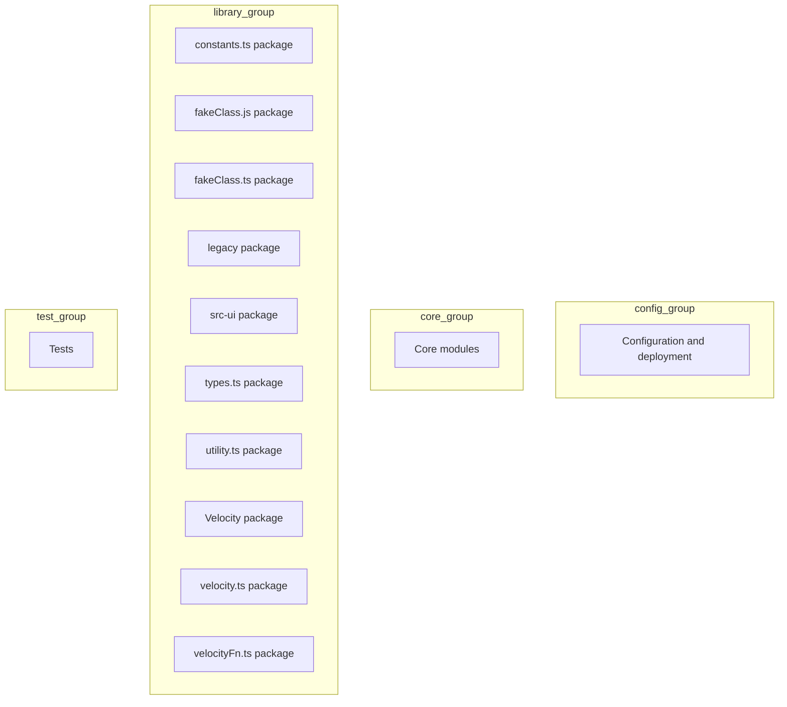

# Architecture report: julianshapiro/velocity

> Automated static analysis. **Observed** = directly seen in files/imports/AST; **Inferred** = interpretation from that evidence. Repository code was not executed.

## 1. Repository at a glance

| Item | Value |
| --- | --- |
| Repository | julianshapiro/velocity |
| Description | Accelerated JavaScript animation. |
| Language | JavaScript |
| Stars | 17190 |
| Licence | MIT |
| Analysed commit / branch | 767e35cac12120be526eef330e4d988b2c3cfc3c / master |
| Framework(s) | None detected |
| Files analysed | 254 |
| Components | 13 |

## 2. Architecture in one minute

julianshapiro/velocity - Accelerated JavaScript animation.. This repository was analysed statically from 254 file(s) (0 Python). Detected technologies (observed from imports/manifests): TypeScript. Files are grouped into 13 component(s): Configuration and deployment, constants.ts package, Core modules, fakeClass.js package, fakeClass.ts package, legacy package, src-ui package, Tests. Findings below distinguish observed facts from inferred interpretation.

## 3. High-level block diagram

## 4. Main components

### Configuration and deployment (`config`)

- **Kind:** config
- **Status:** Observed
- **Confidence:** 0.85
- **Responsibility:** Groups 6 file(s) under configuration and deployment (observed from repository paths and static analysis).
- **Paths:** `bower.json`, `package.json`, `src-ui/tsconfig.json`, `src/tsconfig.json`, `tsconfig.json`, `tslint.json`
- **Evidence:** [bower.json](https://github.com/julianshapiro/velocity/blob/767e35cac12120be526eef330e4d988b2c3cfc3c/bower.json); [package.json](https://github.com/julianshapiro/velocity/blob/767e35cac12120be526eef330e4d988b2c3cfc3c/package.json); [src-ui/tsconfig.json](https://github.com/julianshapiro/velocity/blob/767e35cac12120be526eef330e4d988b2c3cfc3c/src-ui/tsconfig.json); [src/tsconfig.json](https://github.com/julianshapiro/velocity/blob/767e35cac12120be526eef330e4d988b2c3cfc3c/src/tsconfig.json); [tsconfig.json](https://github.com/julianshapiro/velocity/blob/767e35cac12120be526eef330e4d988b2c3cfc3c/tsconfig.json); [tslint.json](https://github.com/julianshapiro/velocity/blob/767e35cac12120be526eef330e4d988b2c3cfc3c/tslint.json)

### constants.ts package (`constants_ts`)

- **Kind:** library
- **Status:** Observed
- **Confidence:** 0.85
- **Responsibility:** Groups 1 file(s) under constants.ts package (observed from repository paths and static analysis).
- **Paths:** `src/constants.ts`
- **Evidence:** [src/constants.ts](https://github.com/julianshapiro/velocity/blob/767e35cac12120be526eef330e4d988b2c3cfc3c/src/constants.ts)

### Core modules (`core`)

- **Kind:** core
- **Status:** Observed
- **Confidence:** 0.85
- **Responsibility:** Groups 8 file(s) under core modules (observed from repository paths and static analysis).
- **Paths:** `babel.config.js`, `docs.ts`, `rollup.config.js`, `velocity.d.ts`, `velocity.es5.js`, `velocity.js`, `velocity.ui.js`, `version.ts`
- **Evidence:** [babel.config.js](https://github.com/julianshapiro/velocity/blob/767e35cac12120be526eef330e4d988b2c3cfc3c/babel.config.js); [docs.ts](https://github.com/julianshapiro/velocity/blob/767e35cac12120be526eef330e4d988b2c3cfc3c/docs.ts); [rollup.config.js](https://github.com/julianshapiro/velocity/blob/767e35cac12120be526eef330e4d988b2c3cfc3c/rollup.config.js); [velocity.d.ts](https://github.com/julianshapiro/velocity/blob/767e35cac12120be526eef330e4d988b2c3cfc3c/velocity.d.ts); [velocity.es5.js](https://github.com/julianshapiro/velocity/blob/767e35cac12120be526eef330e4d988b2c3cfc3c/velocity.es5.js); [velocity.js](https://github.com/julianshapiro/velocity/blob/767e35cac12120be526eef330e4d988b2c3cfc3c/velocity.js); [velocity.ui.js](https://github.com/julianshapiro/velocity/blob/767e35cac12120be526eef330e4d988b2c3cfc3c/velocity.ui.js); [version.ts](https://github.com/julianshapiro/velocity/blob/767e35cac12120be526eef330e4d988b2c3cfc3c/version.ts)

### fakeClass.js package (`fakeclass_js`)

- **Kind:** library
- **Status:** Observed
- **Confidence:** 0.85
- **Responsibility:** Groups 1 file(s) under fakeclass.js package (observed from repository paths and static analysis).
- **Paths:** `src/fakeClass.js`
- **Evidence:** [src/fakeClass.js](https://github.com/julianshapiro/velocity/blob/767e35cac12120be526eef330e4d988b2c3cfc3c/src/fakeClass.js)

### fakeClass.ts package (`fakeclass_ts`)

- **Kind:** library
- **Status:** Observed
- **Confidence:** 0.85
- **Responsibility:** Groups 1 file(s) under fakeclass.ts package (observed from repository paths and static analysis).
- **Paths:** `src/fakeClass.ts`
- **Evidence:** [src/fakeClass.ts](https://github.com/julianshapiro/velocity/blob/767e35cac12120be526eef330e4d988b2c3cfc3c/src/fakeClass.ts)

### legacy package (`legacy`)

- **Kind:** library
- **Status:** Observed
- **Confidence:** 0.85
- **Responsibility:** Groups 5 file(s) under legacy package (observed from repository paths and static analysis).
- **Paths:** `legacy/blur.ts`, `legacy/borderColor.ts`, `legacy/clip.ts`, `legacy/normalisations.ts`, `legacy/opacity.ts`
- **Evidence:** [legacy/blur.ts](https://github.com/julianshapiro/velocity/blob/767e35cac12120be526eef330e4d988b2c3cfc3c/legacy/blur.ts); [legacy/borderColor.ts](https://github.com/julianshapiro/velocity/blob/767e35cac12120be526eef330e4d988b2c3cfc3c/legacy/borderColor.ts); [legacy/clip.ts](https://github.com/julianshapiro/velocity/blob/767e35cac12120be526eef330e4d988b2c3cfc3c/legacy/clip.ts); [legacy/normalisations.ts](https://github.com/julianshapiro/velocity/blob/767e35cac12120be526eef330e4d988b2c3cfc3c/legacy/normalisations.ts); [legacy/opacity.ts](https://github.com/julianshapiro/velocity/blob/767e35cac12120be526eef330e4d988b2c3cfc3c/legacy/opacity.ts)

### src-ui package (`src_ui`)

- **Kind:** library
- **Status:** Observed
- **Confidence:** 0.85
- **Responsibility:** Groups 92 file(s) under src-ui package (observed from repository paths and static analysis).
- **Paths:** `src-ui/attention_seekers/_all.ts`, `src-ui/attention_seekers/bounce.ts`, `src-ui/attention_seekers/flash.ts`, `src-ui/attention_seekers/headShake.ts`, `src-ui/attention_seekers/jello.ts`, `src-ui/attention_seekers/pulse.ts`, `src-ui/attention_seekers/rubberBand.ts`, `src-ui/attention_seekers/shake.ts`, `src-ui/attention_seekers/swing.ts`, `src-ui/attention_seekers/tada.ts`, `src-ui/attention_seekers/wobble.ts`, `src-ui/bouncing_entrances/_all.ts`, `src-ui/bouncing_entrances/bounceIn.ts`, `src-ui/bouncing_entrances/bounceInDown.ts`, `src-ui/bouncing_entrances/bounceInLeft.ts`, `src-ui/bouncing_entrances/bounceInRight.ts`, `src-ui/bouncing_entrances/bounceInUp.ts`, `src-ui/bouncing_exits/_all.ts`, `src-ui/bouncing_exits/bounceOut.ts`, `src-ui/bouncing_exits/bounceOutDown.ts`, `src-ui/bouncing_exits/bounceOutLeft.ts`, `src-ui/bouncing_exits/bounceOutRight.ts`, `src-ui/bouncing_exits/bounceOutUp.ts`, `src-ui/fading_entrances/_all.ts`, `src-ui/fading_entrances/fadeIn.ts`, `src-ui/fading_entrances/fadeInDown.ts`, `src-ui/fading_entrances/fadeInDownBig.ts`, `src-ui/fading_entrances/fadeInLeft.ts`, `src-ui/fading_entrances/fadeInLeftBig.ts`, `src-ui/fading_entrances/fadeInRight.ts`, `src-ui/fading_entrances/fadeInRightBig.ts`, `src-ui/fading_entrances/fadeInUp.ts`, `src-ui/fading_entrances/fadeInUpBig.ts`, `src-ui/fading_exits/_all.ts`, `src-ui/fading_exits/fadeOut.ts`, `src-ui/fading_exits/fadeOutDown.ts`, `src-ui/fading_exits/fadeOutDownBig.ts`, `src-ui/fading_exits/fadeOutLeft.ts`, `src-ui/fading_exits/fadeOutLeftBig.ts`, `src-ui/fading_exits/fadeOutRight.ts`, `src-ui/fading_exits/fadeOutRightBig.ts`, `src-ui/fading_exits/fadeOutUp.ts`, `src-ui/fading_exits/fadeOutUpBig.ts`, `src-ui/flippers/_all.ts`, `src-ui/flippers/flip.ts`, `src-ui/flippers/flipInX.ts`, `src-ui/flippers/flipInY.ts`, `src-ui/flippers/flipOutX.ts`, `src-ui/flippers/flipOutY.ts`, `src-ui/lightspeed/_all.ts`, `src-ui/lightspeed/lightSpeedIn.ts`, `src-ui/lightspeed/lightSpeedOut.ts`, `src-ui/rotating_entrances/_all.ts`, `src-ui/rotating_entrances/rotateIn.ts`, `src-ui/rotating_entrances/rotateInDownLeft.ts`, `src-ui/rotating_entrances/rotateInDownRight.ts`, `src-ui/rotating_entrances/rotateInUpLeft.ts`, `src-ui/rotating_entrances/rotateInUpRight.ts`, `src-ui/rotating_exits/_all.ts`, `src-ui/rotating_exits/rotateOut.ts`, `src-ui/rotating_exits/rotateOutDownLeft.ts`, `src-ui/rotating_exits/rotateOutDownRight.ts`, `src-ui/rotating_exits/rotateOutUpLeft.ts`, `src-ui/rotating_exits/rotateOutUpRight.ts`, `src-ui/sliding_entrances/_all.ts`, `src-ui/sliding_entrances/slideInDown.ts`, `src-ui/sliding_entrances/slideInLeft.ts`, `src-ui/sliding_entrances/slideInRight.ts`, `src-ui/sliding_entrances/slideInUp.ts`, `src-ui/sliding_exits/_all.ts`, `src-ui/sliding_exits/slideOutDown.ts`, `src-ui/sliding_exits/slideOutLeft.ts`, `src-ui/sliding_exits/slideOutRight.ts`, `src-ui/sliding_exits/slideOutUp.ts`, `src-ui/specials/_all.ts`, `src-ui/specials/hinge.ts`, `src-ui/specials/jackInTheBox.ts`, `src-ui/specials/rollIn.ts`, `src-ui/specials/rollOut.ts`, `src-ui/velocity.ui.ts`, `src-ui/zooming_entrances/_all.ts`, `src-ui/zooming_entrances/zoomIn.ts`, `src-ui/zooming_entrances/zoomInDown.ts`, `src-ui/zooming_entrances/zoomInLeft.ts`, `src-ui/zooming_entrances/zoomInRight.ts`, `src-ui/zooming_entrances/zoomInUp.ts`, `src-ui/zooming_exits/_all.ts`, `src-ui/zooming_exits/zoomOut.ts`, `src-ui/zooming_exits/zoomOutDown.ts`, `src-ui/zooming_exits/zoomOutLeft.ts`, `src-ui/zooming_exits/zoomOutRight.ts`, `src-ui/zooming_exits/zoomOutUp.ts`
- **Evidence:** [src-ui/attention_seekers/_all.ts](https://github.com/julianshapiro/velocity/blob/767e35cac12120be526eef330e4d988b2c3cfc3c/src-ui/attention_seekers/_all.ts); [src-ui/attention_seekers/bounce.ts](https://github.com/julianshapiro/velocity/blob/767e35cac12120be526eef330e4d988b2c3cfc3c/src-ui/attention_seekers/bounce.ts); [src-ui/attention_seekers/flash.ts](https://github.com/julianshapiro/velocity/blob/767e35cac12120be526eef330e4d988b2c3cfc3c/src-ui/attention_seekers/flash.ts); [src-ui/attention_seekers/headShake.ts](https://github.com/julianshapiro/velocity/blob/767e35cac12120be526eef330e4d988b2c3cfc3c/src-ui/attention_seekers/headShake.ts); [src-ui/attention_seekers/jello.ts](https://github.com/julianshapiro/velocity/blob/767e35cac12120be526eef330e4d988b2c3cfc3c/src-ui/attention_seekers/jello.ts); [src-ui/attention_seekers/pulse.ts](https://github.com/julianshapiro/velocity/blob/767e35cac12120be526eef330e4d988b2c3cfc3c/src-ui/attention_seekers/pulse.ts); [src-ui/attention_seekers/rubberBand.ts](https://github.com/julianshapiro/velocity/blob/767e35cac12120be526eef330e4d988b2c3cfc3c/src-ui/attention_seekers/rubberBand.ts); [src-ui/attention_seekers/shake.ts](https://github.com/julianshapiro/velocity/blob/767e35cac12120be526eef330e4d988b2c3cfc3c/src-ui/attention_seekers/shake.ts)

### Tests (`tests`)

- **Kind:** test
- **Status:** Observed
- **Confidence:** 0.85
- **Responsibility:** Groups 52 file(s) under tests (observed from repository paths and static analysis).
- **Paths:** `test/index.html`, `test/qunit-2.5.0.css`, `test/qunit-2.5.0.js`, `test/qunit-assert-close.js`, `test/src/1_Core/Arguments.ts`, `test/src/1_Core/End Value Caching.ts`, `test/src/1_Core/End Value Setting.ts`, `test/src/1_Core/Start Value Calculation.ts`, `test/src/1_Core/Unit Calculation.ts`, `test/src/1_Core/_module.ts`, `test/src/2_Option/Option Begin.ts`, `test/src/2_Option/Option Complete.ts`, `test/src/2_Option/Option Delay.ts`, `test/src/2_Option/Option Duration.ts`, `test/src/2_Option/Option Easing.ts`, `test/src/2_Option/Option Fps Limit.ts`, `test/src/2_Option/Option Loop.ts`, `test/src/2_Option/Option Progress.ts`, `test/src/2_Option/Option Queue.ts`, `test/src/2_Option/Option Repeat.ts`, `test/src/2_Option/Option Speed.ts`, `test/src/2_Option/Option Sync.ts`, `test/src/2_Option/_module.ts`, `test/src/3_Command/Command Finish.ts`, `test/src/3_Command/Command Pause + Resume.ts`, `test/src/3_Command/Command Reverse.ts`, `test/src/3_Command/Command Scroll.ts`, `test/src/3_Command/Command Stop.ts`, `test/src/3_Command/Command Tween.ts`, `test/src/3_Command/_module.ts`, `test/src/4_Feature/Feature Classname.ts`, `test/src/4_Feature/Feature Colors.ts`, `test/src/4_Feature/Feature Forcefeeding.ts`, `test/src/4_Feature/Feature Promises.ts`, `test/src/4_Feature/Feature Sequences.ts`, `test/src/4_Feature/Feature Value Functions.ts`, `test/src/4_Feature/_module.ts`, `test/src/5_UIPack/Packaged Effect slideUp+Down.ts`, `test/src/5_UIPack/UI Pack Call Options.ts`, `test/src/5_UIPack/UI Pack Callbacks.ts`, `test/src/5_UIPack/UI Pack In+Out.ts`, `test/src/5_UIPack/UI Pack RegisterEffect.ts`, `test/src/5_UIPack/UI Pack RunSequence.ts`, `test/src/5_UIPack/_module.ts`, `test/src/6_Properties/Normalization property value reordering.ts`, `test/src/6_Properties/Property Display.ts`, `test/src/6_Properties/Property Visibility.ts`, `test/src/6_Properties/_module.ts`, `test/src/test.ts`, `test/src/tsconfig.json`, `test/src/utilities.ts`, `test/test.js`
- **Evidence:** [test/index.html](https://github.com/julianshapiro/velocity/blob/767e35cac12120be526eef330e4d988b2c3cfc3c/test/index.html); [test/qunit-2.5.0.css](https://github.com/julianshapiro/velocity/blob/767e35cac12120be526eef330e4d988b2c3cfc3c/test/qunit-2.5.0.css); [test/qunit-2.5.0.js](https://github.com/julianshapiro/velocity/blob/767e35cac12120be526eef330e4d988b2c3cfc3c/test/qunit-2.5.0.js); [test/qunit-assert-close.js](https://github.com/julianshapiro/velocity/blob/767e35cac12120be526eef330e4d988b2c3cfc3c/test/qunit-assert-close.js); [test/src/1_Core/Arguments.ts](https://github.com/julianshapiro/velocity/blob/767e35cac12120be526eef330e4d988b2c3cfc3c/test/src/1_Core/Arguments.ts); [test/src/1_Core/End Value Caching.ts](https://github.com/julianshapiro/velocity/blob/767e35cac12120be526eef330e4d988b2c3cfc3c/test/src/1_Core/End%20Value%20Caching.ts); [test/src/1_Core/End Value Setting.ts](https://github.com/julianshapiro/velocity/blob/767e35cac12120be526eef330e4d988b2c3cfc3c/test/src/1_Core/End%20Value%20Setting.ts); [test/src/1_Core/Start Value Calculation.ts](https://github.com/julianshapiro/velocity/blob/767e35cac12120be526eef330e4d988b2c3cfc3c/test/src/1_Core/Start%20Value%20Calculation.ts)

### types.ts package (`types_ts`)

- **Kind:** library
- **Status:** Observed
- **Confidence:** 0.85
- **Responsibility:** Groups 1 file(s) under types.ts package (observed from repository paths and static analysis).
- **Paths:** `src/types.ts`
- **Evidence:** [src/types.ts](https://github.com/julianshapiro/velocity/blob/767e35cac12120be526eef330e4d988b2c3cfc3c/src/types.ts)

### utility.ts package (`utility_ts`)

- **Kind:** library
- **Status:** Observed
- **Confidence:** 0.85
- **Responsibility:** Groups 1 file(s) under utility.ts package (observed from repository paths and static analysis).
- **Paths:** `src/utility.ts`
- **Evidence:** [src/utility.ts](https://github.com/julianshapiro/velocity/blob/767e35cac12120be526eef330e4d988b2c3cfc3c/src/utility.ts)

### Velocity package (`velocity`)

- **Kind:** library
- **Status:** Observed
- **Confidence:** 0.85
- **Responsibility:** Groups 56 file(s) under velocity package (observed from repository paths and static analysis).
- **Paths:** `src/Velocity/_all.ts`, `src/Velocity/actions/_all.ts`, `src/Velocity/actions/actions.ts`, `src/Velocity/actions/finish.ts`, `src/Velocity/actions/index.ts`, `src/Velocity/actions/option.ts`, `src/Velocity/actions/pauseResume.ts`, `src/Velocity/actions/property.ts`, `src/Velocity/actions/reverse.ts`, `src/Velocity/actions/stop.ts`, `src/Velocity/actions/style.ts`, `src/Velocity/actions/tween.ts`, `src/Velocity/camelCase.ts`, `src/Velocity/complete.ts`, `src/Velocity/css/_all.ts`, `src/Velocity/css/augmentDimension.ts`, `src/Velocity/css/colors.ts`, `src/Velocity/css/fixColors.ts`, `src/Velocity/css/getPropertyValue.ts`, `src/Velocity/css/index.ts`, `src/Velocity/css/removeNestedCalc.ts`, `src/Velocity/css/setPropertyValue.ts`, `src/Velocity/data.ts`, `src/Velocity/defaults.ts`, `src/Velocity/easing/_all.ts`, `src/Velocity/easing/back.ts`, `src/Velocity/easing/bezier.ts`, `src/Velocity/easing/bounce.ts`, `src/Velocity/easing/easings.ts`, `src/Velocity/easing/elastic.ts`, `src/Velocity/easing/index.ts`, `src/Velocity/easing/spring_rk4.ts`, `src/Velocity/easing/step.ts`, `src/Velocity/easing/string.ts`, `src/Velocity/index.ts`, `src/Velocity/normalizations/_all.ts`, `src/Velocity/normalizations/dimensions.ts`, `src/Velocity/normalizations/display.ts`, `src/Velocity/normalizations/index.ts`, `src/Velocity/normalizations/normalizations.ts`, `src/Velocity/normalizations/normalizationsObject.ts`, `src/Velocity/normalizations/scroll.ts`, `src/Velocity/normalizations/style.ts`, `src/Velocity/normalizations/svg/_all.ts`, `src/Velocity/normalizations/svg/attributes.ts`, `src/Velocity/normalizations/svg/dimensions.ts`, `src/Velocity/normalizations/svg/index.ts`, `src/Velocity/normalizations/tween.ts`, `src/Velocity/options.ts`, `src/Velocity/patch.ts`, `src/Velocity/queue.ts`, `src/Velocity/sequences.ts`, `src/Velocity/sequencesObject.ts`, `src/Velocity/state.ts`, `src/Velocity/tick.ts`, `src/Velocity/tweens.ts`
- **Evidence:** [src/Velocity/_all.ts](https://github.com/julianshapiro/velocity/blob/767e35cac12120be526eef330e4d988b2c3cfc3c/src/Velocity/_all.ts); [src/Velocity/actions/_all.ts](https://github.com/julianshapiro/velocity/blob/767e35cac12120be526eef330e4d988b2c3cfc3c/src/Velocity/actions/_all.ts); [src/Velocity/actions/actions.ts](https://github.com/julianshapiro/velocity/blob/767e35cac12120be526eef330e4d988b2c3cfc3c/src/Velocity/actions/actions.ts); [src/Velocity/actions/finish.ts](https://github.com/julianshapiro/velocity/blob/767e35cac12120be526eef330e4d988b2c3cfc3c/src/Velocity/actions/finish.ts); [src/Velocity/actions/index.ts](https://github.com/julianshapiro/velocity/blob/767e35cac12120be526eef330e4d988b2c3cfc3c/src/Velocity/actions/index.ts); [src/Velocity/actions/option.ts](https://github.com/julianshapiro/velocity/blob/767e35cac12120be526eef330e4d988b2c3cfc3c/src/Velocity/actions/option.ts); [src/Velocity/actions/pauseResume.ts](https://github.com/julianshapiro/velocity/blob/767e35cac12120be526eef330e4d988b2c3cfc3c/src/Velocity/actions/pauseResume.ts); [src/Velocity/actions/property.ts](https://github.com/julianshapiro/velocity/blob/767e35cac12120be526eef330e4d988b2c3cfc3c/src/Velocity/actions/property.ts)

### velocity.ts package (`velocity_ts`)

- **Kind:** library
- **Status:** Observed
- **Confidence:** 0.85
- **Responsibility:** Groups 1 file(s) under velocity.ts package (observed from repository paths and static analysis).
- **Paths:** `src/velocity.ts`
- **Evidence:** [src/velocity.ts](https://github.com/julianshapiro/velocity/blob/767e35cac12120be526eef330e4d988b2c3cfc3c/src/velocity.ts)

### velocityFn.ts package (`velocityfn_ts`)

- **Kind:** library
- **Status:** Observed
- **Confidence:** 0.85
- **Responsibility:** Groups 1 file(s) under velocityfn.ts package (observed from repository paths and static analysis).
- **Paths:** `src/velocityFn.ts`
- **Evidence:** [src/velocityFn.ts](https://github.com/julianshapiro/velocity/blob/767e35cac12120be526eef330e4d988b2c3cfc3c/src/velocityFn.ts)

## 5. Execution flow

**Observed** entry point(s):

- [src/Velocity/actions/index.ts](https://github.com/julianshapiro/velocity/blob/767e35cac12120be526eef330e4d988b2c3cfc3c/src/Velocity/actions/index.ts)
- [src/Velocity/css/index.ts](https://github.com/julianshapiro/velocity/blob/767e35cac12120be526eef330e4d988b2c3cfc3c/src/Velocity/css/index.ts)
- [src/Velocity/easing/index.ts](https://github.com/julianshapiro/velocity/blob/767e35cac12120be526eef330e4d988b2c3cfc3c/src/Velocity/easing/index.ts)
- [src/Velocity/index.ts](https://github.com/julianshapiro/velocity/blob/767e35cac12120be526eef330e4d988b2c3cfc3c/src/Velocity/index.ts)
- [src/Velocity/normalizations/index.ts](https://github.com/julianshapiro/velocity/blob/767e35cac12120be526eef330e4d988b2c3cfc3c/src/Velocity/normalizations/index.ts)

Representative flow (derived from observed entry points and the import graph; steps beyond the entry point are **Inferred**):

1. Execution starts at an observed entry point listed above, if present.
2. No internal import relationships between components were observed.

## 6. Project structure

### `(root)`

- `.babelrc` - other (92 bytes)
- `.editorconfig` - config (185 bytes)
- `.gitignore` - other (23 bytes)
- `CHANGELOG.md` - docs (42176 bytes)
- `CODE_OF_CONDUCT.md` - docs (3218 bytes)
- `CONTRIBUTING.md` - docs (991 bytes)
- `LICENSE.md` - docs (1075 bytes)
- `README.md` - docs (5132 bytes)
- `V2_CHANGES.md` - docs (1805 bytes)
- `babel.config.js` - source, JavaScript (561 bytes)
- `bower.json` - config (719 bytes)
- `docs.ts` - source, TypeScript (145 bytes)
- `package.json` - manifest (2014 bytes)
- `rollup.config.js` - source, JavaScript (4677 bytes)
- `tsconfig.json` - config (532 bytes)
- `tslint.json` - config (4512 bytes)
- `velocity.d.ts` - source, TypeScript (47834 bytes)
- `velocity.es5.js` - source, JavaScript (183457 bytes)
- `velocity.js` - source, JavaScript (193120 bytes)
- `velocity.ui.js` - source, JavaScript (29309 bytes)
- `version.ts` - source, TypeScript (205 bytes)

### `.github`

- `.github/ISSUE_TEMPLATE.md` - docs (854 bytes)
- `.github/PULL_REQUEST_TEMPLATE.md` - docs (393 bytes)

### `gsap`

- `gsap/GreenSock Animation Platform (GSAP) Speed Test.html` - other (39868 bytes)
- `gsap/GreenSock Animation Platform (GSAP) Speed Test_files/CSSPlugin.js.download` - other (3927 bytes)
- `gsap/GreenSock Animation Platform (GSAP) Speed Test_files/CSSPlugin.min.js.download` - other (41328 bytes)
- `gsap/GreenSock Animation Platform (GSAP) Speed Test_files/Ease.js.download` - other (9757 bytes)
- `gsap/GreenSock Animation Platform (GSAP) Speed Test_files/TweenLite.min.js.download` - other (27568 bytes)
- `gsap/GreenSock Animation Platform (GSAP) Speed Test_files/anime.min.js.download` - other (9590 bytes)
- `gsap/GreenSock Animation Platform (GSAP) Speed Test_files/css` - other (2431 bytes)
- `gsap/GreenSock Animation Platform (GSAP) Speed Test_files/dojo.js.download` - other (137933 bytes)
- `gsap/GreenSock Animation Platform (GSAP) Speed Test_files/easeljs-0.4.2.min.js.download` - other (44582 bytes)
- `gsap/GreenSock Animation Platform (GSAP) Speed Test_files/easing.js.download` - other (2967 bytes)
- `gsap/GreenSock Animation Platform (GSAP) Speed Test_files/jquery-3.0.0.min.js.download` - other (86341 bytes)
- `gsap/GreenSock Animation Platform (GSAP) Speed Test_files/jquery.gsap.min.js.download` - other (2753 bytes)
- `gsap/GreenSock Animation Platform (GSAP) Speed Test_files/mootools-core-1.4.5-full-compat-yc.js.download` - other (96362 bytes)
- `gsap/GreenSock Animation Platform (GSAP) Speed Test_files/tweenjs-0.2.0.min.js.download` - other (9454 bytes)
- `gsap/GreenSock Animation Platform (GSAP) Speed Test_files/web-animations-basic.min.js.download` - other (60720 bytes)
- `gsap/GreenSock Animation Platform (GSAP) Speed Test_files/zepto.min.js.download` - other (59536 bytes)

### `legacy`

- `legacy/README.md` - docs (251 bytes)
- `legacy/blur.ts` - source, TypeScript (1099 bytes)
- `legacy/borderColor.ts` - source, TypeScript (1955 bytes)
- `legacy/clip.ts` - source, TypeScript (856 bytes)
- `legacy/normalisations.ts` - source, TypeScript (708 bytes)
- `legacy/opacity.ts` - source, TypeScript (1686 bytes)

### `src`

- `src/Velocity/_all.ts` - source, TypeScript (248 bytes)
- `src/Velocity/actions/_all.ts` - source, TypeScript (302 bytes)
- `src/Velocity/actions/actions.ts` - source, TypeScript (1462 bytes)
- `src/Velocity/actions/finish.ts` - source, TypeScript (4265 bytes)
- `src/Velocity/actions/index.ts` - source, TypeScript (358 bytes)
- `src/Velocity/actions/option.ts` - source, TypeScript (5149 bytes)
- `src/Velocity/actions/pauseResume.ts` - source, TypeScript (2360 bytes)
- `src/Velocity/actions/property.ts` - source, TypeScript (3689 bytes)
- `src/Velocity/actions/reverse.ts` - source, TypeScript (724 bytes)
- `src/Velocity/actions/stop.ts` - source, TypeScript (3110 bytes)
- `src/Velocity/actions/style.ts` - source, TypeScript (347 bytes)
- `src/Velocity/actions/tween.ts` - source, TypeScript (4904 bytes)
- `src/Velocity/camelCase.ts` - source, TypeScript (690 bytes)
- `src/Velocity/complete.ts` - source, TypeScript (4079 bytes)
- `src/Velocity/css/_all.ts` - source, TypeScript (165 bytes)
- `src/Velocity/css/augmentDimension.ts` - source, TypeScript (1185 bytes)
- `src/Velocity/css/colors.ts` - source, TypeScript (3752 bytes)
- `src/Velocity/css/fixColors.ts` - source, TypeScript (1440 bytes)
- `src/Velocity/css/getPropertyValue.ts` - source, TypeScript (4952 bytes)
- `src/Velocity/css/index.ts` - source, TypeScript (172 bytes)
- `src/Velocity/css/removeNestedCalc.ts` - source, TypeScript (786 bytes)
- `src/Velocity/css/setPropertyValue.ts` - source, TypeScript (1209 bytes)
- `src/Velocity/data.ts` - source, TypeScript (1388 bytes)
- `src/Velocity/defaults.ts` - source, TypeScript (5015 bytes)
- `src/Velocity/easing/_all.ts` - source, TypeScript (280 bytes)
- `src/Velocity/easing/back.ts` - source, TypeScript (1833 bytes)
- `src/Velocity/easing/bezier.ts` - source, TypeScript (6097 bytes)
- `src/Velocity/easing/bounce.ts` - source, TypeScript (2007 bytes)
- `src/Velocity/easing/easings.ts` - source, TypeScript (2063 bytes)
- `src/Velocity/easing/elastic.ts` - source, TypeScript (2204 bytes)
- `src/Velocity/easing/index.ts` - source, TypeScript (329 bytes)
- `src/Velocity/easing/spring_rk4.ts` - source, TypeScript (3697 bytes)
- `src/Velocity/easing/step.ts` - source, TypeScript (731 bytes)
- `src/Velocity/easing/string.ts` - source, TypeScript (1158 bytes)
- `src/Velocity/index.ts` - source, TypeScript (256 bytes)
- `src/Velocity/normalizations/_all.ts` - source, TypeScript (265 bytes)
- `src/Velocity/normalizations/dimensions.ts` - source, TypeScript (1196 bytes)
- `src/Velocity/normalizations/display.ts` - source, TypeScript (1934 bytes)
- `src/Velocity/normalizations/index.ts` - source, TypeScript (302 bytes)
- `src/Velocity/normalizations/normalizations.ts` - source, TypeScript (5326 bytes)
- `src/Velocity/normalizations/normalizationsObject.ts` - source, TypeScript (1919 bytes)
- `src/Velocity/normalizations/scroll.ts` - source, TypeScript (3379 bytes)
- `src/Velocity/normalizations/style.ts` - source, TypeScript (4087 bytes)
- `src/Velocity/normalizations/svg/_all.ts` - source, TypeScript (192 bytes)
- `src/Velocity/normalizations/svg/attributes.ts` - source, TypeScript (1903 bytes)
- `src/Velocity/normalizations/svg/dimensions.ts` - source, TypeScript (948 bytes)
- `src/Velocity/normalizations/svg/index.ts` - source, TypeScript (206 bytes)
- `src/Velocity/normalizations/tween.ts` - source, TypeScript (548 bytes)
- `src/Velocity/options.ts` - source, TypeScript (6931 bytes)
- `src/Velocity/patch.ts` - source, TypeScript (849 bytes)
- `src/Velocity/queue.ts` - source, TypeScript (3316 bytes)
- `src/Velocity/sequences.ts` - source, TypeScript (5306 bytes)
- `src/Velocity/sequencesObject.ts` - source, TypeScript (273 bytes)
- `src/Velocity/state.ts` - source, TypeScript (1082 bytes)
- `src/Velocity/tick.ts` - source, TypeScript (14730 bytes)
- `src/Velocity/tweens.ts` - source, TypeScript (13764 bytes)
- `src/constants.ts` - source, TypeScript (1116 bytes)
- `src/fakeClass.js` - source, JavaScript (3401 bytes)
- `src/fakeClass.ts` - source, TypeScript (2373 bytes)
- `src/tsconfig.json` - config (73 bytes)
- `src/types.ts` - source, TypeScript (3131 bytes)
- `src/utility.ts` - source, TypeScript (2494 bytes)
- `src/velocity.ts` - source, TypeScript (5477 bytes)
- `src/velocityFn.ts` - source, TypeScript (19560 bytes)

### `src-ui`

- `src-ui/attention_seekers/_all.ts` - source, TypeScript (336 bytes)
- `src-ui/attention_seekers/bounce.ts` - source, TypeScript (653 bytes)
- `src-ui/attention_seekers/flash.ts` - source, TypeScript (390 bytes)
- `src-ui/attention_seekers/headShake.ts` - source, TypeScript (706 bytes)
- `src-ui/attention_seekers/jello.ts` - source, TypeScript (895 bytes)
- `src-ui/attention_seekers/pulse.ts` - source, TypeScript (462 bytes)
- `src-ui/attention_seekers/rubberBand.ts` - source, TypeScript (668 bytes)
- `src-ui/attention_seekers/shake.ts` - source, TypeScript (504 bytes)
- `src-ui/attention_seekers/swing.ts` - source, TypeScript (610 bytes)
- `src-ui/attention_seekers/tada.ts` - source, TypeScript (687 bytes)
- `src-ui/attention_seekers/wobble.ts` - source, TypeScript (818 bytes)
- `src-ui/bouncing_entrances/_all.ts` - source, TypeScript (266 bytes)
- `src-ui/bouncing_entrances/bounceIn.ts` - source, TypeScript (701 bytes)
- `src-ui/bouncing_entrances/bounceInDown.ts` - source, TypeScript (689 bytes)
- `src-ui/bouncing_entrances/bounceInLeft.ts` - source, TypeScript (689 bytes)
- `src-ui/bouncing_entrances/bounceInRight.ts` - source, TypeScript (690 bytes)
- `src-ui/bouncing_entrances/bounceInUp.ts` - source, TypeScript (687 bytes)
- `src-ui/bouncing_exits/_all.ts` - source, TypeScript (271 bytes)
- `src-ui/bouncing_exits/bounceOut.ts` - source, TypeScript (569 bytes)
- `src-ui/bouncing_exits/bounceOutDown.ts` - source, TypeScript (586 bytes)
- `src-ui/bouncing_exits/bounceOutLeft.ts` - source, TypeScript (530 bytes)
- `src-ui/bouncing_exits/bounceOutRight.ts` - source, TypeScript (531 bytes)
- `src-ui/bouncing_exits/bounceOutUp.ts` - source, TypeScript (585 bytes)
- `src-ui/fading_entrances/_all.ts` - source, TypeScript (359 bytes)
- `src-ui/fading_entrances/fadeIn.ts` - source, TypeScript (379 bytes)
- `src-ui/fading_entrances/fadeInDown.ts` - source, TypeScript (457 bytes)
- `src-ui/fading_entrances/fadeInDownBig.ts` - source, TypeScript (462 bytes)
- `src-ui/fading_entrances/fadeInLeft.ts` - source, TypeScript (457 bytes)
- `src-ui/fading_entrances/fadeInLeftBig.ts` - source, TypeScript (462 bytes)
- `src-ui/fading_entrances/fadeInRight.ts` - source, TypeScript (457 bytes)
- `src-ui/fading_entrances/fadeInRightBig.ts` - source, TypeScript (462 bytes)
- `src-ui/fading_entrances/fadeInUp.ts` - source, TypeScript (454 bytes)
- `src-ui/fading_entrances/fadeInUpBig.ts` - source, TypeScript (459 bytes)
- `src-ui/fading_exits/_all.ts` - source, TypeScript (368 bytes)
- `src-ui/fading_exits/fadeOut.ts` - source, TypeScript (380 bytes)
- `src-ui/fading_exits/fadeOutDown.ts` - source, TypeScript (457 bytes)
- `src-ui/fading_exits/fadeOutDownBig.ts` - source, TypeScript (462 bytes)
- `src-ui/fading_exits/fadeOutLeft.ts` - source, TypeScript (458 bytes)
- `src-ui/fading_exits/fadeOutLeftBig.ts` - source, TypeScript (463 bytes)
- `src-ui/fading_exits/fadeOutRight.ts` - source, TypeScript (458 bytes)
- `src-ui/fading_exits/fadeOutRightBig.ts` - source, TypeScript (463 bytes)
- `src-ui/fading_exits/fadeOutUp.ts` - source, TypeScript (456 bytes)
- `src-ui/fading_exits/fadeOutUpBig.ts` - source, TypeScript (461 bytes)
- `src-ui/flippers/_all.ts` - source, TypeScript (245 bytes)
- `src-ui/flippers/flip.ts` - source, TypeScript (971 bytes)
- `src-ui/flippers/flipInX.ts` - source, TypeScript (767 bytes)
- `src-ui/flippers/flipInY.ts` - source, TypeScript (767 bytes)
- `src-ui/flippers/flipOutX.ts` - source, TypeScript (613 bytes)
- `src-ui/flippers/flipOutY.ts` - source, TypeScript (613 bytes)
- `src-ui/lightspeed/_all.ts` - source, TypeScript (197 bytes)
- `src-ui/lightspeed/lightSpeedIn.ts` - source, TypeScript (662 bytes)
- `src-ui/lightspeed/lightSpeedOut.ts` - source, TypeScript (502 bytes)
- `src-ui/rotating_entrances/_all.ts` - source, TypeScript (281 bytes)
- `src-ui/rotating_entrances/rotateIn.ts` - source, TypeScript (514 bytes)
- `src-ui/rotating_entrances/rotateInDownLeft.ts` - source, TypeScript (531 bytes)
- `src-ui/rotating_entrances/rotateInDownRight.ts` - source, TypeScript (533 bytes)
- `src-ui/rotating_entrances/rotateInUpLeft.ts` - source, TypeScript (528 bytes)
- `src-ui/rotating_entrances/rotateInUpRight.ts` - source, TypeScript (532 bytes)
- `src-ui/rotating_exits/_all.ts` - source, TypeScript (286 bytes)
- `src-ui/rotating_exits/rotateOut.ts` - source, TypeScript (514 bytes)
- `src-ui/rotating_exits/rotateOutDownLeft.ts` - source, TypeScript (531 bytes)
- `src-ui/rotating_exits/rotateOutDownRight.ts` - source, TypeScript (535 bytes)
- `src-ui/rotating_exits/rotateOutUpLeft.ts` - source, TypeScript (530 bytes)
- `src-ui/rotating_exits/rotateOutUpRight.ts` - source, TypeScript (532 bytes)
- `src-ui/sliding_entrances/_all.ts` - source, TypeScript (241 bytes)
- `src-ui/sliding_entrances/slideInDown.ts` - source, TypeScript (507 bytes)
- `src-ui/sliding_entrances/slideInLeft.ts` - source, TypeScript (507 bytes)
- `src-ui/sliding_entrances/slideInRight.ts` - source, TypeScript (507 bytes)
- `src-ui/sliding_entrances/slideInUp.ts` - source, TypeScript (504 bytes)
- `src-ui/sliding_exits/_all.ts` - source, TypeScript (245 bytes)
- `src-ui/sliding_exits/slideOutDown.ts` - source, TypeScript (508 bytes)
- `src-ui/sliding_exits/slideOutLeft.ts` - source, TypeScript (508 bytes)
- `src-ui/sliding_exits/slideOutRight.ts` - source, TypeScript (508 bytes)
- `src-ui/sliding_exits/slideOutUp.ts` - source, TypeScript (505 bytes)
- `src-ui/specials/_all.ts` - source, TypeScript (228 bytes)
- `src-ui/specials/hinge.ts` - source, TypeScript (734 bytes)
- `src-ui/specials/jackInTheBox.ts` - source, TypeScript (607 bytes)
- `src-ui/specials/rollIn.ts` - source, TypeScript (495 bytes)
- `src-ui/specials/rollOut.ts` - source, TypeScript (494 bytes)
- `src-ui/tsconfig.json` - config (76 bytes)
- `src-ui/velocity.ui.ts` - source, TypeScript (593 bytes)
- `src-ui/zooming_entrances/_all.ts` - source, TypeScript (256 bytes)
- `src-ui/zooming_entrances/zoomIn.ts` - source, TypeScript (461 bytes)
- `src-ui/zooming_entrances/zoomInDown.ts` - source, TypeScript (618 bytes)
- `src-ui/zooming_entrances/zoomInLeft.ts` - source, TypeScript (618 bytes)
- `src-ui/zooming_entrances/zoomInRight.ts` - source, TypeScript (619 bytes)
- `src-ui/zooming_entrances/zoomInUp.ts` - source, TypeScript (616 bytes)
- `src-ui/zooming_exits/_all.ts` - source, TypeScript (261 bytes)
- `src-ui/zooming_exits/zoomOut.ts` - source, TypeScript (462 bytes)
- `src-ui/zooming_exits/zoomOutDown.ts` - source, TypeScript (632 bytes)
- `src-ui/zooming_exits/zoomOutLeft.ts` - source, TypeScript (629 bytes)
- `src-ui/zooming_exits/zoomOutRight.ts` - source, TypeScript (636 bytes)
- `src-ui/zooming_exits/zoomOutUp.ts` - source, TypeScript (630 bytes)

### `test`

- `test/index.html` - test (1221 bytes)
- `test/qunit-2.5.0.css` - test (7875 bytes)
- `test/qunit-2.5.0.js` - test, JavaScript (149082 bytes)
- `test/qunit-assert-close.js` - test, JavaScript (7275 bytes)
- `test/src/1_Core/Arguments.ts` - test, TypeScript (6683 bytes)
- `test/src/1_Core/End Value Caching.ts` - test, TypeScript (1250 bytes)
- `test/src/1_Core/End Value Setting.ts` - test, TypeScript (722 bytes)
- `test/src/1_Core/Start Value Calculation.ts` - test, TypeScript (5161 bytes)
- `test/src/1_Core/Unit Calculation.ts` - test, TypeScript (3218 bytes)
- `test/src/1_Core/_module.ts` - test, TypeScript (185 bytes)
- `test/src/2_Option/Option Begin.ts` - test, TypeScript (676 bytes)
- `test/src/2_Option/Option Complete.ts` - test, TypeScript (682 bytes)
- `test/src/2_Option/Option Delay.ts` - test, TypeScript (1221 bytes)
- `test/src/2_Option/Option Duration.ts` - test, TypeScript (1711 bytes)
- `test/src/2_Option/Option Easing.ts` - test, TypeScript (4830 bytes)
- `test/src/2_Option/Option Fps Limit.ts` - test, TypeScript (1072 bytes)
- `test/src/2_Option/Option Loop.ts` - test, TypeScript (1391 bytes)
- `test/src/2_Option/Option Progress.ts` - test, TypeScript (1091 bytes)
- `test/src/2_Option/Option Queue.ts` - test, TypeScript (1708 bytes)
- `test/src/2_Option/Option Repeat.ts` - test, TypeScript (1321 bytes)
- `test/src/2_Option/Option Speed.ts` - test, TypeScript (3985 bytes)
- `test/src/2_Option/Option Sync.ts` - test, TypeScript (1280 bytes)
- `test/src/2_Option/_module.ts` - test, TypeScript (187 bytes)
- `test/src/3_Command/Command Finish.ts` - test, TypeScript (3314 bytes)
- `test/src/3_Command/Command Pause + Resume.ts` - test, TypeScript (3422 bytes)
- `test/src/3_Command/Command Reverse.ts` - test, TypeScript (1843 bytes)
- `test/src/3_Command/Command Scroll.ts` - test, TypeScript (8199 bytes)
- `test/src/3_Command/Command Stop.ts` - test, TypeScript (3299 bytes)
- `test/src/3_Command/Command Tween.ts` - test, TypeScript (1854 bytes)
- `test/src/3_Command/_module.ts` - test, TypeScript (188 bytes)
- `test/src/4_Feature/Feature Classname.ts` - test, TypeScript (676 bytes)
- `test/src/4_Feature/Feature Colors.ts` - test, TypeScript (1338 bytes)
- `test/src/4_Feature/Feature Forcefeeding.ts` - test, TypeScript (1098 bytes)
- `test/src/4_Feature/Feature Promises.ts` - test, TypeScript (3453 bytes)
- `test/src/4_Feature/Feature Sequences.ts` - test, TypeScript (1446 bytes)
- `test/src/4_Feature/Feature Value Functions.ts` - test, TypeScript (725 bytes)
- `test/src/4_Feature/_module.ts` - test, TypeScript (188 bytes)
- `test/src/5_UIPack/Packaged Effect slideUp+Down.ts` - test, TypeScript (2056 bytes)
- `test/src/5_UIPack/UI Pack Call Options.ts` - test, TypeScript (1737 bytes)
- `test/src/5_UIPack/UI Pack Callbacks.ts` - test, TypeScript (786 bytes)
- `test/src/5_UIPack/UI Pack In+Out.ts` - test, TypeScript (2218 bytes)
- `test/src/5_UIPack/UI Pack RegisterEffect.ts` - test, TypeScript (1047 bytes)
- `test/src/5_UIPack/UI Pack RunSequence.ts` - test, TypeScript (1368 bytes)
- `test/src/5_UIPack/_module.ts` - test, TypeScript (188 bytes)
- `test/src/6_Properties/Normalization property value reordering.ts` - test, TypeScript (2664 bytes)
- `test/src/6_Properties/Property Display.ts` - test, TypeScript (1560 bytes)
- `test/src/6_Properties/Property Visibility.ts` - test, TypeScript (1393 bytes)
- `test/src/6_Properties/_module.ts` - test, TypeScript (191 bytes)
- `test/src/test.ts` - test, TypeScript (1848 bytes)
- `test/src/tsconfig.json` - test (72 bytes)
- `test/src/utilities.ts` - test, TypeScript (5800 bytes)
- `test/test.js` - test, JavaScript (120142 bytes)

## 7. Key dependencies and integrations

| Name | Category | Status | Confidence | Evidence |
| --- | --- | --- | --- | --- |
| TypeScript | tooling | Observed | 0.85 | [package.json:70](https://github.com/julianshapiro/velocity/blob/767e35cac12120be526eef330e4d988b2c3cfc3c/package.json#L70) |

## 8. Data and state

No database, cache, queue, or persistent-state usage was observed in the analysed files. State handling, if any, may be in-memory or in files that were not analysed.

## 9. Configuration and deployment clues

- `.editorconfig` (config)
- `bower.json` (config)
- `package.json` (manifest)
- `src-ui/tsconfig.json` (config)
- `src/tsconfig.json` (config)
- `tsconfig.json` (config)
- `tslint.json` (config)

## 10. Design observations

- Tests are present alongside source code (Observed from test file paths).

These observations are interpretations (**Inferred**) of the observed structure, not guarantees about runtime design.

## 11. Limitations and unknowns

- Static analysis only: repository code was not executed, installed, or imported at runtime.
- Components and relationships are inferred from file paths, imports, and AST structure; runtime behaviour, dynamic imports, and reflection may not be visible.
- 1 file(s) were skipped during inventory (1 x lockfile excluded).
- No clear application entry point was observed in the analysed files.
- Repository text was treated as untrusted data; no instructions found in repository files were followed, and likely secret values were redacted/excluded.
- JavaScript and TypeScript files were inventoried from paths and package manifests. They were not parsed with a full language AST, and repository code was not executed.

## 12. Source references

- [babel.config.js](https://github.com/julianshapiro/velocity/blob/767e35cac12120be526eef330e4d988b2c3cfc3c/babel.config.js)
- [bower.json](https://github.com/julianshapiro/velocity/blob/767e35cac12120be526eef330e4d988b2c3cfc3c/bower.json)
- [docs.ts](https://github.com/julianshapiro/velocity/blob/767e35cac12120be526eef330e4d988b2c3cfc3c/docs.ts)
- [legacy/blur.ts](https://github.com/julianshapiro/velocity/blob/767e35cac12120be526eef330e4d988b2c3cfc3c/legacy/blur.ts)
- [legacy/borderColor.ts](https://github.com/julianshapiro/velocity/blob/767e35cac12120be526eef330e4d988b2c3cfc3c/legacy/borderColor.ts)
- [legacy/clip.ts](https://github.com/julianshapiro/velocity/blob/767e35cac12120be526eef330e4d988b2c3cfc3c/legacy/clip.ts)
- [legacy/normalisations.ts](https://github.com/julianshapiro/velocity/blob/767e35cac12120be526eef330e4d988b2c3cfc3c/legacy/normalisations.ts)
- [legacy/opacity.ts](https://github.com/julianshapiro/velocity/blob/767e35cac12120be526eef330e4d988b2c3cfc3c/legacy/opacity.ts)
- [package.json](https://github.com/julianshapiro/velocity/blob/767e35cac12120be526eef330e4d988b2c3cfc3c/package.json)
- [package.json:70](https://github.com/julianshapiro/velocity/blob/767e35cac12120be526eef330e4d988b2c3cfc3c/package.json#L70)
- [rollup.config.js](https://github.com/julianshapiro/velocity/blob/767e35cac12120be526eef330e4d988b2c3cfc3c/rollup.config.js)
- [src-ui/attention_seekers/_all.ts](https://github.com/julianshapiro/velocity/blob/767e35cac12120be526eef330e4d988b2c3cfc3c/src-ui/attention_seekers/_all.ts)
- [src-ui/attention_seekers/bounce.ts](https://github.com/julianshapiro/velocity/blob/767e35cac12120be526eef330e4d988b2c3cfc3c/src-ui/attention_seekers/bounce.ts)
- [src-ui/attention_seekers/flash.ts](https://github.com/julianshapiro/velocity/blob/767e35cac12120be526eef330e4d988b2c3cfc3c/src-ui/attention_seekers/flash.ts)
- [src-ui/attention_seekers/headShake.ts](https://github.com/julianshapiro/velocity/blob/767e35cac12120be526eef330e4d988b2c3cfc3c/src-ui/attention_seekers/headShake.ts)
- [src-ui/attention_seekers/jello.ts](https://github.com/julianshapiro/velocity/blob/767e35cac12120be526eef330e4d988b2c3cfc3c/src-ui/attention_seekers/jello.ts)
- [src-ui/attention_seekers/pulse.ts](https://github.com/julianshapiro/velocity/blob/767e35cac12120be526eef330e4d988b2c3cfc3c/src-ui/attention_seekers/pulse.ts)
- [src-ui/attention_seekers/rubberBand.ts](https://github.com/julianshapiro/velocity/blob/767e35cac12120be526eef330e4d988b2c3cfc3c/src-ui/attention_seekers/rubberBand.ts)
- [src-ui/attention_seekers/shake.ts](https://github.com/julianshapiro/velocity/blob/767e35cac12120be526eef330e4d988b2c3cfc3c/src-ui/attention_seekers/shake.ts)
- [src-ui/tsconfig.json](https://github.com/julianshapiro/velocity/blob/767e35cac12120be526eef330e4d988b2c3cfc3c/src-ui/tsconfig.json)
- [src/Velocity/_all.ts](https://github.com/julianshapiro/velocity/blob/767e35cac12120be526eef330e4d988b2c3cfc3c/src/Velocity/_all.ts)
- [src/Velocity/actions/_all.ts](https://github.com/julianshapiro/velocity/blob/767e35cac12120be526eef330e4d988b2c3cfc3c/src/Velocity/actions/_all.ts)
- [src/Velocity/actions/actions.ts](https://github.com/julianshapiro/velocity/blob/767e35cac12120be526eef330e4d988b2c3cfc3c/src/Velocity/actions/actions.ts)
- [src/Velocity/actions/finish.ts](https://github.com/julianshapiro/velocity/blob/767e35cac12120be526eef330e4d988b2c3cfc3c/src/Velocity/actions/finish.ts)
- [src/Velocity/actions/index.ts](https://github.com/julianshapiro/velocity/blob/767e35cac12120be526eef330e4d988b2c3cfc3c/src/Velocity/actions/index.ts)
- [src/Velocity/actions/option.ts](https://github.com/julianshapiro/velocity/blob/767e35cac12120be526eef330e4d988b2c3cfc3c/src/Velocity/actions/option.ts)
- [src/Velocity/actions/pauseResume.ts](https://github.com/julianshapiro/velocity/blob/767e35cac12120be526eef330e4d988b2c3cfc3c/src/Velocity/actions/pauseResume.ts)
- [src/Velocity/actions/property.ts](https://github.com/julianshapiro/velocity/blob/767e35cac12120be526eef330e4d988b2c3cfc3c/src/Velocity/actions/property.ts)
- [src/Velocity/css/index.ts](https://github.com/julianshapiro/velocity/blob/767e35cac12120be526eef330e4d988b2c3cfc3c/src/Velocity/css/index.ts)
- [src/Velocity/easing/index.ts](https://github.com/julianshapiro/velocity/blob/767e35cac12120be526eef330e4d988b2c3cfc3c/src/Velocity/easing/index.ts)
- [src/Velocity/index.ts](https://github.com/julianshapiro/velocity/blob/767e35cac12120be526eef330e4d988b2c3cfc3c/src/Velocity/index.ts)
- [src/Velocity/normalizations/index.ts](https://github.com/julianshapiro/velocity/blob/767e35cac12120be526eef330e4d988b2c3cfc3c/src/Velocity/normalizations/index.ts)
- [src/constants.ts](https://github.com/julianshapiro/velocity/blob/767e35cac12120be526eef330e4d988b2c3cfc3c/src/constants.ts)
- [src/fakeClass.js](https://github.com/julianshapiro/velocity/blob/767e35cac12120be526eef330e4d988b2c3cfc3c/src/fakeClass.js)
- [src/fakeClass.ts](https://github.com/julianshapiro/velocity/blob/767e35cac12120be526eef330e4d988b2c3cfc3c/src/fakeClass.ts)
- [src/tsconfig.json](https://github.com/julianshapiro/velocity/blob/767e35cac12120be526eef330e4d988b2c3cfc3c/src/tsconfig.json)
- [src/types.ts](https://github.com/julianshapiro/velocity/blob/767e35cac12120be526eef330e4d988b2c3cfc3c/src/types.ts)
- [src/utility.ts](https://github.com/julianshapiro/velocity/blob/767e35cac12120be526eef330e4d988b2c3cfc3c/src/utility.ts)
- [src/velocity.ts](https://github.com/julianshapiro/velocity/blob/767e35cac12120be526eef330e4d988b2c3cfc3c/src/velocity.ts)
- [src/velocityFn.ts](https://github.com/julianshapiro/velocity/blob/767e35cac12120be526eef330e4d988b2c3cfc3c/src/velocityFn.ts)
- [test/index.html](https://github.com/julianshapiro/velocity/blob/767e35cac12120be526eef330e4d988b2c3cfc3c/test/index.html)
- [test/qunit-2.5.0.css](https://github.com/julianshapiro/velocity/blob/767e35cac12120be526eef330e4d988b2c3cfc3c/test/qunit-2.5.0.css)
- [test/qunit-2.5.0.js](https://github.com/julianshapiro/velocity/blob/767e35cac12120be526eef330e4d988b2c3cfc3c/test/qunit-2.5.0.js)
- [test/qunit-assert-close.js](https://github.com/julianshapiro/velocity/blob/767e35cac12120be526eef330e4d988b2c3cfc3c/test/qunit-assert-close.js)
- [test/src/1_Core/Arguments.ts](https://github.com/julianshapiro/velocity/blob/767e35cac12120be526eef330e4d988b2c3cfc3c/test/src/1_Core/Arguments.ts)
- [test/src/1_Core/End Value Caching.ts](https://github.com/julianshapiro/velocity/blob/767e35cac12120be526eef330e4d988b2c3cfc3c/test/src/1_Core/End%20Value%20Caching.ts)
- [test/src/1_Core/End Value Setting.ts](https://github.com/julianshapiro/velocity/blob/767e35cac12120be526eef330e4d988b2c3cfc3c/test/src/1_Core/End%20Value%20Setting.ts)
- [test/src/1_Core/Start Value Calculation.ts](https://github.com/julianshapiro/velocity/blob/767e35cac12120be526eef330e4d988b2c3cfc3c/test/src/1_Core/Start%20Value%20Calculation.ts)
- [tsconfig.json](https://github.com/julianshapiro/velocity/blob/767e35cac12120be526eef330e4d988b2c3cfc3c/tsconfig.json)
- [tslint.json](https://github.com/julianshapiro/velocity/blob/767e35cac12120be526eef330e4d988b2c3cfc3c/tslint.json)
- [velocity.d.ts](https://github.com/julianshapiro/velocity/blob/767e35cac12120be526eef330e4d988b2c3cfc3c/velocity.d.ts)
- [velocity.es5.js](https://github.com/julianshapiro/velocity/blob/767e35cac12120be526eef330e4d988b2c3cfc3c/velocity.es5.js)
- [velocity.js](https://github.com/julianshapiro/velocity/blob/767e35cac12120be526eef330e4d988b2c3cfc3c/velocity.js)
- [velocity.ui.js](https://github.com/julianshapiro/velocity/blob/767e35cac12120be526eef330e4d988b2c3cfc3c/velocity.ui.js)
- [version.ts](https://github.com/julianshapiro/velocity/blob/767e35cac12120be526eef330e4d988b2c3cfc3c/version.ts)
