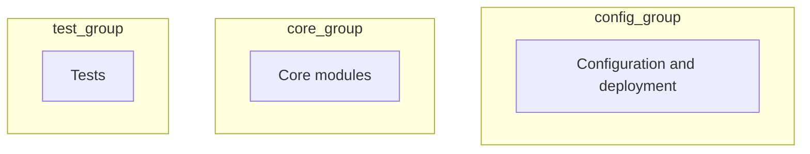

# Architecture report: jwagner/smartcrop.js

> Automated static analysis. **Observed** = directly seen in files/imports/AST; **Inferred** = interpretation from that evidence. Repository code was not executed.

## 1. Repository at a glance

| Item | Value |
| --- | --- |
| Repository | jwagner/smartcrop.js |
| Description | Content aware image cropping |
| Language | JavaScript |
| Stars | 12959 |
| Licence | MIT |
| Analysed commit / branch | 0e207ed910625f91b07d35865c71a9621a63ebdb / main |
| Framework(s) | None detected |
| Files analysed | 35 |
| Components | 3 |

## 2. Architecture in one minute

jwagner/smartcrop.js - Content aware image cropping. This repository was analysed statically from 35 file(s) (0 Python). Detected technologies (observed from imports/manifests): GitHub Actions, Docker. Files are grouped into 3 component(s): Configuration and deployment, Core modules, Tests. Findings below distinguish observed facts from inferred interpretation.

## 3. High-level block diagram

## 4. Main components

### Configuration and deployment (`config`)

- **Kind:** config
- **Status:** Observed
- **Confidence:** 0.85
- **Responsibility:** Groups 2 file(s) under configuration and deployment (observed from repository paths and static analysis).
- **Paths:** `bower.json`, `package.json`
- **Evidence:** [bower.json](https://github.com/jwagner/smartcrop.js/blob/0e207ed910625f91b07d35865c71a9621a63ebdb/bower.json); [package.json](https://github.com/jwagner/smartcrop.js/blob/0e207ed910625f91b07d35865c71a9621a63ebdb/package.json)

### Core modules (`core`)

- **Kind:** core
- **Status:** Observed
- **Confidence:** 0.85
- **Responsibility:** Groups 2 file(s) under core modules (observed from repository paths and static analysis).
- **Paths:** `index.d.ts`, `smartcrop.js`
- **Evidence:** [index.d.ts](https://github.com/jwagner/smartcrop.js/blob/0e207ed910625f91b07d35865c71a9621a63ebdb/index.d.ts); [smartcrop.js](https://github.com/jwagner/smartcrop.js/blob/0e207ed910625f91b07d35865c71a9621a63ebdb/smartcrop.js)

### Tests (`tests`)

- **Kind:** test
- **Status:** Observed
- **Confidence:** 0.85
- **Responsibility:** Groups 6 file(s) under tests (observed from repository paths and static analysis).
- **Paths:** `test/benchmark-node.js`, `test/benchmark.html`, `test/benchmark.js`, `test/index.html`, `test/smartcrop.js`, `test/types.ts`
- **Evidence:** [test/benchmark-node.js](https://github.com/jwagner/smartcrop.js/blob/0e207ed910625f91b07d35865c71a9621a63ebdb/test/benchmark-node.js); [test/benchmark.html](https://github.com/jwagner/smartcrop.js/blob/0e207ed910625f91b07d35865c71a9621a63ebdb/test/benchmark.html); [test/benchmark.js](https://github.com/jwagner/smartcrop.js/blob/0e207ed910625f91b07d35865c71a9621a63ebdb/test/benchmark.js); [test/index.html](https://github.com/jwagner/smartcrop.js/blob/0e207ed910625f91b07d35865c71a9621a63ebdb/test/index.html); [test/smartcrop.js](https://github.com/jwagner/smartcrop.js/blob/0e207ed910625f91b07d35865c71a9621a63ebdb/test/smartcrop.js); [test/types.ts](https://github.com/jwagner/smartcrop.js/blob/0e207ed910625f91b07d35865c71a9621a63ebdb/test/types.ts)

## 5. Execution flow

No entry point was observed; the startup flow below is therefore limited.

Representative flow (derived from observed entry points and the import graph; steps beyond the entry point are **Inferred**):

1. Execution starts at an observed entry point listed above, if present.
2. No internal import relationships between components were observed.

## 6. Project structure

### `(root)`

- `.editorconfig` - config (44 bytes)
- `.eslintrc.js` - source, JavaScript (789 bytes)
- `.prettierrc` - other (26 bytes)
- `LICENSE` - docs (1056 bytes)
- `README.md` - docs (10364 bytes)
- `bower.json` - config (610 bytes)
- `index.d.ts` - source, TypeScript (535 bytes)
- `package.json` - manifest (1280 bytes)
- `smartcrop.js` - source, JavaScript (17674 bytes)

### `.devcontainer`

- `.devcontainer/Dockerfile` - container (842 bytes)
- `.devcontainer/devcontainer.json` - config (948 bytes)

### `.github`

- `.github/workflows/publish.yml` - ci, YAML (430 bytes)
- `.github/workflows/tests.yml` - ci, YAML (584 bytes)

### `examples`

- `examples/face-api/tiny_face_detector_model-weights_manifest.json` - config (2953 bytes)
- `examples/images/images.json` - config (22931 bytes)
- `examples/jquery.js` - source, JavaScript (89501 bytes)
- `examples/minimal.html` - other (1367 bytes)
- `examples/q.js` - source, JavaScript (58120 bytes)
- `examples/slideshow.html` - other (1339 bytes)
- `examples/slideshow.js` - source, JavaScript (2874 bytes)
- `examples/smartcrop-debug.js` - source, JavaScript (1563 bytes)
- `examples/style.css` - other (1713 bytes)
- `examples/testbed.html` - other (2718 bytes)
- `examples/testbed.js` - source, JavaScript (6986 bytes)
- `examples/testsuite.html` - other (2177 bytes)
- `examples/testsuite.js` - source, JavaScript (2703 bytes)
- `examples/tracking-face-min.js` - source, JavaScript (181820 bytes)
- `examples/tracking-min.js` - source, JavaScript (20538 bytes)
- `examples/underscore.js` - source, JavaScript (19530 bytes)

### `test`

- `test/benchmark-node.js` - test, JavaScript (749 bytes)
- `test/benchmark.html` - test (473 bytes)
- `test/benchmark.js` - test, JavaScript (802 bytes)
- `test/index.html` - test (683 bytes)
- `test/smartcrop.js` - test, JavaScript (7532 bytes)
- `test/types.ts` - test, TypeScript (57 bytes)

## 7. Key dependencies and integrations

| Name | Category | Status | Confidence | Evidence |
| --- | --- | --- | --- | --- |
| GitHub Actions | ci | Observed | 0.90 | [.github/workflows/publish.yml](https://github.com/jwagner/smartcrop.js/blob/0e207ed910625f91b07d35865c71a9621a63ebdb/.github/workflows/publish.yml); [.github/workflows/tests.yml](https://github.com/jwagner/smartcrop.js/blob/0e207ed910625f91b07d35865c71a9621a63ebdb/.github/workflows/tests.yml) |
| Docker | tooling | Observed | 0.85 | [.devcontainer/Dockerfile](https://github.com/jwagner/smartcrop.js/blob/0e207ed910625f91b07d35865c71a9621a63ebdb/.devcontainer/Dockerfile) |

## 8. Data and state

No database, cache, queue, or persistent-state usage was observed in the analysed files. State handling, if any, may be in-memory or in files that were not analysed.

## 9. Configuration and deployment clues

- `.devcontainer/Dockerfile` (container)
- `.devcontainer/devcontainer.json` (config)
- `.editorconfig` (config)
- `.github/workflows/publish.yml` (ci)
- `.github/workflows/tests.yml` (ci)
- `bower.json` (config)
- `examples/face-api/tiny_face_detector_model-weights_manifest.json` (config)
- `examples/images/images.json` (config)
- `package.json` (manifest)

## 10. Design observations

- Tests are present alongside source code (Observed from test file paths).

These observations are interpretations (**Inferred**) of the observed structure, not guarantees about runtime design.

## 11. Limitations and unknowns

- Static analysis only: repository code was not executed, installed, or imported at runtime.
- Components and relationships are inferred from file paths, imports, and AST structure; runtime behaviour, dynamic imports, and reflection may not be visible.
- No clear application entry point was observed in the analysed files.
- Repository text was treated as untrusted data; no instructions found in repository files were followed, and likely secret values were redacted/excluded.
- JavaScript and TypeScript files were inventoried from paths and package manifests. They were not parsed with a full language AST, and repository code was not executed.

## 12. Source references

- [.devcontainer/Dockerfile](https://github.com/jwagner/smartcrop.js/blob/0e207ed910625f91b07d35865c71a9621a63ebdb/.devcontainer/Dockerfile)
- [.github/workflows/publish.yml](https://github.com/jwagner/smartcrop.js/blob/0e207ed910625f91b07d35865c71a9621a63ebdb/.github/workflows/publish.yml)
- [.github/workflows/tests.yml](https://github.com/jwagner/smartcrop.js/blob/0e207ed910625f91b07d35865c71a9621a63ebdb/.github/workflows/tests.yml)
- [bower.json](https://github.com/jwagner/smartcrop.js/blob/0e207ed910625f91b07d35865c71a9621a63ebdb/bower.json)
- [index.d.ts](https://github.com/jwagner/smartcrop.js/blob/0e207ed910625f91b07d35865c71a9621a63ebdb/index.d.ts)
- [package.json](https://github.com/jwagner/smartcrop.js/blob/0e207ed910625f91b07d35865c71a9621a63ebdb/package.json)
- [smartcrop.js](https://github.com/jwagner/smartcrop.js/blob/0e207ed910625f91b07d35865c71a9621a63ebdb/smartcrop.js)
- [test/benchmark-node.js](https://github.com/jwagner/smartcrop.js/blob/0e207ed910625f91b07d35865c71a9621a63ebdb/test/benchmark-node.js)
- [test/benchmark.html](https://github.com/jwagner/smartcrop.js/blob/0e207ed910625f91b07d35865c71a9621a63ebdb/test/benchmark.html)
- [test/benchmark.js](https://github.com/jwagner/smartcrop.js/blob/0e207ed910625f91b07d35865c71a9621a63ebdb/test/benchmark.js)
- [test/index.html](https://github.com/jwagner/smartcrop.js/blob/0e207ed910625f91b07d35865c71a9621a63ebdb/test/index.html)
- [test/smartcrop.js](https://github.com/jwagner/smartcrop.js/blob/0e207ed910625f91b07d35865c71a9621a63ebdb/test/smartcrop.js)
- [test/types.ts](https://github.com/jwagner/smartcrop.js/blob/0e207ed910625f91b07d35865c71a9621a63ebdb/test/types.ts)
