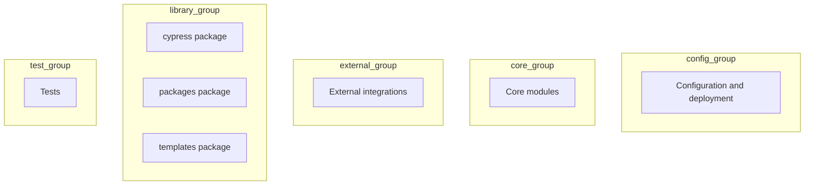

# Architecture report: jxnblk/mdx-deck

> Automated static analysis. **Observed** = directly seen in files/imports/AST; **Inferred** = interpretation from that evidence. Repository code was not executed.

## 1. Repository at a glance

| Item | Value |
| --- | --- |
| Repository | jxnblk/mdx-deck |
| Description | ♠️ React MDX-based presentation decks |
| Language | JavaScript |
| Stars | 11494 |
| Licence | MIT |
| Analysed commit / branch | a4779fc0555e26bc241afd8176661d41fd6981ac / master |
| Framework(s) | React |
| Files analysed | 181 |
| Components | 7 |

## 2. Architecture in one minute

jxnblk/mdx-deck - ♠️ React MDX-based presentation decks. This repository was analysed statically from 181 file(s) (0 Python). Detected technologies (observed from imports/manifests): React, Jest. Files are grouped into 7 component(s): Configuration and deployment, Core modules, cypress package, External integrations, packages package, templates package, Tests. Findings below distinguish observed facts from inferred interpretation.

## 3. High-level block diagram

## 4. Main components

### Configuration and deployment (`config`)

- **Kind:** config
- **Status:** Observed
- **Confidence:** 0.85
- **Responsibility:** Groups 12 file(s) under configuration and deployment (observed from repository paths and static analysis).
- **Paths:** `cypress.json`, `lerna.json`, `netlify.toml`, `package.json`, `packages/create-deck/package.json`, `packages/gatsby-plugin/package.json`, `packages/gatsby-theme/package.json`, `packages/mdx-deck/package.json`, `packages/starter/package.json`, `packages/themes/package.json`, `packages/website-pdf/package.json`, `templates/basic/package.json`
- **Evidence:** [cypress.json](https://github.com/jxnblk/mdx-deck/blob/a4779fc0555e26bc241afd8176661d41fd6981ac/cypress.json); [lerna.json](https://github.com/jxnblk/mdx-deck/blob/a4779fc0555e26bc241afd8176661d41fd6981ac/lerna.json); [netlify.toml](https://github.com/jxnblk/mdx-deck/blob/a4779fc0555e26bc241afd8176661d41fd6981ac/netlify.toml); [package.json](https://github.com/jxnblk/mdx-deck/blob/a4779fc0555e26bc241afd8176661d41fd6981ac/package.json); [packages/create-deck/package.json](https://github.com/jxnblk/mdx-deck/blob/a4779fc0555e26bc241afd8176661d41fd6981ac/packages/create-deck/package.json); [packages/gatsby-plugin/package.json](https://github.com/jxnblk/mdx-deck/blob/a4779fc0555e26bc241afd8176661d41fd6981ac/packages/gatsby-plugin/package.json); [packages/gatsby-theme/package.json](https://github.com/jxnblk/mdx-deck/blob/a4779fc0555e26bc241afd8176661d41fd6981ac/packages/gatsby-theme/package.json); [packages/mdx-deck/package.json](https://github.com/jxnblk/mdx-deck/blob/a4779fc0555e26bc241afd8176661d41fd6981ac/packages/mdx-deck/package.json)

### Core modules (`core`)

- **Kind:** core
- **Status:** Observed
- **Confidence:** 0.85
- **Responsibility:** Groups 1 file(s) under core modules (observed from repository paths and static analysis).
- **Paths:** `babel.config.js`
- **Evidence:** [babel.config.js](https://github.com/jxnblk/mdx-deck/blob/a4779fc0555e26bc241afd8176661d41fd6981ac/babel.config.js)

### cypress package (`cypress`)

- **Kind:** library
- **Status:** Observed
- **Confidence:** 0.85
- **Responsibility:** Groups 3 file(s) under cypress package (observed from repository paths and static analysis).
- **Paths:** `cypress/plugins/index.js`, `cypress/support/commands.js`, `cypress/support/index.js`
- **Evidence:** [cypress/plugins/index.js](https://github.com/jxnblk/mdx-deck/blob/a4779fc0555e26bc241afd8176661d41fd6981ac/cypress/plugins/index.js); [cypress/support/commands.js](https://github.com/jxnblk/mdx-deck/blob/a4779fc0555e26bc241afd8176661d41fd6981ac/cypress/support/commands.js); [cypress/support/index.js](https://github.com/jxnblk/mdx-deck/blob/a4779fc0555e26bc241afd8176661d41fd6981ac/cypress/support/index.js)

### External integrations (`external_integrations`)

- **Kind:** external
- **Status:** Observed
- **Confidence:** 0.85
- **Responsibility:** Groups 1 file(s) under external integrations (observed from repository paths and static analysis).
- **Paths:** `cypress/integration/hello.js`
- **Evidence:** [cypress/integration/hello.js](https://github.com/jxnblk/mdx-deck/blob/a4779fc0555e26bc241afd8176661d41fd6981ac/cypress/integration/hello.js)

### packages package (`packages`)

- **Kind:** library
- **Status:** Observed
- **Confidence:** 0.85
- **Responsibility:** Groups 88 file(s) under packages package (observed from repository paths and static analysis).
- **Paths:** `packages/create-deck/cli.js`, `packages/gatsby-plugin/gatsby-browser.js`, `packages/gatsby-plugin/gatsby-config.js`, `packages/gatsby-plugin/gatsby-node.js`, `packages/gatsby-plugin/gatsby-ssr.js`, `packages/gatsby-plugin/index.js`, `packages/gatsby-plugin/src/clock.js`, `packages/gatsby-plugin/src/components.js`, `packages/gatsby-plugin/src/container.js`, `packages/gatsby-plugin/src/context.js`, `packages/gatsby-plugin/src/deck.js`, `packages/gatsby-plugin/src/footer.js`, `packages/gatsby-plugin/src/header.js`, `packages/gatsby-plugin/src/index.js`, `packages/gatsby-plugin/src/keyboard.js`, `packages/gatsby-plugin/src/modes.js`, `packages/gatsby-plugin/src/slide.js`, `packages/gatsby-plugin/src/split-slides.js`, `packages/gatsby-plugin/src/storage.js`, `packages/gatsby-plugin/src/theme.js`, `packages/gatsby-plugin/src/timer.js`, `packages/gatsby-plugin/src/use-steps.js`, `packages/gatsby-theme/gatsby-browser.js`, `packages/gatsby-theme/gatsby-config.js`, `packages/gatsby-theme/gatsby-node.js`, `packages/gatsby-theme/gatsby-ssr.js`, `packages/gatsby-theme/index.js`, `packages/gatsby-theme/src/components/app.js`, `packages/gatsby-theme/src/components/appear.js`, `packages/gatsby-theme/src/components/clock.js`, `packages/gatsby-theme/src/components/deck.js`, `packages/gatsby-theme/src/components/decks.js`, `packages/gatsby-theme/src/components/embed.js`, `packages/gatsby-theme/src/components/full-screen-code.js`, `packages/gatsby-theme/src/components/grid.js`, `packages/gatsby-theme/src/components/head.js`, `packages/gatsby-theme/src/components/horizontal.js`, `packages/gatsby-theme/src/components/image.js`, `packages/gatsby-theme/src/components/invert.js`, `packages/gatsby-theme/src/components/notes.js`, `packages/gatsby-theme/src/components/overview.js`, `packages/gatsby-theme/src/components/presenter-footer.js`, `packages/gatsby-theme/src/components/presenter.js`, `packages/gatsby-theme/src/components/slide-list.js`, `packages/gatsby-theme/src/components/slide.js`, `packages/gatsby-theme/src/components/split-right.js`, `packages/gatsby-theme/src/components/split.js`, `packages/gatsby-theme/src/components/timer.js`, `packages/gatsby-theme/src/components/wrapper.js`, `packages/gatsby-theme/src/components/zoom.js`, `packages/gatsby-theme/src/constants.js`, `packages/gatsby-theme/src/context.js`, `packages/gatsby-theme/src/convert-legacy-theme.js`, `packages/gatsby-theme/src/gatsby-plugin-theme-ui/components.js`, `packages/gatsby-theme/src/gatsby-plugin-theme-ui/index.js`, `packages/gatsby-theme/src/hooks/use-deck.js`, `packages/gatsby-theme/src/hooks/use-keyboard.js`, `packages/gatsby-theme/src/hooks/use-steps.js`, `packages/gatsby-theme/src/hooks/use-storage.js`, `packages/gatsby-theme/src/hooks/use-swipe.js`, `packages/gatsby-theme/src/index.js`, `packages/gatsby-theme/src/navigate.js`, `packages/gatsby-theme/src/split-slides.js`, `packages/gatsby-theme/src/templates/deck.js`, `packages/gatsby-theme/src/templates/decks.js`, `packages/mdx-deck/cli.js`, `packages/mdx-deck/gatsby-config.js`, `packages/mdx-deck/index.js`, `packages/starter/gatsby-config.js`, `packages/themes/base.js`, `packages/themes/big.js`, `packages/themes/book.js`, `packages/themes/code.js`, `packages/themes/comic.js`, `packages/themes/condensed.js`, `packages/themes/dark.js`, `packages/themes/future.js`, `packages/themes/index.js`, `packages/themes/lobster.js`, `packages/themes/notes.js`, `packages/themes/poppins.js`, `packages/themes/script.js`, `packages/themes/swiss.js`, `packages/themes/syntax-highlighter-prism.js`, `packages/themes/syntax-highlighter.js`, `packages/themes/yellow.js`, `packages/website-pdf/cli.js`, `packages/website-pdf/index.js`
- **Evidence:** [packages/create-deck/cli.js](https://github.com/jxnblk/mdx-deck/blob/a4779fc0555e26bc241afd8176661d41fd6981ac/packages/create-deck/cli.js); [packages/gatsby-plugin/gatsby-browser.js](https://github.com/jxnblk/mdx-deck/blob/a4779fc0555e26bc241afd8176661d41fd6981ac/packages/gatsby-plugin/gatsby-browser.js); [packages/gatsby-plugin/gatsby-config.js](https://github.com/jxnblk/mdx-deck/blob/a4779fc0555e26bc241afd8176661d41fd6981ac/packages/gatsby-plugin/gatsby-config.js); [packages/gatsby-plugin/gatsby-node.js](https://github.com/jxnblk/mdx-deck/blob/a4779fc0555e26bc241afd8176661d41fd6981ac/packages/gatsby-plugin/gatsby-node.js); [packages/gatsby-plugin/gatsby-ssr.js](https://github.com/jxnblk/mdx-deck/blob/a4779fc0555e26bc241afd8176661d41fd6981ac/packages/gatsby-plugin/gatsby-ssr.js); [packages/gatsby-plugin/index.js](https://github.com/jxnblk/mdx-deck/blob/a4779fc0555e26bc241afd8176661d41fd6981ac/packages/gatsby-plugin/index.js); [packages/gatsby-plugin/src/clock.js](https://github.com/jxnblk/mdx-deck/blob/a4779fc0555e26bc241afd8176661d41fd6981ac/packages/gatsby-plugin/src/clock.js); [packages/gatsby-plugin/src/components.js](https://github.com/jxnblk/mdx-deck/blob/a4779fc0555e26bc241afd8176661d41fd6981ac/packages/gatsby-plugin/src/components.js)

### templates package (`templates`)

- **Kind:** library
- **Status:** Observed
- **Confidence:** 0.85
- **Responsibility:** Groups 1 file(s) under templates package (observed from repository paths and static analysis).
- **Paths:** `templates/basic/theme.js`
- **Evidence:** [templates/basic/theme.js](https://github.com/jxnblk/mdx-deck/blob/a4779fc0555e26bc241afd8176661d41fd6981ac/templates/basic/theme.js)

### Tests (`tests`)

- **Kind:** test
- **Status:** Observed
- **Confidence:** 0.85
- **Responsibility:** Groups 4 file(s) under tests (observed from repository paths and static analysis).
- **Paths:** `packages/gatsby-plugin/test/__snapshots__/components.js.snap`, `packages/gatsby-plugin/test/clock.js`, `packages/gatsby-plugin/test/components.js`, `packages/gatsby-plugin/test/deck.js`
- **Evidence:** [packages/gatsby-plugin/test/__snapshots__/components.js.snap](https://github.com/jxnblk/mdx-deck/blob/a4779fc0555e26bc241afd8176661d41fd6981ac/packages/gatsby-plugin/test/__snapshots__/components.js.snap); [packages/gatsby-plugin/test/clock.js](https://github.com/jxnblk/mdx-deck/blob/a4779fc0555e26bc241afd8176661d41fd6981ac/packages/gatsby-plugin/test/clock.js); [packages/gatsby-plugin/test/components.js](https://github.com/jxnblk/mdx-deck/blob/a4779fc0555e26bc241afd8176661d41fd6981ac/packages/gatsby-plugin/test/components.js); [packages/gatsby-plugin/test/deck.js](https://github.com/jxnblk/mdx-deck/blob/a4779fc0555e26bc241afd8176661d41fd6981ac/packages/gatsby-plugin/test/deck.js)

## 5. Execution flow

**Observed** entry point(s):

- [cypress/plugins/index.js](https://github.com/jxnblk/mdx-deck/blob/a4779fc0555e26bc241afd8176661d41fd6981ac/cypress/plugins/index.js)
- [cypress/support/index.js](https://github.com/jxnblk/mdx-deck/blob/a4779fc0555e26bc241afd8176661d41fd6981ac/cypress/support/index.js)
- [packages/create-deck/cli.js](https://github.com/jxnblk/mdx-deck/blob/a4779fc0555e26bc241afd8176661d41fd6981ac/packages/create-deck/cli.js)
- [packages/gatsby-plugin/index.js](https://github.com/jxnblk/mdx-deck/blob/a4779fc0555e26bc241afd8176661d41fd6981ac/packages/gatsby-plugin/index.js)
- [packages/gatsby-plugin/src/index.js](https://github.com/jxnblk/mdx-deck/blob/a4779fc0555e26bc241afd8176661d41fd6981ac/packages/gatsby-plugin/src/index.js)
- [packages/gatsby-theme/index.js](https://github.com/jxnblk/mdx-deck/blob/a4779fc0555e26bc241afd8176661d41fd6981ac/packages/gatsby-theme/index.js)
- [packages/gatsby-theme/src/index.js](https://github.com/jxnblk/mdx-deck/blob/a4779fc0555e26bc241afd8176661d41fd6981ac/packages/gatsby-theme/src/index.js)
- [packages/mdx-deck/cli.js](https://github.com/jxnblk/mdx-deck/blob/a4779fc0555e26bc241afd8176661d41fd6981ac/packages/mdx-deck/cli.js)
- [packages/mdx-deck/index.js](https://github.com/jxnblk/mdx-deck/blob/a4779fc0555e26bc241afd8176661d41fd6981ac/packages/mdx-deck/index.js)
- [packages/themes/index.js](https://github.com/jxnblk/mdx-deck/blob/a4779fc0555e26bc241afd8176661d41fd6981ac/packages/themes/index.js)
- [packages/website-pdf/cli.js](https://github.com/jxnblk/mdx-deck/blob/a4779fc0555e26bc241afd8176661d41fd6981ac/packages/website-pdf/cli.js)
- [packages/website-pdf/index.js](https://github.com/jxnblk/mdx-deck/blob/a4779fc0555e26bc241afd8176661d41fd6981ac/packages/website-pdf/index.js)

Representative flow (derived from observed entry points and the import graph; steps beyond the entry point are **Inferred**):

1. Execution starts at an observed entry point listed above, if present.
2. No internal import relationships between components were observed.

## 6. Project structure

### `(root)`

- `.gitignore` - other (81 bytes)
- `.prettierrc` - other (99 bytes)
- `CHANGELOG.md` - docs (9998 bytes)
- `CONTRIBUTING.md` - docs (3966 bytes)
- `LICENSE.md` - docs (1083 bytes)
- `MIGRATION.md` - docs (5123 bytes)
- `babel.config.js` - source, JavaScript (91 bytes)
- `cypress.json` - config (42 bytes)
- `lerna.json` - config (111 bytes)
- `netlify.toml` - config (88 bytes)
- `package.json` - manifest (1710 bytes)

### `.circleci`

- `.circleci/config.yml` - ci, YAML (992 bytes)

### `cypress`

- `cypress/integration/hello.js` - source, JavaScript (407 bytes)
- `cypress/plugins/index.js` - source, JavaScript (644 bytes)
- `cypress/support/commands.js` - source, JavaScript (841 bytes)
- `cypress/support/index.js` - source, JavaScript (670 bytes)

### `docs`

- `docs/Counter.js` - docs (1117 bytes)
- `docs/api.md` - docs (731 bytes)
- `docs/components.md` - docs (2558 bytes)
- `docs/demo.mdx` - docs (1954 bytes)
- `docs/exporting.md` - docs (1014 bytes)
- `docs/gatsby.md` - docs (1265 bytes)
- `docs/layouts.md` - docs (1697 bytes)
- `docs/package.json` - manifest (403 bytes)
- `docs/presenting.md` - docs (583 bytes)
- `docs/themes.md` - docs (1198 bytes)
- `docs/theming.md` - docs (3173 bytes)

### `examples`

- `examples/README.md` - docs (1249 bytes)
- `examples/aspect-ratio/deck.mdx` - other (220 bytes)
- `examples/aspect-ratio/package.json` - manifest (258 bytes)
- `examples/basic/deck.mdx` - other (33 bytes)
- `examples/basic/package.json` - manifest (251 bytes)
- `examples/gatsby/decks/beep.mdx` - other (32 bytes)
- `examples/gatsby/decks/hello.mdx` - other (56 bytes)
- `examples/gatsby/gatsby-config.js` - source, JavaScript (207 bytes)
- `examples/gatsby/package.json` - manifest (510 bytes)
- `examples/gatsby/src/pages/index.mdx` - other (46 bytes)
- `examples/head/deck.mdx` - other (85 bytes)
- `examples/head/package.json` - manifest (250 bytes)
- `examples/header-footer/deck.mdx` - other (142 bytes)
- `examples/header-footer/package.json` - manifest (259 bytes)
- `examples/images/deck.mdx` - other (297 bytes)
- `examples/images/package.json` - manifest (252 bytes)
- `examples/layouts/deck.mdx` - other (536 bytes)
- `examples/layouts/package.json` - manifest (253 bytes)
- `examples/multiple/deck.js` - source, JavaScript (124 bytes)
- `examples/multiple/one.mdx` - other (36 bytes)
- `examples/multiple/package.json` - manifest (252 bytes)
- `examples/multiple/two.mdx` - other (39 bytes)
- `examples/prism/deck.mdx` - other (195 bytes)
- `examples/prism/package.json` - manifest (251 bytes)
- `examples/provider/deck.mdx` - other (172 bytes)
- `examples/provider/package.json` - manifest (254 bytes)
- `examples/provider/theme.js` - source, JavaScript (284 bytes)
- `examples/steps/deck.mdx` - other (167 bytes)
- `examples/steps/package.json` - manifest (252 bytes)
- `examples/syntax-highlighting/deck.mdx` - other (209 bytes)
- `examples/syntax-highlighting/package.json` - manifest (265 bytes)
- `examples/themes/deck.mdx` - other (324 bytes)
- `examples/themes/package.json` - manifest (252 bytes)
- `examples/themes/theme.js` - source, JavaScript (1567 bytes)

### `packages`

- `packages/create-deck/README.md` - docs (88 bytes)
- `packages/create-deck/cli.js` - source, JavaScript (1007 bytes)
- `packages/create-deck/package.json` - manifest (345 bytes)
- `packages/gatsby-plugin/.gitignore` - other (23 bytes)
- `packages/gatsby-plugin/.npmignore` - other (28 bytes)
- `packages/gatsby-plugin/README.md` - docs (247 bytes)
- `packages/gatsby-plugin/gatsby-browser.js` - source, JavaScript (40 bytes)
- `packages/gatsby-plugin/gatsby-config.js` - source, JavaScript (73 bytes)
- `packages/gatsby-plugin/gatsby-node.js` - source, JavaScript (1301 bytes)
- `packages/gatsby-plugin/gatsby-ssr.js` - source, JavaScript (40 bytes)
- `packages/gatsby-plugin/index.js` - source, JavaScript (30 bytes)
- `packages/gatsby-plugin/package.json` - manifest (904 bytes)
- `packages/gatsby-plugin/src/clock.js` - source, JavaScript (352 bytes)
- `packages/gatsby-plugin/src/components.js` - source, JavaScript (3775 bytes)
- `packages/gatsby-plugin/src/container.js` - source, JavaScript (6015 bytes)
- `packages/gatsby-plugin/src/context.js` - source, JavaScript (130 bytes)
- `packages/gatsby-plugin/src/deck.js` - source, JavaScript (2640 bytes)
- `packages/gatsby-plugin/src/footer.js` - source, JavaScript (273 bytes)
- `packages/gatsby-plugin/src/header.js` - source, JavaScript (270 bytes)
- `packages/gatsby-plugin/src/index.js` - source, JavaScript (506 bytes)
- `packages/gatsby-plugin/src/keyboard.js` - source, JavaScript (1857 bytes)
- `packages/gatsby-plugin/src/modes.js` - source, JavaScript (125 bytes)
- `packages/gatsby-plugin/src/slide.js` - source, JavaScript (518 bytes)
- `packages/gatsby-plugin/src/split-slides.js` - source, JavaScript (1678 bytes)
- `packages/gatsby-plugin/src/storage.js` - source, JavaScript (1312 bytes)
- `packages/gatsby-plugin/src/theme.js` - source, JavaScript (1177 bytes)
- `packages/gatsby-plugin/src/timer.js` - source, JavaScript (860 bytes)
- `packages/gatsby-plugin/src/use-steps.js` - source, JavaScript (377 bytes)
- `packages/gatsby-plugin/test/__snapshots__/components.js.snap` - test (3859 bytes)
- `packages/gatsby-plugin/test/clock.js` - test, JavaScript (255 bytes)
- `packages/gatsby-plugin/test/components.js` - test, JavaScript (1671 bytes)
- `packages/gatsby-plugin/test/deck.js` - test, JavaScript (5329 bytes)
- `packages/gatsby-theme/.gitignore` - other (14 bytes)
- `packages/gatsby-theme/README.md` - docs (1108 bytes)
- `packages/gatsby-theme/decks/beep.mdx` - other (27 bytes)
- `packages/gatsby-theme/decks/hello.mdx` - other (677 bytes)
- `packages/gatsby-theme/gatsby-browser.js` - source, JavaScript (40 bytes)
- `packages/gatsby-theme/gatsby-config.js` - source, JavaScript (935 bytes)
- `packages/gatsby-theme/gatsby-node.js` - source, JavaScript (4315 bytes)
- `packages/gatsby-theme/gatsby-ssr.js` - source, JavaScript (40 bytes)
- `packages/gatsby-theme/index.js` - source, JavaScript (22 bytes)
- `packages/gatsby-theme/package.json` - manifest (1316 bytes)
- `packages/gatsby-theme/src/components/app.js` - source, JavaScript (779 bytes)
- `packages/gatsby-theme/src/components/appear.js` - source, JavaScript (414 bytes)
- `packages/gatsby-theme/src/components/clock.js` - source, JavaScript (407 bytes)
- `packages/gatsby-theme/src/components/deck.js` - source, JavaScript (3438 bytes)
- `packages/gatsby-theme/src/components/decks.js` - source, JavaScript (780 bytes)
- `packages/gatsby-theme/src/components/embed.js` - source, JavaScript (711 bytes)
- `packages/gatsby-theme/src/components/full-screen-code.js` - source, JavaScript (378 bytes)
- `packages/gatsby-theme/src/components/grid.js` - source, JavaScript (767 bytes)
- `packages/gatsby-theme/src/components/head.js` - source, JavaScript (81 bytes)
- `packages/gatsby-theme/src/components/horizontal.js` - source, JavaScript (543 bytes)
- `packages/gatsby-theme/src/components/image.js` - source, JavaScript (408 bytes)
- `packages/gatsby-theme/src/components/invert.js` - source, JavaScript (407 bytes)
- `packages/gatsby-theme/src/components/notes.js` - source, JavaScript (279 bytes)
- `packages/gatsby-theme/src/components/overview.js` - source, JavaScript (1315 bytes)
- `packages/gatsby-theme/src/components/presenter-footer.js` - source, JavaScript (974 bytes)
- `packages/gatsby-theme/src/components/presenter.js` - source, JavaScript (1595 bytes)
- `packages/gatsby-theme/src/components/slide-list.js` - source, JavaScript (1310 bytes)
- `packages/gatsby-theme/src/components/slide.js` - source, JavaScript (1042 bytes)
- `packages/gatsby-theme/src/components/split-right.js` - source, JavaScript (494 bytes)
- `packages/gatsby-theme/src/components/split.js` - source, JavaScript (484 bytes)
- `packages/gatsby-theme/src/components/timer.js` - source, JavaScript (1109 bytes)
- `packages/gatsby-theme/src/components/wrapper.js` - source, JavaScript (1267 bytes)
- `packages/gatsby-theme/src/components/zoom.js` - source, JavaScript (678 bytes)
- `packages/gatsby-theme/src/constants.js` - source, JavaScript (129 bytes)
- `packages/gatsby-theme/src/context.js` - source, JavaScript (72 bytes)
- `packages/gatsby-theme/src/convert-legacy-theme.js` - source, JavaScript (1286 bytes)
- `packages/gatsby-theme/src/gatsby-plugin-theme-ui/components.js` - source, JavaScript (243 bytes)
- `packages/gatsby-theme/src/gatsby-plugin-theme-ui/index.js` - source, JavaScript (1815 bytes)
- `packages/gatsby-theme/src/hooks/use-deck.js` - source, JavaScript (149 bytes)
- `packages/gatsby-theme/src/hooks/use-keyboard.js` - source, JavaScript (2217 bytes)
- `packages/gatsby-theme/src/hooks/use-steps.js` - source, JavaScript (355 bytes)
- `packages/gatsby-theme/src/hooks/use-storage.js` - source, JavaScript (1464 bytes)
- `packages/gatsby-theme/src/hooks/use-swipe.js` - source, JavaScript (747 bytes)
- `packages/gatsby-theme/src/index.js` - source, JavaScript (925 bytes)
- `packages/gatsby-theme/src/navigate.js` - source, JavaScript (795 bytes)
- `packages/gatsby-theme/src/split-slides.js` - source, JavaScript (1062 bytes)
- `packages/gatsby-theme/src/templates/deck.js` - source, JavaScript (680 bytes)
- `packages/gatsby-theme/src/templates/decks.js` - source, JavaScript (213 bytes)
- `packages/mdx-deck/.gitignore` - other (21 bytes)
- `packages/mdx-deck/.npmignore` - other (21 bytes)
- `packages/mdx-deck/README.md` - docs (8294 bytes)
- `packages/mdx-deck/cli.js` - source, JavaScript (1930 bytes)
- `packages/mdx-deck/gatsby-config.js` - source, JavaScript (595 bytes)
- `packages/mdx-deck/hello.mdx` - other (1010 bytes)
- `packages/mdx-deck/index.js` - source, JavaScript (102 bytes)
- `packages/mdx-deck/package.json` - manifest (838 bytes)
- `packages/starter/decks/.gitkeep` - other (0 bytes)
- `packages/starter/gatsby-config.js` - source, JavaScript (59 bytes)
- `packages/starter/package.json` - manifest (430 bytes)
- `packages/themes/README.md` - docs (80 bytes)
- `packages/themes/base.js` - source, JavaScript (54 bytes)
- `packages/themes/big.js` - source, JavaScript (451 bytes)
- `packages/themes/book.js` - source, JavaScript (437 bytes)
- `packages/themes/code.js` - source, JavaScript (420 bytes)
- `packages/themes/comic.js` - source, JavaScript (300 bytes)
- `packages/themes/condensed.js` - source, JavaScript (593 bytes)
- `packages/themes/dark.js` - source, JavaScript (272 bytes)
- `packages/themes/future.js` - source, JavaScript (480 bytes)
- `packages/themes/index.js` - source, JavaScript (807 bytes)
- `packages/themes/lobster.js` - source, JavaScript (287 bytes)
- `packages/themes/notes.js` - source, JavaScript (376 bytes)
- `packages/themes/package.json` - manifest (299 bytes)
- `packages/themes/poppins.js` - source, JavaScript (415 bytes)
- `packages/themes/script.js` - source, JavaScript (426 bytes)
- `packages/themes/swiss.js` - source, JavaScript (384 bytes)
- `packages/themes/syntax-highlighter-prism.js` - source, JavaScript (363 bytes)
- `packages/themes/syntax-highlighter.js` - source, JavaScript (549 bytes)
- `packages/themes/yellow.js` - source, JavaScript (574 bytes)
- `packages/website-pdf/.gitignore` - other (5 bytes)
- `packages/website-pdf/README.md` - docs (284 bytes)
- `packages/website-pdf/cli.js` - source, JavaScript (1004 bytes)
- `packages/website-pdf/index.js` - source, JavaScript (756 bytes)
- `packages/website-pdf/package.json` - manifest (408 bytes)

### `templates`

- `templates/basic/.gitignore` - other (18 bytes)
- `templates/basic/README.md` - docs (419 bytes)
- `templates/basic/deck.mdx` - other (325 bytes)
- `templates/basic/package.json` - manifest (252 bytes)
- `templates/basic/theme.js` - source, JavaScript (244 bytes)

## 7. Key dependencies and integrations

| Name | Category | Status | Confidence | Evidence |
| --- | --- | --- | --- | --- |
| React | framework | Observed | 0.90 | [examples/gatsby/package.json:18](https://github.com/jxnblk/mdx-deck/blob/a4779fc0555e26bc241afd8176661d41fd6981ac/examples/gatsby/package.json#L18); [examples/gatsby/package.json:19](https://github.com/jxnblk/mdx-deck/blob/a4779fc0555e26bc241afd8176661d41fd6981ac/examples/gatsby/package.json#L19); [packages/gatsby-plugin/package.json:13](https://github.com/jxnblk/mdx-deck/blob/a4779fc0555e26bc241afd8176661d41fd6981ac/packages/gatsby-plugin/package.json#L13); [packages/gatsby-plugin/package.json:14](https://github.com/jxnblk/mdx-deck/blob/a4779fc0555e26bc241afd8176661d41fd6981ac/packages/gatsby-plugin/package.json#L14) |
| Jest | tooling | Observed | 0.85 | [package.json:16](https://github.com/jxnblk/mdx-deck/blob/a4779fc0555e26bc241afd8176661d41fd6981ac/package.json#L16) |

## 8. Data and state

No database, cache, queue, or persistent-state usage was observed in the analysed files. State handling, if any, may be in-memory or in files that were not analysed.

## 9. Configuration and deployment clues

- `.circleci/config.yml` (ci)
- `cypress.json` (config)
- `docs/package.json` (manifest)
- `examples/aspect-ratio/package.json` (manifest)
- `examples/basic/package.json` (manifest)
- `examples/gatsby/package.json` (manifest)
- `examples/head/package.json` (manifest)
- `examples/header-footer/package.json` (manifest)
- `examples/images/package.json` (manifest)
- `examples/layouts/package.json` (manifest)
- `examples/multiple/package.json` (manifest)
- `examples/prism/package.json` (manifest)
- `examples/provider/package.json` (manifest)
- `examples/steps/package.json` (manifest)
- `examples/syntax-highlighting/package.json` (manifest)
- `examples/themes/package.json` (manifest)
- `lerna.json` (config)
- `netlify.toml` (config)
- `package.json` (manifest)
- `packages/create-deck/package.json` (manifest)
- `packages/gatsby-plugin/package.json` (manifest)
- `packages/gatsby-theme/package.json` (manifest)
- `packages/mdx-deck/package.json` (manifest)
- `packages/starter/package.json` (manifest)
- `packages/themes/package.json` (manifest)
- `packages/website-pdf/package.json` (manifest)
- `templates/basic/package.json` (manifest)

## 10. Design observations

- Tests are present alongside source code (Observed from test file paths).
- External integrations appear isolated behind a boundary component (Inferred from imports/paths).

These observations are interpretations (**Inferred**) of the observed structure, not guarantees about runtime design.

## 11. Limitations and unknowns

- Static analysis only: repository code was not executed, installed, or imported at runtime.
- Components and relationships are inferred from file paths, imports, and AST structure; runtime behaviour, dynamic imports, and reflection may not be visible.
- No clear application entry point was observed in the analysed files.
- Repository text was treated as untrusted data; no instructions found in repository files were followed, and likely secret values were redacted/excluded.
- JavaScript and TypeScript files were inventoried from paths and package manifests. They were not parsed with a full language AST, and repository code was not executed.

## 12. Source references

- [babel.config.js](https://github.com/jxnblk/mdx-deck/blob/a4779fc0555e26bc241afd8176661d41fd6981ac/babel.config.js)
- [cypress.json](https://github.com/jxnblk/mdx-deck/blob/a4779fc0555e26bc241afd8176661d41fd6981ac/cypress.json)
- [cypress/integration/hello.js](https://github.com/jxnblk/mdx-deck/blob/a4779fc0555e26bc241afd8176661d41fd6981ac/cypress/integration/hello.js)
- [cypress/plugins/index.js](https://github.com/jxnblk/mdx-deck/blob/a4779fc0555e26bc241afd8176661d41fd6981ac/cypress/plugins/index.js)
- [cypress/support/commands.js](https://github.com/jxnblk/mdx-deck/blob/a4779fc0555e26bc241afd8176661d41fd6981ac/cypress/support/commands.js)
- [cypress/support/index.js](https://github.com/jxnblk/mdx-deck/blob/a4779fc0555e26bc241afd8176661d41fd6981ac/cypress/support/index.js)
- [examples/gatsby/package.json:18](https://github.com/jxnblk/mdx-deck/blob/a4779fc0555e26bc241afd8176661d41fd6981ac/examples/gatsby/package.json#L18)
- [examples/gatsby/package.json:19](https://github.com/jxnblk/mdx-deck/blob/a4779fc0555e26bc241afd8176661d41fd6981ac/examples/gatsby/package.json#L19)
- [lerna.json](https://github.com/jxnblk/mdx-deck/blob/a4779fc0555e26bc241afd8176661d41fd6981ac/lerna.json)
- [netlify.toml](https://github.com/jxnblk/mdx-deck/blob/a4779fc0555e26bc241afd8176661d41fd6981ac/netlify.toml)
- [package.json](https://github.com/jxnblk/mdx-deck/blob/a4779fc0555e26bc241afd8176661d41fd6981ac/package.json)
- [package.json:16](https://github.com/jxnblk/mdx-deck/blob/a4779fc0555e26bc241afd8176661d41fd6981ac/package.json#L16)
- [packages/create-deck/cli.js](https://github.com/jxnblk/mdx-deck/blob/a4779fc0555e26bc241afd8176661d41fd6981ac/packages/create-deck/cli.js)
- [packages/create-deck/package.json](https://github.com/jxnblk/mdx-deck/blob/a4779fc0555e26bc241afd8176661d41fd6981ac/packages/create-deck/package.json)
- [packages/gatsby-plugin/gatsby-browser.js](https://github.com/jxnblk/mdx-deck/blob/a4779fc0555e26bc241afd8176661d41fd6981ac/packages/gatsby-plugin/gatsby-browser.js)
- [packages/gatsby-plugin/gatsby-config.js](https://github.com/jxnblk/mdx-deck/blob/a4779fc0555e26bc241afd8176661d41fd6981ac/packages/gatsby-plugin/gatsby-config.js)
- [packages/gatsby-plugin/gatsby-node.js](https://github.com/jxnblk/mdx-deck/blob/a4779fc0555e26bc241afd8176661d41fd6981ac/packages/gatsby-plugin/gatsby-node.js)
- [packages/gatsby-plugin/gatsby-ssr.js](https://github.com/jxnblk/mdx-deck/blob/a4779fc0555e26bc241afd8176661d41fd6981ac/packages/gatsby-plugin/gatsby-ssr.js)
- [packages/gatsby-plugin/index.js](https://github.com/jxnblk/mdx-deck/blob/a4779fc0555e26bc241afd8176661d41fd6981ac/packages/gatsby-plugin/index.js)
- [packages/gatsby-plugin/package.json](https://github.com/jxnblk/mdx-deck/blob/a4779fc0555e26bc241afd8176661d41fd6981ac/packages/gatsby-plugin/package.json)
- [packages/gatsby-plugin/package.json:13](https://github.com/jxnblk/mdx-deck/blob/a4779fc0555e26bc241afd8176661d41fd6981ac/packages/gatsby-plugin/package.json#L13)
- [packages/gatsby-plugin/package.json:14](https://github.com/jxnblk/mdx-deck/blob/a4779fc0555e26bc241afd8176661d41fd6981ac/packages/gatsby-plugin/package.json#L14)
- [packages/gatsby-plugin/src/clock.js](https://github.com/jxnblk/mdx-deck/blob/a4779fc0555e26bc241afd8176661d41fd6981ac/packages/gatsby-plugin/src/clock.js)
- [packages/gatsby-plugin/src/components.js](https://github.com/jxnblk/mdx-deck/blob/a4779fc0555e26bc241afd8176661d41fd6981ac/packages/gatsby-plugin/src/components.js)
- [packages/gatsby-plugin/src/index.js](https://github.com/jxnblk/mdx-deck/blob/a4779fc0555e26bc241afd8176661d41fd6981ac/packages/gatsby-plugin/src/index.js)
- [packages/gatsby-plugin/test/__snapshots__/components.js.snap](https://github.com/jxnblk/mdx-deck/blob/a4779fc0555e26bc241afd8176661d41fd6981ac/packages/gatsby-plugin/test/__snapshots__/components.js.snap)
- [packages/gatsby-plugin/test/clock.js](https://github.com/jxnblk/mdx-deck/blob/a4779fc0555e26bc241afd8176661d41fd6981ac/packages/gatsby-plugin/test/clock.js)
- [packages/gatsby-plugin/test/components.js](https://github.com/jxnblk/mdx-deck/blob/a4779fc0555e26bc241afd8176661d41fd6981ac/packages/gatsby-plugin/test/components.js)
- [packages/gatsby-plugin/test/deck.js](https://github.com/jxnblk/mdx-deck/blob/a4779fc0555e26bc241afd8176661d41fd6981ac/packages/gatsby-plugin/test/deck.js)
- [packages/gatsby-theme/index.js](https://github.com/jxnblk/mdx-deck/blob/a4779fc0555e26bc241afd8176661d41fd6981ac/packages/gatsby-theme/index.js)
- [packages/gatsby-theme/package.json](https://github.com/jxnblk/mdx-deck/blob/a4779fc0555e26bc241afd8176661d41fd6981ac/packages/gatsby-theme/package.json)
- [packages/gatsby-theme/package.json:13](https://github.com/jxnblk/mdx-deck/blob/a4779fc0555e26bc241afd8176661d41fd6981ac/packages/gatsby-theme/package.json#L13)
- [packages/gatsby-theme/package.json:14](https://github.com/jxnblk/mdx-deck/blob/a4779fc0555e26bc241afd8176661d41fd6981ac/packages/gatsby-theme/package.json#L14)
- [packages/gatsby-theme/src/index.js](https://github.com/jxnblk/mdx-deck/blob/a4779fc0555e26bc241afd8176661d41fd6981ac/packages/gatsby-theme/src/index.js)
- [packages/mdx-deck/cli.js](https://github.com/jxnblk/mdx-deck/blob/a4779fc0555e26bc241afd8176661d41fd6981ac/packages/mdx-deck/cli.js)
- [packages/mdx-deck/index.js](https://github.com/jxnblk/mdx-deck/blob/a4779fc0555e26bc241afd8176661d41fd6981ac/packages/mdx-deck/index.js)
- [packages/mdx-deck/package.json](https://github.com/jxnblk/mdx-deck/blob/a4779fc0555e26bc241afd8176661d41fd6981ac/packages/mdx-deck/package.json)
- [packages/mdx-deck/package.json:29](https://github.com/jxnblk/mdx-deck/blob/a4779fc0555e26bc241afd8176661d41fd6981ac/packages/mdx-deck/package.json#L29)
- [packages/mdx-deck/package.json:30](https://github.com/jxnblk/mdx-deck/blob/a4779fc0555e26bc241afd8176661d41fd6981ac/packages/mdx-deck/package.json#L30)
- [packages/themes/index.js](https://github.com/jxnblk/mdx-deck/blob/a4779fc0555e26bc241afd8176661d41fd6981ac/packages/themes/index.js)
- [packages/website-pdf/cli.js](https://github.com/jxnblk/mdx-deck/blob/a4779fc0555e26bc241afd8176661d41fd6981ac/packages/website-pdf/cli.js)
- [packages/website-pdf/index.js](https://github.com/jxnblk/mdx-deck/blob/a4779fc0555e26bc241afd8176661d41fd6981ac/packages/website-pdf/index.js)
- [templates/basic/theme.js](https://github.com/jxnblk/mdx-deck/blob/a4779fc0555e26bc241afd8176661d41fd6981ac/templates/basic/theme.js)
