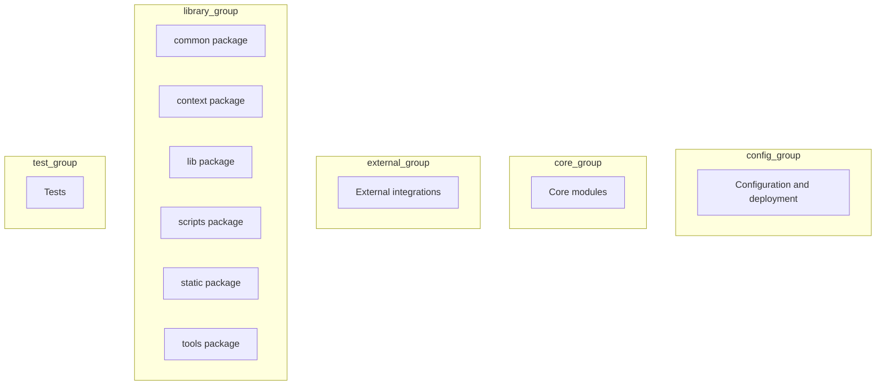

# Architecture report: karma-runner/karma

> Automated static analysis. **Observed** = directly seen in files/imports/AST; **Inferred** = interpretation from that evidence. Repository code was not executed.

## 1. Repository at a glance

| Item | Value |
| --- | --- |
| Repository | karma-runner/karma |
| Description | Spectacular Test Runner for JavaScript |
| Language | JavaScript |
| Stars | 11951 |
| Licence | MIT |
| Analysed commit / branch | 84f85e7016efc2266fa6b3465f494a3fa151c85c / master |
| Framework(s) | None detected |
| Files analysed | 261 |
| Components | 10 |

## 2. Architecture in one minute

karma-runner/karma - Spectacular Test Runner for JavaScript. This repository was analysed statically from 261 file(s) (0 Python). Detected technologies (observed from imports/manifests): GitHub Actions. Files are grouped into 10 component(s): common package, Configuration and deployment, context package, Core modules, External integrations, lib package, scripts package, static package. Findings below distinguish observed facts from inferred interpretation.

## 3. High-level block diagram

## 4. Main components

### common package (`common`)

- **Kind:** library
- **Status:** Observed
- **Confidence:** 0.85
- **Responsibility:** Groups 2 file(s) under common package (observed from repository paths and static analysis).
- **Paths:** `common/stringify.js`, `common/util.js`
- **Evidence:** [common/stringify.js](https://github.com/karma-runner/karma/blob/84f85e7016efc2266fa6b3465f494a3fa151c85c/common/stringify.js); [common/util.js](https://github.com/karma-runner/karma/blob/84f85e7016efc2266fa6b3465f494a3fa151c85c/common/util.js)

### Configuration and deployment (`config`)

- **Kind:** config
- **Status:** Observed
- **Confidence:** 0.85
- **Responsibility:** Groups 1 file(s) under configuration and deployment (observed from repository paths and static analysis).
- **Paths:** `package.json`
- **Evidence:** [package.json](https://github.com/karma-runner/karma/blob/84f85e7016efc2266fa6b3465f494a3fa151c85c/package.json)

### context package (`context`)

- **Kind:** library
- **Status:** Observed
- **Confidence:** 0.85
- **Responsibility:** Groups 2 file(s) under context package (observed from repository paths and static analysis).
- **Paths:** `context/karma.js`, `context/main.js`
- **Evidence:** [context/karma.js](https://github.com/karma-runner/karma/blob/84f85e7016efc2266fa6b3465f494a3fa151c85c/context/karma.js); [context/main.js](https://github.com/karma-runner/karma/blob/84f85e7016efc2266fa6b3465f494a3fa151c85c/context/main.js)

### Core modules (`core`)

- **Kind:** core
- **Status:** Observed
- **Confidence:** 0.85
- **Responsibility:** Groups 7 file(s) under core modules (observed from repository paths and static analysis).
- **Paths:** `commitlint.config.js`, `config.tpl.js`, `config.tpl.ts`, `cucumber.js`, `release.config.js`, `requirejs.config.tpl.js`, `wallaby.js`
- **Evidence:** [commitlint.config.js](https://github.com/karma-runner/karma/blob/84f85e7016efc2266fa6b3465f494a3fa151c85c/commitlint.config.js); [config.tpl.js](https://github.com/karma-runner/karma/blob/84f85e7016efc2266fa6b3465f494a3fa151c85c/config.tpl.js); [config.tpl.ts](https://github.com/karma-runner/karma/blob/84f85e7016efc2266fa6b3465f494a3fa151c85c/config.tpl.ts); [cucumber.js](https://github.com/karma-runner/karma/blob/84f85e7016efc2266fa6b3465f494a3fa151c85c/cucumber.js); [release.config.js](https://github.com/karma-runner/karma/blob/84f85e7016efc2266fa6b3465f494a3fa151c85c/release.config.js); [requirejs.config.tpl.js](https://github.com/karma-runner/karma/blob/84f85e7016efc2266fa6b3465f494a3fa151c85c/requirejs.config.tpl.js); [wallaby.js](https://github.com/karma-runner/karma/blob/84f85e7016efc2266fa6b3465f494a3fa151c85c/wallaby.js)

### External integrations (`external_integrations`)

- **Kind:** external
- **Status:** Observed
- **Confidence:** 0.85
- **Responsibility:** Groups 4 file(s) under external integrations (observed from repository paths and static analysis).
- **Paths:** `client/constants.js`, `client/karma.js`, `client/main.js`, `client/updater.js`
- **Evidence:** [client/constants.js](https://github.com/karma-runner/karma/blob/84f85e7016efc2266fa6b3465f494a3fa151c85c/client/constants.js); [client/karma.js](https://github.com/karma-runner/karma/blob/84f85e7016efc2266fa6b3465f494a3fa151c85c/client/karma.js); [client/main.js](https://github.com/karma-runner/karma/blob/84f85e7016efc2266fa6b3465f494a3fa151c85c/client/main.js); [client/updater.js](https://github.com/karma-runner/karma/blob/84f85e7016efc2266fa6b3465f494a3fa151c85c/client/updater.js)

### lib package (`lib`)

- **Kind:** library
- **Status:** Observed
- **Confidence:** 0.85
- **Responsibility:** Groups 56 file(s) under lib package (observed from repository paths and static analysis).
- **Paths:** `lib/browser.js`, `lib/browser_collection.js`, `lib/browser_result.js`, `lib/cli.js`, `lib/completion.js`, `lib/config.js`, `lib/constants.js`, `lib/detached.js`, `lib/emitter_wrapper.js`, `lib/events.js`, `lib/executor.js`, `lib/file-list.js`, `lib/file.js`, `lib/helper.js`, `lib/index.js`, `lib/init.js`, `lib/init/color_schemes.js`, `lib/init/formatters.js`, `lib/init/log-queue.js`, `lib/init/state_machine.js`, `lib/launcher.js`, `lib/launchers/base.js`, `lib/launchers/capture_timeout.js`, `lib/launchers/process.js`, `lib/launchers/retry.js`, `lib/logger.js`, `lib/middleware/common.js`, `lib/middleware/karma.js`, `lib/middleware/proxy.js`, `lib/middleware/runner.js`, `lib/middleware/source_files.js`, `lib/middleware/stopper.js`, `lib/middleware/strip_host.js`, `lib/plugin.js`, `lib/preprocessor.js`, `lib/reporter.js`, `lib/reporters/base.js`, `lib/reporters/base_color.js`, `lib/reporters/dots.js`, `lib/reporters/dots_color.js`, `lib/reporters/multi.js`, `lib/reporters/progress.js`, `lib/reporters/progress_color.js`, `lib/runner.js`, `lib/server.js`, `lib/stopper.js`, `lib/temp_dir.js`, `lib/url.js`, `lib/utils/crypto-utils.js`, `lib/utils/dns-utils.js`, `lib/utils/file-utils.js`, `lib/utils/net-utils.js`, `lib/utils/path-utils.js`, `lib/utils/pattern-utils.js`, `lib/watcher.js`, `lib/web-server.js`
- **Evidence:** [lib/browser.js](https://github.com/karma-runner/karma/blob/84f85e7016efc2266fa6b3465f494a3fa151c85c/lib/browser.js); [lib/browser_collection.js](https://github.com/karma-runner/karma/blob/84f85e7016efc2266fa6b3465f494a3fa151c85c/lib/browser_collection.js); [lib/browser_result.js](https://github.com/karma-runner/karma/blob/84f85e7016efc2266fa6b3465f494a3fa151c85c/lib/browser_result.js); [lib/cli.js](https://github.com/karma-runner/karma/blob/84f85e7016efc2266fa6b3465f494a3fa151c85c/lib/cli.js); [lib/completion.js](https://github.com/karma-runner/karma/blob/84f85e7016efc2266fa6b3465f494a3fa151c85c/lib/completion.js); [lib/config.js](https://github.com/karma-runner/karma/blob/84f85e7016efc2266fa6b3465f494a3fa151c85c/lib/config.js); [lib/constants.js](https://github.com/karma-runner/karma/blob/84f85e7016efc2266fa6b3465f494a3fa151c85c/lib/constants.js); [lib/detached.js](https://github.com/karma-runner/karma/blob/84f85e7016efc2266fa6b3465f494a3fa151c85c/lib/detached.js)

### scripts package (`scripts`)

- **Kind:** library
- **Status:** Observed
- **Confidence:** 0.85
- **Responsibility:** Groups 3 file(s) under scripts package (observed from repository paths and static analysis).
- **Paths:** `scripts/client.js`, `scripts/integration-tests.sh`, `scripts/karma-completion.sh`
- **Evidence:** [scripts/client.js](https://github.com/karma-runner/karma/blob/84f85e7016efc2266fa6b3465f494a3fa151c85c/scripts/client.js); [scripts/integration-tests.sh](https://github.com/karma-runner/karma/blob/84f85e7016efc2266fa6b3465f494a3fa151c85c/scripts/integration-tests.sh); [scripts/karma-completion.sh](https://github.com/karma-runner/karma/blob/84f85e7016efc2266fa6b3465f494a3fa151c85c/scripts/karma-completion.sh)

### static package (`static`)

- **Kind:** library
- **Status:** Observed
- **Confidence:** 0.85
- **Responsibility:** Groups 3 file(s) under static package (observed from repository paths and static analysis).
- **Paths:** `static/context.js`, `static/debug.js`, `static/karma.js`
- **Evidence:** [static/context.js](https://github.com/karma-runner/karma/blob/84f85e7016efc2266fa6b3465f494a3fa151c85c/static/context.js); [static/debug.js](https://github.com/karma-runner/karma/blob/84f85e7016efc2266fa6b3465f494a3fa151c85c/static/debug.js); [static/karma.js](https://github.com/karma-runner/karma/blob/84f85e7016efc2266fa6b3465f494a3fa151c85c/static/karma.js)

### Tests (`tests`)

- **Kind:** test
- **Status:** Observed
- **Confidence:** 0.85
- **Responsibility:** Groups 124 file(s) under tests (observed from repository paths and static analysis).
- **Paths:** `test/.eslintrc`, `test/client/.eslintrc`, `test/client/browser-exceptions.log`, `test/client/karma.conf.js`, `test/client/karma.spec.js`, `test/client/mocks.js`, `test/client/stringify.spec.js`, `test/client/util.spec.js`, `test/e2e/.eslintrc`, `test/e2e/basic.feature`, `test/e2e/browser_console.feature`, `test/e2e/cli.feature`, `test/e2e/custom-context.feature`, `test/e2e/displayname.feature`, `test/e2e/error.feature`, `test/e2e/files.feature`, `test/e2e/headers.feature`, `test/e2e/helpful-logs.feature`, `test/e2e/launcher-error.feature`, `test/e2e/load.feature`, `test/e2e/middleware.feature`, `test/e2e/mocharepoter.feature`, `test/e2e/module-types.feature`, `test/e2e/pass-opts.feature`, `test/e2e/proxy.feature`, `test/e2e/reconnecting.feature`, `test/e2e/reporting.feature`, `test/e2e/restart-on-change.feature`, `test/e2e/runInParent.feature`, `test/e2e/step_definitions/core_steps.js`, `test/e2e/step_definitions/hooks.js`, `test/e2e/step_definitions/utils.js`, `test/e2e/stop.feature`, `test/e2e/support/basic/plus.js`, `test/e2e/support/basic/test.js`, `test/e2e/support/behind-proxy/plus.js`, `test/e2e/support/behind-proxy/test.js`, `test/e2e/support/browser-console/log.js`, `test/e2e/support/browser-console/test.js`, `test/e2e/support/context/context2.html`, `test/e2e/support/context/test.js`, `test/e2e/support/env.js`, `test/e2e/support/error/import-something-from-somewhere.js`, `test/e2e/support/error/test.js`, `test/e2e/support/error/under-test.js`, `test/e2e/support/files/log_foo.js`, `test/e2e/support/files/test.js`, `test/e2e/support/headers/foo.js`, `test/e2e/support/headers/test.js`, `test/e2e/support/launcher-error/fake-browser.sh`, `test/e2e/support/launcher-error/specs.js`, `test/e2e/support/middleware/middleware.js`, `test/e2e/support/middleware/test.js`, `test/e2e/support/mocha/plus.js`, `test/e2e/support/mocha/test.js`, `test/e2e/support/modules/__tests__/minus.test.mjs`, `test/e2e/support/modules/__tests__/plus.test.js`, `test/e2e/support/modules/minus.mjs`, `test/e2e/support/modules/plus.js`, `test/e2e/support/pass-opts/test.js`, `test/e2e/support/proxy.js`, `test/e2e/support/proxy/.tern-port`, `test/e2e/support/proxy/foo.js`, `test/e2e/support/proxy/plugin.js`, `test/e2e/support/proxy/test.js`, `test/e2e/support/reconnecting/plus.js`, `test/e2e/support/reconnecting/test.js`, `test/e2e/support/reporting/test.js`, `test/e2e/support/tag/tag.js`, `test/e2e/support/tag/test-with-version.js`, `test/e2e/support/tag/test-without-version.js`, `test/e2e/support/timeout/fake-browser.sh`, `test/e2e/support/timeout/specs.js`, `test/e2e/support/world.js`, `test/e2e/tag.feature`, `test/e2e/timeout.feature`, `test/e2e/upstream-proxy.feature`, `test/mocha.opts`, `test/unit/browser.spec.js`, `test/unit/browser_collection.spec.js`, `test/unit/browser_result.spec.js`, `test/unit/certificates/server.crt`, `test/unit/cli.spec.js`, `test/unit/completion.spec.js`, `test/unit/config.spec.js`, `test/unit/emitter_wrapper.spec.js`, `test/unit/events.spec.js`, `test/unit/executor.spec.js`, `test/unit/file-list.spec.js`, `test/unit/file.spec.js`, `test/unit/fixtures/format-error-property.js`, `test/unit/fixtures/format-error-root.js`, `test/unit/helper.spec.js`, `test/unit/index.spec.js`, `test/unit/init.spec.js`, `test/unit/init/formatters.spec.js`, `test/unit/init/state_machine.spec.js`, `test/unit/launcher.spec.js`, `test/unit/launchers/base.spec.js`, `test/unit/launchers/capture_timeout.spec.js`, `test/unit/launchers/process.spec.js`, `test/unit/launchers/retry.spec.js`, `test/unit/logger.spec.js`, `test/unit/middleware/karma.spec.js`, `test/unit/middleware/proxy.spec.js`, `test/unit/middleware/runner.spec.js`, `test/unit/middleware/source_files.spec.js`, `test/unit/middleware/strip_host.spec.js`, `test/unit/mocha-globals.js`, `test/unit/mocks/timer.js`, `test/unit/plugin.spec.js`, `test/unit/preprocessor.spec.js`, `test/unit/reporter.spec.js`, `test/unit/reporters/base.spec.js`, `test/unit/reporters/progress.spec.js`, `test/unit/runner.spec.js`, `test/unit/server.spec.js`, `test/unit/url.spec.js`, `test/unit/utils/crypto-utils.spec.js`, `test/unit/utils/net-utils.spec.js`, `test/unit/utils/path-utils.spec.js`, `test/unit/utils/pattern-utils.spec.js`, `test/unit/watcher.spec.js`, `test/unit/web-server.spec.js`
- **Evidence:** [test/.eslintrc](https://github.com/karma-runner/karma/blob/84f85e7016efc2266fa6b3465f494a3fa151c85c/test/.eslintrc); [test/client/.eslintrc](https://github.com/karma-runner/karma/blob/84f85e7016efc2266fa6b3465f494a3fa151c85c/test/client/.eslintrc); [test/client/browser-exceptions.log](https://github.com/karma-runner/karma/blob/84f85e7016efc2266fa6b3465f494a3fa151c85c/test/client/browser-exceptions.log); [test/client/karma.conf.js](https://github.com/karma-runner/karma/blob/84f85e7016efc2266fa6b3465f494a3fa151c85c/test/client/karma.conf.js); [test/client/karma.spec.js](https://github.com/karma-runner/karma/blob/84f85e7016efc2266fa6b3465f494a3fa151c85c/test/client/karma.spec.js); [test/client/mocks.js](https://github.com/karma-runner/karma/blob/84f85e7016efc2266fa6b3465f494a3fa151c85c/test/client/mocks.js); [test/client/stringify.spec.js](https://github.com/karma-runner/karma/blob/84f85e7016efc2266fa6b3465f494a3fa151c85c/test/client/stringify.spec.js); [test/client/util.spec.js](https://github.com/karma-runner/karma/blob/84f85e7016efc2266fa6b3465f494a3fa151c85c/test/client/util.spec.js)

### tools package (`tools`)

- **Kind:** library
- **Status:** Observed
- **Confidence:** 0.85
- **Responsibility:** Groups 2 file(s) under tools package (observed from repository paths and static analysis).
- **Paths:** `tools/update-contributors.js`, `tools/update-docs.js`
- **Evidence:** [tools/update-contributors.js](https://github.com/karma-runner/karma/blob/84f85e7016efc2266fa6b3465f494a3fa151c85c/tools/update-contributors.js); [tools/update-docs.js](https://github.com/karma-runner/karma/blob/84f85e7016efc2266fa6b3465f494a3fa151c85c/tools/update-docs.js)

## 5. Execution flow

**Observed** entry point(s):

- [bin/karma](https://github.com/karma-runner/karma/blob/84f85e7016efc2266fa6b3465f494a3fa151c85c/bin/karma)
- [client/main.js](https://github.com/karma-runner/karma/blob/84f85e7016efc2266fa6b3465f494a3fa151c85c/client/main.js)
- [context/main.js](https://github.com/karma-runner/karma/blob/84f85e7016efc2266fa6b3465f494a3fa151c85c/context/main.js)
- [lib/index.js](https://github.com/karma-runner/karma/blob/84f85e7016efc2266fa6b3465f494a3fa151c85c/lib/index.js)
- [lib/server.js](https://github.com/karma-runner/karma/blob/84f85e7016efc2266fa6b3465f494a3fa151c85c/lib/server.js)

Representative flow (derived from observed entry points and the import graph; steps beyond the entry point are **Inferred**):

1. Execution starts at an observed entry point listed above, if present.
2. No internal import relationships between components were observed.

## 6. Project structure

### `(root)`

- `.codeclimate.yml` - config (238 bytes)
- `.eslintignore` - other (126 bytes)
- `.eslintrc.json` - config (136 bytes)
- `.gitattributes` - other (253 bytes)
- `.gitignore` - other (295 bytes)
- `.mailmap` - other (194 bytes)
- `.npmignore` - other (244 bytes)
- `CHANGELOG.md` - docs (140425 bytes)
- `CODE_OF_CONDUCT.md` - docs (1402 bytes)
- `CONTRIBUTING.md` - docs (1175 bytes)
- `ISSUE_TEMPLATE.md` - docs (213 bytes)
- `LICENSE` - docs (1078 bytes)
- `README.md` - docs (6683 bytes)
- `SECURITY.md` - docs (376 bytes)
- `commitlint.config.js` - source, JavaScript (61 bytes)
- `config.tpl.coffee` - other (1704 bytes)
- `config.tpl.js` - source, JavaScript (1727 bytes)
- `config.tpl.ls` - other (1707 bytes)
- `config.tpl.ts` - source, TypeScript (1722 bytes)
- `cucumber.js` - source, JavaScript (405 bytes)
- `package.json` - manifest (21953 bytes)
- `release.config.js` - source, JavaScript (1630 bytes)
- `requirejs.config.tpl.coffee` - other (712 bytes)
- `requirejs.config.tpl.js` - source, JavaScript (782 bytes)
- `wallaby.js` - source, JavaScript (1620 bytes)

### `.github`

- `.github/ISSUE_TEMPLATE/bug_report.md` - docs (181 bytes)
- `.github/workflows/lint.yml` - ci, YAML (486 bytes)
- `.github/workflows/release.yml` - ci, YAML (981 bytes)
- `.github/workflows/test.yml` - ci, YAML (1583 bytes)

### `bin`

- `bin/karma` - other (50 bytes)

### `client`

- `client/.eslintrc` - other (39 bytes)
- `client/constants.js` - source, JavaScript (215 bytes)
- `client/karma.js` - source, JavaScript (10627 bytes)
- `client/main.js` - source, JavaScript (942 bytes)
- `client/updater.js` - source, JavaScript (2233 bytes)

### `common`

- `common/stringify.js` - source, JavaScript (2561 bytes)
- `common/util.js` - source, JavaScript (791 bytes)

### `context`

- `context/karma.js` - source, JavaScript (4876 bytes)
- `context/main.js` - source, JavaScript (913 bytes)

### `docs`

- `docs/about/01-versioning.md` - docs (214 bytes)
- `docs/about/03-migration.md` - docs (2183 bytes)
- `docs/config/01-configuration-file.md` - docs (25904 bytes)
- `docs/config/02-files.md` - docs (6997 bytes)
- `docs/config/03-browsers.md` - docs (4954 bytes)
- `docs/config/04-preprocessors.md` - docs (4344 bytes)
- `docs/config/05-plugins.md` - docs (1980 bytes)
- `docs/dev/01-contributing.md` - docs (2549 bytes)
- `docs/dev/02-making-changes.md` - docs (3193 bytes)
- `docs/dev/03-maintaining.md` - docs (3594 bytes)
- `docs/dev/04-public-api.md` - docs (11614 bytes)
- `docs/dev/05-plugins.md` - docs (9370 bytes)
- `docs/dev/06-git-commit-msg.md` - docs (3447 bytes)
- `docs/index.md` - docs (75 bytes)
- `docs/intro/01-installation.md` - docs (1657 bytes)
- `docs/intro/02-configuration.md` - docs (2738 bytes)
- `docs/intro/03-how-it-works.md` - docs (3391 bytes)
- `docs/intro/04-faq.md` - docs (1875 bytes)
- `docs/intro/05-troubleshooting.md` - docs (4447 bytes)
- `docs/plus/01-requirejs.md` - docs (6594 bytes)
- `docs/plus/02-travis.md` - docs (2546 bytes)
- `docs/plus/03-jenkins.md` - docs (2334 bytes)
- `docs/plus/04-semaphore.md` - docs (2114 bytes)
- `docs/plus/05-cloud9.md` - docs (941 bytes)
- `docs/plus/06-angularjs.md` - docs (319 bytes)
- `docs/plus/07-yeoman.md` - docs (180 bytes)
- `docs/plus/08-emberjs.md` - docs (2807 bytes)
- `docs/plus/09-codio.md` - docs (2034 bytes)
- `docs/plus/10-teamcity.md` - docs (1422 bytes)

### `lib`

- `lib/browser.js` - source, JavaScript (8665 bytes)
- `lib/browser_collection.js` - source, JavaScript (2685 bytes)
- `lib/browser_result.js` - source, JavaScript (558 bytes)
- `lib/cli.js` - source, JavaScript (11504 bytes)
- `lib/completion.js` - source, JavaScript (3515 bytes)
- `lib/config.js` - source, JavaScript (18982 bytes)
- `lib/constants.js` - source, JavaScript (1039 bytes)
- `lib/detached.js` - source, JavaScript (316 bytes)
- `lib/emitter_wrapper.js` - source, JavaScript (732 bytes)
- `lib/events.js` - source, JavaScript (1652 bytes)
- `lib/executor.js` - source, JavaScript (3076 bytes)
- `lib/file-list.js` - source, JavaScript (6910 bytes)
- `lib/file.js` - source, JavaScript (1130 bytes)
- `lib/helper.js` - source, JavaScript (4337 bytes)
- `lib/index.js` - source, JavaScript (487 bytes)
- `lib/init.js` - source, JavaScript (7855 bytes)
- `lib/init/color_schemes.js` - source, JavaScript (516 bytes)
- `lib/init/formatters.js` - source, JavaScript (2846 bytes)
- `lib/init/log-queue.js` - source, JavaScript (211 bytes)
- `lib/init/state_machine.js` - source, JavaScript (3301 bytes)
- `lib/launcher.js` - source, JavaScript (5470 bytes)
- `lib/launchers/base.js` - source, JavaScript (3273 bytes)
- `lib/launchers/capture_timeout.js` - source, JavaScript (1075 bytes)
- `lib/launchers/process.js` - source, JavaScript (5462 bytes)
- `lib/launchers/retry.js` - source, JavaScript (840 bytes)
- `lib/logger.js` - source, JavaScript (3540 bytes)
- `lib/middleware/common.js` - source, JavaScript (3364 bytes)
- `lib/middleware/karma.js` - source, JavaScript (10162 bytes)
- `lib/middleware/proxy.js` - source, JavaScript (4344 bytes)
- `lib/middleware/runner.js` - source, JavaScript (3961 bytes)
- `lib/middleware/source_files.js` - source, JavaScript (2409 bytes)
- `lib/middleware/stopper.js` - source, JavaScript (517 bytes)
- `lib/middleware/strip_host.js` - source, JavaScript (280 bytes)
- `lib/plugin.js` - source, JavaScript (3256 bytes)
- `lib/preprocessor.js` - source, JavaScript (3425 bytes)
- `lib/reporter.js` - source, JavaScript (5573 bytes)
- `lib/reporters/base.js` - source, JavaScript (4740 bytes)
- `lib/reporters/base_color.js` - source, JavaScript (724 bytes)
- `lib/reporters/dots.js` - source, JavaScript (1212 bytes)
- `lib/reporters/dots_color.js` - source, JavaScript (387 bytes)
- `lib/reporters/multi.js` - source, JavaScript (399 bytes)
- `lib/reporters/progress.js` - source, JavaScript (1291 bytes)
- `lib/reporters/progress_color.js` - source, JavaScript (407 bytes)
- `lib/runner.js` - source, JavaScript (3312 bytes)
- `lib/server.js` - source, JavaScript (16331 bytes)
- `lib/stopper.js` - source, JavaScript (2008 bytes)
- `lib/temp_dir.js` - source, JavaScript (594 bytes)
- `lib/url.js` - source, JavaScript (611 bytes)
- `lib/utils/crypto-utils.js` - source, JavaScript (207 bytes)
- `lib/utils/dns-utils.js` - source, JavaScript (704 bytes)
- `lib/utils/file-utils.js` - source, JavaScript (419 bytes)
- `lib/utils/net-utils.js` - source, JavaScript (647 bytes)
- `lib/utils/path-utils.js` - source, JavaScript (331 bytes)
- `lib/utils/pattern-utils.js` - source, JavaScript (376 bytes)
- `lib/watcher.js` - source, JavaScript (2359 bytes)
- `lib/web-server.js` - source, JavaScript (3618 bytes)

### `logo`

- `logo/logo.svg` - other (3845 bytes)

### `scripts`

- `scripts/client.js` - source, JavaScript (2268 bytes)
- `scripts/integration-tests.sh` - source, Shell (142 bytes)
- `scripts/karma-completion.sh` - source, Shell (1520 bytes)

### `static`

- `static/client.html` - other (2803 bytes)
- `static/client_with_context.html` - other (3180 bytes)
- `static/context.html` - other (1328 bytes)
- `static/context.js` - source, JavaScript (67460 bytes)
- `static/debug.html` - other (1482 bytes)
- `static/debug.js` - source, JavaScript (856 bytes)
- `static/karma.js` - source, JavaScript (75879 bytes)

### `test`

- `test/.eslintrc` - test (148 bytes)
- `test/client/.eslintrc` - test (59 bytes)
- `test/client/browser-exceptions.log` - test (7110 bytes)
- `test/client/karma.conf.js` - test, JavaScript (3630 bytes)
- `test/client/karma.spec.js` - test, JavaScript (14276 bytes)
- `test/client/mocks.js` - test, JavaScript (939 bytes)
- `test/client/stringify.spec.js` - test, JavaScript (3892 bytes)
- `test/client/util.spec.js` - test, JavaScript (318 bytes)
- `test/e2e/.eslintrc` - test (39 bytes)
- `test/e2e/basic.feature` - test (880 bytes)
- `test/e2e/browser_console.feature` - test (5806 bytes)
- `test/e2e/cli.feature` - test (8516 bytes)
- `test/e2e/custom-context.feature` - test (542 bytes)
- `test/e2e/displayname.feature` - test (638 bytes)
- `test/e2e/error.feature` - test (1526 bytes)
- `test/e2e/files.feature` - test (4393 bytes)
- `test/e2e/headers.feature` - test (646 bytes)
- `test/e2e/helpful-logs.feature` - test (868 bytes)
- `test/e2e/launcher-error.feature` - test (528 bytes)
- `test/e2e/load.feature` - test (2867 bytes)
- `test/e2e/middleware.feature` - test (1012 bytes)
- `test/e2e/mocharepoter.feature` - test (1248 bytes)
- `test/e2e/module-types.feature` - test (981 bytes)
- `test/e2e/pass-opts.feature` - test (722 bytes)
- `test/e2e/proxy.feature` - test (1432 bytes)
- `test/e2e/reconnecting.feature` - test (696 bytes)
- `test/e2e/reporting.feature` - test (682 bytes)
- `test/e2e/restart-on-change.feature` - test (792 bytes)
- `test/e2e/runInParent.feature` - test (1040 bytes)
- `test/e2e/step_definitions/core_steps.js` - test, JavaScript (6326 bytes)
- `test/e2e/step_definitions/hooks.js` - test, JavaScript (205 bytes)
- `test/e2e/step_definitions/utils.js` - test, JavaScript (498 bytes)
- `test/e2e/stop.feature` - test (1761 bytes)
- `test/e2e/support/basic/plus.js` - test, JavaScript (100 bytes)
- `test/e2e/support/basic/test.js` - test, JavaScript (191 bytes)
- `test/e2e/support/behind-proxy/plus.js` - test, JavaScript (100 bytes)
- `test/e2e/support/behind-proxy/test.js` - test, JavaScript (191 bytes)
- `test/e2e/support/browser-console/log.js` - test, JavaScript (108 bytes)
- `test/e2e/support/browser-console/test.js` - test, JavaScript (103 bytes)
- `test/e2e/support/context/context2.html` - test (1123 bytes)
- `test/e2e/support/context/test.js` - test, JavaScript (193 bytes)
- `test/e2e/support/env.js` - test, JavaScript (80 bytes)
- `test/e2e/support/error/import-something-from-somewhere.js` - test, JavaScript (66 bytes)
- `test/e2e/support/error/test.js` - test, JavaScript (190 bytes)
- `test/e2e/support/error/under-test.js` - test, JavaScript (89 bytes)
- `test/e2e/support/files/log_foo.js` - test, JavaScript (20 bytes)
- `test/e2e/support/files/test.js` - test, JavaScript (101 bytes)
- `test/e2e/support/headers/foo.js` - test, JavaScript (30 bytes)
- `test/e2e/support/headers/test.js` - test, JavaScript (372 bytes)
- `test/e2e/support/launcher-error/fake-browser.sh` - test, Shell (56 bytes)
- `test/e2e/support/launcher-error/specs.js` - test, JavaScript (121 bytes)
- `test/e2e/support/middleware/middleware.js` - test, JavaScript (506 bytes)
- `test/e2e/support/middleware/test.js` - test, JavaScript (313 bytes)
- `test/e2e/support/mocha/plus.js` - test, JavaScript (100 bytes)
- `test/e2e/support/mocha/test.js` - test, JavaScript (195 bytes)
- `test/e2e/support/modules/__tests__/minus.test.mjs` - test, JavaScript (216 bytes)
- `test/e2e/support/modules/__tests__/plus.test.js` - test, JavaScript (211 bytes)
- `test/e2e/support/modules/minus.mjs` - test, JavaScript (72 bytes)
- `test/e2e/support/modules/plus.js` - test, JavaScript (71 bytes)
- `test/e2e/support/pass-opts/test.js` - test, JavaScript (220 bytes)
- `test/e2e/support/proxy.js` - test, JavaScript (1187 bytes)
- `test/e2e/support/proxy/.tern-port` - test (5 bytes)
- `test/e2e/support/proxy/foo.js` - test, JavaScript (28 bytes)
- `test/e2e/support/proxy/plugin.js` - test, JavaScript (189 bytes)
- `test/e2e/support/proxy/test.js` - test, JavaScript (311 bytes)
- `test/e2e/support/reconnecting/plus.js` - test, JavaScript (100 bytes)
- `test/e2e/support/reconnecting/test.js` - test, JavaScript (737 bytes)
- `test/e2e/support/reporting/test.js` - test, JavaScript (145 bytes)
- `test/e2e/support/tag/tag.js` - test, JavaScript (406 bytes)
- `test/e2e/support/tag/test-with-version.js` - test, JavaScript (227 bytes)
- `test/e2e/support/tag/test-without-version.js` - test, JavaScript (196 bytes)
- `test/e2e/support/timeout/fake-browser.sh` - test, Shell (18 bytes)
- `test/e2e/support/timeout/specs.js` - test, JavaScript (121 bytes)
- `test/e2e/support/world.js` - test, JavaScript (4956 bytes)
- `test/e2e/tag.feature` - test (1783 bytes)
- `test/e2e/timeout.feature` - test (531 bytes)
- `test/e2e/upstream-proxy.feature` - test (775 bytes)
- `test/mocha.opts` - test (51 bytes)
- `test/unit/browser.spec.js` - test, JavaScript (18501 bytes)
- `test/unit/browser_collection.spec.js` - test, JavaScript (12950 bytes)
- `test/unit/browser_result.spec.js` - test, JavaScript (1673 bytes)
- `test/unit/certificates/server.crt` - test (756 bytes)
- `test/unit/cli.spec.js` - test, JavaScript (15229 bytes)
- `test/unit/completion.spec.js` - test, JavaScript (1795 bytes)
- `test/unit/config.spec.js` - test, JavaScript (25764 bytes)
- `test/unit/emitter_wrapper.spec.js` - test, JavaScript (1824 bytes)
- `test/unit/events.spec.js` - test, JavaScript (4999 bytes)
- `test/unit/executor.spec.js` - test, JavaScript (3260 bytes)
- `test/unit/file-list.spec.js` - test, JavaScript (28540 bytes)
- `test/unit/file.spec.js` - test, JavaScript (465 bytes)
- `test/unit/fixtures/format-error-property.js` - test, JavaScript (74 bytes)
- `test/unit/fixtures/format-error-root.js` - test, JavaScript (96 bytes)
- `test/unit/helper.spec.js` - test, JavaScript (11506 bytes)
- `test/unit/index.spec.js` - test, JavaScript (246 bytes)
- `test/unit/init.spec.js` - test, JavaScript (8587 bytes)
- `test/unit/init/formatters.spec.js` - test, JavaScript (2455 bytes)
- `test/unit/init/state_machine.spec.js` - test, JavaScript (3943 bytes)
- `test/unit/launcher.spec.js` - test, JavaScript (8617 bytes)
- `test/unit/launchers/base.spec.js` - test, JavaScript (7039 bytes)
- `test/unit/launchers/capture_timeout.spec.js` - test, JavaScript (1488 bytes)
- `test/unit/launchers/process.spec.js` - test, JavaScript (12330 bytes)
- `test/unit/launchers/retry.spec.js` - test, JavaScript (2523 bytes)
- `test/unit/logger.spec.js` - test, JavaScript (1631 bytes)
- `test/unit/middleware/karma.spec.js` - test, JavaScript (20831 bytes)
- `test/unit/middleware/proxy.spec.js` - test, JavaScript (11283 bytes)
- `test/unit/middleware/runner.spec.js` - test, JavaScript (12034 bytes)
- `test/unit/middleware/source_files.spec.js` - test, JavaScript (8190 bytes)
- `test/unit/middleware/strip_host.spec.js` - test, JavaScript (1126 bytes)
- `test/unit/mocha-globals.js` - test, JavaScript (1517 bytes)
- `test/unit/mocks/timer.js` - test, JavaScript (305 bytes)
- `test/unit/plugin.spec.js` - test, JavaScript (4091 bytes)
- `test/unit/preprocessor.spec.js` - test, JavaScript (13786 bytes)
- `test/unit/reporter.spec.js` - test, JavaScript (15166 bytes)
- `test/unit/reporters/base.spec.js` - test, JavaScript (6807 bytes)
- `test/unit/reporters/progress.spec.js` - test, JavaScript (1165 bytes)
- `test/unit/runner.spec.js` - test, JavaScript (2937 bytes)
- `test/unit/server.spec.js` - test, JavaScript (16614 bytes)
- `test/unit/url.spec.js` - test, JavaScript (1094 bytes)
- `test/unit/utils/crypto-utils.spec.js` - test, JavaScript (268 bytes)
- `test/unit/utils/net-utils.spec.js` - test, JavaScript (1223 bytes)
- `test/unit/utils/path-utils.spec.js` - test, JavaScript (318 bytes)
- `test/unit/utils/pattern-utils.spec.js` - test, JavaScript (1280 bytes)
- `test/unit/watcher.spec.js` - test, JavaScript (4183 bytes)
- `test/unit/web-server.spec.js` - test, JavaScript (8692 bytes)

### `tools`

- `tools/update-contributors.js` - source, JavaScript (1000 bytes)
- `tools/update-docs.js` - source, JavaScript (1052 bytes)

## 7. Key dependencies and integrations

| Name | Category | Status | Confidence | Evidence |
| --- | --- | --- | --- | --- |
| GitHub Actions | ci | Observed | 0.90 | [.github/workflows/lint.yml](https://github.com/karma-runner/karma/blob/84f85e7016efc2266fa6b3465f494a3fa151c85c/.github/workflows/lint.yml); [.github/workflows/release.yml](https://github.com/karma-runner/karma/blob/84f85e7016efc2266fa6b3465f494a3fa151c85c/.github/workflows/release.yml); [.github/workflows/test.yml](https://github.com/karma-runner/karma/blob/84f85e7016efc2266fa6b3465f494a3fa151c85c/.github/workflows/test.yml) |

## 8. Data and state

No database, cache, queue, or persistent-state usage was observed in the analysed files. State handling, if any, may be in-memory or in files that were not analysed.

## 9. Configuration and deployment clues

- `.codeclimate.yml` (config)
- `.eslintrc.json` (config)
- `.github/workflows/lint.yml` (ci)
- `.github/workflows/release.yml` (ci)
- `.github/workflows/test.yml` (ci)
- `package.json` (manifest)

## 10. Design observations

- Tests are present alongside source code (Observed from test file paths).
- External integrations appear isolated behind a boundary component (Inferred from imports/paths).

These observations are interpretations (**Inferred**) of the observed structure, not guarantees about runtime design.

## 11. Limitations and unknowns

- Static analysis only: repository code was not executed, installed, or imported at runtime.
- Components and relationships are inferred from file paths, imports, and AST structure; runtime behaviour, dynamic imports, and reflection may not be visible.
- 1 file(s) were skipped during inventory (1 x likely secret file excluded).
- No clear application entry point was observed in the analysed files.
- Repository text was treated as untrusted data; no instructions found in repository files were followed, and likely secret values were redacted/excluded.
- JavaScript and TypeScript files were inventoried from paths and package manifests. They were not parsed with a full language AST, and repository code was not executed.

## 12. Source references

- [.github/workflows/lint.yml](https://github.com/karma-runner/karma/blob/84f85e7016efc2266fa6b3465f494a3fa151c85c/.github/workflows/lint.yml)
- [.github/workflows/release.yml](https://github.com/karma-runner/karma/blob/84f85e7016efc2266fa6b3465f494a3fa151c85c/.github/workflows/release.yml)
- [.github/workflows/test.yml](https://github.com/karma-runner/karma/blob/84f85e7016efc2266fa6b3465f494a3fa151c85c/.github/workflows/test.yml)
- [bin/karma](https://github.com/karma-runner/karma/blob/84f85e7016efc2266fa6b3465f494a3fa151c85c/bin/karma)
- [client/constants.js](https://github.com/karma-runner/karma/blob/84f85e7016efc2266fa6b3465f494a3fa151c85c/client/constants.js)
- [client/karma.js](https://github.com/karma-runner/karma/blob/84f85e7016efc2266fa6b3465f494a3fa151c85c/client/karma.js)
- [client/main.js](https://github.com/karma-runner/karma/blob/84f85e7016efc2266fa6b3465f494a3fa151c85c/client/main.js)
- [client/updater.js](https://github.com/karma-runner/karma/blob/84f85e7016efc2266fa6b3465f494a3fa151c85c/client/updater.js)
- [commitlint.config.js](https://github.com/karma-runner/karma/blob/84f85e7016efc2266fa6b3465f494a3fa151c85c/commitlint.config.js)
- [common/stringify.js](https://github.com/karma-runner/karma/blob/84f85e7016efc2266fa6b3465f494a3fa151c85c/common/stringify.js)
- [common/util.js](https://github.com/karma-runner/karma/blob/84f85e7016efc2266fa6b3465f494a3fa151c85c/common/util.js)
- [config.tpl.js](https://github.com/karma-runner/karma/blob/84f85e7016efc2266fa6b3465f494a3fa151c85c/config.tpl.js)
- [config.tpl.ts](https://github.com/karma-runner/karma/blob/84f85e7016efc2266fa6b3465f494a3fa151c85c/config.tpl.ts)
- [context/karma.js](https://github.com/karma-runner/karma/blob/84f85e7016efc2266fa6b3465f494a3fa151c85c/context/karma.js)
- [context/main.js](https://github.com/karma-runner/karma/blob/84f85e7016efc2266fa6b3465f494a3fa151c85c/context/main.js)
- [cucumber.js](https://github.com/karma-runner/karma/blob/84f85e7016efc2266fa6b3465f494a3fa151c85c/cucumber.js)
- [lib/browser.js](https://github.com/karma-runner/karma/blob/84f85e7016efc2266fa6b3465f494a3fa151c85c/lib/browser.js)
- [lib/browser_collection.js](https://github.com/karma-runner/karma/blob/84f85e7016efc2266fa6b3465f494a3fa151c85c/lib/browser_collection.js)
- [lib/browser_result.js](https://github.com/karma-runner/karma/blob/84f85e7016efc2266fa6b3465f494a3fa151c85c/lib/browser_result.js)
- [lib/cli.js](https://github.com/karma-runner/karma/blob/84f85e7016efc2266fa6b3465f494a3fa151c85c/lib/cli.js)
- [lib/completion.js](https://github.com/karma-runner/karma/blob/84f85e7016efc2266fa6b3465f494a3fa151c85c/lib/completion.js)
- [lib/config.js](https://github.com/karma-runner/karma/blob/84f85e7016efc2266fa6b3465f494a3fa151c85c/lib/config.js)
- [lib/constants.js](https://github.com/karma-runner/karma/blob/84f85e7016efc2266fa6b3465f494a3fa151c85c/lib/constants.js)
- [lib/detached.js](https://github.com/karma-runner/karma/blob/84f85e7016efc2266fa6b3465f494a3fa151c85c/lib/detached.js)
- [lib/index.js](https://github.com/karma-runner/karma/blob/84f85e7016efc2266fa6b3465f494a3fa151c85c/lib/index.js)
- [lib/server.js](https://github.com/karma-runner/karma/blob/84f85e7016efc2266fa6b3465f494a3fa151c85c/lib/server.js)
- [package.json](https://github.com/karma-runner/karma/blob/84f85e7016efc2266fa6b3465f494a3fa151c85c/package.json)
- [release.config.js](https://github.com/karma-runner/karma/blob/84f85e7016efc2266fa6b3465f494a3fa151c85c/release.config.js)
- [requirejs.config.tpl.js](https://github.com/karma-runner/karma/blob/84f85e7016efc2266fa6b3465f494a3fa151c85c/requirejs.config.tpl.js)
- [scripts/client.js](https://github.com/karma-runner/karma/blob/84f85e7016efc2266fa6b3465f494a3fa151c85c/scripts/client.js)
- [scripts/integration-tests.sh](https://github.com/karma-runner/karma/blob/84f85e7016efc2266fa6b3465f494a3fa151c85c/scripts/integration-tests.sh)
- [scripts/karma-completion.sh](https://github.com/karma-runner/karma/blob/84f85e7016efc2266fa6b3465f494a3fa151c85c/scripts/karma-completion.sh)
- [static/context.js](https://github.com/karma-runner/karma/blob/84f85e7016efc2266fa6b3465f494a3fa151c85c/static/context.js)
- [static/debug.js](https://github.com/karma-runner/karma/blob/84f85e7016efc2266fa6b3465f494a3fa151c85c/static/debug.js)
- [static/karma.js](https://github.com/karma-runner/karma/blob/84f85e7016efc2266fa6b3465f494a3fa151c85c/static/karma.js)
- [test/.eslintrc](https://github.com/karma-runner/karma/blob/84f85e7016efc2266fa6b3465f494a3fa151c85c/test/.eslintrc)
- [test/client/.eslintrc](https://github.com/karma-runner/karma/blob/84f85e7016efc2266fa6b3465f494a3fa151c85c/test/client/.eslintrc)
- [test/client/browser-exceptions.log](https://github.com/karma-runner/karma/blob/84f85e7016efc2266fa6b3465f494a3fa151c85c/test/client/browser-exceptions.log)
- [test/client/karma.conf.js](https://github.com/karma-runner/karma/blob/84f85e7016efc2266fa6b3465f494a3fa151c85c/test/client/karma.conf.js)
- [test/client/karma.spec.js](https://github.com/karma-runner/karma/blob/84f85e7016efc2266fa6b3465f494a3fa151c85c/test/client/karma.spec.js)
- [test/client/mocks.js](https://github.com/karma-runner/karma/blob/84f85e7016efc2266fa6b3465f494a3fa151c85c/test/client/mocks.js)
- [test/client/stringify.spec.js](https://github.com/karma-runner/karma/blob/84f85e7016efc2266fa6b3465f494a3fa151c85c/test/client/stringify.spec.js)
- [test/client/util.spec.js](https://github.com/karma-runner/karma/blob/84f85e7016efc2266fa6b3465f494a3fa151c85c/test/client/util.spec.js)
- [tools/update-contributors.js](https://github.com/karma-runner/karma/blob/84f85e7016efc2266fa6b3465f494a3fa151c85c/tools/update-contributors.js)
- [tools/update-docs.js](https://github.com/karma-runner/karma/blob/84f85e7016efc2266fa6b3465f494a3fa151c85c/tools/update-docs.js)
- [wallaby.js](https://github.com/karma-runner/karma/blob/84f85e7016efc2266fa6b3465f494a3fa151c85c/wallaby.js)
