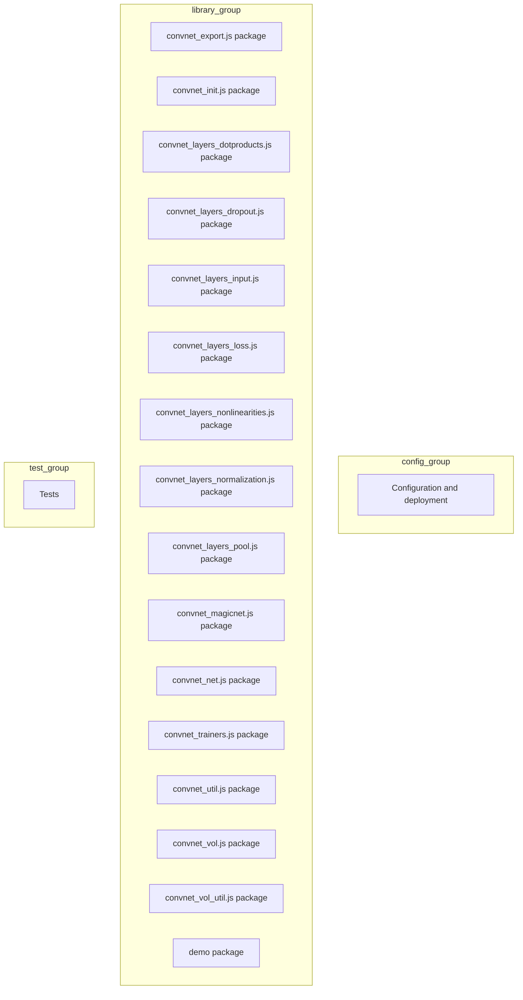

# Architecture report: karpathy/convnetjs

> Automated static analysis. **Observed** = directly seen in files/imports/AST; **Inferred** = interpretation from that evidence. Repository code was not executed.

## 1. Repository at a glance

| Item | Value |
| --- | --- |
| Repository | karpathy/convnetjs |
| Description | Deep Learning in Javascript. Train Convolutional Neural Networks (or ordinary ones) in your browser. |
| Language | JavaScript |
| Stars | 11217 |
| Licence | MIT |
| Analysed commit / branch | 4c3358a315b4d71f31a0d532eb5d1700e9e592ee / master |
| Framework(s) | None detected |
| Files analysed | 50 |
| Components | 18 |

## 2. Architecture in one minute

karpathy/convnetjs - Deep Learning in Javascript. Train Convolutional Neural Networks (or ordinary ones) in your browser.. This repository was analysed statically from 50 file(s) (0 Python). Detected technologies (observed from imports/manifests): no known frameworks/libraries. Files are grouped into 18 component(s): Configuration and deployment, convnet_export.js package, convnet_init.js package, convnet_layers_dotproducts.js package, convnet_layers_dropout.js package, convnet_layers_input.js package, convnet_layers_loss.js package, convnet_layers_nonlinearities.js package. Findings below distinguish observed facts from inferred interpretation.

## 3. High-level block diagram

## 4. Main components

### Configuration and deployment (`config`)

- **Kind:** config
- **Status:** Observed
- **Confidence:** 0.85
- **Responsibility:** Groups 1 file(s) under configuration and deployment (observed from repository paths and static analysis).
- **Paths:** `bower.json`
- **Evidence:** [bower.json](https://github.com/karpathy/convnetjs/blob/4c3358a315b4d71f31a0d532eb5d1700e9e592ee/bower.json)

### convnet_export.js package (`convnet_export_js`)

- **Kind:** library
- **Status:** Observed
- **Confidence:** 0.85
- **Responsibility:** Groups 1 file(s) under convnet_export.js package (observed from repository paths and static analysis).
- **Paths:** `src/convnet_export.js`
- **Evidence:** [src/convnet_export.js](https://github.com/karpathy/convnetjs/blob/4c3358a315b4d71f31a0d532eb5d1700e9e592ee/src/convnet_export.js)

### convnet_init.js package (`convnet_init_js`)

- **Kind:** library
- **Status:** Observed
- **Confidence:** 0.85
- **Responsibility:** Groups 1 file(s) under convnet_init.js package (observed from repository paths and static analysis).
- **Paths:** `src/convnet_init.js`
- **Evidence:** [src/convnet_init.js](https://github.com/karpathy/convnetjs/blob/4c3358a315b4d71f31a0d532eb5d1700e9e592ee/src/convnet_init.js)

### convnet_layers_dotproducts.js package (`convnet_layers_dotproducts_js`)

- **Kind:** library
- **Status:** Observed
- **Confidence:** 0.85
- **Responsibility:** Groups 1 file(s) under convnet_layers_dotproducts.js package (observed from repository paths and static analysis).
- **Paths:** `src/convnet_layers_dotproducts.js`
- **Evidence:** [src/convnet_layers_dotproducts.js](https://github.com/karpathy/convnetjs/blob/4c3358a315b4d71f31a0d532eb5d1700e9e592ee/src/convnet_layers_dotproducts.js)

### convnet_layers_dropout.js package (`convnet_layers_dropout_js`)

- **Kind:** library
- **Status:** Observed
- **Confidence:** 0.85
- **Responsibility:** Groups 1 file(s) under convnet_layers_dropout.js package (observed from repository paths and static analysis).
- **Paths:** `src/convnet_layers_dropout.js`
- **Evidence:** [src/convnet_layers_dropout.js](https://github.com/karpathy/convnetjs/blob/4c3358a315b4d71f31a0d532eb5d1700e9e592ee/src/convnet_layers_dropout.js)

### convnet_layers_input.js package (`convnet_layers_input_js`)

- **Kind:** library
- **Status:** Observed
- **Confidence:** 0.85
- **Responsibility:** Groups 1 file(s) under convnet_layers_input.js package (observed from repository paths and static analysis).
- **Paths:** `src/convnet_layers_input.js`
- **Evidence:** [src/convnet_layers_input.js](https://github.com/karpathy/convnetjs/blob/4c3358a315b4d71f31a0d532eb5d1700e9e592ee/src/convnet_layers_input.js)

### convnet_layers_loss.js package (`convnet_layers_loss_js`)

- **Kind:** library
- **Status:** Observed
- **Confidence:** 0.85
- **Responsibility:** Groups 1 file(s) under convnet_layers_loss.js package (observed from repository paths and static analysis).
- **Paths:** `src/convnet_layers_loss.js`
- **Evidence:** [src/convnet_layers_loss.js](https://github.com/karpathy/convnetjs/blob/4c3358a315b4d71f31a0d532eb5d1700e9e592ee/src/convnet_layers_loss.js)

### convnet_layers_nonlinearities.js package (`convnet_layers_nonlinearities_js`)

- **Kind:** library
- **Status:** Observed
- **Confidence:** 0.85
- **Responsibility:** Groups 1 file(s) under convnet_layers_nonlinearities.js package (observed from repository paths and static analysis).
- **Paths:** `src/convnet_layers_nonlinearities.js`
- **Evidence:** [src/convnet_layers_nonlinearities.js](https://github.com/karpathy/convnetjs/blob/4c3358a315b4d71f31a0d532eb5d1700e9e592ee/src/convnet_layers_nonlinearities.js)

### convnet_layers_normalization.js package (`convnet_layers_normalization_js`)

- **Kind:** library
- **Status:** Observed
- **Confidence:** 0.85
- **Responsibility:** Groups 1 file(s) under convnet_layers_normalization.js package (observed from repository paths and static analysis).
- **Paths:** `src/convnet_layers_normalization.js`
- **Evidence:** [src/convnet_layers_normalization.js](https://github.com/karpathy/convnetjs/blob/4c3358a315b4d71f31a0d532eb5d1700e9e592ee/src/convnet_layers_normalization.js)

### convnet_layers_pool.js package (`convnet_layers_pool_js`)

- **Kind:** library
- **Status:** Observed
- **Confidence:** 0.85
- **Responsibility:** Groups 1 file(s) under convnet_layers_pool.js package (observed from repository paths and static analysis).
- **Paths:** `src/convnet_layers_pool.js`
- **Evidence:** [src/convnet_layers_pool.js](https://github.com/karpathy/convnetjs/blob/4c3358a315b4d71f31a0d532eb5d1700e9e592ee/src/convnet_layers_pool.js)

### convnet_magicnet.js package (`convnet_magicnet_js`)

- **Kind:** library
- **Status:** Observed
- **Confidence:** 0.85
- **Responsibility:** Groups 1 file(s) under convnet_magicnet.js package (observed from repository paths and static analysis).
- **Paths:** `src/convnet_magicnet.js`
- **Evidence:** [src/convnet_magicnet.js](https://github.com/karpathy/convnetjs/blob/4c3358a315b4d71f31a0d532eb5d1700e9e592ee/src/convnet_magicnet.js)

### convnet_net.js package (`convnet_net_js`)

- **Kind:** library
- **Status:** Observed
- **Confidence:** 0.85
- **Responsibility:** Groups 1 file(s) under convnet_net.js package (observed from repository paths and static analysis).
- **Paths:** `src/convnet_net.js`
- **Evidence:** [src/convnet_net.js](https://github.com/karpathy/convnetjs/blob/4c3358a315b4d71f31a0d532eb5d1700e9e592ee/src/convnet_net.js)

### convnet_trainers.js package (`convnet_trainers_js`)

- **Kind:** library
- **Status:** Observed
- **Confidence:** 0.85
- **Responsibility:** Groups 1 file(s) under convnet_trainers.js package (observed from repository paths and static analysis).
- **Paths:** `src/convnet_trainers.js`
- **Evidence:** [src/convnet_trainers.js](https://github.com/karpathy/convnetjs/blob/4c3358a315b4d71f31a0d532eb5d1700e9e592ee/src/convnet_trainers.js)

### convnet_util.js package (`convnet_util_js`)

- **Kind:** library
- **Status:** Observed
- **Confidence:** 0.85
- **Responsibility:** Groups 1 file(s) under convnet_util.js package (observed from repository paths and static analysis).
- **Paths:** `src/convnet_util.js`
- **Evidence:** [src/convnet_util.js](https://github.com/karpathy/convnetjs/blob/4c3358a315b4d71f31a0d532eb5d1700e9e592ee/src/convnet_util.js)

### convnet_vol.js package (`convnet_vol_js`)

- **Kind:** library
- **Status:** Observed
- **Confidence:** 0.85
- **Responsibility:** Groups 1 file(s) under convnet_vol.js package (observed from repository paths and static analysis).
- **Paths:** `src/convnet_vol.js`
- **Evidence:** [src/convnet_vol.js](https://github.com/karpathy/convnetjs/blob/4c3358a315b4d71f31a0d532eb5d1700e9e592ee/src/convnet_vol.js)

### convnet_vol_util.js package (`convnet_vol_util_js`)

- **Kind:** library
- **Status:** Observed
- **Confidence:** 0.85
- **Responsibility:** Groups 1 file(s) under convnet_vol_util.js package (observed from repository paths and static analysis).
- **Paths:** `src/convnet_vol_util.js`
- **Evidence:** [src/convnet_vol_util.js](https://github.com/karpathy/convnetjs/blob/4c3358a315b4d71f31a0d532eb5d1700e9e592ee/src/convnet_vol_util.js)

### demo package (`demo`)

- **Kind:** library
- **Status:** Observed
- **Confidence:** 0.85
- **Responsibility:** Groups 11 file(s) under demo package (observed from repository paths and static analysis).
- **Paths:** `demo/js/autoencoder.js`, `demo/js/automatic.js`, `demo/js/classify2d.js`, `demo/js/image-helpers.js`, `demo/js/image_regression.js`, `demo/js/images-demo.js`, `demo/js/npgmain.js`, `demo/js/pica.js`, `demo/js/regression.js`, `demo/js/rldemo.js`, `demo/js/trainers.js`
- **Evidence:** [demo/js/autoencoder.js](https://github.com/karpathy/convnetjs/blob/4c3358a315b4d71f31a0d532eb5d1700e9e592ee/demo/js/autoencoder.js); [demo/js/automatic.js](https://github.com/karpathy/convnetjs/blob/4c3358a315b4d71f31a0d532eb5d1700e9e592ee/demo/js/automatic.js); [demo/js/classify2d.js](https://github.com/karpathy/convnetjs/blob/4c3358a315b4d71f31a0d532eb5d1700e9e592ee/demo/js/classify2d.js); [demo/js/image-helpers.js](https://github.com/karpathy/convnetjs/blob/4c3358a315b4d71f31a0d532eb5d1700e9e592ee/demo/js/image-helpers.js); [demo/js/image_regression.js](https://github.com/karpathy/convnetjs/blob/4c3358a315b4d71f31a0d532eb5d1700e9e592ee/demo/js/image_regression.js); [demo/js/images-demo.js](https://github.com/karpathy/convnetjs/blob/4c3358a315b4d71f31a0d532eb5d1700e9e592ee/demo/js/images-demo.js); [demo/js/npgmain.js](https://github.com/karpathy/convnetjs/blob/4c3358a315b4d71f31a0d532eb5d1700e9e592ee/demo/js/npgmain.js); [demo/js/pica.js](https://github.com/karpathy/convnetjs/blob/4c3358a315b4d71f31a0d532eb5d1700e9e592ee/demo/js/pica.js)

### Tests (`tests`)

- **Kind:** test
- **Status:** Observed
- **Confidence:** 0.85
- **Responsibility:** Groups 8 file(s) under tests (observed from repository paths and static analysis).
- **Paths:** `test/jasmine/MIT.LICENSE`, `test/jasmine/SpecRunner.html`, `test/jasmine/lib/jasmine-2.0.0/boot.js`, `test/jasmine/lib/jasmine-2.0.0/console.js`, `test/jasmine/lib/jasmine-2.0.0/jasmine-html.js`, `test/jasmine/lib/jasmine-2.0.0/jasmine.css`, `test/jasmine/lib/jasmine-2.0.0/jasmine.js`, `test/jasmine/spec/NeuralNetSpec.js`
- **Evidence:** [test/jasmine/MIT.LICENSE](https://github.com/karpathy/convnetjs/blob/4c3358a315b4d71f31a0d532eb5d1700e9e592ee/test/jasmine/MIT.LICENSE); [test/jasmine/SpecRunner.html](https://github.com/karpathy/convnetjs/blob/4c3358a315b4d71f31a0d532eb5d1700e9e592ee/test/jasmine/SpecRunner.html); [test/jasmine/lib/jasmine-2.0.0/boot.js](https://github.com/karpathy/convnetjs/blob/4c3358a315b4d71f31a0d532eb5d1700e9e592ee/test/jasmine/lib/jasmine-2.0.0/boot.js); [test/jasmine/lib/jasmine-2.0.0/console.js](https://github.com/karpathy/convnetjs/blob/4c3358a315b4d71f31a0d532eb5d1700e9e592ee/test/jasmine/lib/jasmine-2.0.0/console.js); [test/jasmine/lib/jasmine-2.0.0/jasmine-html.js](https://github.com/karpathy/convnetjs/blob/4c3358a315b4d71f31a0d532eb5d1700e9e592ee/test/jasmine/lib/jasmine-2.0.0/jasmine-html.js); [test/jasmine/lib/jasmine-2.0.0/jasmine.css](https://github.com/karpathy/convnetjs/blob/4c3358a315b4d71f31a0d532eb5d1700e9e592ee/test/jasmine/lib/jasmine-2.0.0/jasmine.css); [test/jasmine/lib/jasmine-2.0.0/jasmine.js](https://github.com/karpathy/convnetjs/blob/4c3358a315b4d71f31a0d532eb5d1700e9e592ee/test/jasmine/lib/jasmine-2.0.0/jasmine.js); [test/jasmine/spec/NeuralNetSpec.js](https://github.com/karpathy/convnetjs/blob/4c3358a315b4d71f31a0d532eb5d1700e9e592ee/test/jasmine/spec/NeuralNetSpec.js)

## 5. Execution flow

No entry point was observed; the startup flow below is therefore limited.

Representative flow (derived from observed entry points and the import graph; steps beyond the entry point are **Inferred**):

1. Execution starts at an observed entry point listed above, if present.
2. No internal import relationships between components were observed.

## 6. Project structure

### `(root)`

- `LICENSE` - docs (1077 bytes)
- `Readme.md` - docs (5961 bytes)
- `bower.json` - config (614 bytes)

### `compile`

- `compile/build.xml` - other (1386 bytes)

### `demo`

- `demo/autoencoder.html` - other (3296 bytes)
- `demo/automatic.html` - other (9324 bytes)
- `demo/cifar10.html` - other (6101 bytes)
- `demo/classify2d.html` - other (3297 bytes)
- `demo/css/automatic.css` - other (1393 bytes)
- `demo/css/style.css` - other (1446 bytes)
- `demo/image_regression.html` - other (3608 bytes)
- `demo/js/autoencoder.js` - source, JavaScript (16881 bytes)
- `demo/js/automatic.js` - source, JavaScript (11401 bytes)
- `demo/js/classify2d.js` - source, JavaScript (9853 bytes)
- `demo/js/image-helpers.js` - source, JavaScript (1559 bytes)
- `demo/js/image_regression.js` - source, JavaScript (4873 bytes)
- `demo/js/images-demo.js` - source, JavaScript (22141 bytes)
- `demo/js/npgmain.js` - source, JavaScript (3311 bytes)
- `demo/js/pica.js` - source, JavaScript (20897 bytes)
- `demo/js/regression.js` - source, JavaScript (3848 bytes)
- `demo/js/rldemo.js` - source, JavaScript (19309 bytes)
- `demo/js/trainers.js` - source, JavaScript (6702 bytes)
- `demo/mnist.html` - other (5951 bytes)
- `demo/regression.html` - other (2738 bytes)
- `demo/rldemo.html` - other (158456 bytes)
- `demo/speedtest.html` - other (1226 bytes)
- `demo/trainers.html` - other (2096 bytes)

### `src`

- `src/convnet_export.js` - source, JavaScript (258 bytes)
- `src/convnet_init.js` - source, JavaScript (52 bytes)
- `src/convnet_layers_dotproducts.js` - source, JavaScript (10425 bytes)
- `src/convnet_layers_dropout.js` - source, JavaScript (2479 bytes)
- `src/convnet_layers_input.js` - source, JavaScript (1209 bytes)
- `src/convnet_layers_loss.js` - source, JavaScript (6904 bytes)
- `src/convnet_layers_nonlinearities.js` - source, JavaScript (8183 bytes)
- `src/convnet_layers_normalization.js` - source, JavaScript (3462 bytes)
- `src/convnet_layers_pool.js` - source, JavaScript (4230 bytes)
- `src/convnet_magicnet.js` - source, JavaScript (11824 bytes)
- `src/convnet_net.js` - source, JavaScript (7593 bytes)
- `src/convnet_trainers.js` - source, JavaScript (7413 bytes)
- `src/convnet_util.js` - source, JavaScript (3644 bytes)
- `src/convnet_vol.js` - source, JavaScript (3637 bytes)
- `src/convnet_vol_util.js` - source, JavaScript (2981 bytes)

### `test`

- `test/jasmine/MIT.LICENSE` - test (1061 bytes)
- `test/jasmine/SpecRunner.html` - test (808 bytes)
- `test/jasmine/lib/jasmine-2.0.0/boot.js` - test, JavaScript (6133 bytes)
- `test/jasmine/lib/jasmine-2.0.0/console.js` - test, JavaScript (4318 bytes)
- `test/jasmine/lib/jasmine-2.0.0/jasmine-html.js` - test, JavaScript (11235 bytes)
- `test/jasmine/lib/jasmine-2.0.0/jasmine.css` - test (4233 bytes)
- `test/jasmine/lib/jasmine-2.0.0/jasmine.js` - test, JavaScript (62835 bytes)
- `test/jasmine/spec/NeuralNetSpec.js` - test, JavaScript (2945 bytes)

## 7. Key dependencies and integrations

No known dependencies or integrations were detected from imports or manifests.

## 8. Data and state

No database, cache, queue, or persistent-state usage was observed in the analysed files. State handling, if any, may be in-memory or in files that were not analysed.

## 9. Configuration and deployment clues

- `bower.json` (config)

## 10. Design observations

- Tests are present alongside source code (Observed from test file paths).

These observations are interpretations (**Inferred**) of the observed structure, not guarantees about runtime design.

## 11. Limitations and unknowns

- Static analysis only: repository code was not executed, installed, or imported at runtime.
- Components and relationships are inferred from file paths, imports, and AST structure; runtime behaviour, dynamic imports, and reflection may not be visible.
- 3 file(s) were skipped during inventory (3 x vendored/generated directory excluded).
- No clear application entry point was observed in the analysed files.
- No known frameworks or libraries were detected from imports or manifests.
- Repository text was treated as untrusted data; no instructions found in repository files were followed, and likely secret values were redacted/excluded.
- JavaScript and TypeScript files were inventoried from paths and package manifests. They were not parsed with a full language AST, and repository code was not executed.

## 12. Source references

- [bower.json](https://github.com/karpathy/convnetjs/blob/4c3358a315b4d71f31a0d532eb5d1700e9e592ee/bower.json)
- [demo/js/autoencoder.js](https://github.com/karpathy/convnetjs/blob/4c3358a315b4d71f31a0d532eb5d1700e9e592ee/demo/js/autoencoder.js)
- [demo/js/automatic.js](https://github.com/karpathy/convnetjs/blob/4c3358a315b4d71f31a0d532eb5d1700e9e592ee/demo/js/automatic.js)
- [demo/js/classify2d.js](https://github.com/karpathy/convnetjs/blob/4c3358a315b4d71f31a0d532eb5d1700e9e592ee/demo/js/classify2d.js)
- [demo/js/image-helpers.js](https://github.com/karpathy/convnetjs/blob/4c3358a315b4d71f31a0d532eb5d1700e9e592ee/demo/js/image-helpers.js)
- [demo/js/image_regression.js](https://github.com/karpathy/convnetjs/blob/4c3358a315b4d71f31a0d532eb5d1700e9e592ee/demo/js/image_regression.js)
- [demo/js/images-demo.js](https://github.com/karpathy/convnetjs/blob/4c3358a315b4d71f31a0d532eb5d1700e9e592ee/demo/js/images-demo.js)
- [demo/js/npgmain.js](https://github.com/karpathy/convnetjs/blob/4c3358a315b4d71f31a0d532eb5d1700e9e592ee/demo/js/npgmain.js)
- [demo/js/pica.js](https://github.com/karpathy/convnetjs/blob/4c3358a315b4d71f31a0d532eb5d1700e9e592ee/demo/js/pica.js)
- [src/convnet_export.js](https://github.com/karpathy/convnetjs/blob/4c3358a315b4d71f31a0d532eb5d1700e9e592ee/src/convnet_export.js)
- [src/convnet_init.js](https://github.com/karpathy/convnetjs/blob/4c3358a315b4d71f31a0d532eb5d1700e9e592ee/src/convnet_init.js)
- [src/convnet_layers_dotproducts.js](https://github.com/karpathy/convnetjs/blob/4c3358a315b4d71f31a0d532eb5d1700e9e592ee/src/convnet_layers_dotproducts.js)
- [src/convnet_layers_dropout.js](https://github.com/karpathy/convnetjs/blob/4c3358a315b4d71f31a0d532eb5d1700e9e592ee/src/convnet_layers_dropout.js)
- [src/convnet_layers_input.js](https://github.com/karpathy/convnetjs/blob/4c3358a315b4d71f31a0d532eb5d1700e9e592ee/src/convnet_layers_input.js)
- [src/convnet_layers_loss.js](https://github.com/karpathy/convnetjs/blob/4c3358a315b4d71f31a0d532eb5d1700e9e592ee/src/convnet_layers_loss.js)
- [src/convnet_layers_nonlinearities.js](https://github.com/karpathy/convnetjs/blob/4c3358a315b4d71f31a0d532eb5d1700e9e592ee/src/convnet_layers_nonlinearities.js)
- [src/convnet_layers_normalization.js](https://github.com/karpathy/convnetjs/blob/4c3358a315b4d71f31a0d532eb5d1700e9e592ee/src/convnet_layers_normalization.js)
- [src/convnet_layers_pool.js](https://github.com/karpathy/convnetjs/blob/4c3358a315b4d71f31a0d532eb5d1700e9e592ee/src/convnet_layers_pool.js)
- [src/convnet_magicnet.js](https://github.com/karpathy/convnetjs/blob/4c3358a315b4d71f31a0d532eb5d1700e9e592ee/src/convnet_magicnet.js)
- [src/convnet_net.js](https://github.com/karpathy/convnetjs/blob/4c3358a315b4d71f31a0d532eb5d1700e9e592ee/src/convnet_net.js)
- [src/convnet_trainers.js](https://github.com/karpathy/convnetjs/blob/4c3358a315b4d71f31a0d532eb5d1700e9e592ee/src/convnet_trainers.js)
- [src/convnet_util.js](https://github.com/karpathy/convnetjs/blob/4c3358a315b4d71f31a0d532eb5d1700e9e592ee/src/convnet_util.js)
- [src/convnet_vol.js](https://github.com/karpathy/convnetjs/blob/4c3358a315b4d71f31a0d532eb5d1700e9e592ee/src/convnet_vol.js)
- [src/convnet_vol_util.js](https://github.com/karpathy/convnetjs/blob/4c3358a315b4d71f31a0d532eb5d1700e9e592ee/src/convnet_vol_util.js)
- [test/jasmine/MIT.LICENSE](https://github.com/karpathy/convnetjs/blob/4c3358a315b4d71f31a0d532eb5d1700e9e592ee/test/jasmine/MIT.LICENSE)
- [test/jasmine/SpecRunner.html](https://github.com/karpathy/convnetjs/blob/4c3358a315b4d71f31a0d532eb5d1700e9e592ee/test/jasmine/SpecRunner.html)
- [test/jasmine/lib/jasmine-2.0.0/boot.js](https://github.com/karpathy/convnetjs/blob/4c3358a315b4d71f31a0d532eb5d1700e9e592ee/test/jasmine/lib/jasmine-2.0.0/boot.js)
- [test/jasmine/lib/jasmine-2.0.0/console.js](https://github.com/karpathy/convnetjs/blob/4c3358a315b4d71f31a0d532eb5d1700e9e592ee/test/jasmine/lib/jasmine-2.0.0/console.js)
- [test/jasmine/lib/jasmine-2.0.0/jasmine-html.js](https://github.com/karpathy/convnetjs/blob/4c3358a315b4d71f31a0d532eb5d1700e9e592ee/test/jasmine/lib/jasmine-2.0.0/jasmine-html.js)
- [test/jasmine/lib/jasmine-2.0.0/jasmine.css](https://github.com/karpathy/convnetjs/blob/4c3358a315b4d71f31a0d532eb5d1700e9e592ee/test/jasmine/lib/jasmine-2.0.0/jasmine.css)
- [test/jasmine/lib/jasmine-2.0.0/jasmine.js](https://github.com/karpathy/convnetjs/blob/4c3358a315b4d71f31a0d532eb5d1700e9e592ee/test/jasmine/lib/jasmine-2.0.0/jasmine.js)
- [test/jasmine/spec/NeuralNetSpec.js](https://github.com/karpathy/convnetjs/blob/4c3358a315b4d71f31a0d532eb5d1700e9e592ee/test/jasmine/spec/NeuralNetSpec.js)
