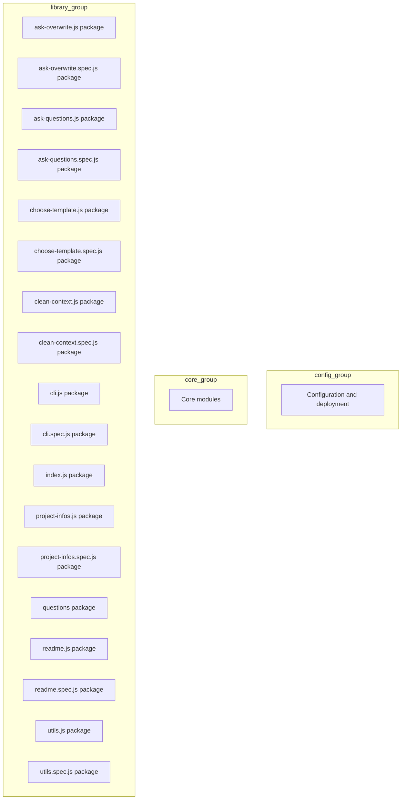

# Architecture report: kefranabg/readme-md-generator

> Automated static analysis. **Observed** = directly seen in files/imports/AST; **Inferred** = interpretation from that evidence. Repository code was not executed.

## 1. Repository at a glance

| Item | Value |
| --- | --- |
| Repository | kefranabg/readme-md-generator |
| Description | 📄 CLI that generates beautiful README.md files |
| Language | JavaScript |
| Stars | 11135 |
| Licence | MIT |
| Analysed commit / branch | f0370c8efe602bfc1e1334ea556214de4c1b0f04 / master |
| Framework(s) | None detected |
| Files analysed | 81 |
| Components | 20 |

## 2. Architecture in one minute

kefranabg/readme-md-generator - 📄 CLI that generates beautiful README.md files. This repository was analysed statically from 81 file(s) (0 Python). Detected technologies (observed from imports/manifests): GitHub Actions, Jest. Files are grouped into 20 component(s): ask-overwrite.js package, ask-overwrite.spec.js package, ask-questions.js package, ask-questions.spec.js package, choose-template.js package, choose-template.spec.js package, clean-context.js package, clean-context.spec.js package. Findings below distinguish observed facts from inferred interpretation.

## 3. High-level block diagram

## 4. Main components

### ask-overwrite.js package (`ask_overwrite_js`)

- **Kind:** library
- **Status:** Observed
- **Confidence:** 0.85
- **Responsibility:** Groups 1 file(s) under ask-overwrite.js package (observed from repository paths and static analysis).
- **Paths:** `src/ask-overwrite.js`
- **Evidence:** [src/ask-overwrite.js](https://github.com/kefranabg/readme-md-generator/blob/f0370c8efe602bfc1e1334ea556214de4c1b0f04/src/ask-overwrite.js)

### ask-overwrite.spec.js package (`ask_overwrite_spec_js`)

- **Kind:** library
- **Status:** Observed
- **Confidence:** 0.85
- **Responsibility:** Groups 1 file(s) under ask-overwrite.spec.js package (observed from repository paths and static analysis).
- **Paths:** `src/ask-overwrite.spec.js`
- **Evidence:** [src/ask-overwrite.spec.js](https://github.com/kefranabg/readme-md-generator/blob/f0370c8efe602bfc1e1334ea556214de4c1b0f04/src/ask-overwrite.spec.js)

### ask-questions.js package (`ask_questions_js`)

- **Kind:** library
- **Status:** Observed
- **Confidence:** 0.85
- **Responsibility:** Groups 1 file(s) under ask-questions.js package (observed from repository paths and static analysis).
- **Paths:** `src/ask-questions.js`
- **Evidence:** [src/ask-questions.js](https://github.com/kefranabg/readme-md-generator/blob/f0370c8efe602bfc1e1334ea556214de4c1b0f04/src/ask-questions.js)

### ask-questions.spec.js package (`ask_questions_spec_js`)

- **Kind:** library
- **Status:** Observed
- **Confidence:** 0.85
- **Responsibility:** Groups 1 file(s) under ask-questions.spec.js package (observed from repository paths and static analysis).
- **Paths:** `src/ask-questions.spec.js`
- **Evidence:** [src/ask-questions.spec.js](https://github.com/kefranabg/readme-md-generator/blob/f0370c8efe602bfc1e1334ea556214de4c1b0f04/src/ask-questions.spec.js)

### choose-template.js package (`choose_template_js`)

- **Kind:** library
- **Status:** Observed
- **Confidence:** 0.85
- **Responsibility:** Groups 1 file(s) under choose-template.js package (observed from repository paths and static analysis).
- **Paths:** `src/choose-template.js`
- **Evidence:** [src/choose-template.js](https://github.com/kefranabg/readme-md-generator/blob/f0370c8efe602bfc1e1334ea556214de4c1b0f04/src/choose-template.js)

### choose-template.spec.js package (`choose_template_spec_js`)

- **Kind:** library
- **Status:** Observed
- **Confidence:** 0.85
- **Responsibility:** Groups 1 file(s) under choose-template.spec.js package (observed from repository paths and static analysis).
- **Paths:** `src/choose-template.spec.js`
- **Evidence:** [src/choose-template.spec.js](https://github.com/kefranabg/readme-md-generator/blob/f0370c8efe602bfc1e1334ea556214de4c1b0f04/src/choose-template.spec.js)

### clean-context.js package (`clean_context_js`)

- **Kind:** library
- **Status:** Observed
- **Confidence:** 0.85
- **Responsibility:** Groups 1 file(s) under clean-context.js package (observed from repository paths and static analysis).
- **Paths:** `src/clean-context.js`
- **Evidence:** [src/clean-context.js](https://github.com/kefranabg/readme-md-generator/blob/f0370c8efe602bfc1e1334ea556214de4c1b0f04/src/clean-context.js)

### clean-context.spec.js package (`clean_context_spec_js`)

- **Kind:** library
- **Status:** Observed
- **Confidence:** 0.85
- **Responsibility:** Groups 1 file(s) under clean-context.spec.js package (observed from repository paths and static analysis).
- **Paths:** `src/clean-context.spec.js`
- **Evidence:** [src/clean-context.spec.js](https://github.com/kefranabg/readme-md-generator/blob/f0370c8efe602bfc1e1334ea556214de4c1b0f04/src/clean-context.spec.js)

### cli.js package (`cli_js`)

- **Kind:** library
- **Status:** Observed
- **Confidence:** 0.85
- **Responsibility:** Groups 1 file(s) under cli.js package (observed from repository paths and static analysis).
- **Paths:** `src/cli.js`
- **Evidence:** [src/cli.js](https://github.com/kefranabg/readme-md-generator/blob/f0370c8efe602bfc1e1334ea556214de4c1b0f04/src/cli.js)

### cli.spec.js package (`cli_spec_js`)

- **Kind:** library
- **Status:** Observed
- **Confidence:** 0.85
- **Responsibility:** Groups 1 file(s) under cli.spec.js package (observed from repository paths and static analysis).
- **Paths:** `src/cli.spec.js`
- **Evidence:** [src/cli.spec.js](https://github.com/kefranabg/readme-md-generator/blob/f0370c8efe602bfc1e1334ea556214de4c1b0f04/src/cli.spec.js)

### Configuration and deployment (`config`)

- **Kind:** config
- **Status:** Observed
- **Confidence:** 0.85
- **Responsibility:** Groups 1 file(s) under configuration and deployment (observed from repository paths and static analysis).
- **Paths:** `package.json`
- **Evidence:** [package.json](https://github.com/kefranabg/readme-md-generator/blob/f0370c8efe602bfc1e1334ea556214de4c1b0f04/package.json)

### Core modules (`core`)

- **Kind:** core
- **Status:** Observed
- **Confidence:** 0.85
- **Responsibility:** Groups 1 file(s) under core modules (observed from repository paths and static analysis).
- **Paths:** `jest.config.js`
- **Evidence:** [jest.config.js](https://github.com/kefranabg/readme-md-generator/blob/f0370c8efe602bfc1e1334ea556214de4c1b0f04/jest.config.js)

### index.js package (`index_js`)

- **Kind:** library
- **Status:** Observed
- **Confidence:** 0.85
- **Responsibility:** Groups 1 file(s) under index.js package (observed from repository paths and static analysis).
- **Paths:** `src/index.js`
- **Evidence:** [src/index.js](https://github.com/kefranabg/readme-md-generator/blob/f0370c8efe602bfc1e1334ea556214de4c1b0f04/src/index.js)

### project-infos.js package (`project_infos_js`)

- **Kind:** library
- **Status:** Observed
- **Confidence:** 0.85
- **Responsibility:** Groups 1 file(s) under project-infos.js package (observed from repository paths and static analysis).
- **Paths:** `src/project-infos.js`
- **Evidence:** [src/project-infos.js](https://github.com/kefranabg/readme-md-generator/blob/f0370c8efe602bfc1e1334ea556214de4c1b0f04/src/project-infos.js)

### project-infos.spec.js package (`project_infos_spec_js`)

- **Kind:** library
- **Status:** Observed
- **Confidence:** 0.85
- **Responsibility:** Groups 1 file(s) under project-infos.spec.js package (observed from repository paths and static analysis).
- **Paths:** `src/project-infos.spec.js`
- **Evidence:** [src/project-infos.spec.js](https://github.com/kefranabg/readme-md-generator/blob/f0370c8efe602bfc1e1334ea556214de4c1b0f04/src/project-infos.spec.js)

### questions package (`questions`)

- **Kind:** library
- **Status:** Observed
- **Confidence:** 0.85
- **Responsibility:** Groups 44 file(s) under questions package (observed from repository paths and static analysis).
- **Paths:** `src/questions/author-github.js`, `src/questions/author-github.spec.js`, `src/questions/author-linkedin.js`, `src/questions/author-linkedin.spec.js`, `src/questions/author-name.js`, `src/questions/author-name.spec.js`, `src/questions/author-patreon.js`, `src/questions/author-patreon.spec.js`, `src/questions/author-twitter.js`, `src/questions/author-twitter.spec.js`, `src/questions/author-website.js`, `src/questions/author-website.spec.js`, `src/questions/contributing-url.js`, `src/questions/contributing-url.spec.js`, `src/questions/index.js`, `src/questions/index.spec.js`, `src/questions/install-command.js`, `src/questions/install-command.spec.js`, `src/questions/issues-url.js`, `src/questions/issues-url.spec.js`, `src/questions/license-name.js`, `src/questions/license-name.spec.js`, `src/questions/license-url.js`, `src/questions/license-url.spec.js`, `src/questions/package-manager.js`, `src/questions/package-manager.spec.js`, `src/questions/project-demo-url.js`, `src/questions/project-demo-url.spec.js`, `src/questions/project-description.js`, `src/questions/project-description.spec.js`, `src/questions/project-documentation-url.js`, `src/questions/project-documentation-url.spec.js`, `src/questions/project-homepage.js`, `src/questions/project-homepage.spec.js`, `src/questions/project-name.js`, `src/questions/project-name.spec.js`, `src/questions/project-prerequisites.js`, `src/questions/project-prerequisites.spec.js`, `src/questions/project-version.js`, `src/questions/project-version.spec.js`, `src/questions/test-command.js`, `src/questions/test-command.spec.js`, `src/questions/usage.js`, `src/questions/usage.spec.js`
- **Evidence:** [src/questions/author-github.js](https://github.com/kefranabg/readme-md-generator/blob/f0370c8efe602bfc1e1334ea556214de4c1b0f04/src/questions/author-github.js); [src/questions/author-github.spec.js](https://github.com/kefranabg/readme-md-generator/blob/f0370c8efe602bfc1e1334ea556214de4c1b0f04/src/questions/author-github.spec.js); [src/questions/author-linkedin.js](https://github.com/kefranabg/readme-md-generator/blob/f0370c8efe602bfc1e1334ea556214de4c1b0f04/src/questions/author-linkedin.js); [src/questions/author-linkedin.spec.js](https://github.com/kefranabg/readme-md-generator/blob/f0370c8efe602bfc1e1334ea556214de4c1b0f04/src/questions/author-linkedin.spec.js); [src/questions/author-name.js](https://github.com/kefranabg/readme-md-generator/blob/f0370c8efe602bfc1e1334ea556214de4c1b0f04/src/questions/author-name.js); [src/questions/author-name.spec.js](https://github.com/kefranabg/readme-md-generator/blob/f0370c8efe602bfc1e1334ea556214de4c1b0f04/src/questions/author-name.spec.js); [src/questions/author-patreon.js](https://github.com/kefranabg/readme-md-generator/blob/f0370c8efe602bfc1e1334ea556214de4c1b0f04/src/questions/author-patreon.js); [src/questions/author-patreon.spec.js](https://github.com/kefranabg/readme-md-generator/blob/f0370c8efe602bfc1e1334ea556214de4c1b0f04/src/questions/author-patreon.spec.js)

### readme.js package (`readme_js`)

- **Kind:** library
- **Status:** Observed
- **Confidence:** 0.85
- **Responsibility:** Groups 1 file(s) under readme.js package (observed from repository paths and static analysis).
- **Paths:** `src/readme.js`
- **Evidence:** [src/readme.js](https://github.com/kefranabg/readme-md-generator/blob/f0370c8efe602bfc1e1334ea556214de4c1b0f04/src/readme.js)

### readme.spec.js package (`readme_spec_js`)

- **Kind:** library
- **Status:** Observed
- **Confidence:** 0.85
- **Responsibility:** Groups 1 file(s) under readme.spec.js package (observed from repository paths and static analysis).
- **Paths:** `src/readme.spec.js`
- **Evidence:** [src/readme.spec.js](https://github.com/kefranabg/readme-md-generator/blob/f0370c8efe602bfc1e1334ea556214de4c1b0f04/src/readme.spec.js)

### utils.js package (`utils_js`)

- **Kind:** library
- **Status:** Observed
- **Confidence:** 0.85
- **Responsibility:** Groups 1 file(s) under utils.js package (observed from repository paths and static analysis).
- **Paths:** `src/utils.js`
- **Evidence:** [src/utils.js](https://github.com/kefranabg/readme-md-generator/blob/f0370c8efe602bfc1e1334ea556214de4c1b0f04/src/utils.js)

### utils.spec.js package (`utils_spec_js`)

- **Kind:** library
- **Status:** Observed
- **Confidence:** 0.85
- **Responsibility:** Groups 1 file(s) under utils.spec.js package (observed from repository paths and static analysis).
- **Paths:** `src/utils.spec.js`
- **Evidence:** [src/utils.spec.js](https://github.com/kefranabg/readme-md-generator/blob/f0370c8efe602bfc1e1334ea556214de4c1b0f04/src/utils.spec.js)

## 5. Execution flow

**Observed** entry point(s):

- [src/index.js](https://github.com/kefranabg/readme-md-generator/blob/f0370c8efe602bfc1e1334ea556214de4c1b0f04/src/index.js)
- [src/questions/index.js](https://github.com/kefranabg/readme-md-generator/blob/f0370c8efe602bfc1e1334ea556214de4c1b0f04/src/questions/index.js)

Representative flow (derived from observed entry points and the import graph; steps beyond the entry point are **Inferred**):

1. Execution starts at an observed entry point listed above, if present.
2. No internal import relationships between components were observed.

## 6. Project structure

### `(root)`

- `.eslintrc.js` - source, JavaScript (541 bytes)
- `.gitignore` - other (211 bytes)
- `.prettierignore` - other (11 bytes)
- `.prettierrc` - other (43 bytes)
- `CHANGELOG.md` - docs (29418 bytes)
- `CONTRIBUTING.md` - docs (2247 bytes)
- `LICENSE` - docs (1071 bytes)
- `README.md` - docs (6465 bytes)
- `jest.config.js` - source, JavaScript (141 bytes)
- `package.json` - manifest (1571 bytes)

### `.github`

- `.github/CODE_OF_CONDUCT.md` - docs (3219 bytes)
- `.github/FUNDING.yml` - config (593 bytes)
- `.github/ISSUE_TEMPLATE/bug_report.md` - docs (829 bytes)
- `.github/ISSUE_TEMPLATE/feature_request.md` - docs (594 bytes)
- `.github/workflows/nodejs.yml` - ci, YAML (754 bytes)

### `.vscode`

- `.vscode/settings.json` - config (34 bytes)

### `src`

- `src/__snapshots__/readme.spec.js.snap` - other (5379 bytes)
- `src/ask-overwrite.js` - source, JavaScript (528 bytes)
- `src/ask-overwrite.spec.js` - source, JavaScript (919 bytes)
- `src/ask-questions.js` - source, JavaScript (863 bytes)
- `src/ask-questions.spec.js` - source, JavaScript (2177 bytes)
- `src/choose-template.js` - source, JavaScript (783 bytes)
- `src/choose-template.spec.js` - source, JavaScript (1309 bytes)
- `src/clean-context.js` - source, JavaScript (485 bytes)
- `src/clean-context.spec.js` - source, JavaScript (475 bytes)
- `src/cli.js` - source, JavaScript (1069 bytes)
- `src/cli.spec.js` - source, JavaScript (3536 bytes)
- `src/index.js` - source, JavaScript (701 bytes)
- `src/project-infos.js` - source, JavaScript (4846 bytes)
- `src/project-infos.spec.js` - source, JavaScript (14720 bytes)
- `src/questions/author-github.js` - source, JavaScript (287 bytes)
- `src/questions/author-github.spec.js` - source, JavaScript (509 bytes)
- `src/questions/author-linkedin.js` - source, JavaScript (241 bytes)
- `src/questions/author-linkedin.spec.js` - source, JavaScript (394 bytes)
- `src/questions/author-name.js` - source, JavaScript (141 bytes)
- `src/questions/author-name.spec.js` - source, JavaScript (406 bytes)
- `src/questions/author-patreon.js` - source, JavaScript (241 bytes)
- `src/questions/author-patreon.spec.js` - source, JavaScript (396 bytes)
- `src/questions/author-twitter.js` - source, JavaScript (239 bytes)
- `src/questions/author-twitter.spec.js` - source, JavaScript (388 bytes)
- `src/questions/author-website.js` - source, JavaScript (401 bytes)
- `src/questions/author-website.spec.js` - source, JavaScript (1510 bytes)
- `src/questions/contributing-url.js` - source, JavaScript (192 bytes)
- `src/questions/contributing-url.spec.js` - source, JavaScript (563 bytes)
- `src/questions/index.js` - source, JavaScript (1098 bytes)
- `src/questions/index.spec.js` - source, JavaScript (786 bytes)
- `src/questions/install-command.js` - source, JavaScript (367 bytes)
- `src/questions/install-command.spec.js` - source, JavaScript (915 bytes)
- `src/questions/issues-url.js` - source, JavaScript (171 bytes)
- `src/questions/issues-url.spec.js` - source, JavaScript (472 bytes)
- `src/questions/license-name.js` - source, JavaScript (172 bytes)
- `src/questions/license-name.spec.js` - source, JavaScript (442 bytes)
- `src/questions/license-url.js` - source, JavaScript (278 bytes)
- `src/questions/license-url.spec.js` - source, JavaScript (1308 bytes)
- `src/questions/package-manager.js` - source, JavaScript (368 bytes)
- `src/questions/package-manager.spec.js` - source, JavaScript (1388 bytes)
- `src/questions/project-demo-url.js` - source, JavaScript (133 bytes)
- `src/questions/project-demo-url.spec.js` - source, JavaScript (353 bytes)
- `src/questions/project-description.js` - source, JavaScript (162 bytes)
- `src/questions/project-description.spec.js` - source, JavaScript (466 bytes)
- `src/questions/project-documentation-url.js` - source, JavaScript (204 bytes)
- `src/questions/project-documentation-url.spec.js` - source, JavaScript (411 bytes)
- `src/questions/project-homepage.js` - source, JavaScript (179 bytes)
- `src/questions/project-homepage.spec.js` - source, JavaScript (462 bytes)
- `src/questions/project-name.js` - source, JavaScript (141 bytes)
- `src/questions/project-name.spec.js` - source, JavaScript (604 bytes)
- `src/questions/project-prerequisites.js` - source, JavaScript (866 bytes)
- `src/questions/project-prerequisites.spec.js` - source, JavaScript (1648 bytes)
- `src/questions/project-version.js` - source, JavaScript (178 bytes)
- `src/questions/project-version.spec.js` - source, JavaScript (452 bytes)
- `src/questions/test-command.js` - source, JavaScript (405 bytes)
- `src/questions/test-command.spec.js` - source, JavaScript (1227 bytes)
- `src/questions/usage.js` - source, JavaScript (418 bytes)
- `src/questions/usage.spec.js` - source, JavaScript (1200 bytes)
- `src/readme.js` - source, JavaScript (2660 bytes)
- `src/readme.spec.js` - source, JavaScript (7625 bytes)
- `src/utils.js` - source, JavaScript (4524 bytes)
- `src/utils.spec.js` - source, JavaScript (9749 bytes)

### `templates`

- `templates/default-no-html.md` - docs (3500 bytes)
- `templates/default.md` - docs (3827 bytes)
- `templates/footer.md` - docs (114 bytes)

## 7. Key dependencies and integrations

| Name | Category | Status | Confidence | Evidence |
| --- | --- | --- | --- | --- |
| GitHub Actions | ci | Observed | 0.85 | [.github/workflows/nodejs.yml](https://github.com/kefranabg/readme-md-generator/blob/f0370c8efe602bfc1e1334ea556214de4c1b0f04/.github/workflows/nodejs.yml) |
| Jest | tooling | Observed | 0.85 | [package.json:27](https://github.com/kefranabg/readme-md-generator/blob/f0370c8efe602bfc1e1334ea556214de4c1b0f04/package.json#L27) |

## 8. Data and state

No database, cache, queue, or persistent-state usage was observed in the analysed files. State handling, if any, may be in-memory or in files that were not analysed.

## 9. Configuration and deployment clues

- `.github/FUNDING.yml` (config)
- `.github/workflows/nodejs.yml` (ci)
- `.vscode/settings.json` (config)
- `package.json` (manifest)

## 10. Design observations

- No strong design patterns could be established from the available evidence.

These observations are interpretations (**Inferred**) of the observed structure, not guarantees about runtime design.

## 11. Limitations and unknowns

- Static analysis only: repository code was not executed, installed, or imported at runtime.
- Components and relationships are inferred from file paths, imports, and AST structure; runtime behaviour, dynamic imports, and reflection may not be visible.
- No clear application entry point was observed in the analysed files.
- Repository text was treated as untrusted data; no instructions found in repository files were followed, and likely secret values were redacted/excluded.
- JavaScript and TypeScript files were inventoried from paths and package manifests. They were not parsed with a full language AST, and repository code was not executed.

## 12. Source references

- [.github/workflows/nodejs.yml](https://github.com/kefranabg/readme-md-generator/blob/f0370c8efe602bfc1e1334ea556214de4c1b0f04/.github/workflows/nodejs.yml)
- [jest.config.js](https://github.com/kefranabg/readme-md-generator/blob/f0370c8efe602bfc1e1334ea556214de4c1b0f04/jest.config.js)
- [package.json](https://github.com/kefranabg/readme-md-generator/blob/f0370c8efe602bfc1e1334ea556214de4c1b0f04/package.json)
- [package.json:27](https://github.com/kefranabg/readme-md-generator/blob/f0370c8efe602bfc1e1334ea556214de4c1b0f04/package.json#L27)
- [src/ask-overwrite.js](https://github.com/kefranabg/readme-md-generator/blob/f0370c8efe602bfc1e1334ea556214de4c1b0f04/src/ask-overwrite.js)
- [src/ask-overwrite.spec.js](https://github.com/kefranabg/readme-md-generator/blob/f0370c8efe602bfc1e1334ea556214de4c1b0f04/src/ask-overwrite.spec.js)
- [src/ask-questions.js](https://github.com/kefranabg/readme-md-generator/blob/f0370c8efe602bfc1e1334ea556214de4c1b0f04/src/ask-questions.js)
- [src/ask-questions.spec.js](https://github.com/kefranabg/readme-md-generator/blob/f0370c8efe602bfc1e1334ea556214de4c1b0f04/src/ask-questions.spec.js)
- [src/choose-template.js](https://github.com/kefranabg/readme-md-generator/blob/f0370c8efe602bfc1e1334ea556214de4c1b0f04/src/choose-template.js)
- [src/choose-template.spec.js](https://github.com/kefranabg/readme-md-generator/blob/f0370c8efe602bfc1e1334ea556214de4c1b0f04/src/choose-template.spec.js)
- [src/clean-context.js](https://github.com/kefranabg/readme-md-generator/blob/f0370c8efe602bfc1e1334ea556214de4c1b0f04/src/clean-context.js)
- [src/clean-context.spec.js](https://github.com/kefranabg/readme-md-generator/blob/f0370c8efe602bfc1e1334ea556214de4c1b0f04/src/clean-context.spec.js)
- [src/cli.js](https://github.com/kefranabg/readme-md-generator/blob/f0370c8efe602bfc1e1334ea556214de4c1b0f04/src/cli.js)
- [src/cli.spec.js](https://github.com/kefranabg/readme-md-generator/blob/f0370c8efe602bfc1e1334ea556214de4c1b0f04/src/cli.spec.js)
- [src/index.js](https://github.com/kefranabg/readme-md-generator/blob/f0370c8efe602bfc1e1334ea556214de4c1b0f04/src/index.js)
- [src/project-infos.js](https://github.com/kefranabg/readme-md-generator/blob/f0370c8efe602bfc1e1334ea556214de4c1b0f04/src/project-infos.js)
- [src/project-infos.spec.js](https://github.com/kefranabg/readme-md-generator/blob/f0370c8efe602bfc1e1334ea556214de4c1b0f04/src/project-infos.spec.js)
- [src/questions/author-github.js](https://github.com/kefranabg/readme-md-generator/blob/f0370c8efe602bfc1e1334ea556214de4c1b0f04/src/questions/author-github.js)
- [src/questions/author-github.spec.js](https://github.com/kefranabg/readme-md-generator/blob/f0370c8efe602bfc1e1334ea556214de4c1b0f04/src/questions/author-github.spec.js)
- [src/questions/author-linkedin.js](https://github.com/kefranabg/readme-md-generator/blob/f0370c8efe602bfc1e1334ea556214de4c1b0f04/src/questions/author-linkedin.js)
- [src/questions/author-linkedin.spec.js](https://github.com/kefranabg/readme-md-generator/blob/f0370c8efe602bfc1e1334ea556214de4c1b0f04/src/questions/author-linkedin.spec.js)
- [src/questions/author-name.js](https://github.com/kefranabg/readme-md-generator/blob/f0370c8efe602bfc1e1334ea556214de4c1b0f04/src/questions/author-name.js)
- [src/questions/author-name.spec.js](https://github.com/kefranabg/readme-md-generator/blob/f0370c8efe602bfc1e1334ea556214de4c1b0f04/src/questions/author-name.spec.js)
- [src/questions/author-patreon.js](https://github.com/kefranabg/readme-md-generator/blob/f0370c8efe602bfc1e1334ea556214de4c1b0f04/src/questions/author-patreon.js)
- [src/questions/author-patreon.spec.js](https://github.com/kefranabg/readme-md-generator/blob/f0370c8efe602bfc1e1334ea556214de4c1b0f04/src/questions/author-patreon.spec.js)
- [src/questions/index.js](https://github.com/kefranabg/readme-md-generator/blob/f0370c8efe602bfc1e1334ea556214de4c1b0f04/src/questions/index.js)
- [src/readme.js](https://github.com/kefranabg/readme-md-generator/blob/f0370c8efe602bfc1e1334ea556214de4c1b0f04/src/readme.js)
- [src/readme.spec.js](https://github.com/kefranabg/readme-md-generator/blob/f0370c8efe602bfc1e1334ea556214de4c1b0f04/src/readme.spec.js)
- [src/utils.js](https://github.com/kefranabg/readme-md-generator/blob/f0370c8efe602bfc1e1334ea556214de4c1b0f04/src/utils.js)
- [src/utils.spec.js](https://github.com/kefranabg/readme-md-generator/blob/f0370c8efe602bfc1e1334ea556214de4c1b0f04/src/utils.spec.js)
