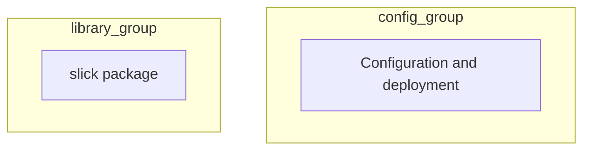

# Architecture report: kenwheeler/slick

> Automated static analysis. **Observed** = directly seen in files/imports/AST; **Inferred** = interpretation from that evidence. Repository code was not executed.

## 1. Repository at a glance

| Item | Value |
| --- | --- |
| Repository | kenwheeler/slick |
| Description | the last carousel you'll ever need |
| Language | JavaScript |
| Stars | 28519 |
| Licence | MIT |
| Analysed commit / branch | 7b2b3a76def3309d235d9ad9683a8d82941896cd / master |
| Framework(s) | None detected |
| Files analysed | 19 |
| Components | 2 |

## 2. Architecture in one minute

kenwheeler/slick - the last carousel you'll ever need. This repository was analysed statically from 19 file(s) (0 Python). Detected technologies (observed from imports/manifests): no known frameworks/libraries. Files are grouped into 2 component(s): Configuration and deployment, slick package. Findings below distinguish observed facts from inferred interpretation.

## 3. High-level block diagram

## 4. Main components

### Configuration and deployment (`config`)

- **Kind:** config
- **Status:** Observed
- **Confidence:** 0.85
- **Responsibility:** Groups 4 file(s) under configuration and deployment (observed from repository paths and static analysis).
- **Paths:** `bower.json`, `component.json`, `package.json`, `slick.jquery.json`
- **Evidence:** [bower.json](https://github.com/kenwheeler/slick/blob/7b2b3a76def3309d235d9ad9683a8d82941896cd/bower.json); [component.json](https://github.com/kenwheeler/slick/blob/7b2b3a76def3309d235d9ad9683a8d82941896cd/component.json); [package.json](https://github.com/kenwheeler/slick/blob/7b2b3a76def3309d235d9ad9683a8d82941896cd/package.json); [slick.jquery.json](https://github.com/kenwheeler/slick/blob/7b2b3a76def3309d235d9ad9683a8d82941896cd/slick.jquery.json)

### slick package (`slick`)

- **Kind:** library
- **Status:** Observed
- **Confidence:** 0.85
- **Responsibility:** Groups 1 file(s) under slick package (observed from repository paths and static analysis).
- **Paths:** `slick/slick.js`
- **Evidence:** [slick/slick.js](https://github.com/kenwheeler/slick/blob/7b2b3a76def3309d235d9ad9683a8d82941896cd/slick/slick.js)

## 5. Execution flow

**Observed** entry point(s):

- [slick/slick.js](https://github.com/kenwheeler/slick/blob/7b2b3a76def3309d235d9ad9683a8d82941896cd/slick/slick.js)

Representative flow (derived from observed entry points and the import graph; steps beyond the entry point are **Inferred**):

1. Execution starts at an observed entry point listed above, if present.
2. No internal import relationships between components were observed.

## 6. Project structure

### `(root)`

- `.gitignore` - other (24 bytes)
- `.prettierignore` - other (20 bytes)
- `CONTRIBUTING.markdown` - other (2988 bytes)
- `ISSUE_TEMPLATE.md` - docs (883 bytes)
- `LICENSE` - docs (1071 bytes)
- `Makefile` - other (133 bytes)
- `README.markdown` - other (12644 bytes)
- `bower.json` - config (672 bytes)
- `component.json` - config (465 bytes)
- `index.html` - other (9577 bytes)
- `package.json` - manifest (1055 bytes)
- `slick.jquery.json` - config (964 bytes)

### `slick`

- `slick/slick-theme.css` - other (2800 bytes)
- `slick/slick-theme.less` - other (4152 bytes)
- `slick/slick-theme.scss` - other (4521 bytes)
- `slick/slick.css` - other (1456 bytes)
- `slick/slick.js` - source, JavaScript (90360 bytes)
- `slick/slick.less` - other (1585 bytes)
- `slick/slick.scss` - other (1580 bytes)

## 7. Key dependencies and integrations

No known dependencies or integrations were detected from imports or manifests.

## 8. Data and state

No database, cache, queue, or persistent-state usage was observed in the analysed files. State handling, if any, may be in-memory or in files that were not analysed.

## 9. Configuration and deployment clues

- `bower.json` (config)
- `component.json` (config)
- `package.json` (manifest)
- `slick.jquery.json` (config)

## 10. Design observations

- No strong design patterns could be established from the available evidence.

These observations are interpretations (**Inferred**) of the observed structure, not guarantees about runtime design.

## 11. Limitations and unknowns

- Static analysis only: repository code was not executed, installed, or imported at runtime.
- Components and relationships are inferred from file paths, imports, and AST structure; runtime behaviour, dynamic imports, and reflection may not be visible.
- 1 file(s) were skipped during inventory (1 x lockfile excluded).
- No clear application entry point was observed in the analysed files.
- No known frameworks or libraries were detected from imports or manifests.
- Repository text was treated as untrusted data; no instructions found in repository files were followed, and likely secret values were redacted/excluded.
- JavaScript and TypeScript files were inventoried from paths and package manifests. They were not parsed with a full language AST, and repository code was not executed.

## 12. Source references

- [bower.json](https://github.com/kenwheeler/slick/blob/7b2b3a76def3309d235d9ad9683a8d82941896cd/bower.json)
- [component.json](https://github.com/kenwheeler/slick/blob/7b2b3a76def3309d235d9ad9683a8d82941896cd/component.json)
- [package.json](https://github.com/kenwheeler/slick/blob/7b2b3a76def3309d235d9ad9683a8d82941896cd/package.json)
- [slick.jquery.json](https://github.com/kenwheeler/slick/blob/7b2b3a76def3309d235d9ad9683a8d82941896cd/slick.jquery.json)
- [slick/slick.js](https://github.com/kenwheeler/slick/blob/7b2b3a76def3309d235d9ad9683a8d82941896cd/slick/slick.js)
