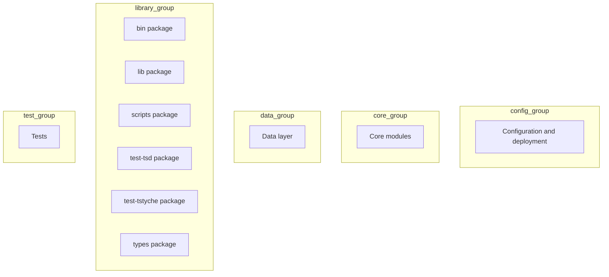

# Architecture report: knex/knex

> Automated static analysis. **Observed** = directly seen in files/imports/AST; **Inferred** = interpretation from that evidence. Repository code was not executed.

## 1. Repository at a glance

| Item | Value |
| --- | --- |
| Repository | knex/knex |
| Description | A query builder for PostgreSQL, MySQL, CockroachDB, SQL Server, SQLite3 and Oracle, designed to be flexible, portable, and fun to use. |
| Language | JavaScript |
| Stars | 20340 |
| Licence | MIT |
| Analysed commit / branch | e25d54bcb707714a17f5a5744eba5c4246bb4d1d / master |
| Framework(s) | None detected |
| Files analysed | 588 |
| Components | 10 |

## 2. Architecture in one minute

knex/knex - A query builder for PostgreSQL, MySQL, CockroachDB, SQL Server, SQLite3 and Oracle, designed to be flexible, portable, and fun to use.. This repository was analysed statically from 588 file(s) (0 Python). Detected technologies (observed from imports/manifests): GitHub Actions, MySQL, PostgreSQL, SQLite, Docker, Docker Compose. Files are grouped into 10 component(s): bin package, Configuration and deployment, Core modules, Data layer, lib package, scripts package, test-tsd package, test-tstyche package. Findings below distinguish observed facts from inferred interpretation.

## 3. High-level block diagram

## 4. Main components

### bin package (`bin`)

- **Kind:** library
- **Status:** Observed
- **Confidence:** 0.85
- **Responsibility:** Groups 5 file(s) under bin package (observed from repository paths and static analysis).
- **Paths:** `bin/cli.js`, `bin/knexfile-runtime-error.js`, `bin/utils/cli-config-utils.js`, `bin/utils/constants.js`, `bin/utils/migrationsLister.js`
- **Evidence:** [bin/cli.js](https://github.com/knex/knex/blob/e25d54bcb707714a17f5a5744eba5c4246bb4d1d/bin/cli.js); [bin/knexfile-runtime-error.js](https://github.com/knex/knex/blob/e25d54bcb707714a17f5a5744eba5c4246bb4d1d/bin/knexfile-runtime-error.js); [bin/utils/cli-config-utils.js](https://github.com/knex/knex/blob/e25d54bcb707714a17f5a5744eba5c4246bb4d1d/bin/utils/cli-config-utils.js); [bin/utils/constants.js](https://github.com/knex/knex/blob/e25d54bcb707714a17f5a5744eba5c4246bb4d1d/bin/utils/constants.js); [bin/utils/migrationsLister.js](https://github.com/knex/knex/blob/e25d54bcb707714a17f5a5744eba5c4246bb4d1d/bin/utils/migrationsLister.js)

### Configuration and deployment (`config`)

- **Kind:** config
- **Status:** Observed
- **Confidence:** 0.85
- **Responsibility:** Groups 6 file(s) under configuration and deployment (observed from repository paths and static analysis).
- **Paths:** `package.json`, `scripts/docker-compose.yml`, `scripts/stress-test/docker-compose.yml`, `test-tstyche/package.json`, `test-tstyche/tsconfig.json`, `tsconfig.json`
- **Evidence:** [package.json](https://github.com/knex/knex/blob/e25d54bcb707714a17f5a5744eba5c4246bb4d1d/package.json); [scripts/docker-compose.yml](https://github.com/knex/knex/blob/e25d54bcb707714a17f5a5744eba5c4246bb4d1d/scripts/docker-compose.yml); [scripts/stress-test/docker-compose.yml](https://github.com/knex/knex/blob/e25d54bcb707714a17f5a5744eba5c4246bb4d1d/scripts/stress-test/docker-compose.yml); [test-tstyche/package.json](https://github.com/knex/knex/blob/e25d54bcb707714a17f5a5744eba5c4246bb4d1d/test-tstyche/package.json); [test-tstyche/tsconfig.json](https://github.com/knex/knex/blob/e25d54bcb707714a17f5a5744eba5c4246bb4d1d/test-tstyche/tsconfig.json); [tsconfig.json](https://github.com/knex/knex/blob/e25d54bcb707714a17f5a5744eba5c4246bb4d1d/tsconfig.json)

### Core modules (`core`)

- **Kind:** core
- **Status:** Observed
- **Confidence:** 0.85
- **Responsibility:** Groups 2 file(s) under core modules (observed from repository paths and static analysis).
- **Paths:** `knex.js`, `knex.mjs`
- **Evidence:** [knex.js](https://github.com/knex/knex/blob/e25d54bcb707714a17f5a5744eba5c4246bb4d1d/knex.js); [knex.mjs](https://github.com/knex/knex/blob/e25d54bcb707714a17f5a5744eba5c4246bb4d1d/knex.mjs)

### Data layer (`data_layer`)

- **Kind:** data
- **Status:** Inferred
- **Confidence:** 0.70
- **Responsibility:** Groups 0 file(s) under data layer (observed from repository paths and static analysis).
- **Evidence:** [package.json:4](https://github.com/knex/knex/blob/e25d54bcb707714a17f5a5744eba5c4246bb4d1d/package.json#L4); [scripts/docker-compose.yml:23](https://github.com/knex/knex/blob/e25d54bcb707714a17f5a5744eba5c4246bb4d1d/scripts/docker-compose.yml#L23); [scripts/stress-test/docker-compose.yml:12](https://github.com/knex/knex/blob/e25d54bcb707714a17f5a5744eba5c4246bb4d1d/scripts/stress-test/docker-compose.yml#L12); [scripts/docker-compose.yml:108](https://github.com/knex/knex/blob/e25d54bcb707714a17f5a5744eba5c4246bb4d1d/scripts/docker-compose.yml#L108); [scripts/stress-test/docker-compose.yml:13](https://github.com/knex/knex/blob/e25d54bcb707714a17f5a5744eba5c4246bb4d1d/scripts/stress-test/docker-compose.yml#L13); [docs/package.json:15](https://github.com/knex/knex/blob/e25d54bcb707714a17f5a5744eba5c4246bb4d1d/docs/package.json#L15)

### lib package (`lib`)

- **Kind:** library
- **Status:** Observed
- **Confidence:** 0.85
- **Responsibility:** Groups 147 file(s) under lib package (observed from repository paths and static analysis).
- **Paths:** `lib/builder-interface-augmenter.js`, `lib/client.js`, `lib/constants.js`, `lib/dialects/better-sqlite3/index.js`, `lib/dialects/cockroachdb/crdb-columncompiler.js`, `lib/dialects/cockroachdb/crdb-querybuilder.js`, `lib/dialects/cockroachdb/crdb-querycompiler.js`, `lib/dialects/cockroachdb/crdb-tablecompiler.js`, `lib/dialects/cockroachdb/crdb-viewcompiler.js`, `lib/dialects/cockroachdb/index.js`, `lib/dialects/index.js`, `lib/dialects/index.ts`, `lib/dialects/mariadb/index.js`, `lib/dialects/mariadb/query/mariadb-querycompiler.js`, `lib/dialects/mariadb/schema/mariadb-columncompiler.js`, `lib/dialects/mariadb/transaction.js`, `lib/dialects/mssql/index.js`, `lib/dialects/mssql/mssql-formatter.js`, `lib/dialects/mssql/query/mssql-querycompiler.js`, `lib/dialects/mssql/schema/mssql-columncompiler.js`, `lib/dialects/mssql/schema/mssql-compiler.js`, `lib/dialects/mssql/schema/mssql-tablecompiler.js`, `lib/dialects/mssql/schema/mssql-viewcompiler.js`, `lib/dialects/mssql/transaction.js`, `lib/dialects/mysql/index.js`, `lib/dialects/mysql/query/mysql-querybuilder.js`, `lib/dialects/mysql/query/mysql-querycompiler.js`, `lib/dialects/mysql/schema/mysql-columncompiler.js`, `lib/dialects/mysql/schema/mysql-compiler.js`, `lib/dialects/mysql/schema/mysql-tablecompiler.js`, `lib/dialects/mysql/schema/mysql-viewbuilder.js`, `lib/dialects/mysql/schema/mysql-viewcompiler.js`, `lib/dialects/mysql/transaction.js`, `lib/dialects/mysql2/index.js`, `lib/dialects/mysql2/transaction.js`, `lib/dialects/oracle/index.js`, `lib/dialects/oracle/query/oracle-querycompiler.js`, `lib/dialects/oracle/schema/internal/incrementUtils.js`, `lib/dialects/oracle/schema/internal/trigger.js`, `lib/dialects/oracle/schema/oracle-columnbuilder.js`, `lib/dialects/oracle/schema/oracle-columncompiler.js`, `lib/dialects/oracle/schema/oracle-compiler.js`, `lib/dialects/oracle/schema/oracle-tablecompiler.js`, `lib/dialects/oracle/utils.js`, `lib/dialects/oracledb/index.js`, `lib/dialects/oracledb/query/oracledb-querycompiler.js`, `lib/dialects/oracledb/schema/oracledb-columncompiler.js`, `lib/dialects/oracledb/schema/oracledb-tablecompiler.js`, `lib/dialects/oracledb/schema/oracledb-viewbuilder.js`, `lib/dialects/oracledb/schema/oracledb-viewcompiler.js`, `lib/dialects/oracledb/transaction.js`, `lib/dialects/oracledb/utils.js`, `lib/dialects/pgnative/index.js`, `lib/dialects/postgres/execution/pg-transaction.js`, `lib/dialects/postgres/index.js`, `lib/dialects/postgres/query/pg-querybuilder.js`, `lib/dialects/postgres/query/pg-querycompiler.js`, `lib/dialects/postgres/schema/pg-columncompiler.js`, `lib/dialects/postgres/schema/pg-compiler.js`, `lib/dialects/postgres/schema/pg-tablecompiler.js`, `lib/dialects/postgres/schema/pg-viewbuilder.js`, `lib/dialects/postgres/schema/pg-viewcompiler.js`, `lib/dialects/redshift/index.js`, `lib/dialects/redshift/query/redshift-querycompiler.js`, `lib/dialects/redshift/schema/redshift-columnbuilder.js`, `lib/dialects/redshift/schema/redshift-columncompiler.js`, `lib/dialects/redshift/schema/redshift-compiler.js`, `lib/dialects/redshift/schema/redshift-tablecompiler.js`, `lib/dialects/redshift/schema/redshift-viewcompiler.js`, `lib/dialects/redshift/transaction.js`, `lib/dialects/sqlite3/execution/sqlite-transaction.js`, `lib/dialects/sqlite3/index.js`, `lib/dialects/sqlite3/query/sqlite-querybuilder.js`, `lib/dialects/sqlite3/query/sqlite-querycompiler.js`, `lib/dialects/sqlite3/schema/ddl.js`, `lib/dialects/sqlite3/schema/internal/compiler.js`, `lib/dialects/sqlite3/schema/internal/parser-combinator.js`, `lib/dialects/sqlite3/schema/internal/parser.js`, `lib/dialects/sqlite3/schema/internal/sqlite-ddl-operations.js`, `lib/dialects/sqlite3/schema/internal/tokenizer.js`, `lib/dialects/sqlite3/schema/internal/utils.js`, `lib/dialects/sqlite3/schema/sqlite-columncompiler.js`, `lib/dialects/sqlite3/schema/sqlite-compiler.js`, `lib/dialects/sqlite3/schema/sqlite-tablecompiler.js`, `lib/dialects/sqlite3/schema/sqlite-viewcompiler.js`, `lib/execution/batch-insert.js`, `lib/execution/internal/delay.js`, `lib/execution/internal/ensure-connection-callback.js`, `lib/execution/internal/query-executioner.js`, `lib/execution/runner.js`, `lib/execution/transaction.js`, `lib/formatter.js`, `lib/formatter/formatterUtils.js`, `lib/formatter/rawFormatter.js`, `lib/formatter/wrappingFormatter.js`, `lib/index.js`, `lib/knex-builder/FunctionHelper.js`, `lib/knex-builder/Knex.js`, `lib/knex-builder/internal/config-resolver.js`, `lib/knex-builder/internal/parse-connection.js`, `lib/knex-builder/make-knex.js`, `lib/logger.js`, `lib/migrations/common/MigrationsLoader.js`, `lib/migrations/migrate/MigrationGenerator.js`, `lib/migrations/migrate/Migrator.js`, `lib/migrations/migrate/migrate-stub.js`, `lib/migrations/migrate/migration-list-resolver.js`, `lib/migrations/migrate/migrator-configuration-merger.js`, `lib/migrations/migrate/sources/fs-migrations.js`, `lib/migrations/migrate/table-creator.js`, `lib/migrations/migrate/table-resolver.js`, `lib/migrations/seed/Seeder.js`, `lib/migrations/seed/seed-stub.js`, `lib/migrations/seed/seeder-configuration-merger.js`, `lib/migrations/seed/sources/fs-seeds.js`, `lib/migrations/util/fs.js`, `lib/migrations/util/import-file.js`, `lib/migrations/util/is-module-type.js`, `lib/migrations/util/template.js`, `lib/migrations/util/timestamp.js`, `lib/pool.js`, `lib/query/analytic.js`, `lib/query/constants.js`, `lib/query/joinclause.js`, `lib/query/method-constants.js`, `lib/query/querybuilder.js`, `lib/query/querycompiler.js`, `lib/raw.js`, `lib/ref.js`, `lib/schema/builder.js`, `lib/schema/columnbuilder.js`, `lib/schema/columncompiler.js`, `lib/schema/compiler.js`, `lib/schema/internal/helpers.js`, `lib/schema/tablebuilder.js`, `lib/schema/tablecompiler.js`, `lib/schema/viewbuilder.js`, `lib/schema/viewcompiler.js`, `lib/util/finally-mixin.js`, `lib/util/helpers.js`, `lib/util/is.js`, `lib/util/nanoid.js`, `lib/util/noop.js`, `lib/util/save-async-stack.js`, `lib/util/security.js`, `lib/util/string.js`, `lib/util/timeout.js`
- **Evidence:** [lib/builder-interface-augmenter.js](https://github.com/knex/knex/blob/e25d54bcb707714a17f5a5744eba5c4246bb4d1d/lib/builder-interface-augmenter.js); [lib/client.js](https://github.com/knex/knex/blob/e25d54bcb707714a17f5a5744eba5c4246bb4d1d/lib/client.js); [lib/constants.js](https://github.com/knex/knex/blob/e25d54bcb707714a17f5a5744eba5c4246bb4d1d/lib/constants.js); [lib/dialects/better-sqlite3/index.js](https://github.com/knex/knex/blob/e25d54bcb707714a17f5a5744eba5c4246bb4d1d/lib/dialects/better-sqlite3/index.js); [lib/dialects/cockroachdb/crdb-columncompiler.js](https://github.com/knex/knex/blob/e25d54bcb707714a17f5a5744eba5c4246bb4d1d/lib/dialects/cockroachdb/crdb-columncompiler.js); [lib/dialects/cockroachdb/crdb-querybuilder.js](https://github.com/knex/knex/blob/e25d54bcb707714a17f5a5744eba5c4246bb4d1d/lib/dialects/cockroachdb/crdb-querybuilder.js); [lib/dialects/cockroachdb/crdb-querycompiler.js](https://github.com/knex/knex/blob/e25d54bcb707714a17f5a5744eba5c4246bb4d1d/lib/dialects/cockroachdb/crdb-querycompiler.js); [lib/dialects/cockroachdb/crdb-tablecompiler.js](https://github.com/knex/knex/blob/e25d54bcb707714a17f5a5744eba5c4246bb4d1d/lib/dialects/cockroachdb/crdb-tablecompiler.js)

### scripts package (`scripts`)

- **Kind:** library
- **Status:** Observed
- **Confidence:** 0.85
- **Responsibility:** Groups 11 file(s) under scripts package (observed from repository paths and static analysis).
- **Paths:** `scripts/build-for-release.sh`, `scripts/build.js`, `scripts/clean.js`, `scripts/oracledb-install-driver-libs.sh`, `scripts/revert-release-to-draft.sh`, `scripts/runkit-example.js`, `scripts/stress-test/knex-stress-test.js`, `scripts/stress-test/mysql2-random-hanging-every-now-and-then.js`, `scripts/stress-test/mysql2-sudden-exit-without-error.js`, `scripts/stress-test/reconnect-test-mysql-based-drivers.js`, `scripts/update-changelog.mjs`
- **Evidence:** [scripts/build-for-release.sh](https://github.com/knex/knex/blob/e25d54bcb707714a17f5a5744eba5c4246bb4d1d/scripts/build-for-release.sh); [scripts/build.js](https://github.com/knex/knex/blob/e25d54bcb707714a17f5a5744eba5c4246bb4d1d/scripts/build.js); [scripts/clean.js](https://github.com/knex/knex/blob/e25d54bcb707714a17f5a5744eba5c4246bb4d1d/scripts/clean.js); [scripts/oracledb-install-driver-libs.sh](https://github.com/knex/knex/blob/e25d54bcb707714a17f5a5744eba5c4246bb4d1d/scripts/oracledb-install-driver-libs.sh); [scripts/revert-release-to-draft.sh](https://github.com/knex/knex/blob/e25d54bcb707714a17f5a5744eba5c4246bb4d1d/scripts/revert-release-to-draft.sh); [scripts/runkit-example.js](https://github.com/knex/knex/blob/e25d54bcb707714a17f5a5744eba5c4246bb4d1d/scripts/runkit-example.js); [scripts/stress-test/knex-stress-test.js](https://github.com/knex/knex/blob/e25d54bcb707714a17f5a5744eba5c4246bb4d1d/scripts/stress-test/knex-stress-test.js); [scripts/stress-test/mysql2-random-hanging-every-now-and-then.js](https://github.com/knex/knex/blob/e25d54bcb707714a17f5a5744eba5c4246bb4d1d/scripts/stress-test/mysql2-random-hanging-every-now-and-then.js)

### test-tsd package (`test_tsd`)

- **Kind:** library
- **Status:** Observed
- **Confidence:** 0.85
- **Responsibility:** Groups 18 file(s) under test-tsd package (observed from repository paths and static analysis).
- **Paths:** `test-tsd/batchInsert.test-d.ts`, `test-tsd/common.ts`, `test-tsd/having.test-d.ts`, `test-tsd/mssql-config.test-d.ts`, `test-tsd/pg-config.test-d.ts`, `test-tsd/querybuilder.test-d.ts`, `test-tsd/select.test-d.ts`, `test-tsd/tables.test-d.ts`, `test-tsd/transaction.test-d.ts`, `test-tsd/tsd-tests1.test-d.ts`, `test-tsd/tsd-tests2.test-d.ts`, `test-tsd/tsd-tests3.test-d.ts`, `test-tsd/tsd-tests4.test-d.ts`, `test-tsd/tsd-tests5.test-d.ts`, `test-tsd/tsd-tests6.test-d.ts`, `test-tsd/tsd-tests7.test-d.ts`, `test-tsd/tsd-tests8.test-d.ts`, `test-tsd/types.test-d.ts`
- **Evidence:** [test-tsd/batchInsert.test-d.ts](https://github.com/knex/knex/blob/e25d54bcb707714a17f5a5744eba5c4246bb4d1d/test-tsd/batchInsert.test-d.ts); [test-tsd/common.ts](https://github.com/knex/knex/blob/e25d54bcb707714a17f5a5744eba5c4246bb4d1d/test-tsd/common.ts); [test-tsd/having.test-d.ts](https://github.com/knex/knex/blob/e25d54bcb707714a17f5a5744eba5c4246bb4d1d/test-tsd/having.test-d.ts); [test-tsd/mssql-config.test-d.ts](https://github.com/knex/knex/blob/e25d54bcb707714a17f5a5744eba5c4246bb4d1d/test-tsd/mssql-config.test-d.ts); [test-tsd/pg-config.test-d.ts](https://github.com/knex/knex/blob/e25d54bcb707714a17f5a5744eba5c4246bb4d1d/test-tsd/pg-config.test-d.ts); [test-tsd/querybuilder.test-d.ts](https://github.com/knex/knex/blob/e25d54bcb707714a17f5a5744eba5c4246bb4d1d/test-tsd/querybuilder.test-d.ts); [test-tsd/select.test-d.ts](https://github.com/knex/knex/blob/e25d54bcb707714a17f5a5744eba5c4246bb4d1d/test-tsd/select.test-d.ts); [test-tsd/tables.test-d.ts](https://github.com/knex/knex/blob/e25d54bcb707714a17f5a5744eba5c4246bb4d1d/test-tsd/tables.test-d.ts)

### test-tstyche package (`test_tstyche`)

- **Kind:** library
- **Status:** Observed
- **Confidence:** 0.85
- **Responsibility:** Groups 2 file(s) under test-tstyche package (observed from repository paths and static analysis).
- **Paths:** `test-tstyche/esm-subpath-exports.tst.ts`, `test-tstyche/esm-types.tst.ts`
- **Evidence:** [test-tstyche/esm-subpath-exports.tst.ts](https://github.com/knex/knex/blob/e25d54bcb707714a17f5a5744eba5c4246bb4d1d/test-tstyche/esm-subpath-exports.tst.ts); [test-tstyche/esm-types.tst.ts](https://github.com/knex/knex/blob/e25d54bcb707714a17f5a5744eba5c4246bb4d1d/test-tstyche/esm-types.tst.ts)

### Tests (`tests`)

- **Kind:** test
- **Status:** Observed
- **Confidence:** 0.85
- **Responsibility:** Groups 293 file(s) under tests (observed from repository paths and static analysis).
- **Paths:** `test/.gitignore`, `test/.istanbul.yml`, `test/all-tests-suite.js`, `test/cli-tests-suite.js`, `test/cli/_justexit.js`, `test/cli/cli-config-utils.spec.js`, `test/cli/cli-test-utils.js`, `test/cli/esm-interop.spec.js`, `test/cli/help.spec.js`, `test/cli/knexfile-runtime-error.spec.js`, `test/cli/knexfile-test.spec.js`, `test/cli/migrate-disable-transactions.spec.js`, `test/cli/migrate-make.spec.js`, `test/cli/migrate-to-before.spec.js`, `test/cli/migrate-unlock.spec.js`, `test/cli/migrate.spec.js`, `test/cli/seed-make.spec.js`, `test/cli/seed.spec.js`, `test/cli/tempfiles.js`, `test/cli/version.spec.js`, `test/db-less-test-suite.js`, `test/integration-test-suite.js`, `test/integration/connection-config-provider.js`, `test/integration/datatype/bigint.js`, `test/integration/datatype/decimal.js`, `test/integration/datatype/double.js`, `test/integration/dialects/oracledb.js`, `test/integration/execution/transaction.js`, `test/integration/helpers/knex-builder.js`, `test/integration/index.js`, `test/integration/logger.js`, `test/integration/query/aggregate.js`, `test/integration/query/deletes.js`, `test/integration/query/trigger-deletes.js`, `test/integration/query/trigger-inserts.js`, `test/integration/query/trigger-updates.js`, `test/integration/seed/index.js`, `test/integration/seed/test/random_bad_file.txt`, `test/integration/seed/test/seed1.js`, `test/integration/seed/test/seed2.js`, `test/integration/suite.js`, `test/integration2/dialects/better-sqlite3.spec.js`, `test/integration2/dialects/cockroachdb.spec.js`, `test/integration2/dialects/mariadb.spec.js`, `test/integration2/dialects/mssql.spec.js`, `test/integration2/dialects/mysql.spec.js`, `test/integration2/dialects/mysql2.spec.js`, `test/integration2/dialects/oracledb.spec.js`, `test/integration2/dialects/postgres-cockroach.spec.js`, `test/integration2/dialects/sqlite.spec.js`, `test/integration2/knex.spec.js`, `test/integration2/migrate/alter-table-ignore-case-sensitive/01_create.js`, `test/integration2/migrate/alter-table-ignore-case-sensitive/02_add_column.js`, `test/integration2/migrate/async-await-drop-and-recreate-with-schema/01_create.js`, `test/integration2/migrate/async-await-drop-and-recreate-with-schema/02_drop_and_recreate.js`, `test/integration2/migrate/async-await-drop-and-recreate/01_create.js`, `test/integration2/migrate/async-await-drop-and-recreate/02_drop_and_recreate.js`, `test/integration2/migrate/drop-and-recreate-with-schema/01_create.js`, `test/integration2/migrate/drop-and-recreate-with-schema/02_drop_and_recreate.js`, `test/integration2/migrate/drop-and-recreate/01_create.js`, `test/integration2/migrate/drop-and-recreate/02_drop_and_recreate.js`, `test/integration2/migrate/drop-with-default-constraint/01_create.js`, `test/integration2/migrate/drop-with-default-constraint/02_drop_column.js`, `test/integration2/migrate/memory-migrations.js`, `test/integration2/migrate/migration-explicit-transactions/01_failing.js`, `test/integration2/migrate/migration-integration.spec.js`, `test/integration2/migrate/migration-lifecycle-integration.spec.js`, `test/integration2/migrate/null_timestamp_default/01_create.js`, `test/integration2/migrate/rename-and-drop-column-with-multiline-sql-from-legacy-db/01_rename-column.js`, `test/integration2/migrate/rename-and-drop-column-with-multiline-sql-from-legacy-db/02_drop_column.js`, `test/integration2/migrate/sqlite.spec.js`, `test/integration2/migrate/test/20131019235242_migration_1.js`, `test/integration2/migrate/test/20131019235306_migration_2.js`, `test/integration2/migrate/test2/20131019235242_migration_3.js`, `test/integration2/migrate/test2/20131019235306_migration_4.js`, `test/integration2/migrate/test_per_migration_trx_disabled/20131019235242_migration_1.js`, `test/integration2/migrate/test_per_migration_trx_disabled/20150109002832_invalid_migration.js`, `test/integration2/migrate/test_per_migration_trx_disabled/20150109095253_migration_after_invalid.js`, `test/integration2/migrate/test_per_migration_trx_enabled/20131019235242_migration_1.js`, `test/integration2/migrate/test_per_migration_trx_enabled/20150109002832_invalid_migration.js`, `test/integration2/migrate/test_per_migration_trx_enabled/20150109095253_migration_after_invalid.js`, `test/integration2/migrate/test_single_per_migration_trx_disabled/create_table.js`, `test/integration2/migrate/test_single_per_migration_trx_disabled/down.js`, `test/integration2/migrate/test_single_per_migration_trx_disabled/rollback/create_table.js`, `test/integration2/migrate/test_single_per_migration_trx_disabled/rollback/down.js`, `test/integration2/migrate/test_single_per_migration_trx_disabled/up.js`, `test/integration2/migrate/test_to_before/20131019235242_migration_1.js`, `test/integration2/migrate/test_to_before/20131019235306_migration_2.js`, `test/integration2/migrate/test_to_before/20131019235320_migration_3.js`, `test/integration2/migrate/test_with_invalid/20131019235242_migration_1.js`, `test/integration2/migrate/test_with_invalid/20131019235306_migration_2.js`, `test/integration2/migrate/test_with_invalid/20150109002832_invalid_migration.js`, `test/integration2/migrate/test_with_invalid/20150109095253_migration_after_invalid.js`, `test/integration2/migrate/test_with_invalid/random_bad_file.txt`, `test/integration2/migrate/test_with_missing_first_migration/20131019235306_migration_2.js`, `test/integration2/pool/connection-pool.spec.js`, `test/integration2/query/insert/inserts.spec.js`, `test/integration2/query/insert/on-conflict-deferred.spec.js`, `test/integration2/query/insert/on-conflict-merge.spec.js`, `test/integration2/query/misc/additional.spec.js`, `test/integration2/query/select/first.spec.js`, `test/integration2/query/select/fts.spec.js`, `test/integration2/query/select/joins.spec.js`, `test/integration2/query/select/pluck.spec.js`, `test/integration2/query/select/selects.spec.js`, `test/integration2/query/select/unions.spec.js`, `test/integration2/query/select/where.spec.js`, `test/integration2/query/update/updates.spec.js`, `test/integration2/schema/alter.spec.js`, `test/integration2/schema/checks.spec.js`, `test/integration2/schema/enum-native.spec.js`, `test/integration2/schema/foreign-keys.spec.js`, `test/integration2/schema/geometry-columns.spec.js`, `test/integration2/schema/index.spec.js`, `test/integration2/schema/json.spec.js`, `test/integration2/schema/jsonb.spec.js`, `test/integration2/schema/misc.spec.js`, `test/integration2/schema/primary-keys.spec.js`, `test/integration2/schema/set-nullable.spec.js`, `test/integration2/schema/specific-type.spec.js`, `test/integration2/schema/views.spec.js`, `test/integration2/transaction/set-deferrable-constraint.spec.js`, `test/integration2/transaction/set-isolation-level.spec.js`, `test/integration2/transaction/set-readonly.spec.js`, `test/integration2/util/knex-instance-provider.js`, `test/jake-util/helpers/migration-test-helper.js`, `test/jake-util/knexfile-custom-migration-source/knexfile-with-directory.js`, `test/jake-util/knexfile-custom-migration-source/knexfile.js`, `test/jake-util/knexfile-errors/knexfile_function_throw.js`, `test/jake-util/knexfile-errors/knexfile_import_throw.js`, `test/jake-util/knexfile-errors/knexfile_non_error_throw.js`, `test/jake-util/knexfile-errors/knexfile_non_stringable_throw.js`, `test/jake-util/knexfile-errors/knexfile_object_throw.js`, `test/jake-util/knexfile-esm-module/.eslintrc.json`, `test/jake-util/knexfile-esm-module/knexfile.js`, `test/jake-util/knexfile-esm-module/migrations/one.js`, `test/jake-util/knexfile-esm-module/package.json`, `test/jake-util/knexfile-esm-module/seeds/one.js`, `test/jake-util/knexfile-esm-package/.eslintrc.json`, `test/jake-util/knexfile-esm-package/knexfile.js`, `test/jake-util/knexfile-esm-package/migrations/one.js`, `test/jake-util/knexfile-esm-package/package.json`, `test/jake-util/knexfile-esm-package/seeds/one.js`, `test/jake-util/knexfile-esm/.eslintrc.json`, `test/jake-util/knexfile-esm/knexfile.cjs`, `test/jake-util/knexfile-esm/knexfile.cjs.js`, `test/jake-util/knexfile-esm/knexfile.default.js`, `test/jake-util/knexfile-esm/knexfile.js`, `test/jake-util/knexfile-esm/migrations/one.js`, `test/jake-util/knexfile-esm/seeds/one.js`, `test/jake-util/knexfile-imports/.eslintrc.json`, `test/jake-util/knexfile-imports/cjs/migrations/one.cjs`, `test/jake-util/knexfile-imports/cjs/seeds/one.cjs`, `test/jake-util/knexfile-imports/esm/migrations/one.js`, `test/jake-util/knexfile-imports/esm/seeds/one.js`, `test/jake-util/knexfile-imports/js/migrations/one.js`, `test/jake-util/knexfile-imports/js/seeds/one.js`, `test/jake-util/knexfile-imports/knexfile.mjs`, `test/jake-util/knexfile-imports/knexfile1.mjs`, `test/jake-util/knexfile-imports/knexfile10.js`, `test/jake-util/knexfile-imports/knexfile11.js`, `test/jake-util/knexfile-imports/knexfile12.cjs`, `test/jake-util/knexfile-imports/knexfile13.cjs`, `test/jake-util/knexfile-imports/knexfile14.cjs`, `test/jake-util/knexfile-imports/knexfile15.cjs`, `test/jake-util/knexfile-imports/knexfile16.mjs`, `test/jake-util/knexfile-imports/knexfile17.mjs`, `test/jake-util/knexfile-imports/knexfile18.mjs`, `test/jake-util/knexfile-imports/knexfile19.js`, `test/jake-util/knexfile-imports/knexfile2.mjs`, `test/jake-util/knexfile-imports/knexfile20.js`, `test/jake-util/knexfile-imports/knexfile3.mjs`, `test/jake-util/knexfile-imports/knexfile4.mjs`, `test/jake-util/knexfile-imports/knexfile5.mjs`, `test/jake-util/knexfile-imports/knexfile6.js`, `test/jake-util/knexfile-imports/knexfile7.js`, `test/jake-util/knexfile-imports/knexfile8.js`, `test/jake-util/knexfile-imports/knexfile9.js`, `test/jake-util/knexfile-imports/mjs/migrations/one.mjs`, `test/jake-util/knexfile-imports/mjs/seeds/one.mjs`, `test/jake-util/knexfile-mjs/.eslintrc.json`, `test/jake-util/knexfile-mjs/knexfile.mjs`, `test/jake-util/knexfile-mjs/migrations/one.mjs`, `test/jake-util/knexfile-mjs/seeds/one.mjs`, `test/jake-util/knexfile-relative/knexfile-with-resolve.js`, `test/jake-util/knexfile-relative/knexfile.js`, `test/jake-util/knexfile-relative/knexfile_migrations/.gitkeep`, `test/jake-util/knexfile-relative/knexfile_migrations/20200105205226_one.js`, `test/jake-util/knexfile-relative/knexfile_migrations/20200105205320_two.js`, `test/jake-util/knexfile-relative/knexfile_seeds/.gitkeep`, `test/jake-util/knexfile-stubs/knexfile.js`, `test/jake-util/knexfile-stubs/seed.stub`, `test/jake-util/knexfile-stubs/table.stub`, `test/jake-util/knexfile-ts/custom-config.ts`, `test/jake-util/knexfile-ts/knexfile.ts`, `test/jake-util/knexfile-ts/knexfile_migrations/20200131112749_one.ts`, `test/jake-util/knexfile-ts/knexfile_migrations/20200131112753_two.ts`, `test/jake-util/knexfile-ts/knexfile_migrations/20200131112757_three.ts`, `test/jake-util/knexfile-ts/knexfile_migrations/20200131112801_four.ts`, `test/jake-util/knexfile/knexfile.js`, `test/jake-util/knexfile/knexfile_async.js`, `test/jake-util/knexfile/knexfile_func.js`, `test/jake-util/knexfile/knexfile_promise.js`, `test/jake-util/knexfile_migrations/simple_migration.js`, `test/jake-util/knexfile_migrations/table-foreign.stub`, `test/jake-util/knexfile_seeds/seed2.stub`, `test/jake-util/migration-stubs/table.stub`, `test/jake-util/seeds-error-knexfile.js`, `test/jake-util/seeds-error/seeds.js`, `test/jake-util/seeds-knexfile-async.js`, `test/jake-util/seeds-knexfile-directories-recursive.js`, `test/jake-util/seeds-knexfile-directories.js`, `test/jake-util/seeds-knexfile.js`, `test/jake-util/seeds-recursive/first/third/first.js`, `test/jake-util/seeds-recursive/second/before-second.js`, `test/jake-util/seeds-recursive/second/second.js`, `test/jake-util/seeds/first.js`, `test/jake-util/seeds/second.js`, `test/jake/Jakefile`, `test/jake/jakelib/migrate-test.js`, `test/knexfile.js`, `test/mocha-all-config-test.js`, `test/mocha-integration-config-test.js`, `test/mocha-unit-config-test.js`, `test/prep-db-mocha.js`, `test/prep-db.js`, `test/tape/crossdb-compatibility.js`, `test/tape/harness.js`, `test/tape/index.js`, `test/tape/invalid-db-setup.js`, `test/tape/knex.js`, `test/tape/migrate.js`, `test/tape/parse-connection.js`, `test/tape/pool.js`, `test/tape/query-builder.js`, `test/tape/raw.js`, `test/tape/seed.js`, `test/tape/stream.js`, `test/tape/transactions.js`, `test/testInitializer.js`, `test/unit/builder-interface-augmenter.js`, `test/unit/client/connection-pool.js`, `test/unit/client/pool-config.js`, `test/unit/dialects/better-sqlite3.js`, `test/unit/dialects/cockroachdb.js`, `test/unit/dialects/mssql.js`, `test/unit/dialects/mysql-version.js`, `test/unit/dialects/mysql.js`, `test/unit/dialects/oracledb.js`, `test/unit/dialects/postgres.js`, `test/unit/knex.js`, `test/unit/migrations/migrate/Migrator.js`, `test/unit/migrations/migrate/migration-list-resolver.js`, `test/unit/migrations/migrate/migrations/blank_migration.js`, `test/unit/migrations/migrate/migrator-use-transaction.js`, `test/unit/migrations/migrate/processed-migrations/simple_migration.js`, `test/unit/migrations/migrate/schemaBuilder.js`, `test/unit/migrations/seed/seeder.js`, `test/unit/migrations/seed/test/1-first.js`, `test/unit/migrations/seed/test/2-second.js`, `test/unit/migrations/util/fs.js`, `test/unit/migrations/util/is-module-type.js`, `test/unit/migrations/util/test/commonjs/package.json`, `test/unit/migrations/util/test/commonjs/test.js`, `test/unit/migrations/util/test/commonjs/test.mjs`, `test/unit/migrations/util/test/module/package.json`, `test/unit/migrations/util/test/module/test.cjs`, `test/unit/migrations/util/test/module/test.js`, `test/unit/migrations/util/timestamp.js`, `test/unit/query/formatter.js`, `test/unit/query/string.js`, `test/unit/schema-builder/better-sqlite3.js`, `test/unit/schema-builder/cockroachdb.js`, `test/unit/schema-builder/extensions.js`, `test/unit/schema-builder/mssql.js`, `test/unit/schema-builder/mysql.js`, `test/unit/schema-builder/oracle.js`, `test/unit/schema-builder/oracledb.js`, `test/unit/schema-builder/postgres.js`, `test/unit/schema-builder/redshift.js`, `test/unit/schema-builder/sqlite3.js`, `test/unit/schema/tablecompiler-base.js`, `test/unit/util/comma-no-paren-regex.js`, `test/unit/util/format-sql-bindings.js`, `test/unit/util/nanoid.js`, `test/unit/util/save-async-stack.js`, `test/unit/util/security.js`, `test/util/assertHelper.js`, `test/util/chai-setup.js`, `test/util/constants.js`, `test/util/dataInsertHelper.js`, `test/util/db-helpers.js`, `test/util/tableCreatorHelper.js`
- **Evidence:** [test/.gitignore](https://github.com/knex/knex/blob/e25d54bcb707714a17f5a5744eba5c4246bb4d1d/test/.gitignore); [test/.istanbul.yml](https://github.com/knex/knex/blob/e25d54bcb707714a17f5a5744eba5c4246bb4d1d/test/.istanbul.yml); [test/all-tests-suite.js](https://github.com/knex/knex/blob/e25d54bcb707714a17f5a5744eba5c4246bb4d1d/test/all-tests-suite.js); [test/cli-tests-suite.js](https://github.com/knex/knex/blob/e25d54bcb707714a17f5a5744eba5c4246bb4d1d/test/cli-tests-suite.js); [test/cli/_justexit.js](https://github.com/knex/knex/blob/e25d54bcb707714a17f5a5744eba5c4246bb4d1d/test/cli/_justexit.js); [test/cli/cli-config-utils.spec.js](https://github.com/knex/knex/blob/e25d54bcb707714a17f5a5744eba5c4246bb4d1d/test/cli/cli-config-utils.spec.js); [test/cli/cli-test-utils.js](https://github.com/knex/knex/blob/e25d54bcb707714a17f5a5744eba5c4246bb4d1d/test/cli/cli-test-utils.js); [test/cli/esm-interop.spec.js](https://github.com/knex/knex/blob/e25d54bcb707714a17f5a5744eba5c4246bb4d1d/test/cli/esm-interop.spec.js)

### types package (`types`)

- **Kind:** library
- **Status:** Observed
- **Confidence:** 0.85
- **Responsibility:** Groups 3 file(s) under types package (observed from repository paths and static analysis).
- **Paths:** `types/index.d.ts`, `types/result.d.ts`, `types/tables.d.ts`
- **Evidence:** [types/index.d.ts](https://github.com/knex/knex/blob/e25d54bcb707714a17f5a5744eba5c4246bb4d1d/types/index.d.ts); [types/result.d.ts](https://github.com/knex/knex/blob/e25d54bcb707714a17f5a5744eba5c4246bb4d1d/types/result.d.ts); [types/tables.d.ts](https://github.com/knex/knex/blob/e25d54bcb707714a17f5a5744eba5c4246bb4d1d/types/tables.d.ts)

## 5. Execution flow

**Observed** entry point(s):

- [bin/cli.js](https://github.com/knex/knex/blob/e25d54bcb707714a17f5a5744eba5c4246bb4d1d/bin/cli.js)
- [knex.js](https://github.com/knex/knex/blob/e25d54bcb707714a17f5a5744eba5c4246bb4d1d/knex.js)
- [lib/dialects/better-sqlite3/index.js](https://github.com/knex/knex/blob/e25d54bcb707714a17f5a5744eba5c4246bb4d1d/lib/dialects/better-sqlite3/index.js)
- [lib/dialects/cockroachdb/index.js](https://github.com/knex/knex/blob/e25d54bcb707714a17f5a5744eba5c4246bb4d1d/lib/dialects/cockroachdb/index.js)
- [lib/dialects/index.js](https://github.com/knex/knex/blob/e25d54bcb707714a17f5a5744eba5c4246bb4d1d/lib/dialects/index.js)
- [lib/dialects/index.ts](https://github.com/knex/knex/blob/e25d54bcb707714a17f5a5744eba5c4246bb4d1d/lib/dialects/index.ts)
- [lib/dialects/mariadb/index.js](https://github.com/knex/knex/blob/e25d54bcb707714a17f5a5744eba5c4246bb4d1d/lib/dialects/mariadb/index.js)
- [lib/dialects/mssql/index.js](https://github.com/knex/knex/blob/e25d54bcb707714a17f5a5744eba5c4246bb4d1d/lib/dialects/mssql/index.js)
- [lib/dialects/mysql/index.js](https://github.com/knex/knex/blob/e25d54bcb707714a17f5a5744eba5c4246bb4d1d/lib/dialects/mysql/index.js)
- [lib/dialects/mysql2/index.js](https://github.com/knex/knex/blob/e25d54bcb707714a17f5a5744eba5c4246bb4d1d/lib/dialects/mysql2/index.js)
- [lib/dialects/oracle/index.js](https://github.com/knex/knex/blob/e25d54bcb707714a17f5a5744eba5c4246bb4d1d/lib/dialects/oracle/index.js)
- [test/jake-util/knexfile-esm-package/knexfile.js](https://github.com/knex/knex/blob/e25d54bcb707714a17f5a5744eba5c4246bb4d1d/test/jake-util/knexfile-esm-package/knexfile.js)

Representative flow (derived from observed entry points and the import graph; steps beyond the entry point are **Inferred**):

1. Execution starts at an observed entry point listed above, if present.
2. No internal import relationships between components were observed.

## 6. Project structure

### `(root)`

- `.codecov.yml` - config (130 bytes)
- `.editorconfig` - config (147 bytes)
- `.eslintignore` - other (116 bytes)
- `.eslintrc.js` - source, JavaScript (1257 bytes)
- `.gitignore` - other (449 bytes)
- `.prettierrc` - other (79 bytes)
- `CHANGELOG.md` - docs (131351 bytes)
- `CONTRIBUTING.md` - docs (8580 bytes)
- `ECOSYSTEM.md` - docs (2442 bytes)
- `LICENSE` - docs (1064 bytes)
- `README.md` - docs (5453 bytes)
- `UPGRADING.md` - docs (8837 bytes)
- `knex.d.mts` - other (936 bytes)
- `knex.js` - source, JavaScript (650 bytes)
- `knex.mjs` - source, JavaScript (264 bytes)
- `package.json` - manifest (9879 bytes)
- `tsconfig.json` - config (387 bytes)

### `.github`

- `.github/ISSUE_TEMPLATE.md` - docs (1143 bytes)
- `.github/dependabot.yml` - config (261 bytes)
- `.github/release-drafter.yml` - config (1550 bytes)
- `.github/workflows/assign-dri.yml` - ci, YAML (1948 bytes)
- `.github/workflows/codeql-analysis.yml` - ci, YAML (1232 bytes)
- `.github/workflows/coverage.yml` - ci, YAML (2672 bytes)
- `.github/workflows/ensure-labels.yml` - ci, YAML (565 bytes)
- `.github/workflows/integration-tests.yml` - ci, YAML (5225 bytes)
- `.github/workflows/linting.yml` - ci, YAML (1641 bytes)
- `.github/workflows/mirror-images.yml` - ci, YAML (2994 bytes)
- `.github/workflows/release-drafter.yml` - ci, YAML (6405 bytes)
- `.github/workflows/release.yml` - ci, YAML (18369 bytes)
- `.github/workflows/unit-tests.yml` - ci, YAML (1685 bytes)

### `.husky`

- `.husky/post-checkout` - other (73 bytes)
- `.husky/pre-commit` - other (69 bytes)

### `bin`

- `bin/cli.js` - source, JavaScript (15928 bytes)
- `bin/knexfile-runtime-error.js` - source, JavaScript (887 bytes)
- `bin/utils/cli-config-utils.js` - source, JavaScript (5346 bytes)
- `bin/utils/constants.js` - source, JavaScript (132 bytes)
- `bin/utils/migrationsLister.js` - source, JavaScript (941 bytes)

### `docs`

- `docs/.gitignore` - docs (136 bytes)
- `docs/.vitepress/badges.ts` - docs (3247 bytes)
- `docs/.vitepress/config.mts` - docs (6459 bytes)
- `docs/.vitepress/knexDialects.ts` - docs (16322 bytes)
- `docs/.vitepress/slugify.ts` - docs (442 bytes)
- `docs/.vitepress/theme/AlgoliaSearchBox.vue` - docs (6198 bytes)
- `docs/.vitepress/theme/Layout.vue` - docs (4032 bytes)
- `docs/.vitepress/theme/SqlDialectSelector.vue` - docs (2195 bytes)
- `docs/.vitepress/theme/SqlOutput.vue` - docs (152 bytes)
- `docs/.vitepress/theme/ToggleDark.vue` - docs (3729 bytes)
- `docs/.vitepress/theme/dialect.js` - docs (753 bytes)
- `docs/.vitepress/theme/index.js` - docs (471 bytes)
- `docs/.vitepress/theme/sidebarDialectErrors.js` - docs (1741 bytes)
- `docs/.vitepress/theme/styles.css` - docs (10313 bytes)
- `docs/README.md` - docs (2966 bytes)
- `docs/package.json` - manifest (622 bytes)
- `docs/scripts/deploy-doc.sh` - docs (314 bytes)
- `docs/scripts/format-sql-bindings.mjs` - docs (2731 bytes)
- `docs/scripts/resolve-schema-snippets-docker.mjs` - docs (8916 bytes)
- `docs/scripts/resolve-schema-snippets.mjs` - docs (22544 bytes)
- `docs/scripts/snippet-utils.d.ts` - docs (362 bytes)
- `docs/scripts/snippet-utils.mjs` - docs (5086 bytes)
- `docs/src/blog/BlogArchive.vue` - docs (1980 bytes)
- `docs/src/blog/blog.constants.ts` - docs (217 bytes)
- `docs/src/blog/date.ts` - docs (896 bytes)
- `docs/src/blog/index.md` - docs (166 bytes)
- `docs/src/blog/page/[page].md` - docs (333 bytes)
- `docs/src/blog/page/[page].paths.ts` - docs (1611 bytes)
- `docs/src/blog/posts.data.mts` - docs (1906 bytes)
- `docs/src/blog/posts/2026-03-23-welcome/index.md` - docs (5193 bytes)
- `docs/src/changelog.md` - docs (131562 bytes)
- `docs/src/faq/index.md` - docs (2485 bytes)
- `docs/src/faq/recipes.md` - docs (7281 bytes)
- `docs/src/faq/support.md` - docs (374 bytes)
- `docs/src/guide/extending.md` - docs (1014 bytes)
- `docs/src/guide/index.md` - docs (28294 bytes)
- `docs/src/guide/interfaces.md` - docs (8514 bytes)
- `docs/src/guide/migrations.md` - docs (21940 bytes)
- `docs/src/guide/query-builder.md` - docs (72869 bytes)
- `docs/src/guide/raw.md` - docs (5568 bytes)
- `docs/src/guide/ref.md` - docs (758 bytes)
- `docs/src/guide/schema-builder.md` - docs (45866 bytes)
- `docs/src/guide/transactions.md` - docs (8043 bytes)
- `docs/src/guide/utility.md` - docs (2011 bytes)
- `docs/src/index.md` - docs (1791 bytes)
- `docs/src/public/favicon.svg` - docs (4339 bytes)
- `docs/src/public/knex-logo.svg` - docs (4339 bytes)
- `docs/src/public/site.webmanifest` - docs (375 bytes)
- `docs/tsconfig.json` - config (226 bytes)

### `lib`

- `lib/.gitignore` - other (104 bytes)
- `lib/builder-interface-augmenter.js` - source, JavaScript (3737 bytes)
- `lib/client.js` - source, JavaScript (19768 bytes)
- `lib/constants.js` - source, JavaScript (1349 bytes)
- `lib/dialects/better-sqlite3/index.js` - source, JavaScript (2485 bytes)
- `lib/dialects/cockroachdb/crdb-columncompiler.js` - source, JavaScript (375 bytes)
- `lib/dialects/cockroachdb/crdb-querybuilder.js` - source, JavaScript (364 bytes)
- `lib/dialects/cockroachdb/crdb-querycompiler.js` - source, JavaScript (3159 bytes)
- `lib/dialects/cockroachdb/crdb-tablecompiler.js` - source, JavaScript (1382 bytes)
- `lib/dialects/cockroachdb/crdb-viewcompiler.js` - source, JavaScript (418 bytes)
- `lib/dialects/cockroachdb/index.js` - source, JavaScript (2284 bytes)
- `lib/dialects/index.js` - source, JavaScript (1346 bytes)
- `lib/dialects/index.ts` - source, TypeScript (1178 bytes)
- `lib/dialects/mariadb/index.js` - source, JavaScript (1299 bytes)
- `lib/dialects/mariadb/query/mariadb-querycompiler.js` - source, JavaScript (3014 bytes)
- `lib/dialects/mariadb/schema/mariadb-columncompiler.js` - source, JavaScript (573 bytes)
- `lib/dialects/mariadb/transaction.js` - source, JavaScript (1249 bytes)
- `lib/dialects/mssql/index.js` - source, JavaScript (13123 bytes)
- `lib/dialects/mssql/mssql-formatter.js` - source, JavaScript (1093 bytes)
- `lib/dialects/mssql/query/mssql-querycompiler.js` - source, JavaScript (16872 bytes)
- `lib/dialects/mssql/schema/mssql-columncompiler.js` - source, JavaScript (5983 bytes)
- `lib/dialects/mssql/schema/mssql-compiler.js` - source, JavaScript (2607 bytes)
- `lib/dialects/mssql/schema/mssql-tablecompiler.js` - source, JavaScript (14384 bytes)
- `lib/dialects/mssql/schema/mssql-viewcompiler.js` - source, JavaScript (1269 bytes)
- `lib/dialects/mssql/transaction.js` - source, JavaScript (4495 bytes)
- `lib/dialects/mysql/index.js` - source, JavaScript (10274 bytes)
- `lib/dialects/mysql/query/mysql-querybuilder.js` - source, JavaScript (376 bytes)
- `lib/dialects/mysql/query/mysql-querycompiler.js` - source, JavaScript (8326 bytes)
- `lib/dialects/mysql/schema/mysql-columncompiler.js` - source, JavaScript (4737 bytes)
- `lib/dialects/mysql/schema/mysql-compiler.js` - source, JavaScript (1426 bytes)
- `lib/dialects/mysql/schema/mysql-tablecompiler.js` - source, JavaScript (13692 bytes)
- `lib/dialects/mysql/schema/mysql-viewbuilder.js` - source, JavaScript (410 bytes)
- `lib/dialects/mysql/schema/mysql-viewcompiler.js` - source, JavaScript (348 bytes)
- `lib/dialects/mysql/transaction.js` - source, JavaScript (1248 bytes)
- `lib/dialects/mysql2/index.js` - source, JavaScript (1675 bytes)
- `lib/dialects/mysql2/transaction.js` - source, JavaScript (1247 bytes)
- `lib/dialects/oracle/DEAD_CODE.md` - docs (420 bytes)
- `lib/dialects/oracle/index.js` - source, JavaScript (2450 bytes)
- `lib/dialects/oracle/query/oracle-querycompiler.js` - source, JavaScript (9902 bytes)
- `lib/dialects/oracle/schema/internal/incrementUtils.js` - source, JavaScript (692 bytes)
- `lib/dialects/oracle/schema/internal/trigger.js` - source, JavaScript (5826 bytes)
- `lib/dialects/oracle/schema/oracle-columnbuilder.js` - source, JavaScript (474 bytes)
- `lib/dialects/oracle/schema/oracle-columncompiler.js` - source, JavaScript (3557 bytes)
- `lib/dialects/oracle/schema/oracle-compiler.js` - source, JavaScript (3388 bytes)
- `lib/dialects/oracle/schema/oracle-tablecompiler.js` - source, JavaScript (6150 bytes)
- `lib/dialects/oracle/utils.js` - source, JavaScript (3728 bytes)
- `lib/dialects/oracledb/index.js` - source, JavaScript (13661 bytes)
- `lib/dialects/oracledb/query/oracledb-querycompiler.js` - source, JavaScript (13980 bytes)
- `lib/dialects/oracledb/schema/oracledb-columncompiler.js` - source, JavaScript (1542 bytes)
- `lib/dialects/oracledb/schema/oracledb-tablecompiler.js` - source, JavaScript (537 bytes)
- `lib/dialects/oracledb/schema/oracledb-viewbuilder.js` - source, JavaScript (274 bytes)
- `lib/dialects/oracledb/schema/oracledb-viewcompiler.js` - source, JavaScript (448 bytes)
- `lib/dialects/oracledb/transaction.js` - source, JavaScript (2973 bytes)
- `lib/dialects/oracledb/utils.js` - source, JavaScript (5813 bytes)
- `lib/dialects/pgnative/index.js` - source, JavaScript (1415 bytes)
- `lib/dialects/postgres/execution/pg-transaction.js` - source, JavaScript (480 bytes)
- `lib/dialects/postgres/index.js` - source, JavaScript (11288 bytes)
- `lib/dialects/postgres/query/pg-querybuilder.js` - source, JavaScript (907 bytes)
- `lib/dialects/postgres/query/pg-querycompiler.js` - source, JavaScript (10157 bytes)
- `lib/dialects/postgres/schema/pg-columncompiler.js` - source, JavaScript (4299 bytes)
- `lib/dialects/postgres/schema/pg-compiler.js` - source, JavaScript (3334 bytes)
- `lib/dialects/postgres/schema/pg-tablecompiler.js` - source, JavaScript (10173 bytes)
- `lib/dialects/postgres/schema/pg-viewbuilder.js` - source, JavaScript (404 bytes)
- `lib/dialects/postgres/schema/pg-viewcompiler.js` - source, JavaScript (832 bytes)
- `lib/dialects/redshift/index.js` - source, JavaScript (2212 bytes)
- `lib/dialects/redshift/query/redshift-querycompiler.js` - source, JavaScript (4249 bytes)
- `lib/dialects/redshift/schema/redshift-columnbuilder.js` - source, JavaScript (492 bytes)
- `lib/dialects/redshift/schema/redshift-columncompiler.js` - source, JavaScript (2354 bytes)
- `lib/dialects/redshift/schema/redshift-compiler.js` - source, JavaScript (297 bytes)
- `lib/dialects/redshift/schema/redshift-tablecompiler.js` - source, JavaScript (3958 bytes)
- `lib/dialects/redshift/schema/redshift-viewcompiler.js` - source, JavaScript (275 bytes)
- `lib/dialects/redshift/transaction.js` - source, JavaScript (837 bytes)
- `lib/dialects/sqlite3/execution/sqlite-transaction.js` - source, JavaScript (7112 bytes)
- `lib/dialects/sqlite3/index.js` - source, JavaScript (7343 bytes)
- `lib/dialects/sqlite3/query/sqlite-querybuilder.js` - source, JavaScript (752 bytes)
- `lib/dialects/sqlite3/query/sqlite-querycompiler.js` - source, JavaScript (9775 bytes)
- `lib/dialects/sqlite3/schema/ddl.js` - source, JavaScript (11148 bytes)
- `lib/dialects/sqlite3/schema/internal/compiler.js` - source, JavaScript (7797 bytes)
- `lib/dialects/sqlite3/schema/internal/parser-combinator.js` - source, JavaScript (3760 bytes)
- `lib/dialects/sqlite3/schema/internal/parser.js` - source, JavaScript (16253 bytes)
- `lib/dialects/sqlite3/schema/internal/sqlite-ddl-operations.js` - source, JavaScript (1004 bytes)
- `lib/dialects/sqlite3/schema/internal/tokenizer.js` - source, JavaScript (777 bytes)
- `lib/dialects/sqlite3/schema/internal/utils.js` - source, JavaScript (229 bytes)
- `lib/dialects/sqlite3/schema/sqlite-columncompiler.js` - source, JavaScript (1382 bytes)
- `lib/dialects/sqlite3/schema/sqlite-compiler.js` - source, JavaScript (2100 bytes)
- `lib/dialects/sqlite3/schema/sqlite-tablecompiler.js` - source, JavaScript (11978 bytes)
- `lib/dialects/sqlite3/schema/sqlite-viewcompiler.js` - source, JavaScript (935 bytes)
- `lib/execution/batch-insert.js` - source, JavaScript (1330 bytes)
- `lib/execution/internal/delay.js` - source, JavaScript (145 bytes)
- `lib/execution/internal/ensure-connection-callback.js` - source, JavaScript (889 bytes)
- `lib/execution/internal/query-executioner.js` - source, JavaScript (1835 bytes)
- `lib/execution/runner.js` - source, JavaScript (10570 bytes)
- `lib/execution/transaction.js` - source, JavaScript (12770 bytes)
- `lib/formatter.js` - source, JavaScript (670 bytes)
- `lib/formatter/formatterUtils.js` - source, JavaScript (1277 bytes)
- `lib/formatter/rawFormatter.js` - source, JavaScript (1825 bytes)
- `lib/formatter/wrappingFormatter.js` - source, JavaScript (7293 bytes)
- `lib/index.js` - source, JavaScript (69 bytes)
- `lib/knex-builder/FunctionHelper.js` - source, JavaScript (2317 bytes)
- `lib/knex-builder/Knex.js` - source, JavaScript (1589 bytes)
- `lib/knex-builder/internal/config-resolver.js` - source, JavaScript (1945 bytes)
- `lib/knex-builder/internal/parse-connection.js` - source, JavaScript (1988 bytes)
- `lib/knex-builder/make-knex.js` - source, JavaScript (11010 bytes)
- `lib/logger.js` - source, JavaScript (1636 bytes)
- `lib/migrations/common/MigrationsLoader.js` - source, JavaScript (920 bytes)
- `lib/migrations/migrate/MigrationGenerator.js` - source, JavaScript (2553 bytes)
- `lib/migrations/migrate/Migrator.js` - source, JavaScript (23788 bytes)
- `lib/migrations/migrate/migrate-stub.js` - source, JavaScript (423 bytes)
- `lib/migrations/migrate/migration-list-resolver.js` - source, JavaScript (1036 bytes)
- `lib/migrations/migrate/migrator-configuration-merger.js` - source, JavaScript (1648 bytes)
- `lib/migrations/migrate/sources/fs-migrations.js` - source, JavaScript (2120 bytes)
- `lib/migrations/migrate/stub/cjs.stub` - other (312 bytes)
- `lib/migrations/migrate/stub/coffee.stub` - other (262 bytes)
- `lib/migrations/migrate/stub/eg.stub` - other (263 bytes)
- `lib/migrations/migrate/stub/js-schema.stub` - other (463 bytes)
- `lib/migrations/migrate/stub/js.stub` - other (465 bytes)
- `lib/migrations/migrate/stub/knexfile-coffee.stub` - other (632 bytes)
- `lib/migrations/migrate/stub/knexfile-eg.stub` - other (830 bytes)
- `lib/migrations/migrate/stub/knexfile-js.stub` - other (742 bytes)
- `lib/migrations/migrate/stub/knexfile-ls.stub` - other (633 bytes)
- `lib/migrations/migrate/stub/knexfile-ts.stub` - other (759 bytes)
- `lib/migrations/migrate/stub/ls.stub` - other (281 bytes)
- `lib/migrations/migrate/stub/mjs.stub` - other (476 bytes)
- `lib/migrations/migrate/stub/ts-schema.stub` - other (566 bytes)
- `lib/migrations/migrate/stub/ts.stub` - other (565 bytes)
- `lib/migrations/migrate/table-creator.js` - source, JavaScript (2047 bytes)
- `lib/migrations/migrate/table-resolver.js` - source, JavaScript (709 bytes)
- `lib/migrations/seed/Seeder.js` - source, JavaScript (3909 bytes)
- `lib/migrations/seed/seed-stub.js` - source, JavaScript (306 bytes)
- `lib/migrations/seed/seeder-configuration-merger.js` - source, JavaScript (1573 bytes)
- `lib/migrations/seed/sources/fs-seeds.js` - source, JavaScript (1823 bytes)
- `lib/migrations/seed/stub/coffee.stub` - other (239 bytes)
- `lib/migrations/seed/stub/eg.stub` - other (301 bytes)
- `lib/migrations/seed/stub/js.stub` - other (332 bytes)
- `lib/migrations/seed/stub/ls.stub` - other (279 bytes)
- `lib/migrations/seed/stub/mjs.stub` - other (285 bytes)
- `lib/migrations/seed/stub/ts.stub` - other (363 bytes)
- `lib/migrations/util/fs.js` - source, JavaScript (2011 bytes)
- `lib/migrations/util/import-file.js` - source, JavaScript (322 bytes)
- `lib/migrations/util/is-module-type.js` - source, JavaScript (250 bytes)
- `lib/migrations/util/template.js` - source, JavaScript (1415 bytes)
- `lib/migrations/util/timestamp.js` - source, JavaScript (416 bytes)
- `lib/pool.js` - source, JavaScript (731 bytes)
- `lib/query/analytic.js` - source, JavaScript (1349 bytes)
- `lib/query/constants.js` - source, JavaScript (298 bytes)
- `lib/query/joinclause.js` - source, JavaScript (6314 bytes)
- `lib/query/method-constants.js` - source, JavaScript (2283 bytes)
- `lib/query/querybuilder.js` - source, JavaScript (47699 bytes)
- `lib/query/querycompiler.js` - source, JavaScript (40401 bytes)
- `lib/raw.js` - source, JavaScript (3522 bytes)
- `lib/ref.js` - source, JavaScript (672 bytes)
- `lib/schema/builder.js` - source, JavaScript (3103 bytes)
- `lib/schema/columnbuilder.js` - source, JavaScript (3610 bytes)
- `lib/schema/columncompiler.js` - source, JavaScript (8410 bytes)
- `lib/schema/compiler.js` - source, JavaScript (5085 bytes)
- `lib/schema/internal/helpers.js` - source, JavaScript (1429 bytes)
- `lib/schema/tablebuilder.js` - source, JavaScript (9484 bytes)
- `lib/schema/tablecompiler.js` - source, JavaScript (13852 bytes)
- `lib/schema/viewbuilder.js` - source, JavaScript (2024 bytes)
- `lib/schema/viewcompiler.js` - source, JavaScript (3520 bytes)
- `lib/util/finally-mixin.js` - source, JavaScript (470 bytes)
- `lib/util/helpers.js` - source, JavaScript (2341 bytes)
- `lib/util/is.js` - source, JavaScript (526 bytes)
- `lib/util/nanoid.js` - source, JavaScript (1055 bytes)
- `lib/util/noop.js` - source, JavaScript (33 bytes)
- `lib/util/save-async-stack.js` - source, JavaScript (447 bytes)
- `lib/util/security.js` - source, JavaScript (878 bytes)
- `lib/util/string.js` - source, JavaScript (4404 bytes)
- `lib/util/timeout.js` - source, JavaScript (639 bytes)

### `scripts`

- `scripts/build-for-release.sh` - source, Shell (3754 bytes)
- `scripts/build.js` - source, JavaScript (4704 bytes)
- `scripts/clean.js` - source, JavaScript (790 bytes)
- `scripts/docker-compose.yml` - container (6245 bytes)
- `scripts/oracledb-install-driver-libs.sh` - source, Shell (2647 bytes)
- `scripts/revert-release-to-draft.sh` - source, Shell (1538 bytes)
- `scripts/runkit-example.js` - source, JavaScript (752 bytes)
- `scripts/stress-test/README.txt` - docs (606 bytes)
- `scripts/stress-test/docker-compose.yml` - container (1080 bytes)
- `scripts/stress-test/knex-stress-test.js` - source, JavaScript (5997 bytes)
- `scripts/stress-test/mysql2-random-hanging-every-now-and-then.js` - source, JavaScript (3896 bytes)
- `scripts/stress-test/mysql2-sudden-exit-without-error.js` - source, JavaScript (2574 bytes)
- `scripts/stress-test/reconnect-test-mysql-based-drivers.js` - source, JavaScript (5133 bytes)
- `scripts/update-changelog.mjs` - source, JavaScript (4606 bytes)

### `test`

- `test/.gitignore` - test (64 bytes)
- `test/.istanbul.yml` - test (34 bytes)
- `test/all-tests-suite.js` - test, JavaScript (70 bytes)
- `test/cli-tests-suite.js` - test, JavaScript (424 bytes)
- `test/cli/_justexit.js` - test, JavaScript (1366 bytes)
- `test/cli/cli-config-utils.spec.js` - test, JavaScript (2874 bytes)
- `test/cli/cli-test-utils.js` - test, JavaScript (2351 bytes)
- `test/cli/esm-interop.spec.js` - test, JavaScript (20508 bytes)
- `test/cli/help.spec.js` - test, JavaScript (835 bytes)
- `test/cli/knexfile-runtime-error.spec.js` - test, JavaScript (1042 bytes)
- `test/cli/knexfile-test.spec.js` - test, JavaScript (9737 bytes)
- `test/cli/migrate-disable-transactions.spec.js` - test, JavaScript (3933 bytes)
- `test/cli/migrate-make.spec.js` - test, JavaScript (13658 bytes)
- `test/cli/migrate-to-before.spec.js` - test, JavaScript (4158 bytes)
- `test/cli/migrate-unlock.spec.js` - test, JavaScript (1919 bytes)
- `test/cli/migrate.spec.js` - test, JavaScript (3253 bytes)
- `test/cli/seed-make.spec.js` - test, JavaScript (13236 bytes)
- `test/cli/seed.spec.js` - test, JavaScript (3563 bytes)
- `test/cli/tempfiles.js` - test, JavaScript (5598 bytes)
- `test/cli/version.spec.js` - test, JavaScript (658 bytes)
- `test/db-less-test-suite.js` - test, JavaScript (2142 bytes)
- `test/integration-test-suite.js` - test, JavaScript (198 bytes)
- `test/integration/connection-config-provider.js` - test, JavaScript (3316 bytes)
- `test/integration/datatype/bigint.js` - test, JavaScript (3673 bytes)
- `test/integration/datatype/decimal.js` - test, JavaScript (3015 bytes)
- `test/integration/datatype/double.js` - test, JavaScript (2988 bytes)
- `test/integration/dialects/oracledb.js` - test, JavaScript (8754 bytes)
- `test/integration/execution/transaction.js` - test, JavaScript (27532 bytes)
- `test/integration/helpers/knex-builder.js` - test, JavaScript (324 bytes)
- `test/integration/index.js` - test, JavaScript (1003 bytes)
- `test/integration/logger.js` - test, JavaScript (4321 bytes)
- `test/integration/query/aggregate.js` - test, JavaScript (19781 bytes)
- `test/integration/query/deletes.js` - test, JavaScript (10328 bytes)
- `test/integration/query/trigger-deletes.js` - test, JavaScript (9809 bytes)
- `test/integration/query/trigger-inserts.js` - test, JavaScript (68546 bytes)
- `test/integration/query/trigger-updates.js` - test, JavaScript (9627 bytes)
- `test/integration/seed/index.js` - test, JavaScript (1107 bytes)
- `test/integration/seed/test/random_bad_file.txt` - test (36 bytes)
- `test/integration/seed/test/seed1.js` - test, JavaScript (66 bytes)
- `test/integration/seed/test/seed2.js` - test, JavaScript (66 bytes)
- `test/integration/suite.js` - test, JavaScript (949 bytes)
- `test/integration2/dialects/better-sqlite3.spec.js` - test, JavaScript (2694 bytes)
- `test/integration2/dialects/cockroachdb.spec.js` - test, JavaScript (1902 bytes)
- `test/integration2/dialects/mariadb.spec.js` - test, JavaScript (5481 bytes)
- `test/integration2/dialects/mssql.spec.js` - test, JavaScript (15612 bytes)
- `test/integration2/dialects/mysql.spec.js` - test, JavaScript (5275 bytes)
- `test/integration2/dialects/mysql2.spec.js` - test, JavaScript (2575 bytes)
- `test/integration2/dialects/oracledb.spec.js` - test, JavaScript (3396 bytes)
- `test/integration2/dialects/postgres-cockroach.spec.js` - test, JavaScript (5222 bytes)
- `test/integration2/dialects/sqlite.spec.js` - test, JavaScript (9550 bytes)
- `test/integration2/knex.spec.js` - test, JavaScript (513 bytes)
- `test/integration2/migrate/alter-table-ignore-case-sensitive/01_create.js` - test, JavaScript (224 bytes)
- `test/integration2/migrate/alter-table-ignore-case-sensitive/02_add_column.js` - test, JavaScript (362 bytes)
- `test/integration2/migrate/async-await-drop-and-recreate-with-schema/01_create.js` - test, JavaScript (407 bytes)
- `test/integration2/migrate/async-await-drop-and-recreate-with-schema/02_drop_and_recreate.js` - test, JavaScript (350 bytes)
- `test/integration2/migrate/async-await-drop-and-recreate/01_create.js` - test, JavaScript (235 bytes)
- `test/integration2/migrate/async-await-drop-and-recreate/02_drop_and_recreate.js` - test, JavaScript (309 bytes)
- `test/integration2/migrate/drop-and-recreate-with-schema/01_create.js` - test, JavaScript (468 bytes)
- `test/integration2/migrate/drop-and-recreate-with-schema/02_drop_and_recreate.js` - test, JavaScript (384 bytes)
- `test/integration2/migrate/drop-and-recreate/01_create.js` - test, JavaScript (225 bytes)
- `test/integration2/migrate/drop-and-recreate/02_drop_and_recreate.js` - test, JavaScript (344 bytes)
- `test/integration2/migrate/drop-with-default-constraint/01_create.js` - test, JavaScript (296 bytes)
- `test/integration2/migrate/drop-with-default-constraint/02_drop_column.js` - test, JavaScript (347 bytes)
- `test/integration2/migrate/memory-migrations.js` - test, JavaScript (304 bytes)
- `test/integration2/migrate/migration-explicit-transactions/01_failing.js` - test, JavaScript (374 bytes)
- `test/integration2/migrate/migration-integration.spec.js` - test, JavaScript (57321 bytes)
- `test/integration2/migrate/migration-lifecycle-integration.spec.js` - test, JavaScript (11509 bytes)
- `test/integration2/migrate/null_timestamp_default/01_create.js` - test, JavaScript (292 bytes)
- `test/integration2/migrate/rename-and-drop-column-with-multiline-sql-from-legacy-db/01_rename-column.js` - test, JavaScript (321 bytes)
- `test/integration2/migrate/rename-and-drop-column-with-multiline-sql-from-legacy-db/02_drop_column.js` - test, JavaScript (309 bytes)
- `test/integration2/migrate/sqlite.spec.js` - test, JavaScript (2428 bytes)
- `test/integration2/migrate/test/20131019235242_migration_1.js` - test, JavaScript (254 bytes)
- `test/integration2/migrate/test/20131019235306_migration_2.js` - test, JavaScript (932 bytes)
- `test/integration2/migrate/test2/20131019235242_migration_3.js` - test, JavaScript (254 bytes)
- `test/integration2/migrate/test2/20131019235306_migration_4.js` - test, JavaScript (479 bytes)
- `test/integration2/migrate/test_per_migration_trx_disabled/20131019235242_migration_1.js` - test, JavaScript (262 bytes)
- `test/integration2/migrate/test_per_migration_trx_disabled/20150109002832_invalid_migration.js` - test, JavaScript (286 bytes)
- `test/integration2/migrate/test_per_migration_trx_disabled/20150109095253_migration_after_invalid.js` - test, JavaScript (256 bytes)
- `test/integration2/migrate/test_per_migration_trx_enabled/20131019235242_migration_1.js` - test, JavaScript (262 bytes)
- `test/integration2/migrate/test_per_migration_trx_enabled/20150109002832_invalid_migration.js` - test, JavaScript (285 bytes)
- `test/integration2/migrate/test_per_migration_trx_enabled/20150109095253_migration_after_invalid.js` - test, JavaScript (256 bytes)
- `test/integration2/migrate/test_single_per_migration_trx_disabled/create_table.js` - test, JavaScript (292 bytes)
- `test/integration2/migrate/test_single_per_migration_trx_disabled/down.js` - test, JavaScript (235 bytes)
- `test/integration2/migrate/test_single_per_migration_trx_disabled/rollback/create_table.js` - test, JavaScript (149 bytes)
- `test/integration2/migrate/test_single_per_migration_trx_disabled/rollback/down.js` - test, JavaScript (133 bytes)
- `test/integration2/migrate/test_single_per_migration_trx_disabled/up.js` - test, JavaScript (232 bytes)
- `test/integration2/migrate/test_to_before/20131019235242_migration_1.js` - test, JavaScript (256 bytes)
- `test/integration2/migrate/test_to_before/20131019235306_migration_2.js` - test, JavaScript (256 bytes)
- `test/integration2/migrate/test_to_before/20131019235320_migration_3.js` - test, JavaScript (256 bytes)
- `test/integration2/migrate/test_with_invalid/20131019235242_migration_1.js` - test, JavaScript (254 bytes)
- `test/integration2/migrate/test_with_invalid/20131019235306_migration_2.js` - test, JavaScript (497 bytes)
- `test/integration2/migrate/test_with_invalid/20150109002832_invalid_migration.js` - test, JavaScript (237 bytes)
- `test/integration2/migrate/test_with_invalid/20150109095253_migration_after_invalid.js` - test, JavaScript (256 bytes)
- `test/integration2/migrate/test_with_invalid/random_bad_file.txt` - test (36 bytes)
- `test/integration2/migrate/test_with_missing_first_migration/20131019235306_migration_2.js` - test, JavaScript (890 bytes)
- `test/integration2/pool/connection-pool.spec.js` - test, JavaScript (10650 bytes)
- `test/integration2/query/insert/inserts.spec.js` - test, JavaScript (86707 bytes)
- `test/integration2/query/insert/on-conflict-deferred.spec.js` - test, JavaScript (2339 bytes)
- `test/integration2/query/insert/on-conflict-merge.spec.js` - test, JavaScript (2036 bytes)
- `test/integration2/query/misc/additional.spec.js` - test, JavaScript (60405 bytes)
- `test/integration2/query/select/first.spec.js` - test, JavaScript (1175 bytes)
- `test/integration2/query/select/fts.spec.js` - test, JavaScript (1595 bytes)
- `test/integration2/query/select/joins.spec.js` - test, JavaScript (88509 bytes)
- `test/integration2/query/select/pluck.spec.js` - test, JavaScript (1133 bytes)
- `test/integration2/query/select/selects.spec.js` - test, JavaScript (51086 bytes)
- `test/integration2/query/select/unions.spec.js` - test, JavaScript (36819 bytes)
- `test/integration2/query/select/where.spec.js` - test, JavaScript (29193 bytes)
- `test/integration2/query/update/updates.spec.js` - test, JavaScript (26238 bytes)
- `test/integration2/schema/alter.spec.js` - test, JavaScript (10103 bytes)
- `test/integration2/schema/checks.spec.js` - test, JavaScript (17568 bytes)
- `test/integration2/schema/enum-native.spec.js` - test, JavaScript (3434 bytes)
- `test/integration2/schema/foreign-keys.spec.js` - test, JavaScript (16713 bytes)
- `test/integration2/schema/geometry-columns.spec.js` - test, JavaScript (3732 bytes)
- `test/integration2/schema/index.spec.js` - test, JavaScript (11192 bytes)
- `test/integration2/schema/json.spec.js` - test, JavaScript (1349 bytes)
- `test/integration2/schema/jsonb.spec.js` - test, JavaScript (1956 bytes)
- `test/integration2/schema/misc.spec.js` - test, JavaScript (123351 bytes)
- `test/integration2/schema/primary-keys.spec.js` - test, JavaScript (11335 bytes)
- `test/integration2/schema/set-nullable.spec.js` - test, JavaScript (7424 bytes)
- `test/integration2/schema/specific-type.spec.js` - test, JavaScript (2463 bytes)
- `test/integration2/schema/views.spec.js` - test, JavaScript (16000 bytes)
- `test/integration2/transaction/set-deferrable-constraint.spec.js` - test, JavaScript (4592 bytes)
- `test/integration2/transaction/set-isolation-level.spec.js` - test, JavaScript (2416 bytes)
- `test/integration2/transaction/set-readonly.spec.js` - test, JavaScript (1510 bytes)
- `test/integration2/util/knex-instance-provider.js` - test, JavaScript (7038 bytes)
- `test/jake-util/helpers/migration-test-helper.js` - test, JavaScript (1540 bytes)
- `test/jake-util/knexfile-custom-migration-source/knexfile-with-directory.js` - test, JavaScript (1226 bytes)
- `test/jake-util/knexfile-custom-migration-source/knexfile.js` - test, JavaScript (1172 bytes)
- `test/jake-util/knexfile-errors/knexfile_function_throw.js` - test, JavaScript (79 bytes)
- `test/jake-util/knexfile-errors/knexfile_import_throw.js` - test, JavaScript (36 bytes)
- `test/jake-util/knexfile-errors/knexfile_non_error_throw.js` - test, JavaScript (22 bytes)
- `test/jake-util/knexfile-errors/knexfile_non_stringable_throw.js` - test, JavaScript (87 bytes)
- `test/jake-util/knexfile-errors/knexfile_object_throw.js` - test, JavaScript (144 bytes)
- `test/jake-util/knexfile-esm-module/.eslintrc.json` - test (270 bytes)
- `test/jake-util/knexfile-esm-module/knexfile.js` - test, JavaScript (295 bytes)
- `test/jake-util/knexfile-esm-module/migrations/one.js` - test, JavaScript (280 bytes)
- `test/jake-util/knexfile-esm-module/package.json` - test (125 bytes)
- `test/jake-util/knexfile-esm-module/seeds/one.js` - test, JavaScript (107 bytes)
- `test/jake-util/knexfile-esm-package/.eslintrc.json` - test (270 bytes)
- `test/jake-util/knexfile-esm-package/knexfile.js` - test, JavaScript (162 bytes)
- `test/jake-util/knexfile-esm-package/migrations/one.js` - test, JavaScript (280 bytes)
- `test/jake-util/knexfile-esm-package/package.json` - test (152 bytes)
- `test/jake-util/knexfile-esm-package/seeds/one.js` - test, JavaScript (107 bytes)
- `test/jake-util/knexfile-esm/.eslintrc.json` - test (270 bytes)
- `test/jake-util/knexfile-esm/knexfile.cjs` - test, JavaScript (164 bytes)
- `test/jake-util/knexfile-esm/knexfile.cjs.js` - test, JavaScript (164 bytes)
- `test/jake-util/knexfile-esm/knexfile.default.js` - test, JavaScript (162 bytes)
- `test/jake-util/knexfile-esm/knexfile.js` - test, JavaScript (246 bytes)
- `test/jake-util/knexfile-esm/migrations/one.js` - test, JavaScript (280 bytes)
- `test/jake-util/knexfile-esm/seeds/one.js` - test, JavaScript (107 bytes)
- `test/jake-util/knexfile-imports/.eslintrc.json` - test (270 bytes)
- `test/jake-util/knexfile-imports/cjs/migrations/one.cjs` - test, JavaScript (201 bytes)
- `test/jake-util/knexfile-imports/cjs/seeds/one.cjs` - test, JavaScript (72 bytes)
- `test/jake-util/knexfile-imports/esm/migrations/one.js` - test, JavaScript (280 bytes)
- `test/jake-util/knexfile-imports/esm/seeds/one.js` - test, JavaScript (107 bytes)
- `test/jake-util/knexfile-imports/js/migrations/one.js` - test, JavaScript (201 bytes)
- `test/jake-util/knexfile-imports/js/seeds/one.js` - test, JavaScript (72 bytes)
- `test/jake-util/knexfile-imports/knexfile.mjs` - test, JavaScript (314 bytes)
- `test/jake-util/knexfile-imports/knexfile1.mjs` - test, JavaScript (301 bytes)
- `test/jake-util/knexfile-imports/knexfile10.js` - test, JavaScript (396 bytes)
- `test/jake-util/knexfile-imports/knexfile11.js` - test, JavaScript (338 bytes)
- `test/jake-util/knexfile-imports/knexfile12.cjs` - test, JavaScript (373 bytes)
- `test/jake-util/knexfile-imports/knexfile13.cjs` - test, JavaScript (338 bytes)
- `test/jake-util/knexfile-imports/knexfile14.cjs` - test, JavaScript (311 bytes)
- `test/jake-util/knexfile-imports/knexfile15.cjs` - test, JavaScript (390 bytes)
- `test/jake-util/knexfile-imports/knexfile16.mjs` - test, JavaScript (341 bytes)
- `test/jake-util/knexfile-imports/knexfile17.mjs` - test, JavaScript (313 bytes)
- `test/jake-util/knexfile-imports/knexfile18.mjs` - test, JavaScript (342 bytes)
- `test/jake-util/knexfile-imports/knexfile19.js` - test, JavaScript (324 bytes)
- `test/jake-util/knexfile-imports/knexfile2.mjs` - test, JavaScript (474 bytes)
- `test/jake-util/knexfile-imports/knexfile20.js` - test, JavaScript (356 bytes)
- `test/jake-util/knexfile-imports/knexfile3.mjs` - test, JavaScript (402 bytes)
- `test/jake-util/knexfile-imports/knexfile4.mjs` - test, JavaScript (602 bytes)
- `test/jake-util/knexfile-imports/knexfile5.mjs` - test, JavaScript (534 bytes)
- `test/jake-util/knexfile-imports/knexfile6.js` - test, JavaScript (896 bytes)
- `test/jake-util/knexfile-imports/knexfile7.js` - test, JavaScript (244 bytes)
- `test/jake-util/knexfile-imports/knexfile8.js` - test, JavaScript (328 bytes)
- `test/jake-util/knexfile-imports/knexfile9.js` - test, JavaScript (330 bytes)
- `test/jake-util/knexfile-imports/mjs/migrations/one.mjs` - test, JavaScript (280 bytes)
- `test/jake-util/knexfile-imports/mjs/seeds/one.mjs` - test, JavaScript (107 bytes)
- `test/jake-util/knexfile-mjs/.eslintrc.json` - test (270 bytes)
- `test/jake-util/knexfile-mjs/knexfile.mjs` - test, JavaScript (480 bytes)
- `test/jake-util/knexfile-mjs/migrations/one.mjs` - test, JavaScript (280 bytes)
- `test/jake-util/knexfile-mjs/seeds/one.mjs` - test, JavaScript (107 bytes)
- `test/jake-util/knexfile-relative/knexfile-with-resolve.js` - test, JavaScript (577 bytes)
- `test/jake-util/knexfile-relative/knexfile.js` - test, JavaScript (222 bytes)
- `test/jake-util/knexfile-relative/knexfile_migrations/.gitkeep` - test (0 bytes)
- `test/jake-util/knexfile-relative/knexfile_migrations/20200105205226_one.js` - test, JavaScript (183 bytes)
- `test/jake-util/knexfile-relative/knexfile_migrations/20200105205320_two.js` - test, JavaScript (183 bytes)
- `test/jake-util/knexfile-relative/knexfile_seeds/.gitkeep` - test (0 bytes)
- `test/jake-util/knexfile-stubs/knexfile.js` - test, JavaScript (292 bytes)
- `test/jake-util/knexfile-stubs/seed.stub` - test (366 bytes)
- `test/jake-util/knexfile-stubs/table.stub` - test (242 bytes)
- `test/jake-util/knexfile-ts/custom-config.ts` - test, TypeScript (226 bytes)
- `test/jake-util/knexfile-ts/knexfile.ts` - test, TypeScript (250 bytes)
- `test/jake-util/knexfile-ts/knexfile_migrations/20200131112749_one.ts` - test, TypeScript (148 bytes)
- `test/jake-util/knexfile-ts/knexfile_migrations/20200131112753_two.ts` - test, TypeScript (148 bytes)
- `test/jake-util/knexfile-ts/knexfile_migrations/20200131112757_three.ts` - test, TypeScript (148 bytes)
- `test/jake-util/knexfile-ts/knexfile_migrations/20200131112801_four.ts` - test, TypeScript (148 bytes)
- `test/jake-util/knexfile/knexfile.js` - test, JavaScript (250 bytes)
- `test/jake-util/knexfile/knexfile_async.js` - test, JavaScript (264 bytes)
- `test/jake-util/knexfile/knexfile_func.js` - test, JavaScript (258 bytes)
- `test/jake-util/knexfile/knexfile_promise.js` - test, JavaScript (267 bytes)
- `test/jake-util/knexfile_migrations/simple_migration.js` - test, JavaScript (187 bytes)
- `test/jake-util/knexfile_migrations/table-foreign.stub` - test (499 bytes)
- `test/jake-util/knexfile_seeds/seed2.stub` - test (138 bytes)
- `test/jake-util/migration-stubs/table.stub` - test (314 bytes)
- `test/jake-util/seeds-error-knexfile.js` - test, JavaScript (169 bytes)
- `test/jake-util/seeds-error/seeds.js` - test, JavaScript (66 bytes)
- `test/jake-util/seeds-knexfile-async.js` - test, JavaScript (177 bytes)
- `test/jake-util/seeds-knexfile-directories-recursive.js` - test, JavaScript (260 bytes)
- `test/jake-util/seeds-knexfile-directories.js` - test, JavaScript (239 bytes)
- `test/jake-util/seeds-knexfile.js` - test, JavaScript (163 bytes)
- `test/jake-util/seeds-recursive/first/third/first.js` - test, JavaScript (29 bytes)
- `test/jake-util/seeds-recursive/second/before-second.js` - test, JavaScript (29 bytes)
- `test/jake-util/seeds-recursive/second/second.js` - test, JavaScript (29 bytes)
- `test/jake-util/seeds/first.js` - test, JavaScript (38 bytes)
- `test/jake-util/seeds/second.js` - test, JavaScript (38 bytes)
- `test/jake/Jakefile` - test (228 bytes)
- `test/jake/jakelib/migrate-test.js` - test, JavaScript (25233 bytes)
- `test/knexfile.js` - test, JavaScript (5007 bytes)
- `test/mocha-all-config-test.js` - test, JavaScript (135 bytes)
- `test/mocha-integration-config-test.js` - test, JavaScript (142 bytes)
- `test/mocha-unit-config-test.js` - test, JavaScript (62 bytes)
- `test/prep-db-mocha.js` - test, JavaScript (293 bytes)
- `test/prep-db.js` - test, JavaScript (831 bytes)
- `test/tape/crossdb-compatibility.js` - test, JavaScript (4614 bytes)
- `test/tape/harness.js` - test, JavaScript (898 bytes)
- `test/tape/index.js` - test, JavaScript (891 bytes)
- `test/tape/invalid-db-setup.js` - test, JavaScript (3374 bytes)
- `test/tape/knex.js` - test, JavaScript (3583 bytes)
- `test/tape/migrate.js` - test, JavaScript (694 bytes)
- `test/tape/parse-connection.js` - test, JavaScript (7674 bytes)
- `test/tape/pool.js` - test, JavaScript (4985 bytes)
- `test/tape/query-builder.js` - test, JavaScript (1496 bytes)
- `test/tape/raw.js` - test, JavaScript (4855 bytes)
- `test/tape/seed.js` - test, JavaScript (326 bytes)
- `test/tape/stream.js` - test, JavaScript (623 bytes)
- `test/tape/transactions.js` - test, JavaScript (20137 bytes)
- `test/testInitializer.js` - test, JavaScript (821 bytes)
- `test/unit/builder-interface-augmenter.js` - test, JavaScript (1257 bytes)
- `test/unit/client/connection-pool.js` - test, JavaScript (13059 bytes)
- `test/unit/client/pool-config.js` - test, JavaScript (4310 bytes)
- `test/unit/dialects/better-sqlite3.js` - test, JavaScript (2980 bytes)
- `test/unit/dialects/cockroachdb.js` - test, JavaScript (2489 bytes)
- `test/unit/dialects/mssql.js` - test, JavaScript (2950 bytes)
- `test/unit/dialects/mysql-version.js` - test, JavaScript (7458 bytes)
- `test/unit/dialects/mysql.js` - test, JavaScript (2715 bytes)
- `test/unit/dialects/oracledb.js` - test, JavaScript (3179 bytes)
- `test/unit/dialects/postgres.js` - test, JavaScript (8898 bytes)
- `test/unit/knex.js` - test, JavaScript (27607 bytes)
- `test/unit/migrations/migrate/Migrator.js` - test, JavaScript (2954 bytes)
- `test/unit/migrations/migrate/migration-list-resolver.js` - test, JavaScript (6372 bytes)
- `test/unit/migrations/migrate/migrations/blank_migration.js` - test, JavaScript (69 bytes)
- `test/unit/migrations/migrate/migrator-use-transaction.js` - test, JavaScript (1974 bytes)
- `test/unit/migrations/migrate/processed-migrations/simple_migration.js` - test, JavaScript (195 bytes)
- `test/unit/migrations/migrate/schemaBuilder.js` - test, JavaScript (800 bytes)
- `test/unit/migrations/seed/seeder.js` - test, JavaScript (13147 bytes)
- `test/unit/migrations/seed/test/1-first.js` - test, JavaScript (92 bytes)
- `test/unit/migrations/seed/test/2-second.js` - test, JavaScript (88 bytes)
- `test/unit/migrations/util/fs.js` - test, JavaScript (5194 bytes)
- `test/unit/migrations/util/is-module-type.js` - test, JavaScript (954 bytes)
- `test/unit/migrations/util/test/commonjs/package.json` - test (25 bytes)
- `test/unit/migrations/util/test/commonjs/test.js` - test, JavaScript (0 bytes)
- `test/unit/migrations/util/test/commonjs/test.mjs` - test, JavaScript (0 bytes)
- `test/unit/migrations/util/test/module/package.json` - test (23 bytes)
- `test/unit/migrations/util/test/module/test.cjs` - test, JavaScript (0 bytes)
- `test/unit/migrations/util/test/module/test.js` - test, JavaScript (0 bytes)
- `test/unit/migrations/util/timestamp.js` - test, JavaScript (561 bytes)
- `test/unit/query/formatter.js` - test, JavaScript (1834 bytes)
- `test/unit/query/string.js` - test, JavaScript (10887 bytes)
- `test/unit/schema-builder/better-sqlite3.js` - test, JavaScript (124252 bytes)
- `test/unit/schema-builder/cockroachdb.js` - test, JavaScript (2058 bytes)
- `test/unit/schema-builder/extensions.js` - test, JavaScript (1546 bytes)
- `test/unit/schema-builder/mssql.js` - test, JavaScript (45691 bytes)
- `test/unit/schema-builder/mysql.js` - test, JavaScript (54090 bytes)
- `test/unit/schema-builder/oracle.js` - test, JavaScript (37211 bytes)
- `test/unit/schema-builder/oracledb.js` - test, JavaScript (46738 bytes)
- `test/unit/schema-builder/postgres.js` - test, JavaScript (73299 bytes)
- `test/unit/schema-builder/redshift.js` - test, JavaScript (34012 bytes)
- `test/unit/schema-builder/sqlite3.js` - test, JavaScript (130812 bytes)
- `test/unit/schema/tablecompiler-base.js` - test, JavaScript (1591 bytes)
- `test/unit/util/comma-no-paren-regex.js` - test, JavaScript (566 bytes)
- `test/unit/util/format-sql-bindings.js` - test, JavaScript (4710 bytes)
- `test/unit/util/nanoid.js` - test, JavaScript (330 bytes)
- `test/unit/util/save-async-stack.js` - test, JavaScript (872 bytes)
- `test/unit/util/security.js` - test, JavaScript (1231 bytes)
- `test/util/assertHelper.js` - test, JavaScript (2189 bytes)
- `test/util/chai-setup.js` - test, JavaScript (172 bytes)
- `test/util/constants.js` - test, JavaScript (205 bytes)
- `test/util/dataInsertHelper.js` - test, JavaScript (5542 bytes)
- `test/util/db-helpers.js` - test, JavaScript (2090 bytes)
- `test/util/tableCreatorHelper.js` - test, JavaScript (4184 bytes)

### `test-tsd`

- `test-tsd/batchInsert.test-d.ts` - source, TypeScript (1939 bytes)
- `test-tsd/common.ts` - source, TypeScript (534 bytes)
- `test-tsd/having.test-d.ts` - source, TypeScript (791 bytes)
- `test-tsd/mssql-config.test-d.ts` - source, TypeScript (1712 bytes)
- `test-tsd/pg-config.test-d.ts` - source, TypeScript (619 bytes)
- `test-tsd/querybuilder.test-d.ts` - source, TypeScript (755 bytes)
- `test-tsd/select.test-d.ts` - source, TypeScript (2513 bytes)
- `test-tsd/tables.test-d.ts` - source, TypeScript (7044 bytes)
- `test-tsd/transaction.test-d.ts` - source, TypeScript (3510 bytes)
- `test-tsd/tsd-tests1.test-d.ts` - source, TypeScript (8989 bytes)
- `test-tsd/tsd-tests2.test-d.ts` - source, TypeScript (14999 bytes)
- `test-tsd/tsd-tests3.test-d.ts` - source, TypeScript (12445 bytes)
- `test-tsd/tsd-tests4.test-d.ts` - source, TypeScript (17863 bytes)
- `test-tsd/tsd-tests5.test-d.ts` - source, TypeScript (12401 bytes)
- `test-tsd/tsd-tests6.test-d.ts` - source, TypeScript (10768 bytes)
- `test-tsd/tsd-tests7.test-d.ts` - source, TypeScript (15853 bytes)
- `test-tsd/tsd-tests8.test-d.ts` - source, TypeScript (14973 bytes)
- `test-tsd/types.test-d.ts` - source, TypeScript (6089 bytes)

### `test-tstyche`

- `test-tstyche/cjs-subpath-exports.tst.cts` - other (1061 bytes)
- `test-tstyche/esm-subpath-exports.tst.ts` - source, TypeScript (1079 bytes)
- `test-tstyche/esm-types.tst.ts` - source, TypeScript (887 bytes)
- `test-tstyche/package.json` - manifest (89 bytes)
- `test-tstyche/tsconfig.json` - config (207 bytes)

### `types`

- `types/index.d.ts` - source, TypeScript (108449 bytes)
- `types/result.d.ts` - source, TypeScript (857 bytes)
- `types/tables.d.ts` - source, TypeScript (211 bytes)

## 7. Key dependencies and integrations

| Name | Category | Status | Confidence | Evidence |
| --- | --- | --- | --- | --- |
| GitHub Actions | ci | Observed | 0.90 | [.github/workflows/assign-dri.yml](https://github.com/knex/knex/blob/e25d54bcb707714a17f5a5744eba5c4246bb4d1d/.github/workflows/assign-dri.yml); [.github/workflows/codeql-analysis.yml](https://github.com/knex/knex/blob/e25d54bcb707714a17f5a5744eba5c4246bb4d1d/.github/workflows/codeql-analysis.yml); [.github/workflows/coverage.yml](https://github.com/knex/knex/blob/e25d54bcb707714a17f5a5744eba5c4246bb4d1d/.github/workflows/coverage.yml); [.github/workflows/ensure-labels.yml](https://github.com/knex/knex/blob/e25d54bcb707714a17f5a5744eba5c4246bb4d1d/.github/workflows/ensure-labels.yml) |
| MySQL | database | Observed | 0.85 | [package.json:4](https://github.com/knex/knex/blob/e25d54bcb707714a17f5a5744eba5c4246bb4d1d/package.json#L4); [scripts/docker-compose.yml:23](https://github.com/knex/knex/blob/e25d54bcb707714a17f5a5744eba5c4246bb4d1d/scripts/docker-compose.yml#L23); [scripts/stress-test/docker-compose.yml:12](https://github.com/knex/knex/blob/e25d54bcb707714a17f5a5744eba5c4246bb4d1d/scripts/stress-test/docker-compose.yml#L12) |
| PostgreSQL | database | Observed | 0.85 | [scripts/docker-compose.yml:108](https://github.com/knex/knex/blob/e25d54bcb707714a17f5a5744eba5c4246bb4d1d/scripts/docker-compose.yml#L108); [scripts/stress-test/docker-compose.yml:13](https://github.com/knex/knex/blob/e25d54bcb707714a17f5a5744eba5c4246bb4d1d/scripts/stress-test/docker-compose.yml#L13) |
| SQLite | database | Observed | 0.90 | [docs/package.json:15](https://github.com/knex/knex/blob/e25d54bcb707714a17f5a5744eba5c4246bb4d1d/docs/package.json#L15); [package.json:4](https://github.com/knex/knex/blob/e25d54bcb707714a17f5a5744eba5c4246bb4d1d/package.json#L4) |
| Docker | tooling | Observed | 0.75 | [.github/workflows/coverage.yml:29](https://github.com/knex/knex/blob/e25d54bcb707714a17f5a5744eba5c4246bb4d1d/.github/workflows/coverage.yml#L29); [.github/workflows/ensure-labels.yml:21](https://github.com/knex/knex/blob/e25d54bcb707714a17f5a5744eba5c4246bb4d1d/.github/workflows/ensure-labels.yml#L21); [.github/workflows/integration-tests.yml:68](https://github.com/knex/knex/blob/e25d54bcb707714a17f5a5744eba5c4246bb4d1d/.github/workflows/integration-tests.yml#L68); [.github/workflows/mirror-images.yml:3](https://github.com/knex/knex/blob/e25d54bcb707714a17f5a5744eba5c4246bb4d1d/.github/workflows/mirror-images.yml#L3) |
| Docker Compose | tooling | Observed | 0.90 | [scripts/docker-compose.yml](https://github.com/knex/knex/blob/e25d54bcb707714a17f5a5744eba5c4246bb4d1d/scripts/docker-compose.yml); [scripts/stress-test/docker-compose.yml](https://github.com/knex/knex/blob/e25d54bcb707714a17f5a5744eba5c4246bb4d1d/scripts/stress-test/docker-compose.yml) |
| TypeScript | tooling | Observed | 0.90 | [docs/package.json:16](https://github.com/knex/knex/blob/e25d54bcb707714a17f5a5744eba5c4246bb4d1d/docs/package.json#L16); [package.json:162](https://github.com/knex/knex/blob/e25d54bcb707714a17f5a5744eba5c4246bb4d1d/package.json#L162) |

## 8. Data and state

- **MySQL** (Observed, confidence 0.85) - evidence: [package.json:4](https://github.com/knex/knex/blob/e25d54bcb707714a17f5a5744eba5c4246bb4d1d/package.json#L4); [scripts/docker-compose.yml:23](https://github.com/knex/knex/blob/e25d54bcb707714a17f5a5744eba5c4246bb4d1d/scripts/docker-compose.yml#L23); [scripts/stress-test/docker-compose.yml:12](https://github.com/knex/knex/blob/e25d54bcb707714a17f5a5744eba5c4246bb4d1d/scripts/stress-test/docker-compose.yml#L12)
- **PostgreSQL** (Observed, confidence 0.85) - evidence: [scripts/docker-compose.yml:108](https://github.com/knex/knex/blob/e25d54bcb707714a17f5a5744eba5c4246bb4d1d/scripts/docker-compose.yml#L108); [scripts/stress-test/docker-compose.yml:13](https://github.com/knex/knex/blob/e25d54bcb707714a17f5a5744eba5c4246bb4d1d/scripts/stress-test/docker-compose.yml#L13)
- **SQLite** (Observed, confidence 0.90) - evidence: [docs/package.json:15](https://github.com/knex/knex/blob/e25d54bcb707714a17f5a5744eba5c4246bb4d1d/docs/package.json#L15); [package.json:4](https://github.com/knex/knex/blob/e25d54bcb707714a17f5a5744eba5c4246bb4d1d/package.json#L4)
- Data component `data_layer` (Inferred): Groups 0 file(s) under data layer (observed from repository paths and static analysis).

## 9. Configuration and deployment clues

- `.codecov.yml` (config)
- `.editorconfig` (config)
- `.github/dependabot.yml` (config)
- `.github/release-drafter.yml` (config)
- `.github/workflows/assign-dri.yml` (ci)
- `.github/workflows/codeql-analysis.yml` (ci)
- `.github/workflows/coverage.yml` (ci)
- `.github/workflows/ensure-labels.yml` (ci)
- `.github/workflows/integration-tests.yml` (ci)
- `.github/workflows/linting.yml` (ci)
- `.github/workflows/mirror-images.yml` (ci)
- `.github/workflows/release-drafter.yml` (ci)
- `.github/workflows/release.yml` (ci)
- `.github/workflows/unit-tests.yml` (ci)
- `docs/package.json` (manifest)
- `docs/tsconfig.json` (config)
- `package.json` (manifest)
- `scripts/docker-compose.yml` (container)
- `scripts/stress-test/docker-compose.yml` (container)
- `test-tstyche/package.json` (manifest)
- `test-tstyche/tsconfig.json` (config)
- `tsconfig.json` (config)

## 10. Design observations

- Data-related code is grouped separately, suggesting a data-layer boundary (Inferred).
- Tests are present alongside source code (Observed from test file paths).

These observations are interpretations (**Inferred**) of the observed structure, not guarantees about runtime design.

## 11. Limitations and unknowns

- Static analysis only: repository code was not executed, installed, or imported at runtime.
- Components and relationships are inferred from file paths, imports, and AST structure; runtime behaviour, dynamic imports, and reflection may not be visible.
- 2 file(s) were skipped during inventory (1 x likely secret file excluded; 1 x lockfile excluded).
- No clear application entry point was observed in the analysed files.
- Repository text was treated as untrusted data; no instructions found in repository files were followed, and likely secret values were redacted/excluded.
- JavaScript and TypeScript files were inventoried from paths and package manifests. They were not parsed with a full language AST, and repository code was not executed.

## 12. Source references

- [.github/workflows/assign-dri.yml](https://github.com/knex/knex/blob/e25d54bcb707714a17f5a5744eba5c4246bb4d1d/.github/workflows/assign-dri.yml)
- [.github/workflows/codeql-analysis.yml](https://github.com/knex/knex/blob/e25d54bcb707714a17f5a5744eba5c4246bb4d1d/.github/workflows/codeql-analysis.yml)
- [.github/workflows/coverage.yml](https://github.com/knex/knex/blob/e25d54bcb707714a17f5a5744eba5c4246bb4d1d/.github/workflows/coverage.yml)
- [.github/workflows/coverage.yml:29](https://github.com/knex/knex/blob/e25d54bcb707714a17f5a5744eba5c4246bb4d1d/.github/workflows/coverage.yml#L29)
- [.github/workflows/ensure-labels.yml](https://github.com/knex/knex/blob/e25d54bcb707714a17f5a5744eba5c4246bb4d1d/.github/workflows/ensure-labels.yml)
- [.github/workflows/ensure-labels.yml:21](https://github.com/knex/knex/blob/e25d54bcb707714a17f5a5744eba5c4246bb4d1d/.github/workflows/ensure-labels.yml#L21)
- [.github/workflows/integration-tests.yml](https://github.com/knex/knex/blob/e25d54bcb707714a17f5a5744eba5c4246bb4d1d/.github/workflows/integration-tests.yml)
- [.github/workflows/integration-tests.yml:68](https://github.com/knex/knex/blob/e25d54bcb707714a17f5a5744eba5c4246bb4d1d/.github/workflows/integration-tests.yml#L68)
- [.github/workflows/linting.yml](https://github.com/knex/knex/blob/e25d54bcb707714a17f5a5744eba5c4246bb4d1d/.github/workflows/linting.yml)
- [.github/workflows/mirror-images.yml](https://github.com/knex/knex/blob/e25d54bcb707714a17f5a5744eba5c4246bb4d1d/.github/workflows/mirror-images.yml)
- [.github/workflows/mirror-images.yml:3](https://github.com/knex/knex/blob/e25d54bcb707714a17f5a5744eba5c4246bb4d1d/.github/workflows/mirror-images.yml#L3)
- [.github/workflows/release-drafter.yml](https://github.com/knex/knex/blob/e25d54bcb707714a17f5a5744eba5c4246bb4d1d/.github/workflows/release-drafter.yml)
- [bin/cli.js](https://github.com/knex/knex/blob/e25d54bcb707714a17f5a5744eba5c4246bb4d1d/bin/cli.js)
- [bin/knexfile-runtime-error.js](https://github.com/knex/knex/blob/e25d54bcb707714a17f5a5744eba5c4246bb4d1d/bin/knexfile-runtime-error.js)
- [bin/utils/cli-config-utils.js](https://github.com/knex/knex/blob/e25d54bcb707714a17f5a5744eba5c4246bb4d1d/bin/utils/cli-config-utils.js)
- [bin/utils/constants.js](https://github.com/knex/knex/blob/e25d54bcb707714a17f5a5744eba5c4246bb4d1d/bin/utils/constants.js)
- [bin/utils/migrationsLister.js](https://github.com/knex/knex/blob/e25d54bcb707714a17f5a5744eba5c4246bb4d1d/bin/utils/migrationsLister.js)
- [docs/package.json:15](https://github.com/knex/knex/blob/e25d54bcb707714a17f5a5744eba5c4246bb4d1d/docs/package.json#L15)
- [docs/package.json:16](https://github.com/knex/knex/blob/e25d54bcb707714a17f5a5744eba5c4246bb4d1d/docs/package.json#L16)
- [knex.js](https://github.com/knex/knex/blob/e25d54bcb707714a17f5a5744eba5c4246bb4d1d/knex.js)
- [knex.mjs](https://github.com/knex/knex/blob/e25d54bcb707714a17f5a5744eba5c4246bb4d1d/knex.mjs)
- [lib/builder-interface-augmenter.js](https://github.com/knex/knex/blob/e25d54bcb707714a17f5a5744eba5c4246bb4d1d/lib/builder-interface-augmenter.js)
- [lib/client.js](https://github.com/knex/knex/blob/e25d54bcb707714a17f5a5744eba5c4246bb4d1d/lib/client.js)
- [lib/constants.js](https://github.com/knex/knex/blob/e25d54bcb707714a17f5a5744eba5c4246bb4d1d/lib/constants.js)
- [lib/dialects/better-sqlite3/index.js](https://github.com/knex/knex/blob/e25d54bcb707714a17f5a5744eba5c4246bb4d1d/lib/dialects/better-sqlite3/index.js)
- [lib/dialects/cockroachdb/crdb-columncompiler.js](https://github.com/knex/knex/blob/e25d54bcb707714a17f5a5744eba5c4246bb4d1d/lib/dialects/cockroachdb/crdb-columncompiler.js)
- [lib/dialects/cockroachdb/crdb-querybuilder.js](https://github.com/knex/knex/blob/e25d54bcb707714a17f5a5744eba5c4246bb4d1d/lib/dialects/cockroachdb/crdb-querybuilder.js)
- [lib/dialects/cockroachdb/crdb-querycompiler.js](https://github.com/knex/knex/blob/e25d54bcb707714a17f5a5744eba5c4246bb4d1d/lib/dialects/cockroachdb/crdb-querycompiler.js)
- [lib/dialects/cockroachdb/crdb-tablecompiler.js](https://github.com/knex/knex/blob/e25d54bcb707714a17f5a5744eba5c4246bb4d1d/lib/dialects/cockroachdb/crdb-tablecompiler.js)
- [lib/dialects/cockroachdb/index.js](https://github.com/knex/knex/blob/e25d54bcb707714a17f5a5744eba5c4246bb4d1d/lib/dialects/cockroachdb/index.js)
- [lib/dialects/index.js](https://github.com/knex/knex/blob/e25d54bcb707714a17f5a5744eba5c4246bb4d1d/lib/dialects/index.js)
- [lib/dialects/index.ts](https://github.com/knex/knex/blob/e25d54bcb707714a17f5a5744eba5c4246bb4d1d/lib/dialects/index.ts)
- [lib/dialects/mariadb/index.js](https://github.com/knex/knex/blob/e25d54bcb707714a17f5a5744eba5c4246bb4d1d/lib/dialects/mariadb/index.js)
- [lib/dialects/mssql/index.js](https://github.com/knex/knex/blob/e25d54bcb707714a17f5a5744eba5c4246bb4d1d/lib/dialects/mssql/index.js)
- [lib/dialects/mysql/index.js](https://github.com/knex/knex/blob/e25d54bcb707714a17f5a5744eba5c4246bb4d1d/lib/dialects/mysql/index.js)
- [lib/dialects/mysql2/index.js](https://github.com/knex/knex/blob/e25d54bcb707714a17f5a5744eba5c4246bb4d1d/lib/dialects/mysql2/index.js)
- [lib/dialects/oracle/index.js](https://github.com/knex/knex/blob/e25d54bcb707714a17f5a5744eba5c4246bb4d1d/lib/dialects/oracle/index.js)
- [package.json](https://github.com/knex/knex/blob/e25d54bcb707714a17f5a5744eba5c4246bb4d1d/package.json)
- [package.json:4](https://github.com/knex/knex/blob/e25d54bcb707714a17f5a5744eba5c4246bb4d1d/package.json#L4)
- [package.json:162](https://github.com/knex/knex/blob/e25d54bcb707714a17f5a5744eba5c4246bb4d1d/package.json#L162)
- [scripts/build-for-release.sh](https://github.com/knex/knex/blob/e25d54bcb707714a17f5a5744eba5c4246bb4d1d/scripts/build-for-release.sh)
- [scripts/build.js](https://github.com/knex/knex/blob/e25d54bcb707714a17f5a5744eba5c4246bb4d1d/scripts/build.js)
- [scripts/clean.js](https://github.com/knex/knex/blob/e25d54bcb707714a17f5a5744eba5c4246bb4d1d/scripts/clean.js)
- [scripts/docker-compose.yml](https://github.com/knex/knex/blob/e25d54bcb707714a17f5a5744eba5c4246bb4d1d/scripts/docker-compose.yml)
- [scripts/docker-compose.yml:23](https://github.com/knex/knex/blob/e25d54bcb707714a17f5a5744eba5c4246bb4d1d/scripts/docker-compose.yml#L23)
- [scripts/docker-compose.yml:108](https://github.com/knex/knex/blob/e25d54bcb707714a17f5a5744eba5c4246bb4d1d/scripts/docker-compose.yml#L108)
- [scripts/oracledb-install-driver-libs.sh](https://github.com/knex/knex/blob/e25d54bcb707714a17f5a5744eba5c4246bb4d1d/scripts/oracledb-install-driver-libs.sh)
- [scripts/revert-release-to-draft.sh](https://github.com/knex/knex/blob/e25d54bcb707714a17f5a5744eba5c4246bb4d1d/scripts/revert-release-to-draft.sh)
- [scripts/runkit-example.js](https://github.com/knex/knex/blob/e25d54bcb707714a17f5a5744eba5c4246bb4d1d/scripts/runkit-example.js)
- [scripts/stress-test/docker-compose.yml](https://github.com/knex/knex/blob/e25d54bcb707714a17f5a5744eba5c4246bb4d1d/scripts/stress-test/docker-compose.yml)
- [scripts/stress-test/docker-compose.yml:12](https://github.com/knex/knex/blob/e25d54bcb707714a17f5a5744eba5c4246bb4d1d/scripts/stress-test/docker-compose.yml#L12)
- [scripts/stress-test/docker-compose.yml:13](https://github.com/knex/knex/blob/e25d54bcb707714a17f5a5744eba5c4246bb4d1d/scripts/stress-test/docker-compose.yml#L13)
- [scripts/stress-test/knex-stress-test.js](https://github.com/knex/knex/blob/e25d54bcb707714a17f5a5744eba5c4246bb4d1d/scripts/stress-test/knex-stress-test.js)
- [scripts/stress-test/mysql2-random-hanging-every-now-and-then.js](https://github.com/knex/knex/blob/e25d54bcb707714a17f5a5744eba5c4246bb4d1d/scripts/stress-test/mysql2-random-hanging-every-now-and-then.js)
- [test-tsd/batchInsert.test-d.ts](https://github.com/knex/knex/blob/e25d54bcb707714a17f5a5744eba5c4246bb4d1d/test-tsd/batchInsert.test-d.ts)
- [test-tsd/common.ts](https://github.com/knex/knex/blob/e25d54bcb707714a17f5a5744eba5c4246bb4d1d/test-tsd/common.ts)
- [test-tsd/having.test-d.ts](https://github.com/knex/knex/blob/e25d54bcb707714a17f5a5744eba5c4246bb4d1d/test-tsd/having.test-d.ts)
- [test-tsd/mssql-config.test-d.ts](https://github.com/knex/knex/blob/e25d54bcb707714a17f5a5744eba5c4246bb4d1d/test-tsd/mssql-config.test-d.ts)
- [test-tsd/pg-config.test-d.ts](https://github.com/knex/knex/blob/e25d54bcb707714a17f5a5744eba5c4246bb4d1d/test-tsd/pg-config.test-d.ts)
- [test-tsd/querybuilder.test-d.ts](https://github.com/knex/knex/blob/e25d54bcb707714a17f5a5744eba5c4246bb4d1d/test-tsd/querybuilder.test-d.ts)
- [test-tsd/select.test-d.ts](https://github.com/knex/knex/blob/e25d54bcb707714a17f5a5744eba5c4246bb4d1d/test-tsd/select.test-d.ts)
- [test-tsd/tables.test-d.ts](https://github.com/knex/knex/blob/e25d54bcb707714a17f5a5744eba5c4246bb4d1d/test-tsd/tables.test-d.ts)
- [test-tstyche/esm-subpath-exports.tst.ts](https://github.com/knex/knex/blob/e25d54bcb707714a17f5a5744eba5c4246bb4d1d/test-tstyche/esm-subpath-exports.tst.ts)
- [test-tstyche/esm-types.tst.ts](https://github.com/knex/knex/blob/e25d54bcb707714a17f5a5744eba5c4246bb4d1d/test-tstyche/esm-types.tst.ts)
- [test-tstyche/package.json](https://github.com/knex/knex/blob/e25d54bcb707714a17f5a5744eba5c4246bb4d1d/test-tstyche/package.json)
- [test-tstyche/tsconfig.json](https://github.com/knex/knex/blob/e25d54bcb707714a17f5a5744eba5c4246bb4d1d/test-tstyche/tsconfig.json)
- [test/.gitignore](https://github.com/knex/knex/blob/e25d54bcb707714a17f5a5744eba5c4246bb4d1d/test/.gitignore)
- [test/.istanbul.yml](https://github.com/knex/knex/blob/e25d54bcb707714a17f5a5744eba5c4246bb4d1d/test/.istanbul.yml)
- [test/all-tests-suite.js](https://github.com/knex/knex/blob/e25d54bcb707714a17f5a5744eba5c4246bb4d1d/test/all-tests-suite.js)
- [test/cli-tests-suite.js](https://github.com/knex/knex/blob/e25d54bcb707714a17f5a5744eba5c4246bb4d1d/test/cli-tests-suite.js)
- [test/cli/_justexit.js](https://github.com/knex/knex/blob/e25d54bcb707714a17f5a5744eba5c4246bb4d1d/test/cli/_justexit.js)
- [test/cli/cli-config-utils.spec.js](https://github.com/knex/knex/blob/e25d54bcb707714a17f5a5744eba5c4246bb4d1d/test/cli/cli-config-utils.spec.js)
- [test/cli/cli-test-utils.js](https://github.com/knex/knex/blob/e25d54bcb707714a17f5a5744eba5c4246bb4d1d/test/cli/cli-test-utils.js)
- [test/cli/esm-interop.spec.js](https://github.com/knex/knex/blob/e25d54bcb707714a17f5a5744eba5c4246bb4d1d/test/cli/esm-interop.spec.js)
- [test/jake-util/knexfile-esm-package/knexfile.js](https://github.com/knex/knex/blob/e25d54bcb707714a17f5a5744eba5c4246bb4d1d/test/jake-util/knexfile-esm-package/knexfile.js)
- [tsconfig.json](https://github.com/knex/knex/blob/e25d54bcb707714a17f5a5744eba5c4246bb4d1d/tsconfig.json)
- [types/index.d.ts](https://github.com/knex/knex/blob/e25d54bcb707714a17f5a5744eba5c4246bb4d1d/types/index.d.ts)
- [types/result.d.ts](https://github.com/knex/knex/blob/e25d54bcb707714a17f5a5744eba5c4246bb4d1d/types/result.d.ts)
- [types/tables.d.ts](https://github.com/knex/knex/blob/e25d54bcb707714a17f5a5744eba5c4246bb4d1d/types/tables.d.ts)
