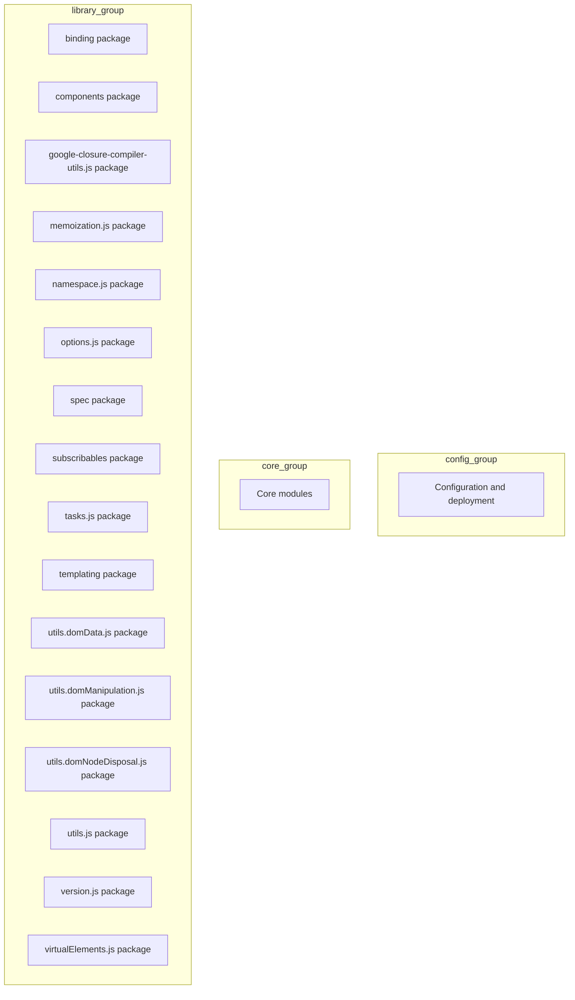

# Architecture report: knockout/knockout

> Automated static analysis. **Observed** = directly seen in files/imports/AST; **Inferred** = interpretation from that evidence. Repository code was not executed.

## 1. Repository at a glance

| Item | Value |
| --- | --- |
| Repository | knockout/knockout |
| Description | Knockout makes it easier to create rich, responsive UIs with JavaScript |
| Language | JavaScript |
| Stars | 10566 |
| Licence | Other |
| Analysed commit / branch | ab1f4b0e25c93ca2027bca84437ba5ec5e410b18 / master |
| Framework(s) | None detected |
| Files analysed | 145 |
| Components | 18 |

## 2. Architecture in one minute

knockout/knockout - Knockout makes it easier to create rich, responsive UIs with JavaScript. This repository was analysed statically from 145 file(s) (0 Python). Detected technologies (observed from imports/manifests): TypeScript. Files are grouped into 18 component(s): binding package, components package, Configuration and deployment, Core modules, google-closure-compiler-utils.js package, memoization.js package, namespace.js package, options.js package. Findings below distinguish observed facts from inferred interpretation.

## 3. High-level block diagram

## 4. Main components

### binding package (`binding`)

- **Kind:** library
- **Status:** Observed
- **Confidence:** 0.85
- **Responsibility:** Groups 27 file(s) under binding package (observed from repository paths and static analysis).
- **Paths:** `src/binding/bindingAttributeSyntax.js`, `src/binding/bindingProvider.js`, `src/binding/defaultBindings/attr.js`, `src/binding/defaultBindings/checked.js`, `src/binding/defaultBindings/click.js`, `src/binding/defaultBindings/css.js`, `src/binding/defaultBindings/enableDisable.js`, `src/binding/defaultBindings/event.js`, `src/binding/defaultBindings/foreach.js`, `src/binding/defaultBindings/hasfocus.js`, `src/binding/defaultBindings/html.js`, `src/binding/defaultBindings/ifIfnotWith.js`, `src/binding/defaultBindings/let.js`, `src/binding/defaultBindings/options.js`, `src/binding/defaultBindings/selectedOptions.js`, `src/binding/defaultBindings/style.js`, `src/binding/defaultBindings/submit.js`, `src/binding/defaultBindings/text.js`, `src/binding/defaultBindings/textInput.js`, `src/binding/defaultBindings/uniqueName.js`, `src/binding/defaultBindings/using.js`, `src/binding/defaultBindings/value.js`, `src/binding/defaultBindings/visibleHidden.js`, `src/binding/editDetection/arrayToDomNodeChildren.js`, `src/binding/editDetection/compareArrays.js`, `src/binding/expressionRewriting.js`, `src/binding/selectExtensions.js`
- **Evidence:** [src/binding/bindingAttributeSyntax.js](https://github.com/knockout/knockout/blob/ab1f4b0e25c93ca2027bca84437ba5ec5e410b18/src/binding/bindingAttributeSyntax.js); [src/binding/bindingProvider.js](https://github.com/knockout/knockout/blob/ab1f4b0e25c93ca2027bca84437ba5ec5e410b18/src/binding/bindingProvider.js); [src/binding/defaultBindings/attr.js](https://github.com/knockout/knockout/blob/ab1f4b0e25c93ca2027bca84437ba5ec5e410b18/src/binding/defaultBindings/attr.js); [src/binding/defaultBindings/checked.js](https://github.com/knockout/knockout/blob/ab1f4b0e25c93ca2027bca84437ba5ec5e410b18/src/binding/defaultBindings/checked.js); [src/binding/defaultBindings/click.js](https://github.com/knockout/knockout/blob/ab1f4b0e25c93ca2027bca84437ba5ec5e410b18/src/binding/defaultBindings/click.js); [src/binding/defaultBindings/css.js](https://github.com/knockout/knockout/blob/ab1f4b0e25c93ca2027bca84437ba5ec5e410b18/src/binding/defaultBindings/css.js); [src/binding/defaultBindings/enableDisable.js](https://github.com/knockout/knockout/blob/ab1f4b0e25c93ca2027bca84437ba5ec5e410b18/src/binding/defaultBindings/enableDisable.js); [src/binding/defaultBindings/event.js](https://github.com/knockout/knockout/blob/ab1f4b0e25c93ca2027bca84437ba5ec5e410b18/src/binding/defaultBindings/event.js)

### components package (`components`)

- **Kind:** library
- **Status:** Observed
- **Confidence:** 0.85
- **Responsibility:** Groups 4 file(s) under components package (observed from repository paths and static analysis).
- **Paths:** `src/components/componentBinding.js`, `src/components/customElements.js`, `src/components/defaultLoader.js`, `src/components/loaderRegistry.js`
- **Evidence:** [src/components/componentBinding.js](https://github.com/knockout/knockout/blob/ab1f4b0e25c93ca2027bca84437ba5ec5e410b18/src/components/componentBinding.js); [src/components/customElements.js](https://github.com/knockout/knockout/blob/ab1f4b0e25c93ca2027bca84437ba5ec5e410b18/src/components/customElements.js); [src/components/defaultLoader.js](https://github.com/knockout/knockout/blob/ab1f4b0e25c93ca2027bca84437ba5ec5e410b18/src/components/defaultLoader.js); [src/components/loaderRegistry.js](https://github.com/knockout/knockout/blob/ab1f4b0e25c93ca2027bca84437ba5ec5e410b18/src/components/loaderRegistry.js)

### Configuration and deployment (`config`)

- **Kind:** config
- **Status:** Observed
- **Confidence:** 0.85
- **Responsibility:** Groups 4 file(s) under configuration and deployment (observed from repository paths and static analysis).
- **Paths:** `bower.json`, `package.json`, `spec/types/global/tsconfig.json`, `spec/types/module/tsconfig.json`
- **Evidence:** [bower.json](https://github.com/knockout/knockout/blob/ab1f4b0e25c93ca2027bca84437ba5ec5e410b18/bower.json); [package.json](https://github.com/knockout/knockout/blob/ab1f4b0e25c93ca2027bca84437ba5ec5e410b18/package.json); [spec/types/global/tsconfig.json](https://github.com/knockout/knockout/blob/ab1f4b0e25c93ca2027bca84437ba5ec5e410b18/spec/types/global/tsconfig.json); [spec/types/module/tsconfig.json](https://github.com/knockout/knockout/blob/ab1f4b0e25c93ca2027bca84437ba5ec5e410b18/spec/types/module/tsconfig.json)

### Core modules (`core`)

- **Kind:** core
- **Status:** Observed
- **Confidence:** 0.85
- **Responsibility:** Groups 1 file(s) under core modules (observed from repository paths and static analysis).
- **Paths:** `Gruntfile.js`
- **Evidence:** [Gruntfile.js](https://github.com/knockout/knockout/blob/ab1f4b0e25c93ca2027bca84437ba5ec5e410b18/Gruntfile.js)

### google-closure-compiler-utils.js package (`google_closure_compiler_utils_js`)

- **Kind:** library
- **Status:** Observed
- **Confidence:** 0.85
- **Responsibility:** Groups 1 file(s) under google-closure-compiler-utils.js package (observed from repository paths and static analysis).
- **Paths:** `src/google-closure-compiler-utils.js`
- **Evidence:** [src/google-closure-compiler-utils.js](https://github.com/knockout/knockout/blob/ab1f4b0e25c93ca2027bca84437ba5ec5e410b18/src/google-closure-compiler-utils.js)

### memoization.js package (`memoization_js`)

- **Kind:** library
- **Status:** Observed
- **Confidence:** 0.85
- **Responsibility:** Groups 1 file(s) under memoization.js package (observed from repository paths and static analysis).
- **Paths:** `src/memoization.js`
- **Evidence:** [src/memoization.js](https://github.com/knockout/knockout/blob/ab1f4b0e25c93ca2027bca84437ba5ec5e410b18/src/memoization.js)

### namespace.js package (`namespace_js`)

- **Kind:** library
- **Status:** Observed
- **Confidence:** 0.85
- **Responsibility:** Groups 1 file(s) under namespace.js package (observed from repository paths and static analysis).
- **Paths:** `src/namespace.js`
- **Evidence:** [src/namespace.js](https://github.com/knockout/knockout/blob/ab1f4b0e25c93ca2027bca84437ba5ec5e410b18/src/namespace.js)

### options.js package (`options_js`)

- **Kind:** library
- **Status:** Observed
- **Confidence:** 0.85
- **Responsibility:** Groups 1 file(s) under options.js package (observed from repository paths and static analysis).
- **Paths:** `src/options.js`
- **Evidence:** [src/options.js](https://github.com/knockout/knockout/blob/ab1f4b0e25c93ca2027bca84437ba5ec5e410b18/src/options.js)

### spec package (`spec`)

- **Kind:** library
- **Status:** Observed
- **Confidence:** 0.85
- **Responsibility:** Groups 72 file(s) under spec package (observed from repository paths and static analysis).
- **Paths:** `spec/arrayEditDetectionBehaviors.js`, `spec/arrayToDomEditDetectionBehaviors.js`, `spec/asyncBehaviors.js`, `spec/asyncBindingBehaviors.js`, `spec/bindingAttributeBehaviors.js`, `spec/bindingDependencyBehaviors.js`, `spec/bindingPreprocessingBehaviors.js`, `spec/components/componentBindingBehaviors.js`, `spec/components/customElementBehaviors.js`, `spec/components/defaultLoaderBehaviors.js`, `spec/components/loaderRegistryBehaviors.js`, `spec/crossWindowBehaviors.js`, `spec/defaultBindings/attrBehaviors.js`, `spec/defaultBindings/checkedBehaviors.js`, `spec/defaultBindings/clickBehaviors.js`, `spec/defaultBindings/cssBehaviors.js`, `spec/defaultBindings/enableDisableBehaviors.js`, `spec/defaultBindings/eventBehaviors.js`, `spec/defaultBindings/foreachBehaviors.js`, `spec/defaultBindings/hasfocusBehaviors.js`, `spec/defaultBindings/htmlBehaviors.js`, `spec/defaultBindings/ifBehaviors.js`, `spec/defaultBindings/ifnotBehaviors.js`, `spec/defaultBindings/letBehaviors.js`, `spec/defaultBindings/optionsBehaviors.js`, `spec/defaultBindings/selectedOptionsBehaviors.js`, `spec/defaultBindings/styleBehaviors.js`, `spec/defaultBindings/submitBehaviors.js`, `spec/defaultBindings/textBehaviors.js`, `spec/defaultBindings/textInputBehaviors.js`, `spec/defaultBindings/uniqueNameBehaviors.js`, `spec/defaultBindings/usingBehaviors.js`, `spec/defaultBindings/valueBehaviors.js`, `spec/defaultBindings/visibleHiddenBehaviors.js`, `spec/defaultBindings/withBehaviors.js`, `spec/dependentObservableBehaviors.js`, `spec/dependentObservableDomBehaviors.js`, `spec/domNodeDisposalBehaviors.js`, `spec/expressionRewritingBehaviors.js`, `spec/extenderBehaviors.js`, `spec/jsonPostingBehaviors.js`, `spec/lib/innershiv.js`, `spec/lib/jasmine-1.2.0/jasmine-html.js`, `spec/lib/jasmine-1.2.0/jasmine-tap.js`, `spec/lib/jasmine-1.2.0/jasmine.js`, `spec/lib/jasmine-results.js`, `spec/lib/jasmine.extensions.js`, `spec/lib/json2.js`, `spec/lib/loadDependencies.js`, `spec/mappingHelperBehaviors.js`, `spec/memoizationBehaviors.js`, `spec/nativeTemplateEngineBehaviors.js`, `spec/nodePreprocessingBehaviors.js`, `spec/observableArrayBehaviors.js`, `spec/observableArrayChangeTrackingBehaviors.js`, `spec/observableBehaviors.js`, `spec/observableUtilsBehaviors.js`, `spec/onErrorBehaviors.js`, `spec/parseHtmlFragment.js`, `spec/pureComputedBehaviors.js`, `spec/runner.e2e.js`, `spec/runner.node.js`, `spec/runner.puppeteer.js`, `spec/subscribableBehaviors.js`, `spec/taskBehaviors.js`, `spec/templatingBehaviors.js`, `spec/types/global/_references.d.ts`, `spec/types/global/test-global.ts`, `spec/types/module/test-module.ts`, `spec/types/module/test-readonly.ts`, `spec/utilsBehaviors.js`, `spec/utilsDomBehaviors.js`
- **Evidence:** [spec/arrayEditDetectionBehaviors.js](https://github.com/knockout/knockout/blob/ab1f4b0e25c93ca2027bca84437ba5ec5e410b18/spec/arrayEditDetectionBehaviors.js); [spec/arrayToDomEditDetectionBehaviors.js](https://github.com/knockout/knockout/blob/ab1f4b0e25c93ca2027bca84437ba5ec5e410b18/spec/arrayToDomEditDetectionBehaviors.js); [spec/asyncBehaviors.js](https://github.com/knockout/knockout/blob/ab1f4b0e25c93ca2027bca84437ba5ec5e410b18/spec/asyncBehaviors.js); [spec/asyncBindingBehaviors.js](https://github.com/knockout/knockout/blob/ab1f4b0e25c93ca2027bca84437ba5ec5e410b18/spec/asyncBindingBehaviors.js); [spec/bindingAttributeBehaviors.js](https://github.com/knockout/knockout/blob/ab1f4b0e25c93ca2027bca84437ba5ec5e410b18/spec/bindingAttributeBehaviors.js); [spec/bindingDependencyBehaviors.js](https://github.com/knockout/knockout/blob/ab1f4b0e25c93ca2027bca84437ba5ec5e410b18/spec/bindingDependencyBehaviors.js); [spec/bindingPreprocessingBehaviors.js](https://github.com/knockout/knockout/blob/ab1f4b0e25c93ca2027bca84437ba5ec5e410b18/spec/bindingPreprocessingBehaviors.js); [spec/components/componentBindingBehaviors.js](https://github.com/knockout/knockout/blob/ab1f4b0e25c93ca2027bca84437ba5ec5e410b18/spec/components/componentBindingBehaviors.js)

### subscribables package (`subscribables`)

- **Kind:** library
- **Status:** Observed
- **Confidence:** 0.85
- **Responsibility:** Groups 9 file(s) under subscribables package (observed from repository paths and static analysis).
- **Paths:** `src/subscribables/dependencyDetection.js`, `src/subscribables/dependentObservable.js`, `src/subscribables/extenders.js`, `src/subscribables/mappingHelpers.js`, `src/subscribables/observable.js`, `src/subscribables/observableArray.changeTracking.js`, `src/subscribables/observableArray.js`, `src/subscribables/observableUtils.js`, `src/subscribables/subscribable.js`
- **Evidence:** [src/subscribables/dependencyDetection.js](https://github.com/knockout/knockout/blob/ab1f4b0e25c93ca2027bca84437ba5ec5e410b18/src/subscribables/dependencyDetection.js); [src/subscribables/dependentObservable.js](https://github.com/knockout/knockout/blob/ab1f4b0e25c93ca2027bca84437ba5ec5e410b18/src/subscribables/dependentObservable.js); [src/subscribables/extenders.js](https://github.com/knockout/knockout/blob/ab1f4b0e25c93ca2027bca84437ba5ec5e410b18/src/subscribables/extenders.js); [src/subscribables/mappingHelpers.js](https://github.com/knockout/knockout/blob/ab1f4b0e25c93ca2027bca84437ba5ec5e410b18/src/subscribables/mappingHelpers.js); [src/subscribables/observable.js](https://github.com/knockout/knockout/blob/ab1f4b0e25c93ca2027bca84437ba5ec5e410b18/src/subscribables/observable.js); [src/subscribables/observableArray.changeTracking.js](https://github.com/knockout/knockout/blob/ab1f4b0e25c93ca2027bca84437ba5ec5e410b18/src/subscribables/observableArray.changeTracking.js); [src/subscribables/observableArray.js](https://github.com/knockout/knockout/blob/ab1f4b0e25c93ca2027bca84437ba5ec5e410b18/src/subscribables/observableArray.js); [src/subscribables/observableUtils.js](https://github.com/knockout/knockout/blob/ab1f4b0e25c93ca2027bca84437ba5ec5e410b18/src/subscribables/observableUtils.js)

### tasks.js package (`tasks_js`)

- **Kind:** library
- **Status:** Observed
- **Confidence:** 0.85
- **Responsibility:** Groups 1 file(s) under tasks.js package (observed from repository paths and static analysis).
- **Paths:** `src/tasks.js`
- **Evidence:** [src/tasks.js](https://github.com/knockout/knockout/blob/ab1f4b0e25c93ca2027bca84437ba5ec5e410b18/src/tasks.js)

### templating package (`templating`)

- **Kind:** library
- **Status:** Observed
- **Confidence:** 0.85
- **Responsibility:** Groups 6 file(s) under templating package (observed from repository paths and static analysis).
- **Paths:** `src/templating/jquery.tmpl/jqueryTmplTemplateEngine.js`, `src/templating/native/nativeTemplateEngine.js`, `src/templating/templateEngine.js`, `src/templating/templateRewriting.js`, `src/templating/templateSources.js`, `src/templating/templating.js`
- **Evidence:** [src/templating/jquery.tmpl/jqueryTmplTemplateEngine.js](https://github.com/knockout/knockout/blob/ab1f4b0e25c93ca2027bca84437ba5ec5e410b18/src/templating/jquery.tmpl/jqueryTmplTemplateEngine.js); [src/templating/native/nativeTemplateEngine.js](https://github.com/knockout/knockout/blob/ab1f4b0e25c93ca2027bca84437ba5ec5e410b18/src/templating/native/nativeTemplateEngine.js); [src/templating/templateEngine.js](https://github.com/knockout/knockout/blob/ab1f4b0e25c93ca2027bca84437ba5ec5e410b18/src/templating/templateEngine.js); [src/templating/templateRewriting.js](https://github.com/knockout/knockout/blob/ab1f4b0e25c93ca2027bca84437ba5ec5e410b18/src/templating/templateRewriting.js); [src/templating/templateSources.js](https://github.com/knockout/knockout/blob/ab1f4b0e25c93ca2027bca84437ba5ec5e410b18/src/templating/templateSources.js); [src/templating/templating.js](https://github.com/knockout/knockout/blob/ab1f4b0e25c93ca2027bca84437ba5ec5e410b18/src/templating/templating.js)

### utils.domData.js package (`utils_domdata_js`)

- **Kind:** library
- **Status:** Observed
- **Confidence:** 0.85
- **Responsibility:** Groups 1 file(s) under utils.domdata.js package (observed from repository paths and static analysis).
- **Paths:** `src/utils.domData.js`
- **Evidence:** [src/utils.domData.js](https://github.com/knockout/knockout/blob/ab1f4b0e25c93ca2027bca84437ba5ec5e410b18/src/utils.domData.js)

### utils.domManipulation.js package (`utils_dommanipulation_js`)

- **Kind:** library
- **Status:** Observed
- **Confidence:** 0.85
- **Responsibility:** Groups 1 file(s) under utils.dommanipulation.js package (observed from repository paths and static analysis).
- **Paths:** `src/utils.domManipulation.js`
- **Evidence:** [src/utils.domManipulation.js](https://github.com/knockout/knockout/blob/ab1f4b0e25c93ca2027bca84437ba5ec5e410b18/src/utils.domManipulation.js)

### utils.domNodeDisposal.js package (`utils_domnodedisposal_js`)

- **Kind:** library
- **Status:** Observed
- **Confidence:** 0.85
- **Responsibility:** Groups 1 file(s) under utils.domnodedisposal.js package (observed from repository paths and static analysis).
- **Paths:** `src/utils.domNodeDisposal.js`
- **Evidence:** [src/utils.domNodeDisposal.js](https://github.com/knockout/knockout/blob/ab1f4b0e25c93ca2027bca84437ba5ec5e410b18/src/utils.domNodeDisposal.js)

### utils.js package (`utils_js`)

- **Kind:** library
- **Status:** Observed
- **Confidence:** 0.85
- **Responsibility:** Groups 1 file(s) under utils.js package (observed from repository paths and static analysis).
- **Paths:** `src/utils.js`
- **Evidence:** [src/utils.js](https://github.com/knockout/knockout/blob/ab1f4b0e25c93ca2027bca84437ba5ec5e410b18/src/utils.js)

### version.js package (`version_js`)

- **Kind:** library
- **Status:** Observed
- **Confidence:** 0.85
- **Responsibility:** Groups 1 file(s) under version.js package (observed from repository paths and static analysis).
- **Paths:** `src/version.js`
- **Evidence:** [src/version.js](https://github.com/knockout/knockout/blob/ab1f4b0e25c93ca2027bca84437ba5ec5e410b18/src/version.js)

### virtualElements.js package (`virtualelements_js`)

- **Kind:** library
- **Status:** Observed
- **Confidence:** 0.85
- **Responsibility:** Groups 1 file(s) under virtualelements.js package (observed from repository paths and static analysis).
- **Paths:** `src/virtualElements.js`
- **Evidence:** [src/virtualElements.js](https://github.com/knockout/knockout/blob/ab1f4b0e25c93ca2027bca84437ba5ec5e410b18/src/virtualElements.js)

## 5. Execution flow

No entry point was observed; the startup flow below is therefore limited.

Representative flow (derived from observed entry points and the import graph; steps beyond the entry point are **Inferred**):

1. Execution starts at an observed entry point listed above, if present.
2. No internal import relationships between components were observed.

## 6. Project structure

### `(root)`

- `.gitignore` - other (160 bytes)
- `.npmignore` - other (207 bytes)
- `.travis.yml` - ci, YAML (64 bytes)
- `Gruntfile.js` - source, JavaScript (7426 bytes)
- `LICENSE` - docs (1205 bytes)
- `README.md` - docs (2489 bytes)
- `bower.json` - config (444 bytes)
- `package.json` - manifest (1411 bytes)

### `spec`

- `spec/arrayEditDetectionBehaviors.js` - source, JavaScript (5144 bytes)
- `spec/arrayToDomEditDetectionBehaviors.js` - source, JavaScript (11768 bytes)
- `spec/asyncBehaviors.js` - source, JavaScript (57724 bytes)
- `spec/asyncBindingBehaviors.js` - source, JavaScript (12405 bytes)
- `spec/bindingAttributeBehaviors.js` - source, JavaScript (38547 bytes)
- `spec/bindingDependencyBehaviors.js` - source, JavaScript (27976 bytes)
- `spec/bindingPreprocessingBehaviors.js` - source, JavaScript (2870 bytes)
- `spec/blank.html` - other (55 bytes)
- `spec/components/componentBindingBehaviors.js` - source, JavaScript (49425 bytes)
- `spec/components/customElementBehaviors.js` - source, JavaScript (27117 bytes)
- `spec/components/defaultLoaderBehaviors.js` - source, JavaScript (22750 bytes)
- `spec/components/loaderRegistryBehaviors.js` - source, JavaScript (17041 bytes)
- `spec/crossWindowBehaviors.js` - source, JavaScript (3278 bytes)
- `spec/defaultBindings/attrBehaviors.js` - source, JavaScript (4989 bytes)
- `spec/defaultBindings/checkedBehaviors.js` - source, JavaScript (27004 bytes)
- `spec/defaultBindings/clickBehaviors.js` - source, JavaScript (830 bytes)
- `spec/defaultBindings/cssBehaviors.js` - source, JavaScript (6967 bytes)
- `spec/defaultBindings/enableDisableBehaviors.js` - source, JavaScript (1651 bytes)
- `spec/defaultBindings/eventBehaviors.js` - source, JavaScript (4627 bytes)
- `spec/defaultBindings/foreachBehaviors.js` - source, JavaScript (59821 bytes)
- `spec/defaultBindings/hasfocusBehaviors.js` - source, JavaScript (4921 bytes)
- `spec/defaultBindings/htmlBehaviors.js` - source, JavaScript (3407 bytes)
- `spec/defaultBindings/ifBehaviors.js` - source, JavaScript (13967 bytes)
- `spec/defaultBindings/ifnotBehaviors.js` - source, JavaScript (11623 bytes)
- `spec/defaultBindings/letBehaviors.js` - source, JavaScript (1646 bytes)
- `spec/defaultBindings/optionsBehaviors.js` - source, JavaScript (16493 bytes)
- `spec/defaultBindings/selectedOptionsBehaviors.js` - source, JavaScript (11222 bytes)
- `spec/defaultBindings/styleBehaviors.js` - source, JavaScript (4330 bytes)
- `spec/defaultBindings/submitBehaviors.js` - source, JavaScript (748 bytes)
- `spec/defaultBindings/textBehaviors.js` - source, JavaScript (4263 bytes)
- `spec/defaultBindings/textInputBehaviors.js` - source, JavaScript (16419 bytes)
- `spec/defaultBindings/uniqueNameBehaviors.js` - source, JavaScript (554 bytes)
- `spec/defaultBindings/usingBehaviors.js` - source, JavaScript (16254 bytes)
- `spec/defaultBindings/valueBehaviors.js` - source, JavaScript (42846 bytes)
- `spec/defaultBindings/visibleHiddenBehaviors.js` - source, JavaScript (1733 bytes)
- `spec/defaultBindings/withBehaviors.js` - source, JavaScript (34986 bytes)
- `spec/dependentObservableBehaviors.js` - source, JavaScript (33110 bytes)
- `spec/dependentObservableDomBehaviors.js` - source, JavaScript (3270 bytes)
- `spec/domNodeDisposalBehaviors.js` - source, JavaScript (9013 bytes)
- `spec/e2e-tests.html` - other (3554 bytes)
- `spec/expressionRewritingBehaviors.js` - source, JavaScript (11990 bytes)
- `spec/extenderBehaviors.js` - source, JavaScript (914 bytes)
- `spec/jsonPostingBehaviors.js` - source, JavaScript (3192 bytes)
- `spec/lib/innershiv.js` - source, JavaScript (1675 bytes)
- `spec/lib/jasmine-1.2.0/MIT.LICENSE` - other (1061 bytes)
- `spec/lib/jasmine-1.2.0/jasmine-html.js` - source, JavaScript (19065 bytes)
- `spec/lib/jasmine-1.2.0/jasmine-tap.js` - source, JavaScript (3514 bytes)
- `spec/lib/jasmine-1.2.0/jasmine.css` - other (6444 bytes)
- `spec/lib/jasmine-1.2.0/jasmine.js` - source, JavaScript (68776 bytes)
- `spec/lib/jasmine-results.js` - source, JavaScript (897 bytes)
- `spec/lib/jasmine.extensions.css` - other (64 bytes)
- `spec/lib/jasmine.extensions.js` - source, JavaScript (6246 bytes)
- `spec/lib/json2.js` - source, JavaScript (17382 bytes)
- `spec/lib/loadDependencies.js` - source, JavaScript (2412 bytes)
- `spec/mappingHelperBehaviors.js` - source, JavaScript (6267 bytes)
- `spec/memoizationBehaviors.js` - source, JavaScript (2243 bytes)
- `spec/nativeTemplateEngineBehaviors.js` - source, JavaScript (10503 bytes)
- `spec/nodePreprocessingBehaviors.js` - source, JavaScript (7200 bytes)
- `spec/observableArrayBehaviors.js` - source, JavaScript (16072 bytes)
- `spec/observableArrayChangeTrackingBehaviors.js` - source, JavaScript (25386 bytes)
- `spec/observableBehaviors.js` - source, JavaScript (13006 bytes)
- `spec/observableUtilsBehaviors.js` - source, JavaScript (3756 bytes)
- `spec/onErrorBehaviors.js` - source, JavaScript (3873 bytes)
- `spec/parseHtmlFragment.js` - source, JavaScript (5773 bytes)
- `spec/pureComputedBehaviors.js` - source, JavaScript (21845 bytes)
- `spec/runner.e2e.js` - source, JavaScript (5712 bytes)
- `spec/runner.html` - other (6415 bytes)
- `spec/runner.node.js` - source, JavaScript (2680 bytes)
- `spec/runner.puppeteer.js` - source, JavaScript (2292 bytes)
- `spec/subscribableBehaviors.js` - source, JavaScript (6732 bytes)
- `spec/taskBehaviors.js` - source, JavaScript (11385 bytes)
- `spec/templatingBehaviors.js` - source, JavaScript (73728 bytes)
- `spec/types/global/_references.d.ts` - source, TypeScript (1032 bytes)
- `spec/types/global/test-global.ts` - source, TypeScript (57552 bytes)
- `spec/types/global/tsconfig.json` - config (570 bytes)
- `spec/types/module/test-module.ts` - source, TypeScript (58783 bytes)
- `spec/types/module/test-readonly.ts` - source, TypeScript (4740 bytes)
- `spec/types/module/tsconfig.json` - config (569 bytes)
- `spec/utilsBehaviors.js` - source, JavaScript (14978 bytes)
- `spec/utilsDomBehaviors.js` - source, JavaScript (4651 bytes)

### `src`

- `src/binding/bindingAttributeSyntax.js` - source, JavaScript (31211 bytes)
- `src/binding/bindingProvider.js` - source, JavaScript (4059 bytes)
- `src/binding/defaultBindings/attr.js` - source, JavaScript (2652 bytes)
- `src/binding/defaultBindings/checked.js` - source, JavaScript (5876 bytes)
- `src/binding/defaultBindings/click.js` - source, JavaScript (114 bytes)
- `src/binding/defaultBindings/css.js` - source, JavaScript (1009 bytes)
- `src/binding/defaultBindings/enableDisable.js` - source, JavaScript (549 bytes)
- `src/binding/defaultBindings/event.js` - source, JavaScript (2440 bytes)
- `src/binding/defaultBindings/foreach.js` - source, JavaScript (2418 bytes)
- `src/binding/defaultBindings/hasfocus.js` - source, JavaScript (3501 bytes)
- `src/binding/defaultBindings/html.js` - source, JavaScript (418 bytes)
- `src/binding/defaultBindings/ifIfnotWith.js` - source, JavaScript (3566 bytes)
- `src/binding/defaultBindings/let.js` - source, JavaScript (465 bytes)
- `src/binding/defaultBindings/options.js` - source, JavaScript (8784 bytes)
- `src/binding/defaultBindings/selectedOptions.js` - source, JavaScript (2119 bytes)
- `src/binding/defaultBindings/style.js` - source, JavaScript (1319 bytes)
- `src/binding/defaultBindings/submit.js` - source, JavaScript (894 bytes)
- `src/binding/defaultBindings/text.js` - source, JavaScript (551 bytes)
- `src/binding/defaultBindings/textInput.js` - source, JavaScript (10714 bytes)
- `src/binding/defaultBindings/uniqueName.js` - source, JavaScript (327 bytes)
- `src/binding/defaultBindings/using.js` - source, JavaScript (568 bytes)
- `src/binding/defaultBindings/value.js` - source, JavaScript (7218 bytes)
- `src/binding/defaultBindings/visibleHidden.js` - source, JavaScript (635 bytes)
- `src/binding/editDetection/arrayToDomNodeChildren.js` - source, JavaScript (12923 bytes)
- `src/binding/editDetection/compareArrays.js` - source, JavaScript (5086 bytes)
- `src/binding/expressionRewriting.js` - source, JavaScript (11870 bytes)
- `src/binding/selectExtensions.js` - source, JavaScript (4394 bytes)
- `src/components/componentBinding.js` - source, JavaScript (4941 bytes)
- `src/components/customElements.js` - source, JavaScript (6499 bytes)
- `src/components/defaultLoader.js` - source, JavaScript (10354 bytes)
- `src/components/loaderRegistry.js` - source, JavaScript (7393 bytes)
- `src/google-closure-compiler-utils.js` - source, JavaScript (626 bytes)
- `src/memoization.js` - source, JavaScript (3016 bytes)
- `src/namespace.js` - source, JavaScript (337 bytes)
- `src/options.js` - source, JavaScript (298 bytes)
- `src/subscribables/dependencyDetection.js` - source, JavaScript (2616 bytes)
- `src/subscribables/dependentObservable.js` - source, JavaScript (24671 bytes)
- `src/subscribables/extenders.js` - source, JavaScript (3960 bytes)
- `src/subscribables/mappingHelpers.js` - source, JavaScript (3922 bytes)
- `src/subscribables/observable.js` - source, JavaScript (3395 bytes)
- `src/subscribables/observableArray.changeTracking.js` - source, JavaScript (6710 bytes)
- `src/subscribables/observableArray.js` - source, JavaScript (5844 bytes)
- `src/subscribables/observableUtils.js` - source, JavaScript (718 bytes)
- `src/subscribables/subscribable.js` - source, JavaScript (7657 bytes)
- `src/tasks.js` - source, JavaScript (4082 bytes)
- `src/templating/jquery.tmpl/jqueryTmplTemplateEngine.js` - source, JavaScript (4321 bytes)
- `src/templating/native/nativeTemplateEngine.js` - source, JavaScript (1052 bytes)
- `src/templating/templateEngine.js` - source, JavaScript (3618 bytes)
- `src/templating/templateRewriting.js` - source, JavaScript (3871 bytes)
- `src/templating/templateSources.js` - source, JavaScript (7227 bytes)
- `src/templating/templating.js` - source, JavaScript (20596 bytes)
- `src/utils.domData.js` - source, JavaScript (3316 bytes)
- `src/utils.domManipulation.js` - source, JavaScript (6826 bytes)
- `src/utils.domNodeDisposal.js` - source, JavaScript (4686 bytes)
- `src/utils.js` - source, JavaScript (30845 bytes)
- `src/version.js` - source, JavaScript (69 bytes)
- `src/virtualElements.js` - source, JavaScript (11160 bytes)

## 7. Key dependencies and integrations

| Name | Category | Status | Confidence | Evidence |
| --- | --- | --- | --- | --- |
| TypeScript | tooling | Observed | 0.85 | [package.json:46](https://github.com/knockout/knockout/blob/ab1f4b0e25c93ca2027bca84437ba5ec5e410b18/package.json#L46) |

## 8. Data and state

No database, cache, queue, or persistent-state usage was observed in the analysed files. State handling, if any, may be in-memory or in files that were not analysed.

## 9. Configuration and deployment clues

- `.travis.yml` (ci)
- `bower.json` (config)
- `package.json` (manifest)
- `spec/types/global/tsconfig.json` (config)
- `spec/types/module/tsconfig.json` (config)

## 10. Design observations

- No strong design patterns could be established from the available evidence.

These observations are interpretations (**Inferred**) of the observed structure, not guarantees about runtime design.

## 11. Limitations and unknowns

- Static analysis only: repository code was not executed, installed, or imported at runtime.
- Components and relationships are inferred from file paths, imports, and AST structure; runtime behaviour, dynamic imports, and reflection may not be visible.
- 11 file(s) were skipped during inventory (1 x lockfile excluded; 10 x vendored/generated directory excluded).
- No clear application entry point was observed in the analysed files.
- Repository text was treated as untrusted data; no instructions found in repository files were followed, and likely secret values were redacted/excluded.
- JavaScript and TypeScript files were inventoried from paths and package manifests. They were not parsed with a full language AST, and repository code was not executed.

## 12. Source references

- [Gruntfile.js](https://github.com/knockout/knockout/blob/ab1f4b0e25c93ca2027bca84437ba5ec5e410b18/Gruntfile.js)
- [bower.json](https://github.com/knockout/knockout/blob/ab1f4b0e25c93ca2027bca84437ba5ec5e410b18/bower.json)
- [package.json](https://github.com/knockout/knockout/blob/ab1f4b0e25c93ca2027bca84437ba5ec5e410b18/package.json)
- [package.json:46](https://github.com/knockout/knockout/blob/ab1f4b0e25c93ca2027bca84437ba5ec5e410b18/package.json#L46)
- [spec/arrayEditDetectionBehaviors.js](https://github.com/knockout/knockout/blob/ab1f4b0e25c93ca2027bca84437ba5ec5e410b18/spec/arrayEditDetectionBehaviors.js)
- [spec/arrayToDomEditDetectionBehaviors.js](https://github.com/knockout/knockout/blob/ab1f4b0e25c93ca2027bca84437ba5ec5e410b18/spec/arrayToDomEditDetectionBehaviors.js)
- [spec/asyncBehaviors.js](https://github.com/knockout/knockout/blob/ab1f4b0e25c93ca2027bca84437ba5ec5e410b18/spec/asyncBehaviors.js)
- [spec/asyncBindingBehaviors.js](https://github.com/knockout/knockout/blob/ab1f4b0e25c93ca2027bca84437ba5ec5e410b18/spec/asyncBindingBehaviors.js)
- [spec/bindingAttributeBehaviors.js](https://github.com/knockout/knockout/blob/ab1f4b0e25c93ca2027bca84437ba5ec5e410b18/spec/bindingAttributeBehaviors.js)
- [spec/bindingDependencyBehaviors.js](https://github.com/knockout/knockout/blob/ab1f4b0e25c93ca2027bca84437ba5ec5e410b18/spec/bindingDependencyBehaviors.js)
- [spec/bindingPreprocessingBehaviors.js](https://github.com/knockout/knockout/blob/ab1f4b0e25c93ca2027bca84437ba5ec5e410b18/spec/bindingPreprocessingBehaviors.js)
- [spec/components/componentBindingBehaviors.js](https://github.com/knockout/knockout/blob/ab1f4b0e25c93ca2027bca84437ba5ec5e410b18/spec/components/componentBindingBehaviors.js)
- [spec/types/global/tsconfig.json](https://github.com/knockout/knockout/blob/ab1f4b0e25c93ca2027bca84437ba5ec5e410b18/spec/types/global/tsconfig.json)
- [spec/types/module/tsconfig.json](https://github.com/knockout/knockout/blob/ab1f4b0e25c93ca2027bca84437ba5ec5e410b18/spec/types/module/tsconfig.json)
- [src/binding/bindingAttributeSyntax.js](https://github.com/knockout/knockout/blob/ab1f4b0e25c93ca2027bca84437ba5ec5e410b18/src/binding/bindingAttributeSyntax.js)
- [src/binding/bindingProvider.js](https://github.com/knockout/knockout/blob/ab1f4b0e25c93ca2027bca84437ba5ec5e410b18/src/binding/bindingProvider.js)
- [src/binding/defaultBindings/attr.js](https://github.com/knockout/knockout/blob/ab1f4b0e25c93ca2027bca84437ba5ec5e410b18/src/binding/defaultBindings/attr.js)
- [src/binding/defaultBindings/checked.js](https://github.com/knockout/knockout/blob/ab1f4b0e25c93ca2027bca84437ba5ec5e410b18/src/binding/defaultBindings/checked.js)
- [src/binding/defaultBindings/click.js](https://github.com/knockout/knockout/blob/ab1f4b0e25c93ca2027bca84437ba5ec5e410b18/src/binding/defaultBindings/click.js)
- [src/binding/defaultBindings/css.js](https://github.com/knockout/knockout/blob/ab1f4b0e25c93ca2027bca84437ba5ec5e410b18/src/binding/defaultBindings/css.js)
- [src/binding/defaultBindings/enableDisable.js](https://github.com/knockout/knockout/blob/ab1f4b0e25c93ca2027bca84437ba5ec5e410b18/src/binding/defaultBindings/enableDisable.js)
- [src/binding/defaultBindings/event.js](https://github.com/knockout/knockout/blob/ab1f4b0e25c93ca2027bca84437ba5ec5e410b18/src/binding/defaultBindings/event.js)
- [src/components/componentBinding.js](https://github.com/knockout/knockout/blob/ab1f4b0e25c93ca2027bca84437ba5ec5e410b18/src/components/componentBinding.js)
- [src/components/customElements.js](https://github.com/knockout/knockout/blob/ab1f4b0e25c93ca2027bca84437ba5ec5e410b18/src/components/customElements.js)
- [src/components/defaultLoader.js](https://github.com/knockout/knockout/blob/ab1f4b0e25c93ca2027bca84437ba5ec5e410b18/src/components/defaultLoader.js)
- [src/components/loaderRegistry.js](https://github.com/knockout/knockout/blob/ab1f4b0e25c93ca2027bca84437ba5ec5e410b18/src/components/loaderRegistry.js)
- [src/google-closure-compiler-utils.js](https://github.com/knockout/knockout/blob/ab1f4b0e25c93ca2027bca84437ba5ec5e410b18/src/google-closure-compiler-utils.js)
- [src/memoization.js](https://github.com/knockout/knockout/blob/ab1f4b0e25c93ca2027bca84437ba5ec5e410b18/src/memoization.js)
- [src/namespace.js](https://github.com/knockout/knockout/blob/ab1f4b0e25c93ca2027bca84437ba5ec5e410b18/src/namespace.js)
- [src/options.js](https://github.com/knockout/knockout/blob/ab1f4b0e25c93ca2027bca84437ba5ec5e410b18/src/options.js)
- [src/subscribables/dependencyDetection.js](https://github.com/knockout/knockout/blob/ab1f4b0e25c93ca2027bca84437ba5ec5e410b18/src/subscribables/dependencyDetection.js)
- [src/subscribables/dependentObservable.js](https://github.com/knockout/knockout/blob/ab1f4b0e25c93ca2027bca84437ba5ec5e410b18/src/subscribables/dependentObservable.js)
- [src/subscribables/extenders.js](https://github.com/knockout/knockout/blob/ab1f4b0e25c93ca2027bca84437ba5ec5e410b18/src/subscribables/extenders.js)
- [src/subscribables/mappingHelpers.js](https://github.com/knockout/knockout/blob/ab1f4b0e25c93ca2027bca84437ba5ec5e410b18/src/subscribables/mappingHelpers.js)
- [src/subscribables/observable.js](https://github.com/knockout/knockout/blob/ab1f4b0e25c93ca2027bca84437ba5ec5e410b18/src/subscribables/observable.js)
- [src/subscribables/observableArray.changeTracking.js](https://github.com/knockout/knockout/blob/ab1f4b0e25c93ca2027bca84437ba5ec5e410b18/src/subscribables/observableArray.changeTracking.js)
- [src/subscribables/observableArray.js](https://github.com/knockout/knockout/blob/ab1f4b0e25c93ca2027bca84437ba5ec5e410b18/src/subscribables/observableArray.js)
- [src/subscribables/observableUtils.js](https://github.com/knockout/knockout/blob/ab1f4b0e25c93ca2027bca84437ba5ec5e410b18/src/subscribables/observableUtils.js)
- [src/tasks.js](https://github.com/knockout/knockout/blob/ab1f4b0e25c93ca2027bca84437ba5ec5e410b18/src/tasks.js)
- [src/templating/jquery.tmpl/jqueryTmplTemplateEngine.js](https://github.com/knockout/knockout/blob/ab1f4b0e25c93ca2027bca84437ba5ec5e410b18/src/templating/jquery.tmpl/jqueryTmplTemplateEngine.js)
- [src/templating/native/nativeTemplateEngine.js](https://github.com/knockout/knockout/blob/ab1f4b0e25c93ca2027bca84437ba5ec5e410b18/src/templating/native/nativeTemplateEngine.js)
- [src/templating/templateEngine.js](https://github.com/knockout/knockout/blob/ab1f4b0e25c93ca2027bca84437ba5ec5e410b18/src/templating/templateEngine.js)
- [src/templating/templateRewriting.js](https://github.com/knockout/knockout/blob/ab1f4b0e25c93ca2027bca84437ba5ec5e410b18/src/templating/templateRewriting.js)
- [src/templating/templateSources.js](https://github.com/knockout/knockout/blob/ab1f4b0e25c93ca2027bca84437ba5ec5e410b18/src/templating/templateSources.js)
- [src/templating/templating.js](https://github.com/knockout/knockout/blob/ab1f4b0e25c93ca2027bca84437ba5ec5e410b18/src/templating/templating.js)
- [src/utils.domData.js](https://github.com/knockout/knockout/blob/ab1f4b0e25c93ca2027bca84437ba5ec5e410b18/src/utils.domData.js)
- [src/utils.domManipulation.js](https://github.com/knockout/knockout/blob/ab1f4b0e25c93ca2027bca84437ba5ec5e410b18/src/utils.domManipulation.js)
- [src/utils.domNodeDisposal.js](https://github.com/knockout/knockout/blob/ab1f4b0e25c93ca2027bca84437ba5ec5e410b18/src/utils.domNodeDisposal.js)
- [src/utils.js](https://github.com/knockout/knockout/blob/ab1f4b0e25c93ca2027bca84437ba5ec5e410b18/src/utils.js)
- [src/version.js](https://github.com/knockout/knockout/blob/ab1f4b0e25c93ca2027bca84437ba5ec5e410b18/src/version.js)
- [src/virtualElements.js](https://github.com/knockout/knockout/blob/ab1f4b0e25c93ca2027bca84437ba5ec5e410b18/src/virtualElements.js)
