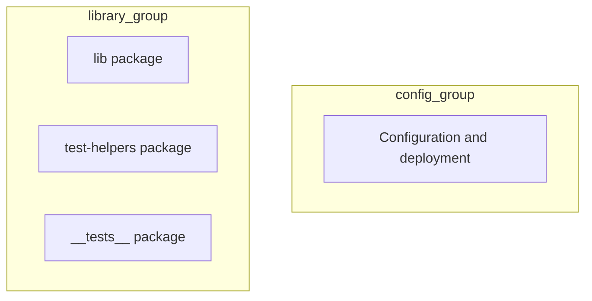

# Architecture report: koajs/koa

> Automated static analysis. **Observed** = directly seen in files/imports/AST; **Inferred** = interpretation from that evidence. Repository code was not executed.

## 1. Repository at a glance

| Item | Value |
| --- | --- |
| Repository | koajs/koa |
| Description | Expressive middleware for node.js using ES2017 async functions |
| Language | JavaScript |
| Stars | 35683 |
| Licence | MIT |
| Analysed commit / branch | 7c6bfe7744bbeaf021c2e17c0556f26c36a7d690 / master |
| Framework(s) | None detected |
| Files analysed | 108 |
| Components | 4 |

## 2. Architecture in one minute

koajs/koa - Expressive middleware for node.js using ES2017 async functions. This repository was analysed statically from 108 file(s) (0 Python). Detected technologies (observed from imports/manifests): GitHub Actions. Files are grouped into 4 component(s): Configuration and deployment, lib package, test-helpers package, __tests__ package. Findings below distinguish observed facts from inferred interpretation.

## 3. High-level block diagram

## 4. Main components

### Configuration and deployment (`config`)

- **Kind:** config
- **Status:** Observed
- **Confidence:** 0.85
- **Responsibility:** Groups 2 file(s) under configuration and deployment (observed from repository paths and static analysis).
- **Paths:** `__tests__/.eslintrc.yml`, `package.json`
- **Evidence:** [__tests__/.eslintrc.yml](https://github.com/koajs/koa/blob/7c6bfe7744bbeaf021c2e17c0556f26c36a7d690/__tests__/.eslintrc.yml); [package.json](https://github.com/koajs/koa/blob/7c6bfe7744bbeaf021c2e17c0556f26c36a7d690/package.json)

### lib package (`lib`)

- **Kind:** library
- **Status:** Observed
- **Confidence:** 0.85
- **Responsibility:** Groups 7 file(s) under lib package (observed from repository paths and static analysis).
- **Paths:** `lib/application.js`, `lib/context.js`, `lib/is-stream.js`, `lib/only.js`, `lib/request.js`, `lib/response.js`, `lib/search-params.js`
- **Evidence:** [lib/application.js](https://github.com/koajs/koa/blob/7c6bfe7744bbeaf021c2e17c0556f26c36a7d690/lib/application.js); [lib/context.js](https://github.com/koajs/koa/blob/7c6bfe7744bbeaf021c2e17c0556f26c36a7d690/lib/context.js); [lib/is-stream.js](https://github.com/koajs/koa/blob/7c6bfe7744bbeaf021c2e17c0556f26c36a7d690/lib/is-stream.js); [lib/only.js](https://github.com/koajs/koa/blob/7c6bfe7744bbeaf021c2e17c0556f26c36a7d690/lib/only.js); [lib/request.js](https://github.com/koajs/koa/blob/7c6bfe7744bbeaf021c2e17c0556f26c36a7d690/lib/request.js); [lib/response.js](https://github.com/koajs/koa/blob/7c6bfe7744bbeaf021c2e17c0556f26c36a7d690/lib/response.js); [lib/search-params.js](https://github.com/koajs/koa/blob/7c6bfe7744bbeaf021c2e17c0556f26c36a7d690/lib/search-params.js)

### test-helpers package (`test_helpers`)

- **Kind:** library
- **Status:** Observed
- **Confidence:** 0.85
- **Responsibility:** Groups 2 file(s) under test-helpers package (observed from repository paths and static analysis).
- **Paths:** `test-helpers/context.js`, `test-helpers/stream.js`
- **Evidence:** [test-helpers/context.js](https://github.com/koajs/koa/blob/7c6bfe7744bbeaf021c2e17c0556f26c36a7d690/test-helpers/context.js); [test-helpers/stream.js](https://github.com/koajs/koa/blob/7c6bfe7744bbeaf021c2e17c0556f26c36a7d690/test-helpers/stream.js)

### __tests__ package (`tests`)

- **Kind:** library
- **Status:** Observed
- **Confidence:** 0.85
- **Responsibility:** Groups 73 file(s) under __tests__ package (observed from repository paths and static analysis).
- **Paths:** `__tests__/application/compose.test.js`, `__tests__/application/context.test.js`, `__tests__/application/currentContext.test.js`, `__tests__/application/index.test.js`, `__tests__/application/inspect.test.js`, `__tests__/application/onerror.test.js`, `__tests__/application/request.test.js`, `__tests__/application/respond.test.js`, `__tests__/application/response.test.js`, `__tests__/application/toJSON.test.js`, `__tests__/application/use.test.js`, `__tests__/context/assert.test.js`, `__tests__/context/cookies.test.js`, `__tests__/context/inspect.test.js`, `__tests__/context/onerror.test.js`, `__tests__/context/state.test.js`, `__tests__/context/throw.test.js`, `__tests__/context/toJSON.test.js`, `__tests__/lib/search-params.test.js`, `__tests__/load-with-esm.test.js`, `__tests__/request/accept.test.js`, `__tests__/request/accepts.test.js`, `__tests__/request/acceptsCharsets.test.js`, `__tests__/request/acceptsEncodings.test.js`, `__tests__/request/acceptsLanguages.test.js`, `__tests__/request/charset.test.js`, `__tests__/request/fresh.test.js`, `__tests__/request/get.test.js`, `__tests__/request/header.test.js`, `__tests__/request/headers.test.js`, `__tests__/request/host.test.js`, `__tests__/request/hostname.test.js`, `__tests__/request/href.test.js`, `__tests__/request/idempotent.test.js`, `__tests__/request/inspect.test.js`, `__tests__/request/ip.test.js`, `__tests__/request/ips.test.js`, `__tests__/request/is.test.js`, `__tests__/request/length.test.js`, `__tests__/request/origin.test.js`, `__tests__/request/path.test.js`, `__tests__/request/protocol.test.js`, `__tests__/request/query.test.js`, `__tests__/request/querystring.test.js`, `__tests__/request/search.test.js`, `__tests__/request/secure.test.js`, `__tests__/request/stale.test.js`, `__tests__/request/subdomains.test.js`, `__tests__/request/type.test.js`, `__tests__/request/whatwg-url.test.js`, `__tests__/response/append.test.js`, `__tests__/response/attachment.test.js`, `__tests__/response/back.test.js`, `__tests__/response/body.test.js`, `__tests__/response/etag.test.js`, `__tests__/response/flushHeaders.test.js`, `__tests__/response/get.test.js`, `__tests__/response/has.test.js`, `__tests__/response/header.test.js`, `__tests__/response/headers.test.js`, `__tests__/response/inspect.test.js`, `__tests__/response/is.test.js`, `__tests__/response/last-modified.test.js`, `__tests__/response/length.test.js`, `__tests__/response/message.test.js`, `__tests__/response/redirect.test.js`, `__tests__/response/remove.test.js`, `__tests__/response/set.test.js`, `__tests__/response/socket.test.js`, `__tests__/response/status.test.js`, `__tests__/response/type.test.js`, `__tests__/response/vary.test.js`, `__tests__/response/writable.test.js`
- **Evidence:** [__tests__/application/compose.test.js](https://github.com/koajs/koa/blob/7c6bfe7744bbeaf021c2e17c0556f26c36a7d690/__tests__/application/compose.test.js); [__tests__/application/context.test.js](https://github.com/koajs/koa/blob/7c6bfe7744bbeaf021c2e17c0556f26c36a7d690/__tests__/application/context.test.js); [__tests__/application/currentContext.test.js](https://github.com/koajs/koa/blob/7c6bfe7744bbeaf021c2e17c0556f26c36a7d690/__tests__/application/currentContext.test.js); [__tests__/application/index.test.js](https://github.com/koajs/koa/blob/7c6bfe7744bbeaf021c2e17c0556f26c36a7d690/__tests__/application/index.test.js); [__tests__/application/inspect.test.js](https://github.com/koajs/koa/blob/7c6bfe7744bbeaf021c2e17c0556f26c36a7d690/__tests__/application/inspect.test.js); [__tests__/application/onerror.test.js](https://github.com/koajs/koa/blob/7c6bfe7744bbeaf021c2e17c0556f26c36a7d690/__tests__/application/onerror.test.js); [__tests__/application/request.test.js](https://github.com/koajs/koa/blob/7c6bfe7744bbeaf021c2e17c0556f26c36a7d690/__tests__/application/request.test.js); [__tests__/application/respond.test.js](https://github.com/koajs/koa/blob/7c6bfe7744bbeaf021c2e17c0556f26c36a7d690/__tests__/application/respond.test.js)

## 5. Execution flow

**Observed** entry point(s):

- [lib/application.js](https://github.com/koajs/koa/blob/7c6bfe7744bbeaf021c2e17c0556f26c36a7d690/lib/application.js)

Representative flow (derived from observed entry points and the import graph; steps beyond the entry point are **Inferred**):

1. Execution starts at an observed entry point listed above, if present.
2. No internal import relationships between components were observed.

## 6. Project structure

### `(root)`

- `.codecov.yml` - config (64 bytes)
- `.editorconfig` - config (238 bytes)
- `.gitignore` - other (61 bytes)
- `.mailmap` - other (51 bytes)
- `AUTHORS` - other (6486 bytes)
- `CODE_OF_CONDUCT.md` - docs (3228 bytes)
- `History.md` - docs (32681 bytes)
- `LICENSE` - docs (1079 bytes)
- `Readme.md` - docs (16969 bytes)
- `package.json` - manifest (1711 bytes)

### `.github`

- `.github/FUNDING.yml` - config (23 bytes)
- `.github/dependabot.yml` - config (279 bytes)
- `.github/workflows/node.js.yml` - ci, YAML (604 bytes)
- `.github/workflows/npm-publish.yml` - ci, YAML (1519 bytes)

### `__tests__`

- `__tests__/.eslintrc.yml` - config (291 bytes)
- `__tests__/application/compose.test.js` - source, JavaScript (1357 bytes)
- `__tests__/application/context.test.js` - source, JavaScript (747 bytes)
- `__tests__/application/currentContext.test.js` - source, JavaScript (5831 bytes)
- `__tests__/application/index.test.js` - source, JavaScript (3552 bytes)
- `__tests__/application/inspect.test.js` - source, JavaScript (571 bytes)
- `__tests__/application/onerror.test.js` - source, JavaScript (1545 bytes)
- `__tests__/application/request.test.js` - source, JavaScript (775 bytes)
- `__tests__/application/respond.test.js` - source, JavaScript (29633 bytes)
- `__tests__/application/response.test.js` - source, JavaScript (2919 bytes)
- `__tests__/application/toJSON.test.js` - source, JavaScript (380 bytes)
- `__tests__/application/use.test.js` - source, JavaScript (1871 bytes)
- `__tests__/context/assert.test.js` - source, JavaScript (4353 bytes)
- `__tests__/context/cookies.test.js` - source, JavaScript (2960 bytes)
- `__tests__/context/inspect.test.js` - source, JavaScript (786 bytes)
- `__tests__/context/onerror.test.js` - source, JavaScript (7066 bytes)
- `__tests__/context/state.test.js` - source, JavaScript (433 bytes)
- `__tests__/context/throw.test.js` - source, JavaScript (4018 bytes)
- `__tests__/context/toJSON.test.js` - source, JavaScript (874 bytes)
- `__tests__/lib/search-params.test.js` - source, JavaScript (2878 bytes)
- `__tests__/load-with-esm.test.js` - source, JavaScript (1313 bytes)
- `__tests__/request/accept.test.js` - source, JavaScript (931 bytes)
- `__tests__/request/accepts.test.js` - source, JavaScript (3506 bytes)
- `__tests__/request/acceptsCharsets.test.js` - source, JavaScript (1798 bytes)
- `__tests__/request/acceptsEncodings.test.js` - source, JavaScript (1564 bytes)
- `__tests__/request/acceptsLanguages.test.js` - source, JavaScript (1703 bytes)
- `__tests__/request/charset.test.js` - source, JavaScript (1021 bytes)
- `__tests__/request/fresh.test.js` - source, JavaScript (1371 bytes)
- `__tests__/request/get.test.js` - source, JavaScript (683 bytes)
- `__tests__/request/header.test.js` - source, JavaScript (567 bytes)
- `__tests__/request/headers.test.js` - source, JavaScript (571 bytes)
- `__tests__/request/host.test.js` - source, JavaScript (4328 bytes)
- `__tests__/request/hostname.test.js` - source, JavaScript (4433 bytes)
- `__tests__/request/href.test.js` - source, JavaScript (1147 bytes)
- `__tests__/request/idempotent.test.js` - source, JavaScript (753 bytes)
- `__tests__/request/inspect.test.js` - source, JavaScript (920 bytes)
- `__tests__/request/ip.test.js` - source, JavaScript (1996 bytes)
- `__tests__/request/ips.test.js` - source, JavaScript (2188 bytes)
- `__tests__/request/is.test.js` - source, JavaScript (3691 bytes)
- `__tests__/request/length.test.js` - source, JavaScript (1644 bytes)
- `__tests__/request/origin.test.js` - source, JavaScript (745 bytes)
- `__tests__/request/path.test.js` - source, JavaScript (1148 bytes)
- `__tests__/request/protocol.test.js` - source, JavaScript (1934 bytes)
- `__tests__/request/query.test.js` - source, JavaScript (3248 bytes)
- `__tests__/request/querystring.test.js` - source, JavaScript (1860 bytes)
- `__tests__/request/search.test.js` - source, JavaScript (1334 bytes)
- `__tests__/request/secure.test.js` - source, JavaScript (365 bytes)
- `__tests__/request/stale.test.js` - source, JavaScript (476 bytes)
- `__tests__/request/subdomains.test.js` - source, JavaScript (4031 bytes)
- `__tests__/request/type.test.js` - source, JavaScript (524 bytes)
- `__tests__/request/whatwg-url.test.js` - source, JavaScript (3227 bytes)
- `__tests__/response/append.test.js` - source, JavaScript (1287 bytes)
- `__tests__/response/attachment.test.js` - source, JavaScript (7913 bytes)
- `__tests__/response/back.test.js` - source, JavaScript (2160 bytes)
- `__tests__/response/body.test.js` - source, JavaScript (10626 bytes)
- `__tests__/response/etag.test.js` - source, JavaScript (854 bytes)
- `__tests__/response/flushHeaders.test.js` - source, JavaScript (4362 bytes)
- `__tests__/response/get.test.js` - source, JavaScript (1677 bytes)
- `__tests__/response/has.test.js` - source, JavaScript (619 bytes)
- `__tests__/response/header.test.js` - source, JavaScript (1299 bytes)
- `__tests__/response/headers.test.js` - source, JavaScript (596 bytes)
- `__tests__/response/inspect.test.js` - source, JavaScript (946 bytes)
- `__tests__/response/is.test.js` - source, JavaScript (3030 bytes)
- `__tests__/response/last-modified.test.js` - source, JavaScript (1130 bytes)
- `__tests__/response/length.test.js` - source, JavaScript (2158 bytes)
- `__tests__/response/message.test.js` - source, JavaScript (839 bytes)
- `__tests__/response/redirect.test.js` - source, JavaScript (3719 bytes)
- `__tests__/response/remove.test.js` - source, JavaScript (373 bytes)
- `__tests__/response/set.test.js` - source, JavaScript (3338 bytes)
- `__tests__/response/socket.test.js` - source, JavaScript (384 bytes)
- `__tests__/response/status.test.js` - source, JavaScript (3569 bytes)
- `__tests__/response/type.test.js` - source, JavaScript (2262 bytes)
- `__tests__/response/vary.test.js` - source, JavaScript (981 bytes)
- `__tests__/response/writable.test.js` - source, JavaScript (2904 bytes)

### `docs`

- `docs/api/context.md` - docs (7694 bytes)
- `docs/api/index.md` - docs (8657 bytes)
- `docs/api/request.md` - docs (10865 bytes)
- `docs/api/response.md` - docs (10313 bytes)
- `docs/error-handling.md` - docs (1942 bytes)
- `docs/faq.md` - docs (2069 bytes)
- `docs/guide.md` - docs (9027 bytes)
- `docs/koa-vs-express.md` - docs (3792 bytes)
- `docs/migration-v1-to-v2.md` - docs (3980 bytes)
- `docs/migration-v2-to-v3.md` - docs (4810 bytes)
- `docs/troubleshooting.md` - docs (6598 bytes)

### `lib`

- `lib/application.js` - source, JavaScript (9988 bytes)
- `lib/context.js` - source, JavaScript (5779 bytes)
- `lib/is-stream.js` - source, JavaScript (539 bytes)
- `lib/only.js` - source, JavaScript (195 bytes)
- `lib/request.js` - source, JavaScript (15982 bytes)
- `lib/response.js` - source, JavaScript (14197 bytes)
- `lib/search-params.js` - source, JavaScript (1058 bytes)

### `test-helpers`

- `test-helpers/context.js` - source, JavaScript (812 bytes)
- `test-helpers/stream.js` - source, JavaScript (308 bytes)

## 7. Key dependencies and integrations

| Name | Category | Status | Confidence | Evidence |
| --- | --- | --- | --- | --- |
| GitHub Actions | ci | Observed | 0.90 | [.github/workflows/node.js.yml](https://github.com/koajs/koa/blob/7c6bfe7744bbeaf021c2e17c0556f26c36a7d690/.github/workflows/node.js.yml); [.github/workflows/npm-publish.yml](https://github.com/koajs/koa/blob/7c6bfe7744bbeaf021c2e17c0556f26c36a7d690/.github/workflows/npm-publish.yml) |

## 8. Data and state

No database, cache, queue, or persistent-state usage was observed in the analysed files. State handling, if any, may be in-memory or in files that were not analysed.

## 9. Configuration and deployment clues

- `.codecov.yml` (config)
- `.editorconfig` (config)
- `.github/FUNDING.yml` (config)
- `.github/dependabot.yml` (config)
- `.github/workflows/node.js.yml` (ci)
- `.github/workflows/npm-publish.yml` (ci)
- `__tests__/.eslintrc.yml` (config)
- `package.json` (manifest)

## 10. Design observations

- No strong design patterns could be established from the available evidence.

These observations are interpretations (**Inferred**) of the observed structure, not guarantees about runtime design.

## 11. Limitations and unknowns

- Static analysis only: repository code was not executed, installed, or imported at runtime.
- Components and relationships are inferred from file paths, imports, and AST structure; runtime behaviour, dynamic imports, and reflection may not be visible.
- 1 file(s) were skipped during inventory (1 x lockfile excluded).
- No clear application entry point was observed in the analysed files.
- Repository text was treated as untrusted data; no instructions found in repository files were followed, and likely secret values were redacted/excluded.
- JavaScript and TypeScript files were inventoried from paths and package manifests. They were not parsed with a full language AST, and repository code was not executed.

## 12. Source references

- [.github/workflows/node.js.yml](https://github.com/koajs/koa/blob/7c6bfe7744bbeaf021c2e17c0556f26c36a7d690/.github/workflows/node.js.yml)
- [.github/workflows/npm-publish.yml](https://github.com/koajs/koa/blob/7c6bfe7744bbeaf021c2e17c0556f26c36a7d690/.github/workflows/npm-publish.yml)
- [__tests__/.eslintrc.yml](https://github.com/koajs/koa/blob/7c6bfe7744bbeaf021c2e17c0556f26c36a7d690/__tests__/.eslintrc.yml)
- [__tests__/application/compose.test.js](https://github.com/koajs/koa/blob/7c6bfe7744bbeaf021c2e17c0556f26c36a7d690/__tests__/application/compose.test.js)
- [__tests__/application/context.test.js](https://github.com/koajs/koa/blob/7c6bfe7744bbeaf021c2e17c0556f26c36a7d690/__tests__/application/context.test.js)
- [__tests__/application/currentContext.test.js](https://github.com/koajs/koa/blob/7c6bfe7744bbeaf021c2e17c0556f26c36a7d690/__tests__/application/currentContext.test.js)
- [__tests__/application/index.test.js](https://github.com/koajs/koa/blob/7c6bfe7744bbeaf021c2e17c0556f26c36a7d690/__tests__/application/index.test.js)
- [__tests__/application/inspect.test.js](https://github.com/koajs/koa/blob/7c6bfe7744bbeaf021c2e17c0556f26c36a7d690/__tests__/application/inspect.test.js)
- [__tests__/application/onerror.test.js](https://github.com/koajs/koa/blob/7c6bfe7744bbeaf021c2e17c0556f26c36a7d690/__tests__/application/onerror.test.js)
- [__tests__/application/request.test.js](https://github.com/koajs/koa/blob/7c6bfe7744bbeaf021c2e17c0556f26c36a7d690/__tests__/application/request.test.js)
- [__tests__/application/respond.test.js](https://github.com/koajs/koa/blob/7c6bfe7744bbeaf021c2e17c0556f26c36a7d690/__tests__/application/respond.test.js)
- [lib/application.js](https://github.com/koajs/koa/blob/7c6bfe7744bbeaf021c2e17c0556f26c36a7d690/lib/application.js)
- [lib/context.js](https://github.com/koajs/koa/blob/7c6bfe7744bbeaf021c2e17c0556f26c36a7d690/lib/context.js)
- [lib/is-stream.js](https://github.com/koajs/koa/blob/7c6bfe7744bbeaf021c2e17c0556f26c36a7d690/lib/is-stream.js)
- [lib/only.js](https://github.com/koajs/koa/blob/7c6bfe7744bbeaf021c2e17c0556f26c36a7d690/lib/only.js)
- [lib/request.js](https://github.com/koajs/koa/blob/7c6bfe7744bbeaf021c2e17c0556f26c36a7d690/lib/request.js)
- [lib/response.js](https://github.com/koajs/koa/blob/7c6bfe7744bbeaf021c2e17c0556f26c36a7d690/lib/response.js)
- [lib/search-params.js](https://github.com/koajs/koa/blob/7c6bfe7744bbeaf021c2e17c0556f26c36a7d690/lib/search-params.js)
- [package.json](https://github.com/koajs/koa/blob/7c6bfe7744bbeaf021c2e17c0556f26c36a7d690/package.json)
- [test-helpers/context.js](https://github.com/koajs/koa/blob/7c6bfe7744bbeaf021c2e17c0556f26c36a7d690/test-helpers/context.js)
- [test-helpers/stream.js](https://github.com/koajs/koa/blob/7c6bfe7744bbeaf021c2e17c0556f26c36a7d690/test-helpers/stream.js)
