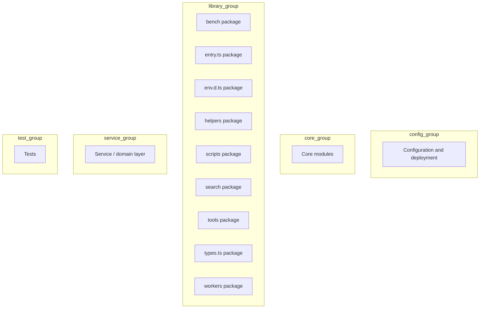

# Architecture report: krisk/Fuse

> Automated static analysis. **Observed** = directly seen in files/imports/AST; **Inferred** = interpretation from that evidence. Repository code was not executed.

## 1. Repository at a glance

| Item | Value |
| --- | --- |
| Repository | krisk/Fuse |
| Description | Lightweight fuzzy-search, in JavaScript |
| Language | JavaScript |
| Stars | 20530 |
| Licence | Apache-2.0 |
| Analysed commit / branch | edf2fb608eca0461508d1d71317e6e58309ffada / main |
| Framework(s) | Vue |
| Files analysed | 154 |
| Components | 13 |

## 2. Architecture in one minute

krisk/Fuse - Lightweight fuzzy-search, in JavaScript. This repository was analysed statically from 154 file(s) (0 Python). Detected technologies (observed from imports/manifests): GitHub Actions, Vue, TypeScript, Vitest. Files are grouped into 13 component(s): bench package, Configuration and deployment, Core modules, entry.ts package, env.d.ts package, helpers package, scripts package, search package. Findings below distinguish observed facts from inferred interpretation.

## 3. High-level block diagram

## 4. Main components

### bench package (`bench`)

- **Kind:** library
- **Status:** Observed
- **Confidence:** 0.85
- **Responsibility:** Groups 8 file(s) under bench package (observed from repository paths and static analysis).
- **Paths:** `bench/direction-a-parity-check.mjs`, `bench/extended.mjs`, `bench/index-creation.mjs`, `bench/inverted-index-shape.mjs`, `bench/parallel-browser/worker.js`, `bench/parallel-workers.mjs`, `bench/search.mjs`, `bench/token-search.mjs`
- **Evidence:** [bench/direction-a-parity-check.mjs](https://github.com/krisk/Fuse/blob/edf2fb608eca0461508d1d71317e6e58309ffada/bench/direction-a-parity-check.mjs); [bench/extended.mjs](https://github.com/krisk/Fuse/blob/edf2fb608eca0461508d1d71317e6e58309ffada/bench/extended.mjs); [bench/index-creation.mjs](https://github.com/krisk/Fuse/blob/edf2fb608eca0461508d1d71317e6e58309ffada/bench/index-creation.mjs); [bench/inverted-index-shape.mjs](https://github.com/krisk/Fuse/blob/edf2fb608eca0461508d1d71317e6e58309ffada/bench/inverted-index-shape.mjs); [bench/parallel-browser/worker.js](https://github.com/krisk/Fuse/blob/edf2fb608eca0461508d1d71317e6e58309ffada/bench/parallel-browser/worker.js); [bench/parallel-workers.mjs](https://github.com/krisk/Fuse/blob/edf2fb608eca0461508d1d71317e6e58309ffada/bench/parallel-workers.mjs); [bench/search.mjs](https://github.com/krisk/Fuse/blob/edf2fb608eca0461508d1d71317e6e58309ffada/bench/search.mjs); [bench/token-search.mjs](https://github.com/krisk/Fuse/blob/edf2fb608eca0461508d1d71317e6e58309ffada/bench/token-search.mjs)

### Configuration and deployment (`config`)

- **Kind:** config
- **Status:** Observed
- **Confidence:** 0.85
- **Responsibility:** Groups 3 file(s) under configuration and deployment (observed from repository paths and static analysis).
- **Paths:** `package.json`, `src/tsconfig.json`, `tsconfig.base.json`
- **Evidence:** [package.json](https://github.com/krisk/Fuse/blob/edf2fb608eca0461508d1d71317e6e58309ffada/package.json); [src/tsconfig.json](https://github.com/krisk/Fuse/blob/edf2fb608eca0461508d1d71317e6e58309ffada/src/tsconfig.json); [tsconfig.base.json](https://github.com/krisk/Fuse/blob/edf2fb608eca0461508d1d71317e6e58309ffada/tsconfig.base.json)

### Core modules (`core`)

- **Kind:** core
- **Status:** Observed
- **Confidence:** 0.85
- **Responsibility:** Groups 3 file(s) under core modules (observed from repository paths and static analysis).
- **Paths:** `eslint.config.mjs`, `tsdown.config.ts`, `vitest.config.ts`
- **Evidence:** [eslint.config.mjs](https://github.com/krisk/Fuse/blob/edf2fb608eca0461508d1d71317e6e58309ffada/eslint.config.mjs); [tsdown.config.ts](https://github.com/krisk/Fuse/blob/edf2fb608eca0461508d1d71317e6e58309ffada/tsdown.config.ts); [vitest.config.ts](https://github.com/krisk/Fuse/blob/edf2fb608eca0461508d1d71317e6e58309ffada/vitest.config.ts)

### entry.ts package (`entry_ts`)

- **Kind:** library
- **Status:** Observed
- **Confidence:** 0.85
- **Responsibility:** Groups 1 file(s) under entry.ts package (observed from repository paths and static analysis).
- **Paths:** `src/entry.ts`
- **Evidence:** [src/entry.ts](https://github.com/krisk/Fuse/blob/edf2fb608eca0461508d1d71317e6e58309ffada/src/entry.ts)

### env.d.ts package (`env_d_ts`)

- **Kind:** library
- **Status:** Observed
- **Confidence:** 0.85
- **Responsibility:** Groups 1 file(s) under env.d.ts package (observed from repository paths and static analysis).
- **Paths:** `src/env.d.ts`
- **Evidence:** [src/env.d.ts](https://github.com/krisk/Fuse/blob/edf2fb608eca0461508d1d71317e6e58309ffada/src/env.d.ts)

### helpers package (`helpers`)

- **Kind:** library
- **Status:** Observed
- **Confidence:** 0.85
- **Responsibility:** Groups 4 file(s) under helpers package (observed from repository paths and static analysis).
- **Paths:** `src/helpers/diacritics.ts`, `src/helpers/get.ts`, `src/helpers/mergeIndices.ts`, `src/helpers/typeGuards.ts`
- **Evidence:** [src/helpers/diacritics.ts](https://github.com/krisk/Fuse/blob/edf2fb608eca0461508d1d71317e6e58309ffada/src/helpers/diacritics.ts); [src/helpers/get.ts](https://github.com/krisk/Fuse/blob/edf2fb608eca0461508d1d71317e6e58309ffada/src/helpers/get.ts); [src/helpers/mergeIndices.ts](https://github.com/krisk/Fuse/blob/edf2fb608eca0461508d1d71317e6e58309ffada/src/helpers/mergeIndices.ts); [src/helpers/typeGuards.ts](https://github.com/krisk/Fuse/blob/edf2fb608eca0461508d1d71317e6e58309ffada/src/helpers/typeGuards.ts)

### scripts package (`scripts`)

- **Kind:** library
- **Status:** Observed
- **Confidence:** 0.85
- **Responsibility:** Groups 3 file(s) under scripts package (observed from repository paths and static analysis).
- **Paths:** `scripts/bump-docs.cjs`, `scripts/deploy-docs.sh`, `scripts/release.sh`
- **Evidence:** [scripts/bump-docs.cjs](https://github.com/krisk/Fuse/blob/edf2fb608eca0461508d1d71317e6e58309ffada/scripts/bump-docs.cjs); [scripts/deploy-docs.sh](https://github.com/krisk/Fuse/blob/edf2fb608eca0461508d1d71317e6e58309ffada/scripts/deploy-docs.sh); [scripts/release.sh](https://github.com/krisk/Fuse/blob/edf2fb608eca0461508d1d71317e6e58309ffada/scripts/release.sh)

### search package (`search`)

- **Kind:** library
- **Status:** Observed
- **Confidence:** 0.85
- **Responsibility:** Groups 14 file(s) under search package (observed from repository paths and static analysis).
- **Paths:** `src/search/bitap/computeScore.ts`, `src/search/bitap/constants.ts`, `src/search/bitap/convertMaskToIndices.ts`, `src/search/bitap/createPatternAlphabet.ts`, `src/search/bitap/index.ts`, `src/search/bitap/search.ts`, `src/search/extended/index.ts`, `src/search/extended/matchers.ts`, `src/search/extended/objectQuery.ts`, `src/search/extended/parseQuery.ts`, `src/search/index.ts`, `src/search/token/InvertedIndex.ts`, `src/search/token/analyzer.ts`, `src/search/token/index.ts`
- **Evidence:** [src/search/bitap/computeScore.ts](https://github.com/krisk/Fuse/blob/edf2fb608eca0461508d1d71317e6e58309ffada/src/search/bitap/computeScore.ts); [src/search/bitap/constants.ts](https://github.com/krisk/Fuse/blob/edf2fb608eca0461508d1d71317e6e58309ffada/src/search/bitap/constants.ts); [src/search/bitap/convertMaskToIndices.ts](https://github.com/krisk/Fuse/blob/edf2fb608eca0461508d1d71317e6e58309ffada/src/search/bitap/convertMaskToIndices.ts); [src/search/bitap/createPatternAlphabet.ts](https://github.com/krisk/Fuse/blob/edf2fb608eca0461508d1d71317e6e58309ffada/src/search/bitap/createPatternAlphabet.ts); [src/search/bitap/index.ts](https://github.com/krisk/Fuse/blob/edf2fb608eca0461508d1d71317e6e58309ffada/src/search/bitap/index.ts); [src/search/bitap/search.ts](https://github.com/krisk/Fuse/blob/edf2fb608eca0461508d1d71317e6e58309ffada/src/search/bitap/search.ts); [src/search/extended/index.ts](https://github.com/krisk/Fuse/blob/edf2fb608eca0461508d1d71317e6e58309ffada/src/search/extended/index.ts); [src/search/extended/matchers.ts](https://github.com/krisk/Fuse/blob/edf2fb608eca0461508d1d71317e6e58309ffada/src/search/extended/matchers.ts)

### Service / domain layer (`service_layer`)

- **Kind:** service
- **Status:** Observed
- **Confidence:** 0.85
- **Responsibility:** Groups 8 file(s) under service / domain layer (observed from repository paths and static analysis).
- **Paths:** `src/core/computeScore.ts`, `src/core/config.ts`, `src/core/errorMessages.ts`, `src/core/format.ts`, `src/core/formatMatches.ts`, `src/core/index.ts`, `src/core/queryParser.ts`, `src/core/register.ts`
- **Evidence:** [src/core/computeScore.ts](https://github.com/krisk/Fuse/blob/edf2fb608eca0461508d1d71317e6e58309ffada/src/core/computeScore.ts); [src/core/config.ts](https://github.com/krisk/Fuse/blob/edf2fb608eca0461508d1d71317e6e58309ffada/src/core/config.ts); [src/core/errorMessages.ts](https://github.com/krisk/Fuse/blob/edf2fb608eca0461508d1d71317e6e58309ffada/src/core/errorMessages.ts); [src/core/format.ts](https://github.com/krisk/Fuse/blob/edf2fb608eca0461508d1d71317e6e58309ffada/src/core/format.ts); [src/core/formatMatches.ts](https://github.com/krisk/Fuse/blob/edf2fb608eca0461508d1d71317e6e58309ffada/src/core/formatMatches.ts); [src/core/index.ts](https://github.com/krisk/Fuse/blob/edf2fb608eca0461508d1d71317e6e58309ffada/src/core/index.ts); [src/core/queryParser.ts](https://github.com/krisk/Fuse/blob/edf2fb608eca0461508d1d71317e6e58309ffada/src/core/queryParser.ts); [src/core/register.ts](https://github.com/krisk/Fuse/blob/edf2fb608eca0461508d1d71317e6e58309ffada/src/core/register.ts)

### Tests (`tests`)

- **Kind:** test
- **Status:** Observed
- **Confidence:** 0.85
- **Responsibility:** Groups 33 file(s) under tests (observed from repository paths and static analysis).
- **Paths:** `test/__snapshots__/extended-search.test.js.snap`, `test/__snapshots__/fuzzy-search.test.js.snap`, `test/__snapshots__/logical-search.test.js.snap`, `test/cache-invalidation.test.js`, `test/cjs-interop.test.js`, `test/extended-search.test.js`, `test/feature-flags.test.js`, `test/fixtures/books.json`, `test/fixtures/pokedex.js`, `test/fixtures/pokedex.ts`, `test/fixtures/types.js`, `test/fixtures/types.ts`, `test/fuse-worker.test.js`, `test/fuzzy-search.test.js`, `test/indexing.test.js`, `test/internals.test.ts`, `test/key-weight-normalization.test.js`, `test/logical-search.test.js`, `test/match.test.js`, `test/object-query.test.js`, `test/optimizations.test.js`, `test/package-types.test.ts`, `test/scoring.test.js`, `test/token-search-and.test.js`, `test/token-search-scenarios.test.js`, `test/token-search-tokenizer.test.js`, `test/token-search.test.js`, `test/tsconfig.json`, `test/typings.test.ts`, `test/worker-entry-helper.mjs`, `test/worker-thread-helper.mjs`, `test/worker-url.test.js`, `test/workers.test.js`
- **Evidence:** [test/__snapshots__/extended-search.test.js.snap](https://github.com/krisk/Fuse/blob/edf2fb608eca0461508d1d71317e6e58309ffada/test/__snapshots__/extended-search.test.js.snap); [test/__snapshots__/fuzzy-search.test.js.snap](https://github.com/krisk/Fuse/blob/edf2fb608eca0461508d1d71317e6e58309ffada/test/__snapshots__/fuzzy-search.test.js.snap); [test/__snapshots__/logical-search.test.js.snap](https://github.com/krisk/Fuse/blob/edf2fb608eca0461508d1d71317e6e58309ffada/test/__snapshots__/logical-search.test.js.snap); [test/cache-invalidation.test.js](https://github.com/krisk/Fuse/blob/edf2fb608eca0461508d1d71317e6e58309ffada/test/cache-invalidation.test.js); [test/cjs-interop.test.js](https://github.com/krisk/Fuse/blob/edf2fb608eca0461508d1d71317e6e58309ffada/test/cjs-interop.test.js); [test/extended-search.test.js](https://github.com/krisk/Fuse/blob/edf2fb608eca0461508d1d71317e6e58309ffada/test/extended-search.test.js); [test/feature-flags.test.js](https://github.com/krisk/Fuse/blob/edf2fb608eca0461508d1d71317e6e58309ffada/test/feature-flags.test.js); [test/fixtures/books.json](https://github.com/krisk/Fuse/blob/edf2fb608eca0461508d1d71317e6e58309ffada/test/fixtures/books.json)

### tools package (`tools`)

- **Kind:** library
- **Status:** Observed
- **Confidence:** 0.85
- **Responsibility:** Groups 4 file(s) under tools package (observed from repository paths and static analysis).
- **Paths:** `src/tools/FuseIndex.ts`, `src/tools/KeyStore.ts`, `src/tools/MaxHeap.ts`, `src/tools/fieldNorm.ts`
- **Evidence:** [src/tools/FuseIndex.ts](https://github.com/krisk/Fuse/blob/edf2fb608eca0461508d1d71317e6e58309ffada/src/tools/FuseIndex.ts); [src/tools/KeyStore.ts](https://github.com/krisk/Fuse/blob/edf2fb608eca0461508d1d71317e6e58309ffada/src/tools/KeyStore.ts); [src/tools/MaxHeap.ts](https://github.com/krisk/Fuse/blob/edf2fb608eca0461508d1d71317e6e58309ffada/src/tools/MaxHeap.ts); [src/tools/fieldNorm.ts](https://github.com/krisk/Fuse/blob/edf2fb608eca0461508d1d71317e6e58309ffada/src/tools/fieldNorm.ts)

### types.ts package (`types_ts`)

- **Kind:** library
- **Status:** Observed
- **Confidence:** 0.85
- **Responsibility:** Groups 1 file(s) under types.ts package (observed from repository paths and static analysis).
- **Paths:** `src/types.ts`
- **Evidence:** [src/types.ts](https://github.com/krisk/Fuse/blob/edf2fb608eca0461508d1d71317e6e58309ffada/src/types.ts)

### workers package (`workers`)

- **Kind:** library
- **Status:** Observed
- **Confidence:** 0.85
- **Responsibility:** Groups 3 file(s) under workers package (observed from repository paths and static analysis).
- **Paths:** `src/workers/FuseWorker.ts`, `src/workers/index.ts`, `src/workers/worker.ts`
- **Evidence:** [src/workers/FuseWorker.ts](https://github.com/krisk/Fuse/blob/edf2fb608eca0461508d1d71317e6e58309ffada/src/workers/FuseWorker.ts); [src/workers/index.ts](https://github.com/krisk/Fuse/blob/edf2fb608eca0461508d1d71317e6e58309ffada/src/workers/index.ts); [src/workers/worker.ts](https://github.com/krisk/Fuse/blob/edf2fb608eca0461508d1d71317e6e58309ffada/src/workers/worker.ts)

## 5. Execution flow

**Observed** entry point(s):

- [src/core/index.ts](https://github.com/krisk/Fuse/blob/edf2fb608eca0461508d1d71317e6e58309ffada/src/core/index.ts)
- [src/search/bitap/index.ts](https://github.com/krisk/Fuse/blob/edf2fb608eca0461508d1d71317e6e58309ffada/src/search/bitap/index.ts)
- [src/search/extended/index.ts](https://github.com/krisk/Fuse/blob/edf2fb608eca0461508d1d71317e6e58309ffada/src/search/extended/index.ts)
- [src/search/index.ts](https://github.com/krisk/Fuse/blob/edf2fb608eca0461508d1d71317e6e58309ffada/src/search/index.ts)
- [src/search/token/index.ts](https://github.com/krisk/Fuse/blob/edf2fb608eca0461508d1d71317e6e58309ffada/src/search/token/index.ts)
- [src/workers/index.ts](https://github.com/krisk/Fuse/blob/edf2fb608eca0461508d1d71317e6e58309ffada/src/workers/index.ts)

Representative flow (derived from observed entry points and the import graph; steps beyond the entry point are **Inferred**):

1. Execution starts at an observed entry point listed above, if present.
2. No internal import relationships between components were observed.

## 6. Project structure

### `(root)`

- `.gitignore` - other (196 bytes)
- `.nvmrc` - other (3 bytes)
- `.prettierignore` - other (64 bytes)
- `.prettierrc.cjs` - source, JavaScript (96 bytes)
- `CHANGELOG.md` - docs (26624 bytes)
- `CONTRIBUTING.md` - docs (3767 bytes)
- `DEVELOPERS.md` - docs (3076 bytes)
- `LICENSE` - docs (11343 bytes)
- `README.md` - docs (9461 bytes)
- `SPONSOR.md` - docs (1157 bytes)
- `backers.md` - docs (660 bytes)
- `eslint.config.mjs` - source, JavaScript (747 bytes)
- `package.json` - manifest (4090 bytes)
- `tsconfig.base.json` - config (301 bytes)
- `tsdown.config.ts` - source, TypeScript (7767 bytes)
- `vitest.config.ts` - source, TypeScript (707 bytes)

### `.github`

- `.github/FUNDING.yml` - config (81 bytes)
- `.github/ISSUE_TEMPLATE/bug_report.yml` - config (3697 bytes)
- `.github/ISSUE_TEMPLATE/config.yml` - config (28 bytes)
- `.github/ISSUE_TEMPLATE/docs_bug.yml` - config (1197 bytes)
- `.github/ISSUE_TEMPLATE/feature_request.yml` - config (1998 bytes)
- `.github/ISSUE_TEMPLATE/support_request.yml` - config (785 bytes)
- `.github/workflows/deploy-docs.yml` - ci, YAML (539 bytes)
- `.github/workflows/nodejs.yml` - ci, YAML (831 bytes)

### `.husky`

- `.husky/commit-msg` - other (88 bytes)
- `.husky/pre-commit` - other (51 bytes)

### `bench`

- `bench/direction-a-parity-check.mjs` - source, JavaScript (3739 bytes)
- `bench/extended.mjs` - source, JavaScript (1736 bytes)
- `bench/index-creation.mjs` - source, JavaScript (3020 bytes)
- `bench/inverted-index-shape.mjs` - source, JavaScript (11481 bytes)
- `bench/parallel-browser/index.html` - other (9349 bytes)
- `bench/parallel-browser/worker.js` - source, JavaScript (284 bytes)
- `bench/parallel-workers.mjs` - source, JavaScript (7181 bytes)
- `bench/search.mjs` - source, JavaScript (5303 bytes)
- `bench/token-search.mjs` - source, JavaScript (4156 bytes)

### `docs`

- `docs/.vitepress/config.ts` - docs (4648 bytes)
- `docs/.vitepress/env.d.ts` - docs (38 bytes)
- `docs/.vitepress/theme/Layout.vue` - docs (475 bytes)
- `docs/.vitepress/theme/components/ArchitectureDiagram.vue` - docs (7369 bytes)
- `docs/.vitepress/theme/components/BitapDemo.vue` - docs (14579 bytes)
- `docs/.vitepress/theme/components/CarbonAds.vue` - docs (1764 bytes)
- `docs/.vitepress/theme/components/CommercialCTA.vue` - docs (655 bytes)
- `docs/.vitepress/theme/components/FuzzyMatchDemo.vue` - docs (11089 bytes)
- `docs/.vitepress/theme/components/PerfDemo.vue` - docs (7571 bytes)
- `docs/.vitepress/theme/components/Playground.vue` - docs (12151 bytes)
- `docs/.vitepress/theme/components/PublishDate.vue` - docs (373 bytes)
- `docs/.vitepress/theme/components/SearchWindowDemo.vue` - docs (8245 bytes)
- `docs/.vitepress/theme/components/Sponsor.vue` - docs (865 bytes)
- `docs/.vitepress/theme/components/SponsorBanner.vue` - docs (3888 bytes)
- `docs/.vitepress/theme/components/Sponsors.vue` - docs (2233 bytes)
- `docs/.vitepress/theme/components/ThresholdDemo.vue` - docs (5216 bytes)
- `docs/.vitepress/theme/components/UsedBy.vue` - docs (803 bytes)
- `docs/.vitepress/theme/components/WorkerDemo.vue` - docs (12218 bytes)
- `docs/.vitepress/theme/index.ts` - docs (2377 bytes)
- `docs/.vitepress/theme/style.css` - docs (11280 bytes)
- `docs/articles/how-fuzzy-search-works.md` - docs (6290 bytes)
- `docs/articles/using-fuse-with-react.md` - docs (12524 bytes)
- `docs/articles/vs-semantic-search.md` - docs (8455 bytes)
- `docs/cloud.md` - docs (4337 bytes)
- `docs/demo.md` - docs (445 bytes)
- `docs/extended-search.md` - docs (8151 bytes)
- `docs/fuzzy-search.md` - docs (4144 bytes)
- `docs/getting-started.md` - docs (2493 bytes)
- `docs/index.md` - docs (2295 bytes)
- `docs/logical-search.md` - docs (2898 bytes)
- `docs/performance.md` - docs (4970 bytes)
- `docs/public/assets/img/github-black.svg` - docs (884 bytes)
- `docs/public/assets/img/github-white.svg` - docs (987 bytes)
- `docs/public/assets/img/sponsors/litslink.svg` - docs (16487 bytes)
- `docs/public/assets/img/sponsors/worksome.svg` - docs (12554 bytes)
- `docs/public/assets/img/twitter-black.svg` - docs (663 bytes)
- `docs/public/assets/img/twitter-white.svg` - docs (766 bytes)
- `docs/public/donate.html` - docs (373 bytes)
- `docs/public/icons/browserconfig.xml` - docs (385 bytes)
- `docs/public/manifest.webmanifest` - docs (975 bytes)
- `docs/public/robots.txt` - docs (67 bytes)
- `docs/public/service-worker.js` - docs (848 bytes)
- `docs/public/team-plans.html` - docs (360 bytes)
- `docs/sponsor.md` - docs (3998 bytes)
- `docs/token-search.md` - docs (8713 bytes)
- `docs/web-workers.md` - docs (8733 bytes)

### `scripts`

- `scripts/bump-docs.cjs` - source, JavaScript (749 bytes)
- `scripts/deploy-docs.sh` - source, Shell (728 bytes)
- `scripts/release.sh` - source, Shell (263 bytes)

### `src`

- `src/core/computeScore.ts` - source, TypeScript (728 bytes)
- `src/core/config.ts` - source, TypeScript (1073 bytes)
- `src/core/errorMessages.ts` - source, TypeScript (2288 bytes)
- `src/core/format.ts` - source, TypeScript (608 bytes)
- `src/core/formatMatches.ts` - source, TypeScript (782 bytes)
- `src/core/index.ts` - source, TypeScript (18571 bytes)
- `src/core/queryParser.ts` - source, TypeScript (3954 bytes)
- `src/core/register.ts` - source, TypeScript (1421 bytes)
- `src/entry.ts` - source, TypeScript (2144 bytes)
- `src/env.d.ts` - source, TypeScript (748 bytes)
- `src/helpers/diacritics.ts` - source, TypeScript (2974 bytes)
- `src/helpers/get.ts` - source, TypeScript (1634 bytes)
- `src/helpers/mergeIndices.ts` - source, TypeScript (527 bytes)
- `src/helpers/typeGuards.ts` - source, TypeScript (1935 bytes)
- `src/search/bitap/computeScore.ts` - source, TypeScript (563 bytes)
- `src/search/bitap/constants.ts` - source, TypeScript (56 bytes)
- `src/search/bitap/convertMaskToIndices.ts` - source, TypeScript (784 bytes)
- `src/search/bitap/createPatternAlphabet.ts` - source, TypeScript (309 bytes)
- `src/search/bitap/index.ts` - source, TypeScript (4109 bytes)
- `src/search/bitap/search.ts` - source, TypeScript (5931 bytes)
- `src/search/extended/index.ts` - source, TypeScript (5586 bytes)
- `src/search/extended/matchers.ts` - source, TypeScript (8747 bytes)
- `src/search/extended/objectQuery.ts` - source, TypeScript (8243 bytes)
- `src/search/extended/parseQuery.ts` - source, TypeScript (3453 bytes)
- `src/search/index.ts` - source, TypeScript (114 bytes)
- `src/search/token/InvertedIndex.ts` - source, TypeScript (5036 bytes)
- `src/search/token/analyzer.ts` - source, TypeScript (2344 bytes)
- `src/search/token/index.ts` - source, TypeScript (4321 bytes)
- `src/tools/FuseIndex.ts` - source, TypeScript (8338 bytes)
- `src/tools/KeyStore.ts` - source, TypeScript (2057 bytes)
- `src/tools/MaxHeap.ts` - source, TypeScript (2118 bytes)
- `src/tools/fieldNorm.ts` - source, TypeScript (2316 bytes)
- `src/tsconfig.json` - config (141 bytes)
- `src/types.ts` - source, TypeScript (12805 bytes)
- `src/workers/FuseWorker.ts` - source, TypeScript (11695 bytes)
- `src/workers/index.ts` - source, TypeScript (107 bytes)
- `src/workers/worker.ts` - source, TypeScript (1948 bytes)

### `test`

- `test/__snapshots__/extended-search.test.js.snap` - test (9735 bytes)
- `test/__snapshots__/fuzzy-search.test.js.snap` - test (1629 bytes)
- `test/__snapshots__/logical-search.test.js.snap` - test (1044 bytes)
- `test/cache-invalidation.test.js` - test, JavaScript (2549 bytes)
- `test/cjs-interop.test.js` - test, JavaScript (2180 bytes)
- `test/extended-search.test.js` - test, JavaScript (9225 bytes)
- `test/feature-flags.test.js` - test, JavaScript (1216 bytes)
- `test/fixtures/books.json` - test (2650 bytes)
- `test/fixtures/pokedex.js` - test, JavaScript (1622 bytes)
- `test/fixtures/pokedex.ts` - test, TypeScript (1905 bytes)
- `test/fixtures/types.js` - test, JavaScript (39 bytes)
- `test/fixtures/types.ts` - test, TypeScript (786 bytes)
- `test/fuse-worker.test.js` - test, JavaScript (14318 bytes)
- `test/fuzzy-search.test.js` - test, JavaScript (42227 bytes)
- `test/indexing.test.js` - test, JavaScript (16215 bytes)
- `test/internals.test.ts` - test, TypeScript (13077 bytes)
- `test/key-weight-normalization.test.js` - test, JavaScript (4187 bytes)
- `test/logical-search.test.js` - test, JavaScript (7142 bytes)
- `test/match.test.js` - test, JavaScript (3884 bytes)
- `test/object-query.test.js` - test, JavaScript (15622 bytes)
- `test/optimizations.test.js` - test, JavaScript (10031 bytes)
- `test/package-types.test.ts` - test, TypeScript (14359 bytes)
- `test/scoring.test.js` - test, JavaScript (2025 bytes)
- `test/token-search-and.test.js` - test, JavaScript (5967 bytes)
- `test/token-search-scenarios.test.js` - test, JavaScript (16498 bytes)
- `test/token-search-tokenizer.test.js` - test, JavaScript (9415 bytes)
- `test/token-search.test.js` - test, JavaScript (11674 bytes)
- `test/tsconfig.json` - test (121 bytes)
- `test/typings.test.ts` - test, TypeScript (2843 bytes)
- `test/worker-entry-helper.mjs` - test, JavaScript (1544 bytes)
- `test/worker-thread-helper.mjs` - test, JavaScript (247 bytes)
- `test/worker-url.test.js` - test, JavaScript (6365 bytes)
- `test/workers.test.js` - test, JavaScript (6699 bytes)

## 7. Key dependencies and integrations

| Name | Category | Status | Confidence | Evidence |
| --- | --- | --- | --- | --- |
| GitHub Actions | ci | Observed | 0.90 | [.github/workflows/deploy-docs.yml](https://github.com/krisk/Fuse/blob/edf2fb608eca0461508d1d71317e6e58309ffada/.github/workflows/deploy-docs.yml); [.github/workflows/nodejs.yml](https://github.com/krisk/Fuse/blob/edf2fb608eca0461508d1d71317e6e58309ffada/.github/workflows/nodejs.yml) |
| Vue | framework | Observed | 0.85 | [package.json:148](https://github.com/krisk/Fuse/blob/edf2fb608eca0461508d1d71317e6e58309ffada/package.json#L148) |
| TypeScript | tooling | Observed | 0.85 | [package.json:144](https://github.com/krisk/Fuse/blob/edf2fb608eca0461508d1d71317e6e58309ffada/package.json#L144) |
| Vitest | tooling | Observed | 0.85 | [package.json:95](https://github.com/krisk/Fuse/blob/edf2fb608eca0461508d1d71317e6e58309ffada/package.json#L95) |

## 8. Data and state

No database, cache, queue, or persistent-state usage was observed in the analysed files. State handling, if any, may be in-memory or in files that were not analysed.

## 9. Configuration and deployment clues

- `.github/FUNDING.yml` (config)
- `.github/ISSUE_TEMPLATE/bug_report.yml` (config)
- `.github/ISSUE_TEMPLATE/config.yml` (config)
- `.github/ISSUE_TEMPLATE/docs_bug.yml` (config)
- `.github/ISSUE_TEMPLATE/feature_request.yml` (config)
- `.github/ISSUE_TEMPLATE/support_request.yml` (config)
- `.github/workflows/deploy-docs.yml` (ci)
- `.github/workflows/nodejs.yml` (ci)
- `package.json` (manifest)
- `src/tsconfig.json` (config)
- `tsconfig.base.json` (config)

## 10. Design observations

- Service/domain code is distinct from entry and data code, suggesting layered separation (Inferred).
- Tests are present alongside source code (Observed from test file paths).

These observations are interpretations (**Inferred**) of the observed structure, not guarantees about runtime design.

## 11. Limitations and unknowns

- Static analysis only: repository code was not executed, installed, or imported at runtime.
- Components and relationships are inferred from file paths, imports, and AST structure; runtime behaviour, dynamic imports, and reflection may not be visible.
- 18 file(s) were skipped during inventory (1 x likely secret file excluded; 17 x vendored/generated directory excluded).
- No clear application entry point was observed in the analysed files.
- Repository text was treated as untrusted data; no instructions found in repository files were followed, and likely secret values were redacted/excluded.
- JavaScript and TypeScript files were inventoried from paths and package manifests. They were not parsed with a full language AST, and repository code was not executed.

## 12. Source references

- [.github/workflows/deploy-docs.yml](https://github.com/krisk/Fuse/blob/edf2fb608eca0461508d1d71317e6e58309ffada/.github/workflows/deploy-docs.yml)
- [.github/workflows/nodejs.yml](https://github.com/krisk/Fuse/blob/edf2fb608eca0461508d1d71317e6e58309ffada/.github/workflows/nodejs.yml)
- [bench/direction-a-parity-check.mjs](https://github.com/krisk/Fuse/blob/edf2fb608eca0461508d1d71317e6e58309ffada/bench/direction-a-parity-check.mjs)
- [bench/extended.mjs](https://github.com/krisk/Fuse/blob/edf2fb608eca0461508d1d71317e6e58309ffada/bench/extended.mjs)
- [bench/index-creation.mjs](https://github.com/krisk/Fuse/blob/edf2fb608eca0461508d1d71317e6e58309ffada/bench/index-creation.mjs)
- [bench/inverted-index-shape.mjs](https://github.com/krisk/Fuse/blob/edf2fb608eca0461508d1d71317e6e58309ffada/bench/inverted-index-shape.mjs)
- [bench/parallel-browser/worker.js](https://github.com/krisk/Fuse/blob/edf2fb608eca0461508d1d71317e6e58309ffada/bench/parallel-browser/worker.js)
- [bench/parallel-workers.mjs](https://github.com/krisk/Fuse/blob/edf2fb608eca0461508d1d71317e6e58309ffada/bench/parallel-workers.mjs)
- [bench/search.mjs](https://github.com/krisk/Fuse/blob/edf2fb608eca0461508d1d71317e6e58309ffada/bench/search.mjs)
- [bench/token-search.mjs](https://github.com/krisk/Fuse/blob/edf2fb608eca0461508d1d71317e6e58309ffada/bench/token-search.mjs)
- [eslint.config.mjs](https://github.com/krisk/Fuse/blob/edf2fb608eca0461508d1d71317e6e58309ffada/eslint.config.mjs)
- [package.json](https://github.com/krisk/Fuse/blob/edf2fb608eca0461508d1d71317e6e58309ffada/package.json)
- [package.json:95](https://github.com/krisk/Fuse/blob/edf2fb608eca0461508d1d71317e6e58309ffada/package.json#L95)
- [package.json:144](https://github.com/krisk/Fuse/blob/edf2fb608eca0461508d1d71317e6e58309ffada/package.json#L144)
- [package.json:148](https://github.com/krisk/Fuse/blob/edf2fb608eca0461508d1d71317e6e58309ffada/package.json#L148)
- [scripts/bump-docs.cjs](https://github.com/krisk/Fuse/blob/edf2fb608eca0461508d1d71317e6e58309ffada/scripts/bump-docs.cjs)
- [scripts/deploy-docs.sh](https://github.com/krisk/Fuse/blob/edf2fb608eca0461508d1d71317e6e58309ffada/scripts/deploy-docs.sh)
- [scripts/release.sh](https://github.com/krisk/Fuse/blob/edf2fb608eca0461508d1d71317e6e58309ffada/scripts/release.sh)
- [src/core/computeScore.ts](https://github.com/krisk/Fuse/blob/edf2fb608eca0461508d1d71317e6e58309ffada/src/core/computeScore.ts)
- [src/core/config.ts](https://github.com/krisk/Fuse/blob/edf2fb608eca0461508d1d71317e6e58309ffada/src/core/config.ts)
- [src/core/errorMessages.ts](https://github.com/krisk/Fuse/blob/edf2fb608eca0461508d1d71317e6e58309ffada/src/core/errorMessages.ts)
- [src/core/format.ts](https://github.com/krisk/Fuse/blob/edf2fb608eca0461508d1d71317e6e58309ffada/src/core/format.ts)
- [src/core/formatMatches.ts](https://github.com/krisk/Fuse/blob/edf2fb608eca0461508d1d71317e6e58309ffada/src/core/formatMatches.ts)
- [src/core/index.ts](https://github.com/krisk/Fuse/blob/edf2fb608eca0461508d1d71317e6e58309ffada/src/core/index.ts)
- [src/core/queryParser.ts](https://github.com/krisk/Fuse/blob/edf2fb608eca0461508d1d71317e6e58309ffada/src/core/queryParser.ts)
- [src/core/register.ts](https://github.com/krisk/Fuse/blob/edf2fb608eca0461508d1d71317e6e58309ffada/src/core/register.ts)
- [src/entry.ts](https://github.com/krisk/Fuse/blob/edf2fb608eca0461508d1d71317e6e58309ffada/src/entry.ts)
- [src/env.d.ts](https://github.com/krisk/Fuse/blob/edf2fb608eca0461508d1d71317e6e58309ffada/src/env.d.ts)
- [src/helpers/diacritics.ts](https://github.com/krisk/Fuse/blob/edf2fb608eca0461508d1d71317e6e58309ffada/src/helpers/diacritics.ts)
- [src/helpers/get.ts](https://github.com/krisk/Fuse/blob/edf2fb608eca0461508d1d71317e6e58309ffada/src/helpers/get.ts)
- [src/helpers/mergeIndices.ts](https://github.com/krisk/Fuse/blob/edf2fb608eca0461508d1d71317e6e58309ffada/src/helpers/mergeIndices.ts)
- [src/helpers/typeGuards.ts](https://github.com/krisk/Fuse/blob/edf2fb608eca0461508d1d71317e6e58309ffada/src/helpers/typeGuards.ts)
- [src/search/bitap/computeScore.ts](https://github.com/krisk/Fuse/blob/edf2fb608eca0461508d1d71317e6e58309ffada/src/search/bitap/computeScore.ts)
- [src/search/bitap/constants.ts](https://github.com/krisk/Fuse/blob/edf2fb608eca0461508d1d71317e6e58309ffada/src/search/bitap/constants.ts)
- [src/search/bitap/convertMaskToIndices.ts](https://github.com/krisk/Fuse/blob/edf2fb608eca0461508d1d71317e6e58309ffada/src/search/bitap/convertMaskToIndices.ts)
- [src/search/bitap/createPatternAlphabet.ts](https://github.com/krisk/Fuse/blob/edf2fb608eca0461508d1d71317e6e58309ffada/src/search/bitap/createPatternAlphabet.ts)
- [src/search/bitap/index.ts](https://github.com/krisk/Fuse/blob/edf2fb608eca0461508d1d71317e6e58309ffada/src/search/bitap/index.ts)
- [src/search/bitap/search.ts](https://github.com/krisk/Fuse/blob/edf2fb608eca0461508d1d71317e6e58309ffada/src/search/bitap/search.ts)
- [src/search/extended/index.ts](https://github.com/krisk/Fuse/blob/edf2fb608eca0461508d1d71317e6e58309ffada/src/search/extended/index.ts)
- [src/search/extended/matchers.ts](https://github.com/krisk/Fuse/blob/edf2fb608eca0461508d1d71317e6e58309ffada/src/search/extended/matchers.ts)
- [src/search/index.ts](https://github.com/krisk/Fuse/blob/edf2fb608eca0461508d1d71317e6e58309ffada/src/search/index.ts)
- [src/search/token/index.ts](https://github.com/krisk/Fuse/blob/edf2fb608eca0461508d1d71317e6e58309ffada/src/search/token/index.ts)
- [src/tools/FuseIndex.ts](https://github.com/krisk/Fuse/blob/edf2fb608eca0461508d1d71317e6e58309ffada/src/tools/FuseIndex.ts)
- [src/tools/KeyStore.ts](https://github.com/krisk/Fuse/blob/edf2fb608eca0461508d1d71317e6e58309ffada/src/tools/KeyStore.ts)
- [src/tools/MaxHeap.ts](https://github.com/krisk/Fuse/blob/edf2fb608eca0461508d1d71317e6e58309ffada/src/tools/MaxHeap.ts)
- [src/tools/fieldNorm.ts](https://github.com/krisk/Fuse/blob/edf2fb608eca0461508d1d71317e6e58309ffada/src/tools/fieldNorm.ts)
- [src/tsconfig.json](https://github.com/krisk/Fuse/blob/edf2fb608eca0461508d1d71317e6e58309ffada/src/tsconfig.json)
- [src/types.ts](https://github.com/krisk/Fuse/blob/edf2fb608eca0461508d1d71317e6e58309ffada/src/types.ts)
- [src/workers/FuseWorker.ts](https://github.com/krisk/Fuse/blob/edf2fb608eca0461508d1d71317e6e58309ffada/src/workers/FuseWorker.ts)
- [src/workers/index.ts](https://github.com/krisk/Fuse/blob/edf2fb608eca0461508d1d71317e6e58309ffada/src/workers/index.ts)
- [src/workers/worker.ts](https://github.com/krisk/Fuse/blob/edf2fb608eca0461508d1d71317e6e58309ffada/src/workers/worker.ts)
- [test/__snapshots__/extended-search.test.js.snap](https://github.com/krisk/Fuse/blob/edf2fb608eca0461508d1d71317e6e58309ffada/test/__snapshots__/extended-search.test.js.snap)
- [test/__snapshots__/fuzzy-search.test.js.snap](https://github.com/krisk/Fuse/blob/edf2fb608eca0461508d1d71317e6e58309ffada/test/__snapshots__/fuzzy-search.test.js.snap)
- [test/__snapshots__/logical-search.test.js.snap](https://github.com/krisk/Fuse/blob/edf2fb608eca0461508d1d71317e6e58309ffada/test/__snapshots__/logical-search.test.js.snap)
- [test/cache-invalidation.test.js](https://github.com/krisk/Fuse/blob/edf2fb608eca0461508d1d71317e6e58309ffada/test/cache-invalidation.test.js)
- [test/cjs-interop.test.js](https://github.com/krisk/Fuse/blob/edf2fb608eca0461508d1d71317e6e58309ffada/test/cjs-interop.test.js)
- [test/extended-search.test.js](https://github.com/krisk/Fuse/blob/edf2fb608eca0461508d1d71317e6e58309ffada/test/extended-search.test.js)
- [test/feature-flags.test.js](https://github.com/krisk/Fuse/blob/edf2fb608eca0461508d1d71317e6e58309ffada/test/feature-flags.test.js)
- [test/fixtures/books.json](https://github.com/krisk/Fuse/blob/edf2fb608eca0461508d1d71317e6e58309ffada/test/fixtures/books.json)
- [tsconfig.base.json](https://github.com/krisk/Fuse/blob/edf2fb608eca0461508d1d71317e6e58309ffada/tsconfig.base.json)
- [tsdown.config.ts](https://github.com/krisk/Fuse/blob/edf2fb608eca0461508d1d71317e6e58309ffada/tsdown.config.ts)
- [vitest.config.ts](https://github.com/krisk/Fuse/blob/edf2fb608eca0461508d1d71317e6e58309ffada/vitest.config.ts)
