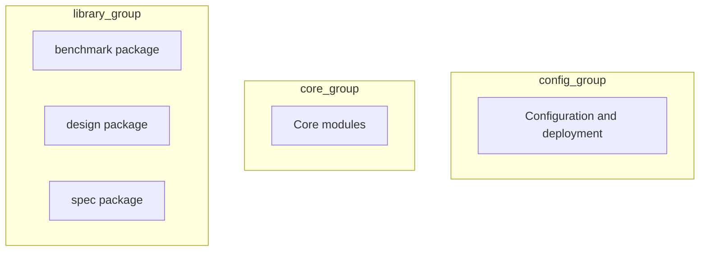

# Architecture report: kriskowal/q

> Automated static analysis. **Observed** = directly seen in files/imports/AST; **Inferred** = interpretation from that evidence. Repository code was not executed.

## 1. Repository at a glance

| Item | Value |
| --- | --- |
| Repository | kriskowal/q |
| Description | A promise library for JavaScript |
| Language | JavaScript |
| Stars | 14983 |
| Licence | MIT |
| Analysed commit / branch | d180f4a0b22499607ac750b56766c8829d6bff43 / master |
| Framework(s) | None detected |
| Files analysed | 43 |
| Components | 5 |

## 2. Architecture in one minute

kriskowal/q - A promise library for JavaScript. This repository was analysed statically from 43 file(s) (0 Python). Detected technologies (observed from imports/manifests): no known frameworks/libraries. Files are grouped into 5 component(s): benchmark package, Configuration and deployment, Core modules, design package, spec package. Findings below distinguish observed facts from inferred interpretation.

## 3. High-level block diagram

## 4. Main components

### benchmark package (`benchmark`)

- **Kind:** library
- **Status:** Observed
- **Confidence:** 0.85
- **Responsibility:** Groups 2 file(s) under benchmark package (observed from repository paths and static analysis).
- **Paths:** `benchmark/compare-with-callbacks.js`, `benchmark/scenarios.js`
- **Evidence:** [benchmark/compare-with-callbacks.js](https://github.com/kriskowal/q/blob/d180f4a0b22499607ac750b56766c8829d6bff43/benchmark/compare-with-callbacks.js); [benchmark/scenarios.js](https://github.com/kriskowal/q/blob/d180f4a0b22499607ac750b56766c8829d6bff43/benchmark/scenarios.js)

### Configuration and deployment (`config`)

- **Kind:** config
- **Status:** Observed
- **Confidence:** 0.85
- **Responsibility:** Groups 1 file(s) under configuration and deployment (observed from repository paths and static analysis).
- **Paths:** `package.json`
- **Evidence:** [package.json](https://github.com/kriskowal/q/blob/d180f4a0b22499607ac750b56766c8829d6bff43/package.json)

### Core modules (`core`)

- **Kind:** core
- **Status:** Observed
- **Confidence:** 0.85
- **Responsibility:** Groups 3 file(s) under core modules (observed from repository paths and static analysis).
- **Paths:** `Gruntfile.js`, `q.js`, `queue.js`
- **Evidence:** [Gruntfile.js](https://github.com/kriskowal/q/blob/d180f4a0b22499607ac750b56766c8829d6bff43/Gruntfile.js); [q.js](https://github.com/kriskowal/q/blob/d180f4a0b22499607ac750b56766c8829d6bff43/q.js); [queue.js](https://github.com/kriskowal/q/blob/d180f4a0b22499607ac750b56766c8829d6bff43/queue.js)

### design package (`design`)

- **Kind:** library
- **Status:** Observed
- **Confidence:** 0.85
- **Responsibility:** Groups 8 file(s) under design package (observed from repository paths and static analysis).
- **Paths:** `design/q0.js`, `design/q1.js`, `design/q2.js`, `design/q3.js`, `design/q4.js`, `design/q5.js`, `design/q6.js`, `design/q7.js`
- **Evidence:** [design/q0.js](https://github.com/kriskowal/q/blob/d180f4a0b22499607ac750b56766c8829d6bff43/design/q0.js); [design/q1.js](https://github.com/kriskowal/q/blob/d180f4a0b22499607ac750b56766c8829d6bff43/design/q1.js); [design/q2.js](https://github.com/kriskowal/q/blob/d180f4a0b22499607ac750b56766c8829d6bff43/design/q2.js); [design/q3.js](https://github.com/kriskowal/q/blob/d180f4a0b22499607ac750b56766c8829d6bff43/design/q3.js); [design/q4.js](https://github.com/kriskowal/q/blob/d180f4a0b22499607ac750b56766c8829d6bff43/design/q4.js); [design/q5.js](https://github.com/kriskowal/q/blob/d180f4a0b22499607ac750b56766c8829d6bff43/design/q5.js); [design/q6.js](https://github.com/kriskowal/q/blob/d180f4a0b22499607ac750b56766c8829d6bff43/design/q6.js); [design/q7.js](https://github.com/kriskowal/q/blob/d180f4a0b22499607ac750b56766c8829d6bff43/design/q7.js)

### spec package (`spec`)

- **Kind:** library
- **Status:** Observed
- **Confidence:** 0.85
- **Responsibility:** Groups 6 file(s) under spec package (observed from repository paths and static analysis).
- **Paths:** `spec/aplus-adapter.js`, `spec/lib/jasmine-1.2.0/jasmine-html.js`, `spec/lib/jasmine-1.2.0/jasmine.js`, `spec/lib/jasmine-promise.js`, `spec/q-spec.js`, `spec/queue-spec.js`
- **Evidence:** [spec/aplus-adapter.js](https://github.com/kriskowal/q/blob/d180f4a0b22499607ac750b56766c8829d6bff43/spec/aplus-adapter.js); [spec/lib/jasmine-1.2.0/jasmine-html.js](https://github.com/kriskowal/q/blob/d180f4a0b22499607ac750b56766c8829d6bff43/spec/lib/jasmine-1.2.0/jasmine-html.js); [spec/lib/jasmine-1.2.0/jasmine.js](https://github.com/kriskowal/q/blob/d180f4a0b22499607ac750b56766c8829d6bff43/spec/lib/jasmine-1.2.0/jasmine.js); [spec/lib/jasmine-promise.js](https://github.com/kriskowal/q/blob/d180f4a0b22499607ac750b56766c8829d6bff43/spec/lib/jasmine-promise.js); [spec/q-spec.js](https://github.com/kriskowal/q/blob/d180f4a0b22499607ac750b56766c8829d6bff43/spec/q-spec.js); [spec/queue-spec.js](https://github.com/kriskowal/q/blob/d180f4a0b22499607ac750b56766c8829d6bff43/spec/queue-spec.js)

## 5. Execution flow

**Observed** entry point(s):

- [q.js](https://github.com/kriskowal/q/blob/d180f4a0b22499607ac750b56766c8829d6bff43/q.js)

Representative flow (derived from observed entry points and the import graph; steps beyond the entry point are **Inferred**):

1. Execution starts at an observed entry point listed above, if present.
2. No internal import relationships between components were observed.

## 6. Project structure

### `(root)`

- `.coverignore` - other (6 bytes)
- `.gitignore` - other (120 bytes)
- `.jshintrc` - other (492 bytes)
- `.mailmap` - other (81 bytes)
- `.travis.yml` - ci, YAML (57 bytes)
- `CHANGES.md` - docs (30064 bytes)
- `CONTRIBUTING.md` - docs (1729 bytes)
- `Gruntfile.js` - source, JavaScript (312 bytes)
- `LICENSE` - docs (1092 bytes)
- `README.md` - docs (26457 bytes)
- `VERSIONS.md` - docs (671 bytes)
- `package.json` - manifest (1842 bytes)
- `q.js` - source, JavaScript (64011 bytes)
- `q.svg` - other (7798 bytes)
- `queue.js` - source, JavaScript (941 bytes)
- `ref_send.md` - docs (1202 bytes)

### `benchmark`

- `benchmark/compare-with-callbacks.js` - source, JavaScript (1859 bytes)
- `benchmark/scenarios.js` - source, JavaScript (950 bytes)

### `design`

- `design/README.md` - docs (33014 bytes)
- `design/q0.js` - source, JavaScript (523 bytes)
- `design/q1.js` - source, JavaScript (682 bytes)
- `design/q2.js` - source, JavaScript (737 bytes)
- `design/q3.js` - source, JavaScript (739 bytes)
- `design/q4.js` - source, JavaScript (1388 bytes)
- `design/q5.js` - source, JavaScript (1503 bytes)
- `design/q6.js` - source, JavaScript (1842 bytes)
- `design/q7.js` - source, JavaScript (3286 bytes)

### `examples`

- `examples/all.js` - source, JavaScript (306 bytes)
- `examples/async-generators/0.html` - other (989 bytes)
- `examples/async-generators/1-return.js` - source, JavaScript (415 bytes)
- `examples/async-generators/2-error-propagation.js` - source, JavaScript (571 bytes)
- `examples/async-generators/3-spawn.js` - source, JavaScript (296 bytes)
- `examples/async-generators/4-flow-control.js` - source, JavaScript (935 bytes)
- `examples/async-generators/README.md` - docs (1897 bytes)

### `spec`

- `spec/aplus-adapter.js` - source, JavaScript (289 bytes)
- `spec/lib/jasmine-1.2.0/MIT.LICENSE` - other (1061 bytes)
- `spec/lib/jasmine-1.2.0/jasmine-html.js` - source, JavaScript (19065 bytes)
- `spec/lib/jasmine-1.2.0/jasmine.css` - other (6444 bytes)
- `spec/lib/jasmine-1.2.0/jasmine.js` - source, JavaScript (68641 bytes)
- `spec/lib/jasmine-promise.js` - source, JavaScript (2938 bytes)
- `spec/q-spec.html` - other (1350 bytes)
- `spec/q-spec.js` - source, JavaScript (87879 bytes)
- `spec/queue-spec.js` - source, JavaScript (4542 bytes)

## 7. Key dependencies and integrations

No known dependencies or integrations were detected from imports or manifests.

## 8. Data and state

No database, cache, queue, or persistent-state usage was observed in the analysed files. State handling, if any, may be in-memory or in files that were not analysed.

## 9. Configuration and deployment clues

- `.travis.yml` (ci)
- `package.json` (manifest)

## 10. Design observations

- No strong design patterns could be established from the available evidence.

These observations are interpretations (**Inferred**) of the observed structure, not guarantees about runtime design.

## 11. Limitations and unknowns

- Static analysis only: repository code was not executed, installed, or imported at runtime.
- Components and relationships are inferred from file paths, imports, and AST structure; runtime behaviour, dynamic imports, and reflection may not be visible.
- No clear application entry point was observed in the analysed files.
- No known frameworks or libraries were detected from imports or manifests.
- Repository text was treated as untrusted data; no instructions found in repository files were followed, and likely secret values were redacted/excluded.
- JavaScript and TypeScript files were inventoried from paths and package manifests. They were not parsed with a full language AST, and repository code was not executed.
- The GitHub repository was marked archived at selection time.

## 12. Source references

- [Gruntfile.js](https://github.com/kriskowal/q/blob/d180f4a0b22499607ac750b56766c8829d6bff43/Gruntfile.js)
- [benchmark/compare-with-callbacks.js](https://github.com/kriskowal/q/blob/d180f4a0b22499607ac750b56766c8829d6bff43/benchmark/compare-with-callbacks.js)
- [benchmark/scenarios.js](https://github.com/kriskowal/q/blob/d180f4a0b22499607ac750b56766c8829d6bff43/benchmark/scenarios.js)
- [design/q0.js](https://github.com/kriskowal/q/blob/d180f4a0b22499607ac750b56766c8829d6bff43/design/q0.js)
- [design/q1.js](https://github.com/kriskowal/q/blob/d180f4a0b22499607ac750b56766c8829d6bff43/design/q1.js)
- [design/q2.js](https://github.com/kriskowal/q/blob/d180f4a0b22499607ac750b56766c8829d6bff43/design/q2.js)
- [design/q3.js](https://github.com/kriskowal/q/blob/d180f4a0b22499607ac750b56766c8829d6bff43/design/q3.js)
- [design/q4.js](https://github.com/kriskowal/q/blob/d180f4a0b22499607ac750b56766c8829d6bff43/design/q4.js)
- [design/q5.js](https://github.com/kriskowal/q/blob/d180f4a0b22499607ac750b56766c8829d6bff43/design/q5.js)
- [design/q6.js](https://github.com/kriskowal/q/blob/d180f4a0b22499607ac750b56766c8829d6bff43/design/q6.js)
- [design/q7.js](https://github.com/kriskowal/q/blob/d180f4a0b22499607ac750b56766c8829d6bff43/design/q7.js)
- [package.json](https://github.com/kriskowal/q/blob/d180f4a0b22499607ac750b56766c8829d6bff43/package.json)
- [q.js](https://github.com/kriskowal/q/blob/d180f4a0b22499607ac750b56766c8829d6bff43/q.js)
- [queue.js](https://github.com/kriskowal/q/blob/d180f4a0b22499607ac750b56766c8829d6bff43/queue.js)
- [spec/aplus-adapter.js](https://github.com/kriskowal/q/blob/d180f4a0b22499607ac750b56766c8829d6bff43/spec/aplus-adapter.js)
- [spec/lib/jasmine-1.2.0/jasmine-html.js](https://github.com/kriskowal/q/blob/d180f4a0b22499607ac750b56766c8829d6bff43/spec/lib/jasmine-1.2.0/jasmine-html.js)
- [spec/lib/jasmine-1.2.0/jasmine.js](https://github.com/kriskowal/q/blob/d180f4a0b22499607ac750b56766c8829d6bff43/spec/lib/jasmine-1.2.0/jasmine.js)
- [spec/lib/jasmine-promise.js](https://github.com/kriskowal/q/blob/d180f4a0b22499607ac750b56766c8829d6bff43/spec/lib/jasmine-promise.js)
- [spec/q-spec.js](https://github.com/kriskowal/q/blob/d180f4a0b22499607ac750b56766c8829d6bff43/spec/q-spec.js)
- [spec/queue-spec.js](https://github.com/kriskowal/q/blob/d180f4a0b22499607ac750b56766c8829d6bff43/spec/queue-spec.js)
