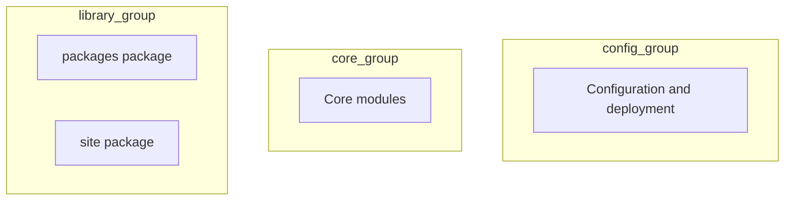

# Architecture report: ksky521/nodeppt

> Automated static analysis. **Observed** = directly seen in files/imports/AST; **Inferred** = interpretation from that evidence. Repository code was not executed.

## 1. Repository at a glance

| Item | Value |
| --- | --- |
| Repository | ksky521/nodeppt |
| Description | This is probably the best web presentation tool so far! |
| Language | JavaScript |
| Stars | 10329 |
| Licence | MIT |
| Analysed commit / branch | 44f4babb6586d3d0f2dad830e9956a1e39507d47 / master |
| Framework(s) | None detected |
| Files analysed | 170 |
| Components | 4 |

## 2. Architecture in one minute

ksky521/nodeppt - This is probably the best web presentation tool so far!. This repository was analysed statically from 170 file(s) (0 Python). Detected technologies (observed from imports/manifests): webpack. Files are grouped into 4 component(s): Configuration and deployment, Core modules, packages package, site package. Findings below distinguish observed facts from inferred interpretation.

## 3. High-level block diagram

## 4. Main components

### Configuration and deployment (`config`)

- **Kind:** config
- **Status:** Observed
- **Confidence:** 0.85
- **Responsibility:** Groups 12 file(s) under configuration and deployment (observed from repository paths and static analysis).
- **Paths:** `lerna.json`, `package.json`, `packages/nodeppt-js/package.json`, `packages/nodeppt-parser/package.json`, `packages/nodeppt-serve/config/app.js`, `packages/nodeppt-serve/config/base.js`, `packages/nodeppt-serve/config/css.js`, `packages/nodeppt-serve/config/dev.js`, `packages/nodeppt-serve/config/prod.js`, `packages/nodeppt-serve/package.json`, `packages/nodeppt-shared-utils/package.json`, `packages/nodeppt/package.json`
- **Evidence:** [lerna.json](https://github.com/ksky521/nodeppt/blob/44f4babb6586d3d0f2dad830e9956a1e39507d47/lerna.json); [package.json](https://github.com/ksky521/nodeppt/blob/44f4babb6586d3d0f2dad830e9956a1e39507d47/package.json); [packages/nodeppt-js/package.json](https://github.com/ksky521/nodeppt/blob/44f4babb6586d3d0f2dad830e9956a1e39507d47/packages/nodeppt-js/package.json); [packages/nodeppt-parser/package.json](https://github.com/ksky521/nodeppt/blob/44f4babb6586d3d0f2dad830e9956a1e39507d47/packages/nodeppt-parser/package.json); [packages/nodeppt-serve/config/app.js](https://github.com/ksky521/nodeppt/blob/44f4babb6586d3d0f2dad830e9956a1e39507d47/packages/nodeppt-serve/config/app.js); [packages/nodeppt-serve/config/base.js](https://github.com/ksky521/nodeppt/blob/44f4babb6586d3d0f2dad830e9956a1e39507d47/packages/nodeppt-serve/config/base.js); [packages/nodeppt-serve/config/css.js](https://github.com/ksky521/nodeppt/blob/44f4babb6586d3d0f2dad830e9956a1e39507d47/packages/nodeppt-serve/config/css.js); [packages/nodeppt-serve/config/dev.js](https://github.com/ksky521/nodeppt/blob/44f4babb6586d3d0f2dad830e9956a1e39507d47/packages/nodeppt-serve/config/dev.js)

### Core modules (`core`)

- **Kind:** core
- **Status:** Observed
- **Confidence:** 0.85
- **Responsibility:** Groups 1 file(s) under core modules (observed from repository paths and static analysis).
- **Paths:** `gh-page.sh`
- **Evidence:** [gh-page.sh](https://github.com/ksky521/nodeppt/blob/44f4babb6586d3d0f2dad830e9956a1e39507d47/gh-page.sh)

### packages package (`packages`)

- **Kind:** library
- **Status:** Observed
- **Confidence:** 0.85
- **Responsibility:** Groups 73 file(s) under packages package (observed from repository paths and static analysis).
- **Paths:** `packages/nodeppt-js/index.js`, `packages/nodeppt-js/plugins/echarts.js`, `packages/nodeppt-js/plugins/keyboard.js`, `packages/nodeppt-js/plugins/mermaid.js`, `packages/nodeppt-js/plugins/speaker-mode.js`, `packages/nodeppt-js/plugins/speaker-note.js`, `packages/nodeppt-parser/__tests__/public/demo.js`, `packages/nodeppt-parser/defaults.js`, `packages/nodeppt-parser/index.js`, `packages/nodeppt-parser/lib/get-markdown-parser.js`, `packages/nodeppt-parser/lib/get-parser.js`, `packages/nodeppt-parser/lib/markdown/attrs/index.js`, `packages/nodeppt-parser/lib/markdown/attrs/patterns.js`, `packages/nodeppt-parser/lib/markdown/attrs/utils.js`, `packages/nodeppt-parser/lib/markdown/cite.js`, `packages/nodeppt-parser/lib/markdown/container.js`, `packages/nodeppt-parser/lib/markdown/containers/blink.js`, `packages/nodeppt-parser/lib/markdown/containers/card.js`, `packages/nodeppt-parser/lib/markdown/containers/column.js`, `packages/nodeppt-parser/lib/markdown/containers/cta.js`, `packages/nodeppt-parser/lib/markdown/containers/div.js`, `packages/nodeppt-parser/lib/markdown/containers/features.js`, `packages/nodeppt-parser/lib/markdown/containers/flexblock.js`, `packages/nodeppt-parser/lib/markdown/containers/flexbox.js`, `packages/nodeppt-parser/lib/markdown/containers/gallery.js`, `packages/nodeppt-parser/lib/markdown/containers/shadow.js`, `packages/nodeppt-parser/lib/markdown/containers/specs.js`, `packages/nodeppt-parser/lib/markdown/containers/steps.js`, `packages/nodeppt-parser/lib/markdown/echarts.js`, `packages/nodeppt-parser/lib/markdown/fa.js`, `packages/nodeppt-parser/lib/markdown/img.js`, `packages/nodeppt-parser/lib/markdown/jsx.js`, `packages/nodeppt-parser/lib/markdown/link.js`, `packages/nodeppt-parser/lib/markdown/mermaid.js`, `packages/nodeppt-parser/lib/markdown/plus-list.js`, `packages/nodeppt-parser/lib/markdown/prism.js`, `packages/nodeppt-parser/lib/markdown/regexp/index.js`, `packages/nodeppt-parser/lib/markdown/regexp/utils.js`, `packages/nodeppt-parser/lib/markdown/span.js`, `packages/nodeppt-parser/lib/tags/attrs.js`, `packages/nodeppt-parser/lib/tags/header-footer.js`, `packages/nodeppt-parser/lib/tags/note.js`, `packages/nodeppt-parser/lib/tags/slide.js`, `packages/nodeppt-parser/lib/tags/utils.js`, `packages/nodeppt-parser/lib/utils.js`, `packages/nodeppt-parser/lib/yaml-parser.js`, `packages/nodeppt-serve/PluginAPI.js`, `packages/nodeppt-serve/Service.js`, `packages/nodeppt-serve/commands/build.js`, `packages/nodeppt-serve/commands/serve.js`, `packages/nodeppt-serve/index.js`, `packages/nodeppt-serve/lib/globalConfigPlugin.js`, `packages/nodeppt-serve/lib/utils.js`, `packages/nodeppt-serve/options.js`, `packages/nodeppt-serve/template/main.js`, `packages/nodeppt-serve/template/reload.js`, `packages/nodeppt-shared-utils/index.js`, `packages/nodeppt-shared-utils/lib/download-repo.js`, `packages/nodeppt-shared-utils/lib/eval.js`, `packages/nodeppt-shared-utils/lib/find-existing.js`, `packages/nodeppt-shared-utils/lib/get-debug.js`, `packages/nodeppt-shared-utils/lib/get-latest-version.js`, `packages/nodeppt-shared-utils/lib/git-user.js`, `packages/nodeppt-shared-utils/lib/logger.js`, `packages/nodeppt-shared-utils/lib/new-version-log.js`, `packages/nodeppt-shared-utils/lib/path.js`, `packages/nodeppt-shared-utils/lib/plugin.js`, `packages/nodeppt-shared-utils/lib/prepare-urls.js`, `packages/nodeppt-shared-utils/lib/spinner.js`, `packages/nodeppt-shared-utils/lib/webpack-error.js`, `packages/nodeppt/commands/new.js`, `packages/nodeppt/lib/ask.js`, `packages/nodeppt/lib/generate.js`
- **Evidence:** [packages/nodeppt-js/index.js](https://github.com/ksky521/nodeppt/blob/44f4babb6586d3d0f2dad830e9956a1e39507d47/packages/nodeppt-js/index.js); [packages/nodeppt-js/plugins/echarts.js](https://github.com/ksky521/nodeppt/blob/44f4babb6586d3d0f2dad830e9956a1e39507d47/packages/nodeppt-js/plugins/echarts.js); [packages/nodeppt-js/plugins/keyboard.js](https://github.com/ksky521/nodeppt/blob/44f4babb6586d3d0f2dad830e9956a1e39507d47/packages/nodeppt-js/plugins/keyboard.js); [packages/nodeppt-js/plugins/mermaid.js](https://github.com/ksky521/nodeppt/blob/44f4babb6586d3d0f2dad830e9956a1e39507d47/packages/nodeppt-js/plugins/mermaid.js); [packages/nodeppt-js/plugins/speaker-mode.js](https://github.com/ksky521/nodeppt/blob/44f4babb6586d3d0f2dad830e9956a1e39507d47/packages/nodeppt-js/plugins/speaker-mode.js); [packages/nodeppt-js/plugins/speaker-note.js](https://github.com/ksky521/nodeppt/blob/44f4babb6586d3d0f2dad830e9956a1e39507d47/packages/nodeppt-js/plugins/speaker-note.js); [packages/nodeppt-parser/__tests__/public/demo.js](https://github.com/ksky521/nodeppt/blob/44f4babb6586d3d0f2dad830e9956a1e39507d47/packages/nodeppt-parser/__tests__/public/demo.js); [packages/nodeppt-parser/defaults.js](https://github.com/ksky521/nodeppt/blob/44f4babb6586d3d0f2dad830e9956a1e39507d47/packages/nodeppt-parser/defaults.js)

### site package (`site`)

- **Kind:** library
- **Status:** Observed
- **Confidence:** 0.85
- **Responsibility:** Groups 1 file(s) under site package (observed from repository paths and static analysis).
- **Paths:** `site/public/background.js`
- **Evidence:** [site/public/background.js](https://github.com/ksky521/nodeppt/blob/44f4babb6586d3d0f2dad830e9956a1e39507d47/site/public/background.js)

## 5. Execution flow

**Observed** entry point(s):

- [packages/nodeppt-js/index.js](https://github.com/ksky521/nodeppt/blob/44f4babb6586d3d0f2dad830e9956a1e39507d47/packages/nodeppt-js/index.js)
- [packages/nodeppt-parser/index.js](https://github.com/ksky521/nodeppt/blob/44f4babb6586d3d0f2dad830e9956a1e39507d47/packages/nodeppt-parser/index.js)
- [packages/nodeppt-serve/config/app.js](https://github.com/ksky521/nodeppt/blob/44f4babb6586d3d0f2dad830e9956a1e39507d47/packages/nodeppt-serve/config/app.js)
- [packages/nodeppt-serve/index.js](https://github.com/ksky521/nodeppt/blob/44f4babb6586d3d0f2dad830e9956a1e39507d47/packages/nodeppt-serve/index.js)
- [packages/nodeppt-serve/template/main.js](https://github.com/ksky521/nodeppt/blob/44f4babb6586d3d0f2dad830e9956a1e39507d47/packages/nodeppt-serve/template/main.js)
- [packages/nodeppt-shared-utils/index.js](https://github.com/ksky521/nodeppt/blob/44f4babb6586d3d0f2dad830e9956a1e39507d47/packages/nodeppt-shared-utils/index.js)
- [packages/nodeppt/bin/nodeppt](https://github.com/ksky521/nodeppt/blob/44f4babb6586d3d0f2dad830e9956a1e39507d47/packages/nodeppt/bin/nodeppt)

Representative flow (derived from observed entry points and the import graph; steps beyond the entry point are **Inferred**):

1. Execution starts at an observed entry point listed above, if present.
2. No internal import relationships between components were observed.

## 6. Project structure

### `(root)`

- `.editorconfig` - config (249 bytes)
- `.gitignore` - other (2325 bytes)
- `.prettierrc` - other (223 bytes)
- `MIT-LICENSE.txt` - docs (1061 bytes)
- `README.md` - docs (13359 bytes)
- `gh-page.sh` - source, Shell (683 bytes)
- `lerna.json` - config (232 bytes)
- `package.json` - manifest (154 bytes)

### `.github`

- `.github/ISSUE_TEMPLATE.md` - docs (657 bytes)

### `packages`

- `packages/nodeppt-js/.npmignore` - other (48 bytes)
- `packages/nodeppt-js/assets/images/logos/airbnb.svg` - other (7016 bytes)
- `packages/nodeppt-js/assets/images/logos/apple.svg` - other (5395 bytes)
- `packages/nodeppt-js/assets/images/logos/facebook.svg` - other (3685 bytes)
- `packages/nodeppt-js/assets/images/logos/google.svg` - other (7965 bytes)
- `packages/nodeppt-js/assets/images/logos/instagram.svg` - other (6469 bytes)
- `packages/nodeppt-js/assets/images/logos/logo.svg` - other (2510 bytes)
- `packages/nodeppt-js/assets/images/logos/microsoft.svg` - other (4163 bytes)
- `packages/nodeppt-js/assets/images/logos/netflix.svg` - other (3353 bytes)
- `packages/nodeppt-js/assets/images/logos/nyt.svg` - other (6887 bytes)
- `packages/nodeppt-js/assets/images/logos/thetimes.svg` - other (11142 bytes)
- `packages/nodeppt-js/assets/images/swipe.svg` - other (3624 bytes)
- `packages/nodeppt-js/assets/less/_base.less` - other (3048 bytes)
- `packages/nodeppt-js/assets/less/_color.less` - other (18030 bytes)
- `packages/nodeppt-js/assets/less/_typography.less` - other (8335 bytes)
- `packages/nodeppt-js/assets/less/_vars.less` - other (944 bytes)
- `packages/nodeppt-js/assets/less/full.less` - other (3276 bytes)
- `packages/nodeppt-js/assets/less/index.less` - other (2208 bytes)
- `packages/nodeppt-js/assets/less/modules/_animation.less` - other (552 bytes)
- `packages/nodeppt-js/assets/less/modules/_avatars.less` - other (456 bytes)
- `packages/nodeppt-js/assets/less/modules/_badges.less` - other (668 bytes)
- `packages/nodeppt-js/assets/less/modules/_browser.less` - other (691 bytes)
- `packages/nodeppt-js/assets/less/modules/_build.less` - other (975 bytes)
- `packages/nodeppt-js/assets/less/modules/_button.less` - other (237 bytes)
- `packages/nodeppt-js/assets/less/modules/_cards.less` - other (2602 bytes)
- `packages/nodeppt-js/assets/less/modules/_flexblock-activity.less` - other (866 bytes)
- `packages/nodeppt-js/assets/less/modules/_flexblock-clients.less` - other (717 bytes)
- `packages/nodeppt-js/assets/less/modules/_flexblock-features.less` - other (1387 bytes)
- `packages/nodeppt-js/assets/less/modules/_flexblock-gallery.less` - other (2484 bytes)
- `packages/nodeppt-js/assets/less/modules/_flexblock-metrics.less` - other (563 bytes)
- `packages/nodeppt-js/assets/less/modules/_flexblock-plans.less` - other (1593 bytes)
- `packages/nodeppt-js/assets/less/modules/_flexblock-reasons.less` - other (938 bytes)
- `packages/nodeppt-js/assets/less/modules/_flexblock-specs.less` - other (842 bytes)
- `packages/nodeppt-js/assets/less/modules/_flexblock-steps.less` - other (660 bytes)
- `packages/nodeppt-js/assets/less/modules/_flexblock.less` - other (1768 bytes)
- `packages/nodeppt-js/assets/less/modules/_form.less` - other (2340 bytes)
- `packages/nodeppt-js/assets/less/modules/_grid.less` - other (1018 bytes)
- `packages/nodeppt-js/assets/less/modules/_header-footer.less` - other (987 bytes)
- `packages/nodeppt-js/assets/less/modules/_logo.less` - other (393 bytes)
- `packages/nodeppt-js/assets/less/modules/_longform.less` - other (1225 bytes)
- `packages/nodeppt-js/assets/less/modules/_media.less` - other (1372 bytes)
- `packages/nodeppt-js/assets/less/modules/_navigation.less` - other (1390 bytes)
- `packages/nodeppt-js/assets/less/modules/_print.less` - other (1042 bytes)
- `packages/nodeppt-js/assets/less/modules/_promos.less` - other (1573 bytes)
- `packages/nodeppt-js/assets/less/modules/_quotes.less` - other (1267 bytes)
- `packages/nodeppt-js/assets/less/modules/_slides-bg.less` - other (2283 bytes)
- `packages/nodeppt-js/assets/less/modules/_slides-navigation.less` - other (1098 bytes)
- `packages/nodeppt-js/assets/less/modules/_slides.less` - other (2323 bytes)
- `packages/nodeppt-js/assets/less/modules/_speaker-note.less` - other (613 bytes)
- `packages/nodeppt-js/assets/less/modules/_tables.less` - other (589 bytes)
- `packages/nodeppt-js/assets/less/modules/_toc.less` - other (1434 bytes)
- `packages/nodeppt-js/assets/less/modules/_with-note.less` - other (1112 bytes)
- `packages/nodeppt-js/assets/less/modules/_work.less` - other (1837 bytes)
- `packages/nodeppt-js/assets/less/modules/_zoom.less` - other (3527 bytes)
- `packages/nodeppt-js/assets/less/utils/_animations.less` - other (2160 bytes)
- `packages/nodeppt-js/assets/less/utils/_bugs.less` - other (302 bytes)
- `packages/nodeppt-js/assets/less/utils/_clear.less` - other (200 bytes)
- `packages/nodeppt-js/assets/less/utils/_reset.less` - other (2755 bytes)
- `packages/nodeppt-js/index.js` - source, JavaScript (697 bytes)
- `packages/nodeppt-js/package.json` - manifest (907 bytes)
- `packages/nodeppt-js/plugins/echarts.js` - source, JavaScript (1687 bytes)
- `packages/nodeppt-js/plugins/keyboard.js` - source, JavaScript (6022 bytes)
- `packages/nodeppt-js/plugins/mermaid.js` - source, JavaScript (1435 bytes)
- `packages/nodeppt-js/plugins/speaker-mode.js` - source, JavaScript (2251 bytes)
- `packages/nodeppt-js/plugins/speaker-note.js` - source, JavaScript (1514 bytes)
- `packages/nodeppt-parser/.npmignore` - other (20 bytes)
- `packages/nodeppt-parser/__tests__/classes.md` - docs (22650 bytes)
- `packages/nodeppt-parser/__tests__/demo.md` - docs (17641 bytes)
- `packages/nodeppt-parser/__tests__/public/demo.js` - source, JavaScript (21 bytes)
- `packages/nodeppt-parser/defaults.js` - source, JavaScript (379 bytes)
- `packages/nodeppt-parser/index.js` - source, JavaScript (1461 bytes)
- `packages/nodeppt-parser/lib/get-markdown-parser.js` - source, JavaScript (2105 bytes)
- `packages/nodeppt-parser/lib/get-parser.js` - source, JavaScript (1393 bytes)
- `packages/nodeppt-parser/lib/markdown/attrs/index.js` - source, JavaScript (4942 bytes)
- `packages/nodeppt-parser/lib/markdown/attrs/patterns.js` - source, JavaScript (17452 bytes)
- `packages/nodeppt-parser/lib/markdown/attrs/utils.js` - source, JavaScript (9402 bytes)
- `packages/nodeppt-parser/lib/markdown/cite.js` - source, JavaScript (3390 bytes)
- `packages/nodeppt-parser/lib/markdown/container.js` - source, JavaScript (5121 bytes)
- `packages/nodeppt-parser/lib/markdown/containers/blink.js` - source, JavaScript (3449 bytes)
- `packages/nodeppt-parser/lib/markdown/containers/card.js` - source, JavaScript (4679 bytes)
- `packages/nodeppt-parser/lib/markdown/containers/column.js` - source, JavaScript (2774 bytes)
- `packages/nodeppt-parser/lib/markdown/containers/cta.js` - source, JavaScript (3729 bytes)
- `packages/nodeppt-parser/lib/markdown/containers/div.js` - source, JavaScript (744 bytes)
- `packages/nodeppt-parser/lib/markdown/containers/features.js` - source, JavaScript (3239 bytes)
- `packages/nodeppt-parser/lib/markdown/containers/flexblock.js` - source, JavaScript (6954 bytes)
- `packages/nodeppt-parser/lib/markdown/containers/flexbox.js` - source, JavaScript (3721 bytes)
- `packages/nodeppt-parser/lib/markdown/containers/gallery.js` - source, JavaScript (5217 bytes)
- `packages/nodeppt-parser/lib/markdown/containers/shadow.js` - source, JavaScript (2812 bytes)
- `packages/nodeppt-parser/lib/markdown/containers/specs.js` - source, JavaScript (3220 bytes)
- `packages/nodeppt-parser/lib/markdown/containers/steps.js` - source, JavaScript (3188 bytes)
- `packages/nodeppt-parser/lib/markdown/echarts.js` - source, JavaScript (953 bytes)
- `packages/nodeppt-parser/lib/markdown/fa.js` - source, JavaScript (2980 bytes)
- `packages/nodeppt-parser/lib/markdown/img.js` - source, JavaScript (3091 bytes)
- `packages/nodeppt-parser/lib/markdown/jsx.js` - source, JavaScript (3395 bytes)
- `packages/nodeppt-parser/lib/markdown/link.js` - source, JavaScript (1836 bytes)
- `packages/nodeppt-parser/lib/markdown/mermaid.js` - source, JavaScript (772 bytes)
- `packages/nodeppt-parser/lib/markdown/plus-list.js` - source, JavaScript (1247 bytes)
- `packages/nodeppt-parser/lib/markdown/prism.js` - source, JavaScript (7555 bytes)
- `packages/nodeppt-parser/lib/markdown/regexp/index.js` - source, JavaScript (1918 bytes)
- `packages/nodeppt-parser/lib/markdown/regexp/utils.js` - source, JavaScript (426 bytes)
- `packages/nodeppt-parser/lib/markdown/span.js` - source, JavaScript (4539 bytes)
- `packages/nodeppt-parser/lib/tags/attrs.js` - source, JavaScript (1465 bytes)
- `packages/nodeppt-parser/lib/tags/header-footer.js` - source, JavaScript (863 bytes)
- `packages/nodeppt-parser/lib/tags/note.js` - source, JavaScript (1028 bytes)
- `packages/nodeppt-parser/lib/tags/slide.js` - source, JavaScript (5904 bytes)
- `packages/nodeppt-parser/lib/tags/utils.js` - source, JavaScript (431 bytes)
- `packages/nodeppt-parser/lib/utils.js` - source, JavaScript (465 bytes)
- `packages/nodeppt-parser/lib/yaml-parser.js` - source, JavaScript (615 bytes)
- `packages/nodeppt-parser/package.json` - manifest (1295 bytes)
- `packages/nodeppt-parser/template/index.ejs` - other (2944 bytes)
- `packages/nodeppt-serve/.npmignore` - other (48 bytes)
- `packages/nodeppt-serve/PluginAPI.js` - source, JavaScript (2137 bytes)
- `packages/nodeppt-serve/Service.js` - source, JavaScript (7108 bytes)
- `packages/nodeppt-serve/commands/build.js` - source, JavaScript (1141 bytes)
- `packages/nodeppt-serve/commands/serve.js` - source, JavaScript (7235 bytes)
- `packages/nodeppt-serve/config/app.js` - source, JavaScript (6659 bytes)
- `packages/nodeppt-serve/config/base.js` - source, JavaScript (4608 bytes)
- `packages/nodeppt-serve/config/css.js` - source, JavaScript (3231 bytes)
- `packages/nodeppt-serve/config/dev.js` - source, JavaScript (801 bytes)
- `packages/nodeppt-serve/config/prod.js` - source, JavaScript (1261 bytes)
- `packages/nodeppt-serve/index.js` - source, JavaScript (1576 bytes)
- `packages/nodeppt-serve/lib/globalConfigPlugin.js` - source, JavaScript (1042 bytes)
- `packages/nodeppt-serve/lib/utils.js` - source, JavaScript (1042 bytes)
- `packages/nodeppt-serve/options.js` - source, JavaScript (1561 bytes)
- `packages/nodeppt-serve/package.json` - manifest (1839 bytes)
- `packages/nodeppt-serve/template/main.js` - source, JavaScript (352 bytes)
- `packages/nodeppt-serve/template/reload.js` - source, JavaScript (238 bytes)
- `packages/nodeppt-shared-utils/.npmignore` - other (48 bytes)
- `packages/nodeppt-shared-utils/index.js` - source, JavaScript (363 bytes)
- `packages/nodeppt-shared-utils/lib/download-repo.js` - source, JavaScript (1824 bytes)
- `packages/nodeppt-shared-utils/lib/eval.js` - source, JavaScript (369 bytes)
- `packages/nodeppt-shared-utils/lib/find-existing.js` - source, JavaScript (272 bytes)
- `packages/nodeppt-shared-utils/lib/get-debug.js` - source, JavaScript (229 bytes)
- `packages/nodeppt-shared-utils/lib/get-latest-version.js` - source, JavaScript (859 bytes)
- `packages/nodeppt-shared-utils/lib/git-user.js` - source, JavaScript (600 bytes)
- `packages/nodeppt-shared-utils/lib/logger.js` - source, JavaScript (1908 bytes)
- `packages/nodeppt-shared-utils/lib/new-version-log.js` - source, JavaScript (548 bytes)
- `packages/nodeppt-shared-utils/lib/path.js` - source, JavaScript (342 bytes)
- `packages/nodeppt-shared-utils/lib/plugin.js` - source, JavaScript (727 bytes)
- `packages/nodeppt-shared-utils/lib/prepare-urls.js` - source, JavaScript (1774 bytes)
- `packages/nodeppt-shared-utils/lib/spinner.js` - source, JavaScript (1362 bytes)
- `packages/nodeppt-shared-utils/lib/webpack-error.js` - source, JavaScript (1369 bytes)
- `packages/nodeppt-shared-utils/package.json` - manifest (1081 bytes)
- `packages/nodeppt/.npmignore` - other (48 bytes)
- `packages/nodeppt/README.md` - docs (13318 bytes)
- `packages/nodeppt/__tests__/demo.md` - docs (42 bytes)
- `packages/nodeppt/bin/nodeppt` - other (3790 bytes)
- `packages/nodeppt/commands/new.js` - source, JavaScript (3492 bytes)
- `packages/nodeppt/lib/ask.js` - source, JavaScript (2040 bytes)
- `packages/nodeppt/lib/generate.js` - source, JavaScript (4272 bytes)
- `packages/nodeppt/package.json` - manifest (1388 bytes)

### `site`

- `site/animation.md` - docs (4034 bytes)
- `site/background.md` - docs (5135 bytes)
- `site/classes.md` - docs (9312 bytes)
- `site/component.md` - docs (12325 bytes)
- `site/echarts.md` - docs (4507 bytes)
- `site/index.md` - docs (25179 bytes)
- `site/layout.md` - docs (3996 bytes)
- `site/media.md` - docs (9124 bytes)
- `site/mermaid.md` - docs (3762 bytes)
- `site/public/background.js` - source, JavaScript (294 bytes)

## 7. Key dependencies and integrations

| Name | Category | Status | Confidence | Evidence |
| --- | --- | --- | --- | --- |
| webpack | tooling | Observed | 0.85 | [packages/nodeppt-serve/package.json:20](https://github.com/ksky521/nodeppt/blob/44f4babb6586d3d0f2dad830e9956a1e39507d47/packages/nodeppt-serve/package.json#L20) |

## 8. Data and state

No database, cache, queue, or persistent-state usage was observed in the analysed files. State handling, if any, may be in-memory or in files that were not analysed.

## 9. Configuration and deployment clues

- `.editorconfig` (config)
- `lerna.json` (config)
- `package.json` (manifest)
- `packages/nodeppt-js/package.json` (manifest)
- `packages/nodeppt-parser/package.json` (manifest)
- `packages/nodeppt-serve/package.json` (manifest)
- `packages/nodeppt-shared-utils/package.json` (manifest)
- `packages/nodeppt/package.json` (manifest)

## 10. Design observations

- No strong design patterns could be established from the available evidence.

These observations are interpretations (**Inferred**) of the observed structure, not guarantees about runtime design.

## 11. Limitations and unknowns

- Static analysis only: repository code was not executed, installed, or imported at runtime.
- Components and relationships are inferred from file paths, imports, and AST structure; runtime behaviour, dynamic imports, and reflection may not be visible.
- No clear application entry point was observed in the analysed files.
- Repository text was treated as untrusted data; no instructions found in repository files were followed, and likely secret values were redacted/excluded.
- JavaScript and TypeScript files were inventoried from paths and package manifests. They were not parsed with a full language AST, and repository code was not executed.
- The GitHub repository was marked archived at selection time.

## 12. Source references

- [gh-page.sh](https://github.com/ksky521/nodeppt/blob/44f4babb6586d3d0f2dad830e9956a1e39507d47/gh-page.sh)
- [lerna.json](https://github.com/ksky521/nodeppt/blob/44f4babb6586d3d0f2dad830e9956a1e39507d47/lerna.json)
- [package.json](https://github.com/ksky521/nodeppt/blob/44f4babb6586d3d0f2dad830e9956a1e39507d47/package.json)
- [packages/nodeppt-js/index.js](https://github.com/ksky521/nodeppt/blob/44f4babb6586d3d0f2dad830e9956a1e39507d47/packages/nodeppt-js/index.js)
- [packages/nodeppt-js/package.json](https://github.com/ksky521/nodeppt/blob/44f4babb6586d3d0f2dad830e9956a1e39507d47/packages/nodeppt-js/package.json)
- [packages/nodeppt-js/plugins/echarts.js](https://github.com/ksky521/nodeppt/blob/44f4babb6586d3d0f2dad830e9956a1e39507d47/packages/nodeppt-js/plugins/echarts.js)
- [packages/nodeppt-js/plugins/keyboard.js](https://github.com/ksky521/nodeppt/blob/44f4babb6586d3d0f2dad830e9956a1e39507d47/packages/nodeppt-js/plugins/keyboard.js)
- [packages/nodeppt-js/plugins/mermaid.js](https://github.com/ksky521/nodeppt/blob/44f4babb6586d3d0f2dad830e9956a1e39507d47/packages/nodeppt-js/plugins/mermaid.js)
- [packages/nodeppt-js/plugins/speaker-mode.js](https://github.com/ksky521/nodeppt/blob/44f4babb6586d3d0f2dad830e9956a1e39507d47/packages/nodeppt-js/plugins/speaker-mode.js)
- [packages/nodeppt-js/plugins/speaker-note.js](https://github.com/ksky521/nodeppt/blob/44f4babb6586d3d0f2dad830e9956a1e39507d47/packages/nodeppt-js/plugins/speaker-note.js)
- [packages/nodeppt-parser/__tests__/public/demo.js](https://github.com/ksky521/nodeppt/blob/44f4babb6586d3d0f2dad830e9956a1e39507d47/packages/nodeppt-parser/__tests__/public/demo.js)
- [packages/nodeppt-parser/defaults.js](https://github.com/ksky521/nodeppt/blob/44f4babb6586d3d0f2dad830e9956a1e39507d47/packages/nodeppt-parser/defaults.js)
- [packages/nodeppt-parser/index.js](https://github.com/ksky521/nodeppt/blob/44f4babb6586d3d0f2dad830e9956a1e39507d47/packages/nodeppt-parser/index.js)
- [packages/nodeppt-parser/package.json](https://github.com/ksky521/nodeppt/blob/44f4babb6586d3d0f2dad830e9956a1e39507d47/packages/nodeppt-parser/package.json)
- [packages/nodeppt-serve/config/app.js](https://github.com/ksky521/nodeppt/blob/44f4babb6586d3d0f2dad830e9956a1e39507d47/packages/nodeppt-serve/config/app.js)
- [packages/nodeppt-serve/config/base.js](https://github.com/ksky521/nodeppt/blob/44f4babb6586d3d0f2dad830e9956a1e39507d47/packages/nodeppt-serve/config/base.js)
- [packages/nodeppt-serve/config/css.js](https://github.com/ksky521/nodeppt/blob/44f4babb6586d3d0f2dad830e9956a1e39507d47/packages/nodeppt-serve/config/css.js)
- [packages/nodeppt-serve/config/dev.js](https://github.com/ksky521/nodeppt/blob/44f4babb6586d3d0f2dad830e9956a1e39507d47/packages/nodeppt-serve/config/dev.js)
- [packages/nodeppt-serve/index.js](https://github.com/ksky521/nodeppt/blob/44f4babb6586d3d0f2dad830e9956a1e39507d47/packages/nodeppt-serve/index.js)
- [packages/nodeppt-serve/package.json:20](https://github.com/ksky521/nodeppt/blob/44f4babb6586d3d0f2dad830e9956a1e39507d47/packages/nodeppt-serve/package.json#L20)
- [packages/nodeppt-serve/template/main.js](https://github.com/ksky521/nodeppt/blob/44f4babb6586d3d0f2dad830e9956a1e39507d47/packages/nodeppt-serve/template/main.js)
- [packages/nodeppt-shared-utils/index.js](https://github.com/ksky521/nodeppt/blob/44f4babb6586d3d0f2dad830e9956a1e39507d47/packages/nodeppt-shared-utils/index.js)
- [packages/nodeppt/bin/nodeppt](https://github.com/ksky521/nodeppt/blob/44f4babb6586d3d0f2dad830e9956a1e39507d47/packages/nodeppt/bin/nodeppt)
- [site/public/background.js](https://github.com/ksky521/nodeppt/blob/44f4babb6586d3d0f2dad830e9956a1e39507d47/site/public/background.js)
