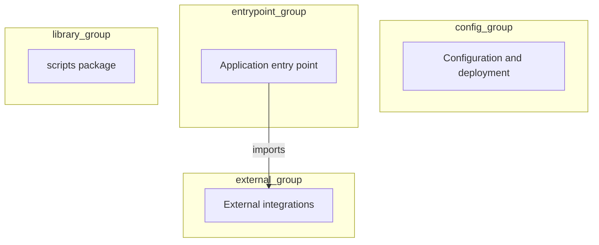

# Architecture report: laoma528/awesome-zhuiju-free

> Automated static analysis. **Observed** = directly seen in files/imports/AST; **Inferred** = interpretation from that evidence. Repository code was not executed.

## 1. Repository at a glance

| Item | Value |
| --- | --- |
| Repository | laoma528/awesome-zhuiju-free |
| Description | 免费无广告的追剧资源指南，人工精选资源、每天检测资源有效性。收录在线影视、影视APP、网盘搜索、磁力BT、字幕、TVBox / 影视仓空壳软件/配置地址、IPTV直播源、会员拼团、影视相关开源项目。开源，社区共同维护。 |
| Language | JavaScript |
| Stars | 15620 |
| Licence | CC-BY-4.0 |
| Analysed commit / branch | bacc0f32b72313b31f4cfc18d0a8b3c7ffb76904 / main |
| Framework(s) | None detected |
| Files analysed | 51 |
| Components | 4 |

## 2. Architecture in one minute

laoma528/awesome-zhuiju-free - 免费无广告的追剧资源指南，人工精选资源、每天检测资源有效性。收录在线影视、影视APP、网盘搜索、磁力BT、字幕、TVBox / 影视仓空壳软件/配置地址、IPTV直播源、会员拼团、影视相关开源项目。开源，社区共同维护。. This repository was analysed statically from 51 file(s) (1 Python). Detected technologies (observed from imports/manifests): GitHub Actions. Files are grouped into 4 component(s): Configuration and deployment, Application entry point, External integrations, scripts package. Observed entry point(s): scripts/publish-typecho.py. Findings below distinguish observed facts from inferred interpretation.

## 3. High-level block diagram

## 4. Main components

### Configuration and deployment (`config`)

- **Kind:** config
- **Status:** Observed
- **Confidence:** 0.85
- **Responsibility:** Groups 6 file(s) under configuration and deployment (observed from repository paths and static analysis).
- **Paths:** `reports/availability.json`, `reports/notices.json`, `reports/verifications.json`, `resources/android-yingshi-app-downloads.json`, `resources/resources.json`, `resources/schema.json`
- **Evidence:** [reports/availability.json](https://github.com/laoma528/awesome-zhuiju-free/blob/bacc0f32b72313b31f4cfc18d0a8b3c7ffb76904/reports/availability.json); [reports/notices.json](https://github.com/laoma528/awesome-zhuiju-free/blob/bacc0f32b72313b31f4cfc18d0a8b3c7ffb76904/reports/notices.json); [reports/verifications.json](https://github.com/laoma528/awesome-zhuiju-free/blob/bacc0f32b72313b31f4cfc18d0a8b3c7ffb76904/reports/verifications.json); [resources/android-yingshi-app-downloads.json](https://github.com/laoma528/awesome-zhuiju-free/blob/bacc0f32b72313b31f4cfc18d0a8b3c7ffb76904/resources/android-yingshi-app-downloads.json); [resources/resources.json](https://github.com/laoma528/awesome-zhuiju-free/blob/bacc0f32b72313b31f4cfc18d0a8b3c7ffb76904/resources/resources.json); [resources/schema.json](https://github.com/laoma528/awesome-zhuiju-free/blob/bacc0f32b72313b31f4cfc18d0a8b3c7ffb76904/resources/schema.json)

### Application entry point (`entrypoint`)

- **Kind:** entrypoint
- **Status:** Observed
- **Confidence:** 0.85
- **Responsibility:** Groups 1 file(s) under application entry point (observed from repository paths and static analysis). Observed top-level classes: TimeoutSafeTransport. Observed top-level functions: add_common_document_arguments, add_get_arguments, add_page_document_arguments, add_post_document_arguments, build_content, check_connection.
- **Paths:** `scripts/publish-typecho.py`
- **Evidence:** [scripts/publish-typecho.py:32](https://github.com/laoma528/awesome-zhuiju-free/blob/bacc0f32b72313b31f4cfc18d0a8b3c7ffb76904/scripts/publish-typecho.py#L32)

### External integrations (`external_integrations`)

- **Kind:** external
- **Status:** Inferred
- **Confidence:** 0.70
- **Responsibility:** Groups 0 file(s) under external integrations (observed from repository paths and static analysis).
- **Evidence:** [scripts/publish-typecho.py:11](https://github.com/laoma528/awesome-zhuiju-free/blob/bacc0f32b72313b31f4cfc18d0a8b3c7ffb76904/scripts/publish-typecho.py#L11)

### scripts package (`scripts`)

- **Kind:** library
- **Status:** Observed
- **Confidence:** 0.85
- **Responsibility:** Groups 6 file(s) under scripts package (observed from repository paths and static analysis).
- **Paths:** `scripts/check-availability.mjs`, `scripts/check-public-files.mjs`, `scripts/generate-weekly-release.mjs`, `scripts/sync-readme.mjs`, `scripts/update-open-source-stats.mjs`, `scripts/validate-data.mjs`
- **Evidence:** [scripts/check-availability.mjs](https://github.com/laoma528/awesome-zhuiju-free/blob/bacc0f32b72313b31f4cfc18d0a8b3c7ffb76904/scripts/check-availability.mjs); [scripts/check-public-files.mjs](https://github.com/laoma528/awesome-zhuiju-free/blob/bacc0f32b72313b31f4cfc18d0a8b3c7ffb76904/scripts/check-public-files.mjs); [scripts/generate-weekly-release.mjs](https://github.com/laoma528/awesome-zhuiju-free/blob/bacc0f32b72313b31f4cfc18d0a8b3c7ffb76904/scripts/generate-weekly-release.mjs); [scripts/sync-readme.mjs](https://github.com/laoma528/awesome-zhuiju-free/blob/bacc0f32b72313b31f4cfc18d0a8b3c7ffb76904/scripts/sync-readme.mjs); [scripts/update-open-source-stats.mjs](https://github.com/laoma528/awesome-zhuiju-free/blob/bacc0f32b72313b31f4cfc18d0a8b3c7ffb76904/scripts/update-open-source-stats.mjs); [scripts/validate-data.mjs](https://github.com/laoma528/awesome-zhuiju-free/blob/bacc0f32b72313b31f4cfc18d0a8b3c7ffb76904/scripts/validate-data.mjs)

## 5. Execution flow

**Observed** entry point(s):

- [scripts/publish-typecho.py:569](https://github.com/laoma528/awesome-zhuiju-free/blob/bacc0f32b72313b31f4cfc18d0a8b3c7ffb76904/scripts/publish-typecho.py#L569)

Representative flow (derived from observed entry points and the import graph; steps beyond the entry point are **Inferred**):

1. Execution starts at an observed entry point listed above, if present.
2. `entrypoint` imports `external_integrations` (Application entry point -> External integrations).

## 6. Project structure

### `(root)`

- `.gitattributes` - other (99 bytes)
- `.gitignore` - other (874 bytes)
- `CLAUDE.md` - docs (3506 bytes)
- `CONTRIBUTING.md` - docs (4451 bytes)
- `LICENSE` - docs (17023 bytes)
- `MAINTAINERS.md` - docs (3554 bytes)
- `README.md` - docs (55901 bytes)

### `.githooks`

- `.githooks/pre-push` - other (108 bytes)

### `.github`

- `.github/ISSUE_TEMPLATE/broken-link.yml` - config (965 bytes)
- `.github/ISSUE_TEMPLATE/resource.yml` - config (1974 bytes)
- `.github/ISSUE_TEMPLATE/rights-holder-request.yml` - config (1218 bytes)
- `.github/pull_request_template.md` - docs (409 bytes)
- `.github/workflows/check-availability.yml` - ci, YAML (1250 bytes)
- `.github/workflows/issue-to-resource-pr.yml` - ci, YAML (16614 bytes)
- `.github/workflows/public-files.yml` - ci, YAML (431 bytes)
- `.github/workflows/update-open-source-stats.yml` - ci, YAML (1114 bytes)
- `.github/workflows/validate-data.yml` - ci, YAML (430 bytes)
- `.github/workflows/weekly-release.yml` - ci, YAML (1856 bytes)

### `blog`

- `blog/README.md` - docs (5747 bytes)
- `blog/_template.md` - docs (2189 bytes)
- `blog/articles/2026-07-12-awesome-zhuiju-free-guide.md` - docs (4948 bytes)
- `blog/articles/2026-07-12-selene-tv-guide.md` - docs (6738 bytes)
- `blog/articles/2026-07-12-tvbox-yingshicang-interface-guide.md` - docs (7487 bytes)
- `blog/articles/2026-07-12-yingshicang-config-addresses.md` - docs (4939 bytes)
- `blog/articles/2026-08-01-fongmi-download.md` - docs (8061 bytes)
- `blog/articles/2026-08-01-ok-yingshi-download.md` - docs (9978 bytes)
- `blog/articles/2026-08-01-peekpro-download.md` - docs (9902 bytes)
- `blog/articles/2026-08-01-webhometv-download.md` - docs (10278 bytes)
- `blog/articles/2026-08-01-yingshicang-download.md` - docs (7712 bytes)
- `blog/articles/2026-08-29-about-awesome-zhuiju-free.md` - docs (4654 bytes)
- `blog/articles/2026-08-29-friend-links.md` - docs (2557 bytes)
- `blog/articles/2026-08-29-submit-resource.md` - docs (2398 bytes)
- `blog/articles/2026-09-13-ios-yingshi-app.md` - docs (1513 bytes)
- `blog/articles/2026-10-17-iptv-live-sources.md` - docs (4934 bytes)
- `blog/articles/2026-11-01-android-yingshi-app.md` - docs (6667 bytes)

### `docs`

- `docs/PUBLIC-FILES.md` - docs (2215 bytes)

### `reports`

- `reports/README.md` - docs (1294 bytes)
- `reports/availability.json` - config (31008 bytes)
- `reports/notices.json` - config (67 bytes)
- `reports/verifications.json` - config (44289 bytes)

### `resources`

- `resources/README.md` - docs (1839 bytes)
- `resources/android-yingshi-app-downloads.json` - config (2060 bytes)
- `resources/resources.json` - config (161389 bytes)
- `resources/schema.json` - config (6215 bytes)

### `scripts`

- `scripts/check-availability.mjs` - source, JavaScript (5150 bytes)
- `scripts/check-public-files.mjs` - source, JavaScript (5965 bytes)
- `scripts/generate-weekly-release.mjs` - source, JavaScript (11470 bytes)
- `scripts/publish-typecho.py` - source, Python (21271 bytes)
- `scripts/sync-readme.mjs` - source, JavaScript (21637 bytes)
- `scripts/update-open-source-stats.mjs` - source, JavaScript (2939 bytes)
- `scripts/validate-data.mjs` - source, JavaScript (7659 bytes)

## 7. Key dependencies and integrations

| Name | Category | Status | Confidence | Evidence |
| --- | --- | --- | --- | --- |
| GitHub Actions | ci | Observed | 0.90 | [.github/workflows/check-availability.yml](https://github.com/laoma528/awesome-zhuiju-free/blob/bacc0f32b72313b31f4cfc18d0a8b3c7ffb76904/.github/workflows/check-availability.yml); [.github/workflows/issue-to-resource-pr.yml](https://github.com/laoma528/awesome-zhuiju-free/blob/bacc0f32b72313b31f4cfc18d0a8b3c7ffb76904/.github/workflows/issue-to-resource-pr.yml); [.github/workflows/public-files.yml](https://github.com/laoma528/awesome-zhuiju-free/blob/bacc0f32b72313b31f4cfc18d0a8b3c7ffb76904/.github/workflows/public-files.yml); [.github/workflows/update-open-source-stats.yml](https://github.com/laoma528/awesome-zhuiju-free/blob/bacc0f32b72313b31f4cfc18d0a8b3c7ffb76904/.github/workflows/update-open-source-stats.yml) |

## 8. Data and state

No database, cache, queue, or persistent-state usage was observed in the analysed files. State handling, if any, may be in-memory or in files that were not analysed.

## 9. Configuration and deployment clues

- `.github/ISSUE_TEMPLATE/broken-link.yml` (config)
- `.github/ISSUE_TEMPLATE/resource.yml` (config)
- `.github/ISSUE_TEMPLATE/rights-holder-request.yml` (config)
- `.github/workflows/check-availability.yml` (ci)
- `.github/workflows/issue-to-resource-pr.yml` (ci)
- `.github/workflows/public-files.yml` (ci)
- `.github/workflows/update-open-source-stats.yml` (ci)
- `.github/workflows/validate-data.yml` (ci)
- `.github/workflows/weekly-release.yml` (ci)
- `reports/availability.json` (config)
- `reports/notices.json` (config)
- `reports/verifications.json` (config)
- `resources/android-yingshi-app-downloads.json` (config)
- `resources/resources.json` (config)
- `resources/schema.json` (config)

## 10. Design observations

- An entry/API layer is separated from other code (Inferred from paths and decorators).
- External integrations appear isolated behind a boundary component (Inferred from imports/paths).

These observations are interpretations (**Inferred**) of the observed structure, not guarantees about runtime design.

## 11. Limitations and unknowns

- Static analysis only: repository code was not executed, installed, or imported at runtime.
- Components and relationships are inferred from file paths, imports, and AST structure; runtime behaviour, dynamic imports, and reflection may not be visible.
- Repository text was treated as untrusted data; no instructions found in repository files were followed, and likely secret values were redacted/excluded.

## 12. Source references

- [.github/workflows/check-availability.yml](https://github.com/laoma528/awesome-zhuiju-free/blob/bacc0f32b72313b31f4cfc18d0a8b3c7ffb76904/.github/workflows/check-availability.yml)
- [.github/workflows/issue-to-resource-pr.yml](https://github.com/laoma528/awesome-zhuiju-free/blob/bacc0f32b72313b31f4cfc18d0a8b3c7ffb76904/.github/workflows/issue-to-resource-pr.yml)
- [.github/workflows/public-files.yml](https://github.com/laoma528/awesome-zhuiju-free/blob/bacc0f32b72313b31f4cfc18d0a8b3c7ffb76904/.github/workflows/public-files.yml)
- [.github/workflows/update-open-source-stats.yml](https://github.com/laoma528/awesome-zhuiju-free/blob/bacc0f32b72313b31f4cfc18d0a8b3c7ffb76904/.github/workflows/update-open-source-stats.yml)
- [.github/workflows/validate-data.yml](https://github.com/laoma528/awesome-zhuiju-free/blob/bacc0f32b72313b31f4cfc18d0a8b3c7ffb76904/.github/workflows/validate-data.yml)
- [.github/workflows/weekly-release.yml](https://github.com/laoma528/awesome-zhuiju-free/blob/bacc0f32b72313b31f4cfc18d0a8b3c7ffb76904/.github/workflows/weekly-release.yml)
- [reports/availability.json](https://github.com/laoma528/awesome-zhuiju-free/blob/bacc0f32b72313b31f4cfc18d0a8b3c7ffb76904/reports/availability.json)
- [reports/notices.json](https://github.com/laoma528/awesome-zhuiju-free/blob/bacc0f32b72313b31f4cfc18d0a8b3c7ffb76904/reports/notices.json)
- [reports/verifications.json](https://github.com/laoma528/awesome-zhuiju-free/blob/bacc0f32b72313b31f4cfc18d0a8b3c7ffb76904/reports/verifications.json)
- [resources/android-yingshi-app-downloads.json](https://github.com/laoma528/awesome-zhuiju-free/blob/bacc0f32b72313b31f4cfc18d0a8b3c7ffb76904/resources/android-yingshi-app-downloads.json)
- [resources/resources.json](https://github.com/laoma528/awesome-zhuiju-free/blob/bacc0f32b72313b31f4cfc18d0a8b3c7ffb76904/resources/resources.json)
- [resources/schema.json](https://github.com/laoma528/awesome-zhuiju-free/blob/bacc0f32b72313b31f4cfc18d0a8b3c7ffb76904/resources/schema.json)
- [scripts/check-availability.mjs](https://github.com/laoma528/awesome-zhuiju-free/blob/bacc0f32b72313b31f4cfc18d0a8b3c7ffb76904/scripts/check-availability.mjs)
- [scripts/check-public-files.mjs](https://github.com/laoma528/awesome-zhuiju-free/blob/bacc0f32b72313b31f4cfc18d0a8b3c7ffb76904/scripts/check-public-files.mjs)
- [scripts/generate-weekly-release.mjs](https://github.com/laoma528/awesome-zhuiju-free/blob/bacc0f32b72313b31f4cfc18d0a8b3c7ffb76904/scripts/generate-weekly-release.mjs)
- [scripts/publish-typecho.py:11](https://github.com/laoma528/awesome-zhuiju-free/blob/bacc0f32b72313b31f4cfc18d0a8b3c7ffb76904/scripts/publish-typecho.py#L11)
- [scripts/publish-typecho.py:32](https://github.com/laoma528/awesome-zhuiju-free/blob/bacc0f32b72313b31f4cfc18d0a8b3c7ffb76904/scripts/publish-typecho.py#L32)
- [scripts/publish-typecho.py:569](https://github.com/laoma528/awesome-zhuiju-free/blob/bacc0f32b72313b31f4cfc18d0a8b3c7ffb76904/scripts/publish-typecho.py#L569)
- [scripts/sync-readme.mjs](https://github.com/laoma528/awesome-zhuiju-free/blob/bacc0f32b72313b31f4cfc18d0a8b3c7ffb76904/scripts/sync-readme.mjs)
- [scripts/update-open-source-stats.mjs](https://github.com/laoma528/awesome-zhuiju-free/blob/bacc0f32b72313b31f4cfc18d0a8b3c7ffb76904/scripts/update-open-source-stats.mjs)
- [scripts/validate-data.mjs](https://github.com/laoma528/awesome-zhuiju-free/blob/bacc0f32b72313b31f4cfc18d0a8b3c7ffb76904/scripts/validate-data.mjs)
