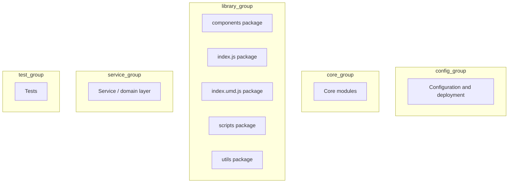

# Architecture report: layui/layui

> Automated static analysis. **Observed** = directly seen in files/imports/AST; **Inferred** = interpretation from that evidence. Repository code was not executed.

## 1. Repository at a glance

| Item | Value |
| --- | --- |
| Repository | layui/layui |
| Description | 一套遵循浏览器原生态开发模式的 Web UI 组件库。 |
| Language | JavaScript |
| Stars | 30584 |
| Licence | MIT |
| Analysed commit / branch | 13725717407d23fac11b15b1a1155d26328b6d99 / main |
| Framework(s) | None detected |
| Files analysed | 181 |
| Components | 9 |

## 2. Architecture in one minute

layui/layui - 一套遵循浏览器原生态开发模式的 Web UI 组件库。. This repository was analysed statically from 181 file(s) (0 Python). Detected technologies (observed from imports/manifests): GitHub Actions, Jest. Files are grouped into 9 component(s): components package, Configuration and deployment, Core modules, index.js package, index.umd.js package, scripts package, Service / domain layer, Tests. Findings below distinguish observed facts from inferred interpretation.

## 3. High-level block diagram

## 4. Main components

### components package (`components`)

- **Kind:** library
- **Status:** Observed
- **Confidence:** 0.85
- **Responsibility:** Groups 25 file(s) under components package (observed from repository paths and static analysis).
- **Paths:** `src/components/breadcrumb.js`, `src/components/carousel.js`, `src/components/code.js`, `src/components/collapse.js`, `src/components/colorPicker.js`, `src/components/datePicker.js`, `src/components/dropdown.js`, `src/components/floatbar.js`, `src/components/flow.js`, `src/components/form.js`, `src/components/initializer.js`, `src/components/layer.js`, `src/components/laypage.js`, `src/components/menu.js`, `src/components/nav.js`, `src/components/popup.js`, `src/components/progress.js`, `src/components/rate.js`, `src/components/slider.js`, `src/components/table.js`, `src/components/tabs.js`, `src/components/transfer.js`, `src/components/tree.js`, `src/components/treeTable.js`, `src/components/upload.js`
- **Evidence:** [src/components/breadcrumb.js](https://github.com/layui/layui/blob/13725717407d23fac11b15b1a1155d26328b6d99/src/components/breadcrumb.js); [src/components/carousel.js](https://github.com/layui/layui/blob/13725717407d23fac11b15b1a1155d26328b6d99/src/components/carousel.js); [src/components/code.js](https://github.com/layui/layui/blob/13725717407d23fac11b15b1a1155d26328b6d99/src/components/code.js); [src/components/collapse.js](https://github.com/layui/layui/blob/13725717407d23fac11b15b1a1155d26328b6d99/src/components/collapse.js); [src/components/colorPicker.js](https://github.com/layui/layui/blob/13725717407d23fac11b15b1a1155d26328b6d99/src/components/colorPicker.js); [src/components/datePicker.js](https://github.com/layui/layui/blob/13725717407d23fac11b15b1a1155d26328b6d99/src/components/datePicker.js); [src/components/dropdown.js](https://github.com/layui/layui/blob/13725717407d23fac11b15b1a1155d26328b6d99/src/components/dropdown.js); [src/components/floatbar.js](https://github.com/layui/layui/blob/13725717407d23fac11b15b1a1155d26328b6d99/src/components/floatbar.js)

### Configuration and deployment (`config`)

- **Kind:** config
- **Status:** Observed
- **Confidence:** 0.85
- **Responsibility:** Groups 2 file(s) under configuration and deployment (observed from repository paths and static analysis).
- **Paths:** `biome.json`, `package.json`
- **Evidence:** [biome.json](https://github.com/layui/layui/blob/13725717407d23fac11b15b1a1155d26328b6d99/biome.json); [package.json](https://github.com/layui/layui/blob/13725717407d23fac11b15b1a1155d26328b6d99/package.json)

### Core modules (`core`)

- **Kind:** core
- **Status:** Observed
- **Confidence:** 0.85
- **Responsibility:** Groups 4 file(s) under core modules (observed from repository paths and static analysis).
- **Paths:** `eslint.config.mjs`, `jest.config.mjs`, `postcss.config.mjs`, `rollup.config.mjs`
- **Evidence:** [eslint.config.mjs](https://github.com/layui/layui/blob/13725717407d23fac11b15b1a1155d26328b6d99/eslint.config.mjs); [jest.config.mjs](https://github.com/layui/layui/blob/13725717407d23fac11b15b1a1155d26328b6d99/jest.config.mjs); [postcss.config.mjs](https://github.com/layui/layui/blob/13725717407d23fac11b15b1a1155d26328b6d99/postcss.config.mjs); [rollup.config.mjs](https://github.com/layui/layui/blob/13725717407d23fac11b15b1a1155d26328b6d99/rollup.config.mjs)

### index.js package (`index_js`)

- **Kind:** library
- **Status:** Observed
- **Confidence:** 0.85
- **Responsibility:** Groups 1 file(s) under index.js package (observed from repository paths and static analysis).
- **Paths:** `src/index.js`
- **Evidence:** [src/index.js](https://github.com/layui/layui/blob/13725717407d23fac11b15b1a1155d26328b6d99/src/index.js)

### index.umd.js package (`index_umd_js`)

- **Kind:** library
- **Status:** Observed
- **Confidence:** 0.85
- **Responsibility:** Groups 1 file(s) under index.umd.js package (observed from repository paths and static analysis).
- **Paths:** `src/index.umd.js`
- **Evidence:** [src/index.umd.js](https://github.com/layui/layui/blob/13725717407d23fac11b15b1a1155d26328b6d99/src/index.umd.js)

### scripts package (`scripts`)

- **Kind:** library
- **Status:** Observed
- **Confidence:** 0.85
- **Responsibility:** Groups 4 file(s) under scripts package (observed from repository paths and static analysis).
- **Paths:** `scripts/dev-builder.mjs`, `scripts/dev.mjs`, `scripts/release.mjs`, `scripts/rollup-plugins.mjs`
- **Evidence:** [scripts/dev-builder.mjs](https://github.com/layui/layui/blob/13725717407d23fac11b15b1a1155d26328b6d99/scripts/dev-builder.mjs); [scripts/dev.mjs](https://github.com/layui/layui/blob/13725717407d23fac11b15b1a1155d26328b6d99/scripts/dev.mjs); [scripts/release.mjs](https://github.com/layui/layui/blob/13725717407d23fac11b15b1a1155d26328b6d99/scripts/release.mjs); [scripts/rollup-plugins.mjs](https://github.com/layui/layui/blob/13725717407d23fac11b15b1a1155d26328b6d99/scripts/rollup-plugins.mjs)

### Service / domain layer (`service_layer`)

- **Kind:** service
- **Status:** Observed
- **Confidence:** 0.85
- **Responsibility:** Groups 7 file(s) under service / domain layer (observed from repository paths and static analysis).
- **Paths:** `src/core/component.js`, `src/core/i18n.js`, `src/core/lay.js`, `src/core/laytpl.js`, `src/core/loader.js`, `src/core/logger.js`, `src/core/router.js`
- **Evidence:** [src/core/component.js](https://github.com/layui/layui/blob/13725717407d23fac11b15b1a1155d26328b6d99/src/core/component.js); [src/core/i18n.js](https://github.com/layui/layui/blob/13725717407d23fac11b15b1a1155d26328b6d99/src/core/i18n.js); [src/core/lay.js](https://github.com/layui/layui/blob/13725717407d23fac11b15b1a1155d26328b6d99/src/core/lay.js); [src/core/laytpl.js](https://github.com/layui/layui/blob/13725717407d23fac11b15b1a1155d26328b6d99/src/core/laytpl.js); [src/core/loader.js](https://github.com/layui/layui/blob/13725717407d23fac11b15b1a1155d26328b6d99/src/core/loader.js); [src/core/logger.js](https://github.com/layui/layui/blob/13725717407d23fac11b15b1a1155d26328b6d99/src/core/logger.js); [src/core/router.js](https://github.com/layui/layui/blob/13725717407d23fac11b15b1a1155d26328b6d99/src/core/router.js)

### Tests (`tests`)

- **Kind:** test
- **Status:** Observed
- **Confidence:** 0.85
- **Responsibility:** Groups 68 file(s) under tests (observed from repository paths and static analysis).
- **Paths:** `tests/unit/core.test.js`, `tests/unit/layExtend.test.js`, `tests/visual/assets/demo.css`, `tests/visual/assets/i18n/en.js`, `tests/visual/assets/i18n/fr.js`, `tests/visual/assets/i18n/zh-HK.js`, `tests/visual/assets/json/table/demo1.json`, `tests/visual/assets/json/table/demo2.json`, `tests/visual/assets/json/table/demo3.json`, `tests/visual/assets/json/treeTable/demo-1.json`, `tests/visual/assets/json/treeTable/demo-simple.json`, `tests/visual/assets/modules/@demo/loader/demo1.css`, `tests/visual/assets/modules/@demo/loader/demo1.js`, `tests/visual/assets/modules/@demo/loader/demo2.css`, `tests/visual/assets/modules/@demo/loader/demo2.js`, `tests/visual/assets/modules/@demo/loader/demo3.css`, `tests/visual/assets/modules/@demo/loader/demo3.js`, `tests/visual/assets/modules/test/test.css`, `tests/visual/assets/modules/test/test.js`, `tests/visual/base.html`, `tests/visual/button.html`, `tests/visual/carousel.html`, `tests/visual/code.html`, `tests/visual/collapse.html`, `tests/visual/colorPicker.html`, `tests/visual/datePicker.html`, `tests/visual/dropdown.html`, `tests/visual/esm/index.html`, `tests/visual/floatbar.html`, `tests/visual/flow.html`, `tests/visual/form.html`, `tests/visual/i18n.html`, `tests/visual/layer.html`, `tests/visual/layout-admin.html`, `tests/visual/layout-grid.html`, `tests/visual/laypage.html`, `tests/visual/laytpl.html`, `tests/visual/loader.html`, `tests/visual/menu.html`, `tests/visual/nav.html`, `tests/visual/popup.html`, `tests/visual/progress.html`, `tests/visual/rate.html`, `tests/visual/router.html`, `tests/visual/slider.html`, `tests/visual/static.html`, `tests/visual/table-static.html`, `tests/visual/table-test-border.html`, `tests/visual/table-test.html`, `tests/visual/table.html`, `tests/visual/tabs.html`, `tests/visual/template/README.md`, `tests/visual/template/pr-preview/README.md`, `tests/visual/template/pr-preview/index.html`, `tests/visual/template/pr-preview/index.js`, `tests/visual/template/pr-preview/package.json`, `tests/visual/template/release/test.html`, `tests/visual/template/release/免责声明.html`, `tests/visual/template/release/官方文档.html`, `tests/visual/text.md.html`, `tests/visual/transfer.html`, `tests/visual/tree.html`, `tests/visual/treeTable-async.html`, `tests/visual/treeTable-crud.html`, `tests/visual/treeTable-test-reloadData.html`, `tests/visual/treeTable.html`, `tests/visual/upload.html`, `tests/visual/utils.html`
- **Evidence:** [tests/unit/core.test.js](https://github.com/layui/layui/blob/13725717407d23fac11b15b1a1155d26328b6d99/tests/unit/core.test.js); [tests/unit/layExtend.test.js](https://github.com/layui/layui/blob/13725717407d23fac11b15b1a1155d26328b6d99/tests/unit/layExtend.test.js); [tests/visual/assets/demo.css](https://github.com/layui/layui/blob/13725717407d23fac11b15b1a1155d26328b6d99/tests/visual/assets/demo.css); [tests/visual/assets/i18n/en.js](https://github.com/layui/layui/blob/13725717407d23fac11b15b1a1155d26328b6d99/tests/visual/assets/i18n/en.js); [tests/visual/assets/i18n/fr.js](https://github.com/layui/layui/blob/13725717407d23fac11b15b1a1155d26328b6d99/tests/visual/assets/i18n/fr.js); [tests/visual/assets/i18n/zh-HK.js](https://github.com/layui/layui/blob/13725717407d23fac11b15b1a1155d26328b6d99/tests/visual/assets/i18n/zh-HK.js); [tests/visual/assets/json/table/demo1.json](https://github.com/layui/layui/blob/13725717407d23fac11b15b1a1155d26328b6d99/tests/visual/assets/json/table/demo1.json); [tests/visual/assets/json/table/demo2.json](https://github.com/layui/layui/blob/13725717407d23fac11b15b1a1155d26328b6d99/tests/visual/assets/json/table/demo2.json)

### utils package (`utils`)

- **Kind:** library
- **Status:** Observed
- **Confidence:** 0.85
- **Responsibility:** Groups 4 file(s) under utils package (observed from repository paths and static analysis).
- **Paths:** `src/utils/browser.js`, `src/utils/date.js`, `src/utils/events.js`, `src/utils/index.js`
- **Evidence:** [src/utils/browser.js](https://github.com/layui/layui/blob/13725717407d23fac11b15b1a1155d26328b6d99/src/utils/browser.js); [src/utils/date.js](https://github.com/layui/layui/blob/13725717407d23fac11b15b1a1155d26328b6d99/src/utils/date.js); [src/utils/events.js](https://github.com/layui/layui/blob/13725717407d23fac11b15b1a1155d26328b6d99/src/utils/events.js); [src/utils/index.js](https://github.com/layui/layui/blob/13725717407d23fac11b15b1a1155d26328b6d99/src/utils/index.js)

## 5. Execution flow

**Observed** entry point(s):

- [src/index.js](https://github.com/layui/layui/blob/13725717407d23fac11b15b1a1155d26328b6d99/src/index.js)
- [src/utils/index.js](https://github.com/layui/layui/blob/13725717407d23fac11b15b1a1155d26328b6d99/src/utils/index.js)
- [tests/visual/template/pr-preview/index.js](https://github.com/layui/layui/blob/13725717407d23fac11b15b1a1155d26328b6d99/tests/visual/template/pr-preview/index.js)

Representative flow (derived from observed entry points and the import graph; steps beyond the entry point are **Inferred**):

1. Execution starts at an observed entry point listed above, if present.
2. No internal import relationships between components were observed.

## 6. Project structure

### `(root)`

- `.editorconfig` - config (167 bytes)
- `.gitattributes` - other (19 bytes)
- `.gitignore` - other (353 bytes)
- `.nvmrc` - other (3 bytes)
- `.prettierignore` - other (82 bytes)
- `.prettierrc` - other (26 bytes)
- `CHANGELOG.md` - docs (189 bytes)
- `CODE_OF_CONDUCT.md` - docs (5436 bytes)
- `CONTRIBUTING.md` - docs (6063 bytes)
- `DISCLAIMER.md` - docs (2774 bytes)
- `LICENSE` - docs (1093 bytes)
- `README.en-US.md` - docs (3927 bytes)
- `README.md` - docs (3377 bytes)
- `SECURITY.md` - docs (1543 bytes)
- `biome.json` - config (680 bytes)
- `eslint.config.mjs` - source, JavaScript (1221 bytes)
- `jest.config.mjs` - source, JavaScript (96 bytes)
- `package.json` - manifest (2713 bytes)
- `postcss.config.mjs` - source, JavaScript (785 bytes)
- `rollup.config.mjs` - source, JavaScript (2811 bytes)

### `.github`

- `.github/FUNDING.yml` - config (23 bytes)
- `.github/ISSUE_TEMPLATE/bug-feature.yml` - config (2804 bytes)
- `.github/ISSUE_TEMPLATE/config.yml` - config (438 bytes)
- `.github/copilot-instructions.md` - docs (9347 bytes)
- `.github/pull_request_template.md` - docs (591 bytes)
- `.github/workflows/ci.yml` - ci, YAML (744 bytes)
- `.github/workflows/issue-closed.yml` - ci, YAML (1072 bytes)
- `.github/workflows/issue-labeled.yml` - ci, YAML (4137 bytes)
- `.github/workflows/issue-opened.yml` - ci, YAML (2798 bytes)
- `.github/workflows/pr-preview.yml` - ci, YAML (474 bytes)
- `.github/workflows/release.yml` - ci, YAML (3997 bytes)

### `.husky`

- `.husky/install.mjs` - source, JavaScript (212 bytes)
- `.husky/pre-commit` - other (31 bytes)

### `docs`

- `docs/.template/detail/demo.md` - docs (694 bytes)
- `docs/.template/detail/options.md` - docs (187 bytes)
- `docs/.template/examples/demo.md` - docs (128 bytes)
- `docs/.template/index.md` - docs (1490 bytes)
- `docs/README.md` - docs (141 bytes)

### `scripts`

- `scripts/dev-builder.mjs` - source, JavaScript (769 bytes)
- `scripts/dev.mjs` - source, JavaScript (1420 bytes)
- `scripts/release.mjs` - source, JavaScript (1546 bytes)
- `scripts/rollup-plugins.mjs` - source, JavaScript (407 bytes)

### `src`

- `src/components/breadcrumb.js` - source, JavaScript (1023 bytes)
- `src/components/carousel.js` - source, JavaScript (8923 bytes)
- `src/components/code.js` - source, JavaScript (20360 bytes)
- `src/components/collapse.js` - source, JavaScript (3165 bytes)
- `src/components/colorPicker.js` - source, JavaScript (23813 bytes)
- `src/components/datePicker.js` - source, JavaScript (96585 bytes)
- `src/components/dropdown.js` - source, JavaScript (5788 bytes)
- `src/components/floatbar.js` - source, JavaScript (3907 bytes)
- `src/components/flow.js` - source, JavaScript (7134 bytes)
- `src/components/form.js` - source, JavaScript (56935 bytes)
- `src/components/initializer.js` - source, JavaScript (1431 bytes)
- `src/components/layer.js` - source, JavaScript (61594 bytes)
- `src/components/laypage.js` - source, JavaScript (12632 bytes)
- `src/components/menu.js` - source, JavaScript (31033 bytes)
- `src/components/nav.js` - source, JavaScript (7672 bytes)
- `src/components/popup.js` - source, JavaScript (17433 bytes)
- `src/components/progress.js` - source, JavaScript (2630 bytes)
- `src/components/rate.js` - source, JavaScript (7423 bytes)
- `src/components/slider.js` - source, JavaScript (20025 bytes)
- `src/components/table.js` - source, JavaScript (117980 bytes)
- `src/components/tabs.js` - source, JavaScript (22975 bytes)
- `src/components/transfer.js` - source, JavaScript (13422 bytes)
- `src/components/tree.js` - source, JavaScript (31054 bytes)
- `src/components/treeTable.js` - source, JavaScript (79352 bytes)
- `src/components/upload.js` - source, JavaScript (22295 bytes)
- `src/core/component.js` - source, JavaScript (8930 bytes)
- `src/core/i18n.js` - source, JavaScript (9679 bytes)
- `src/core/lay.js` - source, JavaScript (48242 bytes)
- `src/core/laytpl.js` - source, JavaScript (14298 bytes)
- `src/core/loader.js` - source, JavaScript (10235 bytes)
- `src/core/logger.js` - source, JavaScript (762 bytes)
- `src/core/router.js` - source, JavaScript (3999 bytes)
- `src/css/base.css` - other (2784 bytes)
- `src/css/index.css` - other (1032 bytes)
- `src/css/modules/anim.css` - other (4313 bytes)
- `src/css/modules/auxiliary.css` - other (1371 bytes)
- `src/css/modules/badge.css` - other (856 bytes)
- `src/css/modules/button.css` - other (3003 bytes)
- `src/css/modules/carousel.css` - other (6535 bytes)
- `src/css/modules/code.css` - other (5897 bytes)
- `src/css/modules/colorPicker.css` - other (4138 bytes)
- `src/css/modules/datePicker.css` - other (11683 bytes)
- `src/css/modules/floatbar.css` - other (651 bytes)
- `src/css/modules/flow.css` - other (529 bytes)
- `src/css/modules/form.css` - other (17523 bytes)
- `src/css/modules/icon.css` - other (9854 bytes)
- `src/css/modules/layer.css` - other (21980 bytes)
- `src/css/modules/layout.css` - other (14219 bytes)
- `src/css/modules/laypage.css` - other (3016 bytes)
- `src/css/modules/menu.css` - other (9738 bytes)
- `src/css/modules/nav.css` - other (5236 bytes)
- `src/css/modules/panel.css` - other (1886 bytes)
- `src/css/modules/popup.css` - other (1480 bytes)
- `src/css/modules/progress.css` - other (1055 bytes)
- `src/css/modules/rate.css` - other (585 bytes)
- `src/css/modules/slider.css` - other (3008 bytes)
- `src/css/modules/table.css` - other (12915 bytes)
- `src/css/modules/tabs.css` - other (3294 bytes)
- `src/css/modules/text.css` - other (2597 bytes)
- `src/css/modules/theme.css` - other (2754 bytes)
- `src/css/modules/timeline.css` - other (834 bytes)
- `src/css/modules/transfer.css` - other (1870 bytes)
- `src/css/modules/tree.css` - other (2879 bytes)
- `src/css/modules/upload.css` - other (4491 bytes)
- `src/css/var.css` - other (1482 bytes)
- `src/index.js` - source, JavaScript (1689 bytes)
- `src/index.umd.js` - source, JavaScript (2086 bytes)
- `src/utils/browser.js` - source, JavaScript (730 bytes)
- `src/utils/date.js` - source, JavaScript (6967 bytes)
- `src/utils/events.js` - source, JavaScript (2014 bytes)
- `src/utils/index.js` - source, JavaScript (117 bytes)

### `tests`

- `tests/unit/core.test.js` - test, JavaScript (308 bytes)
- `tests/unit/layExtend.test.js` - test, JavaScript (19021 bytes)
- `tests/visual/assets/demo.css` - test (1067 bytes)
- `tests/visual/assets/i18n/en.js` - test, JavaScript (3943 bytes)
- `tests/visual/assets/i18n/fr.js` - test, JavaScript (4486 bytes)
- `tests/visual/assets/i18n/zh-HK.js` - test, JavaScript (4323 bytes)
- `tests/visual/assets/json/table/demo1.json` - test (4707 bytes)
- `tests/visual/assets/json/table/demo2.json` - test (1474 bytes)
- `tests/visual/assets/json/table/demo3.json` - test (2859 bytes)
- `tests/visual/assets/json/treeTable/demo-1.json` - test (158023 bytes)
- `tests/visual/assets/json/treeTable/demo-simple.json` - test (2479 bytes)
- `tests/visual/assets/modules/@demo/loader/demo1.css` - test (50 bytes)
- `tests/visual/assets/modules/@demo/loader/demo1.js` - test, JavaScript (32 bytes)
- `tests/visual/assets/modules/@demo/loader/demo2.css` - test (0 bytes)
- `tests/visual/assets/modules/@demo/loader/demo2.js` - test, JavaScript (32 bytes)
- `tests/visual/assets/modules/@demo/loader/demo3.css` - test (0 bytes)
- `tests/visual/assets/modules/@demo/loader/demo3.js` - test, JavaScript (32 bytes)
- `tests/visual/assets/modules/test/test.css` - test (982 bytes)
- `tests/visual/assets/modules/test/test.js` - test, JavaScript (9097 bytes)
- `tests/visual/base.html` - test (13657 bytes)
- `tests/visual/button.html` - test (6232 bytes)
- `tests/visual/carousel.html` - test (3968 bytes)
- `tests/visual/code.html` - test (10654 bytes)
- `tests/visual/collapse.html` - test (2005 bytes)
- `tests/visual/colorPicker.html` - test (3751 bytes)
- `tests/visual/datePicker.html` - test (15553 bytes)
- `tests/visual/dropdown.html` - test (14440 bytes)
- `tests/visual/esm/index.html` - test (610 bytes)
- `tests/visual/floatbar.html` - test (2475 bytes)
- `tests/visual/flow.html` - test (5928 bytes)
- `tests/visual/form.html` - test (27014 bytes)
- `tests/visual/i18n.html` - test (17893 bytes)
- `tests/visual/layer.html` - test (9028 bytes)
- `tests/visual/layout-admin.html` - test (5893 bytes)
- `tests/visual/layout-grid.html` - test (9972 bytes)
- `tests/visual/laypage.html` - test (7833 bytes)
- `tests/visual/laytpl.html` - test (9039 bytes)
- `tests/visual/loader.html` - test (6362 bytes)
- `tests/visual/menu.html` - test (20808 bytes)
- `tests/visual/nav.html` - test (9775 bytes)
- `tests/visual/popup.html` - test (10809 bytes)
- `tests/visual/progress.html` - test (3622 bytes)
- `tests/visual/rate.html` - test (2224 bytes)
- `tests/visual/router.html` - test (10895 bytes)
- `tests/visual/slider.html` - test (1505 bytes)
- `tests/visual/static.html` - test (4213 bytes)
- `tests/visual/table-static.html` - test (2521 bytes)
- `tests/visual/table-test-border.html` - test (4362 bytes)
- `tests/visual/table-test.html` - test (26021 bytes)
- `tests/visual/table.html` - test (12506 bytes)
- `tests/visual/tabs.html` - test (13606 bytes)
- `tests/visual/template/README.md` - test (92 bytes)
- `tests/visual/template/pr-preview/README.md` - test (38 bytes)
- `tests/visual/template/pr-preview/index.html` - test (480 bytes)
- `tests/visual/template/pr-preview/index.js` - test, JavaScript (86 bytes)
- `tests/visual/template/pr-preview/package.json` - test (323 bytes)
- `tests/visual/template/release/test.html` - test (3083 bytes)
- `tests/visual/template/release/免责声明.html` - test (308 bytes)
- `tests/visual/template/release/官方文档.html` - test (278 bytes)
- `tests/visual/text.md.html` - test (2356 bytes)
- `tests/visual/transfer.html` - test (3042 bytes)
- `tests/visual/tree.html` - test (12306 bytes)
- `tests/visual/treeTable-async.html` - test (8032 bytes)
- `tests/visual/treeTable-crud.html` - test (10404 bytes)
- `tests/visual/treeTable-test-reloadData.html` - test (2526 bytes)
- `tests/visual/treeTable.html` - test (9206 bytes)
- `tests/visual/upload.html` - test (7605 bytes)
- `tests/visual/utils.html` - test (7633 bytes)

## 7. Key dependencies and integrations

| Name | Category | Status | Confidence | Evidence |
| --- | --- | --- | --- | --- |
| GitHub Actions | ci | Observed | 0.90 | [.github/workflows/ci.yml](https://github.com/layui/layui/blob/13725717407d23fac11b15b1a1155d26328b6d99/.github/workflows/ci.yml); [.github/workflows/issue-closed.yml](https://github.com/layui/layui/blob/13725717407d23fac11b15b1a1155d26328b6d99/.github/workflows/issue-closed.yml); [.github/workflows/issue-labeled.yml](https://github.com/layui/layui/blob/13725717407d23fac11b15b1a1155d26328b6d99/.github/workflows/issue-labeled.yml); [.github/workflows/issue-opened.yml](https://github.com/layui/layui/blob/13725717407d23fac11b15b1a1155d26328b6d99/.github/workflows/issue-opened.yml) |
| Jest | tooling | Observed | 0.85 | [package.json:49](https://github.com/layui/layui/blob/13725717407d23fac11b15b1a1155d26328b6d99/package.json#L49) |

## 8. Data and state

No database, cache, queue, or persistent-state usage was observed in the analysed files. State handling, if any, may be in-memory or in files that were not analysed.

## 9. Configuration and deployment clues

- `.editorconfig` (config)
- `.github/FUNDING.yml` (config)
- `.github/ISSUE_TEMPLATE/bug-feature.yml` (config)
- `.github/ISSUE_TEMPLATE/config.yml` (config)
- `.github/workflows/ci.yml` (ci)
- `.github/workflows/issue-closed.yml` (ci)
- `.github/workflows/issue-labeled.yml` (ci)
- `.github/workflows/issue-opened.yml` (ci)
- `.github/workflows/pr-preview.yml` (ci)
- `.github/workflows/release.yml` (ci)
- `biome.json` (config)
- `package.json` (manifest)

## 10. Design observations

- Service/domain code is distinct from entry and data code, suggesting layered separation (Inferred).
- Tests are present alongside source code (Observed from test file paths).

These observations are interpretations (**Inferred**) of the observed structure, not guarantees about runtime design.

## 11. Limitations and unknowns

- Static analysis only: repository code was not executed, installed, or imported at runtime.
- Components and relationships are inferred from file paths, imports, and AST structure; runtime behaviour, dynamic imports, and reflection may not be visible.
- No clear application entry point was observed in the analysed files.
- Repository text was treated as untrusted data; no instructions found in repository files were followed, and likely secret values were redacted/excluded.
- JavaScript and TypeScript files were inventoried from paths and package manifests. They were not parsed with a full language AST, and repository code was not executed.

## 12. Source references

- [.github/workflows/ci.yml](https://github.com/layui/layui/blob/13725717407d23fac11b15b1a1155d26328b6d99/.github/workflows/ci.yml)
- [.github/workflows/issue-closed.yml](https://github.com/layui/layui/blob/13725717407d23fac11b15b1a1155d26328b6d99/.github/workflows/issue-closed.yml)
- [.github/workflows/issue-labeled.yml](https://github.com/layui/layui/blob/13725717407d23fac11b15b1a1155d26328b6d99/.github/workflows/issue-labeled.yml)
- [.github/workflows/issue-opened.yml](https://github.com/layui/layui/blob/13725717407d23fac11b15b1a1155d26328b6d99/.github/workflows/issue-opened.yml)
- [.github/workflows/pr-preview.yml](https://github.com/layui/layui/blob/13725717407d23fac11b15b1a1155d26328b6d99/.github/workflows/pr-preview.yml)
- [.github/workflows/release.yml](https://github.com/layui/layui/blob/13725717407d23fac11b15b1a1155d26328b6d99/.github/workflows/release.yml)
- [biome.json](https://github.com/layui/layui/blob/13725717407d23fac11b15b1a1155d26328b6d99/biome.json)
- [eslint.config.mjs](https://github.com/layui/layui/blob/13725717407d23fac11b15b1a1155d26328b6d99/eslint.config.mjs)
- [jest.config.mjs](https://github.com/layui/layui/blob/13725717407d23fac11b15b1a1155d26328b6d99/jest.config.mjs)
- [package.json](https://github.com/layui/layui/blob/13725717407d23fac11b15b1a1155d26328b6d99/package.json)
- [package.json:49](https://github.com/layui/layui/blob/13725717407d23fac11b15b1a1155d26328b6d99/package.json#L49)
- [postcss.config.mjs](https://github.com/layui/layui/blob/13725717407d23fac11b15b1a1155d26328b6d99/postcss.config.mjs)
- [rollup.config.mjs](https://github.com/layui/layui/blob/13725717407d23fac11b15b1a1155d26328b6d99/rollup.config.mjs)
- [scripts/dev-builder.mjs](https://github.com/layui/layui/blob/13725717407d23fac11b15b1a1155d26328b6d99/scripts/dev-builder.mjs)
- [scripts/dev.mjs](https://github.com/layui/layui/blob/13725717407d23fac11b15b1a1155d26328b6d99/scripts/dev.mjs)
- [scripts/release.mjs](https://github.com/layui/layui/blob/13725717407d23fac11b15b1a1155d26328b6d99/scripts/release.mjs)
- [scripts/rollup-plugins.mjs](https://github.com/layui/layui/blob/13725717407d23fac11b15b1a1155d26328b6d99/scripts/rollup-plugins.mjs)
- [src/components/breadcrumb.js](https://github.com/layui/layui/blob/13725717407d23fac11b15b1a1155d26328b6d99/src/components/breadcrumb.js)
- [src/components/carousel.js](https://github.com/layui/layui/blob/13725717407d23fac11b15b1a1155d26328b6d99/src/components/carousel.js)
- [src/components/code.js](https://github.com/layui/layui/blob/13725717407d23fac11b15b1a1155d26328b6d99/src/components/code.js)
- [src/components/collapse.js](https://github.com/layui/layui/blob/13725717407d23fac11b15b1a1155d26328b6d99/src/components/collapse.js)
- [src/components/colorPicker.js](https://github.com/layui/layui/blob/13725717407d23fac11b15b1a1155d26328b6d99/src/components/colorPicker.js)
- [src/components/datePicker.js](https://github.com/layui/layui/blob/13725717407d23fac11b15b1a1155d26328b6d99/src/components/datePicker.js)
- [src/components/dropdown.js](https://github.com/layui/layui/blob/13725717407d23fac11b15b1a1155d26328b6d99/src/components/dropdown.js)
- [src/components/floatbar.js](https://github.com/layui/layui/blob/13725717407d23fac11b15b1a1155d26328b6d99/src/components/floatbar.js)
- [src/core/component.js](https://github.com/layui/layui/blob/13725717407d23fac11b15b1a1155d26328b6d99/src/core/component.js)
- [src/core/i18n.js](https://github.com/layui/layui/blob/13725717407d23fac11b15b1a1155d26328b6d99/src/core/i18n.js)
- [src/core/lay.js](https://github.com/layui/layui/blob/13725717407d23fac11b15b1a1155d26328b6d99/src/core/lay.js)
- [src/core/laytpl.js](https://github.com/layui/layui/blob/13725717407d23fac11b15b1a1155d26328b6d99/src/core/laytpl.js)
- [src/core/loader.js](https://github.com/layui/layui/blob/13725717407d23fac11b15b1a1155d26328b6d99/src/core/loader.js)
- [src/core/logger.js](https://github.com/layui/layui/blob/13725717407d23fac11b15b1a1155d26328b6d99/src/core/logger.js)
- [src/core/router.js](https://github.com/layui/layui/blob/13725717407d23fac11b15b1a1155d26328b6d99/src/core/router.js)
- [src/index.js](https://github.com/layui/layui/blob/13725717407d23fac11b15b1a1155d26328b6d99/src/index.js)
- [src/index.umd.js](https://github.com/layui/layui/blob/13725717407d23fac11b15b1a1155d26328b6d99/src/index.umd.js)
- [src/utils/browser.js](https://github.com/layui/layui/blob/13725717407d23fac11b15b1a1155d26328b6d99/src/utils/browser.js)
- [src/utils/date.js](https://github.com/layui/layui/blob/13725717407d23fac11b15b1a1155d26328b6d99/src/utils/date.js)
- [src/utils/events.js](https://github.com/layui/layui/blob/13725717407d23fac11b15b1a1155d26328b6d99/src/utils/events.js)
- [src/utils/index.js](https://github.com/layui/layui/blob/13725717407d23fac11b15b1a1155d26328b6d99/src/utils/index.js)
- [tests/unit/core.test.js](https://github.com/layui/layui/blob/13725717407d23fac11b15b1a1155d26328b6d99/tests/unit/core.test.js)
- [tests/unit/layExtend.test.js](https://github.com/layui/layui/blob/13725717407d23fac11b15b1a1155d26328b6d99/tests/unit/layExtend.test.js)
- [tests/visual/assets/demo.css](https://github.com/layui/layui/blob/13725717407d23fac11b15b1a1155d26328b6d99/tests/visual/assets/demo.css)
- [tests/visual/assets/i18n/en.js](https://github.com/layui/layui/blob/13725717407d23fac11b15b1a1155d26328b6d99/tests/visual/assets/i18n/en.js)
- [tests/visual/assets/i18n/fr.js](https://github.com/layui/layui/blob/13725717407d23fac11b15b1a1155d26328b6d99/tests/visual/assets/i18n/fr.js)
- [tests/visual/assets/i18n/zh-HK.js](https://github.com/layui/layui/blob/13725717407d23fac11b15b1a1155d26328b6d99/tests/visual/assets/i18n/zh-HK.js)
- [tests/visual/assets/json/table/demo1.json](https://github.com/layui/layui/blob/13725717407d23fac11b15b1a1155d26328b6d99/tests/visual/assets/json/table/demo1.json)
- [tests/visual/assets/json/table/demo2.json](https://github.com/layui/layui/blob/13725717407d23fac11b15b1a1155d26328b6d99/tests/visual/assets/json/table/demo2.json)
- [tests/visual/template/pr-preview/index.js](https://github.com/layui/layui/blob/13725717407d23fac11b15b1a1155d26328b6d99/tests/visual/template/pr-preview/index.js)
