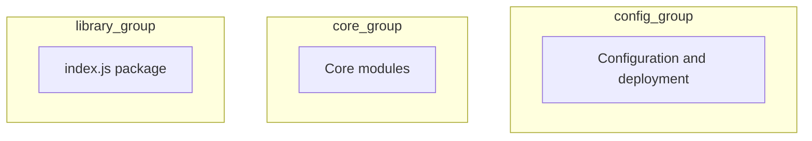

# Architecture report: leecade/react-native-swiper

> Automated static analysis. **Observed** = directly seen in files/imports/AST; **Inferred** = interpretation from that evidence. Repository code was not executed.

## 1. Repository at a glance

| Item | Value |
| --- | --- |
| Repository | leecade/react-native-swiper |
| Description | The best Swiper component for React Native. |
| Language | JavaScript |
| Stars | 10474 |
| Licence | MIT |
| Analysed commit / branch | 98cc9060dad615e5ae31c5f575f5242ce4dd9fa5 / master |
| Framework(s) | React |
| Files analysed | 80 |
| Components | 3 |

## 2. Architecture in one minute

leecade/react-native-swiper - The best Swiper component for React Native.. This repository was analysed statically from 80 file(s) (0 Python). Detected technologies (observed from imports/manifests): React, Jest. Files are grouped into 3 component(s): Configuration and deployment, Core modules, index.js package. Findings below distinguish observed facts from inferred interpretation.

## 3. High-level block diagram

## 4. Main components

### Configuration and deployment (`config`)

- **Kind:** config
- **Status:** Observed
- **Confidence:** 0.85
- **Responsibility:** Groups 1 file(s) under configuration and deployment (observed from repository paths and static analysis).
- **Paths:** `package.json`
- **Evidence:** [package.json](https://github.com/leecade/react-native-swiper/blob/98cc9060dad615e5ae31c5f575f5242ce4dd9fa5/package.json)

### Core modules (`core`)

- **Kind:** core
- **Status:** Observed
- **Confidence:** 0.85
- **Responsibility:** Groups 2 file(s) under core modules (observed from repository paths and static analysis).
- **Paths:** `index.d.ts`, `index.js`
- **Evidence:** [index.d.ts](https://github.com/leecade/react-native-swiper/blob/98cc9060dad615e5ae31c5f575f5242ce4dd9fa5/index.d.ts); [index.js](https://github.com/leecade/react-native-swiper/blob/98cc9060dad615e5ae31c5f575f5242ce4dd9fa5/index.js)

### index.js package (`index_js`)

- **Kind:** library
- **Status:** Observed
- **Confidence:** 0.85
- **Responsibility:** Groups 1 file(s) under index.js package (observed from repository paths and static analysis).
- **Paths:** `src/index.js`
- **Evidence:** [src/index.js](https://github.com/leecade/react-native-swiper/blob/98cc9060dad615e5ae31c5f575f5242ce4dd9fa5/src/index.js)

## 5. Execution flow

**Observed** entry point(s):

- [index.js](https://github.com/leecade/react-native-swiper/blob/98cc9060dad615e5ae31c5f575f5242ce4dd9fa5/index.js)
- [src/index.js](https://github.com/leecade/react-native-swiper/blob/98cc9060dad615e5ae31c5f575f5242ce4dd9fa5/src/index.js)

Representative flow (derived from observed entry points and the import graph; steps beyond the entry point are **Inferred**):

1. Execution starts at an observed entry point listed above, if present.
2. No internal import relationships between components were observed.

## 6. Project structure

### `(root)`

- `.editorconfig` - config (659 bytes)
- `.gitignore` - other (701 bytes)
- `.npmignore` - other (110 bytes)
- `.prettierrc` - other (184 bytes)
- `CHANGELOG.md` - docs (6417 bytes)
- `LICENSE` - docs (1074 bytes)
- `README.md` - docs (23045 bytes)
- `ROADMAP.md` - docs (820 bytes)
- `index.d.ts` - source, TypeScript (5170 bytes)
- `index.js` - source, JavaScript (279 bytes)
- `index.js.flow` - other (4660 bytes)
- `package.json` - manifest (1521 bytes)

### `.github`

- `.github/ISSUE_TEMPLATE.md` - docs (341 bytes)
- `.github/PULL_REQUEST_TEMPLATE.md` - docs (216 bytes)

### `examples`

- `examples/.buckconfig` - other (114 bytes)
- `examples/.eslintrc.js` - source, JavaScript (74 bytes)
- `examples/.flowconfig` - other (3234 bytes)
- `examples/.gitattributes` - other (16 bytes)
- `examples/.gitignore` - other (852 bytes)
- `examples/.prettierrc` - other (184 bytes)
- `examples/.watchmanconfig` - other (2 bytes)
- `examples/__tests__/App-test.js` - source, JavaScript (266 bytes)
- `examples/android/.project` - other (433 bytes)
- `examples/android/.settings/org.eclipse.buildship.core.prefs` - other (54 bytes)
- `examples/android/app/BUCK` - other (1310 bytes)
- `examples/android/app/build.gradle` - manifest (8737 bytes)
- `examples/android/app/build_defs.bzl` - other (602 bytes)
- `examples/android/app/proguard-rules.pro` - other (435 bytes)
- `examples/android/app/src/debug/AndroidManifest.xml` - other (368 bytes)
- `examples/android/app/src/debug/java/com/examples/ReactNativeFlipper.java` - source, Java (3021 bytes)
- `examples/android/app/src/main/AndroidManifest.xml` - other (970 bytes)
- `examples/android/app/src/main/java/com/examples/MainActivity.java` - source, Java (361 bytes)
- `examples/android/app/src/main/java/com/examples/MainApplication.java` - source, Java (2633 bytes)
- `examples/android/app/src/main/res/values/strings.xml` - other (71 bytes)
- `examples/android/app/src/main/res/values/styles.xml` - other (246 bytes)
- `examples/android/build.gradle` - manifest (993 bytes)
- `examples/android/gradle.properties` - other (984 bytes)
- `examples/android/gradle/wrapper/gradle-wrapper.properties` - other (202 bytes)
- `examples/android/gradlew` - other (5916 bytes)
- `examples/android/gradlew.bat` - other (2941 bytes)
- `examples/android/settings.gradle` - other (192 bytes)
- `examples/app.json` - config (53 bytes)
- `examples/babel.config.js` - source, JavaScript (77 bytes)
- `examples/components/AutoPlay/index.tsx` - source, TypeScript (1017 bytes)
- `examples/components/Basic/index.js` - source, JavaScript (1001 bytes)
- `examples/components/DisableButton/index.tsx` - source, TypeScript (1051 bytes)
- `examples/components/Dynamic/index.js` - source, JavaScript (1234 bytes)
- `examples/components/LoadMinimal/index.tsx` - source, TypeScript (2609 bytes)
- `examples/components/Loop/index.tsx` - source, TypeScript (991 bytes)
- `examples/components/NestSwiper/index.tsx` - source, TypeScript (1939 bytes)
- `examples/components/Phone/index.js` - source, JavaScript (2081 bytes)
- `examples/components/PhotoView/index.js` - source, JavaScript (3317 bytes)
- `examples/components/Swiper/index.js` - source, JavaScript (3788 bytes)
- `examples/components/SwiperNumber/index.js` - source, JavaScript (1987 bytes)
- `examples/e2e/AutoPlay.spec.js` - source, JavaScript (1212 bytes)
- `examples/e2e/Basic.spec.js` - source, JavaScript (1221 bytes)
- `examples/e2e/NestSwiper.spec.js` - source, JavaScript (145 bytes)
- `examples/e2e/config.json` - config (156 bytes)
- `examples/e2e/init.js` - source, JavaScript (677 bytes)
- `examples/index.tsx` - source, TypeScript (2485 bytes)
- `examples/ios/Podfile` - other (2183 bytes)
- `examples/ios/Podfile.lock` - other (7858 bytes)
- `examples/ios/examples-tvOS/Info.plist` - other (1489 bytes)
- `examples/ios/examples-tvOSTests/Info.plist` - other (765 bytes)
- `examples/ios/examples.xcodeproj/project.pbxproj` - other (40134 bytes)
- `examples/ios/examples.xcodeproj/xcshareddata/xcschemes/examples-tvOS.xcscheme` - other (5004 bytes)
- `examples/ios/examples.xcodeproj/xcshareddata/xcschemes/examples.xcscheme` - other (4939 bytes)
- `examples/ios/examples.xcworkspace/contents.xcworkspacedata` - other (226 bytes)
- `examples/ios/examples/AppDelegate.h` - source, C/C++ (386 bytes)
- `examples/ios/examples/AppDelegate.m` - other (1413 bytes)
- `examples/ios/examples/Base.lproj/LaunchScreen.xib` - other (3711 bytes)
- `examples/ios/examples/Images.xcassets/AppIcon.appiconset/Contents.json` - config (585 bytes)
- `examples/ios/examples/Images.xcassets/Contents.json` - config (63 bytes)
- `examples/ios/examples/Info.plist` - other (1594 bytes)
- `examples/ios/examples/main.m` - other (390 bytes)
- `examples/ios/examplesTests/Info.plist` - other (733 bytes)
- `examples/ios/examplesTests/examplesTests.m` - other (1943 bytes)
- `examples/metro.config.js` - source, JavaScript (300 bytes)
- `examples/package.json` - manifest (1448 bytes)

### `src`

- `src/index.js` - source, JavaScript (22380 bytes)

## 7. Key dependencies and integrations

| Name | Category | Status | Confidence | Evidence |
| --- | --- | --- | --- | --- |
| React | framework | Observed | 0.85 | [examples/package.json:6](https://github.com/leecade/react-native-swiper/blob/98cc9060dad615e5ae31c5f575f5242ce4dd9fa5/examples/package.json#L6) |
| Jest | tooling | Observed | 0.85 | [examples/package.json:7](https://github.com/leecade/react-native-swiper/blob/98cc9060dad615e5ae31c5f575f5242ce4dd9fa5/examples/package.json#L7) |

## 8. Data and state

No database, cache, queue, or persistent-state usage was observed in the analysed files. State handling, if any, may be in-memory or in files that were not analysed.

## 9. Configuration and deployment clues

- `.editorconfig` (config)
- `examples/android/app/build.gradle` (manifest)
- `examples/android/build.gradle` (manifest)
- `examples/app.json` (config)
- `examples/e2e/config.json` (config)
- `examples/ios/examples/Images.xcassets/AppIcon.appiconset/Contents.json` (config)
- `examples/ios/examples/Images.xcassets/Contents.json` (config)
- `examples/package.json` (manifest)
- `package.json` (manifest)

## 10. Design observations

- No strong design patterns could be established from the available evidence.

These observations are interpretations (**Inferred**) of the observed structure, not guarantees about runtime design.

## 11. Limitations and unknowns

- Static analysis only: repository code was not executed, installed, or imported at runtime.
- Components and relationships are inferred from file paths, imports, and AST structure; runtime behaviour, dynamic imports, and reflection may not be visible.
- 1 file(s) were skipped during inventory (1 x lockfile excluded).
- No clear application entry point was observed in the analysed files.
- Repository text was treated as untrusted data; no instructions found in repository files were followed, and likely secret values were redacted/excluded.
- JavaScript and TypeScript files were inventoried from paths and package manifests. They were not parsed with a full language AST, and repository code was not executed.

## 12. Source references

- [examples/package.json:6](https://github.com/leecade/react-native-swiper/blob/98cc9060dad615e5ae31c5f575f5242ce4dd9fa5/examples/package.json#L6)
- [examples/package.json:7](https://github.com/leecade/react-native-swiper/blob/98cc9060dad615e5ae31c5f575f5242ce4dd9fa5/examples/package.json#L7)
- [index.d.ts](https://github.com/leecade/react-native-swiper/blob/98cc9060dad615e5ae31c5f575f5242ce4dd9fa5/index.d.ts)
- [index.js](https://github.com/leecade/react-native-swiper/blob/98cc9060dad615e5ae31c5f575f5242ce4dd9fa5/index.js)
- [package.json](https://github.com/leecade/react-native-swiper/blob/98cc9060dad615e5ae31c5f575f5242ce4dd9fa5/package.json)
- [src/index.js](https://github.com/leecade/react-native-swiper/blob/98cc9060dad615e5ae31c5f575f5242ce4dd9fa5/src/index.js)
