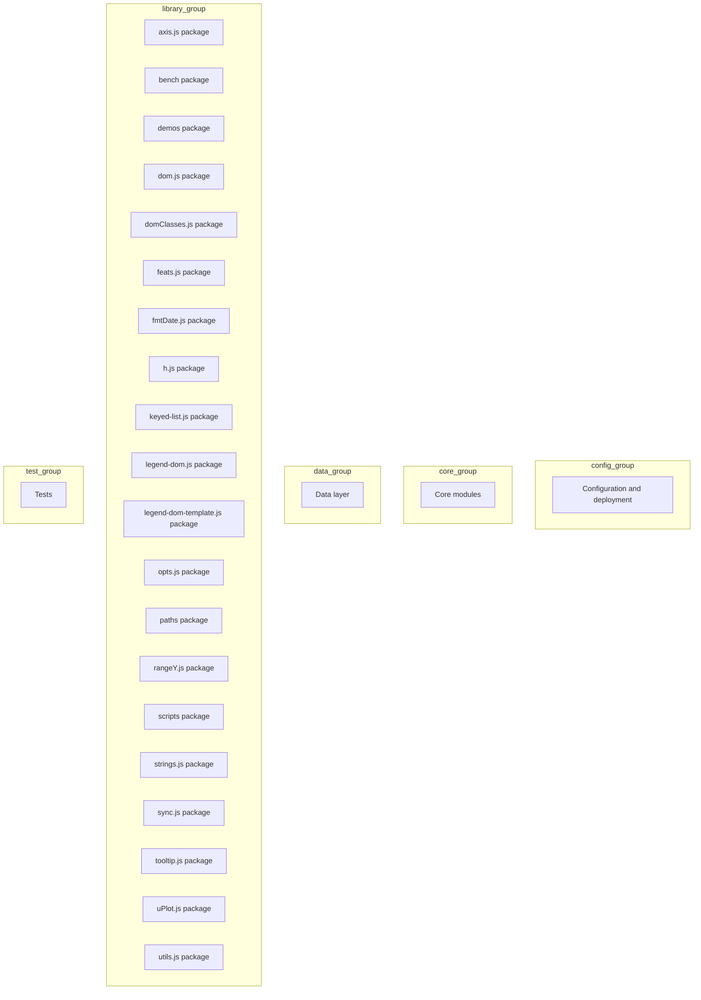

# Architecture report: leeoniya/uPlot

> Automated static analysis. **Observed** = directly seen in files/imports/AST; **Inferred** = interpretation from that evidence. Repository code was not executed.

## 1. Repository at a glance

| Item | Value |
| --- | --- |
| Repository | leeoniya/uPlot |
| Description | 📈 A small, fast chart for time series, lines, areas, ohlc & bars |
| Language | JavaScript |
| Stars | 10639 |
| Licence | MIT |
| Analysed commit / branch | 6f32019905014d952f9f013a101efaac7182f5f8 / master |
| Framework(s) | None detected |
| Files analysed | 788 |
| Components | 24 |

## 2. Architecture in one minute

leeoniya/uPlot - 📈 A small, fast chart for time series, lines, areas, ohlc & bars. This repository was analysed statically from 788 file(s) (0 Python). Detected technologies (observed from imports/manifests): no known frameworks/libraries. Files are grouped into 24 component(s): axis.js package, bench package, Configuration and deployment, Core modules, Data layer, demos package, dom.js package, domClasses.js package. Findings below distinguish observed facts from inferred interpretation.

## 3. High-level block diagram

## 4. Main components

### axis.js package (`axis_js`)

- **Kind:** library
- **Status:** Observed
- **Confidence:** 0.85
- **Responsibility:** Groups 1 file(s) under axis.js package (observed from repository paths and static analysis).
- **Paths:** `src/axis.js`
- **Evidence:** [src/axis.js](https://github.com/leeoniya/uPlot/blob/6f32019905014d952f9f013a101efaac7182f5f8/src/axis.js)

### bench package (`bench`)

- **Kind:** library
- **Status:** Observed
- **Confidence:** 0.85
- **Responsibility:** Groups 115 file(s) under bench package (observed from repository paths and static analysis).
- **Paths:** `bench/agcharts.mjs`, `bench/amcharts-sampled.mjs`, `bench/amcharts.mjs`, `bench/anychart-sampled.mjs`, `bench/anychart.mjs`, `bench/apexcharts-sampled.mjs`, `bench/apexcharts.mjs`, `bench/billboard.mjs`, `bench/bokeh-canvas.mjs`, `bench/bokeh.mjs`, `bench/canvas-sprites.mjs`, `bench/canvasjs.mjs`, `bench/chartgpu.mjs`, `bench/chartjs.mjs`, `bench/d3-minmax.mjs`, `bench/d3-svg-minmax.mjs`, `bench/d3-svg.mjs`, `bench/d3.mjs`, `bench/d3fc-canvas.mjs`, `bench/d3fc.mjs`, `bench/dashboard/agcharts.mjs`, `bench/dashboard/amcharts-sampled.mjs`, `bench/dashboard/amcharts.mjs`, `bench/dashboard/anychart-sampled.mjs`, `bench/dashboard/anychart.mjs`, `bench/dashboard/apexcharts-sampled.mjs`, `bench/dashboard/apexcharts.mjs`, `bench/dashboard/billboard.mjs`, `bench/dashboard/bokeh-canvas.mjs`, `bench/dashboard/bokeh.mjs`, `bench/dashboard/browser.mjs`, `bench/dashboard/canvasjs.mjs`, `bench/dashboard/chartgpu.mjs`, `bench/dashboard/chartjs.mjs`, `bench/dashboard/common.mjs`, `bench/dashboard/custom-common.mjs`, `bench/dashboard/custom-d3-frame.mjs`, `bench/dashboard/custom-d3.mjs`, `bench/dashboard/d3-minmax.mjs`, `bench/dashboard/d3-svg-minmax.mjs`, `bench/dashboard/d3-svg.mjs`, `bench/dashboard/d3.mjs`, `bench/dashboard/d3fc-canvas.mjs`, `bench/dashboard/d3fc.mjs`, `bench/dashboard/deckgl.mjs`, `bench/dashboard/demo.mjs`, `bench/dashboard/dependencies.mjs`, `bench/dashboard/devextreme-sampled.mjs`, `bench/dashboard/devextreme.mjs`, `bench/dashboard/dygraphs.mjs`, `bench/dashboard/echarts.mjs`, `bench/dashboard/financialcharts.mjs`, `bench/dashboard/flot.mjs`, `bench/dashboard/fusiontime-sampled.mjs`, `bench/dashboard/fusiontime.mjs`, `bench/dashboard/g2.mjs`, `bench/dashboard/highcharts-svg.mjs`, `bench/dashboard/highcharts.mjs`, `bench/dashboard/kendo.mjs`, `bench/dashboard/layout.mjs`, `bench/dashboard/lifecycle.mjs`, `bench/dashboard/lightningchart.mjs`, `bench/dashboard/lightweight.mjs`, `bench/dashboard/muicharts.mjs`, `bench/dashboard/plotly-svg.mjs`, `bench/dashboard/plotly-webgl.mjs`, `bench/dashboard/plotly.mjs`, `bench/dashboard/recharts.mjs`, `bench/dashboard/scichart.mjs`, `bench/dashboard/syncfusion.mjs`, `bench/dashboard/uplot-release.mjs`, `bench/dashboard/uplot.mjs`, `bench/dashboard/vega.mjs`, `bench/dashboard/visx.mjs`, `bench/dashboard/zingchart.mjs`, `bench/deckgl.mjs`, `bench/demo-dependencies.mjs`, `bench/demo-fixture.mjs`, `bench/demo-runtime.mjs`, `bench/demo.mjs`, `bench/devextreme-sampled.mjs`, `bench/devextreme.mjs`, `bench/double-mad.mjs`, `bench/dygraphs.mjs`, `bench/echarts.mjs`, `bench/financialcharts.mjs`, `bench/flot.mjs`, `bench/fmtDate.js`, `bench/framework-runtime.mjs`, `bench/fusiontime-sampled.mjs`, `bench/fusiontime.mjs`, `bench/g2-webgl.mjs`, `bench/g2.mjs`, `bench/googlecharts.mjs`, `bench/highcharts-svg.mjs`, `bench/highcharts.mjs`, `bench/hover.mjs`, `bench/jscharting.mjs`, `bench/kendo.mjs`, `bench/lifecycle-data.mjs`, `bench/lifecycle-frameworks.mjs`, `bench/lightningchart.mjs`, `bench/lightweight.mjs`, `bench/muicharts.mjs`, `bench/plotly-svg.mjs`, `bench/plotly.mjs`, `bench/recharts.mjs`, `bench/scichart.mjs`, `bench/syncfusion.mjs`, `bench/table.js`, `bench/uplot-release.mjs`, `bench/uplot.mjs`, `bench/vega.mjs`, `bench/visx.mjs`, `bench/zingchart.mjs`
- **Evidence:** [bench/agcharts.mjs](https://github.com/leeoniya/uPlot/blob/6f32019905014d952f9f013a101efaac7182f5f8/bench/agcharts.mjs); [bench/amcharts-sampled.mjs](https://github.com/leeoniya/uPlot/blob/6f32019905014d952f9f013a101efaac7182f5f8/bench/amcharts-sampled.mjs); [bench/amcharts.mjs](https://github.com/leeoniya/uPlot/blob/6f32019905014d952f9f013a101efaac7182f5f8/bench/amcharts.mjs); [bench/anychart-sampled.mjs](https://github.com/leeoniya/uPlot/blob/6f32019905014d952f9f013a101efaac7182f5f8/bench/anychart-sampled.mjs); [bench/anychart.mjs](https://github.com/leeoniya/uPlot/blob/6f32019905014d952f9f013a101efaac7182f5f8/bench/anychart.mjs); [bench/apexcharts-sampled.mjs](https://github.com/leeoniya/uPlot/blob/6f32019905014d952f9f013a101efaac7182f5f8/bench/apexcharts-sampled.mjs); [bench/apexcharts.mjs](https://github.com/leeoniya/uPlot/blob/6f32019905014d952f9f013a101efaac7182f5f8/bench/apexcharts.mjs); [bench/billboard.mjs](https://github.com/leeoniya/uPlot/blob/6f32019905014d952f9f013a101efaac7182f5f8/bench/billboard.mjs)

### Configuration and deployment (`config`)

- **Kind:** config
- **Status:** Observed
- **Confidence:** 0.85
- **Responsibility:** Groups 8 file(s) under configuration and deployment (observed from repository paths and static analysis).
- **Paths:** `bench/results.json`, `bunfig.toml`, `demos/data/rustc-perf.json`, `demos/data/sparse.json`, `demos/data/taxi-trips.json`, `demos/data/traffic.json`, `jsconfig.json`, `package.json`
- **Evidence:** [bench/results.json](https://github.com/leeoniya/uPlot/blob/6f32019905014d952f9f013a101efaac7182f5f8/bench/results.json); [bunfig.toml](https://github.com/leeoniya/uPlot/blob/6f32019905014d952f9f013a101efaac7182f5f8/bunfig.toml); [demos/data/rustc-perf.json](https://github.com/leeoniya/uPlot/blob/6f32019905014d952f9f013a101efaac7182f5f8/demos/data/rustc-perf.json); [demos/data/sparse.json](https://github.com/leeoniya/uPlot/blob/6f32019905014d952f9f013a101efaac7182f5f8/demos/data/sparse.json); [demos/data/taxi-trips.json](https://github.com/leeoniya/uPlot/blob/6f32019905014d952f9f013a101efaac7182f5f8/demos/data/taxi-trips.json); [demos/data/traffic.json](https://github.com/leeoniya/uPlot/blob/6f32019905014d952f9f013a101efaac7182f5f8/demos/data/traffic.json); [jsconfig.json](https://github.com/leeoniya/uPlot/blob/6f32019905014d952f9f013a101efaac7182f5f8/jsconfig.json); [package.json](https://github.com/leeoniya/uPlot/blob/6f32019905014d952f9f013a101efaac7182f5f8/package.json)

### Core modules (`core`)

- **Kind:** core
- **Status:** Observed
- **Confidence:** 0.85
- **Responsibility:** Groups 1 file(s) under core modules (observed from repository paths and static analysis).
- **Paths:** `rolldown.config.js`
- **Evidence:** [rolldown.config.js](https://github.com/leeoniya/uPlot/blob/6f32019905014d952f9f013a101efaac7182f5f8/rolldown.config.js)

### Data layer (`data_layer`)

- **Kind:** data
- **Status:** Observed
- **Confidence:** 0.85
- **Responsibility:** Groups 1 file(s) under data layer (observed from repository paths and static analysis).
- **Paths:** `demos/data/log-scales.js`
- **Evidence:** [demos/data/log-scales.js](https://github.com/leeoniya/uPlot/blob/6f32019905014d952f9f013a101efaac7182f5f8/demos/data/log-scales.js)

### demos package (`demos`)

- **Kind:** library
- **Status:** Observed
- **Confidence:** 0.85
- **Responsibility:** Groups 75 file(s) under demos package (observed from repository paths and static analysis).
- **Paths:** `demos/annotations.js`, `demos/arcsinh-scales.js`, `demos/area-fill.js`, `demos/axis-control.js`, `demos/axis-label-rotation.js`, `demos/axis-range-aligned.js`, `demos/axis-range-policies.js`, `demos/bars-grouped-stacked.js`, `demos/box-whisker.js`, `demos/candlestick-ohlc.js`, `demos/custom-scales.js`, `demos/decimation-libs.js`, `demos/decimation.js`, `demos/demoResources.js`, `demos/dependent-scale.js`, `demos/gradients.js`, `demos/grid-over-series.js`, `demos/heatmap-cells-bokeh.js`, `demos/heatmap-cells-compare.js`, `demos/heatmap-cells-d3fc.js`, `demos/heatmap-cells-echarts-gl.js`, `demos/heatmap-cells-echarts.js`, `demos/heatmap-cells-observable.js`, `demos/heatmap-cells-perspective.js`, `demos/heatmap-cells-plotly.js`, `demos/heatmap-cells.js`, `demos/high-low-bands.js`, `demos/legend-selection.js`, `demos/legend-tooltip.js`, `demos/lib/ASAP-optimized.js`, `demos/lib/ASAP-simple.js`, `demos/lib/barChartPlugin.js`, `demos/lib/barControls.js`, `demos/lib/barHover.js`, `demos/lib/barTotals.js`, `demos/lib/barValues.js`, `demos/lib/d3CanvasAligned.js`, `demos/lib/dbscan1d.js`, `demos/lib/distr.js`, `demos/lib/double-mad.js`, `demos/lib/flatbush.js`, `demos/lib/heatmapCellsData.js`, `demos/lib/heatmapColorLut.js`, `demos/lib/heatmapPlugin.js`, `demos/lib/quadtree.js`, `demos/lib/rand.js`, `demos/lib/randomWalk.js`, `demos/lib/scatterPlugin.js`, `demos/lib/sgg.js`, `demos/lib/stats.js`, `demos/lib/syncZeroRanges.js`, `demos/line-paths.js`, `demos/log-scales2.js`, `demos/log-time-axis.js`, `demos/missing-data.js`, `demos/months-ru.js`, `demos/months.js`, `demos/multi-bars.js`, `demos/nearest-non-null.js`, `demos/no-data.js`, `demos/path-gap-clip.js`, `demos/points.js`, `demos/reduction-accuracy-grouped.js`, `demos/reduction-accuracy.js`, `demos/renderDemo.js`, `demos/scale-padding.js`, `demos/scales-dir-ori.js`, `demos/soft-minmax.js`, `demos/sparklines-bars.js`, `demos/stacked-series.js`, `demos/thin-bars-stroke-fill.js`, `demos/timezones-dst.js`, `demos/trendlines.js`, `demos/wind-direction.js`, `demos/zoom-reset-range.js`
- **Evidence:** [demos/annotations.js](https://github.com/leeoniya/uPlot/blob/6f32019905014d952f9f013a101efaac7182f5f8/demos/annotations.js); [demos/arcsinh-scales.js](https://github.com/leeoniya/uPlot/blob/6f32019905014d952f9f013a101efaac7182f5f8/demos/arcsinh-scales.js); [demos/area-fill.js](https://github.com/leeoniya/uPlot/blob/6f32019905014d952f9f013a101efaac7182f5f8/demos/area-fill.js); [demos/axis-control.js](https://github.com/leeoniya/uPlot/blob/6f32019905014d952f9f013a101efaac7182f5f8/demos/axis-control.js); [demos/axis-label-rotation.js](https://github.com/leeoniya/uPlot/blob/6f32019905014d952f9f013a101efaac7182f5f8/demos/axis-label-rotation.js); [demos/axis-range-aligned.js](https://github.com/leeoniya/uPlot/blob/6f32019905014d952f9f013a101efaac7182f5f8/demos/axis-range-aligned.js); [demos/axis-range-policies.js](https://github.com/leeoniya/uPlot/blob/6f32019905014d952f9f013a101efaac7182f5f8/demos/axis-range-policies.js); [demos/bars-grouped-stacked.js](https://github.com/leeoniya/uPlot/blob/6f32019905014d952f9f013a101efaac7182f5f8/demos/bars-grouped-stacked.js)

### dom.js package (`dom_js`)

- **Kind:** library
- **Status:** Observed
- **Confidence:** 0.85
- **Responsibility:** Groups 1 file(s) under dom.js package (observed from repository paths and static analysis).
- **Paths:** `src/dom.js`
- **Evidence:** [src/dom.js](https://github.com/leeoniya/uPlot/blob/6f32019905014d952f9f013a101efaac7182f5f8/src/dom.js)

### domClasses.js package (`domclasses_js`)

- **Kind:** library
- **Status:** Observed
- **Confidence:** 0.85
- **Responsibility:** Groups 1 file(s) under domclasses.js package (observed from repository paths and static analysis).
- **Paths:** `src/domClasses.js`
- **Evidence:** [src/domClasses.js](https://github.com/leeoniya/uPlot/blob/6f32019905014d952f9f013a101efaac7182f5f8/src/domClasses.js)

### feats.js package (`feats_js`)

- **Kind:** library
- **Status:** Observed
- **Confidence:** 0.85
- **Responsibility:** Groups 1 file(s) under feats.js package (observed from repository paths and static analysis).
- **Paths:** `src/feats.js`
- **Evidence:** [src/feats.js](https://github.com/leeoniya/uPlot/blob/6f32019905014d952f9f013a101efaac7182f5f8/src/feats.js)

### fmtDate.js package (`fmtdate_js`)

- **Kind:** library
- **Status:** Observed
- **Confidence:** 0.85
- **Responsibility:** Groups 1 file(s) under fmtdate.js package (observed from repository paths and static analysis).
- **Paths:** `src/fmtDate.js`
- **Evidence:** [src/fmtDate.js](https://github.com/leeoniya/uPlot/blob/6f32019905014d952f9f013a101efaac7182f5f8/src/fmtDate.js)

### h.js package (`h_js`)

- **Kind:** library
- **Status:** Observed
- **Confidence:** 0.85
- **Responsibility:** Groups 1 file(s) under h.js package (observed from repository paths and static analysis).
- **Paths:** `src/h.js`
- **Evidence:** [src/h.js](https://github.com/leeoniya/uPlot/blob/6f32019905014d952f9f013a101efaac7182f5f8/src/h.js)

### keyed-list.js package (`keyed_list_js`)

- **Kind:** library
- **Status:** Observed
- **Confidence:** 0.85
- **Responsibility:** Groups 1 file(s) under keyed-list.js package (observed from repository paths and static analysis).
- **Paths:** `src/keyed-list.js`
- **Evidence:** [src/keyed-list.js](https://github.com/leeoniya/uPlot/blob/6f32019905014d952f9f013a101efaac7182f5f8/src/keyed-list.js)

### legend-dom.js package (`legend_dom_js`)

- **Kind:** library
- **Status:** Observed
- **Confidence:** 0.85
- **Responsibility:** Groups 1 file(s) under legend-dom.js package (observed from repository paths and static analysis).
- **Paths:** `src/legend-dom.js`
- **Evidence:** [src/legend-dom.js](https://github.com/leeoniya/uPlot/blob/6f32019905014d952f9f013a101efaac7182f5f8/src/legend-dom.js)

### legend-dom-template.js package (`legend_dom_template_js`)

- **Kind:** library
- **Status:** Observed
- **Confidence:** 0.85
- **Responsibility:** Groups 1 file(s) under legend-dom-template.js package (observed from repository paths and static analysis).
- **Paths:** `src/legend-dom-template.js`
- **Evidence:** [src/legend-dom-template.js](https://github.com/leeoniya/uPlot/blob/6f32019905014d952f9f013a101efaac7182f5f8/src/legend-dom-template.js)

### opts.js package (`opts_js`)

- **Kind:** library
- **Status:** Observed
- **Confidence:** 0.85
- **Responsibility:** Groups 1 file(s) under opts.js package (observed from repository paths and static analysis).
- **Paths:** `src/opts.js`
- **Evidence:** [src/opts.js](https://github.com/leeoniya/uPlot/blob/6f32019905014d952f9f013a101efaac7182f5f8/src/opts.js)

### paths package (`paths`)

- **Kind:** library
- **Status:** Observed
- **Confidence:** 0.85
- **Responsibility:** Groups 9 file(s) under paths package (observed from repository paths and static analysis).
- **Paths:** `src/paths/bars.js`, `src/paths/catmullRomCentrip.js`, `src/paths/disp.js`, `src/paths/linear.js`, `src/paths/monotoneCubic.js`, `src/paths/points.js`, `src/paths/spline.js`, `src/paths/stepped.js`, `src/paths/utils.js`
- **Evidence:** [src/paths/bars.js](https://github.com/leeoniya/uPlot/blob/6f32019905014d952f9f013a101efaac7182f5f8/src/paths/bars.js); [src/paths/catmullRomCentrip.js](https://github.com/leeoniya/uPlot/blob/6f32019905014d952f9f013a101efaac7182f5f8/src/paths/catmullRomCentrip.js); [src/paths/disp.js](https://github.com/leeoniya/uPlot/blob/6f32019905014d952f9f013a101efaac7182f5f8/src/paths/disp.js); [src/paths/linear.js](https://github.com/leeoniya/uPlot/blob/6f32019905014d952f9f013a101efaac7182f5f8/src/paths/linear.js); [src/paths/monotoneCubic.js](https://github.com/leeoniya/uPlot/blob/6f32019905014d952f9f013a101efaac7182f5f8/src/paths/monotoneCubic.js); [src/paths/points.js](https://github.com/leeoniya/uPlot/blob/6f32019905014d952f9f013a101efaac7182f5f8/src/paths/points.js); [src/paths/spline.js](https://github.com/leeoniya/uPlot/blob/6f32019905014d952f9f013a101efaac7182f5f8/src/paths/spline.js); [src/paths/stepped.js](https://github.com/leeoniya/uPlot/blob/6f32019905014d952f9f013a101efaac7182f5f8/src/paths/stepped.js)

### rangeY.js package (`rangey_js`)

- **Kind:** library
- **Status:** Observed
- **Confidence:** 0.85
- **Responsibility:** Groups 1 file(s) under rangey.js package (observed from repository paths and static analysis).
- **Paths:** `src/rangeY.js`
- **Evidence:** [src/rangeY.js](https://github.com/leeoniya/uPlot/blob/6f32019905014d952f9f013a101efaac7182f5f8/src/rangeY.js)

### scripts package (`scripts`)

- **Kind:** library
- **Status:** Observed
- **Confidence:** 0.85
- **Responsibility:** Groups 62 file(s) under scripts package (observed from repository paths and static analysis).
- **Paths:** `scripts/analyze-benchmarks-process-memory.mjs`, `scripts/analyze-benchmarks-raf.mjs`, `scripts/analyze-benchmarks-trace.mjs`, `scripts/audit-grafana-scales.mjs`, `scripts/bench-asinh-scan.mjs`, `scripts/bench-axis-overflow.mjs`, `scripts/bench-browser-process.mjs`, `scripts/bench-canvas-sprites.mjs`, `scripts/bench-demo-sources.mjs`, `scripts/bench-fixed-dec.mjs`, `scripts/bench-heatmap-asinh.mjs`, `scripts/bench-heatmap-color-blocks.mjs`, `scripts/bench-heatmap-color-precompute.mjs`, `scripts/bench-heatmap-grid-browser.mjs`, `scripts/bench-heatmap-grid.mjs`, `scripts/bench-heatmap-log-blocks.mjs`, `scripts/bench-heatmap-lookup.mjs`, `scripts/bench-heatmap-minmax.mjs`, `scripts/bench-hover-browser.mjs`, `scripts/bench-hover.mjs`, `scripts/bench-instrument.mjs`, `scripts/bench-join.mjs`, `scripts/bench-legend-browser.js`, `scripts/bench-legend.mjs`, `scripts/bench-module-bundle.mjs`, `scripts/bench-process-memory.mjs`, `scripts/bench-rounding.mjs`, `scripts/bench-sample-timeout.mjs`, `scripts/bench-trace-policy.mjs`, `scripts/bench-trace-stream.mjs`, `scripts/bench-webgl.mjs`, `scripts/bench-webgpu.mjs`, `scripts/benchmarks-display.mjs`, `scripts/benchmarks-mouse.mjs`, `scripts/benchmarks-paths-browser.mjs`, `scripts/benchmarks-phases.mjs`, `scripts/benchmarks-samples.mjs`, `scripts/benchmarks-suite.mjs`, `scripts/benchmarks-trace-browser.mjs`, `scripts/benchmarks-trace.mjs`, `scripts/benchmarks.mjs`, `scripts/chrome-headless-shell.mjs`, `scripts/coverage-files.mjs`, `scripts/demoSteps.mjs`, `scripts/demos.mjs`, `scripts/instrument-source.mjs`, `scripts/instrument.mjs`, `scripts/investigate-g2-webgl-fill.mjs`, `scripts/investigate-webgpu.mjs`, `scripts/patch-bokeh-highp.mjs`, `scripts/patch-echarts-heatmap.mjs`, `scripts/precision-probe.mjs`, `scripts/probe-worker.mjs`, `scripts/profile-manual.mjs`, `scripts/recorder.mjs`, `scripts/register-hooks.mjs`, `scripts/replay.mjs`, `scripts/report-coverage.mjs`, `scripts/test-css.mjs`, `scripts/test-reports.mjs`, `scripts/test.mjs`, `scripts/withSeededRandom.mjs`
- **Evidence:** [scripts/analyze-benchmarks-process-memory.mjs](https://github.com/leeoniya/uPlot/blob/6f32019905014d952f9f013a101efaac7182f5f8/scripts/analyze-benchmarks-process-memory.mjs); [scripts/analyze-benchmarks-raf.mjs](https://github.com/leeoniya/uPlot/blob/6f32019905014d952f9f013a101efaac7182f5f8/scripts/analyze-benchmarks-raf.mjs); [scripts/analyze-benchmarks-trace.mjs](https://github.com/leeoniya/uPlot/blob/6f32019905014d952f9f013a101efaac7182f5f8/scripts/analyze-benchmarks-trace.mjs); [scripts/audit-grafana-scales.mjs](https://github.com/leeoniya/uPlot/blob/6f32019905014d952f9f013a101efaac7182f5f8/scripts/audit-grafana-scales.mjs); [scripts/bench-asinh-scan.mjs](https://github.com/leeoniya/uPlot/blob/6f32019905014d952f9f013a101efaac7182f5f8/scripts/bench-asinh-scan.mjs); [scripts/bench-axis-overflow.mjs](https://github.com/leeoniya/uPlot/blob/6f32019905014d952f9f013a101efaac7182f5f8/scripts/bench-axis-overflow.mjs); [scripts/bench-browser-process.mjs](https://github.com/leeoniya/uPlot/blob/6f32019905014d952f9f013a101efaac7182f5f8/scripts/bench-browser-process.mjs); [scripts/bench-canvas-sprites.mjs](https://github.com/leeoniya/uPlot/blob/6f32019905014d952f9f013a101efaac7182f5f8/scripts/bench-canvas-sprites.mjs)

### strings.js package (`strings_js`)

- **Kind:** library
- **Status:** Observed
- **Confidence:** 0.85
- **Responsibility:** Groups 1 file(s) under strings.js package (observed from repository paths and static analysis).
- **Paths:** `src/strings.js`
- **Evidence:** [src/strings.js](https://github.com/leeoniya/uPlot/blob/6f32019905014d952f9f013a101efaac7182f5f8/src/strings.js)

### sync.js package (`sync_js`)

- **Kind:** library
- **Status:** Observed
- **Confidence:** 0.85
- **Responsibility:** Groups 1 file(s) under sync.js package (observed from repository paths and static analysis).
- **Paths:** `src/sync.js`
- **Evidence:** [src/sync.js](https://github.com/leeoniya/uPlot/blob/6f32019905014d952f9f013a101efaac7182f5f8/src/sync.js)

### Tests (`tests`)

- **Kind:** test
- **Status:** Observed
- **Confidence:** 0.85
- **Responsibility:** Groups 204 file(s) under tests (observed from repository paths and static analysis).
- **Paths:** `test/README.md`, `test/asinh-scan-utils.mjs`, `test/asinh-scan.mjs`, `test/asinh.mjs`, `test/axis-autosize.mjs`, `test/axis-range-demo.mjs`, `test/axis-range-policy-demo.mjs`, `test/axis-value-precision.mjs`, `test/band-drawing.mjs`, `test/bar-gap.mjs`, `test/bar-radii.mjs`, `test/cache.mjs`, `test/context-attributes.mjs`, `test/cursor-drag.mjs`, `test/cursor-focus.mjs`, `test/cursor-points.mjs`, `test/data-cache.mjs`, `test/dbscan1d.mjs`, `test/decimation.mjs`, `test/demo-extractions.mjs`, `test/demo-migrations.mjs`, `test/demos.mjs`, `test/demos/annotations/0-0.json`, `test/demos/arcsinh-scales/0-0.json`, `test/demos/arcsinh-scales/1-0.json`, `test/demos/area-fill/0-0.json`, `test/demos/axis-control/0-0.json`, `test/demos/axis-control/1-0.json`, `test/demos/axis-control/1-1.json`, `test/demos/bars-grouped-stacked/0-0/0.json`, `test/demos/bars-grouped-stacked/0-0/1.json`, `test/demos/bars-grouped-stacked/0-0/2.json`, `test/demos/bars-grouped-stacked/0-0/3.json`, `test/demos/bars-grouped-stacked/0-1/0.json`, `test/demos/bars-grouped-stacked/0-1/1.json`, `test/demos/bars-grouped-stacked/0-2/0.json`, `test/demos/bars-grouped-stacked/0-2/1.json`, `test/demos/bars-grouped-stacked/0-3/0.json`, `test/demos/bars-grouped-stacked/0-3/1.json`, `test/demos/box-whisker/0-01_run1k.json`, `test/demos/box-whisker/0-02_replace1k.json`, `test/demos/box-whisker/0-03_update10th1k_x16.json`, `test/demos/box-whisker/0-04_select1k.json`, `test/demos/box-whisker/0-05_swap1k.json`, `test/demos/box-whisker/0-06_remove-one-1k.json`, `test/demos/box-whisker/0-07_create10k.json`, `test/demos/box-whisker/0-08_create1k-after1k_x2.json`, `test/demos/box-whisker/0-09_clear1k_x8.json`, `test/demos/box-whisker/0-21_ready-memory.json`, `test/demos/box-whisker/0-22_run-memory.json`, `test/demos/box-whisker/0-23_update5-memory.json`, `test/demos/box-whisker/0-24_run5-memory.json`, `test/demos/box-whisker/0-25_run-clear-memory.json`, `test/demos/box-whisker/0-31_startup-ci.json`, `test/demos/box-whisker/0-32_startup-bt.json`, `test/demos/box-whisker/0-34_startup-totalbytes.json`, `test/demos/candlestick-ohlc/0-0.json`, `test/demos/custom-scales/0-0.json`, `test/demos/custom-scales/0-1.json`, `test/demos/custom-scales/0-2.json`, `test/demos/decimation/0-0.json`, `test/demos/decimation/non-uniform-0.json`, `test/demos/decimation/opposite-spikes-0.json`, `test/demos/dependent-scale/0-0.json`, `test/demos/gradients/0-0.json`, `test/demos/gradients/0-1.json`, `test/demos/gradients/0-2.json`, `test/demos/gradients/0-3.json`, `test/demos/gradients/0-4.json`, `test/demos/grid-over-series/0-0.json`, `test/demos/high-low-bands/0-0.json`, `test/demos/high-low-bands/0-1.json`, `test/demos/high-low-bands/0-10.json`, `test/demos/high-low-bands/0-11.json`, `test/demos/high-low-bands/0-12.json`, `test/demos/high-low-bands/0-2.json`, `test/demos/high-low-bands/0-3.json`, `test/demos/high-low-bands/0-4.json`, `test/demos/high-low-bands/0-5.json`, `test/demos/high-low-bands/0-6.json`, `test/demos/high-low-bands/0-7.json`, `test/demos/high-low-bands/0-8.json`, `test/demos/high-low-bands/0-9.json`, `test/demos/line-paths/0-0.json`, `test/demos/line-paths/0-1.json`, `test/demos/line-paths/0-2.json`, `test/demos/line-paths/0-3.json`, `test/demos/line-paths/0-4.json`, `test/demos/line-paths/0-5.json`, `test/demos/line-paths/0-6.json`, `test/demos/line-paths/0-7.json`, `test/demos/log-scales2/0-0.json`, `test/demos/log-scales2/0-1.json`, `test/demos/log-scales2/0-10.json`, `test/demos/log-scales2/0-2.json`, `test/demos/log-scales2/0-3/0.json`, `test/demos/log-scales2/0-3/1.json`, `test/demos/log-scales2/0-4.json`, `test/demos/log-scales2/0-5.json`, `test/demos/log-scales2/0-6.json`, `test/demos/log-scales2/0-7.json`, `test/demos/log-scales2/0-8.json`, `test/demos/log-scales2/0-9.json`, `test/demos/missing-data/0-0.json`, `test/demos/missing-data/0-1.json`, `test/demos/months-ru/0-0.json`, `test/demos/months/0-0.json`, `test/demos/months/0-1.json`, `test/demos/multi-bars/0-horizontal.json`, `test/demos/multi-bars/0-variable-colors/0.json`, `test/demos/multi-bars/0-variable-colors/1.json`, `test/demos/multi-bars/0-vertical.json`, `test/demos/nearest-non-null/0-0.json`, `test/demos/nearest-non-null/0-1.json`, `test/demos/nearest-non-null/0-2.json`, `test/demos/nearest-non-null/0-3.json`, `test/demos/nearest-non-null/0-4.json`, `test/demos/no-data/0-0.json`, `test/demos/no-data/0-1.json`, `test/demos/no-data/0-10.json`, `test/demos/no-data/0-11.json`, `test/demos/no-data/0-12.json`, `test/demos/no-data/0-13.json`, `test/demos/no-data/0-14.json`, `test/demos/no-data/0-15.json`, `test/demos/no-data/0-16.json`, `test/demos/no-data/0-17.json`, `test/demos/no-data/0-18.json`, `test/demos/no-data/0-19.json`, `test/demos/no-data/0-2.json`, `test/demos/no-data/0-20.json`, `test/demos/no-data/0-21.json`, `test/demos/no-data/0-22.json`, `test/demos/no-data/0-23.json`, `test/demos/no-data/0-24.json`, `test/demos/no-data/0-25.json`, `test/demos/no-data/0-26.json`, `test/demos/no-data/0-27.json`, `test/demos/no-data/0-28.json`, `test/demos/no-data/0-29.json`, `test/demos/no-data/0-3.json`, `test/demos/no-data/0-30.json`, `test/demos/no-data/0-31.json`, `test/demos/no-data/0-32.json`, `test/demos/no-data/0-4.json`, `test/demos/no-data/0-5.json`, `test/demos/no-data/0-6.json`, `test/demos/no-data/0-7.json`, `test/demos/no-data/0-8.json`, `test/demos/no-data/0-9.json`, `test/demos/no-data/0-large-flat-update.json`, `test/demos/no-data/0-large-near-flat-update.json`, `test/demos/path-gap-clip/0-0.json`, `test/demos/path-gap-clip/0-1.json`, `test/demos/path-gap-clip/0-10.json`, `test/demos/path-gap-clip/0-11.json`, `test/demos/path-gap-clip/0-12.json`, `test/demos/path-gap-clip/0-13.json`, `test/demos/path-gap-clip/0-14.json`, `test/demos/path-gap-clip/0-15.json`, `test/demos/path-gap-clip/0-16.json`, `test/demos/path-gap-clip/0-2.json`, `test/demos/path-gap-clip/0-3.json`, `test/demos/path-gap-clip/0-4.json`, `test/demos/path-gap-clip/0-5.json`, `test/demos/path-gap-clip/0-6.json`, `test/demos/path-gap-clip/0-7.json`, `test/demos/path-gap-clip/0-8.json`, `test/demos/path-gap-clip/0-9.json`, `test/demos/points/0-0/0.json`, `test/demos/points/0-0/1.json`, `test/demos/points/0-0/2.json`, `test/demos/points/0-0/3.json`, `test/demos/scale-padding/0-0.json`, `test/demos/scales-dir-ori/0-0.json`, `test/demos/scales-dir-ori/0-1.json`, `test/demos/scales-dir-ori/0-2.json`, `test/demos/scales-dir-ori/0-3.json`, `test/demos/scales-dir-ori/0-4.json`, `test/demos/scales-dir-ori/0-5.json`, `test/demos/scales-dir-ori/0-6.json`, `test/demos/scales-dir-ori/0-7.json`, `test/demos/scales-dir-ori/1-0.json`, `test/demos/scales-dir-ori/1-1.json`, `test/demos/scales-dir-ori/1-2.json`, `test/demos/scales-dir-ori/1-3.json`, `test/demos/scales-dir-ori/1-4.json`, `test/demos/scales-dir-ori/1-5.json`, `test/demos/scales-dir-ori/1-6.json`, `test/demos/scales-dir-ori/1-7.json`, `test/demos/soft-minmax/0-0/0.json`, `test/demos/soft-minmax/0-0/1.json`, `test/demos/soft-minmax/0-0/2.json`, `test/demos/soft-minmax/0-0/3.json`, `test/demos/soft-minmax/0-0/4.json`, `test/demos/soft-minmax/0-1.json`, `test/demos/soft-minmax/1-0/0.json`, `test/demos/soft-minmax/1-0/1.json`, `test/demos/sparklines-bars/0-variants/0.json`, `test/demos/sparklines-bars/0-variants/1.json`, `test/demos/stacked-series/0-1.json`, `test/demos/stacked-series/1-10.json`, `test/integration/demo-steps.mjs`, `test/plugins/test.mjs`
- **Evidence:** [test/README.md](https://github.com/leeoniya/uPlot/blob/6f32019905014d952f9f013a101efaac7182f5f8/test/README.md); [test/asinh-scan-utils.mjs](https://github.com/leeoniya/uPlot/blob/6f32019905014d952f9f013a101efaac7182f5f8/test/asinh-scan-utils.mjs); [test/asinh-scan.mjs](https://github.com/leeoniya/uPlot/blob/6f32019905014d952f9f013a101efaac7182f5f8/test/asinh-scan.mjs); [test/asinh.mjs](https://github.com/leeoniya/uPlot/blob/6f32019905014d952f9f013a101efaac7182f5f8/test/asinh.mjs); [test/axis-autosize.mjs](https://github.com/leeoniya/uPlot/blob/6f32019905014d952f9f013a101efaac7182f5f8/test/axis-autosize.mjs); [test/axis-range-demo.mjs](https://github.com/leeoniya/uPlot/blob/6f32019905014d952f9f013a101efaac7182f5f8/test/axis-range-demo.mjs); [test/axis-range-policy-demo.mjs](https://github.com/leeoniya/uPlot/blob/6f32019905014d952f9f013a101efaac7182f5f8/test/axis-range-policy-demo.mjs); [test/axis-value-precision.mjs](https://github.com/leeoniya/uPlot/blob/6f32019905014d952f9f013a101efaac7182f5f8/test/axis-value-precision.mjs)

### tooltip.js package (`tooltip_js`)

- **Kind:** library
- **Status:** Observed
- **Confidence:** 0.85
- **Responsibility:** Groups 1 file(s) under tooltip.js package (observed from repository paths and static analysis).
- **Paths:** `src/tooltip.js`
- **Evidence:** [src/tooltip.js](https://github.com/leeoniya/uPlot/blob/6f32019905014d952f9f013a101efaac7182f5f8/src/tooltip.js)

### uPlot.js package (`uplot_js`)

- **Kind:** library
- **Status:** Observed
- **Confidence:** 0.85
- **Responsibility:** Groups 1 file(s) under uplot.js package (observed from repository paths and static analysis).
- **Paths:** `src/uPlot.js`
- **Evidence:** [src/uPlot.js](https://github.com/leeoniya/uPlot/blob/6f32019905014d952f9f013a101efaac7182f5f8/src/uPlot.js)

### utils.js package (`utils_js`)

- **Kind:** library
- **Status:** Observed
- **Confidence:** 0.85
- **Responsibility:** Groups 1 file(s) under utils.js package (observed from repository paths and static analysis).
- **Paths:** `src/utils.js`
- **Evidence:** [src/utils.js](https://github.com/leeoniya/uPlot/blob/6f32019905014d952f9f013a101efaac7182f5f8/src/utils.js)

## 5. Execution flow

No entry point was observed; the startup flow below is therefore limited.

Representative flow (derived from observed entry points and the import graph; steps beyond the entry point are **Inferred**):

1. Execution starts at an observed entry point listed above, if present.
2. No internal import relationships between components were observed.

## 6. Project structure

### `(root)`

- `.editorconfig` - config (113 bytes)
- `.gitignore` - other (331 bytes)
- `LICENSE` - docs (1078 bytes)
- `README.md` - docs (11083 bytes)
- `bun.lock` - other (12262 bytes)
- `bunfig.toml` - config (17 bytes)
- `jsconfig.json` - config (139 bytes)
- `package.json` - manifest (3020 bytes)
- `rolldown.config.js` - source, JavaScript (2523 bytes)

### `.github`

- `.github/FUNDING.yml` - config (17 bytes)

### `bench`

- `bench/AGCharts.html` - other (324 bytes)
- `bench/AnyChart-Sampled.html` - other (340 bytes)
- `bench/AnyChart.html` - other (324 bytes)
- `bench/ApexCharts-Sampled.html` - other (333 bytes)
- `bench/ApexCharts.html` - other (317 bytes)
- `bench/Billboard.html` - other (325 bytes)
- `bench/Bokeh-Canvas.html` - other (323 bytes)
- `bench/Bokeh.html` - other (315 bytes)
- `bench/CanvasJS.html` - other (313 bytes)
- `bench/Chart.js4-sine-stream.html` - other (6158 bytes)
- `bench/Chart.js4.html` - other (312 bytes)
- `bench/ChartGPU.html` - other (313 bytes)
- `bench/D3-SVG.html` - other (309 bytes)
- `bench/D3-sine-stream.html` - other (7059 bytes)
- `bench/D3.html` - other (308 bytes)
- `bench/DevExtreme-Sampled.html` - other (333 bytes)
- `bench/DevExtreme.html` - other (317 bytes)
- `bench/ECharts5-sine-stream.html` - other (6564 bytes)
- `bench/ECharts5.html` - other (311 bytes)
- `bench/Flot.html` - other (305 bytes)
- `bench/FusionTime-Sampled.html` - other (333 bytes)
- `bench/FusionTime.html` - other (317 bytes)
- `bench/G2-WebGL.html` - other (318 bytes)
- `bench/G2.html` - other (306 bytes)
- `bench/GoogleCharts.html` - other (340 bytes)
- `bench/Highcharts-SVG.html` - other (325 bytes)
- `bench/Highcharts.html` - other (317 bytes)
- `bench/JSCharting.html` - other (317 bytes)
- `bench/Kendo.html` - other (321 bytes)
- `bench/LightningChart.html` - other (328 bytes)
- `bench/Plotly-SVG.html` - other (320 bytes)
- `bench/Plotly.js.html` - other (312 bytes)
- `bench/SciChart.html` - other (316 bytes)
- `bench/Syncfusion.html` - other (324 bytes)
- `bench/Vega.html` - other (312 bytes)
- `bench/ZingChart.html` - other (315 bytes)
- `bench/agcharts.mjs` - source, JavaScript (2213 bytes)
- `bench/amCharts-Sampled.html` - other (329 bytes)
- `bench/amCharts5.html` - other (315 bytes)
- `bench/amcharts-sampled.mjs` - source, JavaScript (282 bytes)
- `bench/amcharts.mjs` - source, JavaScript (5657 bytes)
- `bench/anychart-sampled.mjs` - source, JavaScript (281 bytes)
- `bench/anychart.mjs` - source, JavaScript (6977 bytes)
- `bench/apexcharts-sampled.mjs` - source, JavaScript (286 bytes)
- `bench/apexcharts.mjs` - source, JavaScript (5460 bytes)
- `bench/bench-test.html` - other (3271 bytes)
- `bench/billboard.mjs` - source, JavaScript (4945 bytes)
- `bench/bokeh-canvas.mjs` - source, JavaScript (299 bytes)
- `bench/bokeh.mjs` - source, JavaScript (8160 bytes)
- `bench/canvas-sprites.html` - other (2773 bytes)
- `bench/canvas-sprites.mjs` - source, JavaScript (10547 bytes)
- `bench/canvasjs.mjs` - source, JavaScript (3872 bytes)
- `bench/chartgpu.mjs` - source, JavaScript (7873 bytes)
- `bench/chartjs.mjs` - source, JavaScript (6993 bytes)
- `bench/d3-minmax.html` - other (323 bytes)
- `bench/d3-minmax.mjs` - source, JavaScript (347 bytes)
- `bench/d3-svg-minmax.html` - other (324 bytes)
- `bench/d3-svg-minmax.mjs` - source, JavaScript (344 bytes)
- `bench/d3-svg.mjs` - source, JavaScript (330 bytes)
- `bench/d3.mjs` - source, JavaScript (16847 bytes)
- `bench/d3fc-Canvas.html` - other (319 bytes)
- `bench/d3fc-canvas.mjs` - source, JavaScript (292 bytes)
- `bench/d3fc.html` - other (311 bytes)
- `bench/d3fc.mjs` - source, JavaScript (11742 bytes)
- `bench/dashboard/README.md` - docs (18907 bytes)
- `bench/dashboard/agcharts.html` - other (397 bytes)
- `bench/dashboard/agcharts.mjs` - source, JavaScript (1365 bytes)
- `bench/dashboard/amcharts-sampled.html` - other (413 bytes)
- `bench/dashboard/amcharts-sampled.mjs` - source, JavaScript (243 bytes)
- `bench/dashboard/amcharts.html` - other (397 bytes)
- `bench/dashboard/amcharts.mjs` - source, JavaScript (2972 bytes)
- `bench/dashboard/anychart-sampled.html` - other (413 bytes)
- `bench/dashboard/anychart-sampled.mjs` - source, JavaScript (242 bytes)
- `bench/dashboard/anychart.html` - other (397 bytes)
- `bench/dashboard/anychart.mjs` - source, JavaScript (2913 bytes)
- `bench/dashboard/apexcharts-sampled.html` - other (417 bytes)
- `bench/dashboard/apexcharts-sampled.mjs` - source, JavaScript (258 bytes)
- `bench/dashboard/apexcharts.html` - other (401 bytes)
- `bench/dashboard/apexcharts.mjs` - source, JavaScript (1904 bytes)
- `bench/dashboard/billboard.html` - other (399 bytes)
- `bench/dashboard/billboard.mjs` - source, JavaScript (2246 bytes)
- `bench/dashboard/bokeh-canvas.html` - other (405 bytes)
- `bench/dashboard/bokeh-canvas.mjs` - source, JavaScript (246 bytes)
- `bench/dashboard/bokeh.html` - other (391 bytes)
- `bench/dashboard/bokeh.mjs` - source, JavaScript (3431 bytes)
- `bench/dashboard/browser.mjs` - source, JavaScript (2224 bytes)
- `bench/dashboard/canvasjs.html` - other (397 bytes)
- `bench/dashboard/canvasjs.mjs` - source, JavaScript (1030 bytes)
- `bench/dashboard/chartgpu.html` - other (397 bytes)
- `bench/dashboard/chartgpu.mjs` - source, JavaScript (4362 bytes)
- `bench/dashboard/chartjs.html` - other (395 bytes)
- `bench/dashboard/chartjs.mjs` - source, JavaScript (1877 bytes)
- `bench/dashboard/common.mjs` - source, JavaScript (1711 bytes)
- `bench/dashboard/custom-common.mjs` - source, JavaScript (4709 bytes)
- `bench/dashboard/custom-d3-frame.mjs` - source, JavaScript (1507 bytes)
- `bench/dashboard/custom-d3.mjs` - source, JavaScript (5983 bytes)
- `bench/dashboard/d3-minmax.html` - other (399 bytes)
- `bench/dashboard/d3-minmax.mjs` - source, JavaScript (146 bytes)
- `bench/dashboard/d3-svg-minmax.html` - other (407 bytes)
- `bench/dashboard/d3-svg-minmax.mjs` - source, JavaScript (163 bytes)
- `bench/dashboard/d3-svg.html` - other (393 bytes)
- `bench/dashboard/d3-svg.mjs` - source, JavaScript (146 bytes)
- `bench/dashboard/d3.html` - other (385 bytes)
- `bench/dashboard/d3.mjs` - source, JavaScript (129 bytes)
- `bench/dashboard/d3fc-canvas.html` - other (403 bytes)
- `bench/dashboard/d3fc-canvas.mjs` - source, JavaScript (139 bytes)
- `bench/dashboard/d3fc.html` - other (389 bytes)
- `bench/dashboard/d3fc.mjs` - source, JavaScript (158 bytes)
- `bench/dashboard/deckgl.html` - other (393 bytes)
- `bench/dashboard/deckgl.mjs` - source, JavaScript (3300 bytes)
- `bench/dashboard/demo.mjs` - source, JavaScript (4948 bytes)
- `bench/dashboard/dependencies.mjs` - source, JavaScript (403 bytes)
- `bench/dashboard/devextreme-sampled.html` - other (417 bytes)
- `bench/dashboard/devextreme-sampled.mjs` - source, JavaScript (256 bytes)
- `bench/dashboard/devextreme.html` - other (401 bytes)
- `bench/dashboard/devextreme.mjs` - source, JavaScript (2155 bytes)
- `bench/dashboard/dygraphs.html` - other (397 bytes)
- `bench/dashboard/dygraphs.mjs` - source, JavaScript (1237 bytes)
- `bench/dashboard/echarts.html` - other (395 bytes)
- `bench/dashboard/echarts.mjs` - source, JavaScript (1423 bytes)
- `bench/dashboard/financialcharts.html` - other (411 bytes)
- `bench/dashboard/financialcharts.mjs` - source, JavaScript (3776 bytes)
- `bench/dashboard/flot.html` - other (389 bytes)
- `bench/dashboard/flot.mjs` - source, JavaScript (1400 bytes)
- `bench/dashboard/fusiontime-sampled.html` - other (417 bytes)
- `bench/dashboard/fusiontime-sampled.mjs` - source, JavaScript (246 bytes)
- `bench/dashboard/fusiontime.html` - other (401 bytes)
- `bench/dashboard/fusiontime.mjs` - source, JavaScript (3389 bytes)
- `bench/dashboard/g2.html` - other (385 bytes)
- `bench/dashboard/g2.mjs` - source, JavaScript (2000 bytes)
- `bench/dashboard/highcharts-svg.html` - other (409 bytes)
- `bench/dashboard/highcharts-svg.mjs` - source, JavaScript (267 bytes)
- `bench/dashboard/highcharts.html` - other (401 bytes)
- `bench/dashboard/highcharts.mjs` - source, JavaScript (3216 bytes)
- `bench/dashboard/index.html` - other (3299 bytes)
- `bench/dashboard/kendo.html` - other (391 bytes)
- `bench/dashboard/kendo.mjs` - source, JavaScript (1351 bytes)
- `bench/dashboard/layout.mjs` - source, JavaScript (1460 bytes)
- `bench/dashboard/lifecycle.mjs` - source, JavaScript (17044 bytes)
- `bench/dashboard/lightningchart.html` - other (409 bytes)
- `bench/dashboard/lightningchart.mjs` - source, JavaScript (4796 bytes)
- `bench/dashboard/lightweight.html` - other (403 bytes)
- `bench/dashboard/lightweight.mjs` - source, JavaScript (2146 bytes)
- `bench/dashboard/muicharts.html` - other (399 bytes)
- `bench/dashboard/muicharts.mjs` - source, JavaScript (2428 bytes)
- `bench/dashboard/plotly-svg.html` - other (401 bytes)
- `bench/dashboard/plotly-svg.mjs` - source, JavaScript (251 bytes)
- `bench/dashboard/plotly-webgl.mjs` - source, JavaScript (4186 bytes)
- `bench/dashboard/plotly.html` - other (393 bytes)
- `bench/dashboard/plotly.mjs` - source, JavaScript (2525 bytes)
- `bench/dashboard/recharts.html` - other (397 bytes)
- `bench/dashboard/recharts.mjs` - source, JavaScript (2626 bytes)
- `bench/dashboard/scichart.html` - other (397 bytes)
- `bench/dashboard/scichart.mjs` - source, JavaScript (5247 bytes)
- `bench/dashboard/syncfusion.html` - other (401 bytes)
- `bench/dashboard/syncfusion.mjs` - source, JavaScript (1428 bytes)
- `bench/dashboard/uplot-release.html` - other (407 bytes)
- `bench/dashboard/uplot-release.mjs` - source, JavaScript (399 bytes)
- `bench/dashboard/uplot.html` - other (391 bytes)
- `bench/dashboard/uplot.mjs` - source, JavaScript (1284 bytes)
- `bench/dashboard/vega.html` - other (389 bytes)
- `bench/dashboard/vega.mjs` - source, JavaScript (2425 bytes)
- `bench/dashboard/visx.html` - other (389 bytes)
- `bench/dashboard/visx.mjs` - source, JavaScript (3558 bytes)
- `bench/dashboard/zingchart.html` - other (399 bytes)
- `bench/dashboard/zingchart.mjs` - source, JavaScript (1732 bytes)
- `bench/deckgl.html` - other (317 bytes)
- `bench/deckgl.mjs` - source, JavaScript (13568 bytes)
- `bench/demo-dependencies.mjs` - source, JavaScript (13318 bytes)
- `bench/demo-fixture.mjs` - source, JavaScript (2010 bytes)
- `bench/demo-runtime.mjs` - source, JavaScript (1373 bytes)
- `bench/demo.css` - other (1252 bytes)
- `bench/demo.mjs` - source, JavaScript (2446 bytes)
- `bench/devextreme-sampled.mjs` - source, JavaScript (285 bytes)
- `bench/devextreme.mjs` - source, JavaScript (6999 bytes)
- `bench/double-mad.mjs` - source, JavaScript (3215 bytes)
- `bench/dygraphs.html` - other (313 bytes)
- `bench/dygraphs.mjs` - source, JavaScript (3587 bytes)
- `bench/echarts.mjs` - source, JavaScript (3409 bytes)
- `bench/financialcharts.html` - other (202 bytes)
- `bench/financialcharts.mjs` - source, JavaScript (3285 bytes)
- `bench/flot.mjs` - source, JavaScript (2427 bytes)
- `bench/fmtDate.js` - source, JavaScript (2218 bytes)
- `bench/framework-runtime.mjs` - source, JavaScript (6350 bytes)
- `bench/fusiontime-sampled.mjs` - source, JavaScript (285 bytes)
- `bench/fusiontime.mjs` - source, JavaScript (6315 bytes)
- `bench/g2-webgl.mjs` - source, JavaScript (1958 bytes)
- `bench/g2.mjs` - source, JavaScript (2491 bytes)
- `bench/googlecharts.mjs` - source, JavaScript (3737 bytes)
- `bench/highcharts-svg.mjs` - source, JavaScript (309 bytes)
- `bench/highcharts.mjs` - source, JavaScript (6938 bytes)
- `bench/hover.mjs` - source, JavaScript (4203 bytes)
- `bench/index.html` - other (3361 bytes)
- `bench/jscharting.mjs` - source, JavaScript (1942 bytes)
- `bench/kendo.mjs` - source, JavaScript (3045 bytes)
- `bench/lifecycle-data.mjs` - source, JavaScript (542 bytes)
- `bench/lifecycle-frameworks.mjs` - source, JavaScript (2379 bytes)
- `bench/lightningchart.mjs` - source, JavaScript (6091 bytes)
- `bench/lightweight-charts.html` - other (326 bytes)
- `bench/lightweight.mjs` - source, JavaScript (7171 bytes)
- `bench/mousemove-rate.html` - other (3797 bytes)
- `bench/muicharts.html` - other (186 bytes)
- `bench/muicharts.mjs` - source, JavaScript (1870 bytes)
- `bench/plotly-svg.mjs` - source, JavaScript (293 bytes)
- `bench/plotly.mjs` - source, JavaScript (4947 bytes)
- `bench/recharts.html` - other (181 bytes)
- `bench/recharts.mjs` - source, JavaScript (5316 bytes)
- `bench/results.json` - config (1378 bytes)
- `bench/scichart.mjs` - source, JavaScript (10348 bytes)
- `bench/syncfusion.mjs` - source, JavaScript (2905 bytes)
- `bench/table.js` - source, JavaScript (1704 bytes)
- `bench/table.md` - docs (2416 bytes)
- `bench/uPlot-10M.html` - other (2709 bytes)
- `bench/uPlot-600-series.html` - other (2075 bytes)
- `bench/uPlot.html` - other (308 bytes)
- `bench/uplot-release.html` - other (331 bytes)
- `bench/uplot-release.mjs` - source, JavaScript (489 bytes)
- `bench/uplot.mjs` - source, JavaScript (4055 bytes)
- `bench/vega.mjs` - source, JavaScript (3461 bytes)
- `bench/visx.html` - other (173 bytes)
- `bench/visx.mjs` - source, JavaScript (2895 bytes)
- `bench/zingchart.mjs` - source, JavaScript (4121 bytes)

### `demos`

- `demos/add-del-series.html` - other (1978 bytes)
- `demos/align-data.html` - other (3316 bytes)
- `demos/annotations.html` - other (1073 bytes)
- `demos/annotations.js` - source, JavaScript (3132 bytes)
- `demos/arcsinh-scales.html` - other (1162 bytes)
- `demos/arcsinh-scales.js` - source, JavaScript (2596 bytes)
- `demos/area-fill.html` - other (499 bytes)
- `demos/area-fill.js` - source, JavaScript (1619 bytes)
- `demos/axis-autosize.html` - other (2036 bytes)
- `demos/axis-control.html` - other (505 bytes)
- `demos/axis-control.js` - source, JavaScript (2572 bytes)
- `demos/axis-indicators.html` - other (4552 bytes)
- `demos/axis-label-rotation-chartjs.html` - other (9450 bytes)
- `demos/axis-label-rotation-echarts.html` - other (9229 bytes)
- `demos/axis-label-rotation.html` - other (10785 bytes)
- `demos/axis-label-rotation.js` - source, JavaScript (6206 bytes)
- `demos/axis-range-aligned.html` - other (4406 bytes)
- `demos/axis-range-aligned.js` - source, JavaScript (6282 bytes)
- `demos/axis-range-policies.html` - other (2690 bytes)
- `demos/axis-range-policies.js` - source, JavaScript (8230 bytes)
- `demos/bars-grouped-stacked.html` - other (788 bytes)
- `demos/bars-grouped-stacked.js` - source, JavaScript (3241 bytes)
- `demos/bars-values-autosize.html` - other (9267 bytes)
- `demos/box-whisker.html` - other (654 bytes)
- `demos/box-whisker.js` - source, JavaScript (9566 bytes)
- `demos/candlestick-ohlc.html` - other (512 bytes)
- `demos/candlestick-ohlc.js` - source, JavaScript (15585 bytes)
- `demos/cursor-bind.html` - other (2600 bytes)
- `demos/cursor-snap.html` - other (1466 bytes)
- `demos/cursor-tooltip.html` - other (2161 bytes)
- `demos/custom-scales.html` - other (576 bytes)
- `demos/custom-scales.js` - source, JavaScript (22819 bytes)
- `demos/data-smoothing.html` - other (8636 bytes)
- `demos/data/AAPL.csv` - data (1293 bytes)
- `demos/data/AMD.csv` - data (1199 bytes)
- `demos/data/AMZN.csv` - data (1332 bytes)
- `demos/data/CSCO.csv` - data (1191 bytes)
- `demos/data/FB.csv` - data (1272 bytes)
- `demos/data/MSFT.csv` - data (1282 bytes)
- `demos/data/QCOM.csv` - data (1193 bytes)
- `demos/data/SBUX.csv` - data (1188 bytes)
- `demos/data/TSLA.csv` - data (1241 bytes)
- `demos/data/ZNGA.csv` - data (1116 bytes)
- `demos/data/log-scales.js` - source, JavaScript (117055 bytes)
- `demos/data/rustc-perf.json` - config (23392 bytes)
- `demos/data/sparse.json` - config (154528 bytes)
- `demos/data/taxi-trips.json` - config (20773 bytes)
- `demos/data/traffic.json` - config (171020 bytes)
- `demos/decimation-libs.js` - source, JavaScript (4380 bytes)
- `demos/decimation.html` - other (11490 bytes)
- `demos/decimation.js` - source, JavaScript (17401 bytes)
- `demos/demoResources.js` - source, JavaScript (766 bytes)
- `demos/dependent-scale.html` - other (509 bytes)
- `demos/dependent-scale.js` - source, JavaScript (927 bytes)
- `demos/draw-hooks.html` - other (6113 bytes)
- `demos/focus-cursor.html` - other (6546 bytes)
- `demos/gradients.html` - other (612 bytes)
- `demos/gradients.js` - source, JavaScript (7629 bytes)
- `demos/grid-over-series.html` - other (512 bytes)
- `demos/grid-over-series.js` - source, JavaScript (1418 bytes)
- `demos/heatmap-cells-bokeh.html` - other (2641 bytes)
- `demos/heatmap-cells-bokeh.js` - source, JavaScript (4314 bytes)
- `demos/heatmap-cells-compare.css` - other (593 bytes)
- `demos/heatmap-cells-compare.js` - source, JavaScript (7215 bytes)
- `demos/heatmap-cells-d3fc.html` - other (2559 bytes)
- `demos/heatmap-cells-d3fc.js` - source, JavaScript (5282 bytes)
- `demos/heatmap-cells-echarts-gl.html` - other (3816 bytes)
- `demos/heatmap-cells-echarts-gl.js` - source, JavaScript (8678 bytes)
- `demos/heatmap-cells-echarts.html` - other (3054 bytes)
- `demos/heatmap-cells-echarts.js` - source, JavaScript (9839 bytes)
- `demos/heatmap-cells-index.html` - other (1202 bytes)
- `demos/heatmap-cells-observable.html` - other (2691 bytes)
- `demos/heatmap-cells-observable.js` - source, JavaScript (5252 bytes)
- `demos/heatmap-cells-perspective.html` - other (3611 bytes)
- `demos/heatmap-cells-perspective.js` - source, JavaScript (5290 bytes)
- `demos/heatmap-cells-plotly.html` - other (2491 bytes)
- `demos/heatmap-cells-plotly.js` - source, JavaScript (3960 bytes)
- `demos/heatmap-cells.html` - other (3268 bytes)
- `demos/heatmap-cells.js` - source, JavaScript (13061 bytes)
- `demos/high-low-bands.html` - other (509 bytes)
- `demos/high-low-bands.js` - source, JavaScript (33025 bytes)
- `demos/index.html` - other (6584 bytes)
- `demos/issues/issue-1133-dynamic-backend-range.html` - other (5212 bytes)
- `demos/issues/issue-20-export-pxratio.html` - other (3241 bytes)
- `demos/issues/issue-648-auto-reset-vs-zoom.html` - other (2386 bytes)
- `demos/issues/issue-650-candidate-range.html` - other (2851 bytes)
- `demos/issues/issue-655-fixed-auto-false.html` - other (1895 bytes)
- `demos/issues/issue-808-static-range-scan.html` - other (1751 bytes)
- `demos/issues/issue-823-full-domain-scan.html` - other (2650 bytes)
- `demos/issues/issue-915-static-range-reset.html` - other (1826 bytes)
- `demos/latency-heatmap.html` - other (19054 bytes)
- `demos/legend-selection.html` - other (2429 bytes)
- `demos/legend-selection.js` - source, JavaScript (8602 bytes)
- `demos/legend-tooltip.html` - other (2191 bytes)
- `demos/legend-tooltip.js` - source, JavaScript (3680 bytes)
- `demos/lib/ASAP-optimized.js` - source, JavaScript (14306 bytes)
- `demos/lib/ASAP-simple.js` - source, JavaScript (2584 bytes)
- `demos/lib/barChartPlugin.js` - source, JavaScript (12593 bytes)
- `demos/lib/barChartPlugin.md` - docs (27365 bytes)
- `demos/lib/barControls.js` - source, JavaScript (6968 bytes)
- `demos/lib/barHover.js` - source, JavaScript (6321 bytes)
- `demos/lib/barTotals.js` - source, JavaScript (716 bytes)
- `demos/lib/barValues.js` - source, JavaScript (10575 bytes)
- `demos/lib/d3CanvasAligned.js` - source, JavaScript (4998 bytes)
- `demos/lib/dbscan1d.js` - source, JavaScript (3753 bytes)
- `demos/lib/distr.js` - source, JavaScript (967 bytes)
- `demos/lib/double-mad.js` - source, JavaScript (7107 bytes)
- `demos/lib/flatbush.LICENSE` - other (836 bytes)
- `demos/lib/flatbush.js` - source, JavaScript (18784 bytes)
- `demos/lib/heatmapCellsData.js` - source, JavaScript (6546 bytes)
- `demos/lib/heatmapCellsData.md` - docs (4846 bytes)
- `demos/lib/heatmapColorLut.js` - source, JavaScript (2493 bytes)
- `demos/lib/heatmapPlugin.js` - source, JavaScript (15381 bytes)
- `demos/lib/quadtree.js` - source, JavaScript (2015 bytes)
- `demos/lib/rand.js` - source, JavaScript (739 bytes)
- `demos/lib/randomWalk.js` - source, JavaScript (753 bytes)
- `demos/lib/scatterPlugin.js` - source, JavaScript (5324 bytes)
- `demos/lib/scatterPlugin.md` - docs (6344 bytes)
- `demos/lib/sgg.js` - source, JavaScript (5418 bytes)
- `demos/lib/stats.js` - source, JavaScript (1775 bytes)
- `demos/lib/syncZeroRanges.js` - source, JavaScript (957 bytes)
- `demos/line-paths.html` - other (717 bytes)
- `demos/line-paths.js` - source, JavaScript (6230 bytes)
- `demos/log-scales.html` - other (1396 bytes)
- `demos/log-scales2.html` - other (537 bytes)
- `demos/log-scales2.js` - source, JavaScript (8255 bytes)
- `demos/log-time-axis.html` - other (3917 bytes)
- `demos/log-time-axis.js` - source, JavaScript (14457 bytes)
- `demos/mass-spectrum.html` - other (1350 bytes)
- `demos/measure-datums.html` - other (3088 bytes)
- `demos/missing-data.html` - other (505 bytes)
- `demos/missing-data.js` - source, JavaScript (9431 bytes)
- `demos/months-ru.html` - other (505 bytes)
- `demos/months-ru.js` - source, JavaScript (1486 bytes)
- `demos/months.html` - other (492 bytes)
- `demos/months.js` - source, JavaScript (1386 bytes)
- `demos/multi-bars.html` - other (827 bytes)
- `demos/multi-bars.js` - source, JavaScript (6155 bytes)
- `demos/nearest-non-null.html` - other (512 bytes)
- `demos/nearest-non-null.js` - source, JavaScript (12395 bytes)
- `demos/no-data.html` - other (553 bytes)
- `demos/no-data.js` - source, JavaScript (2916 bytes)
- `demos/path-gap-clip.html` - other (797 bytes)
- `demos/path-gap-clip.js` - source, JavaScript (19396 bytes)
- `demos/pixel-align.html` - other (2948 bytes)
- `demos/points.html` - other (492 bytes)
- `demos/points.js` - source, JavaScript (6800 bytes)
- `demos/reduction-accuracy-grouped.js` - source, JavaScript (11372 bytes)
- `demos/reduction-accuracy.html` - other (6344 bytes)
- `demos/reduction-accuracy.js` - source, JavaScript (12721 bytes)
- `demos/renderDemo.js` - source, JavaScript (973 bytes)
- `demos/resize.html` - other (1392 bytes)
- `demos/scale-padding.html` - other (505 bytes)
- `demos/scale-padding.js` - source, JavaScript (974 bytes)
- `demos/scales-dir-ori.html` - other (691 bytes)
- `demos/scales-dir-ori.js` - source, JavaScript (5237 bytes)
- `demos/scatter.html` - other (6832 bytes)
- `demos/scroll-sync.html` - other (2477 bytes)
- `demos/sine-stream.html` - other (3954 bytes)
- `demos/soft-minmax.html` - other (3043 bytes)
- `demos/soft-minmax.js` - source, JavaScript (5387 bytes)
- `demos/sparklines-bars.html` - other (531 bytes)
- `demos/sparklines-bars.js` - source, JavaScript (4231 bytes)
- `demos/sparklines.html` - other (2222 bytes)
- `demos/sparse.html` - other (2805 bytes)
- `demos/stacked-series.html` - other (886 bytes)
- `demos/stacked-series.js` - source, JavaScript (8884 bytes)
- `demos/stream-data.html` - other (6198 bytes)
- `demos/svg-image.html` - other (2082 bytes)
- `demos/sync-cursor.html` - other (7249 bytes)
- `demos/sync-y-zero.html` - other (3540 bytes)
- `demos/thin-bars-stroke-fill.html` - other (669 bytes)
- `demos/thin-bars-stroke-fill.js` - source, JavaScript (5775 bytes)
- `demos/time-periods.html` - other (6132 bytes)
- `demos/timeline-discrete.html` - other (17290 bytes)
- `demos/timeseries-discrete.html` - other (2517 bytes)
- `demos/timezones-dst.html` - other (1704 bytes)
- `demos/timezones-dst.js` - source, JavaScript (13159 bytes)
- `demos/tooltips-closest.html` - other (7339 bytes)
- `demos/tooltips.html` - other (4393 bytes)
- `demos/trendlines.html` - other (499 bytes)
- `demos/trendlines.js` - source, JavaScript (2710 bytes)
- `demos/update-cursor-select-resize.html` - other (1724 bytes)
- `demos/wind-direction.html` - other (495 bytes)
- `demos/wind-direction.js` - source, JavaScript (6021 bytes)
- `demos/y-scale-drag.html` - other (2744 bytes)
- `demos/y-shifted-series.html` - other (2457 bytes)
- `demos/zoom-fetch.html` - other (1509 bytes)
- `demos/zoom-ranger-grips.html` - other (5486 bytes)
- `demos/zoom-ranger-xy.html` - other (2452 bytes)
- `demos/zoom-ranger.html` - other (1964 bytes)
- `demos/zoom-reset-range.html` - other (969 bytes)
- `demos/zoom-reset-range.js` - source, JavaScript (749 bytes)
- `demos/zoom-touch.html` - other (3805 bytes)
- `demos/zoom-variations.html` - other (1800 bytes)
- `demos/zoom-wheel.html` - other (3866 bytes)

### `docs`

- `docs/README.md` - docs (32697 bytes)
- `docs/data-modes.md` - docs (9339 bytes)
- `docs/investigations/adaptive-asinh-scan-simplification.md` - docs (15640 bytes)
- `docs/investigations/band-rendering-performance.md` - docs (5108 bytes)
- `docs/investigations/band-scale-plan.md` - docs (12516 bytes)
- `docs/investigations/bar-chart-demo-recommendations.md` - docs (3688 bytes)
- `docs/investigations/benchmark-d3-memory-rerun-results.json` - config (76896 bytes)
- `docs/investigations/benchmark-d3-memory-rerun.md` - docs (5251 bytes)
- `docs/investigations/benchmark-d3-memory-rerun.mjs` - docs (7486 bytes)
- `docs/investigations/benchmark-d3-residual-memory.md` - docs (9888 bytes)
- `docs/investigations/benchmark-d3-residual-probe.mjs` - docs (11455 bytes)
- `docs/investigations/benchmark-d3-residual-rerun.mjs` - docs (8882 bytes)
- `docs/investigations/benchmark-d3-retention-probe.mjs` - docs (7747 bytes)
- `docs/investigations/benchmark-d3-retention-results.json` - config (22319 bytes)
- `docs/investigations/benchmark-d3-retention.md` - docs (8645 bytes)
- `docs/investigations/benchmark-d3-shared-probe.mjs` - docs (23249 bytes)
- `docs/investigations/benchmark-gc-cold-warm.md` - docs (3239 bytes)
- `docs/investigations/benchmark-library-expansion.md` - docs (22295 bytes)
- `docs/investigations/benchmark-update-references.md` - docs (15021 bytes)
- `docs/investigations/coverage-gaps.md` - docs (17367 bytes)
- `docs/investigations/disp-core-capabilities-review.md` - docs (41486 bytes)
- `docs/investigations/disp-semantics-plan.md` - docs (16979 bytes)
- `docs/investigations/drag-range-refinement.md` - docs (2396 bytes)
- `docs/investigations/faceted-mode-migration.md` - docs (14893 bytes)
- `docs/investigations/grafana-bar-chart-replacement-results.json` - config (2059 bytes)
- `docs/investigations/grafana-bar-chart-replacement.md` - docs (13789 bytes)
- `docs/investigations/grafana-bar-chart-replacement.mjs` - docs (5332 bytes)
- `docs/investigations/grafana-bar-chart-size-results.json` - config (10656 bytes)
- `docs/investigations/grafana-bar-chart-size.md` - docs (7442 bytes)
- `docs/investigations/grafana-bar-chart-size.mjs` - docs (8096 bytes)
- `docs/investigations/grafana-scale-compatibility-summary.md` - docs (2762 bytes)
- `docs/investigations/grafana-scale-compatibility.md` - docs (16906 bytes)
- `docs/investigations/heatmap-color-luts.md` - docs (17392 bytes)
- `docs/investigations/hover-performance.md` - docs (5935 bytes)
- `docs/investigations/issue-20-export-pxratio.md` - docs (6593 bytes)
- `docs/investigations/legend-selection.md` - docs (38384 bytes)
- `docs/investigations/minimal-axis-ranging-plan.md` - docs (34752 bytes)
- `docs/investigations/non-iterative-layout-status.md` - docs (12930 bytes)
- `docs/investigations/number-format-decimal-results.json` - config (12499 bytes)
- `docs/investigations/number-format-en-611.mjs` - docs (1457 bytes)
- `docs/investigations/number-format-en-baseline.mjs` - docs (1607 bytes)
- `docs/investigations/number-format-en-compact.mjs` - docs (1359 bytes)
- `docs/investigations/number-format-en.mjs` - docs (1457 bytes)
- `docs/investigations/number-format-iteration-results.json` - config (167295 bytes)
- `docs/investigations/number-format-iteration.mjs` - docs (5466 bytes)
- `docs/investigations/number-format-parity.mjs` - docs (3937 bytes)
- `docs/investigations/number-format-probe.mjs` - docs (4660 bytes)
- `docs/investigations/number-format-results.json` - config (10788 bytes)
- `docs/investigations/number-format-structural-results.json` - config (78413 bytes)
- `docs/investigations/number-format-structural-variants.mjs` - docs (4276 bytes)
- `docs/investigations/number-format-variants.mjs` - docs (3518 bytes)
- `docs/investigations/number-format-virtual.mjs` - docs (1424 bytes)
- `docs/investigations/open-scale-issue-review.md` - docs (26898 bytes)
- `docs/investigations/precision-regressions.md` - docs (37172 bytes)
- `docs/investigations/scale-range-closure-assessment.md` - docs (14549 bytes)
- `docs/investigations/scale-range-issue-review-summary.md` - docs (17476 bytes)
- `docs/investigations/scale-range-issue-review.md` - docs (20547 bytes)
- `docs/investigations/scale-range-policy.md` - docs (14764 bytes)
- `docs/investigations/sine-stream-bundle-size-results.json` - config (7957 bytes)
- `docs/investigations/sine-stream-bundle-size.md` - docs (10021 bytes)
- `docs/investigations/sine-stream-bundle-size.mjs` - docs (7157 bytes)
- `docs/investigations/stacking-audit-follow-up.md` - docs (6360 bytes)
- `docs/investigations/uplot-extraction-notes.md` - docs (16190 bytes)
- `docs/legend-dom-prototype.md` - docs (9889 bytes)
- `docs/manual-profile.md` - docs (4275 bytes)
- `docs/paths-disp.md` - docs (13938 bytes)
- `docs/tooltip.md` - docs (9840 bytes)

### `scripts`

- `scripts/analyze-benchmarks-process-memory.mjs` - source, JavaScript (19958 bytes)
- `scripts/analyze-benchmarks-raf.mjs` - source, JavaScript (7789 bytes)
- `scripts/analyze-benchmarks-trace.mjs` - source, JavaScript (25361 bytes)
- `scripts/audit-grafana-scales.mjs` - source, JavaScript (16881 bytes)
- `scripts/bench-asinh-scan.mjs` - source, JavaScript (17153 bytes)
- `scripts/bench-axis-overflow.mjs` - source, JavaScript (4950 bytes)
- `scripts/bench-browser-process.mjs` - source, JavaScript (2721 bytes)
- `scripts/bench-canvas-sprites.mjs` - source, JavaScript (7434 bytes)
- `scripts/bench-demo-sources.mjs` - source, JavaScript (2703 bytes)
- `scripts/bench-fixed-dec.mjs` - source, JavaScript (3356 bytes)
- `scripts/bench-heatmap-asinh.mjs` - source, JavaScript (12417 bytes)
- `scripts/bench-heatmap-color-blocks.mjs` - source, JavaScript (7490 bytes)
- `scripts/bench-heatmap-color-precompute.mjs` - source, JavaScript (4009 bytes)
- `scripts/bench-heatmap-grid-browser.mjs` - source, JavaScript (4224 bytes)
- `scripts/bench-heatmap-grid.mjs` - source, JavaScript (16275 bytes)
- `scripts/bench-heatmap-log-blocks.mjs` - source, JavaScript (11297 bytes)
- `scripts/bench-heatmap-lookup.mjs` - source, JavaScript (12389 bytes)
- `scripts/bench-heatmap-minmax.mjs` - source, JavaScript (16496 bytes)
- `scripts/bench-hover-browser.mjs` - source, JavaScript (4290 bytes)
- `scripts/bench-hover.mjs` - source, JavaScript (4854 bytes)
- `scripts/bench-instrument.mjs` - source, JavaScript (13843 bytes)
- `scripts/bench-join.mjs` - source, JavaScript (4878 bytes)
- `scripts/bench-legend-browser.js` - source, JavaScript (7411 bytes)
- `scripts/bench-legend.mjs` - source, JavaScript (8068 bytes)
- `scripts/bench-module-bundle.mjs` - source, JavaScript (5749 bytes)
- `scripts/bench-process-memory.mjs` - source, JavaScript (10781 bytes)
- `scripts/bench-rounding.mjs` - source, JavaScript (5126 bytes)
- `scripts/bench-sample-timeout.mjs` - source, JavaScript (1754 bytes)
- `scripts/bench-trace-policy.mjs` - source, JavaScript (2128 bytes)
- `scripts/bench-trace-stream.mjs` - source, JavaScript (5906 bytes)
- `scripts/bench-webgl.mjs` - source, JavaScript (9414 bytes)
- `scripts/bench-webgpu.mjs` - source, JavaScript (3903 bytes)
- `scripts/benchmarks-display.mjs` - source, JavaScript (10810 bytes)
- `scripts/benchmarks-mouse.mjs` - source, JavaScript (4835 bytes)
- `scripts/benchmarks-paths-browser.mjs` - source, JavaScript (15522 bytes)
- `scripts/benchmarks-phases.mjs` - source, JavaScript (5040 bytes)
- `scripts/benchmarks-samples.mjs` - source, JavaScript (9018 bytes)
- `scripts/benchmarks-suite.mjs` - source, JavaScript (27661 bytes)
- `scripts/benchmarks-trace-browser.mjs` - source, JavaScript (54777 bytes)
- `scripts/benchmarks-trace.mjs` - source, JavaScript (10926 bytes)
- `scripts/benchmarks.md` - docs (98507 bytes)
- `scripts/benchmarks.mjs` - source, JavaScript (33009 bytes)
- `scripts/chrome-headless-shell.mjs` - source, JavaScript (7132 bytes)
- `scripts/coverage-files.mjs` - source, JavaScript (2937 bytes)
- `scripts/demoSteps.mjs` - source, JavaScript (1500 bytes)
- `scripts/demos.mjs` - source, JavaScript (2193 bytes)
- `scripts/instrument-source.mjs` - source, JavaScript (2132 bytes)
- `scripts/instrument.mjs` - source, JavaScript (6172 bytes)
- `scripts/investigate-g2-webgl-fill.mjs` - source, JavaScript (18339 bytes)
- `scripts/investigate-webgpu.mjs` - source, JavaScript (9075 bytes)
- `scripts/patch-bokeh-highp.mjs` - source, JavaScript (7182 bytes)
- `scripts/patch-echarts-heatmap.mjs` - source, JavaScript (4975 bytes)
- `scripts/precision-probe.mjs` - source, JavaScript (17500 bytes)
- `scripts/probe-worker.mjs` - source, JavaScript (5628 bytes)
- `scripts/profile-manual.mjs` - source, JavaScript (8603 bytes)
- `scripts/recorder.mjs` - source, JavaScript (2830 bytes)
- `scripts/register-hooks.mjs` - source, JavaScript (2455 bytes)
- `scripts/replay.mjs` - source, JavaScript (5186 bytes)
- `scripts/report-coverage.mjs` - source, JavaScript (1282 bytes)
- `scripts/test-css.mjs` - source, JavaScript (4702 bytes)
- `scripts/test-reports.mjs` - source, JavaScript (656 bytes)
- `scripts/test.mjs` - source, JavaScript (8467 bytes)
- `scripts/withSeededRandom.mjs` - source, JavaScript (898 bytes)

### `src`

- `src/axis.js` - source, JavaScript (4737 bytes)
- `src/dom.js` - source, JavaScript (2788 bytes)
- `src/domClasses.js` - source, JavaScript (1184 bytes)
- `src/feats.js` - source, JavaScript (403 bytes)
- `src/fmtDate.js` - source, JavaScript (8407 bytes)
- `src/h.js` - source, JavaScript (783 bytes)
- `src/keyed-list.js` - source, JavaScript (2270 bytes)
- `src/legend-dom-template.js` - source, JavaScript (6416 bytes)
- `src/legend-dom.js` - source, JavaScript (2391 bytes)
- `src/opts.js` - source, JavaScript (20772 bytes)
- `src/paths/bars.js` - source, JavaScript (6978 bytes)
- `src/paths/catmullRomCentrip.js` - source, JavaScript (2561 bytes)
- `src/paths/disp.js` - source, JavaScript (3314 bytes)
- `src/paths/linear.js` - source, JavaScript (4654 bytes)
- `src/paths/monotoneCubic.js` - source, JavaScript (1620 bytes)
- `src/paths/points.js` - source, JavaScript (5660 bytes)
- `src/paths/spline.js` - source, JavaScript (3142 bytes)
- `src/paths/stepped.js` - source, JavaScript (3558 bytes)
- `src/paths/utils.js` - source, JavaScript (7551 bytes)
- `src/rangeY.js` - source, JavaScript (7611 bytes)
- `src/strings.js` - source, JavaScript (719 bytes)
- `src/sync.js` - source, JavaScript (455 bytes)
- `src/tooltip.js` - source, JavaScript (1794 bytes)
- `src/uPlot.css` - other (3482 bytes)
- `src/uPlot.js` - source, JavaScript (113047 bytes)
- `src/utils.js` - source, JavaScript (19901 bytes)

### `test`

- `test/README.md` - test (28334 bytes)
- `test/asinh-scan-utils.mjs` - test, JavaScript (5282 bytes)
- `test/asinh-scan.mjs` - test, JavaScript (34583 bytes)
- `test/asinh.mjs` - test, JavaScript (20742 bytes)
- `test/axis-autosize.mjs` - test, JavaScript (41405 bytes)
- `test/axis-range-demo.mjs` - test, JavaScript (14883 bytes)
- `test/axis-range-policy-demo.mjs` - test, JavaScript (10300 bytes)
- `test/axis-value-precision.mjs` - test, JavaScript (7924 bytes)
- `test/band-drawing.mjs` - test, JavaScript (49865 bytes)
- `test/bar-gap.mjs` - test, JavaScript (3124 bytes)
- `test/bar-radii.mjs` - test, JavaScript (5660 bytes)
- `test/cache.mjs` - test, JavaScript (4928 bytes)
- `test/context-attributes.mjs` - test, JavaScript (1691 bytes)
- `test/cursor-drag.mjs` - test, JavaScript (36735 bytes)
- `test/cursor-focus.mjs` - test, JavaScript (2991 bytes)
- `test/cursor-points.mjs` - test, JavaScript (14666 bytes)
- `test/data-cache.mjs` - test, JavaScript (6965 bytes)
- `test/dbscan1d.mjs` - test, JavaScript (16835 bytes)
- `test/decimation.mjs` - test, JavaScript (5436 bytes)
- `test/demo-extractions.mjs` - test, JavaScript (7092 bytes)
- `test/demo-migrations.mjs` - test, JavaScript (11629 bytes)
- `test/demos.mjs` - test, JavaScript (800 bytes)
- `test/demos/annotations/0-0.json` - test (25417 bytes)
- `test/demos/arcsinh-scales/0-0.json` - test (40438 bytes)
- `test/demos/arcsinh-scales/1-0.json` - test (47262 bytes)
- `test/demos/area-fill/0-0.json` - test (33330 bytes)
- `test/demos/axis-control/0-0.json` - test (13735 bytes)
- `test/demos/axis-control/1-0.json` - test (5670 bytes)
- `test/demos/axis-control/1-1.json` - test (5689 bytes)
- `test/demos/bars-grouped-stacked/0-0/0.json` - test (5027 bytes)
- `test/demos/bars-grouped-stacked/0-0/1.json` - test (5069 bytes)
- `test/demos/bars-grouped-stacked/0-0/2.json` - test (4658 bytes)
- `test/demos/bars-grouped-stacked/0-0/3.json` - test (4865 bytes)
- `test/demos/bars-grouped-stacked/0-1/0.json` - test (3633 bytes)
- `test/demos/bars-grouped-stacked/0-1/1.json` - test (3687 bytes)
- `test/demos/bars-grouped-stacked/0-2/0.json` - test (4358 bytes)
- `test/demos/bars-grouped-stacked/0-2/1.json` - test (4301 bytes)
- `test/demos/bars-grouped-stacked/0-3/0.json` - test (3621 bytes)
- `test/demos/bars-grouped-stacked/0-3/1.json` - test (3642 bytes)
- `test/demos/box-whisker/0-01_run1k.json` - test (30011 bytes)
- `test/demos/box-whisker/0-02_replace1k.json` - test (29605 bytes)
- `test/demos/box-whisker/0-03_update10th1k_x16.json` - test (30987 bytes)
- `test/demos/box-whisker/0-04_select1k.json` - test (29725 bytes)
- `test/demos/box-whisker/0-05_swap1k.json` - test (29140 bytes)
- `test/demos/box-whisker/0-06_remove-one-1k.json` - test (29832 bytes)
- `test/demos/box-whisker/0-07_create10k.json` - test (29826 bytes)
- `test/demos/box-whisker/0-08_create1k-after1k_x2.json` - test (29838 bytes)
- `test/demos/box-whisker/0-09_clear1k_x8.json` - test (29740 bytes)
- `test/demos/box-whisker/0-21_ready-memory.json` - test (22323 bytes)
- `test/demos/box-whisker/0-22_run-memory.json` - test (23201 bytes)
- `test/demos/box-whisker/0-23_update5-memory.json` - test (22790 bytes)
- `test/demos/box-whisker/0-24_run5-memory.json` - test (23586 bytes)
- `test/demos/box-whisker/0-25_run-clear-memory.json` - test (22985 bytes)
- `test/demos/box-whisker/0-31_startup-ci.json` - test (29345 bytes)
- `test/demos/box-whisker/0-32_startup-bt.json` - test (28963 bytes)
- `test/demos/box-whisker/0-34_startup-totalbytes.json` - test (21037 bytes)
- `test/demos/candlestick-ohlc/0-0.json` - test (57313 bytes)
- `test/demos/custom-scales/0-0.json` - test (23679 bytes)
- `test/demos/custom-scales/0-1.json` - test (30844 bytes)
- `test/demos/custom-scales/0-2.json` - test (26354 bytes)
- `test/demos/decimation/0-0.json` - test (16182 bytes)
- `test/demos/decimation/non-uniform-0.json` - test (5557 bytes)
- `test/demos/decimation/opposite-spikes-0.json` - test (15055 bytes)
- `test/demos/dependent-scale/0-0.json` - test (7529 bytes)
- `test/demos/gradients/0-0.json` - test (6702 bytes)
- `test/demos/gradients/0-1.json` - test (7348 bytes)
- `test/demos/gradients/0-2.json` - test (10372 bytes)
- `test/demos/gradients/0-3.json` - test (10373 bytes)
- `test/demos/gradients/0-4.json` - test (7628 bytes)
- `test/demos/grid-over-series/0-0.json` - test (33461 bytes)
- `test/demos/high-low-bands/0-0.json` - test (77599 bytes)
- `test/demos/high-low-bands/0-1.json` - test (144896 bytes)
- `test/demos/high-low-bands/0-10.json` - test (11760 bytes)
- `test/demos/high-low-bands/0-11.json` - test (7375 bytes)
- `test/demos/high-low-bands/0-12.json` - test (9473 bytes)
- `test/demos/high-low-bands/0-2.json` - test (41666 bytes)
- `test/demos/high-low-bands/0-3.json` - test (15756 bytes)
- `test/demos/high-low-bands/0-4.json` - test (11574 bytes)
- `test/demos/high-low-bands/0-5.json` - test (66586 bytes)
- `test/demos/high-low-bands/0-6.json` - test (9189 bytes)
- `test/demos/high-low-bands/0-7.json` - test (16775 bytes)
- `test/demos/high-low-bands/0-8.json` - test (18315 bytes)
- `test/demos/high-low-bands/0-9.json` - test (11534 bytes)
- `test/demos/line-paths/0-0.json` - test (28577 bytes)
- `test/demos/line-paths/0-1.json` - test (34283 bytes)
- `test/demos/line-paths/0-2.json` - test (44696 bytes)
- `test/demos/line-paths/0-3.json` - test (39487 bytes)
- `test/demos/line-paths/0-4.json` - test (39484 bytes)
- `test/demos/line-paths/0-5.json` - test (35813 bytes)
- `test/demos/line-paths/0-6.json` - test (41477 bytes)
- `test/demos/line-paths/0-7.json` - test (41480 bytes)
- `test/demos/log-scales2/0-0.json` - test (35443 bytes)
- `test/demos/log-scales2/0-1.json` - test (47916 bytes)
- `test/demos/log-scales2/0-10.json` - test (7106 bytes)
- `test/demos/log-scales2/0-2.json` - test (40014 bytes)
- `test/demos/log-scales2/0-3/0.json` - test (7677 bytes)
- `test/demos/log-scales2/0-3/1.json` - test (9744 bytes)
- `test/demos/log-scales2/0-4.json` - test (30973 bytes)
- `test/demos/log-scales2/0-5.json` - test (36946 bytes)
- `test/demos/log-scales2/0-6.json` - test (8475 bytes)
- `test/demos/log-scales2/0-7.json` - test (6721 bytes)
- `test/demos/log-scales2/0-8.json` - test (8970 bytes)
- `test/demos/log-scales2/0-9.json` - test (7105 bytes)
- `test/demos/missing-data/0-0.json` - test (42325 bytes)
- `test/demos/missing-data/0-1.json` - test (10597 bytes)
- `test/demos/months-ru/0-0.json` - test (17424 bytes)
- `test/demos/months/0-0.json` - test (16249 bytes)
- `test/demos/months/0-1.json` - test (16253 bytes)
- `test/demos/multi-bars/0-horizontal.json` - test (19737 bytes)
- `test/demos/multi-bars/0-variable-colors/0.json` - test (12907 bytes)
- `test/demos/multi-bars/0-variable-colors/1.json` - test (12820 bytes)
- `test/demos/multi-bars/0-vertical.json` - test (19804 bytes)
- `test/demos/nearest-non-null/0-0.json` - test (29134 bytes)
- `test/demos/nearest-non-null/0-1.json` - test (31926 bytes)
- `test/demos/nearest-non-null/0-2.json` - test (13642 bytes)
- `test/demos/nearest-non-null/0-3.json` - test (6660 bytes)
- `test/demos/nearest-non-null/0-4.json` - test (6670 bytes)
- `test/demos/no-data/0-0.json` - test (5368 bytes)
- `test/demos/no-data/0-1.json` - test (1298 bytes)
- `test/demos/no-data/0-10.json` - test (5734 bytes)
- `test/demos/no-data/0-11.json` - test (5745 bytes)
- `test/demos/no-data/0-12.json` - test (5791 bytes)
- `test/demos/no-data/0-13.json` - test (5749 bytes)
- `test/demos/no-data/0-14.json` - test (5918 bytes)
- `test/demos/no-data/0-15.json` - test (5933 bytes)
- `test/demos/no-data/0-16.json` - test (6023 bytes)
- `test/demos/no-data/0-17.json` - test (5940 bytes)
- `test/demos/no-data/0-18.json` - test (5798 bytes)
- `test/demos/no-data/0-19.json` - test (5760 bytes)
- `test/demos/no-data/0-2.json` - test (5837 bytes)
- `test/demos/no-data/0-20.json` - test (5930 bytes)
- `test/demos/no-data/0-21.json` - test (5945 bytes)
- `test/demos/no-data/0-22.json` - test (6035 bytes)
- `test/demos/no-data/0-23.json` - test (5952 bytes)
- `test/demos/no-data/0-24.json` - test (5942 bytes)
- `test/demos/no-data/0-25.json` - test (5930 bytes)
- `test/demos/no-data/0-26.json` - test (5944 bytes)
- `test/demos/no-data/0-27.json` - test (5959 bytes)
- `test/demos/no-data/0-28.json` - test (5921 bytes)
- `test/demos/no-data/0-29.json` - test (5947 bytes)
- `test/demos/no-data/0-3.json` - test (5767 bytes)
- `test/demos/no-data/0-30.json` - test (5932 bytes)
- `test/demos/no-data/0-31.json` - test (5918 bytes)
- `test/demos/no-data/0-32.json` - test (5930 bytes)
- `test/demos/no-data/0-4.json` - test (5745 bytes)
- `test/demos/no-data/0-5.json` - test (5756 bytes)
- `test/demos/no-data/0-6.json` - test (5740 bytes)
- `test/demos/no-data/0-7.json` - test (5718 bytes)
- `test/demos/no-data/0-8.json` - test (5729 bytes)
- `test/demos/no-data/0-9.json` - test (5756 bytes)
- `test/demos/no-data/0-large-flat-update.json` - test (13641 bytes)
- `test/demos/no-data/0-large-near-flat-update.json` - test (13648 bytes)
- `test/demos/path-gap-clip/0-0.json` - test (36687 bytes)
- `test/demos/path-gap-clip/0-1.json` - test (11850 bytes)
- `test/demos/path-gap-clip/0-10.json` - test (5771 bytes)
- `test/demos/path-gap-clip/0-11.json` - test (5771 bytes)
- `test/demos/path-gap-clip/0-12.json` - test (6853 bytes)
- `test/demos/path-gap-clip/0-13.json` - test (6853 bytes)
- `test/demos/path-gap-clip/0-14.json` - test (6853 bytes)
- `test/demos/path-gap-clip/0-15.json` - test (6622 bytes)
- `test/demos/path-gap-clip/0-16.json` - test (5141 bytes)
- `test/demos/path-gap-clip/0-2.json` - test (10203 bytes)
- `test/demos/path-gap-clip/0-3.json` - test (10177 bytes)
- `test/demos/path-gap-clip/0-4.json` - test (20177 bytes)
- `test/demos/path-gap-clip/0-5.json` - test (20179 bytes)
- `test/demos/path-gap-clip/0-6.json` - test (15054 bytes)
- `test/demos/path-gap-clip/0-7.json` - test (15053 bytes)
- `test/demos/path-gap-clip/0-8.json` - test (5770 bytes)
- `test/demos/path-gap-clip/0-9.json` - test (5770 bytes)
- `test/demos/points/0-0/0.json` - test (107901 bytes)
- `test/demos/points/0-0/1.json` - test (47599 bytes)
- `test/demos/points/0-0/2.json` - test (12577 bytes)
- `test/demos/points/0-0/3.json` - test (25735 bytes)
- `test/demos/scale-padding/0-0.json` - test (43339 bytes)
- `test/demos/scales-dir-ori/0-0.json` - test (9885 bytes)
- `test/demos/scales-dir-ori/0-1.json` - test (10124 bytes)
- `test/demos/scales-dir-ori/0-2.json` - test (10124 bytes)
- `test/demos/scales-dir-ori/0-3.json` - test (9885 bytes)
- `test/demos/scales-dir-ori/0-4.json` - test (10088 bytes)
- `test/demos/scales-dir-ori/0-5.json` - test (10094 bytes)
- `test/demos/scales-dir-ori/0-6.json` - test (10094 bytes)
- `test/demos/scales-dir-ori/0-7.json` - test (10088 bytes)
- `test/demos/scales-dir-ori/1-0.json` - test (10675 bytes)
- `test/demos/scales-dir-ori/1-1.json` - test (10664 bytes)
- `test/demos/scales-dir-ori/1-2.json` - test (10664 bytes)
- `test/demos/scales-dir-ori/1-3.json` - test (10675 bytes)
- `test/demos/scales-dir-ori/1-4.json` - test (10711 bytes)
- `test/demos/scales-dir-ori/1-5.json` - test (10474 bytes)
- `test/demos/scales-dir-ori/1-6.json` - test (10474 bytes)
- `test/demos/scales-dir-ori/1-7.json` - test (10711 bytes)
- `test/demos/soft-minmax/0-0/0.json` - test (5403 bytes)
- `test/demos/soft-minmax/0-0/1.json` - test (5452 bytes)
- `test/demos/soft-minmax/0-0/2.json` - test (4832 bytes)
- `test/demos/soft-minmax/0-0/3.json` - test (5464 bytes)
- `test/demos/soft-minmax/0-0/4.json` - test (5358 bytes)
- `test/demos/soft-minmax/0-1.json` - test (5376 bytes)
- `test/demos/soft-minmax/1-0/0.json` - test (7756 bytes)
- `test/demos/soft-minmax/1-0/1.json` - test (6974 bytes)
- `test/demos/sparklines-bars/0-variants/0.json` - test (3593 bytes)
- `test/demos/sparklines-bars/0-variants/1.json` - test (3554 bytes)
- `test/demos/stacked-series/0-1.json` - test (33182 bytes)
- `test/demos/stacked-series/1-10.json` - test (7390 bytes)
- `test/integration/demo-steps.mjs` - test, JavaScript (1196 bytes)
- `test/plugins/test.mjs` - test, JavaScript (139 bytes)

## 7. Key dependencies and integrations

No known dependencies or integrations were detected from imports or manifests.

## 8. Data and state

- Data component `data_layer` (Observed): Groups 1 file(s) under data layer (observed from repository paths and static analysis).

## 9. Configuration and deployment clues

- `.editorconfig` (config)
- `.github/FUNDING.yml` (config)
- `bench/results.json` (config)
- `bunfig.toml` (config)
- `demos/data/rustc-perf.json` (config)
- `demos/data/sparse.json` (config)
- `demos/data/taxi-trips.json` (config)
- `demos/data/traffic.json` (config)
- `docs/investigations/benchmark-d3-memory-rerun-results.json` (config)
- `docs/investigations/benchmark-d3-retention-results.json` (config)
- `docs/investigations/grafana-bar-chart-replacement-results.json` (config)
- `docs/investigations/grafana-bar-chart-size-results.json` (config)
- `docs/investigations/number-format-decimal-results.json` (config)
- `docs/investigations/number-format-iteration-results.json` (config)
- `docs/investigations/number-format-results.json` (config)
- `docs/investigations/number-format-structural-results.json` (config)
- `docs/investigations/sine-stream-bundle-size-results.json` (config)
- `jsconfig.json` (config)
- `package.json` (manifest)

## 10. Design observations

- Data-related code is grouped separately, suggesting a data-layer boundary (Inferred).
- Tests are present alongside source code (Observed from test file paths).

These observations are interpretations (**Inferred**) of the observed structure, not guarantees about runtime design.

## 11. Limitations and unknowns

- Static analysis only: repository code was not executed, installed, or imported at runtime.
- Components and relationships are inferred from file paths, imports, and AST structure; runtime behaviour, dynamic imports, and reflection may not be visible.
- 11 file(s) were skipped during inventory (1 x lockfile excluded; 10 x vendored/generated directory excluded).
- No clear application entry point was observed in the analysed files.
- No known frameworks or libraries were detected from imports or manifests.
- Repository text was treated as untrusted data; no instructions found in repository files were followed, and likely secret values were redacted/excluded.
- JavaScript and TypeScript files were inventoried from paths and package manifests. They were not parsed with a full language AST, and repository code was not executed.

## 12. Source references

- [bench/agcharts.mjs](https://github.com/leeoniya/uPlot/blob/6f32019905014d952f9f013a101efaac7182f5f8/bench/agcharts.mjs)
- [bench/amcharts-sampled.mjs](https://github.com/leeoniya/uPlot/blob/6f32019905014d952f9f013a101efaac7182f5f8/bench/amcharts-sampled.mjs)
- [bench/amcharts.mjs](https://github.com/leeoniya/uPlot/blob/6f32019905014d952f9f013a101efaac7182f5f8/bench/amcharts.mjs)
- [bench/anychart-sampled.mjs](https://github.com/leeoniya/uPlot/blob/6f32019905014d952f9f013a101efaac7182f5f8/bench/anychart-sampled.mjs)
- [bench/anychart.mjs](https://github.com/leeoniya/uPlot/blob/6f32019905014d952f9f013a101efaac7182f5f8/bench/anychart.mjs)
- [bench/apexcharts-sampled.mjs](https://github.com/leeoniya/uPlot/blob/6f32019905014d952f9f013a101efaac7182f5f8/bench/apexcharts-sampled.mjs)
- [bench/apexcharts.mjs](https://github.com/leeoniya/uPlot/blob/6f32019905014d952f9f013a101efaac7182f5f8/bench/apexcharts.mjs)
- [bench/billboard.mjs](https://github.com/leeoniya/uPlot/blob/6f32019905014d952f9f013a101efaac7182f5f8/bench/billboard.mjs)
- [bench/results.json](https://github.com/leeoniya/uPlot/blob/6f32019905014d952f9f013a101efaac7182f5f8/bench/results.json)
- [bunfig.toml](https://github.com/leeoniya/uPlot/blob/6f32019905014d952f9f013a101efaac7182f5f8/bunfig.toml)
- [demos/annotations.js](https://github.com/leeoniya/uPlot/blob/6f32019905014d952f9f013a101efaac7182f5f8/demos/annotations.js)
- [demos/arcsinh-scales.js](https://github.com/leeoniya/uPlot/blob/6f32019905014d952f9f013a101efaac7182f5f8/demos/arcsinh-scales.js)
- [demos/area-fill.js](https://github.com/leeoniya/uPlot/blob/6f32019905014d952f9f013a101efaac7182f5f8/demos/area-fill.js)
- [demos/axis-control.js](https://github.com/leeoniya/uPlot/blob/6f32019905014d952f9f013a101efaac7182f5f8/demos/axis-control.js)
- [demos/axis-label-rotation.js](https://github.com/leeoniya/uPlot/blob/6f32019905014d952f9f013a101efaac7182f5f8/demos/axis-label-rotation.js)
- [demos/axis-range-aligned.js](https://github.com/leeoniya/uPlot/blob/6f32019905014d952f9f013a101efaac7182f5f8/demos/axis-range-aligned.js)
- [demos/axis-range-policies.js](https://github.com/leeoniya/uPlot/blob/6f32019905014d952f9f013a101efaac7182f5f8/demos/axis-range-policies.js)
- [demos/bars-grouped-stacked.js](https://github.com/leeoniya/uPlot/blob/6f32019905014d952f9f013a101efaac7182f5f8/demos/bars-grouped-stacked.js)
- [demos/data/log-scales.js](https://github.com/leeoniya/uPlot/blob/6f32019905014d952f9f013a101efaac7182f5f8/demos/data/log-scales.js)
- [demos/data/rustc-perf.json](https://github.com/leeoniya/uPlot/blob/6f32019905014d952f9f013a101efaac7182f5f8/demos/data/rustc-perf.json)
- [demos/data/sparse.json](https://github.com/leeoniya/uPlot/blob/6f32019905014d952f9f013a101efaac7182f5f8/demos/data/sparse.json)
- [demos/data/taxi-trips.json](https://github.com/leeoniya/uPlot/blob/6f32019905014d952f9f013a101efaac7182f5f8/demos/data/taxi-trips.json)
- [demos/data/traffic.json](https://github.com/leeoniya/uPlot/blob/6f32019905014d952f9f013a101efaac7182f5f8/demos/data/traffic.json)
- [jsconfig.json](https://github.com/leeoniya/uPlot/blob/6f32019905014d952f9f013a101efaac7182f5f8/jsconfig.json)
- [package.json](https://github.com/leeoniya/uPlot/blob/6f32019905014d952f9f013a101efaac7182f5f8/package.json)
- [rolldown.config.js](https://github.com/leeoniya/uPlot/blob/6f32019905014d952f9f013a101efaac7182f5f8/rolldown.config.js)
- [scripts/analyze-benchmarks-process-memory.mjs](https://github.com/leeoniya/uPlot/blob/6f32019905014d952f9f013a101efaac7182f5f8/scripts/analyze-benchmarks-process-memory.mjs)
- [scripts/analyze-benchmarks-raf.mjs](https://github.com/leeoniya/uPlot/blob/6f32019905014d952f9f013a101efaac7182f5f8/scripts/analyze-benchmarks-raf.mjs)
- [scripts/analyze-benchmarks-trace.mjs](https://github.com/leeoniya/uPlot/blob/6f32019905014d952f9f013a101efaac7182f5f8/scripts/analyze-benchmarks-trace.mjs)
- [scripts/audit-grafana-scales.mjs](https://github.com/leeoniya/uPlot/blob/6f32019905014d952f9f013a101efaac7182f5f8/scripts/audit-grafana-scales.mjs)
- [scripts/bench-asinh-scan.mjs](https://github.com/leeoniya/uPlot/blob/6f32019905014d952f9f013a101efaac7182f5f8/scripts/bench-asinh-scan.mjs)
- [scripts/bench-axis-overflow.mjs](https://github.com/leeoniya/uPlot/blob/6f32019905014d952f9f013a101efaac7182f5f8/scripts/bench-axis-overflow.mjs)
- [scripts/bench-browser-process.mjs](https://github.com/leeoniya/uPlot/blob/6f32019905014d952f9f013a101efaac7182f5f8/scripts/bench-browser-process.mjs)
- [scripts/bench-canvas-sprites.mjs](https://github.com/leeoniya/uPlot/blob/6f32019905014d952f9f013a101efaac7182f5f8/scripts/bench-canvas-sprites.mjs)
- [src/axis.js](https://github.com/leeoniya/uPlot/blob/6f32019905014d952f9f013a101efaac7182f5f8/src/axis.js)
- [src/dom.js](https://github.com/leeoniya/uPlot/blob/6f32019905014d952f9f013a101efaac7182f5f8/src/dom.js)
- [src/domClasses.js](https://github.com/leeoniya/uPlot/blob/6f32019905014d952f9f013a101efaac7182f5f8/src/domClasses.js)
- [src/feats.js](https://github.com/leeoniya/uPlot/blob/6f32019905014d952f9f013a101efaac7182f5f8/src/feats.js)
- [src/fmtDate.js](https://github.com/leeoniya/uPlot/blob/6f32019905014d952f9f013a101efaac7182f5f8/src/fmtDate.js)
- [src/h.js](https://github.com/leeoniya/uPlot/blob/6f32019905014d952f9f013a101efaac7182f5f8/src/h.js)
- [src/keyed-list.js](https://github.com/leeoniya/uPlot/blob/6f32019905014d952f9f013a101efaac7182f5f8/src/keyed-list.js)
- [src/legend-dom-template.js](https://github.com/leeoniya/uPlot/blob/6f32019905014d952f9f013a101efaac7182f5f8/src/legend-dom-template.js)
- [src/legend-dom.js](https://github.com/leeoniya/uPlot/blob/6f32019905014d952f9f013a101efaac7182f5f8/src/legend-dom.js)
- [src/opts.js](https://github.com/leeoniya/uPlot/blob/6f32019905014d952f9f013a101efaac7182f5f8/src/opts.js)
- [src/paths/bars.js](https://github.com/leeoniya/uPlot/blob/6f32019905014d952f9f013a101efaac7182f5f8/src/paths/bars.js)
- [src/paths/catmullRomCentrip.js](https://github.com/leeoniya/uPlot/blob/6f32019905014d952f9f013a101efaac7182f5f8/src/paths/catmullRomCentrip.js)
- [src/paths/disp.js](https://github.com/leeoniya/uPlot/blob/6f32019905014d952f9f013a101efaac7182f5f8/src/paths/disp.js)
- [src/paths/linear.js](https://github.com/leeoniya/uPlot/blob/6f32019905014d952f9f013a101efaac7182f5f8/src/paths/linear.js)
- [src/paths/monotoneCubic.js](https://github.com/leeoniya/uPlot/blob/6f32019905014d952f9f013a101efaac7182f5f8/src/paths/monotoneCubic.js)
- [src/paths/points.js](https://github.com/leeoniya/uPlot/blob/6f32019905014d952f9f013a101efaac7182f5f8/src/paths/points.js)
- [src/paths/spline.js](https://github.com/leeoniya/uPlot/blob/6f32019905014d952f9f013a101efaac7182f5f8/src/paths/spline.js)
- [src/paths/stepped.js](https://github.com/leeoniya/uPlot/blob/6f32019905014d952f9f013a101efaac7182f5f8/src/paths/stepped.js)
- [src/rangeY.js](https://github.com/leeoniya/uPlot/blob/6f32019905014d952f9f013a101efaac7182f5f8/src/rangeY.js)
- [src/strings.js](https://github.com/leeoniya/uPlot/blob/6f32019905014d952f9f013a101efaac7182f5f8/src/strings.js)
- [src/sync.js](https://github.com/leeoniya/uPlot/blob/6f32019905014d952f9f013a101efaac7182f5f8/src/sync.js)
- [src/tooltip.js](https://github.com/leeoniya/uPlot/blob/6f32019905014d952f9f013a101efaac7182f5f8/src/tooltip.js)
- [src/uPlot.js](https://github.com/leeoniya/uPlot/blob/6f32019905014d952f9f013a101efaac7182f5f8/src/uPlot.js)
- [src/utils.js](https://github.com/leeoniya/uPlot/blob/6f32019905014d952f9f013a101efaac7182f5f8/src/utils.js)
- [test/README.md](https://github.com/leeoniya/uPlot/blob/6f32019905014d952f9f013a101efaac7182f5f8/test/README.md)
- [test/asinh-scan-utils.mjs](https://github.com/leeoniya/uPlot/blob/6f32019905014d952f9f013a101efaac7182f5f8/test/asinh-scan-utils.mjs)
- [test/asinh-scan.mjs](https://github.com/leeoniya/uPlot/blob/6f32019905014d952f9f013a101efaac7182f5f8/test/asinh-scan.mjs)
- [test/asinh.mjs](https://github.com/leeoniya/uPlot/blob/6f32019905014d952f9f013a101efaac7182f5f8/test/asinh.mjs)
- [test/axis-autosize.mjs](https://github.com/leeoniya/uPlot/blob/6f32019905014d952f9f013a101efaac7182f5f8/test/axis-autosize.mjs)
- [test/axis-range-demo.mjs](https://github.com/leeoniya/uPlot/blob/6f32019905014d952f9f013a101efaac7182f5f8/test/axis-range-demo.mjs)
- [test/axis-range-policy-demo.mjs](https://github.com/leeoniya/uPlot/blob/6f32019905014d952f9f013a101efaac7182f5f8/test/axis-range-policy-demo.mjs)
- [test/axis-value-precision.mjs](https://github.com/leeoniya/uPlot/blob/6f32019905014d952f9f013a101efaac7182f5f8/test/axis-value-precision.mjs)
