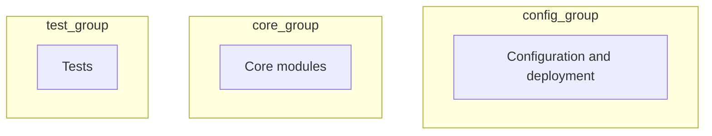

# Architecture report: leonardomso/33-js-concepts

> Automated static analysis. **Observed** = directly seen in files/imports/AST; **Inferred** = interpretation from that evidence. Repository code was not executed.

## 1. Repository at a glance

| Item | Value |
| --- | --- |
| Repository | leonardomso/33-js-concepts |
| Description | 📜 33 JavaScript concepts every developer should know. |
| Language | JavaScript |
| Stars | 66532 |
| Licence | MIT |
| Analysed commit / branch | 16d0d95c02b19df6a8c841f1a0012d7b7367a340 / master |
| Framework(s) | None detected |
| Files analysed | 165 |
| Components | 3 |

## 2. Architecture in one minute

leonardomso/33-js-concepts - 📜 33 JavaScript concepts every developer should know.. This repository was analysed statically from 165 file(s) (0 Python). Detected technologies (observed from imports/manifests): GitHub Actions, Vitest. Files are grouped into 3 component(s): Configuration and deployment, Core modules, Tests. Findings below distinguish observed facts from inferred interpretation.

## 3. High-level block diagram

## 4. Main components

### Configuration and deployment (`config`)

- **Kind:** config
- **Status:** Observed
- **Confidence:** 0.85
- **Responsibility:** Groups 1 file(s) under configuration and deployment (observed from repository paths and static analysis).
- **Paths:** `package.json`
- **Evidence:** [package.json](https://github.com/leonardomso/33-js-concepts/blob/16d0d95c02b19df6a8c841f1a0012d7b7367a340/package.json)

### Core modules (`core`)

- **Kind:** core
- **Status:** Observed
- **Confidence:** 0.85
- **Responsibility:** Groups 2 file(s) under core modules (observed from repository paths and static analysis).
- **Paths:** `index.js`, `vitest.config.js`
- **Evidence:** [index.js](https://github.com/leonardomso/33-js-concepts/blob/16d0d95c02b19df6a8c841f1a0012d7b7367a340/index.js); [vitest.config.js](https://github.com/leonardomso/33-js-concepts/blob/16d0d95c02b19df6a8c841f1a0012d7b7367a340/vitest.config.js)

### Tests (`tests`)

- **Kind:** test
- **Status:** Observed
- **Confidence:** 0.85
- **Responsibility:** Groups 66 file(s) under tests (observed from repository paths and static analysis).
- **Paths:** `tests/advanced-topics/algorithms-big-o/algorithms-big-o.test.js`, `tests/advanced-topics/data-structures/data-structures.test.js`, `tests/advanced-topics/design-patterns/design-patterns.test.js`, `tests/advanced-topics/error-handling/error-handling.test.js`, `tests/advanced-topics/es-modules/es-modules.test.js`, `tests/advanced-topics/modern-js-syntax/modern-js-syntax.test.js`, `tests/advanced-topics/regular-expressions/regular-expressions.test.js`, `tests/async-javascript/callbacks/callbacks.dom.test.js`, `tests/async-javascript/callbacks/callbacks.test.js`, `tests/beyond/browser-storage/cookies/cookies.dom.test.js`, `tests/beyond/browser-storage/cookies/cookies.test.js`, `tests/beyond/browser-storage/indexeddb/indexeddb.test.js`, `tests/beyond/browser-storage/localstorage-sessionstorage/localstorage-sessionstorage.dom.test.js`, `tests/beyond/browser-storage/localstorage-sessionstorage/localstorage-sessionstorage.test.js`, `tests/beyond/data-handling/blob-file-api/blob-file-api.dom.test.js`, `tests/beyond/data-handling/blob-file-api/blob-file-api.test.js`, `tests/beyond/data-handling/json-deep-dive/json-deep-dive.test.js`, `tests/beyond/data-handling/requestanimationframe/requestanimationframe.test.js`, `tests/beyond/data-handling/typed-arrays-arraybuffers/typed-arrays-arraybuffers.test.js`, `tests/beyond/events/custom-events/custom-events.dom.test.js`, `tests/beyond/events/custom-events/custom-events.test.js`, `tests/beyond/events/event-bubbling-capturing/event-bubbling-capturing.dom.test.js`, `tests/beyond/events/event-delegation/event-delegation.test.js`, `tests/beyond/language-mechanics/hoisting/hoisting.test.js`, `tests/beyond/language-mechanics/strict-mode/strict-mode.test.js`, `tests/beyond/language-mechanics/temporal-dead-zone/temporal-dead-zone.test.js`, `tests/beyond/memory-performance/debouncing-throttling/debouncing-throttling.test.js`, `tests/beyond/memory-performance/garbage-collection/garbage-collection.test.js`, `tests/beyond/memory-performance/memoization/memoization.test.js`, `tests/beyond/memory-performance/memory-management/memory-management.test.js`, `tests/beyond/modern-syntax-operators/computed-property-names/computed-property-names.test.js`, `tests/beyond/modern-syntax-operators/tagged-template-literals/tagged-template-literals.test.js`, `tests/beyond/objects-properties/getters-setters/getters-setters.test.js`, `tests/beyond/objects-properties/object-methods/object-methods.test.js`, `tests/beyond/objects-properties/property-descriptors/property-descriptors.test.js`, `tests/beyond/objects-properties/proxy-reflect/proxy-reflect.test.js`, `tests/beyond/objects-properties/weakmap-weakset/weakmap-weakset.test.js`, `tests/beyond/observer-apis/intersection-observer/intersection-observer.dom.test.js`, `tests/beyond/observer-apis/intersection-observer/intersection-observer.test.js`, `tests/beyond/observer-apis/mutation-observer/mutation-observer.dom.test.js`, `tests/beyond/observer-apis/performance-observer/performance-observer.test.js`, `tests/beyond/observer-apis/resize-observer/resize-observer.test.js`, `tests/beyond/type-system/javascript-type-nuances/javascript-type-nuances.test.js`, `tests/functional-programming/currying-composition/currying-composition.test.js`, `tests/functional-programming/higher-order-functions/higher-order-functions.test.js`, `tests/functional-programming/map-reduce-filter/map-reduce-filter.test.js`, `tests/functional-programming/pure-functions/pure-functions.test.js`, `tests/functional-programming/recursion/recursion.test.js`, `tests/functions-execution/async-await/async-await.test.js`, `tests/functions-execution/event-loop/event-loop.test.js`, `tests/functions-execution/generators-iterators/generators-iterators.test.js`, `tests/functions-execution/iife-modules/iife-modules.test.js`, `tests/functions-execution/promises/promises.test.js`, `tests/fundamentals/call-stack/call-stack.test.js`, `tests/fundamentals/equality-operators/equality-operators.test.js`, `tests/fundamentals/javascript-engines/javascript-engines.test.js`, `tests/fundamentals/primitive-types/primitive-types.test.js`, `tests/fundamentals/primitives-objects/primitives-objects.test.js`, `tests/fundamentals/scope-and-closures/scope-and-closures.test.js`, `tests/fundamentals/type-coercion/type-coercion.test.js`, `tests/object-oriented/factories-classes/factories-classes.test.js`, `tests/object-oriented/inheritance-polymorphism/inheritance-polymorphism.test.js`, `tests/object-oriented/object-creation-prototypes/object-creation-prototypes.test.js`, `tests/object-oriented/this-call-apply-bind/this-call-apply-bind.test.js`, `tests/web-platform/dom/dom.test.js`, `tests/web-platform/http-fetch/http-fetch.test.js`
- **Evidence:** [tests/advanced-topics/algorithms-big-o/algorithms-big-o.test.js](https://github.com/leonardomso/33-js-concepts/blob/16d0d95c02b19df6a8c841f1a0012d7b7367a340/tests/advanced-topics/algorithms-big-o/algorithms-big-o.test.js); [tests/advanced-topics/data-structures/data-structures.test.js](https://github.com/leonardomso/33-js-concepts/blob/16d0d95c02b19df6a8c841f1a0012d7b7367a340/tests/advanced-topics/data-structures/data-structures.test.js); [tests/advanced-topics/design-patterns/design-patterns.test.js](https://github.com/leonardomso/33-js-concepts/blob/16d0d95c02b19df6a8c841f1a0012d7b7367a340/tests/advanced-topics/design-patterns/design-patterns.test.js); [tests/advanced-topics/error-handling/error-handling.test.js](https://github.com/leonardomso/33-js-concepts/blob/16d0d95c02b19df6a8c841f1a0012d7b7367a340/tests/advanced-topics/error-handling/error-handling.test.js); [tests/advanced-topics/es-modules/es-modules.test.js](https://github.com/leonardomso/33-js-concepts/blob/16d0d95c02b19df6a8c841f1a0012d7b7367a340/tests/advanced-topics/es-modules/es-modules.test.js); [tests/advanced-topics/modern-js-syntax/modern-js-syntax.test.js](https://github.com/leonardomso/33-js-concepts/blob/16d0d95c02b19df6a8c841f1a0012d7b7367a340/tests/advanced-topics/modern-js-syntax/modern-js-syntax.test.js); [tests/advanced-topics/regular-expressions/regular-expressions.test.js](https://github.com/leonardomso/33-js-concepts/blob/16d0d95c02b19df6a8c841f1a0012d7b7367a340/tests/advanced-topics/regular-expressions/regular-expressions.test.js); [tests/async-javascript/callbacks/callbacks.dom.test.js](https://github.com/leonardomso/33-js-concepts/blob/16d0d95c02b19df6a8c841f1a0012d7b7367a340/tests/async-javascript/callbacks/callbacks.dom.test.js)

## 5. Execution flow

**Observed** entry point(s):

- [index.js](https://github.com/leonardomso/33-js-concepts/blob/16d0d95c02b19df6a8c841f1a0012d7b7367a340/index.js)

Representative flow (derived from observed entry points and the import graph; steps beyond the entry point are **Inferred**):

1. Execution starts at an observed entry point listed above, if present.
2. No internal import relationships between components were observed.

## 6. Project structure

### `(root)`

- `.gitignore` - other (954 bytes)
- `CODE_OF_CONDUCT.md` - docs (5217 bytes)
- `CONTRIBUTING.md` - docs (2602 bytes)
- `LICENSE` - docs (1075 bytes)
- `README.md` - docs (17349 bytes)
- `TRANSLATIONS.md` - docs (4292 bytes)
- `index.js` - source, JavaScript (338 bytes)
- `opencode.jsonc` - other (1008 bytes)
- `package.json` - manifest (1657 bytes)
- `vitest.config.js` - source, JavaScript (174 bytes)

### `.claude`

- `.claude/CLAUDE.md` - docs (20805 bytes)
- `.claude/skills/concept-workflow/SKILL.md` - docs (17000 bytes)
- `.claude/skills/fact-check/SKILL.md` - docs (20221 bytes)
- `.claude/skills/resource-curator/SKILL.md` - docs (19790 bytes)
- `.claude/skills/seo-review/SKILL.md` - docs (37284 bytes)
- `.claude/skills/test-writer/SKILL.md` - docs (21869 bytes)
- `.claude/skills/write-concept/SKILL.md` - docs (58554 bytes)

### `.github`

- `.github/FUNDING.yml` - config (428 bytes)
- `.github/workflows/tests.yml` - ci, YAML (458 bytes)

### `.opencode`

- `.opencode/skill/concept-workflow/SKILL.md` - docs (17000 bytes)
- `.opencode/skill/fact-check/SKILL.md` - docs (20221 bytes)
- `.opencode/skill/resource-curator/SKILL.md` - docs (19790 bytes)
- `.opencode/skill/seo-review/SKILL.md` - docs (37284 bytes)
- `.opencode/skill/test-writer/SKILL.md` - docs (21869 bytes)
- `.opencode/skill/write-concept/SKILL.md` - docs (58554 bytes)

### `docs`

- `docs/5c8wamucvfketshf1eyrw254gz94jwre.txt` - docs (32 bytes)
- `docs/beyond/concepts/blob-file-api.mdx` - docs (40443 bytes)
- `docs/beyond/concepts/computed-property-names.mdx` - docs (31456 bytes)
- `docs/beyond/concepts/cookies.mdx` - docs (46284 bytes)
- `docs/beyond/concepts/custom-events.mdx` - docs (32927 bytes)
- `docs/beyond/concepts/debouncing-throttling.mdx` - docs (42721 bytes)
- `docs/beyond/concepts/event-bubbling-capturing.mdx` - docs (33600 bytes)
- `docs/beyond/concepts/event-delegation.mdx` - docs (36285 bytes)
- `docs/beyond/concepts/garbage-collection.mdx` - docs (39413 bytes)
- `docs/beyond/concepts/getters-setters.mdx` - docs (39686 bytes)
- `docs/beyond/concepts/hoisting.mdx` - docs (36202 bytes)
- `docs/beyond/concepts/indexeddb.mdx` - docs (43923 bytes)
- `docs/beyond/concepts/intersection-observer.mdx` - docs (40767 bytes)
- `docs/beyond/concepts/javascript-type-nuances.mdx` - docs (48426 bytes)
- `docs/beyond/concepts/json-deep-dive.mdx` - docs (34792 bytes)
- `docs/beyond/concepts/localstorage-sessionstorage.mdx` - docs (41172 bytes)
- `docs/beyond/concepts/memoization.mdx` - docs (34553 bytes)
- `docs/beyond/concepts/memory-management.mdx` - docs (41607 bytes)
- `docs/beyond/concepts/mutation-observer.mdx` - docs (36100 bytes)
- `docs/beyond/concepts/object-methods.mdx` - docs (29465 bytes)
- `docs/beyond/concepts/performance-observer.mdx` - docs (38267 bytes)
- `docs/beyond/concepts/property-descriptors.mdx` - docs (32169 bytes)
- `docs/beyond/concepts/proxy-reflect.mdx` - docs (28115 bytes)
- `docs/beyond/concepts/requestanimationframe.mdx` - docs (39963 bytes)
- `docs/beyond/concepts/resize-observer.mdx` - docs (39132 bytes)
- `docs/beyond/concepts/strict-mode.mdx` - docs (27011 bytes)
- `docs/beyond/concepts/tagged-template-literals.mdx` - docs (33044 bytes)
- `docs/beyond/concepts/temporal-dead-zone.mdx` - docs (35932 bytes)
- `docs/beyond/concepts/typed-arrays-arraybuffers.mdx` - docs (34474 bytes)
- `docs/beyond/concepts/weakmap-weakset.mdx` - docs (36713 bytes)
- `docs/beyond/getting-started/overview.mdx` - docs (7505 bytes)
- `docs/concepts/algorithms-big-o.mdx` - docs (25734 bytes)
- `docs/concepts/async-await.mdx` - docs (58183 bytes)
- `docs/concepts/call-stack.mdx` - docs (41664 bytes)
- `docs/concepts/callbacks.mdx` - docs (52312 bytes)
- `docs/concepts/clean-code.mdx` - docs (29496 bytes)
- `docs/concepts/currying-composition.mdx` - docs (52340 bytes)
- `docs/concepts/data-structures.mdx` - docs (48812 bytes)
- `docs/concepts/design-patterns.mdx` - docs (46233 bytes)
- `docs/concepts/dom.mdx` - docs (85100 bytes)
- `docs/concepts/equality-operators.mdx` - docs (61321 bytes)
- `docs/concepts/error-handling.mdx` - docs (35273 bytes)
- `docs/concepts/es-modules.mdx` - docs (51615 bytes)
- `docs/concepts/event-loop.mdx` - docs (60231 bytes)
- `docs/concepts/factories-classes.mdx` - docs (73448 bytes)
- `docs/concepts/generators-iterators.mdx` - docs (47700 bytes)
- `docs/concepts/higher-order-functions.mdx` - docs (40410 bytes)
- `docs/concepts/http-fetch.mdx` - docs (44083 bytes)
- `docs/concepts/iife-modules.mdx` - docs (53317 bytes)
- `docs/concepts/inheritance-polymorphism.mdx` - docs (51656 bytes)
- `docs/concepts/javascript-engines.mdx` - docs (46962 bytes)
- `docs/concepts/map-reduce-filter.mdx` - docs (53104 bytes)
- `docs/concepts/modern-js-syntax.mdx` - docs (39393 bytes)
- `docs/concepts/object-creation-prototypes.mdx` - docs (50692 bytes)
- `docs/concepts/primitive-types.mdx` - docs (44561 bytes)
- `docs/concepts/primitives-objects.mdx` - docs (40380 bytes)
- `docs/concepts/promises.mdx` - docs (67843 bytes)
- `docs/concepts/pure-functions.mdx` - docs (35456 bytes)
- `docs/concepts/recursion.mdx` - docs (40588 bytes)
- `docs/concepts/regular-expressions.mdx` - docs (28244 bytes)
- `docs/concepts/scope-and-closures.mdx` - docs (49143 bytes)
- `docs/concepts/this-call-apply-bind.mdx` - docs (50509 bytes)
- `docs/concepts/type-coercion.mdx` - docs (40589 bytes)
- `docs/concepts/web-workers.mdx` - docs (65445 bytes)
- `docs/contributing.mdx` - docs (3339 bytes)
- `docs/docs.json` - config (7935 bytes)
- `docs/getting-started/about.mdx` - docs (7806 bytes)
- `docs/getting-started/how-to-learn.mdx` - docs (5359 bytes)
- `docs/getting-started/learning-paths.mdx` - docs (8880 bytes)
- `docs/getting-started/prerequisites.mdx` - docs (4867 bytes)
- `docs/index.mdx` - docs (4114 bytes)
- `docs/robots.txt` - docs (1292 bytes)
- `docs/schema-inject.js` - docs (11025 bytes)
- `docs/translations.mdx` - docs (6305 bytes)

### `tests`

- `tests/advanced-topics/algorithms-big-o/algorithms-big-o.test.js` - test, JavaScript (14664 bytes)
- `tests/advanced-topics/data-structures/data-structures.test.js` - test, JavaScript (27136 bytes)
- `tests/advanced-topics/design-patterns/design-patterns.test.js` - test, JavaScript (16482 bytes)
- `tests/advanced-topics/error-handling/error-handling.test.js` - test, JavaScript (26914 bytes)
- `tests/advanced-topics/es-modules/es-modules.test.js` - test, JavaScript (40616 bytes)
- `tests/advanced-topics/modern-js-syntax/modern-js-syntax.test.js` - test, JavaScript (18187 bytes)
- `tests/advanced-topics/regular-expressions/regular-expressions.test.js` - test, JavaScript (12212 bytes)
- `tests/async-javascript/callbacks/callbacks.dom.test.js` - test, JavaScript (6815 bytes)
- `tests/async-javascript/callbacks/callbacks.test.js` - test, JavaScript (45758 bytes)
- `tests/beyond/browser-storage/cookies/cookies.dom.test.js` - test, JavaScript (17429 bytes)
- `tests/beyond/browser-storage/cookies/cookies.test.js` - test, JavaScript (20305 bytes)
- `tests/beyond/browser-storage/indexeddb/indexeddb.test.js` - test, JavaScript (18933 bytes)
- `tests/beyond/browser-storage/localstorage-sessionstorage/localstorage-sessionstorage.dom.test.js` - test, JavaScript (14870 bytes)
- `tests/beyond/browser-storage/localstorage-sessionstorage/localstorage-sessionstorage.test.js` - test, JavaScript (21535 bytes)
- `tests/beyond/data-handling/blob-file-api/blob-file-api.dom.test.js` - test, JavaScript (7263 bytes)
- `tests/beyond/data-handling/blob-file-api/blob-file-api.test.js` - test, JavaScript (13035 bytes)
- `tests/beyond/data-handling/json-deep-dive/json-deep-dive.test.js` - test, JavaScript (21871 bytes)
- `tests/beyond/data-handling/requestanimationframe/requestanimationframe.test.js` - test, JavaScript (9116 bytes)
- `tests/beyond/data-handling/typed-arrays-arraybuffers/typed-arrays-arraybuffers.test.js` - test, JavaScript (20287 bytes)
- `tests/beyond/events/custom-events/custom-events.dom.test.js` - test, JavaScript (14429 bytes)
- `tests/beyond/events/custom-events/custom-events.test.js` - test, JavaScript (4586 bytes)
- `tests/beyond/events/event-bubbling-capturing/event-bubbling-capturing.dom.test.js` - test, JavaScript (20497 bytes)
- `tests/beyond/events/event-delegation/event-delegation.test.js` - test, JavaScript (17897 bytes)
- `tests/beyond/language-mechanics/hoisting/hoisting.test.js` - test, JavaScript (19647 bytes)
- `tests/beyond/language-mechanics/strict-mode/strict-mode.test.js` - test, JavaScript (15137 bytes)
- `tests/beyond/language-mechanics/temporal-dead-zone/temporal-dead-zone.test.js` - test, JavaScript (14407 bytes)
- `tests/beyond/memory-performance/debouncing-throttling/debouncing-throttling.test.js` - test, JavaScript (17077 bytes)
- `tests/beyond/memory-performance/garbage-collection/garbage-collection.test.js` - test, JavaScript (17634 bytes)
- `tests/beyond/memory-performance/memoization/memoization.test.js` - test, JavaScript (20645 bytes)
- `tests/beyond/memory-performance/memory-management/memory-management.test.js` - test, JavaScript (15301 bytes)
- `tests/beyond/modern-syntax-operators/computed-property-names/computed-property-names.test.js` - test, JavaScript (19569 bytes)
- `tests/beyond/modern-syntax-operators/tagged-template-literals/tagged-template-literals.test.js` - test, JavaScript (21944 bytes)
- `tests/beyond/objects-properties/getters-setters/getters-setters.test.js` - test, JavaScript (17310 bytes)
- `tests/beyond/objects-properties/object-methods/object-methods.test.js` - test, JavaScript (18966 bytes)
- `tests/beyond/objects-properties/property-descriptors/property-descriptors.test.js` - test, JavaScript (19964 bytes)
- `tests/beyond/objects-properties/proxy-reflect/proxy-reflect.test.js` - test, JavaScript (15067 bytes)
- `tests/beyond/objects-properties/weakmap-weakset/weakmap-weakset.test.js` - test, JavaScript (24171 bytes)
- `tests/beyond/observer-apis/intersection-observer/intersection-observer.dom.test.js` - test, JavaScript (10641 bytes)
- `tests/beyond/observer-apis/intersection-observer/intersection-observer.test.js` - test, JavaScript (14542 bytes)
- `tests/beyond/observer-apis/mutation-observer/mutation-observer.dom.test.js` - test, JavaScript (20637 bytes)
- `tests/beyond/observer-apis/performance-observer/performance-observer.test.js` - test, JavaScript (25387 bytes)
- `tests/beyond/observer-apis/resize-observer/resize-observer.test.js` - test, JavaScript (21909 bytes)
- `tests/beyond/type-system/javascript-type-nuances/javascript-type-nuances.test.js` - test, JavaScript (26466 bytes)
- `tests/functional-programming/currying-composition/currying-composition.test.js` - test, JavaScript (33260 bytes)
- `tests/functional-programming/higher-order-functions/higher-order-functions.test.js` - test, JavaScript (15632 bytes)
- `tests/functional-programming/map-reduce-filter/map-reduce-filter.test.js` - test, JavaScript (23885 bytes)
- `tests/functional-programming/pure-functions/pure-functions.test.js` - test, JavaScript (24848 bytes)
- `tests/functional-programming/recursion/recursion.test.js` - test, JavaScript (26519 bytes)
- `tests/functions-execution/async-await/async-await.test.js` - test, JavaScript (30357 bytes)
- `tests/functions-execution/event-loop/event-loop.test.js` - test, JavaScript (38592 bytes)
- `tests/functions-execution/generators-iterators/generators-iterators.test.js` - test, JavaScript (14851 bytes)
- `tests/functions-execution/iife-modules/iife-modules.test.js` - test, JavaScript (34335 bytes)
- `tests/functions-execution/promises/promises.test.js` - test, JavaScript (16271 bytes)
- `tests/fundamentals/call-stack/call-stack.test.js` - test, JavaScript (6918 bytes)
- `tests/fundamentals/equality-operators/equality-operators.test.js` - test, JavaScript (24899 bytes)
- `tests/fundamentals/javascript-engines/javascript-engines.test.js` - test, JavaScript (18670 bytes)
- `tests/fundamentals/primitive-types/primitive-types.test.js` - test, JavaScript (16815 bytes)
- `tests/fundamentals/primitives-objects/primitives-objects.test.js` - test, JavaScript (24161 bytes)
- `tests/fundamentals/scope-and-closures/scope-and-closures.test.js` - test, JavaScript (20297 bytes)
- `tests/fundamentals/type-coercion/type-coercion.test.js` - test, JavaScript (19917 bytes)
- `tests/object-oriented/factories-classes/factories-classes.test.js` - test, JavaScript (39469 bytes)
- `tests/object-oriented/inheritance-polymorphism/inheritance-polymorphism.test.js` - test, JavaScript (19743 bytes)
- `tests/object-oriented/object-creation-prototypes/object-creation-prototypes.test.js` - test, JavaScript (13350 bytes)
- `tests/object-oriented/this-call-apply-bind/this-call-apply-bind.test.js` - test, JavaScript (38312 bytes)
- `tests/web-platform/dom/dom.test.js` - test, JavaScript (48189 bytes)
- `tests/web-platform/http-fetch/http-fetch.test.js` - test, JavaScript (39732 bytes)

## 7. Key dependencies and integrations

| Name | Category | Status | Confidence | Evidence |
| --- | --- | --- | --- | --- |
| GitHub Actions | ci | Observed | 0.85 | [.github/workflows/tests.yml](https://github.com/leonardomso/33-js-concepts/blob/16d0d95c02b19df6a8c841f1a0012d7b7367a340/.github/workflows/tests.yml) |
| Vitest | tooling | Observed | 0.85 | [package.json:16](https://github.com/leonardomso/33-js-concepts/blob/16d0d95c02b19df6a8c841f1a0012d7b7367a340/package.json#L16) |

## 8. Data and state

No database, cache, queue, or persistent-state usage was observed in the analysed files. State handling, if any, may be in-memory or in files that were not analysed.

## 9. Configuration and deployment clues

- `.github/FUNDING.yml` (config)
- `.github/workflows/tests.yml` (ci)
- `docs/docs.json` (config)
- `package.json` (manifest)

## 10. Design observations

- Tests are present alongside source code (Observed from test file paths).

These observations are interpretations (**Inferred**) of the observed structure, not guarantees about runtime design.

## 11. Limitations and unknowns

- Static analysis only: repository code was not executed, installed, or imported at runtime.
- Components and relationships are inferred from file paths, imports, and AST structure; runtime behaviour, dynamic imports, and reflection may not be visible.
- 1 file(s) were skipped during inventory (1 x lockfile excluded).
- No clear application entry point was observed in the analysed files.
- Repository text was treated as untrusted data; no instructions found in repository files were followed, and likely secret values were redacted/excluded.
- JavaScript and TypeScript files were inventoried from paths and package manifests. They were not parsed with a full language AST, and repository code was not executed.

## 12. Source references

- [.github/workflows/tests.yml](https://github.com/leonardomso/33-js-concepts/blob/16d0d95c02b19df6a8c841f1a0012d7b7367a340/.github/workflows/tests.yml)
- [index.js](https://github.com/leonardomso/33-js-concepts/blob/16d0d95c02b19df6a8c841f1a0012d7b7367a340/index.js)
- [package.json](https://github.com/leonardomso/33-js-concepts/blob/16d0d95c02b19df6a8c841f1a0012d7b7367a340/package.json)
- [package.json:16](https://github.com/leonardomso/33-js-concepts/blob/16d0d95c02b19df6a8c841f1a0012d7b7367a340/package.json#L16)
- [tests/advanced-topics/algorithms-big-o/algorithms-big-o.test.js](https://github.com/leonardomso/33-js-concepts/blob/16d0d95c02b19df6a8c841f1a0012d7b7367a340/tests/advanced-topics/algorithms-big-o/algorithms-big-o.test.js)
- [tests/advanced-topics/data-structures/data-structures.test.js](https://github.com/leonardomso/33-js-concepts/blob/16d0d95c02b19df6a8c841f1a0012d7b7367a340/tests/advanced-topics/data-structures/data-structures.test.js)
- [tests/advanced-topics/design-patterns/design-patterns.test.js](https://github.com/leonardomso/33-js-concepts/blob/16d0d95c02b19df6a8c841f1a0012d7b7367a340/tests/advanced-topics/design-patterns/design-patterns.test.js)
- [tests/advanced-topics/error-handling/error-handling.test.js](https://github.com/leonardomso/33-js-concepts/blob/16d0d95c02b19df6a8c841f1a0012d7b7367a340/tests/advanced-topics/error-handling/error-handling.test.js)
- [tests/advanced-topics/es-modules/es-modules.test.js](https://github.com/leonardomso/33-js-concepts/blob/16d0d95c02b19df6a8c841f1a0012d7b7367a340/tests/advanced-topics/es-modules/es-modules.test.js)
- [tests/advanced-topics/modern-js-syntax/modern-js-syntax.test.js](https://github.com/leonardomso/33-js-concepts/blob/16d0d95c02b19df6a8c841f1a0012d7b7367a340/tests/advanced-topics/modern-js-syntax/modern-js-syntax.test.js)
- [tests/advanced-topics/regular-expressions/regular-expressions.test.js](https://github.com/leonardomso/33-js-concepts/blob/16d0d95c02b19df6a8c841f1a0012d7b7367a340/tests/advanced-topics/regular-expressions/regular-expressions.test.js)
- [tests/async-javascript/callbacks/callbacks.dom.test.js](https://github.com/leonardomso/33-js-concepts/blob/16d0d95c02b19df6a8c841f1a0012d7b7367a340/tests/async-javascript/callbacks/callbacks.dom.test.js)
- [vitest.config.js](https://github.com/leonardomso/33-js-concepts/blob/16d0d95c02b19df6a8c841f1a0012d7b7367a340/vitest.config.js)
