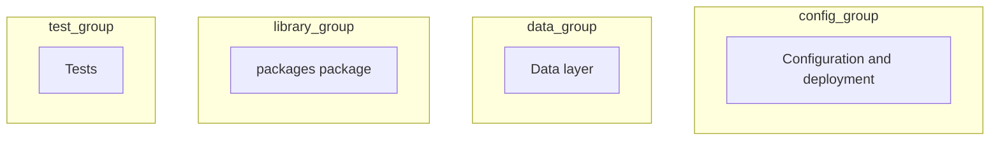

# Architecture report: less/less.js

> Automated static analysis. **Observed** = directly seen in files/imports/AST; **Inferred** = interpretation from that evidence. Repository code was not executed.

## 1. Repository at a glance

| Item | Value |
| --- | --- |
| Repository | less/less.js |
| Description | Less. The dynamic stylesheet language. |
| Language | JavaScript |
| Stars | 17000 |
| Licence | Apache-2.0 |
| Analysed commit / branch | 713331655e437401dfea6cd233893a69762734e1 / master |
| Framework(s) | None detected |
| Files analysed | 797 |
| Components | 4 |

## 2. Architecture in one minute

less/less.js - Less. The dynamic stylesheet language.. This repository was analysed statically from 797 file(s) (0 Python). Detected technologies (observed from imports/manifests): GitHub Actions, TypeScript, webpack. Files are grouped into 4 component(s): Configuration and deployment, Data layer, packages package, Tests. Findings below distinguish observed facts from inferred interpretation.

## 3. High-level block diagram

## 4. Main components

### Configuration and deployment (`config`)

- **Kind:** config
- **Status:** Observed
- **Confidence:** 0.85
- **Responsibility:** Groups 13 file(s) under configuration and deployment (observed from repository paths and static analysis).
- **Paths:** `config/eslint/base.cjs`, `package.json`, `packages/less/benchmark/results/latest/macbook-pro_arm64.json`, `packages/less/benchmark/results/runs/2026-03-09T21-34-11Z_macbook-pro_arm64.json`, `packages/less/benchmark/results/runs/2026-03-09_macbook-pro_arm64.json`, `packages/less/bower.json`, `packages/less/package.json`, `packages/less/tsconfig.json`, `packages/test-data/package.json`, `packages/test-data/tests-config/globalVars/extended.json`, `packages/test-data/tests-config/globalVars/simple.json`, `packages/test-data/tests-config/modifyVars/extended.json`, `packages/test-data/tests-config/sourcemaps/basic.json`
- **Evidence:** [config/eslint/base.cjs](https://github.com/less/less.js/blob/713331655e437401dfea6cd233893a69762734e1/config/eslint/base.cjs); [package.json](https://github.com/less/less.js/blob/713331655e437401dfea6cd233893a69762734e1/package.json); [packages/less/benchmark/results/latest/macbook-pro_arm64.json](https://github.com/less/less.js/blob/713331655e437401dfea6cd233893a69762734e1/packages/less/benchmark/results/latest/macbook-pro_arm64.json); [packages/less/benchmark/results/runs/2026-03-09T21-34-11Z_macbook-pro_arm64.json](https://github.com/less/less.js/blob/713331655e437401dfea6cd233893a69762734e1/packages/less/benchmark/results/runs/2026-03-09T21-34-11Z_macbook-pro_arm64.json); [packages/less/benchmark/results/runs/2026-03-09_macbook-pro_arm64.json](https://github.com/less/less.js/blob/713331655e437401dfea6cd233893a69762734e1/packages/less/benchmark/results/runs/2026-03-09_macbook-pro_arm64.json); [packages/less/bower.json](https://github.com/less/less.js/blob/713331655e437401dfea6cd233893a69762734e1/packages/less/bower.json); [packages/less/package.json](https://github.com/less/less.js/blob/713331655e437401dfea6cd233893a69762734e1/packages/less/package.json); [packages/less/tsconfig.json](https://github.com/less/less.js/blob/713331655e437401dfea6cd233893a69762734e1/packages/less/tsconfig.json)

### Data layer (`data_layer`)

- **Kind:** data
- **Status:** Observed
- **Confidence:** 0.85
- **Responsibility:** Groups 3 file(s) under data layer (observed from repository paths and static analysis).
- **Paths:** `packages/less/lib/less/data/colors.js`, `packages/less/lib/less/data/index.js`, `packages/less/lib/less/data/unit-conversions.js`
- **Evidence:** [packages/less/lib/less/data/colors.js](https://github.com/less/less.js/blob/713331655e437401dfea6cd233893a69762734e1/packages/less/lib/less/data/colors.js); [packages/less/lib/less/data/index.js](https://github.com/less/less.js/blob/713331655e437401dfea6cd233893a69762734e1/packages/less/lib/less/data/index.js); [packages/less/lib/less/data/unit-conversions.js](https://github.com/less/less.js/blob/713331655e437401dfea6cd233893a69762734e1/packages/less/lib/less/data/unit-conversions.js)

### packages package (`packages`)

- **Kind:** library
- **Status:** Observed
- **Confidence:** 0.85
- **Responsibility:** Groups 181 file(s) under packages package (observed from repository paths and static analysis).
- **Paths:** `packages/less/.eslintrc.cjs`, `packages/less/Gruntfile.cjs`, `packages/less/benchmark/benchmark-runner.js`, `packages/less/benchmark/index.js`, `packages/less/benchmark/run-historical.sh`, `packages/less/index.cjs`, `packages/less/lib/less-browser/add-default-options.js`, `packages/less/lib/less-browser/bootstrap.js`, `packages/less/lib/less-browser/browser.js`, `packages/less/lib/less-browser/cache.js`, `packages/less/lib/less-browser/error-reporting.js`, `packages/less/lib/less-browser/file-manager.js`, `packages/less/lib/less-browser/image-size.js`, `packages/less/lib/less-browser/index.js`, `packages/less/lib/less-browser/log-listener.js`, `packages/less/lib/less-browser/plugin-loader.js`, `packages/less/lib/less-browser/utils.js`, `packages/less/lib/less-node/environment.js`, `packages/less/lib/less-node/file-manager.js`, `packages/less/lib/less-node/fs.js`, `packages/less/lib/less-node/image-size.js`, `packages/less/lib/less-node/index.js`, `packages/less/lib/less-node/lessc-helper.js`, `packages/less/lib/less-node/plugin-loader.js`, `packages/less/lib/less-node/url-file-manager.js`, `packages/less/lib/less/constants.js`, `packages/less/lib/less/contexts.js`, `packages/less/lib/less/default-options.js`, `packages/less/lib/less/deprecation.js`, `packages/less/lib/less/environment/abstract-file-manager.js`, `packages/less/lib/less/environment/abstract-plugin-loader.js`, `packages/less/lib/less/environment/environment-api.ts`, `packages/less/lib/less/environment/environment.js`, `packages/less/lib/less/environment/file-manager-api.ts`, `packages/less/lib/less/functions/boolean.js`, `packages/less/lib/less/functions/color-blending.js`, `packages/less/lib/less/functions/color.js`, `packages/less/lib/less/functions/data-uri.js`, `packages/less/lib/less/functions/default.js`, `packages/less/lib/less/functions/function-caller.js`, `packages/less/lib/less/functions/function-registry.js`, `packages/less/lib/less/functions/index.js`, `packages/less/lib/less/functions/list.js`, `packages/less/lib/less/functions/math-helper.js`, `packages/less/lib/less/functions/math.js`, `packages/less/lib/less/functions/number.js`, `packages/less/lib/less/functions/string.js`, `packages/less/lib/less/functions/style.js`, `packages/less/lib/less/functions/svg.js`, `packages/less/lib/less/functions/types.js`, `packages/less/lib/less/import-manager.js`, `packages/less/lib/less/index.js`, `packages/less/lib/less/less-error.js`, `packages/less/lib/less/logger.js`, `packages/less/lib/less/parse-tree.js`, `packages/less/lib/less/parse.js`, `packages/less/lib/less/parser/lookup-pattern.js`, `packages/less/lib/less/parser/parser-input.js`, `packages/less/lib/less/parser/parser.js`, `packages/less/lib/less/plugin-manager.js`, `packages/less/lib/less/render.js`, `packages/less/lib/less/source-map-builder.js`, `packages/less/lib/less/source-map-output.js`, `packages/less/lib/less/transform-tree.js`, `packages/less/lib/less/tree/anonymous.js`, `packages/less/lib/less/tree/assignment.js`, `packages/less/lib/less/tree/atrule-syntax.js`, `packages/less/lib/less/tree/atrule.js`, `packages/less/lib/less/tree/attribute.js`, `packages/less/lib/less/tree/call.js`, `packages/less/lib/less/tree/color.js`, `packages/less/lib/less/tree/combinator.js`, `packages/less/lib/less/tree/comment.js`, `packages/less/lib/less/tree/condition.js`, `packages/less/lib/less/tree/container.js`, `packages/less/lib/less/tree/debug-info.js`, `packages/less/lib/less/tree/declaration.js`, `packages/less/lib/less/tree/detached-ruleset.js`, `packages/less/lib/less/tree/dimension.js`, `packages/less/lib/less/tree/element.js`, `packages/less/lib/less/tree/expression.js`, `packages/less/lib/less/tree/extend.js`, `packages/less/lib/less/tree/import.js`, `packages/less/lib/less/tree/index.js`, `packages/less/lib/less/tree/interpolated-variable.js`, `packages/less/lib/less/tree/javascript.js`, `packages/less/lib/less/tree/js-eval-node.js`, `packages/less/lib/less/tree/keyword.js`, `packages/less/lib/less/tree/media.js`, `packages/less/lib/less/tree/merge-rules.js`, `packages/less/lib/less/tree/mixin-call.js`, `packages/less/lib/less/tree/mixin-definition.js`, `packages/less/lib/less/tree/namespace-value.js`, `packages/less/lib/less/tree/negative.js`, `packages/less/lib/less/tree/nested-at-rule.js`, `packages/less/lib/less/tree/node.js`, `packages/less/lib/less/tree/operation.js`, `packages/less/lib/less/tree/paren.js`, `packages/less/lib/less/tree/property.js`, `packages/less/lib/less/tree/query-in-parens.js`, `packages/less/lib/less/tree/quoted.js`, `packages/less/lib/less/tree/ruleset.js`, `packages/less/lib/less/tree/selector.js`, `packages/less/lib/less/tree/unicode-descriptor.js`, `packages/less/lib/less/tree/unit.js`, `packages/less/lib/less/tree/url.js`, `packages/less/lib/less/tree/value.js`, `packages/less/lib/less/tree/variable-call.js`, `packages/less/lib/less/tree/variable.js`, `packages/less/lib/less/utils.js`, `packages/less/lib/less/visitors/extend-visitor.js`, `packages/less/lib/less/visitors/import-sequencer.js`, `packages/less/lib/less/visitors/import-visitor.js`, `packages/less/lib/less/visitors/index.js`, `packages/less/lib/less/visitors/join-selector-visitor.js`, `packages/less/lib/less/visitors/set-tree-visibility-visitor.js`, `packages/less/lib/less/visitors/to-css-visitor.js`, `packages/less/lib/less/visitors/visitor.js`, `packages/less/scripts/coverage-lines.js`, `packages/less/scripts/coverage-report.js`, `packages/less/scripts/postinstall.js`, `packages/test-data/index.js`, `packages/test-data/plugin/plugin-collection.js`, `packages/test-data/plugin/plugin-global.js`, `packages/test-data/plugin/plugin-local.js`, `packages/test-data/plugin/plugin-preeval.js`, `packages/test-data/plugin/plugin-scope1.js`, `packages/test-data/plugin/plugin-scope2.js`, `packages/test-data/plugin/plugin-set-options-v2.js`, `packages/test-data/plugin/plugin-set-options-v3.js`, `packages/test-data/plugin/plugin-set-options.js`, `packages/test-data/plugin/plugin-simple.js`, `packages/test-data/plugin/plugin-transitive.js`, `packages/test-data/plugin/plugin-tree-nodes.js`, `packages/test-data/tests-config/3rd-party/styles.config.cjs`, `packages/test-data/tests-config/at-rules-compressed-evaluation/styles.config.cjs`, `packages/test-data/tests-config/at-rules-compressed/styles.config.cjs`, `packages/test-data/tests-config/compression/styles.config.cjs`, `packages/test-data/tests-config/debug/all/styles.config.cjs`, `packages/test-data/tests-config/debug/comments/styles.config.cjs`, `packages/test-data/tests-config/debug/mediaquery/styles.config.cjs`, `packages/test-data/tests-config/filemanagerPlugin/styles.config.cjs`, `packages/test-data/tests-config/globalVars/styles.config.cjs`, `packages/test-data/tests-config/include-path-string/styles.config.cjs`, `packages/test-data/tests-config/include-path/styles.config.cjs`, `packages/test-data/tests-config/js-type-errors/styles.config.cjs`, `packages/test-data/tests-config/math-always/styles.config.cjs`, `packages/test-data/tests-config/math-parens-division/styles.config.cjs`, `packages/test-data/tests-config/math-strict/styles.config.cjs`, `packages/test-data/tests-config/modifyVars/styles.config.cjs`, `packages/test-data/tests-config/namespacing/styles.config.cjs`, `packages/test-data/tests-config/no-js-errors/styles.config.cjs`, `packages/test-data/tests-config/postProcessorPlugin/styles.config.cjs`, `packages/test-data/tests-config/preProcessorPlugin/styles.config.cjs`, `packages/test-data/tests-config/process-imports/styles.config.cjs`, `packages/test-data/tests-config/rewrite-urls-all/styles.config.cjs`, `packages/test-data/tests-config/rewrite-urls-local/styles.config.cjs`, `packages/test-data/tests-config/rootpath-escape-interpolation/styles.config.cjs`, `packages/test-data/tests-config/rootpath-rewrite-urls-all/styles.config.cjs`, `packages/test-data/tests-config/rootpath-rewrite-urls-local/styles.config.cjs`, `packages/test-data/tests-config/sourcemaps-basepath/styles.config.cjs`, `packages/test-data/tests-config/sourcemaps-disable-annotation/styles.config.cjs`, `packages/test-data/tests-config/sourcemaps-empty/styles.config.cjs`, `packages/test-data/tests-config/sourcemaps-include-source/styles.config.cjs`, `packages/test-data/tests-config/sourcemaps-rootpath/styles.config.cjs`, `packages/test-data/tests-config/sourcemaps-url/styles.config.cjs`, `packages/test-data/tests-config/sourcemaps-variable-selector/styles.config.cjs`, `packages/test-data/tests-config/sourcemaps/comprehensive/styles.config.cjs`, `packages/test-data/tests-config/sourcemaps/styles.config.cjs`, `packages/test-data/tests-config/sourcemaps/url-interpolation/styles.config.cjs`, `packages/test-data/tests-config/static-urls/styles.config.cjs`, `packages/test-data/tests-config/strict-imports/styles.config.cjs`, `packages/test-data/tests-config/units/no-strict/styles.config.cjs`, `packages/test-data/tests-config/units/strict/styles.config.cjs`, `packages/test-data/tests-config/url-args/styles.config.cjs`, `packages/test-data/tests-config/visitorPlugin/styles.config.cjs`, `packages/test-data/tests-error/eval/plugin/plugin-error-2.js`, `packages/test-data/tests-error/eval/plugin/plugin-error-3.js`, `packages/test-data/tests-error/eval/plugin/plugin-error.js`, `packages/test-data/tests-error/eval/styles.config.cjs`, `packages/test-data/tests-error/parse/styles.config.cjs`
- **Evidence:** [packages/less/.eslintrc.cjs](https://github.com/less/less.js/blob/713331655e437401dfea6cd233893a69762734e1/packages/less/.eslintrc.cjs); [packages/less/Gruntfile.cjs](https://github.com/less/less.js/blob/713331655e437401dfea6cd233893a69762734e1/packages/less/Gruntfile.cjs); [packages/less/benchmark/benchmark-runner.js](https://github.com/less/less.js/blob/713331655e437401dfea6cd233893a69762734e1/packages/less/benchmark/benchmark-runner.js); [packages/less/benchmark/index.js](https://github.com/less/less.js/blob/713331655e437401dfea6cd233893a69762734e1/packages/less/benchmark/index.js); [packages/less/benchmark/run-historical.sh](https://github.com/less/less.js/blob/713331655e437401dfea6cd233893a69762734e1/packages/less/benchmark/run-historical.sh); [packages/less/index.cjs](https://github.com/less/less.js/blob/713331655e437401dfea6cd233893a69762734e1/packages/less/index.cjs); [packages/less/lib/less-browser/add-default-options.js](https://github.com/less/less.js/blob/713331655e437401dfea6cd233893a69762734e1/packages/less/lib/less-browser/add-default-options.js); [packages/less/lib/less-browser/bootstrap.js](https://github.com/less/less.js/blob/713331655e437401dfea6cd233893a69762734e1/packages/less/lib/less-browser/bootstrap.js)

### Tests (`tests`)

- **Kind:** test
- **Status:** Observed
- **Confidence:** 0.85
- **Responsibility:** Groups 105 file(s) under tests (observed from repository paths and static analysis).
- **Paths:** `packages/less/test/.eslintrc.json`, `packages/less/test/README.md`, `packages/less/test/browser/common.js`, `packages/less/test/browser/css/global-vars/simple.css`, `packages/less/test/browser/css/modify-vars/simple.css`, `packages/less/test/browser/css/plugin/plugin.css`, `packages/less/test/browser/css/postProcessor/postProcessor.css`, `packages/less/test/browser/css/relative-urls/urls.css`, `packages/less/test/browser/css/rewrite-urls/urls.css`, `packages/less/test/browser/css/rootpath-relative/urls.css`, `packages/less/test/browser/css/rootpath-rewrite-urls/urls.css`, `packages/less/test/browser/css/rootpath/urls.css`, `packages/less/test/browser/css/urls.css`, `packages/less/test/browser/generator/benchmark.config.cjs`, `packages/less/test/browser/generator/generate.cjs`, `packages/less/test/browser/generator/generate.js`, `packages/less/test/browser/generator/runner.cjs`, `packages/less/test/browser/generator/runner.config.cjs`, `packages/less/test/browser/generator/runner.js`, `packages/less/test/browser/generator/template.cjs`, `packages/less/test/browser/generator/utils.cjs`, `packages/less/test/browser/less/console-errors/test-error.less`, `packages/less/test/browser/less/console-errors/test-error.txt`, `packages/less/test/browser/less/errors/image-height-error.less`, `packages/less/test/browser/less/errors/image-height-error.txt`, `packages/less/test/browser/less/errors/image-size-error.less`, `packages/less/test/browser/less/errors/image-size-error.txt`, `packages/less/test/browser/less/errors/image-width-error.less`, `packages/less/test/browser/less/errors/image-width-error.txt`, `packages/less/test/browser/less/global-vars/simple.less`, `packages/less/test/browser/less/imports/urls.less`, `packages/less/test/browser/less/imports/urls2.less`, `packages/less/test/browser/less/modify-vars/imports/simple2.less`, `packages/less/test/browser/less/modify-vars/simple.less`, `packages/less/test/browser/less/nested-gradient-with-svg-gradient/mixin-consumer.less`, `packages/less/test/browser/less/nested-gradient-with-svg-gradient/svg-gradient-mixin.less`, `packages/less/test/browser/less/plugin/plugin.js`, `packages/less/test/browser/less/plugin/plugin.less`, `packages/less/test/browser/less/postProcessor/postProcessor.less`, `packages/less/test/browser/less/relative-urls/urls.less`, `packages/less/test/browser/less/rewrite-urls/urls.less`, `packages/less/test/browser/less/rootpath-relative/urls.less`, `packages/less/test/browser/less/rootpath-rewrite-urls/urls.less`, `packages/less/test/browser/less/rootpath/urls.less`, `packages/less/test/browser/less/urls.less`, `packages/less/test/browser/runner-VisitorPlugin-options.js`, `packages/less/test/browser/runner-VisitorPlugin.js`, `packages/less/test/browser/runner-browser-options.js`, `packages/less/test/browser/runner-browser-spec.js`, `packages/less/test/browser/runner-console-errors.js`, `packages/less/test/browser/runner-errors-options.js`, `packages/less/test/browser/runner-errors-spec.js`, `packages/less/test/browser/runner-filemanagerPlugin-options.js`, `packages/less/test/browser/runner-filemanagerPlugin.js`, `packages/less/test/browser/runner-global-vars-options.js`, `packages/less/test/browser/runner-global-vars-spec.js`, `packages/less/test/browser/runner-main-options.js`, `packages/less/test/browser/runner-main-spec.js`, `packages/less/test/browser/runner-modify-vars-options.js`, `packages/less/test/browser/runner-modify-vars-spec.js`, `packages/less/test/browser/runner-no-js-errors-options.js`, `packages/less/test/browser/runner-no-js-errors-spec.js`, `packages/less/test/browser/runner-postProcessorPlugin-options.js`, `packages/less/test/browser/runner-postProcessorPlugin.js`, `packages/less/test/browser/runner-preProcessorPlugin-options.js`, `packages/less/test/browser/runner-preProcessorPlugin.js`, `packages/less/test/browser/runner-production-options.js`, `packages/less/test/browser/runner-production-spec.js`, `packages/less/test/browser/runner-relative-urls-options.js`, `packages/less/test/browser/runner-relative-urls-spec.js`, `packages/less/test/browser/runner-rewrite-urls-options.js`, `packages/less/test/browser/runner-rewrite-urls-spec.js`, `packages/less/test/browser/runner-rootpath-options.js`, `packages/less/test/browser/runner-rootpath-relative-options.js`, `packages/less/test/browser/runner-rootpath-relative-spec.js`, `packages/less/test/browser/runner-rootpath-rewrite-urls-options.js`, `packages/less/test/browser/runner-rootpath-rewrite-urls-spec.js`, `packages/less/test/browser/runner-rootpath-spec.js`, `packages/less/test/browser/runner-strict-units-options.js`, `packages/less/test/browser/runner-strict-units-spec.js`, `packages/less/test/exports/import-patterns.cjs`, `packages/less/test/exports/webpack-browser-entry.js`, `packages/less/test/exports/webpack-browser.cjs`, `packages/less/test/index.js`, `packages/less/test/less-test.js`, `packages/less/test/mocha-playwright/runner.js`, `packages/less/test/modify-vars.js`, `packages/less/test/plugins/filemanager/index.cjs`, `packages/less/test/plugins/postprocess/index.cjs`, `packages/less/test/plugins/preprocess/index.cjs`, `packages/less/test/plugins/visitor/index.cjs`, `packages/less/test/sourcemaps-disable-annotation/basic.json`, `packages/less/test/sourcemaps-variable-selector/basic.json`, `packages/less/test/sourcemaps/basic.json`, `packages/less/test/sourcemaps/comprehensive.json`, `packages/less/test/sourcemaps/custom-props.json`, `packages/less/test/sourcemaps/index.html`, `packages/less/test/sourcemaps/sourcemaps-basepath.json`, `packages/less/test/sourcemaps/sourcemaps-include-source.json`, `packages/less/test/sourcemaps/sourcemaps-rootpath.json`, `packages/less/test/sourcemaps/sourcemaps-url.json`, `packages/less/test/sourcemaps/url-interpolation.json`, `packages/less/test/test-cjs-suite.cjs`, `packages/less/test/test-cjs.cjs`, `packages/less/test/test-es6.js`
- **Evidence:** [packages/less/test/.eslintrc.json](https://github.com/less/less.js/blob/713331655e437401dfea6cd233893a69762734e1/packages/less/test/.eslintrc.json); [packages/less/test/README.md](https://github.com/less/less.js/blob/713331655e437401dfea6cd233893a69762734e1/packages/less/test/README.md); [packages/less/test/browser/common.js](https://github.com/less/less.js/blob/713331655e437401dfea6cd233893a69762734e1/packages/less/test/browser/common.js); [packages/less/test/browser/css/global-vars/simple.css](https://github.com/less/less.js/blob/713331655e437401dfea6cd233893a69762734e1/packages/less/test/browser/css/global-vars/simple.css); [packages/less/test/browser/css/modify-vars/simple.css](https://github.com/less/less.js/blob/713331655e437401dfea6cd233893a69762734e1/packages/less/test/browser/css/modify-vars/simple.css); [packages/less/test/browser/css/plugin/plugin.css](https://github.com/less/less.js/blob/713331655e437401dfea6cd233893a69762734e1/packages/less/test/browser/css/plugin/plugin.css); [packages/less/test/browser/css/postProcessor/postProcessor.css](https://github.com/less/less.js/blob/713331655e437401dfea6cd233893a69762734e1/packages/less/test/browser/css/postProcessor/postProcessor.css); [packages/less/test/browser/css/relative-urls/urls.css](https://github.com/less/less.js/blob/713331655e437401dfea6cd233893a69762734e1/packages/less/test/browser/css/relative-urls/urls.css)

## 5. Execution flow

**Observed** entry point(s):

- [packages/less/benchmark/index.js](https://github.com/less/less.js/blob/713331655e437401dfea6cd233893a69762734e1/packages/less/benchmark/index.js)
- [packages/less/bin/lessc](https://github.com/less/less.js/blob/713331655e437401dfea6cd233893a69762734e1/packages/less/bin/lessc)
- [packages/test-data/index.js](https://github.com/less/less.js/blob/713331655e437401dfea6cd233893a69762734e1/packages/test-data/index.js)

Representative flow (derived from observed entry points and the import graph; steps beyond the entry point are **Inferred**):

1. Execution starts at an observed entry point listed above, if present.
2. No internal import relationships between components were observed.

## 6. Project structure

### `(root)`

- `.all-contributorsrc` - other (1916 bytes)
- `.coderabbit.yaml` - config (26 bytes)
- `.editorconfig` - config (214 bytes)
- `.gitattributes` - other (312 bytes)
- `.gitignore` - other (210 bytes)
- `.nvmrc` - other (3 bytes)
- `CHANGELOG.md` - docs (59282 bytes)
- `CONTRIBUTING.md` - docs (7056 bytes)
- `LICENSE` - docs (9724 bytes)
- `README.md` - docs (5935 bytes)
- `package.json` - manifest (1360 bytes)

### `.github`

- `.github/ISSUE_TEMPLATE/bug.md` - docs (853 bytes)
- `.github/ISSUE_TEMPLATE/config.yml` - config (568 bytes)
- `.github/PULL_REQUEST_TEMPLATE.md` - docs (1083 bytes)
- `.github/SECURITY.md` - docs (193 bytes)
- `.github/TESTING_PUBLISHING.md` - docs (4645 bytes)
- `.github/stale.yml` - config (812 bytes)
- `.github/workflows/ci.yml` - ci, YAML (2386 bytes)
- `.github/workflows/create-release-pr.yml` - ci, YAML (12174 bytes)
- `.github/workflows/publish.yml` - ci, YAML (9263 bytes)

### `.husky`

- `.husky/post-merge` - other (168 bytes)
- `.husky/pre-commit` - other (60 bytes)

### `.vscode`

- `.vscode/launch.json` - config (743 bytes)

### `config`

- `config/eslint/base.cjs` - source, JavaScript (853 bytes)

### `packages`

- `packages/less/.eslintignore` - other (69 bytes)
- `packages/less/.eslintrc.cjs` - source, JavaScript (1038 bytes)
- `packages/less/.gitignore` - other (181 bytes)
- `packages/less/.npmignore` - other (187 bytes)
- `packages/less/Gruntfile.cjs` - source, JavaScript (14183 bytes)
- `packages/less/README.md` - docs (2329 bytes)
- `packages/less/benchmark/benchmark-import-reference-target.less` - other (1488 bytes)
- `packages/less/benchmark/benchmark-import-target.less` - other (930 bytes)
- `packages/less/benchmark/benchmark-runner.js` - source, JavaScript (3743 bytes)
- `packages/less/benchmark/benchmark-v3.less` - other (3237 bytes)
- `packages/less/benchmark/benchmark-v37.less` - other (2270 bytes)
- `packages/less/benchmark/benchmark-v39.less` - other (1558 bytes)
- `packages/less/benchmark/benchmark.less` - other (106724 bytes)
- `packages/less/benchmark/index.js` - source, JavaScript (2780 bytes)
- `packages/less/benchmark/results/.gitignore` - other (98 bytes)
- `packages/less/benchmark/results/latest/macbook-pro_arm64.json` - config (35936 bytes)
- `packages/less/benchmark/results/runs/2026-03-09T21-34-11Z_macbook-pro_arm64.json` - config (35936 bytes)
- `packages/less/benchmark/results/runs/2026-03-09_macbook-pro_arm64.json` - config (13972 bytes)
- `packages/less/benchmark/run-historical.sh` - source, Shell (15252 bytes)
- `packages/less/bin/lessc` - other (18366 bytes)
- `packages/less/bower.json` - config (309 bytes)
- `packages/less/index.cjs` - source, JavaScript (101 bytes)
- `packages/less/lib/less-browser/add-default-options.js` - source, JavaScript (1731 bytes)
- `packages/less/lib/less-browser/bootstrap.js` - source, JavaScript (1763 bytes)
- `packages/less/lib/less-browser/browser.js` - source, JavaScript (2703 bytes)
- `packages/less/lib/less-browser/cache.js` - source, JavaScript (1716 bytes)
- `packages/less/lib/less-browser/error-reporting.js` - source, JavaScript (5944 bytes)
- `packages/less/lib/less-browser/file-manager.js` - source, JavaScript (3834 bytes)
- `packages/less/lib/less-browser/image-size.js` - source, JavaScript (741 bytes)
- `packages/less/lib/less-browser/index.js` - source, JavaScript (9758 bytes)
- `packages/less/lib/less-browser/log-listener.js` - source, JavaScript (1339 bytes)
- `packages/less/lib/less-browser/plugin-loader.js` - source, JavaScript (656 bytes)
- `packages/less/lib/less-browser/utils.js` - source, JavaScript (1194 bytes)
- `packages/less/lib/less-node/environment.js` - source, JavaScript (1316 bytes)
- `packages/less/lib/less-node/file-manager.js` - source, JavaScript (6162 bytes)
- `packages/less/lib/less-node/fs.js` - source, JavaScript (266 bytes)
- `packages/less/lib/less-node/image-size.js` - source, JavaScript (2477 bytes)
- `packages/less/lib/less-node/index.js` - source, JavaScript (1054 bytes)
- `packages/less/lib/less-node/lessc-helper.js` - source, JavaScript (6926 bytes)
- `packages/less/lib/less-node/plugin-loader.js` - source, JavaScript (1864 bytes)
- `packages/less/lib/less-node/url-file-manager.js` - source, JavaScript (2404 bytes)
- `packages/less/lib/less/constants.js` - source, JavaScript (182 bytes)
- `packages/less/lib/less/contexts.js` - source, JavaScript (5600 bytes)
- `packages/less/lib/less/data/colors.js` - source, JavaScript (4004 bytes)
- `packages/less/lib/less/data/index.js` - source, JavaScript (132 bytes)
- `packages/less/lib/less/data/unit-conversions.js` - source, JavaScript (383 bytes)
- `packages/less/lib/less/default-options.js` - source, JavaScript (3930 bytes)
- `packages/less/lib/less/deprecation.js` - source, JavaScript (3036 bytes)
- `packages/less/lib/less/environment/abstract-file-manager.js` - source, JavaScript (4242 bytes)
- `packages/less/lib/less/environment/abstract-plugin-loader.js` - source, JavaScript (5777 bytes)
- `packages/less/lib/less/environment/environment-api.ts` - source, TypeScript (478 bytes)
- `packages/less/lib/less/environment/environment.js` - source, JavaScript (2100 bytes)
- `packages/less/lib/less/environment/file-manager-api.ts` - source, TypeScript (2471 bytes)
- `packages/less/lib/less/functions/boolean.js` - source, JavaScript (721 bytes)
- `packages/less/lib/less/functions/color-blending.js` - source, JavaScript (1998 bytes)
- `packages/less/lib/less/functions/color.js` - source, JavaScript (13290 bytes)
- `packages/less/lib/less/functions/data-uri.js` - source, JavaScript (2692 bytes)
- `packages/less/lib/less/functions/default.js` - source, JavaScript (571 bytes)
- `packages/less/lib/less/functions/function-caller.js` - source, JavaScript (1698 bytes)
- `packages/less/lib/less/functions/function-registry.js` - source, JavaScript (1081 bytes)
- `packages/less/lib/less/functions/index.js` - source, JavaScript (1227 bytes)
- `packages/less/lib/less/functions/list.js` - source, JavaScript (4693 bytes)
- `packages/less/lib/less/functions/math-helper.js` - source, JavaScript (807 bytes)
- `packages/less/lib/less/functions/math.js` - source, JavaScript (864 bytes)
- `packages/less/lib/less/functions/number.js` - source, JavaScript (3623 bytes)
- `packages/less/lib/less/functions/string.js` - source, JavaScript (1749 bytes)
- `packages/less/lib/less/functions/style.js` - source, JavaScript (1025 bytes)
- `packages/less/lib/less/functions/svg.js` - source, JavaScript (3658 bytes)
- `packages/less/lib/less/functions/types.js` - source, JavaScript (2151 bytes)
- `packages/less/lib/less/import-manager.js` - source, JavaScript (8754 bytes)
- `packages/less/lib/less/index.js` - source, JavaScript (3085 bytes)
- `packages/less/lib/less/less-error.js` - source, JavaScript (5383 bytes)
- `packages/less/lib/less/logger.js` - source, JavaScript (915 bytes)
- `packages/less/lib/less/parse-tree.js` - source, JavaScript (6402 bytes)
- `packages/less/lib/less/parse.js` - source, JavaScript (3233 bytes)
- `packages/less/lib/less/parser/lookup-pattern.js` - source, JavaScript (1316 bytes)
- `packages/less/lib/less/parser/parser-input.js` - source, JavaScript (13428 bytes)
- `packages/less/lib/less/parser/parser.js` - source, JavaScript (121717 bytes)
- `packages/less/lib/less/plugin-manager.js` - source, JavaScript (4068 bytes)
- `packages/less/lib/less/render.js` - source, JavaScript (1262 bytes)
- `packages/less/lib/less/source-map-builder.js` - source, JavaScript (2898 bytes)
- `packages/less/lib/less/source-map-output.js` - source, JavaScript (6037 bytes)
- `packages/less/lib/less/transform-tree.js` - source, JavaScript (3198 bytes)
- `packages/less/lib/less/tree/anonymous.js` - source, JavaScript (1917 bytes)
- `packages/less/lib/less/tree/assignment.js` - source, JavaScript (1207 bytes)
- `packages/less/lib/less/tree/atrule-syntax.js` - source, JavaScript (144 bytes)
- `packages/less/lib/less/tree/atrule.js` - source, JavaScript (12863 bytes)
- `packages/less/lib/less/tree/attribute.js` - source, JavaScript (1684 bytes)
- `packages/less/lib/less/tree/call.js` - source, JavaScript (4362 bytes)
- `packages/less/lib/less/tree/color.js` - source, JavaScript (8553 bytes)
- `packages/less/lib/less/tree/combinator.js` - source, JavaScript (944 bytes)
- `packages/less/lib/less/tree/comment.js` - source, JavaScript (1431 bytes)
- `packages/less/lib/less/tree/condition.js` - source, JavaScript (1879 bytes)
- `packages/less/lib/less/tree/container.js` - source, JavaScript (3744 bytes)
- `packages/less/lib/less/tree/debug-info.js` - source, JavaScript (2927 bytes)
- `packages/less/lib/less/tree/declaration.js` - source, JavaScript (5317 bytes)
- `packages/less/lib/less/tree/detached-ruleset.js` - source, JavaScript (1163 bytes)
- `packages/less/lib/less/tree/dimension.js` - source, JavaScript (7054 bytes)
- `packages/less/lib/less/tree/element.js` - source, JavaScript (3160 bytes)
- `packages/less/lib/less/tree/expression.js` - source, JavaScript (3213 bytes)
- `packages/less/lib/less/tree/extend.js` - source, JavaScript (3022 bytes)
- `packages/less/lib/less/tree/import.js` - source, JavaScript (11649 bytes)
- `packages/less/lib/less/tree/index.js` - source, JavaScript (2006 bytes)
- `packages/less/lib/less/tree/interpolated-variable.js` - source, JavaScript (3829 bytes)
- `packages/less/lib/less/tree/javascript.js` - source, JavaScript (1447 bytes)
- `packages/less/lib/less/tree/js-eval-node.js` - source, JavaScript (2808 bytes)
- `packages/less/lib/less/tree/keyword.js` - source, JavaScript (659 bytes)
- `packages/less/lib/less/tree/media.js` - source, JavaScript (3441 bytes)
- `packages/less/lib/less/tree/merge-rules.js` - source, JavaScript (1649 bytes)
- `packages/less/lib/less/tree/mixin-call.js` - source, JavaScript (11960 bytes)
- `packages/less/lib/less/tree/mixin-definition.js` - source, JavaScript (12019 bytes)
- `packages/less/lib/less/tree/namespace-value.js` - source, JavaScript (3039 bytes)
- `packages/less/lib/less/tree/negative.js` - source, JavaScript (940 bytes)
- `packages/less/lib/less/tree/nested-at-rule.js` - source, JavaScript (9474 bytes)
- `packages/less/lib/less/tree/node.js` - source, JavaScript (8338 bytes)
- `packages/less/lib/less/tree/operation.js` - source, JavaScript (2567 bytes)
- `packages/less/lib/less/tree/paren.js` - source, JavaScript (896 bytes)
- `packages/less/lib/less/tree/property.js` - source, JavaScript (2964 bytes)
- `packages/less/lib/less/tree/query-in-parens.js` - source, JavaScript (1669 bytes)
- `packages/less/lib/less/tree/quoted.js` - source, JavaScript (4710 bytes)
- `packages/less/lib/less/tree/ruleset.js` - source, JavaScript (42303 bytes)
- `packages/less/lib/less/tree/selector.js` - source, JavaScript (6883 bytes)
- `packages/less/lib/less/tree/unicode-descriptor.js` - source, JavaScript (277 bytes)
- `packages/less/lib/less/tree/unit.js` - source, JavaScript (5239 bytes)
- `packages/less/lib/less/tree/url.js` - source, JavaScript (2722 bytes)
- `packages/less/lib/less/tree/value.js` - source, JavaScript (1512 bytes)
- `packages/less/lib/less/tree/variable-call.js` - source, JavaScript (1894 bytes)
- `packages/less/lib/less/tree/variable.js` - source, JavaScript (2537 bytes)
- `packages/less/lib/less/utils.js` - source, JavaScript (3204 bytes)
- `packages/less/lib/less/visitors/extend-visitor.js` - source, JavaScript (21837 bytes)
- `packages/less/lib/less/visitors/import-sequencer.js` - source, JavaScript (1665 bytes)
- `packages/less/lib/less/visitors/import-visitor.js` - source, JavaScript (6946 bytes)
- `packages/less/lib/less/visitors/index.js` - source, JavaScript (467 bytes)
- `packages/less/lib/less/visitors/join-selector-visitor.js` - source, JavaScript (2044 bytes)
- `packages/less/lib/less/visitors/set-tree-visibility-visitor.js` - source, JavaScript (1120 bytes)
- `packages/less/lib/less/visitors/to-css-visitor.js` - source, JavaScript (10798 bytes)
- `packages/less/lib/less/visitors/visitor.js` - source, JavaScript (4313 bytes)
- `packages/less/package.json` - manifest (4326 bytes)
- `packages/less/scripts/coverage-lines.js` - source, JavaScript (7599 bytes)
- `packages/less/scripts/coverage-report.js` - source, JavaScript (5456 bytes)
- `packages/less/scripts/postinstall.js` - source, JavaScript (1375 bytes)
- `packages/less/test.less` - other (22 bytes)
- `packages/less/test/.eslintrc.json` - test (105 bytes)
- `packages/less/test/README.md` - test (136 bytes)
- `packages/less/test/browser/common.js` - test, JavaScript (10050 bytes)
- `packages/less/test/browser/css/global-vars/simple.css` - test (24 bytes)
- `packages/less/test/browser/css/modify-vars/simple.css` - test (99 bytes)
- `packages/less/test/browser/css/plugin/plugin.css` - test (91 bytes)
- `packages/less/test/browser/css/postProcessor/postProcessor.css` - test (44 bytes)
- `packages/less/test/browser/css/relative-urls/urls.css` - test (1748 bytes)
- `packages/less/test/browser/css/rewrite-urls/urls.css` - test (1742 bytes)
- `packages/less/test/browser/css/rootpath-relative/urls.css` - test (1468 bytes)
- `packages/less/test/browser/css/rootpath-rewrite-urls/urls.css` - test (1468 bytes)
- `packages/less/test/browser/css/rootpath/urls.css` - test (1238 bytes)
- `packages/less/test/browser/css/urls.css` - test (5203 bytes)
- `packages/less/test/browser/generator/benchmark.config.cjs` - test, JavaScript (1659 bytes)
- `packages/less/test/browser/generator/generate.cjs` - test, JavaScript (2266 bytes)
- `packages/less/test/browser/generator/generate.js` - test, JavaScript (2392 bytes)
- `packages/less/test/browser/generator/runner.cjs` - test, JavaScript (49 bytes)
- `packages/less/test/browser/generator/runner.config.cjs` - test, JavaScript (7147 bytes)
- `packages/less/test/browser/generator/runner.js` - test, JavaScript (50 bytes)
- `packages/less/test/browser/generator/template.cjs` - test, JavaScript (3688 bytes)
- `packages/less/test/browser/generator/utils.cjs` - test, JavaScript (284 bytes)
- `packages/less/test/browser/less/console-errors/test-error.less` - test (26 bytes)
- `packages/less/test/browser/less/console-errors/test-error.txt` - test (159 bytes)
- `packages/less/test/browser/less/errors/image-height-error.less` - test (60 bytes)
- `packages/less/test/browser/less/errors/image-height-error.txt` - test (236 bytes)
- `packages/less/test/browser/less/errors/image-size-error.less` - test (53 bytes)
- `packages/less/test/browser/less/errors/image-size-error.txt` - test (225 bytes)
- `packages/less/test/browser/less/errors/image-width-error.less` - test (56 bytes)
- `packages/less/test/browser/less/errors/image-width-error.txt` - test (231 bytes)
- `packages/less/test/browser/less/global-vars/simple.less` - test (32 bytes)
- `packages/less/test/browser/less/imports/urls.less` - test (62 bytes)
- `packages/less/test/browser/less/imports/urls2.less` - test (63 bytes)
- `packages/less/test/browser/less/modify-vars/imports/simple2.less` - test (52 bytes)
- `packages/less/test/browser/less/modify-vars/simple.less` - test (111 bytes)
- `packages/less/test/browser/less/nested-gradient-with-svg-gradient/mixin-consumer.less` - test (80 bytes)
- `packages/less/test/browser/less/nested-gradient-with-svg-gradient/svg-gradient-mixin.less` - test (365 bytes)
- `packages/less/test/browser/less/plugin/plugin.js` - test, JavaScript (82 bytes)
- `packages/less/test/browser/less/plugin/plugin.less` - test (43 bytes)
- `packages/less/test/browser/less/postProcessor/postProcessor.less` - test (44 bytes)
- `packages/less/test/browser/less/relative-urls/urls.less` - test (1106 bytes)
- `packages/less/test/browser/less/rewrite-urls/urls.less` - test (1106 bytes)
- `packages/less/test/browser/less/rootpath-relative/urls.less` - test (1070 bytes)
- `packages/less/test/browser/less/rootpath-rewrite-urls/urls.less` - test (1070 bytes)
- `packages/less/test/browser/less/rootpath/urls.less` - test (1070 bytes)
- `packages/less/test/browser/less/urls.less` - test (2174 bytes)
- `packages/less/test/browser/runner-VisitorPlugin-options.js` - test, JavaScript (87 bytes)
- `packages/less/test/browser/runner-VisitorPlugin.js` - test, JavaScript (84 bytes)
- `packages/less/test/browser/runner-browser-options.js` - test, JavaScript (1589 bytes)
- `packages/less/test/browser/runner-browser-spec.js` - test, JavaScript (309 bytes)
- `packages/less/test/browser/runner-console-errors.js` - test, JavaScript (135 bytes)
- `packages/less/test/browser/runner-errors-options.js` - test, JavaScript (111 bytes)
- `packages/less/test/browser/runner-errors-spec.js` - test, JavaScript (81 bytes)
- `packages/less/test/browser/runner-filemanagerPlugin-options.js` - test, JavaScript (93 bytes)
- `packages/less/test/browser/runner-filemanagerPlugin.js` - test, JavaScript (88 bytes)
- `packages/less/test/browser/runner-global-vars-options.js` - test, JavaScript (117 bytes)
- `packages/less/test/browser/runner-global-vars-spec.js` - test, JavaScript (81 bytes)
- `packages/less/test/browser/runner-main-options.js` - test, JavaScript (399 bytes)
- `packages/less/test/browser/runner-main-spec.js` - test, JavaScript (210 bytes)
- `packages/less/test/browser/runner-modify-vars-options.js` - test, JavaScript (82 bytes)
- `packages/less/test/browser/runner-modify-vars-spec.js` - test, JavaScript (867 bytes)
- `packages/less/test/browser/runner-no-js-errors-options.js` - test, JavaScript (84 bytes)
- `packages/less/test/browser/runner-no-js-errors-spec.js` - test, JavaScript (101 bytes)
- `packages/less/test/browser/runner-postProcessorPlugin-options.js` - test, JavaScript (93 bytes)
- `packages/less/test/browser/runner-postProcessorPlugin.js` - test, JavaScript (90 bytes)
- `packages/less/test/browser/runner-preProcessorPlugin-options.js` - test, JavaScript (92 bytes)
- `packages/less/test/browser/runner-preProcessorPlugin.js` - test, JavaScript (89 bytes)
- `packages/less/test/browser/runner-production-options.js` - test, JavaScript (82 bytes)
- `packages/less/test/browser/runner-production-spec.js` - test, JavaScript (163 bytes)
- `packages/less/test/browser/runner-relative-urls-options.js` - test, JavaScript (83 bytes)
- `packages/less/test/browser/runner-relative-urls-spec.js` - test, JavaScript (100 bytes)
- `packages/less/test/browser/runner-rewrite-urls-options.js` - test, JavaScript (83 bytes)
- `packages/less/test/browser/runner-rewrite-urls-spec.js` - test, JavaScript (97 bytes)
- `packages/less/test/browser/runner-rootpath-options.js` - test, JavaScript (95 bytes)
- `packages/less/test/browser/runner-rootpath-relative-options.js` - test, JavaScript (144 bytes)
- `packages/less/test/browser/runner-rootpath-relative-spec.js` - test, JavaScript (111 bytes)
- `packages/less/test/browser/runner-rootpath-rewrite-urls-options.js` - test, JavaScript (144 bytes)
- `packages/less/test/browser/runner-rootpath-rewrite-urls-spec.js` - test, JavaScript (110 bytes)
- `packages/less/test/browser/runner-rootpath-spec.js` - test, JavaScript (100 bytes)
- `packages/less/test/browser/runner-strict-units-options.js` - test, JavaScript (108 bytes)
- `packages/less/test/browser/runner-strict-units-spec.js` - test, JavaScript (88 bytes)
- `packages/less/test/exports/import-patterns.cjs` - test, JavaScript (1189 bytes)
- `packages/less/test/exports/webpack-browser-entry.js` - test, JavaScript (495 bytes)
- `packages/less/test/exports/webpack-browser.cjs` - test, JavaScript (1866 bytes)
- `packages/less/test/index.js` - test, JavaScript (9218 bytes)
- `packages/less/test/less-test.js` - test, JavaScript (41161 bytes)
- `packages/less/test/mocha-playwright/runner.js` - test, JavaScript (6913 bytes)
- `packages/less/test/modify-vars.js` - test, JavaScript (557 bytes)
- `packages/less/test/plugins/filemanager/index.cjs` - test, JavaScript (844 bytes)
- `packages/less/test/plugins/postprocess/index.cjs` - test, JavaScript (398 bytes)
- `packages/less/test/plugins/preprocess/index.cjs` - test, JavaScript (672 bytes)
- `packages/less/test/plugins/visitor/index.cjs` - test, JavaScript (710 bytes)
- `packages/less/test/sourcemaps-disable-annotation/basic.json` - test (148 bytes)
- `packages/less/test/sourcemaps-variable-selector/basic.json` - test (146 bytes)
- `packages/less/test/sourcemaps/basic.json` - test (1039 bytes)
- `packages/less/test/sourcemaps/comprehensive.json` - test (791 bytes)
- `packages/less/test/sourcemaps/custom-props.json` - test (179 bytes)
- `packages/less/test/sourcemaps/index.html` - test (600 bytes)
- `packages/less/test/sourcemaps/sourcemaps-basepath.json` - test (193 bytes)
- `packages/less/test/sourcemaps/sourcemaps-include-source.json` - test (415 bytes)
- `packages/less/test/sourcemaps/sourcemaps-rootpath.json` - test (208 bytes)
- `packages/less/test/sourcemaps/sourcemaps-url.json` - test (177 bytes)
- `packages/less/test/sourcemaps/url-interpolation.json` - test (181 bytes)
- `packages/less/test/test-cjs-suite.cjs` - test, JavaScript (1418 bytes)
- `packages/less/test/test-cjs.cjs` - test, JavaScript (1641 bytes)
- `packages/less/test/test-es6.js` - test, JavaScript (748 bytes)
- `packages/less/tsconfig.json` - config (354 bytes)
- `packages/test-data/data/image.svg` - other (173 bytes)
- `packages/test-data/data/page.html` - other (49 bytes)
- `packages/test-data/index.js` - source, JavaScript (34 bytes)
- `packages/test-data/package.json` - manifest (443 bytes)
- `packages/test-data/plugin/plugin-collection.js` - source, JavaScript (212 bytes)
- `packages/test-data/plugin/plugin-global.js` - source, JavaScript (202 bytes)
- `packages/test-data/plugin/plugin-local.js` - source, JavaScript (281 bytes)
- `packages/test-data/plugin/plugin-preeval.js` - source, JavaScript (695 bytes)
- `packages/test-data/plugin/plugin-scope1.js` - source, JavaScript (55 bytes)
- `packages/test-data/plugin/plugin-scope2.js` - source, JavaScript (55 bytes)
- `packages/test-data/plugin/plugin-set-options-v2.js` - source, JavaScript (715 bytes)
- `packages/test-data/plugin/plugin-set-options-v3.js` - source, JavaScript (644 bytes)
- `packages/test-data/plugin/plugin-set-options.js` - source, JavaScript (690 bytes)
- `packages/test-data/plugin/plugin-simple.js` - source, JavaScript (135 bytes)
- `packages/test-data/plugin/plugin-transitive.js` - source, JavaScript (147 bytes)
- `packages/test-data/plugin/plugin-transitive.less` - other (69 bytes)
- `packages/test-data/plugin/plugin-tree-nodes.js` - source, JavaScript (2148 bytes)
- `packages/test-data/tests-config/3rd-party/bootstrap4.css` - other (156056 bytes)
- `packages/test-data/tests-config/3rd-party/bootstrap4.less` - other (45 bytes)
- `packages/test-data/tests-config/3rd-party/styles.config.cjs` - source, JavaScript (70 bytes)
- `packages/test-data/tests-config/at-rules-compressed-evaluation/at-rules-compressed-evaluation.css` - other (545 bytes)
- `packages/test-data/tests-config/at-rules-compressed-evaluation/at-rules-compressed-evaluation.less` - other (1648 bytes)
- `packages/test-data/tests-config/at-rules-compressed-evaluation/styles.config.cjs` - source, JavaScript (98 bytes)
- `packages/test-data/tests-config/at-rules-compressed/at-rules-compressed.css` - other (262 bytes)
- `packages/test-data/tests-config/at-rules-compressed/at-rules-compressed.less` - other (626 bytes)
- `packages/test-data/tests-config/at-rules-compressed/styles.config.cjs` - source, JavaScript (98 bytes)
- `packages/test-data/tests-config/compression/compression.css` - other (406 bytes)
- `packages/test-data/tests-config/compression/compression.less` - other (579 bytes)
- `packages/test-data/tests-config/compression/styles.config.cjs` - source, JavaScript (101 bytes)
- `packages/test-data/tests-config/debug/all/linenumbers-all.css` - other (1945 bytes)
- `packages/test-data/tests-config/debug/all/linenumbers-all.less` - other (68 bytes)
- `packages/test-data/tests-config/debug/all/styles.config.cjs` - source, JavaScript (109 bytes)
- `packages/test-data/tests-config/debug/comments/linenumbers-comments.css` - other (848 bytes)
- `packages/test-data/tests-config/debug/comments/linenumbers-comments.less` - other (73 bytes)
- `packages/test-data/tests-config/debug/comments/styles.config.cjs` - source, JavaScript (114 bytes)
- `packages/test-data/tests-config/debug/import/test.less` - other (358 bytes)
- `packages/test-data/tests-config/debug/linenumbers.less` - other (443 bytes)
- `packages/test-data/tests-config/debug/mediaquery/linenumbers-mediaquery.css` - other (1568 bytes)
- `packages/test-data/tests-config/debug/mediaquery/linenumbers-mediaquery.less` - other (75 bytes)
- `packages/test-data/tests-config/debug/mediaquery/styles.config.cjs` - source, JavaScript (116 bytes)
- `packages/test-data/tests-config/filemanagerPlugin/colors.test` - other (13 bytes)
- `packages/test-data/tests-config/filemanagerPlugin/filemanager.css` - other (29 bytes)
- `packages/test-data/tests-config/filemanagerPlugin/filemanager.less` - other (55 bytes)
- `packages/test-data/tests-config/filemanagerPlugin/styles.config.cjs` - source, JavaScript (107 bytes)
- `packages/test-data/tests-config/globalVars/extended.css` - other (144 bytes)
- `packages/test-data/tests-config/globalVars/extended.json` - config (75 bytes)
- `packages/test-data/tests-config/globalVars/extended.less` - other (291 bytes)
- `packages/test-data/tests-config/globalVars/simple.css` - other (43 bytes)
- `packages/test-data/tests-config/globalVars/simple.json` - config (25 bytes)
- `packages/test-data/tests-config/globalVars/simple.less` - other (30 bytes)
- `packages/test-data/tests-config/globalVars/styles.config.cjs` - source, JavaScript (299 bytes)
- `packages/test-data/tests-config/import-redirect/import-redirect.less` - other (65 bytes)
- `packages/test-data/tests-config/include-path-string/include-path-string.css` - other (352 bytes)
- `packages/test-data/tests-config/include-path-string/include-path-string.less` - other (48 bytes)
- `packages/test-data/tests-config/include-path-string/styles.config.cjs` - source, JavaScript (89 bytes)
- `packages/test-data/tests-config/include-path/import-test-e.less` - other (22 bytes)
- `packages/test-data/tests-config/include-path/include-path.css` - other (416 bytes)
- `packages/test-data/tests-config/include-path/include-path.less` - other (126 bytes)
- `packages/test-data/tests-config/include-path/styles.config.cjs` - source, JavaScript (105 bytes)
- `packages/test-data/tests-config/js-type-errors/js-type-error.less` - other (35 bytes)
- `packages/test-data/tests-config/js-type-errors/js-type-error.txt` - docs (198 bytes)
- `packages/test-data/tests-config/js-type-errors/styles.config.cjs` - source, JavaScript (165 bytes)
- `packages/test-data/tests-config/math-always/mixins-guards.less` - other (718 bytes)
- `packages/test-data/tests-config/math-always/no-sm-operations.less` - other (342 bytes)
- `packages/test-data/tests-config/math-always/styles.config.cjs` - source, JavaScript (77 bytes)
- `packages/test-data/tests-config/math-parens-division/media-math.less` - other (119 bytes)
- `packages/test-data/tests-config/math-parens-division/mixins-args.less` - other (3889 bytes)
- `packages/test-data/tests-config/math-parens-division/new-division.less` - other (259 bytes)
- `packages/test-data/tests-config/math-parens-division/parens.less` - other (1250 bytes)
- `packages/test-data/tests-config/math-parens-division/styles.config.cjs` - source, JavaScript (86 bytes)
- `packages/test-data/tests-config/math-strict/css.less` - other (1385 bytes)
- `packages/test-data/tests-config/math-strict/media-math.less` - other (115 bytes)
- `packages/test-data/tests-config/math-strict/mixins-args.less` - other (3889 bytes)
- `packages/test-data/tests-config/math-strict/parens.less` - other (1250 bytes)
- `packages/test-data/tests-config/math-strict/styles.config.cjs` - source, JavaScript (77 bytes)
- `packages/test-data/tests-config/math/always/mixins-guards.css` - other (225 bytes)
- `packages/test-data/tests-config/math/always/no-sm-operations.css` - other (325 bytes)
- `packages/test-data/tests-config/math/parens-division/media-math.css` - other (108 bytes)
- `packages/test-data/tests-config/math/parens-division/mixins-args.css` - other (2213 bytes)
- `packages/test-data/tests-config/math/parens-division/new-division.css` - other (207 bytes)
- `packages/test-data/tests-config/math/parens-division/parens.css` - other (708 bytes)
- `packages/test-data/tests-config/math/strict/css.css` - other (1332 bytes)
- `packages/test-data/tests-config/math/strict/media-math.css` - other (112 bytes)
- `packages/test-data/tests-config/math/strict/mixins-args.css` - other (2234 bytes)
- `packages/test-data/tests-config/math/strict/parens.css` - other (748 bytes)
- `packages/test-data/tests-config/modifyVars/extended.css` - other (126 bytes)
- `packages/test-data/tests-config/modifyVars/extended.json` - config (75 bytes)
- `packages/test-data/tests-config/modifyVars/extended.less` - other (243 bytes)
- `packages/test-data/tests-config/modifyVars/styles.config.cjs` - source, JavaScript (218 bytes)
- `packages/test-data/tests-config/namespacing/imports/a-better-bootstrap.less` - other (171 bytes)
- `packages/test-data/tests-config/namespacing/imports/library.less` - other (178 bytes)
- `packages/test-data/tests-config/namespacing/namespacing-1.css` - other (224 bytes)
- `packages/test-data/tests-config/namespacing/namespacing-1.less` - other (742 bytes)
- `packages/test-data/tests-config/namespacing/namespacing-2.css` - other (96 bytes)
- `packages/test-data/tests-config/namespacing/namespacing-2.less` - other (352 bytes)
- `packages/test-data/tests-config/namespacing/namespacing-3.css` - other (373 bytes)
- `packages/test-data/tests-config/namespacing/namespacing-3.less` - other (895 bytes)
- `packages/test-data/tests-config/namespacing/namespacing-4.css` - other (71 bytes)
- `packages/test-data/tests-config/namespacing/namespacing-4.less` - other (399 bytes)
- `packages/test-data/tests-config/namespacing/namespacing-5.css` - other (221 bytes)
- `packages/test-data/tests-config/namespacing/namespacing-5.less` - other (570 bytes)
- `packages/test-data/tests-config/namespacing/namespacing-6.css` - other (97 bytes)
- `packages/test-data/tests-config/namespacing/namespacing-6.less` - other (306 bytes)
- `packages/test-data/tests-config/namespacing/namespacing-7.css` - other (76 bytes)
- `packages/test-data/tests-config/namespacing/namespacing-7.less` - other (504 bytes)
- `packages/test-data/tests-config/namespacing/namespacing-8.css` - other (174 bytes)
- `packages/test-data/tests-config/namespacing/namespacing-8.less` - other (583 bytes)
- `packages/test-data/tests-config/namespacing/namespacing-functions.css` - other (90 bytes)
- `packages/test-data/tests-config/namespacing/namespacing-functions.less` - other (407 bytes)
- `packages/test-data/tests-config/namespacing/namespacing-media.css` - other (75 bytes)
- `packages/test-data/tests-config/namespacing/namespacing-media.less` - other (315 bytes)
- `packages/test-data/tests-config/namespacing/namespacing-operations.css` - other (22 bytes)
- `packages/test-data/tests-config/namespacing/namespacing-operations.less` - other (150 bytes)
- `packages/test-data/tests-config/namespacing/styles.config.cjs` - source, JavaScript (53 bytes)
- `packages/test-data/tests-config/no-js-errors/no-js-errors.less` - other (20 bytes)
- `packages/test-data/tests-config/no-js-errors/no-js-errors.txt` - docs (149 bytes)
- `packages/test-data/tests-config/no-js-errors/styles.config.cjs` - source, JavaScript (166 bytes)
- `packages/test-data/tests-config/postProcessorPlugin/postProcessor.css` - other (51 bytes)
- `packages/test-data/tests-config/postProcessorPlugin/postProcessor.less` - other (51 bytes)
- `packages/test-data/tests-config/postProcessorPlugin/styles.config.cjs` - source, JavaScript (107 bytes)
- `packages/test-data/tests-config/preProcessorPlugin/preProcessor.css` - other (29 bytes)
- `packages/test-data/tests-config/preProcessorPlugin/preProcessor.less` - other (34 bytes)
- `packages/test-data/tests-config/preProcessorPlugin/styles.config.cjs` - source, JavaScript (106 bytes)
- `packages/test-data/tests-config/process-imports/google.css` - other (15 bytes)
- `packages/test-data/tests-config/process-imports/google.less` - other (87 bytes)
- `packages/test-data/tests-config/process-imports/styles.config.cjs` - source, JavaScript (84 bytes)
- `packages/test-data/tests-config/rewrite-urls-all/folder/file.less` - other (288 bytes)
- `packages/test-data/tests-config/rewrite-urls-all/rewrite-urls-all.css` - other (605 bytes)
- `packages/test-data/tests-config/rewrite-urls-all/rewrite-urls-all.less` - other (371 bytes)
- `packages/test-data/tests-config/rewrite-urls-all/styles.config.cjs` - source, JavaScript (81 bytes)
- `packages/test-data/tests-config/rewrite-urls-local/folder/file.less` - other (288 bytes)
- `packages/test-data/tests-config/rewrite-urls-local/rewrite-urls-local.css` - other (586 bytes)
- `packages/test-data/tests-config/rewrite-urls-local/rewrite-urls-local.less` - other (373 bytes)
- `packages/test-data/tests-config/rewrite-urls-local/styles.config.cjs` - source, JavaScript (88 bytes)
- `packages/test-data/tests-config/root-registry/file.less` - other (17 bytes)
- `packages/test-data/tests-config/root-registry/root.less` - other (79 bytes)
- `packages/test-data/tests-config/rootpath-escape-interpolation/rootpath-escape-interpolation.css` - other (424 bytes)
- `packages/test-data/tests-config/rootpath-escape-interpolation/rootpath-escape-interpolation.less` - other (849 bytes)
- `packages/test-data/tests-config/rootpath-escape-interpolation/styles.config.cjs` - source, JavaScript (133 bytes)
- `packages/test-data/tests-config/rootpath-rewrite-urls-all/folder/file.less` - other (288 bytes)
- `packages/test-data/tests-config/rootpath-rewrite-urls-all/rootpath-rewrite-urls-all.css` - other (979 bytes)
- `packages/test-data/tests-config/rootpath-rewrite-urls-all/rootpath-rewrite-urls-all.less` - other (380 bytes)
- `packages/test-data/tests-config/rootpath-rewrite-urls-all/styles.config.cjs` - source, JavaScript (133 bytes)
- `packages/test-data/tests-config/rootpath-rewrite-urls-local/folder/file.less` - other (288 bytes)
- `packages/test-data/tests-config/rootpath-rewrite-urls-local/rootpath-rewrite-urls-local.css` - other (780 bytes)
- `packages/test-data/tests-config/rootpath-rewrite-urls-local/rootpath-rewrite-urls-local.less` - other (382 bytes)
- `packages/test-data/tests-config/rootpath-rewrite-urls-local/styles.config.cjs` - source, JavaScript (135 bytes)
- `packages/test-data/tests-config/sourcemaps-basepath/sourcemaps-basepath.css` - other (165 bytes)
- `packages/test-data/tests-config/sourcemaps-basepath/sourcemaps-basepath.less` - other (98 bytes)
- `packages/test-data/tests-config/sourcemaps-basepath/styles.config.cjs` - source, JavaScript (569 bytes)
- `packages/test-data/tests-config/sourcemaps-disable-annotation/basic.less` - other (76 bytes)
- `packages/test-data/tests-config/sourcemaps-disable-annotation/styles.config.cjs` - source, JavaScript (217 bytes)
- `packages/test-data/tests-config/sourcemaps-empty/empty.less` - other (0 bytes)
- `packages/test-data/tests-config/sourcemaps-empty/styles.config.cjs` - source, JavaScript (210 bytes)
- `packages/test-data/tests-config/sourcemaps-empty/var-defs.less` - other (23 bytes)
- `packages/test-data/tests-config/sourcemaps-include-source/sourcemaps-include-source.css` - other (207 bytes)
- `packages/test-data/tests-config/sourcemaps-include-source/sourcemaps-include-source.less` - other (158 bytes)
- `packages/test-data/tests-config/sourcemaps-include-source/styles.config.cjs` - source, JavaScript (150 bytes)
- `packages/test-data/tests-config/sourcemaps-rootpath/sourcemaps-rootpath.css` - other (157 bytes)
- `packages/test-data/tests-config/sourcemaps-rootpath/sourcemaps-rootpath.less` - other (88 bytes)
- `packages/test-data/tests-config/sourcemaps-rootpath/styles.config.cjs` - source, JavaScript (173 bytes)
- `packages/test-data/tests-config/sourcemaps-url/sourcemaps-url.css` - other (131 bytes)
- `packages/test-data/tests-config/sourcemaps-url/sourcemaps-url.less` - other (93 bytes)
- `packages/test-data/tests-config/sourcemaps-url/styles.config.cjs` - source, JavaScript (176 bytes)
- `packages/test-data/tests-config/sourcemaps-variable-selector/basic.less` - other (83 bytes)
- `packages/test-data/tests-config/sourcemaps-variable-selector/styles.config.cjs` - source, JavaScript (155 bytes)
- `packages/test-data/tests-config/sourcemaps-variable-selector/vars.less` - other (44 bytes)
- `packages/test-data/tests-config/sourcemaps/basic.json` - config (25 bytes)
- `packages/test-data/tests-config/sourcemaps/basic.less` - other (285 bytes)
- `packages/test-data/tests-config/sourcemaps/comprehensive/comprehensive.css` - other (1478 bytes)
- `packages/test-data/tests-config/sourcemaps/comprehensive/comprehensive.less` - other (2311 bytes)
- `packages/test-data/tests-config/sourcemaps/comprehensive/styles.config.cjs` - source, JavaScript (158 bytes)
- `packages/test-data/tests-config/sourcemaps/custom-props.less` - other (119 bytes)
- `packages/test-data/tests-config/sourcemaps/imported.css` - other (80 bytes)
- `packages/test-data/tests-config/sourcemaps/styles.config.cjs` - source, JavaScript (231 bytes)
- `packages/test-data/tests-config/sourcemaps/url-interpolation/styles.config.cjs` - source, JavaScript (157 bytes)
- `packages/test-data/tests-config/sourcemaps/url-interpolation/url-interpolation.css` - other (276 bytes)
- `packages/test-data/tests-config/sourcemaps/url-interpolation/url-interpolation.less` - other (561 bytes)
- `packages/test-data/tests-config/static-urls/styles.config.cjs` - source, JavaScript (139 bytes)
- `packages/test-data/tests-config/static-urls/urls.css` - other (1455 bytes)
- `packages/test-data/tests-config/static-urls/urls.less` - other (1029 bytes)
- `packages/test-data/tests-config/strict-imports/imported.less` - other (35 bytes)
- `packages/test-data/tests-config/strict-imports/strict-imports.css` - other (135 bytes)
- `packages/test-data/tests-config/strict-imports/strict-imports.less` - other (419 bytes)
- `packages/test-data/tests-config/strict-imports/styles.config.cjs` - source, JavaScript (102 bytes)
- `packages/test-data/tests-config/units/no-strict/no-strict.css` - other (300 bytes)
- `packages/test-data/tests-config/units/no-strict/no-strict.less` - other (409 bytes)
- `packages/test-data/tests-config/units/no-strict/styles.config.cjs` - source, JavaScript (98 bytes)
- `packages/test-data/tests-config/units/strict/strict-units.css` - other (52 bytes)
- `packages/test-data/tests-config/units/strict/strict-units.less` - other (95 bytes)
- `packages/test-data/tests-config/units/strict/styles.config.cjs` - source, JavaScript (97 bytes)
- `packages/test-data/tests-config/url-args/styles.config.cjs` - source, JavaScript (80 bytes)
- `packages/test-data/tests-config/url-args/urls.css` - other (34704 bytes)
- `packages/test-data/tests-config/url-args/urls.less` - other (2036 bytes)
- `packages/test-data/tests-config/visitorPlugin/styles.config.cjs` - source, JavaScript (103 bytes)
- `packages/test-data/tests-config/visitorPlugin/visitor.css` - other (29 bytes)
- `packages/test-data/tests-config/visitorPlugin/visitor.less` - other (69 bytes)
- `packages/test-data/tests-error/eval/add-mixed-units.less` - other (28 bytes)
- `packages/test-data/tests-error/eval/add-mixed-units.txt` - docs (188 bytes)
- `packages/test-data/tests-error/eval/add-mixed-units2.less` - other (44 bytes)
- `packages/test-data/tests-error/eval/add-mixed-units2.txt` - docs (211 bytes)
- `packages/test-data/tests-error/eval/at-rules-undefined-var.less` - other (45 bytes)
- `packages/test-data/tests-error/eval/at-rules-undefined-var.txt` - docs (147 bytes)
- `packages/test-data/tests-error/eval/color-func-invalid-color-2.less` - other (95 bytes)
- `packages/test-data/tests-error/eval/color-func-invalid-color-2.txt` - docs (253 bytes)
- `packages/test-data/tests-error/eval/color-func-invalid-color.less` - other (45 bytes)
- `packages/test-data/tests-error/eval/color-func-invalid-color.txt` - docs (227 bytes)
- `packages/test-data/tests-error/eval/css-guard-default-func.less` - other (47 bytes)
- `packages/test-data/tests-error/eval/css-guard-default-func.txt` - docs (217 bytes)
- `packages/test-data/tests-error/eval/detached-ruleset-1.less` - other (32 bytes)
- `packages/test-data/tests-error/eval/detached-ruleset-1.txt` - docs (133 bytes)
- `packages/test-data/tests-error/eval/detached-ruleset-2.less` - other (34 bytes)
- `packages/test-data/tests-error/eval/detached-ruleset-2.txt` - docs (131 bytes)
- `packages/test-data/tests-error/eval/detached-ruleset-3.less` - other (22 bytes)
- `packages/test-data/tests-error/eval/detached-ruleset-3.txt` - docs (160 bytes)
- `packages/test-data/tests-error/eval/detached-ruleset-5.less` - other (67 bytes)
- `packages/test-data/tests-error/eval/detached-ruleset-5.txt` - docs (130 bytes)
- `packages/test-data/tests-error/eval/divide-mixed-units.less` - other (28 bytes)
- `packages/test-data/tests-error/eval/divide-mixed-units.txt` - docs (191 bytes)
- `packages/test-data/tests-error/eval/extend-no-selector.less` - other (36 bytes)
- `packages/test-data/tests-error/eval/extend-no-selector.txt` - docs (178 bytes)
- `packages/test-data/tests-error/eval/functions-1.less` - other (59 bytes)
- `packages/test-data/tests-error/eval/functions-1.txt` - docs (177 bytes)
- `packages/test-data/tests-error/eval/functions-10-keyword.less` - other (57 bytes)
- `packages/test-data/tests-error/eval/functions-10-keyword.txt` - docs (185 bytes)
- `packages/test-data/tests-error/eval/functions-11-operation.less` - other (59 bytes)
- `packages/test-data/tests-error/eval/functions-11-operation.txt` - docs (191 bytes)
- `packages/test-data/tests-error/eval/functions-12-quoted.less` - other (56 bytes)
- `packages/test-data/tests-error/eval/functions-12-quoted.txt` - docs (182 bytes)
- `packages/test-data/tests-error/eval/functions-13-selector.less` - other (58 bytes)
- `packages/test-data/tests-error/eval/functions-13-selector.txt` - docs (188 bytes)
- `packages/test-data/tests-error/eval/functions-14-url.less` - other (53 bytes)
- `packages/test-data/tests-error/eval/functions-14-url.txt` - docs (173 bytes)
- `packages/test-data/tests-error/eval/functions-15-value.less` - other (55 bytes)
- `packages/test-data/tests-error/eval/functions-15-value.txt` - docs (179 bytes)
- `packages/test-data/tests-error/eval/functions-3-assignment.less` - other (60 bytes)
- `packages/test-data/tests-error/eval/functions-3-assignment.txt` - docs (193 bytes)
- `packages/test-data/tests-error/eval/functions-4-call.less` - other (54 bytes)
- `packages/test-data/tests-error/eval/functions-4-call.txt` - docs (166 bytes)
- `packages/test-data/tests-error/eval/functions-5-color-2.less` - other (14 bytes)
- `packages/test-data/tests-error/eval/functions-5-color-2.txt` - docs (137 bytes)
- `packages/test-data/tests-error/eval/functions-5-color.less` - other (55 bytes)
- `packages/test-data/tests-error/eval/functions-5-color.txt` - docs (178 bytes)
- `packages/test-data/tests-error/eval/functions-6-condition.less` - other (59 bytes)
- `packages/test-data/tests-error/eval/functions-6-condition.txt` - docs (190 bytes)
- `packages/test-data/tests-error/eval/functions-7-dimension.less` - other (59 bytes)
- `packages/test-data/tests-error/eval/functions-7-dimension.txt` - docs (190 bytes)
- `packages/test-data/tests-error/eval/functions-8-element.less` - other (57 bytes)
- `packages/test-data/tests-error/eval/functions-8-element.txt` - docs (184 bytes)
- `packages/test-data/tests-error/eval/functions-9-expression.less` - other (60 bytes)
- `packages/test-data/tests-error/eval/functions-9-expression.txt` - docs (193 bytes)
- `packages/test-data/tests-error/eval/import-missing.less` - other (118 bytes)
- `packages/test-data/tests-error/eval/import-missing.txt` - docs (303 bytes)
- `packages/test-data/tests-error/eval/import-subfolder1.less` - other (41 bytes)
- `packages/test-data/tests-error/eval/import-subfolder1.txt` - docs (126 bytes)
- `packages/test-data/tests-error/eval/imports/import-subfolder1.less` - other (43 bytes)
- `packages/test-data/tests-error/eval/imports/import-test.less` - other (37 bytes)
- `packages/test-data/tests-error/eval/imports/subfolder/mixin-not-defined.less` - other (39 bytes)
- `packages/test-data/tests-error/eval/javascript-undefined-var.less` - other (27 bytes)
- `packages/test-data/tests-error/eval/javascript-undefined-var.txt` - docs (129 bytes)
- `packages/test-data/tests-error/eval/mixin-as-value.less` - other (101 bytes)
- `packages/test-data/tests-error/eval/mixin-as-value.txt` - docs (144 bytes)
- `packages/test-data/tests-error/eval/mixin-not-defined-2.less` - other (83 bytes)
- `packages/test-data/tests-error/eval/mixin-not-defined-2.txt` - docs (175 bytes)
- `packages/test-data/tests-error/eval/mixin-not-defined.less` - other (123 bytes)
- `packages/test-data/tests-error/eval/mixin-not-defined.txt` - docs (126 bytes)
- `packages/test-data/tests-error/eval/mixin-not-matched.less` - other (58 bytes)
- `packages/test-data/tests-error/eval/mixin-not-matched.txt` - docs (146 bytes)
- `packages/test-data/tests-error/eval/mixin-not-matched2.less` - other (61 bytes)
- `packages/test-data/tests-error/eval/mixin-not-matched2.txt` - docs (154 bytes)
- `packages/test-data/tests-error/eval/mixin-not-visible-in-scope-1.less` - other (108 bytes)
- `packages/test-data/tests-error/eval/mixin-not-visible-in-scope-1.txt` - docs (155 bytes)
- `packages/test-data/tests-error/eval/mixins-guards-default-func-1.less` - other (164 bytes)
- `packages/test-data/tests-error/eval/mixins-guards-default-func-1.txt` - docs (178 bytes)
- `packages/test-data/tests-error/eval/mixins-guards-default-func-2.less` - other (188 bytes)
- `packages/test-data/tests-error/eval/mixins-guards-default-func-2.txt` - docs (169 bytes)
- `packages/test-data/tests-error/eval/mixins-guards-default-func-3.less` - other (158 bytes)
- `packages/test-data/tests-error/eval/mixins-guards-default-func-3.txt` - docs (169 bytes)
- `packages/test-data/tests-error/eval/multiple-guards-on-css-selectors.less` - other (41 bytes)
- `packages/test-data/tests-error/eval/multiple-guards-on-css-selectors.txt` - docs (173 bytes)
- `packages/test-data/tests-error/eval/multiple-guards-on-css-selectors2.less` - other (41 bytes)
- `packages/test-data/tests-error/eval/multiple-guards-on-css-selectors2.txt` - docs (175 bytes)
- `packages/test-data/tests-error/eval/multiply-mixed-units.less` - other (59 bytes)
- `packages/test-data/tests-error/eval/multiply-mixed-units.txt` - docs (193 bytes)
- `packages/test-data/tests-error/eval/namespace-property-not-found.less` - other (90 bytes)
- `packages/test-data/tests-error/eval/namespace-property-not-found.txt` - docs (50 bytes)
- `packages/test-data/tests-error/eval/namespace-variable-not-found.less` - other (89 bytes)
- `packages/test-data/tests-error/eval/namespace-variable-not-found.txt` - docs (48 bytes)
- `packages/test-data/tests-error/eval/namespacing-2.less` - other (59 bytes)
- `packages/test-data/tests-error/eval/namespacing-2.txt` - docs (130 bytes)
- `packages/test-data/tests-error/eval/namespacing-3.less` - other (108 bytes)
- `packages/test-data/tests-error/eval/namespacing-3.txt` - docs (184 bytes)
- `packages/test-data/tests-error/eval/namespacing-4.less` - other (60 bytes)
- `packages/test-data/tests-error/eval/namespacing-4.txt` - docs (130 bytes)
- `packages/test-data/tests-error/eval/percentage-css-var.less` - other (34 bytes)
- `packages/test-data/tests-error/eval/percentage-css-var.txt` - docs (175 bytes)
- `packages/test-data/tests-error/eval/percentage-non-number-argument.less` - other (41 bytes)
- `packages/test-data/tests-error/eval/percentage-non-number-argument.txt` - docs (195 bytes)
- `packages/test-data/tests-error/eval/plugin-1.less` - other (30 bytes)
- `packages/test-data/tests-error/eval/plugin-1.txt` - docs (93 bytes)
- `packages/test-data/tests-error/eval/plugin-2.less` - other (32 bytes)
- `packages/test-data/tests-error/eval/plugin-2.txt` - docs (161 bytes)
- `packages/test-data/tests-error/eval/plugin-3.less` - other (32 bytes)
- `packages/test-data/tests-error/eval/plugin-3.txt` - docs (174 bytes)
- `packages/test-data/tests-error/eval/plugin/plugin-error-2.js` - source, JavaScript (94 bytes)
- `packages/test-data/tests-error/eval/plugin/plugin-error-3.js` - source, JavaScript (95 bytes)
- `packages/test-data/tests-error/eval/plugin/plugin-error.js` - source, JavaScript (25 bytes)
- `packages/test-data/tests-error/eval/property-in-root.less` - other (24 bytes)
- `packages/test-data/tests-error/eval/property-in-root.txt` - docs (160 bytes)
- `packages/test-data/tests-error/eval/property-in-root2.less` - other (27 bytes)
- `packages/test-data/tests-error/eval/property-in-root2.txt` - docs (160 bytes)
- `packages/test-data/tests-error/eval/property-in-root3.less` - other (24 bytes)
- `packages/test-data/tests-error/eval/property-in-root3.txt` - docs (153 bytes)
- `packages/test-data/tests-error/eval/property-interp-not-defined.less` - other (27 bytes)
- `packages/test-data/tests-error/eval/property-interp-not-defined.txt` - docs (134 bytes)
- `packages/test-data/tests-error/eval/property-undefined.less` - other (37 bytes)
- `packages/test-data/tests-error/eval/property-undefined.txt` - docs (148 bytes)
- `packages/test-data/tests-error/eval/recursive-property.less` - other (41 bytes)
- `packages/test-data/tests-error/eval/recursive-property.txt` - docs (188 bytes)
- `packages/test-data/tests-error/eval/recursive-variable.less` - other (36 bytes)
- `packages/test-data/tests-error/eval/recursive-variable.txt` - docs (186 bytes)
- `packages/test-data/tests-error/eval/root-func-undefined-1.less` - other (7 bytes)
- `packages/test-data/tests-error/eval/root-func-undefined-1.txt` - docs (123 bytes)
- `packages/test-data/tests-error/eval/root-func-undefined-2.less` - other (62 bytes)
- `packages/test-data/tests-error/eval/root-func-undefined-2.txt` - docs (190 bytes)
- `packages/test-data/tests-error/eval/styles.config.cjs` - source, JavaScript (167 bytes)
- `packages/test-data/tests-error/eval/svg-gradient1.less` - other (51 bytes)
- `packages/test-data/tests-error/eval/svg-gradient1.txt` - docs (277 bytes)
- `packages/test-data/tests-error/eval/svg-gradient2.less` - other (63 bytes)
- `packages/test-data/tests-error/eval/svg-gradient2.txt` - docs (310 bytes)
- `packages/test-data/tests-error/eval/svg-gradient3.less` - other (40 bytes)
- `packages/test-data/tests-error/eval/svg-gradient3.txt` - docs (266 bytes)
- `packages/test-data/tests-error/eval/svg-gradient4.less` - other (70 bytes)
- `packages/test-data/tests-error/eval/svg-gradient4.txt` - docs (272 bytes)
- `packages/test-data/tests-error/eval/svg-gradient5.less` - other (82 bytes)
- `packages/test-data/tests-error/eval/svg-gradient5.txt` - docs (292 bytes)
- `packages/test-data/tests-error/eval/svg-gradient6.less` - other (59 bytes)
- `packages/test-data/tests-error/eval/svg-gradient6.txt` - docs (267 bytes)
- `packages/test-data/tests-error/eval/unit-function.less` - other (36 bytes)
- `packages/test-data/tests-error/eval/unit-function.txt` - docs (219 bytes)
- `packages/test-data/tests-error/parse/at-rules-unmatching-block.less` - other (42 bytes)
- `packages/test-data/tests-error/parse/at-rules-unmatching-block.txt` - docs (101 bytes)
- `packages/test-data/tests-error/parse/bad-variable-declaration1.less` - other (13 bytes)
- `packages/test-data/tests-error/parse/bad-variable-declaration1.txt` - docs (108 bytes)
- `packages/test-data/tests-error/parse/custom-property-unmatched-block-1.less` - other (61 bytes)
- `packages/test-data/tests-error/parse/custom-property-unmatched-block-1.txt` - docs (127 bytes)
- `packages/test-data/tests-error/parse/custom-property-unmatched-block-2.less` - other (61 bytes)
- `packages/test-data/tests-error/parse/custom-property-unmatched-block-2.txt` - docs (127 bytes)
- `packages/test-data/tests-error/parse/custom-property-unmatched-block-3.less` - other (61 bytes)
- `packages/test-data/tests-error/parse/custom-property-unmatched-block-3.txt` - docs (136 bytes)
- `packages/test-data/tests-error/parse/detached-ruleset-6.less` - other (34 bytes)
- `packages/test-data/tests-error/parse/detached-ruleset-6.txt` - docs (119 bytes)
- `packages/test-data/tests-error/parse/extend-not-at-end.less` - other (40 bytes)
- `packages/test-data/tests-error/parse/extend-not-at-end.txt` - docs (157 bytes)
- `packages/test-data/tests-error/parse/import-malformed.less` - other (52 bytes)
- `packages/test-data/tests-error/parse/import-malformed.txt` - docs (149 bytes)
- `packages/test-data/tests-error/parse/import-no-semi.less` - other (40 bytes)
- `packages/test-data/tests-error/parse/import-no-semi.txt` - docs (166 bytes)
- `packages/test-data/tests-error/parse/import-subfolder2.less` - other (41 bytes)
- `packages/test-data/tests-error/parse/import-subfolder2.txt` - docs (135 bytes)
- `packages/test-data/tests-error/parse/imports/import-subfolder2.less` - other (51 bytes)
- `packages/test-data/tests-error/parse/imports/subfolder/parse-error-curly-bracket.less` - other (47 bytes)
- `packages/test-data/tests-error/parse/invalid-color-with-comment.less` - other (37 bytes)
- `packages/test-data/tests-error/parse/invalid-color-with-comment.txt` - docs (134 bytes)
- `packages/test-data/tests-error/parse/mixed-mixin-definition-args-1.less` - other (98 bytes)
- `packages/test-data/tests-error/parse/mixed-mixin-definition-args-1.txt` - docs (172 bytes)
- `packages/test-data/tests-error/parse/mixed-mixin-definition-args-2.less` - other (99 bytes)
- `packages/test-data/tests-error/parse/mixed-mixin-definition-args-2.txt` - docs (172 bytes)
- `packages/test-data/tests-error/parse/mixins-guards-cond-expected.less` - other (60 bytes)
- `packages/test-data/tests-error/parse/mixins-guards-cond-expected.txt` - docs (137 bytes)
- `packages/test-data/tests-error/parse/parens-error-1.less` - other (42 bytes)
- `packages/test-data/tests-error/parse/parens-error-1.txt` - docs (125 bytes)
- `packages/test-data/tests-error/parse/parens-error-2.less` - other (40 bytes)
- `packages/test-data/tests-error/parse/parens-error-2.txt` - docs (123 bytes)
- `packages/test-data/tests-error/parse/parens-error-3.less` - other (41 bytes)
- `packages/test-data/tests-error/parse/parens-error-3.txt` - docs (124 bytes)
- `packages/test-data/tests-error/parse/parse-error-curly-bracket.less` - other (41 bytes)
- `packages/test-data/tests-error/parse/parse-error-curly-bracket.txt` - docs (135 bytes)
- `packages/test-data/tests-error/parse/parse-error-media-no-block-1.less` - other (70 bytes)
- `packages/test-data/tests-error/parse/parse-error-media-no-block-1.txt` - docs (180 bytes)
- `packages/test-data/tests-error/parse/parse-error-media-no-block-2.less` - other (6 bytes)
- `packages/test-data/tests-error/parse/parse-error-media-no-block-2.txt` - docs (148 bytes)
- `packages/test-data/tests-error/parse/parse-error-media-no-block-3.less` - other (73 bytes)
- `packages/test-data/tests-error/parse/parse-error-media-no-block-3.txt` - docs (170 bytes)
- `packages/test-data/tests-error/parse/parse-error-missing-bracket.less` - other (33 bytes)
- `packages/test-data/tests-error/parse/parse-error-missing-bracket.txt` - docs (153 bytes)
- `packages/test-data/tests-error/parse/parse-error-missing-parens.less` - other (70 bytes)
- `packages/test-data/tests-error/parse/parse-error-missing-parens.txt` - docs (135 bytes)
- `packages/test-data/tests-error/parse/parse-error-with-import.less` - other (128 bytes)
- `packages/test-data/tests-error/parse/parse-error-with-import.txt` - docs (108 bytes)
- `packages/test-data/tests-error/parse/percentage-missing-space.less` - other (26 bytes)
- `packages/test-data/tests-error/parse/percentage-missing-space.txt` - docs (131 bytes)
- `packages/test-data/tests-error/parse/property-asterisk-only-name.less` - other (16 bytes)
- `packages/test-data/tests-error/parse/property-asterisk-only-name.txt` - docs (117 bytes)
- `packages/test-data/tests-error/parse/property-interpolation-lookup.less` - other (352 bytes)
- `packages/test-data/tests-error/parse/property-interpolation-lookup.txt` - docs (140 bytes)
- `packages/test-data/tests-error/parse/single-character.less` - other (1 bytes)
- `packages/test-data/tests-error/parse/single-character.txt` - docs (115 bytes)
- `packages/test-data/tests-error/parse/styles.config.cjs` - source, JavaScript (167 bytes)
- `packages/test-data/tests-unit/at-rule-variable-deprecated/at-rule-variable-deprecated.css` - other (1184 bytes)
- `packages/test-data/tests-unit/at-rule-variable-deprecated/at-rule-variable-deprecated.less` - other (3286 bytes)
- `packages/test-data/tests-unit/at-rules-declarations/at-rules-declarations.css` - other (255 bytes)
- `packages/test-data/tests-unit/at-rules-declarations/at-rules-declarations.less` - other (504 bytes)
- `packages/test-data/tests-unit/at-rules-empty-block/at-rules-empty-block.css` - other (0 bytes)
- `packages/test-data/tests-unit/at-rules-empty-block/at-rules-empty-block.less` - other (330 bytes)
- `packages/test-data/tests-unit/at-rules-empty/at-rules-empty.css` - other (131 bytes)
- `packages/test-data/tests-unit/at-rules-empty/at-rules-empty.less` - other (366 bytes)
- `packages/test-data/tests-unit/at-rules-keyword-comments/at-rules-keyword-comments.css` - other (149 bytes)
- `packages/test-data/tests-unit/at-rules-keyword-comments/at-rules-keyword-comments.less` - other (359 bytes)
- `packages/test-data/tests-unit/at-rules-targeted/at-rules-targeted.css` - other (624 bytes)
- `packages/test-data/tests-unit/at-rules-targeted/at-rules-targeted.less` - other (1434 bytes)
- `packages/test-data/tests-unit/at-rules/at-rules.css` - other (1675 bytes)
- `packages/test-data/tests-unit/at-rules/at-rules.less` - other (2373 bytes)
- `packages/test-data/tests-unit/calc/calc.css` - other (651 bytes)
- `packages/test-data/tests-unit/calc/calc.less` - other (827 bytes)
- `packages/test-data/tests-unit/charsets/charsets.css` - other (18 bytes)
- `packages/test-data/tests-unit/charsets/charsets.less` - other (84 bytes)
- `packages/test-data/tests-unit/charsets/import/import-charset-test.less` - other (23 bytes)
- `packages/test-data/tests-unit/color-functions/alpha.css` - other (248 bytes)
- `packages/test-data/tests-unit/color-functions/alpha.less` - other (529 bytes)
- `packages/test-data/tests-unit/color-functions/basic.css` - other (279 bytes)
- `packages/test-data/tests-unit/color-functions/basic.less` - other (399 bytes)
- `packages/test-data/tests-unit/color-functions/comprehensive.css` - other (579 bytes)
- `packages/test-data/tests-unit/color-functions/comprehensive.less` - other (932 bytes)
- `packages/test-data/tests-unit/color-functions/formats.css` - other (495 bytes)
- `packages/test-data/tests-unit/color-functions/formats.less` - other (644 bytes)
- `packages/test-data/tests-unit/color-functions/modern-syntax.css` - other (123 bytes)
- `packages/test-data/tests-unit/color-functions/modern-syntax.less` - other (207 bytes)
- `packages/test-data/tests-unit/color-functions/modern.css` - other (1002 bytes)
- `packages/test-data/tests-unit/color-functions/modern.less` - other (1052 bytes)
- `packages/test-data/tests-unit/color-functions/operations.css` - other (190 bytes)
- `packages/test-data/tests-unit/color-functions/operations.less` - other (298 bytes)
- `packages/test-data/tests-unit/color-functions/rgba.css` - other (553 bytes)
- `packages/test-data/tests-unit/color-functions/rgba.less` - other (563 bytes)
- `packages/test-data/tests-unit/comments/comments.css` - other (1229 bytes)
- `packages/test-data/tests-unit/comments/comments.less` - other (1835 bytes)
- `packages/test-data/tests-unit/comments/comments2.css` - other (321 bytes)
- `packages/test-data/tests-unit/comments/comments2.less` - other (1409 bytes)
- `packages/test-data/tests-unit/container/container.css` - other (6552 bytes)
- `packages/test-data/tests-unit/container/container.less` - other (7829 bytes)
- `packages/test-data/tests-unit/css-3/css-3.css` - other (2279 bytes)
- `packages/test-data/tests-unit/css-3/css-3.less` - other (2322 bytes)
- `packages/test-data/tests-unit/css-escapes/css-escapes.css` - other (604 bytes)
- `packages/test-data/tests-unit/css-escapes/css-escapes.less` - other (709 bytes)
- `packages/test-data/tests-unit/css-grid/css-grid.css` - other (1321 bytes)
- `packages/test-data/tests-unit/css-grid/css-grid.less` - other (1338 bytes)
- `packages/test-data/tests-unit/css-guards/css-guards.css` - other (446 bytes)
- `packages/test-data/tests-unit/css-guards/css-guards.less` - other (1465 bytes)
- `packages/test-data/tests-unit/detached-rulesets/detached-rulesets.css` - other (1280 bytes)
- `packages/test-data/tests-unit/detached-rulesets/detached-rulesets.less` - other (1853 bytes)
- `packages/test-data/tests-unit/directives-bubbling/directives-bubbling.css` - other (1985 bytes)
- `packages/test-data/tests-unit/directives-bubbling/directives-bubbling.less` - other (2422 bytes)
- `packages/test-data/tests-unit/empty/empty.css` - other (0 bytes)
- `packages/test-data/tests-unit/empty/empty.less` - other (3 bytes)
- `packages/test-data/tests-unit/extend-chaining/extend-chaining.css` - other (581 bytes)
- `packages/test-data/tests-unit/extend-chaining/extend-chaining.less` - other (1328 bytes)
- `packages/test-data/tests-unit/extend-clearfix/extend-clearfix.css` - other (190 bytes)
- `packages/test-data/tests-unit/extend-clearfix/extend-clearfix.less` - other (215 bytes)
- `packages/test-data/tests-unit/extend-exact/extend-exact.css` - other (468 bytes)
- `packages/test-data/tests-unit/extend-exact/extend-exact.less` - other (528 bytes)
- `packages/test-data/tests-unit/extend-media/extend-media.css` - other (318 bytes)
- `packages/test-data/tests-unit/extend-media/extend-media.less` - other (315 bytes)
- `packages/test-data/tests-unit/extend-nest/extend-nest.css` - other (2798 bytes)
- `packages/test-data/tests-unit/extend-nest/extend-nest.less` - other (856 bytes)
- `packages/test-data/tests-unit/extend-selector/extend-selector.css` - other (1363 bytes)
- `packages/test-data/tests-unit/extend-selector/extend-selector.less` - other (1561 bytes)
- `packages/test-data/tests-unit/extend/extend-clearfix.css` - other (190 bytes)
- `packages/test-data/tests-unit/extend/extend-clearfix.less` - other (214 bytes)
- `packages/test-data/tests-unit/extend/extend.css` - other (868 bytes)
- `packages/test-data/tests-unit/extend/extend.less` - other (1044 bytes)
- `packages/test-data/tests-unit/extract-and-length/extract-and-length.css` - other (2365 bytes)
- `packages/test-data/tests-unit/extract-and-length/extract-and-length.less` - other (3236 bytes)
- `packages/test-data/tests-unit/functions-each/functions-each.css` - other (985 bytes)
- `packages/test-data/tests-unit/functions-each/functions-each.less` - other (2192 bytes)
- `packages/test-data/tests-unit/functions/functions.css` - other (5520 bytes)
- `packages/test-data/tests-unit/functions/functions.less` - other (9673 bytes)
- `packages/test-data/tests-unit/ie-filters/ie-filters.css` - other (392 bytes)
- `packages/test-data/tests-unit/ie-filters/ie-filters.less` - other (429 bytes)
- `packages/test-data/tests-unit/impor/impor.css` - other (48 bytes)
- `packages/test-data/tests-unit/impor/impor.less` - other (257 bytes)
- `packages/test-data/tests-unit/import/import-inline.css` - other (110 bytes)
- `packages/test-data/tests-unit/import/import-inline.less` - other (213 bytes)
- `packages/test-data/tests-unit/import/import-interpolation.css` - other (162 bytes)
- `packages/test-data/tests-unit/import/import-interpolation.less` - other (159 bytes)
- `packages/test-data/tests-unit/import/import-module.css` - other (74 bytes)
- `packages/test-data/tests-unit/import/import-module.less` - other (150 bytes)
- `packages/test-data/tests-unit/import/import-once.css` - other (140 bytes)
- `packages/test-data/tests-unit/import/import-once.less` - other (255 bytes)
- `packages/test-data/tests-unit/import/import-reference-issues.css` - other (392 bytes)
- `packages/test-data/tests-unit/import/import-reference-issues.less` - other (2303 bytes)
- `packages/test-data/tests-unit/import/import-reference-issues/appender-reference-1968.less` - other (134 bytes)
- `packages/test-data/tests-unit/import/import-reference-issues/comments-2991.less` - other (766 bytes)
- `packages/test-data/tests-unit/import/import-reference-issues/global-scope-import.less` - other (239 bytes)
- `packages/test-data/tests-unit/import/import-reference-issues/global-scope-nested.less` - other (31 bytes)
- `packages/test-data/tests-unit/import/import-reference-issues/mixin-1968.less` - other (168 bytes)
- `packages/test-data/tests-unit/import/import-reference-issues/multiple-import-nested.less` - other (178 bytes)
- `packages/test-data/tests-unit/import/import-reference-issues/multiple-import.less` - other (126 bytes)
- `packages/test-data/tests-unit/import/import-reference-issues/simple-mixin.css` - other (28 bytes)
- `packages/test-data/tests-unit/import/import-reference-issues/simple-ruleset-2162.less` - other (40 bytes)
- `packages/test-data/tests-unit/import/import-reference.css` - other (1375 bytes)
- `packages/test-data/tests-unit/import/import-reference.less` - other (511 bytes)
- `packages/test-data/tests-unit/import/import-remote.css` - other (23 bytes)
- `packages/test-data/tests-unit/import/import-remote.less` - other (385 bytes)
- `packages/test-data/tests-unit/import/import.css` - other (752 bytes)
- `packages/test-data/tests-unit/import/import.less` - other (812 bytes)
- `packages/test-data/tests-unit/import/import/css-import.less` - other (25 bytes)
- `packages/test-data/tests-unit/import/import/deeper/deeper-2/url-import-2.less` - other (34 bytes)
- `packages/test-data/tests-unit/import/import/deeper/deeper-2/url-import.less` - other (33 bytes)
- `packages/test-data/tests-unit/import/import/deeper/import-once-test-a.less` - other (32 bytes)
- `packages/test-data/tests-unit/import/import/deeper/url-import.less` - other (40 bytes)
- `packages/test-data/tests-unit/import/import/import-and-relative-paths-test.less` - other (383 bytes)
- `packages/test-data/tests-unit/import/import/import-charset-test.less` - other (22 bytes)
- `packages/test-data/tests-unit/import/import/import-inline-invalid-css.less` - other (36 bytes)
- `packages/test-data/tests-unit/import/import/import-interpolation.less` - other (81 bytes)
- `packages/test-data/tests-unit/import/import/import-interpolation2.less` - other (51 bytes)
- `packages/test-data/tests-unit/import/import/import-once-test-c.less` - other (36 bytes)
- `packages/test-data/tests-unit/import/import/import-reference.less` - other (1475 bytes)
- `packages/test-data/tests-unit/import/import/import-test-a.less` - other (131 bytes)
- `packages/test-data/tests-unit/import/import/import-test-b.less` - other (77 bytes)
- `packages/test-data/tests-unit/import/import/import-test-c.less` - other (36 bytes)
- `packages/test-data/tests-unit/import/import/import-test-d.css` - other (24 bytes)
- `packages/test-data/tests-unit/import/import/import-test-e.less` - other (22 bytes)
- `packages/test-data/tests-unit/import/import/import-test-f.less` - other (59 bytes)
- `packages/test-data/tests-unit/import/import/imports/font.less` - other (128 bytes)
- `packages/test-data/tests-unit/import/import/imports/logo.less` - other (117 bytes)

## 7. Key dependencies and integrations

| Name | Category | Status | Confidence | Evidence |
| --- | --- | --- | --- | --- |
| GitHub Actions | ci | Observed | 0.90 | [.github/workflows/ci.yml](https://github.com/less/less.js/blob/713331655e437401dfea6cd233893a69762734e1/.github/workflows/ci.yml); [.github/workflows/create-release-pr.yml](https://github.com/less/less.js/blob/713331655e437401dfea6cd233893a69762734e1/.github/workflows/create-release-pr.yml); [.github/workflows/publish.yml](https://github.com/less/less.js/blob/713331655e437401dfea6cd233893a69762734e1/.github/workflows/publish.yml) |
| TypeScript | tooling | Observed | 0.85 | [packages/less/package.json:86](https://github.com/less/less.js/blob/713331655e437401dfea6cd233893a69762734e1/packages/less/package.json#L86) |
| webpack | tooling | Observed | 0.85 | [packages/less/package.json:130](https://github.com/less/less.js/blob/713331655e437401dfea6cd233893a69762734e1/packages/less/package.json#L130) |

## 8. Data and state

- Data component `data_layer` (Observed): Groups 3 file(s) under data layer (observed from repository paths and static analysis).

## 9. Configuration and deployment clues

- `.coderabbit.yaml` (config)
- `.editorconfig` (config)
- `.github/ISSUE_TEMPLATE/config.yml` (config)
- `.github/stale.yml` (config)
- `.github/workflows/ci.yml` (ci)
- `.github/workflows/create-release-pr.yml` (ci)
- `.github/workflows/publish.yml` (ci)
- `.vscode/launch.json` (config)
- `package.json` (manifest)
- `packages/less/benchmark/results/latest/macbook-pro_arm64.json` (config)
- `packages/less/benchmark/results/runs/2026-03-09T21-34-11Z_macbook-pro_arm64.json` (config)
- `packages/less/benchmark/results/runs/2026-03-09_macbook-pro_arm64.json` (config)
- `packages/less/bower.json` (config)
- `packages/less/package.json` (manifest)
- `packages/less/tsconfig.json` (config)
- `packages/test-data/package.json` (manifest)
- `packages/test-data/tests-config/globalVars/extended.json` (config)
- `packages/test-data/tests-config/globalVars/simple.json` (config)
- `packages/test-data/tests-config/modifyVars/extended.json` (config)
- `packages/test-data/tests-config/sourcemaps/basic.json` (config)

## 10. Design observations

- Data-related code is grouped separately, suggesting a data-layer boundary (Inferred).
- Tests are present alongside source code (Observed from test file paths).

These observations are interpretations (**Inferred**) of the observed structure, not guarantees about runtime design.

## 11. Limitations and unknowns

- Static analysis only: repository code was not executed, installed, or imported at runtime.
- Components and relationships are inferred from file paths, imports, and AST structure; runtime behaviour, dynamic imports, and reflection may not be visible.
- 3 file(s) were skipped during inventory (1 x lockfile excluded; 2 x vendored/generated directory excluded).
- No clear application entry point was observed in the analysed files.
- Repository text was treated as untrusted data; no instructions found in repository files were followed, and likely secret values were redacted/excluded.
- JavaScript and TypeScript files were inventoried from paths and package manifests. They were not parsed with a full language AST, and repository code was not executed.

## 12. Source references

- [.github/workflows/ci.yml](https://github.com/less/less.js/blob/713331655e437401dfea6cd233893a69762734e1/.github/workflows/ci.yml)
- [.github/workflows/create-release-pr.yml](https://github.com/less/less.js/blob/713331655e437401dfea6cd233893a69762734e1/.github/workflows/create-release-pr.yml)
- [.github/workflows/publish.yml](https://github.com/less/less.js/blob/713331655e437401dfea6cd233893a69762734e1/.github/workflows/publish.yml)
- [config/eslint/base.cjs](https://github.com/less/less.js/blob/713331655e437401dfea6cd233893a69762734e1/config/eslint/base.cjs)
- [package.json](https://github.com/less/less.js/blob/713331655e437401dfea6cd233893a69762734e1/package.json)
- [packages/less/.eslintrc.cjs](https://github.com/less/less.js/blob/713331655e437401dfea6cd233893a69762734e1/packages/less/.eslintrc.cjs)
- [packages/less/Gruntfile.cjs](https://github.com/less/less.js/blob/713331655e437401dfea6cd233893a69762734e1/packages/less/Gruntfile.cjs)
- [packages/less/benchmark/benchmark-runner.js](https://github.com/less/less.js/blob/713331655e437401dfea6cd233893a69762734e1/packages/less/benchmark/benchmark-runner.js)
- [packages/less/benchmark/index.js](https://github.com/less/less.js/blob/713331655e437401dfea6cd233893a69762734e1/packages/less/benchmark/index.js)
- [packages/less/benchmark/results/latest/macbook-pro_arm64.json](https://github.com/less/less.js/blob/713331655e437401dfea6cd233893a69762734e1/packages/less/benchmark/results/latest/macbook-pro_arm64.json)
- [packages/less/benchmark/results/runs/2026-03-09T21-34-11Z_macbook-pro_arm64.json](https://github.com/less/less.js/blob/713331655e437401dfea6cd233893a69762734e1/packages/less/benchmark/results/runs/2026-03-09T21-34-11Z_macbook-pro_arm64.json)
- [packages/less/benchmark/results/runs/2026-03-09_macbook-pro_arm64.json](https://github.com/less/less.js/blob/713331655e437401dfea6cd233893a69762734e1/packages/less/benchmark/results/runs/2026-03-09_macbook-pro_arm64.json)
- [packages/less/benchmark/run-historical.sh](https://github.com/less/less.js/blob/713331655e437401dfea6cd233893a69762734e1/packages/less/benchmark/run-historical.sh)
- [packages/less/bin/lessc](https://github.com/less/less.js/blob/713331655e437401dfea6cd233893a69762734e1/packages/less/bin/lessc)
- [packages/less/bower.json](https://github.com/less/less.js/blob/713331655e437401dfea6cd233893a69762734e1/packages/less/bower.json)
- [packages/less/index.cjs](https://github.com/less/less.js/blob/713331655e437401dfea6cd233893a69762734e1/packages/less/index.cjs)
- [packages/less/lib/less-browser/add-default-options.js](https://github.com/less/less.js/blob/713331655e437401dfea6cd233893a69762734e1/packages/less/lib/less-browser/add-default-options.js)
- [packages/less/lib/less-browser/bootstrap.js](https://github.com/less/less.js/blob/713331655e437401dfea6cd233893a69762734e1/packages/less/lib/less-browser/bootstrap.js)
- [packages/less/lib/less/data/colors.js](https://github.com/less/less.js/blob/713331655e437401dfea6cd233893a69762734e1/packages/less/lib/less/data/colors.js)
- [packages/less/lib/less/data/index.js](https://github.com/less/less.js/blob/713331655e437401dfea6cd233893a69762734e1/packages/less/lib/less/data/index.js)
- [packages/less/lib/less/data/unit-conversions.js](https://github.com/less/less.js/blob/713331655e437401dfea6cd233893a69762734e1/packages/less/lib/less/data/unit-conversions.js)
- [packages/less/package.json](https://github.com/less/less.js/blob/713331655e437401dfea6cd233893a69762734e1/packages/less/package.json)
- [packages/less/package.json:86](https://github.com/less/less.js/blob/713331655e437401dfea6cd233893a69762734e1/packages/less/package.json#L86)
- [packages/less/package.json:130](https://github.com/less/less.js/blob/713331655e437401dfea6cd233893a69762734e1/packages/less/package.json#L130)
- [packages/less/test/.eslintrc.json](https://github.com/less/less.js/blob/713331655e437401dfea6cd233893a69762734e1/packages/less/test/.eslintrc.json)
- [packages/less/test/README.md](https://github.com/less/less.js/blob/713331655e437401dfea6cd233893a69762734e1/packages/less/test/README.md)
- [packages/less/test/browser/common.js](https://github.com/less/less.js/blob/713331655e437401dfea6cd233893a69762734e1/packages/less/test/browser/common.js)
- [packages/less/test/browser/css/global-vars/simple.css](https://github.com/less/less.js/blob/713331655e437401dfea6cd233893a69762734e1/packages/less/test/browser/css/global-vars/simple.css)
- [packages/less/test/browser/css/modify-vars/simple.css](https://github.com/less/less.js/blob/713331655e437401dfea6cd233893a69762734e1/packages/less/test/browser/css/modify-vars/simple.css)
- [packages/less/test/browser/css/plugin/plugin.css](https://github.com/less/less.js/blob/713331655e437401dfea6cd233893a69762734e1/packages/less/test/browser/css/plugin/plugin.css)
- [packages/less/test/browser/css/postProcessor/postProcessor.css](https://github.com/less/less.js/blob/713331655e437401dfea6cd233893a69762734e1/packages/less/test/browser/css/postProcessor/postProcessor.css)
- [packages/less/test/browser/css/relative-urls/urls.css](https://github.com/less/less.js/blob/713331655e437401dfea6cd233893a69762734e1/packages/less/test/browser/css/relative-urls/urls.css)
- [packages/less/tsconfig.json](https://github.com/less/less.js/blob/713331655e437401dfea6cd233893a69762734e1/packages/less/tsconfig.json)
- [packages/test-data/index.js](https://github.com/less/less.js/blob/713331655e437401dfea6cd233893a69762734e1/packages/test-data/index.js)
