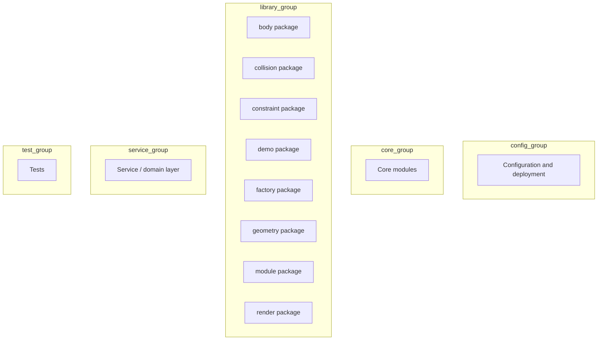

# Architecture report: liabru/matter-js

> Automated static analysis. **Observed** = directly seen in files/imports/AST; **Inferred** = interpretation from that evidence. Repository code was not executed.

## 1. Repository at a glance

| Item | Value |
| --- | --- |
| Repository | liabru/matter-js |
| Description | a 2D rigid body physics engine for the web ▲● ■ |
| Language | JavaScript |
| Stars | 18629 |
| Licence | MIT |
| Analysed commit / branch | b8ee71cd7f9b49f53639ddaedd6254f1929bcbe5 / master |
| Framework(s) | None detected |
| Files analysed | 110 |
| Components | 12 |

## 2. Architecture in one minute

liabru/matter-js - a 2D rigid body physics engine for the web ▲● ■. This repository was analysed statically from 110 file(s) (0 Python). Detected technologies (observed from imports/manifests): GitHub Actions, Jest. Files are grouped into 12 component(s): body package, collision package, Configuration and deployment, constraint package, Core modules, demo package, factory package, geometry package. Findings below distinguish observed facts from inferred interpretation.

## 3. High-level block diagram

## 4. Main components

### body package (`body`)

- **Kind:** library
- **Status:** Observed
- **Confidence:** 0.85
- **Responsibility:** Groups 3 file(s) under body package (observed from repository paths and static analysis).
- **Paths:** `src/body/Body.js`, `src/body/Composite.js`, `src/body/World.js`
- **Evidence:** [src/body/Body.js](https://github.com/liabru/matter-js/blob/b8ee71cd7f9b49f53639ddaedd6254f1929bcbe5/src/body/Body.js); [src/body/Composite.js](https://github.com/liabru/matter-js/blob/b8ee71cd7f9b49f53639ddaedd6254f1929bcbe5/src/body/Composite.js); [src/body/World.js](https://github.com/liabru/matter-js/blob/b8ee71cd7f9b49f53639ddaedd6254f1929bcbe5/src/body/World.js)

### collision package (`collision`)

- **Kind:** library
- **Status:** Observed
- **Confidence:** 0.85
- **Responsibility:** Groups 9 file(s) under collision package (observed from repository paths and static analysis).
- **Paths:** `src/collision/Collision.js`, `src/collision/Contact.js`, `src/collision/Detector.js`, `src/collision/Grid.js`, `src/collision/Pair.js`, `src/collision/Pairs.js`, `src/collision/Query.js`, `src/collision/Resolver.js`, `src/collision/SAT.js`
- **Evidence:** [src/collision/Collision.js](https://github.com/liabru/matter-js/blob/b8ee71cd7f9b49f53639ddaedd6254f1929bcbe5/src/collision/Collision.js); [src/collision/Contact.js](https://github.com/liabru/matter-js/blob/b8ee71cd7f9b49f53639ddaedd6254f1929bcbe5/src/collision/Contact.js); [src/collision/Detector.js](https://github.com/liabru/matter-js/blob/b8ee71cd7f9b49f53639ddaedd6254f1929bcbe5/src/collision/Detector.js); [src/collision/Grid.js](https://github.com/liabru/matter-js/blob/b8ee71cd7f9b49f53639ddaedd6254f1929bcbe5/src/collision/Grid.js); [src/collision/Pair.js](https://github.com/liabru/matter-js/blob/b8ee71cd7f9b49f53639ddaedd6254f1929bcbe5/src/collision/Pair.js); [src/collision/Pairs.js](https://github.com/liabru/matter-js/blob/b8ee71cd7f9b49f53639ddaedd6254f1929bcbe5/src/collision/Pairs.js); [src/collision/Query.js](https://github.com/liabru/matter-js/blob/b8ee71cd7f9b49f53639ddaedd6254f1929bcbe5/src/collision/Query.js); [src/collision/Resolver.js](https://github.com/liabru/matter-js/blob/b8ee71cd7f9b49f53639ddaedd6254f1929bcbe5/src/collision/Resolver.js)

### Configuration and deployment (`config`)

- **Kind:** config
- **Status:** Observed
- **Confidence:** 0.85
- **Responsibility:** Groups 3 file(s) under configuration and deployment (observed from repository paths and static analysis).
- **Paths:** `package.json`, `pnpm-workspace.yaml`, `yuidoc.json`
- **Evidence:** [package.json](https://github.com/liabru/matter-js/blob/b8ee71cd7f9b49f53639ddaedd6254f1929bcbe5/package.json); [pnpm-workspace.yaml](https://github.com/liabru/matter-js/blob/b8ee71cd7f9b49f53639ddaedd6254f1929bcbe5/pnpm-workspace.yaml); [yuidoc.json](https://github.com/liabru/matter-js/blob/b8ee71cd7f9b49f53639ddaedd6254f1929bcbe5/yuidoc.json)

### constraint package (`constraint`)

- **Kind:** library
- **Status:** Observed
- **Confidence:** 0.85
- **Responsibility:** Groups 2 file(s) under constraint package (observed from repository paths and static analysis).
- **Paths:** `src/constraint/Constraint.js`, `src/constraint/MouseConstraint.js`
- **Evidence:** [src/constraint/Constraint.js](https://github.com/liabru/matter-js/blob/b8ee71cd7f9b49f53639ddaedd6254f1929bcbe5/src/constraint/Constraint.js); [src/constraint/MouseConstraint.js](https://github.com/liabru/matter-js/blob/b8ee71cd7f9b49f53639ddaedd6254f1929bcbe5/src/constraint/MouseConstraint.js)

### Core modules (`core`)

- **Kind:** core
- **Status:** Observed
- **Confidence:** 0.85
- **Responsibility:** Groups 3 file(s) under core modules (observed from repository paths and static analysis).
- **Paths:** `eslint.config.mjs`, `rollup.config.demo.mjs`, `rollup.config.mjs`
- **Evidence:** [eslint.config.mjs](https://github.com/liabru/matter-js/blob/b8ee71cd7f9b49f53639ddaedd6254f1929bcbe5/eslint.config.mjs); [rollup.config.demo.mjs](https://github.com/liabru/matter-js/blob/b8ee71cd7f9b49f53639ddaedd6254f1929bcbe5/rollup.config.demo.mjs); [rollup.config.mjs](https://github.com/liabru/matter-js/blob/b8ee71cd7f9b49f53639ddaedd6254f1929bcbe5/rollup.config.mjs)

### demo package (`demo`)

- **Kind:** library
- **Status:** Observed
- **Confidence:** 0.85
- **Responsibility:** Groups 4 file(s) under demo package (observed from repository paths and static analysis).
- **Paths:** `demo/src/Compare.js`, `demo/src/Demo.js`, `demo/src/Multi.js`, `demo/src/index.js`
- **Evidence:** [demo/src/Compare.js](https://github.com/liabru/matter-js/blob/b8ee71cd7f9b49f53639ddaedd6254f1929bcbe5/demo/src/Compare.js); [demo/src/Demo.js](https://github.com/liabru/matter-js/blob/b8ee71cd7f9b49f53639ddaedd6254f1929bcbe5/demo/src/Demo.js); [demo/src/Multi.js](https://github.com/liabru/matter-js/blob/b8ee71cd7f9b49f53639ddaedd6254f1929bcbe5/demo/src/Multi.js); [demo/src/index.js](https://github.com/liabru/matter-js/blob/b8ee71cd7f9b49f53639ddaedd6254f1929bcbe5/demo/src/index.js)

### factory package (`factory`)

- **Kind:** library
- **Status:** Observed
- **Confidence:** 0.85
- **Responsibility:** Groups 2 file(s) under factory package (observed from repository paths and static analysis).
- **Paths:** `src/factory/Bodies.js`, `src/factory/Composites.js`
- **Evidence:** [src/factory/Bodies.js](https://github.com/liabru/matter-js/blob/b8ee71cd7f9b49f53639ddaedd6254f1929bcbe5/src/factory/Bodies.js); [src/factory/Composites.js](https://github.com/liabru/matter-js/blob/b8ee71cd7f9b49f53639ddaedd6254f1929bcbe5/src/factory/Composites.js)

### geometry package (`geometry`)

- **Kind:** library
- **Status:** Observed
- **Confidence:** 0.85
- **Responsibility:** Groups 5 file(s) under geometry package (observed from repository paths and static analysis).
- **Paths:** `src/geometry/Axes.js`, `src/geometry/Bounds.js`, `src/geometry/Svg.js`, `src/geometry/Vector.js`, `src/geometry/Vertices.js`
- **Evidence:** [src/geometry/Axes.js](https://github.com/liabru/matter-js/blob/b8ee71cd7f9b49f53639ddaedd6254f1929bcbe5/src/geometry/Axes.js); [src/geometry/Bounds.js](https://github.com/liabru/matter-js/blob/b8ee71cd7f9b49f53639ddaedd6254f1929bcbe5/src/geometry/Bounds.js); [src/geometry/Svg.js](https://github.com/liabru/matter-js/blob/b8ee71cd7f9b49f53639ddaedd6254f1929bcbe5/src/geometry/Svg.js); [src/geometry/Vector.js](https://github.com/liabru/matter-js/blob/b8ee71cd7f9b49f53639ddaedd6254f1929bcbe5/src/geometry/Vector.js); [src/geometry/Vertices.js](https://github.com/liabru/matter-js/blob/b8ee71cd7f9b49f53639ddaedd6254f1929bcbe5/src/geometry/Vertices.js)

### module package (`module`)

- **Kind:** library
- **Status:** Observed
- **Confidence:** 0.85
- **Responsibility:** Groups 2 file(s) under module package (observed from repository paths and static analysis).
- **Paths:** `src/module/license.js`, `src/module/main.js`
- **Evidence:** [src/module/license.js](https://github.com/liabru/matter-js/blob/b8ee71cd7f9b49f53639ddaedd6254f1929bcbe5/src/module/license.js); [src/module/main.js](https://github.com/liabru/matter-js/blob/b8ee71cd7f9b49f53639ddaedd6254f1929bcbe5/src/module/main.js)

### render package (`render`)

- **Kind:** library
- **Status:** Observed
- **Confidence:** 0.85
- **Responsibility:** Groups 1 file(s) under render package (observed from repository paths and static analysis).
- **Paths:** `src/render/Render.js`
- **Evidence:** [src/render/Render.js](https://github.com/liabru/matter-js/blob/b8ee71cd7f9b49f53639ddaedd6254f1929bcbe5/src/render/Render.js)

### Service / domain layer (`service_layer`)

- **Kind:** service
- **Status:** Observed
- **Confidence:** 0.85
- **Responsibility:** Groups 8 file(s) under service / domain layer (observed from repository paths and static analysis).
- **Paths:** `src/core/Common.js`, `src/core/Engine.js`, `src/core/Events.js`, `src/core/Matter.js`, `src/core/Mouse.js`, `src/core/Plugin.js`, `src/core/Runner.js`, `src/core/Sleeping.js`
- **Evidence:** [src/core/Common.js](https://github.com/liabru/matter-js/blob/b8ee71cd7f9b49f53639ddaedd6254f1929bcbe5/src/core/Common.js); [src/core/Engine.js](https://github.com/liabru/matter-js/blob/b8ee71cd7f9b49f53639ddaedd6254f1929bcbe5/src/core/Engine.js); [src/core/Events.js](https://github.com/liabru/matter-js/blob/b8ee71cd7f9b49f53639ddaedd6254f1929bcbe5/src/core/Events.js); [src/core/Matter.js](https://github.com/liabru/matter-js/blob/b8ee71cd7f9b49f53639ddaedd6254f1929bcbe5/src/core/Matter.js); [src/core/Mouse.js](https://github.com/liabru/matter-js/blob/b8ee71cd7f9b49f53639ddaedd6254f1929bcbe5/src/core/Mouse.js); [src/core/Plugin.js](https://github.com/liabru/matter-js/blob/b8ee71cd7f9b49f53639ddaedd6254f1929bcbe5/src/core/Plugin.js); [src/core/Runner.js](https://github.com/liabru/matter-js/blob/b8ee71cd7f9b49f53639ddaedd6254f1929bcbe5/src/core/Runner.js); [src/core/Sleeping.js](https://github.com/liabru/matter-js/blob/b8ee71cd7f9b49f53639ddaedd6254f1929bcbe5/src/core/Sleeping.js)

### Tests (`tests`)

- **Kind:** test
- **Status:** Observed
- **Confidence:** 0.85
- **Responsibility:** Groups 3 file(s) under tests (observed from repository paths and static analysis).
- **Paths:** `test/ExampleWorker.js`, `test/Examples.spec.js`, `test/TestTools.js`
- **Evidence:** [test/ExampleWorker.js](https://github.com/liabru/matter-js/blob/b8ee71cd7f9b49f53639ddaedd6254f1929bcbe5/test/ExampleWorker.js); [test/Examples.spec.js](https://github.com/liabru/matter-js/blob/b8ee71cd7f9b49f53639ddaedd6254f1929bcbe5/test/Examples.spec.js); [test/TestTools.js](https://github.com/liabru/matter-js/blob/b8ee71cd7f9b49f53639ddaedd6254f1929bcbe5/test/TestTools.js)

## 5. Execution flow

**Observed** entry point(s):

- [demo/src/index.js](https://github.com/liabru/matter-js/blob/b8ee71cd7f9b49f53639ddaedd6254f1929bcbe5/demo/src/index.js)
- [src/module/main.js](https://github.com/liabru/matter-js/blob/b8ee71cd7f9b49f53639ddaedd6254f1929bcbe5/src/module/main.js)

Representative flow (derived from observed entry points and the import graph; steps beyond the entry point are **Inferred**):

1. Execution starts at an observed entry point listed above, if present.
2. No internal import relationships between components were observed.

## 6. Project structure

### `(root)`

- `.gitignore` - other (433 bytes)
- `CHANGELOG.md` - docs (86940 bytes)
- `CONTRIBUTING.md` - docs (1754 bytes)
- `LICENSE` - docs (1092 bytes)
- `README.md` - docs (9056 bytes)
- `RELEASE.md` - docs (18040 bytes)
- `eslint.config.mjs` - source, JavaScript (2288 bytes)
- `package.json` - manifest (2585 bytes)
- `pnpm-workspace.yaml` - config (244 bytes)
- `rollup.config.demo.mjs` - source, JavaScript (2684 bytes)
- `rollup.config.mjs` - source, JavaScript (2032 bytes)
- `yuidoc.json` - config (279 bytes)

### `.github`

- `.github/workflows/ci.yml` - ci, YAML (912 bytes)

### `demo`

- `demo/index.html` - other (1917 bytes)
- `demo/src/Compare.js` - source, JavaScript (5578 bytes)
- `demo/src/Demo.js` - source, JavaScript (3557 bytes)
- `demo/src/Multi.js` - source, JavaScript (3296 bytes)
- `demo/src/index.ejs` - other (2000 bytes)
- `demo/src/index.js` - source, JavaScript (1175 bytes)
- `demo/svg/iconmonstr-check-mark-8-icon.svg` - other (809 bytes)
- `demo/svg/iconmonstr-direction-4-icon.svg` - other (1496 bytes)
- `demo/svg/iconmonstr-paperclip-2-icon.svg` - other (1358 bytes)
- `demo/svg/iconmonstr-puzzle-icon.svg` - other (1365 bytes)
- `demo/svg/iconmonstr-user-icon.svg` - other (961 bytes)
- `demo/svg/svg.svg` - other (3064 bytes)
- `demo/svg/terrain.svg` - other (3849 bytes)

### `examples`

- `examples/airFriction.js` - source, JavaScript (2316 bytes)
- `examples/avalanche.js` - source, JavaScript (3142 bytes)
- `examples/ballPool.js` - source, JavaScript (3094 bytes)
- `examples/bridge.js` - source, JavaScript (3364 bytes)
- `examples/car.js` - source, JavaScript (4735 bytes)
- `examples/catapult.js` - source, JavaScript (2868 bytes)
- `examples/chains.js` - source, JavaScript (3705 bytes)
- `examples/circleStack.js` - source, JavaScript (2300 bytes)
- `examples/cloth.js` - source, JavaScript (3538 bytes)
- `examples/collisionFiltering.js` - source, JavaScript (4320 bytes)
- `examples/compositeManipulation.js` - source, JavaScript (2998 bytes)
- `examples/compound.js` - source, JavaScript (2784 bytes)
- `examples/compoundStack.js` - source, JavaScript (2527 bytes)
- `examples/concave.js` - source, JavaScript (3087 bytes)
- `examples/constraints.js` - source, JavaScript (4946 bytes)
- `examples/doublePendulum.js` - source, JavaScript (4020 bytes)
- `examples/events.js` - source, JavaScript (5962 bytes)
- `examples/friction.js` - source, JavaScript (2734 bytes)
- `examples/gravity.js` - source, JavaScript (2775 bytes)
- `examples/gyro.js` - source, JavaScript (4179 bytes)
- `examples/index.js` - source, JavaScript (1986 bytes)
- `examples/manipulation.js` - source, JavaScript (5110 bytes)
- `examples/mixed.js` - source, JavaScript (3001 bytes)
- `examples/newtonsCradle.js` - source, JavaScript (3278 bytes)
- `examples/pyramid.js` - source, JavaScript (2279 bytes)
- `examples/ragdoll.js` - source, JavaScript (13408 bytes)
- `examples/raycasting.js` - source, JavaScript (4412 bytes)
- `examples/remove.js` - source, JavaScript (4074 bytes)
- `examples/renderResize.js` - source, JavaScript (3679 bytes)
- `examples/restitution.js` - source, JavaScript (2670 bytes)
- `examples/rounded.js` - source, JavaScript (2959 bytes)
- `examples/sensors.js` - source, JavaScript (3413 bytes)
- `examples/sleeping.js` - source, JavaScript (3084 bytes)
- `examples/slingshot.js` - source, JavaScript (3338 bytes)
- `examples/softBody.js` - source, JavaScript (3696 bytes)
- `examples/sprites.js` - source, JavaScript (3180 bytes)
- `examples/stack.js` - source, JavaScript (2270 bytes)
- `examples/staticFriction.js` - source, JavaScript (3096 bytes)
- `examples/stats.js` - source, JavaScript (2355 bytes)
- `examples/stress.js` - source, JavaScript (2280 bytes)
- `examples/stress2.js` - source, JavaScript (2287 bytes)
- `examples/stress3.js` - source, JavaScript (2905 bytes)
- `examples/stress4.js` - source, JavaScript (3436 bytes)
- `examples/substep.js` - source, JavaScript (3490 bytes)
- `examples/svg.js` - source, JavaScript (4192 bytes)
- `examples/terrain.js` - source, JavaScript (3569 bytes)
- `examples/timescale.js` - source, JavaScript (4593 bytes)
- `examples/views.js` - source, JavaScript (6034 bytes)
- `examples/wreckingBall.js` - source, JavaScript (2621 bytes)

### `src`

- `src/body/Body.js` - source, JavaScript (51456 bytes)
- `src/body/Composite.js` - source, JavaScript (23836 bytes)
- `src/body/World.js` - source, JavaScript (1058 bytes)
- `src/collision/Collision.js` - source, JavaScript (11967 bytes)
- `src/collision/Contact.js` - source, JavaScript (494 bytes)
- `src/collision/Detector.js` - source, JavaScript (6374 bytes)
- `src/collision/Grid.js` - source, JavaScript (10254 bytes)
- `src/collision/Pair.js` - source, JavaScript (3617 bytes)
- `src/collision/Pairs.js` - source, JavaScript (4266 bytes)
- `src/collision/Query.js` - source, JavaScript (4325 bytes)
- `src/collision/Resolver.js` - source, JavaScript (15326 bytes)
- `src/collision/SAT.js` - source, JavaScript (997 bytes)
- `src/constraint/Constraint.js` - source, JavaScript (17785 bytes)
- `src/constraint/MouseConstraint.js` - source, JavaScript (8460 bytes)
- `src/core/Common.js` - source, JavaScript (19321 bytes)
- `src/core/Engine.js` - source, JavaScript (18621 bytes)
- `src/core/Events.js` - source, JavaScript (3118 bytes)
- `src/core/Matter.js` - source, JavaScript (2863 bytes)
- `src/core/Mouse.js` - source, JavaScript (7050 bytes)
- `src/core/Plugin.js` - source, JavaScript (13286 bytes)
- `src/core/Runner.js` - source, JavaScript (16710 bytes)
- `src/core/Sleeping.js` - source, JavaScript (4162 bytes)
- `src/factory/Bodies.js` - source, JavaScript (14188 bytes)
- `src/factory/Composites.js` - source, JavaScript (12849 bytes)
- `src/geometry/Axes.js` - source, JavaScript (1673 bytes)
- `src/geometry/Bounds.js` - source, JavaScript (3505 bytes)
- `src/geometry/Svg.js` - source, JavaScript (7393 bytes)
- `src/geometry/Vector.js` - source, JavaScript (7179 bytes)
- `src/geometry/Vertices.js` - source, JavaScript (14056 bytes)
- `src/module/license.js` - source, JavaScript (1163 bytes)
- `src/module/main.js` - source, JavaScript (1629 bytes)
- `src/render/Render.js` - source, JavaScript (59740 bytes)

### `test`

- `test/ExampleWorker.js` - test, JavaScript (8681 bytes)
- `test/Examples.spec.js` - test, JavaScript (3812 bytes)
- `test/TestTools.js` - test, JavaScript (14132 bytes)

## 7. Key dependencies and integrations

| Name | Category | Status | Confidence | Evidence |
| --- | --- | --- | --- | --- |
| GitHub Actions | ci | Observed | 0.85 | [.github/workflows/ci.yml](https://github.com/liabru/matter-js/blob/b8ee71cd7f9b49f53639ddaedd6254f1929bcbe5/.github/workflows/ci.yml) |
| Jest | tooling | Observed | 0.85 | [package.json:44](https://github.com/liabru/matter-js/blob/b8ee71cd7f9b49f53639ddaedd6254f1929bcbe5/package.json#L44) |

## 8. Data and state

No database, cache, queue, or persistent-state usage was observed in the analysed files. State handling, if any, may be in-memory or in files that were not analysed.

## 9. Configuration and deployment clues

- `.github/workflows/ci.yml` (ci)
- `package.json` (manifest)
- `pnpm-workspace.yaml` (config)
- `yuidoc.json` (config)

## 10. Design observations

- Service/domain code is distinct from entry and data code, suggesting layered separation (Inferred).
- Tests are present alongside source code (Observed from test file paths).

These observations are interpretations (**Inferred**) of the observed structure, not guarantees about runtime design.

## 11. Limitations and unknowns

- Static analysis only: repository code was not executed, installed, or imported at runtime.
- Components and relationships are inferred from file paths, imports, and AST structure; runtime behaviour, dynamic imports, and reflection may not be visible.
- 2 file(s) were skipped during inventory (1 x likely secret file excluded; 1 x lockfile excluded).
- No clear application entry point was observed in the analysed files.
- Repository text was treated as untrusted data; no instructions found in repository files were followed, and likely secret values were redacted/excluded.
- JavaScript and TypeScript files were inventoried from paths and package manifests. They were not parsed with a full language AST, and repository code was not executed.

## 12. Source references

- [.github/workflows/ci.yml](https://github.com/liabru/matter-js/blob/b8ee71cd7f9b49f53639ddaedd6254f1929bcbe5/.github/workflows/ci.yml)
- [demo/src/Compare.js](https://github.com/liabru/matter-js/blob/b8ee71cd7f9b49f53639ddaedd6254f1929bcbe5/demo/src/Compare.js)
- [demo/src/Demo.js](https://github.com/liabru/matter-js/blob/b8ee71cd7f9b49f53639ddaedd6254f1929bcbe5/demo/src/Demo.js)
- [demo/src/Multi.js](https://github.com/liabru/matter-js/blob/b8ee71cd7f9b49f53639ddaedd6254f1929bcbe5/demo/src/Multi.js)
- [demo/src/index.js](https://github.com/liabru/matter-js/blob/b8ee71cd7f9b49f53639ddaedd6254f1929bcbe5/demo/src/index.js)
- [eslint.config.mjs](https://github.com/liabru/matter-js/blob/b8ee71cd7f9b49f53639ddaedd6254f1929bcbe5/eslint.config.mjs)
- [package.json](https://github.com/liabru/matter-js/blob/b8ee71cd7f9b49f53639ddaedd6254f1929bcbe5/package.json)
- [package.json:44](https://github.com/liabru/matter-js/blob/b8ee71cd7f9b49f53639ddaedd6254f1929bcbe5/package.json#L44)
- [pnpm-workspace.yaml](https://github.com/liabru/matter-js/blob/b8ee71cd7f9b49f53639ddaedd6254f1929bcbe5/pnpm-workspace.yaml)
- [rollup.config.demo.mjs](https://github.com/liabru/matter-js/blob/b8ee71cd7f9b49f53639ddaedd6254f1929bcbe5/rollup.config.demo.mjs)
- [rollup.config.mjs](https://github.com/liabru/matter-js/blob/b8ee71cd7f9b49f53639ddaedd6254f1929bcbe5/rollup.config.mjs)
- [src/body/Body.js](https://github.com/liabru/matter-js/blob/b8ee71cd7f9b49f53639ddaedd6254f1929bcbe5/src/body/Body.js)
- [src/body/Composite.js](https://github.com/liabru/matter-js/blob/b8ee71cd7f9b49f53639ddaedd6254f1929bcbe5/src/body/Composite.js)
- [src/body/World.js](https://github.com/liabru/matter-js/blob/b8ee71cd7f9b49f53639ddaedd6254f1929bcbe5/src/body/World.js)
- [src/collision/Collision.js](https://github.com/liabru/matter-js/blob/b8ee71cd7f9b49f53639ddaedd6254f1929bcbe5/src/collision/Collision.js)
- [src/collision/Contact.js](https://github.com/liabru/matter-js/blob/b8ee71cd7f9b49f53639ddaedd6254f1929bcbe5/src/collision/Contact.js)
- [src/collision/Detector.js](https://github.com/liabru/matter-js/blob/b8ee71cd7f9b49f53639ddaedd6254f1929bcbe5/src/collision/Detector.js)
- [src/collision/Grid.js](https://github.com/liabru/matter-js/blob/b8ee71cd7f9b49f53639ddaedd6254f1929bcbe5/src/collision/Grid.js)
- [src/collision/Pair.js](https://github.com/liabru/matter-js/blob/b8ee71cd7f9b49f53639ddaedd6254f1929bcbe5/src/collision/Pair.js)
- [src/collision/Pairs.js](https://github.com/liabru/matter-js/blob/b8ee71cd7f9b49f53639ddaedd6254f1929bcbe5/src/collision/Pairs.js)
- [src/collision/Query.js](https://github.com/liabru/matter-js/blob/b8ee71cd7f9b49f53639ddaedd6254f1929bcbe5/src/collision/Query.js)
- [src/collision/Resolver.js](https://github.com/liabru/matter-js/blob/b8ee71cd7f9b49f53639ddaedd6254f1929bcbe5/src/collision/Resolver.js)
- [src/constraint/Constraint.js](https://github.com/liabru/matter-js/blob/b8ee71cd7f9b49f53639ddaedd6254f1929bcbe5/src/constraint/Constraint.js)
- [src/constraint/MouseConstraint.js](https://github.com/liabru/matter-js/blob/b8ee71cd7f9b49f53639ddaedd6254f1929bcbe5/src/constraint/MouseConstraint.js)
- [src/core/Common.js](https://github.com/liabru/matter-js/blob/b8ee71cd7f9b49f53639ddaedd6254f1929bcbe5/src/core/Common.js)
- [src/core/Engine.js](https://github.com/liabru/matter-js/blob/b8ee71cd7f9b49f53639ddaedd6254f1929bcbe5/src/core/Engine.js)
- [src/core/Events.js](https://github.com/liabru/matter-js/blob/b8ee71cd7f9b49f53639ddaedd6254f1929bcbe5/src/core/Events.js)
- [src/core/Matter.js](https://github.com/liabru/matter-js/blob/b8ee71cd7f9b49f53639ddaedd6254f1929bcbe5/src/core/Matter.js)
- [src/core/Mouse.js](https://github.com/liabru/matter-js/blob/b8ee71cd7f9b49f53639ddaedd6254f1929bcbe5/src/core/Mouse.js)
- [src/core/Plugin.js](https://github.com/liabru/matter-js/blob/b8ee71cd7f9b49f53639ddaedd6254f1929bcbe5/src/core/Plugin.js)
- [src/core/Runner.js](https://github.com/liabru/matter-js/blob/b8ee71cd7f9b49f53639ddaedd6254f1929bcbe5/src/core/Runner.js)
- [src/core/Sleeping.js](https://github.com/liabru/matter-js/blob/b8ee71cd7f9b49f53639ddaedd6254f1929bcbe5/src/core/Sleeping.js)
- [src/factory/Bodies.js](https://github.com/liabru/matter-js/blob/b8ee71cd7f9b49f53639ddaedd6254f1929bcbe5/src/factory/Bodies.js)
- [src/factory/Composites.js](https://github.com/liabru/matter-js/blob/b8ee71cd7f9b49f53639ddaedd6254f1929bcbe5/src/factory/Composites.js)
- [src/geometry/Axes.js](https://github.com/liabru/matter-js/blob/b8ee71cd7f9b49f53639ddaedd6254f1929bcbe5/src/geometry/Axes.js)
- [src/geometry/Bounds.js](https://github.com/liabru/matter-js/blob/b8ee71cd7f9b49f53639ddaedd6254f1929bcbe5/src/geometry/Bounds.js)
- [src/geometry/Svg.js](https://github.com/liabru/matter-js/blob/b8ee71cd7f9b49f53639ddaedd6254f1929bcbe5/src/geometry/Svg.js)
- [src/geometry/Vector.js](https://github.com/liabru/matter-js/blob/b8ee71cd7f9b49f53639ddaedd6254f1929bcbe5/src/geometry/Vector.js)
- [src/geometry/Vertices.js](https://github.com/liabru/matter-js/blob/b8ee71cd7f9b49f53639ddaedd6254f1929bcbe5/src/geometry/Vertices.js)
- [src/module/license.js](https://github.com/liabru/matter-js/blob/b8ee71cd7f9b49f53639ddaedd6254f1929bcbe5/src/module/license.js)
- [src/module/main.js](https://github.com/liabru/matter-js/blob/b8ee71cd7f9b49f53639ddaedd6254f1929bcbe5/src/module/main.js)
- [src/render/Render.js](https://github.com/liabru/matter-js/blob/b8ee71cd7f9b49f53639ddaedd6254f1929bcbe5/src/render/Render.js)
- [test/ExampleWorker.js](https://github.com/liabru/matter-js/blob/b8ee71cd7f9b49f53639ddaedd6254f1929bcbe5/test/ExampleWorker.js)
- [test/Examples.spec.js](https://github.com/liabru/matter-js/blob/b8ee71cd7f9b49f53639ddaedd6254f1929bcbe5/test/Examples.spec.js)
- [test/TestTools.js](https://github.com/liabru/matter-js/blob/b8ee71cd7f9b49f53639ddaedd6254f1929bcbe5/test/TestTools.js)
- [yuidoc.json](https://github.com/liabru/matter-js/blob/b8ee71cd7f9b49f53639ddaedd6254f1929bcbe5/yuidoc.json)
