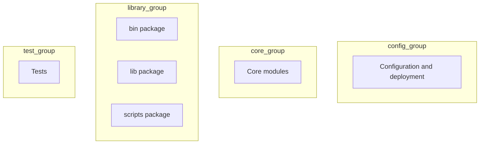

# Architecture report: lint-staged/lint-staged

> Automated static analysis. **Observed** = directly seen in files/imports/AST; **Inferred** = interpretation from that evidence. Repository code was not executed.

## 1. Repository at a glance

| Item | Value |
| --- | --- |
| Repository | lint-staged/lint-staged |
| Description | 🚫💩 — Run tasks like formatters and linters against files staged in Git |
| Language | JavaScript |
| Stars | 14761 |
| Licence | MIT |
| Analysed commit / branch | 49b5472587a6ad112bb32fe1ea3d4c324f2e2ecc / main |
| Framework(s) | None detected |
| Files analysed | 181 |
| Components | 6 |

## 2. Architecture in one minute

lint-staged/lint-staged - 🚫💩 — Run tasks like formatters and linters against files staged in Git. This repository was analysed statically from 181 file(s) (0 Python). Detected technologies (observed from imports/manifests): GitHub Actions, TypeScript, Vitest. Files are grouped into 6 component(s): bin package, Configuration and deployment, Core modules, lib package, scripts package, Tests. Findings below distinguish observed facts from inferred interpretation.

## 3. High-level block diagram

## 4. Main components

### bin package (`bin`)

- **Kind:** library
- **Status:** Observed
- **Confidence:** 0.85
- **Responsibility:** Groups 1 file(s) under bin package (observed from repository paths and static analysis).
- **Paths:** `bin/lint-staged.js`
- **Evidence:** [bin/lint-staged.js](https://github.com/lint-staged/lint-staged/blob/49b5472587a6ad112bb32fe1ea3d4c324f2e2ecc/bin/lint-staged.js)

### Configuration and deployment (`config`)

- **Kind:** config
- **Status:** Observed
- **Confidence:** 0.85
- **Responsibility:** Groups 2 file(s) under configuration and deployment (observed from repository paths and static analysis).
- **Paths:** `package.json`, `tsconfig.json`
- **Evidence:** [package.json](https://github.com/lint-staged/lint-staged/blob/49b5472587a6ad112bb32fe1ea3d4c324f2e2ecc/package.json); [tsconfig.json](https://github.com/lint-staged/lint-staged/blob/49b5472587a6ad112bb32fe1ea3d4c324f2e2ecc/tsconfig.json)

### Core modules (`core`)

- **Kind:** core
- **Status:** Observed
- **Confidence:** 0.85
- **Responsibility:** Groups 3 file(s) under core modules (observed from repository paths and static analysis).
- **Paths:** `commitlint.config.js`, `lint-staged.config.js`, `vitest.config.js`
- **Evidence:** [commitlint.config.js](https://github.com/lint-staged/lint-staged/blob/49b5472587a6ad112bb32fe1ea3d4c324f2e2ecc/commitlint.config.js); [lint-staged.config.js](https://github.com/lint-staged/lint-staged/blob/49b5472587a6ad112bb32fe1ea3d4c324f2e2ecc/lint-staged.config.js); [vitest.config.js](https://github.com/lint-staged/lint-staged/blob/49b5472587a6ad112bb32fe1ea3d4c324f2e2ecc/vitest.config.js)

### lib package (`lib`)

- **Kind:** library
- **Status:** Observed
- **Confidence:** 0.85
- **Responsibility:** Groups 43 file(s) under lib package (observed from repository paths and static analysis).
- **Paths:** `lib/assertGitVersion.js`, `lib/cli.js`, `lib/colors.js`, `lib/config.d.ts`, `lib/config.js`, `lib/configFiles.js`, `lib/debug.js`, `lib/execGit.js`, `lib/figures.js`, `lib/file.js`, `lib/generateTasks.js`, `lib/getAbortController.js`, `lib/getDiffCommand.js`, `lib/getFunctionTask.js`, `lib/getIntentToAddFiles.js`, `lib/getMaxArgLength.js`, `lib/getSpawnedTask.js`, `lib/getSpawnedTasks.js`, `lib/getStagedFiles.js`, `lib/gitWorkflow.js`, `lib/groupFilesByConfig.js`, `lib/index.d.ts`, `lib/index.js`, `lib/killSubprocesses.js`, `lib/loadConfig.js`, `lib/matchFiles.js`, `lib/messages.js`, `lib/normalizePath.js`, `lib/parseGitZOutput.js`, `lib/parseOptions.js`, `lib/printTaskOutput.js`, `lib/readStdin.js`, `lib/resolveConfig.js`, `lib/resolveGitRepo.js`, `lib/runAll.js`, `lib/runParallelTasks.js`, `lib/searchConfigs.js`, `lib/state.js`, `lib/symbols.js`, `lib/validateBraces.js`, `lib/validateConfig.js`, `lib/validateOptions.js`, `lib/version.js`
- **Evidence:** [lib/assertGitVersion.js](https://github.com/lint-staged/lint-staged/blob/49b5472587a6ad112bb32fe1ea3d4c324f2e2ecc/lib/assertGitVersion.js); [lib/cli.js](https://github.com/lint-staged/lint-staged/blob/49b5472587a6ad112bb32fe1ea3d4c324f2e2ecc/lib/cli.js); [lib/colors.js](https://github.com/lint-staged/lint-staged/blob/49b5472587a6ad112bb32fe1ea3d4c324f2e2ecc/lib/colors.js); [lib/config.d.ts](https://github.com/lint-staged/lint-staged/blob/49b5472587a6ad112bb32fe1ea3d4c324f2e2ecc/lib/config.d.ts); [lib/config.js](https://github.com/lint-staged/lint-staged/blob/49b5472587a6ad112bb32fe1ea3d4c324f2e2ecc/lib/config.js); [lib/configFiles.js](https://github.com/lint-staged/lint-staged/blob/49b5472587a6ad112bb32fe1ea3d4c324f2e2ecc/lib/configFiles.js); [lib/debug.js](https://github.com/lint-staged/lint-staged/blob/49b5472587a6ad112bb32fe1ea3d4c324f2e2ecc/lib/debug.js); [lib/execGit.js](https://github.com/lint-staged/lint-staged/blob/49b5472587a6ad112bb32fe1ea3d4c324f2e2ecc/lib/execGit.js)

### scripts package (`scripts`)

- **Kind:** library
- **Status:** Observed
- **Confidence:** 0.85
- **Responsibility:** Groups 1 file(s) under scripts package (observed from repository paths and static analysis).
- **Paths:** `scripts/test-node-range.js`
- **Evidence:** [scripts/test-node-range.js](https://github.com/lint-staged/lint-staged/blob/49b5472587a6ad112bb32fe1ea3d4c324f2e2ecc/scripts/test-node-range.js)

### Tests (`tests`)

- **Kind:** test
- **Status:** Observed
- **Confidence:** 0.85
- **Responsibility:** Groups 103 file(s) under tests (observed from repository paths and static analysis).
- **Paths:** `test/__utils__/createTempDir.js`, `test/__utils__/getRepoRootPath.js`, `test/e2e/__utils__/forkLintStagedBin.js`, `test/e2e/git-pre-commit.test.js`, `test/e2e/internal-errors.test.js`, `test/e2e/kill-tasks-on-failure.test.js`, `test/e2e/no-stash.test.js`, `test/e2e/special-characters.test.js`, `test/e2e/stdin-config.test.js`, `test/integration/__fixtures__/configs.js`, `test/integration/__fixtures__/files.js`, `test/integration/__utils__/addConfigFileSerializer.js`, `test/integration/__utils__/replaceSerializer.js`, `test/integration/__utils__/withGitIntegration.js`, `test/integration/allow-empty.test.js`, `test/integration/basic-functionality.test.js`, `test/integration/binary-files.test.js`, `test/integration/continue-on-error.test.js`, `test/integration/diff-options.test.js`, `test/integration/fail-on-changes.test.js`, `test/integration/fail-to-spawn.test.js`, `test/integration/file-resurrection.test.js`, `test/integration/files-outside-cwd.test.js`, `test/integration/function-tasks.test.js`, `test/integration/git-amend.test.js`, `test/integration/git-lock-file.test.js`, `test/integration/git-submodules.test.js`, `test/integration/git-worktree.test.js`, `test/integration/gitWorkFlow.test.js`, `test/integration/hide-all.test.js`, `test/integration/hide-unstaged.test.js`, `test/integration/include-all-files.test.js`, `test/integration/intent-to-add.test.js`, `test/integration/merge-conflict.test.js`, `test/integration/multiple-config-files.test.js`, `test/integration/no-hide-partially-staged.test.js`, `test/integration/no-initial-commit.test.js`, `test/integration/no-revert.test.js`, `test/integration/no-stash.test.js`, `test/integration/non-ascii.test.js`, `test/integration/not-inside-git-repo.test.js`, `test/integration/parent-globs.test.js`, `test/integration/partially-staged-changes.test.js`, `test/integration/resolveGitRepo.spec.js`, `test/integration/stage-newly-changes-files.test.js`, `test/integration/symlink-git-dir.test.js`, `test/integration/symlinked-config.test.js`, `test/integration/symlinked-staged-files.test.js`, `test/integration/untracked-files.test.js`, `test/types/config.test.ts`, `test/types/index.test.ts`, `test/unit/__mocks__/advanced-cjs-config.cjs`, `test/unit/__mocks__/advanced-esm-config.js`, `test/unit/__mocks__/cjs/my-config.cjs`, `test/unit/__mocks__/esm-config-in-js.js`, `test/unit/__mocks__/esm-config.mjs`, `test/unit/__mocks__/invalid-json-config.json`, `test/unit/__mocks__/invalid-yml-config.yml`, `test/unit/__mocks__/my-config.json`, `test/unit/__mocks__/my-config.yml`, `test/unit/__mocks__/my-lint-staged-config/index.cjs`, `test/unit/__mocks__/my-lint-staged-config/package.json`, `test/unit/__utils__/getMockTinyexec.js`, `test/unit/__utils__/mockNanoSpawnReturnValue.js`, `test/unit/__utils__/mockTinyexecReturnValue.js`, `test/unit/assertGitVersion.spec.js`, `test/unit/cli.spec.js`, `test/unit/colors.spec.js`, `test/unit/debug.spec.js`, `test/unit/execGit.spec.js`, `test/unit/file.spec.js`, `test/unit/generateTasks.spec.js`, `test/unit/getAbortController.spec.js`, `test/unit/getDiffCommand.spec.js`, `test/unit/getFunctionTask.spec.js`, `test/unit/getMaxArgLength.spec.js`, `test/unit/getSpawnedTask.2.spec.js`, `test/unit/getSpawnedTask.spec.js`, `test/unit/getSpawnedTask.unmocked.spec.js`, `test/unit/getSpawnedTasks.3.spec.js`, `test/unit/getSpawnedTasks.spec.js`, `test/unit/getStagedFiles.spec.js`, `test/unit/gitWorkFlow.test.js`, `test/unit/groupFilesByConfig.spec.js`, `test/unit/index.spec.js`, `test/unit/index2.spec.js`, `test/unit/index3.spec.js`, `test/unit/killSubprocesses.spec.js`, `test/unit/loadConfig.spec.js`, `test/unit/matchFiles.spec.js`, `test/unit/normalizePath.spec.js`, `test/unit/parseGitZOutput.spec.js`, `test/unit/parseOptions.spec.js`, `test/unit/printTaskOutput.spec.js`, `test/unit/readStdin.spec.js`, `test/unit/resolveGitRepo.spec.js`, `test/unit/runAll.spec.js`, `test/unit/runParallelTasks.spec.js`, `test/unit/searchConfigs.spec.js`, `test/unit/state.spec.js`, `test/unit/validateBraces.spec.js`, `test/unit/validateConfig.spec.js`, `test/unit/validateOptions.spec.js`
- **Evidence:** [test/__utils__/createTempDir.js](https://github.com/lint-staged/lint-staged/blob/49b5472587a6ad112bb32fe1ea3d4c324f2e2ecc/test/__utils__/createTempDir.js); [test/__utils__/getRepoRootPath.js](https://github.com/lint-staged/lint-staged/blob/49b5472587a6ad112bb32fe1ea3d4c324f2e2ecc/test/__utils__/getRepoRootPath.js); [test/e2e/__utils__/forkLintStagedBin.js](https://github.com/lint-staged/lint-staged/blob/49b5472587a6ad112bb32fe1ea3d4c324f2e2ecc/test/e2e/__utils__/forkLintStagedBin.js); [test/e2e/git-pre-commit.test.js](https://github.com/lint-staged/lint-staged/blob/49b5472587a6ad112bb32fe1ea3d4c324f2e2ecc/test/e2e/git-pre-commit.test.js); [test/e2e/internal-errors.test.js](https://github.com/lint-staged/lint-staged/blob/49b5472587a6ad112bb32fe1ea3d4c324f2e2ecc/test/e2e/internal-errors.test.js); [test/e2e/kill-tasks-on-failure.test.js](https://github.com/lint-staged/lint-staged/blob/49b5472587a6ad112bb32fe1ea3d4c324f2e2ecc/test/e2e/kill-tasks-on-failure.test.js); [test/e2e/no-stash.test.js](https://github.com/lint-staged/lint-staged/blob/49b5472587a6ad112bb32fe1ea3d4c324f2e2ecc/test/e2e/no-stash.test.js); [test/e2e/special-characters.test.js](https://github.com/lint-staged/lint-staged/blob/49b5472587a6ad112bb32fe1ea3d4c324f2e2ecc/test/e2e/special-characters.test.js)

## 5. Execution flow

**Observed** entry point(s):

- [bin/lint-staged.js](https://github.com/lint-staged/lint-staged/blob/49b5472587a6ad112bb32fe1ea3d4c324f2e2ecc/bin/lint-staged.js)
- [lib/index.js](https://github.com/lint-staged/lint-staged/blob/49b5472587a6ad112bb32fe1ea3d4c324f2e2ecc/lib/index.js)
- [test/unit/__mocks__/my-lint-staged-config/index.cjs](https://github.com/lint-staged/lint-staged/blob/49b5472587a6ad112bb32fe1ea3d4c324f2e2ecc/test/unit/__mocks__/my-lint-staged-config/index.cjs)

Representative flow (derived from observed entry points and the import graph; steps beyond the entry point are **Inferred**):

1. Execution starts at an observed entry point listed above, if present.
2. No internal import relationships between components were observed.

## 6. Project structure

### `(root)`

- `.editorconfig` - config (241 bytes)
- `.gitattributes` - other (19 bytes)
- `.gitignore` - other (37 bytes)
- `.node-version` - other (3 bytes)
- `.oxfmtrc.json` - config (282 bytes)
- `.oxlintrc.json` - config (1180 bytes)
- `AGENTS.md` - docs (42 bytes)
- `CHANGELOG.md` - docs (156588 bytes)
- `CONTRIBUTING.md` - docs (660 bytes)
- `LICENSE` - docs (1087 bytes)
- `MIGRATION.md` - docs (4305 bytes)
- `README.md` - docs (44993 bytes)
- `commitlint.config.js` - source, JavaScript (121 bytes)
- `lint-staged.config.js` - source, JavaScript (215 bytes)
- `package.json` - manifest (2237 bytes)
- `tsconfig.json` - config (363 bytes)
- `vitest.config.js` - source, JavaScript (1407 bytes)

### `.changeset`

- `.changeset/README.md` - docs (510 bytes)
- `.changeset/config.json` - config (280 bytes)
- `.changeset/modern-doors-speak.md` - docs (8 bytes)

### `.github`

- `.github/FUNDING.yml` - config (649 bytes)
- `.github/ISSUE_TEMPLATE/01-bug.md` - docs (926 bytes)
- `.github/ISSUE_TEMPLATE/02-feature.md` - docs (761 bytes)
- `.github/ISSUE_TEMPLATE/config.yml` - config (28 bytes)
- `.github/workflows/npm.yml` - ci, YAML (1108 bytes)
- `.github/workflows/pull-requests.yml` - ci, YAML (11307 bytes)
- `.github/workflows/release.yml` - ci, YAML (2579 bytes)
- `.github/workflows/security.yml` - ci, YAML (1091 bytes)

### `.husky`

- `.husky/commit-msg` - other (23 bytes)
- `.husky/pre-commit` - other (24 bytes)
- `.husky/pre-push` - other (30 bytes)

### `.vscode`

- `.vscode/extensions.json` - config (44 bytes)
- `.vscode/settings.json` - config (50 bytes)

### `bin`

- `bin/lint-staged.js` - source, JavaScript (1315 bytes)

### `lib`

- `lib/assertGitVersion.js` - source, JavaScript (1728 bytes)
- `lib/cli.js` - source, JavaScript (6470 bytes)
- `lib/colors.js` - source, JavaScript (851 bytes)
- `lib/config.d.ts` - source, TypeScript (2848 bytes)
- `lib/config.js` - source, JavaScript (387 bytes)
- `lib/configFiles.js` - source, JavaScript (732 bytes)
- `lib/debug.js` - source, JavaScript (630 bytes)
- `lib/execGit.js` - source, JavaScript (1048 bytes)
- `lib/figures.js` - source, JavaScript (457 bytes)
- `lib/file.js` - source, JavaScript (1467 bytes)
- `lib/generateTasks.js` - source, JavaScript (1664 bytes)
- `lib/getAbortController.js` - source, JavaScript (411 bytes)
- `lib/getDiffCommand.js` - source, JavaScript (747 bytes)
- `lib/getFunctionTask.js` - source, JavaScript (1968 bytes)
- `lib/getIntentToAddFiles.js` - source, JavaScript (939 bytes)
- `lib/getMaxArgLength.js` - source, JavaScript (550 bytes)
- `lib/getSpawnedTask.js` - source, JavaScript (4844 bytes)
- `lib/getSpawnedTasks.js` - source, JavaScript (4234 bytes)
- `lib/getStagedFiles.js` - source, JavaScript (4021 bytes)
- `lib/gitWorkflow.js` - source, JavaScript (19632 bytes)
- `lib/groupFilesByConfig.js` - source, JavaScript (2967 bytes)
- `lib/index.d.ts` - source, TypeScript (3310 bytes)
- `lib/index.js` - source, JavaScript (5512 bytes)
- `lib/killSubprocesses.js` - source, JavaScript (994 bytes)
- `lib/loadConfig.js` - source, JavaScript (3006 bytes)
- `lib/matchFiles.js` - source, JavaScript (656 bytes)
- `lib/messages.js` - source, JavaScript (3747 bytes)
- `lib/normalizePath.js` - source, JavaScript (1428 bytes)
- `lib/parseGitZOutput.js` - source, JavaScript (457 bytes)
- `lib/parseOptions.js` - source, JavaScript (1811 bytes)
- `lib/printTaskOutput.js` - source, JavaScript (363 bytes)
- `lib/readStdin.js` - source, JavaScript (479 bytes)
- `lib/resolveConfig.js` - source, JavaScript (387 bytes)
- `lib/resolveGitRepo.js` - source, JavaScript (2263 bytes)
- `lib/runAll.js` - source, JavaScript (11335 bytes)
- `lib/runParallelTasks.js` - source, JavaScript (4480 bytes)
- `lib/searchConfigs.js` - source, JavaScript (5796 bytes)
- `lib/state.js` - source, JavaScript (3575 bytes)
- `lib/symbols.js` - source, JavaScript (1033 bytes)
- `lib/validateBraces.js` - source, JavaScript (3338 bytes)
- `lib/validateConfig.js` - source, JavaScript (3832 bytes)
- `lib/validateOptions.js` - source, JavaScript (1830 bytes)
- `lib/version.js` - source, JavaScript (203 bytes)

### `scripts`

- `scripts/test-node-range.js` - source, JavaScript (1689 bytes)

### `test`

- `test/__utils__/createTempDir.js` - test, JavaScript (599 bytes)
- `test/__utils__/getRepoRootPath.js` - test, JavaScript (267 bytes)
- `test/e2e/__utils__/forkLintStagedBin.js` - test, JavaScript (845 bytes)
- `test/e2e/git-pre-commit.test.js` - test, JavaScript (2633 bytes)
- `test/e2e/internal-errors.test.js` - test, JavaScript (1051 bytes)
- `test/e2e/kill-tasks-on-failure.test.js` - test, JavaScript (992 bytes)
- `test/e2e/no-stash.test.js` - test, JavaScript (2698 bytes)
- `test/e2e/special-characters.test.js` - test, JavaScript (1197 bytes)
- `test/e2e/stdin-config.test.js` - test, JavaScript (2263 bytes)
- `test/integration/__fixtures__/configs.js` - test, JavaScript (126 bytes)
- `test/integration/__fixtures__/files.js` - test, JavaScript (368 bytes)
- `test/integration/__utils__/addConfigFileSerializer.js` - test, JavaScript (873 bytes)
- `test/integration/__utils__/replaceSerializer.js` - test, JavaScript (154 bytes)
- `test/integration/__utils__/withGitIntegration.js` - test, JavaScript (6024 bytes)
- `test/integration/allow-empty.test.js` - test, JavaScript (3184 bytes)
- `test/integration/basic-functionality.test.js` - test, JavaScript (8314 bytes)
- `test/integration/binary-files.test.js` - test, JavaScript (1063 bytes)
- `test/integration/continue-on-error.test.js` - test, JavaScript (5101 bytes)
- `test/integration/diff-options.test.js` - test, JavaScript (5130 bytes)
- `test/integration/fail-on-changes.test.js` - test, JavaScript (6396 bytes)
- `test/integration/fail-to-spawn.test.js` - test, JavaScript (629 bytes)
- `test/integration/file-resurrection.test.js` - test, JavaScript (3238 bytes)
- `test/integration/files-outside-cwd.test.js` - test, JavaScript (1637 bytes)
- `test/integration/function-tasks.test.js` - test, JavaScript (790 bytes)
- `test/integration/git-amend.test.js` - test, JavaScript (2432 bytes)
- `test/integration/git-lock-file.test.js` - test, JavaScript (2837 bytes)
- `test/integration/git-submodules.test.js` - test, JavaScript (3231 bytes)
- `test/integration/git-worktree.test.js` - test, JavaScript (1347 bytes)
- `test/integration/gitWorkFlow.test.js` - test, JavaScript (20812 bytes)
- `test/integration/hide-all.test.js` - test, JavaScript (3511 bytes)
- `test/integration/hide-unstaged.test.js` - test, JavaScript (1694 bytes)
- `test/integration/include-all-files.test.js` - test, JavaScript (1041 bytes)
- `test/integration/intent-to-add.test.js` - test, JavaScript (1244 bytes)
- `test/integration/merge-conflict.test.js` - test, JavaScript (12540 bytes)
- `test/integration/multiple-config-files.test.js` - test, JavaScript (6109 bytes)
- `test/integration/no-hide-partially-staged.test.js` - test, JavaScript (1368 bytes)
- `test/integration/no-initial-commit.test.js` - test, JavaScript (4034 bytes)
- `test/integration/no-revert.test.js` - test, JavaScript (1481 bytes)
- `test/integration/no-stash.test.js` - test, JavaScript (6143 bytes)
- `test/integration/non-ascii.test.js` - test, JavaScript (2004 bytes)
- `test/integration/not-inside-git-repo.test.js` - test, JavaScript (1094 bytes)
- `test/integration/parent-globs.test.js` - test, JavaScript (1882 bytes)
- `test/integration/partially-staged-changes.test.js` - test, JavaScript (5551 bytes)
- `test/integration/resolveGitRepo.spec.js` - test, JavaScript (1470 bytes)
- `test/integration/stage-newly-changes-files.test.js` - test, JavaScript (3124 bytes)
- `test/integration/symlink-git-dir.test.js` - test, JavaScript (1270 bytes)
- `test/integration/symlinked-config.test.js` - test, JavaScript (894 bytes)
- `test/integration/symlinked-staged-files.test.js` - test, JavaScript (1303 bytes)
- `test/integration/untracked-files.test.js` - test, JavaScript (2610 bytes)
- `test/types/config.test.ts` - test, TypeScript (2893 bytes)
- `test/types/index.test.ts` - test, TypeScript (454 bytes)
- `test/unit/__mocks__/advanced-cjs-config.cjs` - test, JavaScript (152 bytes)
- `test/unit/__mocks__/advanced-esm-config.js` - test, JavaScript (150 bytes)
- `test/unit/__mocks__/cjs/my-config.cjs` - test, JavaScript (38 bytes)
- `test/unit/__mocks__/esm-config-in-js.js` - test, JavaScript (36 bytes)
- `test/unit/__mocks__/esm-config.mjs` - test, JavaScript (36 bytes)
- `test/unit/__mocks__/invalid-json-config.json` - test (1 bytes)
- `test/unit/__mocks__/invalid-yml-config.yml` - test (1 bytes)
- `test/unit/__mocks__/my-config.json` - test (20 bytes)
- `test/unit/__mocks__/my-config.yml` - test (14 bytes)
- `test/unit/__mocks__/my-lint-staged-config/index.cjs` - test, JavaScript (38 bytes)
- `test/unit/__mocks__/my-lint-staged-config/package.json` - test (107 bytes)
- `test/unit/__utils__/getMockTinyexec.js` - test, JavaScript (452 bytes)
- `test/unit/__utils__/mockNanoSpawnReturnValue.js` - test, JavaScript (794 bytes)
- `test/unit/__utils__/mockTinyexecReturnValue.js` - test, JavaScript (707 bytes)
- `test/unit/assertGitVersion.spec.js` - test, JavaScript (1940 bytes)
- `test/unit/cli.spec.js` - test, JavaScript (9155 bytes)
- `test/unit/colors.spec.js` - test, JavaScript (1325 bytes)
- `test/unit/debug.spec.js` - test, JavaScript (909 bytes)
- `test/unit/execGit.spec.js` - test, JavaScript (886 bytes)
- `test/unit/file.spec.js` - test, JavaScript (437 bytes)
- `test/unit/generateTasks.spec.js` - test, JavaScript (6966 bytes)
- `test/unit/getAbortController.spec.js` - test, JavaScript (706 bytes)
- `test/unit/getDiffCommand.spec.js` - test, JavaScript (1337 bytes)
- `test/unit/getFunctionTask.spec.js` - test, JavaScript (4597 bytes)
- `test/unit/getMaxArgLength.spec.js` - test, JavaScript (382 bytes)
- `test/unit/getSpawnedTask.2.spec.js` - test, JavaScript (1172 bytes)
- `test/unit/getSpawnedTask.spec.js` - test, JavaScript (8704 bytes)
- `test/unit/getSpawnedTask.unmocked.spec.js` - test, JavaScript (1712 bytes)
- `test/unit/getSpawnedTasks.3.spec.js` - test, JavaScript (6180 bytes)
- `test/unit/getSpawnedTasks.spec.js` - test, JavaScript (8324 bytes)
- `test/unit/getStagedFiles.spec.js` - test, JavaScript (6140 bytes)
- `test/unit/gitWorkFlow.test.js` - test, JavaScript (759 bytes)
- `test/unit/groupFilesByConfig.spec.js` - test, JavaScript (1190 bytes)
- `test/unit/index.spec.js` - test, JavaScript (2023 bytes)
- `test/unit/index2.spec.js` - test, JavaScript (1671 bytes)
- `test/unit/index3.spec.js` - test, JavaScript (3369 bytes)
- `test/unit/killSubprocesses.spec.js` - test, JavaScript (1263 bytes)
- `test/unit/loadConfig.spec.js` - test, JavaScript (8838 bytes)
- `test/unit/matchFiles.spec.js` - test, JavaScript (10554 bytes)
- `test/unit/normalizePath.spec.js` - test, JavaScript (2391 bytes)
- `test/unit/parseGitZOutput.spec.js` - test, JavaScript (607 bytes)
- `test/unit/parseOptions.spec.js` - test, JavaScript (1953 bytes)
- `test/unit/printTaskOutput.spec.js` - test, JavaScript (456 bytes)
- `test/unit/readStdin.spec.js` - test, JavaScript (394 bytes)
- `test/unit/resolveGitRepo.spec.js` - test, JavaScript (2085 bytes)
- `test/unit/runAll.spec.js` - test, JavaScript (12537 bytes)
- `test/unit/runParallelTasks.spec.js` - test, JavaScript (7046 bytes)
- `test/unit/searchConfigs.spec.js` - test, JavaScript (5841 bytes)
- `test/unit/state.spec.js` - test, JavaScript (3819 bytes)
- `test/unit/validateBraces.spec.js` - test, JavaScript (4344 bytes)
- `test/unit/validateConfig.spec.js` - test, JavaScript (4314 bytes)
- `test/unit/validateOptions.spec.js` - test, JavaScript (3821 bytes)

## 7. Key dependencies and integrations

| Name | Category | Status | Confidence | Evidence |
| --- | --- | --- | --- | --- |
| GitHub Actions | ci | Observed | 0.90 | [.github/workflows/npm.yml](https://github.com/lint-staged/lint-staged/blob/49b5472587a6ad112bb32fe1ea3d4c324f2e2ecc/.github/workflows/npm.yml); [.github/workflows/pull-requests.yml](https://github.com/lint-staged/lint-staged/blob/49b5472587a6ad112bb32fe1ea3d4c324f2e2ecc/.github/workflows/pull-requests.yml); [.github/workflows/release.yml](https://github.com/lint-staged/lint-staged/blob/49b5472587a6ad112bb32fe1ea3d4c324f2e2ecc/.github/workflows/release.yml); [.github/workflows/security.yml](https://github.com/lint-staged/lint-staged/blob/49b5472587a6ad112bb32fe1ea3d4c324f2e2ecc/.github/workflows/security.yml) |
| TypeScript | tooling | Observed | 0.85 | [package.json:79](https://github.com/lint-staged/lint-staged/blob/49b5472587a6ad112bb32fe1ea3d4c324f2e2ecc/package.json#L79) |
| Vitest | tooling | Observed | 0.85 | [package.json:51](https://github.com/lint-staged/lint-staged/blob/49b5472587a6ad112bb32fe1ea3d4c324f2e2ecc/package.json#L51) |

## 8. Data and state

No database, cache, queue, or persistent-state usage was observed in the analysed files. State handling, if any, may be in-memory or in files that were not analysed.

## 9. Configuration and deployment clues

- `.changeset/config.json` (config)
- `.editorconfig` (config)
- `.github/FUNDING.yml` (config)
- `.github/ISSUE_TEMPLATE/config.yml` (config)
- `.github/workflows/npm.yml` (ci)
- `.github/workflows/pull-requests.yml` (ci)
- `.github/workflows/release.yml` (ci)
- `.github/workflows/security.yml` (ci)
- `.oxfmtrc.json` (config)
- `.oxlintrc.json` (config)
- `.vscode/extensions.json` (config)
- `.vscode/settings.json` (config)
- `package.json` (manifest)
- `tsconfig.json` (config)

## 10. Design observations

- Tests are present alongside source code (Observed from test file paths).

These observations are interpretations (**Inferred**) of the observed structure, not guarantees about runtime design.

## 11. Limitations and unknowns

- Static analysis only: repository code was not executed, installed, or imported at runtime.
- Components and relationships are inferred from file paths, imports, and AST structure; runtime behaviour, dynamic imports, and reflection may not be visible.
- 1 file(s) were skipped during inventory (1 x lockfile excluded).
- No clear application entry point was observed in the analysed files.
- Repository text was treated as untrusted data; no instructions found in repository files were followed, and likely secret values were redacted/excluded.
- JavaScript and TypeScript files were inventoried from paths and package manifests. They were not parsed with a full language AST, and repository code was not executed.

## 12. Source references

- [.github/workflows/npm.yml](https://github.com/lint-staged/lint-staged/blob/49b5472587a6ad112bb32fe1ea3d4c324f2e2ecc/.github/workflows/npm.yml)
- [.github/workflows/pull-requests.yml](https://github.com/lint-staged/lint-staged/blob/49b5472587a6ad112bb32fe1ea3d4c324f2e2ecc/.github/workflows/pull-requests.yml)
- [.github/workflows/release.yml](https://github.com/lint-staged/lint-staged/blob/49b5472587a6ad112bb32fe1ea3d4c324f2e2ecc/.github/workflows/release.yml)
- [.github/workflows/security.yml](https://github.com/lint-staged/lint-staged/blob/49b5472587a6ad112bb32fe1ea3d4c324f2e2ecc/.github/workflows/security.yml)
- [bin/lint-staged.js](https://github.com/lint-staged/lint-staged/blob/49b5472587a6ad112bb32fe1ea3d4c324f2e2ecc/bin/lint-staged.js)
- [commitlint.config.js](https://github.com/lint-staged/lint-staged/blob/49b5472587a6ad112bb32fe1ea3d4c324f2e2ecc/commitlint.config.js)
- [lib/assertGitVersion.js](https://github.com/lint-staged/lint-staged/blob/49b5472587a6ad112bb32fe1ea3d4c324f2e2ecc/lib/assertGitVersion.js)
- [lib/cli.js](https://github.com/lint-staged/lint-staged/blob/49b5472587a6ad112bb32fe1ea3d4c324f2e2ecc/lib/cli.js)
- [lib/colors.js](https://github.com/lint-staged/lint-staged/blob/49b5472587a6ad112bb32fe1ea3d4c324f2e2ecc/lib/colors.js)
- [lib/config.d.ts](https://github.com/lint-staged/lint-staged/blob/49b5472587a6ad112bb32fe1ea3d4c324f2e2ecc/lib/config.d.ts)
- [lib/config.js](https://github.com/lint-staged/lint-staged/blob/49b5472587a6ad112bb32fe1ea3d4c324f2e2ecc/lib/config.js)
- [lib/configFiles.js](https://github.com/lint-staged/lint-staged/blob/49b5472587a6ad112bb32fe1ea3d4c324f2e2ecc/lib/configFiles.js)
- [lib/debug.js](https://github.com/lint-staged/lint-staged/blob/49b5472587a6ad112bb32fe1ea3d4c324f2e2ecc/lib/debug.js)
- [lib/execGit.js](https://github.com/lint-staged/lint-staged/blob/49b5472587a6ad112bb32fe1ea3d4c324f2e2ecc/lib/execGit.js)
- [lib/index.js](https://github.com/lint-staged/lint-staged/blob/49b5472587a6ad112bb32fe1ea3d4c324f2e2ecc/lib/index.js)
- [lint-staged.config.js](https://github.com/lint-staged/lint-staged/blob/49b5472587a6ad112bb32fe1ea3d4c324f2e2ecc/lint-staged.config.js)
- [package.json](https://github.com/lint-staged/lint-staged/blob/49b5472587a6ad112bb32fe1ea3d4c324f2e2ecc/package.json)
- [package.json:51](https://github.com/lint-staged/lint-staged/blob/49b5472587a6ad112bb32fe1ea3d4c324f2e2ecc/package.json#L51)
- [package.json:79](https://github.com/lint-staged/lint-staged/blob/49b5472587a6ad112bb32fe1ea3d4c324f2e2ecc/package.json#L79)
- [scripts/test-node-range.js](https://github.com/lint-staged/lint-staged/blob/49b5472587a6ad112bb32fe1ea3d4c324f2e2ecc/scripts/test-node-range.js)
- [test/__utils__/createTempDir.js](https://github.com/lint-staged/lint-staged/blob/49b5472587a6ad112bb32fe1ea3d4c324f2e2ecc/test/__utils__/createTempDir.js)
- [test/__utils__/getRepoRootPath.js](https://github.com/lint-staged/lint-staged/blob/49b5472587a6ad112bb32fe1ea3d4c324f2e2ecc/test/__utils__/getRepoRootPath.js)
- [test/e2e/__utils__/forkLintStagedBin.js](https://github.com/lint-staged/lint-staged/blob/49b5472587a6ad112bb32fe1ea3d4c324f2e2ecc/test/e2e/__utils__/forkLintStagedBin.js)
- [test/e2e/git-pre-commit.test.js](https://github.com/lint-staged/lint-staged/blob/49b5472587a6ad112bb32fe1ea3d4c324f2e2ecc/test/e2e/git-pre-commit.test.js)
- [test/e2e/internal-errors.test.js](https://github.com/lint-staged/lint-staged/blob/49b5472587a6ad112bb32fe1ea3d4c324f2e2ecc/test/e2e/internal-errors.test.js)
- [test/e2e/kill-tasks-on-failure.test.js](https://github.com/lint-staged/lint-staged/blob/49b5472587a6ad112bb32fe1ea3d4c324f2e2ecc/test/e2e/kill-tasks-on-failure.test.js)
- [test/e2e/no-stash.test.js](https://github.com/lint-staged/lint-staged/blob/49b5472587a6ad112bb32fe1ea3d4c324f2e2ecc/test/e2e/no-stash.test.js)
- [test/e2e/special-characters.test.js](https://github.com/lint-staged/lint-staged/blob/49b5472587a6ad112bb32fe1ea3d4c324f2e2ecc/test/e2e/special-characters.test.js)
- [test/unit/__mocks__/my-lint-staged-config/index.cjs](https://github.com/lint-staged/lint-staged/blob/49b5472587a6ad112bb32fe1ea3d4c324f2e2ecc/test/unit/__mocks__/my-lint-staged-config/index.cjs)
- [tsconfig.json](https://github.com/lint-staged/lint-staged/blob/49b5472587a6ad112bb32fe1ea3d4c324f2e2ecc/tsconfig.json)
- [vitest.config.js](https://github.com/lint-staged/lint-staged/blob/49b5472587a6ad112bb32fe1ea3d4c324f2e2ecc/vitest.config.js)
