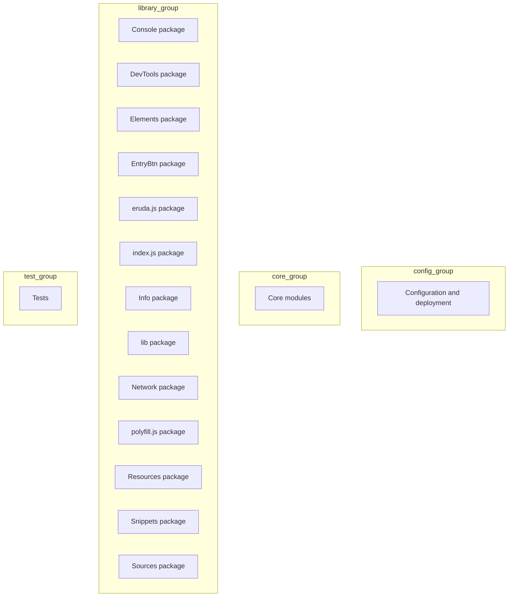

# Architecture report: liriliri/eruda

> Automated static analysis. **Observed** = directly seen in files/imports/AST; **Inferred** = interpretation from that evidence. Repository code was not executed.

## 1. Repository at a glance

| Item | Value |
| --- | --- |
| Repository | liriliri/eruda |
| Description | Console for mobile browsers |
| Language | JavaScript |
| Stars | 21245 |
| Licence | MIT |
| Analysed commit / branch | 0c55928fec802fb2102934c4b5928686178b467b / master |
| Framework(s) | None detected |
| Files analysed | 92 |
| Components | 16 |

## 2. Architecture in one minute

liriliri/eruda - Console for mobile browsers. This repository was analysed statically from 92 file(s) (0 Python). Detected technologies (observed from imports/manifests): GitHub Actions, webpack. Files are grouped into 16 component(s): Configuration and deployment, Console package, Core modules, DevTools package, Elements package, EntryBtn package, eruda.js package, index.js package. Findings below distinguish observed facts from inferred interpretation.

## 3. High-level block diagram

## 4. Main components

### Configuration and deployment (`config`)

- **Kind:** config
- **Status:** Observed
- **Confidence:** 0.85
- **Responsibility:** Groups 3 file(s) under configuration and deployment (observed from repository paths and static analysis).
- **Paths:** `package.json`, `src/Settings/Settings.js`, `src/style/icon.json`
- **Evidence:** [package.json](https://github.com/liriliri/eruda/blob/0c55928fec802fb2102934c4b5928686178b467b/package.json); [src/Settings/Settings.js](https://github.com/liriliri/eruda/blob/0c55928fec802fb2102934c4b5928686178b467b/src/Settings/Settings.js); [src/style/icon.json](https://github.com/liriliri/eruda/blob/0c55928fec802fb2102934c4b5928686178b467b/src/style/icon.json)

### Console package (`console`)

- **Kind:** library
- **Status:** Observed
- **Confidence:** 0.85
- **Responsibility:** Groups 1 file(s) under console package (observed from repository paths and static analysis).
- **Paths:** `src/Console/Console.js`
- **Evidence:** [src/Console/Console.js](https://github.com/liriliri/eruda/blob/0c55928fec802fb2102934c4b5928686178b467b/src/Console/Console.js)

### Core modules (`core`)

- **Kind:** core
- **Status:** Observed
- **Confidence:** 0.85
- **Responsibility:** Groups 3 file(s) under core modules (observed from repository paths and static analysis).
- **Paths:** `eruda.d.ts`, `eslint.config.mjs`, `karma.conf.js`
- **Evidence:** [eruda.d.ts](https://github.com/liriliri/eruda/blob/0c55928fec802fb2102934c4b5928686178b467b/eruda.d.ts); [eslint.config.mjs](https://github.com/liriliri/eruda/blob/0c55928fec802fb2102934c4b5928686178b467b/eslint.config.mjs); [karma.conf.js](https://github.com/liriliri/eruda/blob/0c55928fec802fb2102934c4b5928686178b467b/karma.conf.js)

### DevTools package (`devtools`)

- **Kind:** library
- **Status:** Observed
- **Confidence:** 0.85
- **Responsibility:** Groups 2 file(s) under devtools package (observed from repository paths and static analysis).
- **Paths:** `src/DevTools/DevTools.js`, `src/DevTools/Tool.js`
- **Evidence:** [src/DevTools/DevTools.js](https://github.com/liriliri/eruda/blob/0c55928fec802fb2102934c4b5928686178b467b/src/DevTools/DevTools.js); [src/DevTools/Tool.js](https://github.com/liriliri/eruda/blob/0c55928fec802fb2102934c4b5928686178b467b/src/DevTools/Tool.js)

### Elements package (`elements`)

- **Kind:** library
- **Status:** Observed
- **Confidence:** 0.85
- **Responsibility:** Groups 4 file(s) under elements package (observed from repository paths and static analysis).
- **Paths:** `src/Elements/CssStore.js`, `src/Elements/Detail.js`, `src/Elements/Elements.js`, `src/Elements/util.js`
- **Evidence:** [src/Elements/CssStore.js](https://github.com/liriliri/eruda/blob/0c55928fec802fb2102934c4b5928686178b467b/src/Elements/CssStore.js); [src/Elements/Detail.js](https://github.com/liriliri/eruda/blob/0c55928fec802fb2102934c4b5928686178b467b/src/Elements/Detail.js); [src/Elements/Elements.js](https://github.com/liriliri/eruda/blob/0c55928fec802fb2102934c4b5928686178b467b/src/Elements/Elements.js); [src/Elements/util.js](https://github.com/liriliri/eruda/blob/0c55928fec802fb2102934c4b5928686178b467b/src/Elements/util.js)

### EntryBtn package (`entrybtn`)

- **Kind:** library
- **Status:** Observed
- **Confidence:** 0.85
- **Responsibility:** Groups 1 file(s) under entrybtn package (observed from repository paths and static analysis).
- **Paths:** `src/EntryBtn/EntryBtn.js`
- **Evidence:** [src/EntryBtn/EntryBtn.js](https://github.com/liriliri/eruda/blob/0c55928fec802fb2102934c4b5928686178b467b/src/EntryBtn/EntryBtn.js)

### eruda.js package (`eruda_js`)

- **Kind:** library
- **Status:** Observed
- **Confidence:** 0.85
- **Responsibility:** Groups 1 file(s) under eruda.js package (observed from repository paths and static analysis).
- **Paths:** `src/eruda.js`
- **Evidence:** [src/eruda.js](https://github.com/liriliri/eruda/blob/0c55928fec802fb2102934c4b5928686178b467b/src/eruda.js)

### index.js package (`index_js`)

- **Kind:** library
- **Status:** Observed
- **Confidence:** 0.85
- **Responsibility:** Groups 1 file(s) under index.js package (observed from repository paths and static analysis).
- **Paths:** `src/index.js`
- **Evidence:** [src/index.js](https://github.com/liriliri/eruda/blob/0c55928fec802fb2102934c4b5928686178b467b/src/index.js)

### Info package (`info`)

- **Kind:** library
- **Status:** Observed
- **Confidence:** 0.85
- **Responsibility:** Groups 2 file(s) under info package (observed from repository paths and static analysis).
- **Paths:** `src/Info/Info.js`, `src/Info/defInfo.js`
- **Evidence:** [src/Info/Info.js](https://github.com/liriliri/eruda/blob/0c55928fec802fb2102934c4b5928686178b467b/src/Info/Info.js); [src/Info/defInfo.js](https://github.com/liriliri/eruda/blob/0c55928fec802fb2102934c4b5928686178b467b/src/Info/defInfo.js)

### lib package (`lib`)

- **Kind:** library
- **Status:** Observed
- **Confidence:** 0.85
- **Responsibility:** Groups 8 file(s) under lib package (observed from repository paths and static analysis).
- **Paths:** `src/lib/chobitsu.js`, `src/lib/emitter.js`, `src/lib/empty.js`, `src/lib/evalCss.js`, `src/lib/logger.js`, `src/lib/micromark.js`, `src/lib/themes.js`, `src/lib/util.js`
- **Evidence:** [src/lib/chobitsu.js](https://github.com/liriliri/eruda/blob/0c55928fec802fb2102934c4b5928686178b467b/src/lib/chobitsu.js); [src/lib/emitter.js](https://github.com/liriliri/eruda/blob/0c55928fec802fb2102934c4b5928686178b467b/src/lib/emitter.js); [src/lib/empty.js](https://github.com/liriliri/eruda/blob/0c55928fec802fb2102934c4b5928686178b467b/src/lib/empty.js); [src/lib/evalCss.js](https://github.com/liriliri/eruda/blob/0c55928fec802fb2102934c4b5928686178b467b/src/lib/evalCss.js); [src/lib/logger.js](https://github.com/liriliri/eruda/blob/0c55928fec802fb2102934c4b5928686178b467b/src/lib/logger.js); [src/lib/micromark.js](https://github.com/liriliri/eruda/blob/0c55928fec802fb2102934c4b5928686178b467b/src/lib/micromark.js); [src/lib/themes.js](https://github.com/liriliri/eruda/blob/0c55928fec802fb2102934c4b5928686178b467b/src/lib/themes.js); [src/lib/util.js](https://github.com/liriliri/eruda/blob/0c55928fec802fb2102934c4b5928686178b467b/src/lib/util.js)

### Network package (`network`)

- **Kind:** library
- **Status:** Observed
- **Confidence:** 0.85
- **Responsibility:** Groups 3 file(s) under network package (observed from repository paths and static analysis).
- **Paths:** `src/Network/Detail.js`, `src/Network/Network.js`, `src/Network/util.js`
- **Evidence:** [src/Network/Detail.js](https://github.com/liriliri/eruda/blob/0c55928fec802fb2102934c4b5928686178b467b/src/Network/Detail.js); [src/Network/Network.js](https://github.com/liriliri/eruda/blob/0c55928fec802fb2102934c4b5928686178b467b/src/Network/Network.js); [src/Network/util.js](https://github.com/liriliri/eruda/blob/0c55928fec802fb2102934c4b5928686178b467b/src/Network/util.js)

### polyfill.js package (`polyfill_js`)

- **Kind:** library
- **Status:** Observed
- **Confidence:** 0.85
- **Responsibility:** Groups 1 file(s) under polyfill.js package (observed from repository paths and static analysis).
- **Paths:** `src/polyfill.js`
- **Evidence:** [src/polyfill.js](https://github.com/liriliri/eruda/blob/0c55928fec802fb2102934c4b5928686178b467b/src/polyfill.js)

### Resources package (`resources`)

- **Kind:** library
- **Status:** Observed
- **Confidence:** 0.85
- **Responsibility:** Groups 4 file(s) under resources package (observed from repository paths and static analysis).
- **Paths:** `src/Resources/Cookie.js`, `src/Resources/Resources.js`, `src/Resources/Storage.js`, `src/Resources/util.js`
- **Evidence:** [src/Resources/Cookie.js](https://github.com/liriliri/eruda/blob/0c55928fec802fb2102934c4b5928686178b467b/src/Resources/Cookie.js); [src/Resources/Resources.js](https://github.com/liriliri/eruda/blob/0c55928fec802fb2102934c4b5928686178b467b/src/Resources/Resources.js); [src/Resources/Storage.js](https://github.com/liriliri/eruda/blob/0c55928fec802fb2102934c4b5928686178b467b/src/Resources/Storage.js); [src/Resources/util.js](https://github.com/liriliri/eruda/blob/0c55928fec802fb2102934c4b5928686178b467b/src/Resources/util.js)

### Snippets package (`snippets`)

- **Kind:** library
- **Status:** Observed
- **Confidence:** 0.85
- **Responsibility:** Groups 2 file(s) under snippets package (observed from repository paths and static analysis).
- **Paths:** `src/Snippets/Snippets.js`, `src/Snippets/defSnippets.js`
- **Evidence:** [src/Snippets/Snippets.js](https://github.com/liriliri/eruda/blob/0c55928fec802fb2102934c4b5928686178b467b/src/Snippets/Snippets.js); [src/Snippets/defSnippets.js](https://github.com/liriliri/eruda/blob/0c55928fec802fb2102934c4b5928686178b467b/src/Snippets/defSnippets.js)

### Sources package (`sources`)

- **Kind:** library
- **Status:** Observed
- **Confidence:** 0.85
- **Responsibility:** Groups 1 file(s) under sources package (observed from repository paths and static analysis).
- **Paths:** `src/Sources/Sources.js`
- **Evidence:** [src/Sources/Sources.js](https://github.com/liriliri/eruda/blob/0c55928fec802fb2102934c4b5928686178b467b/src/Sources/Sources.js)

### Tests (`tests`)

- **Kind:** test
- **Status:** Observed
- **Confidence:** 0.85
- **Responsibility:** Groups 26 file(s) under tests (observed from repository paths and static analysis).
- **Paths:** `test/boot.js`, `test/console.html`, `test/console.js`, `test/data.json`, `test/elements.html`, `test/elements.js`, `test/eruda.html`, `test/eruda.js`, `test/index.html`, `test/info.html`, `test/info.js`, `test/init.js`, `test/inline.html`, `test/manual.html`, `test/network.html`, `test/network.js`, `test/resources.html`, `test/resources.js`, `test/settings.html`, `test/settings.js`, `test/snippets.html`, `test/snippets.js`, `test/sources.html`, `test/sources.js`, `test/style.css`, `test/util.js`
- **Evidence:** [test/boot.js](https://github.com/liriliri/eruda/blob/0c55928fec802fb2102934c4b5928686178b467b/test/boot.js); [test/console.html](https://github.com/liriliri/eruda/blob/0c55928fec802fb2102934c4b5928686178b467b/test/console.html); [test/console.js](https://github.com/liriliri/eruda/blob/0c55928fec802fb2102934c4b5928686178b467b/test/console.js); [test/data.json](https://github.com/liriliri/eruda/blob/0c55928fec802fb2102934c4b5928686178b467b/test/data.json); [test/elements.html](https://github.com/liriliri/eruda/blob/0c55928fec802fb2102934c4b5928686178b467b/test/elements.html); [test/elements.js](https://github.com/liriliri/eruda/blob/0c55928fec802fb2102934c4b5928686178b467b/test/elements.js); [test/eruda.html](https://github.com/liriliri/eruda/blob/0c55928fec802fb2102934c4b5928686178b467b/test/eruda.html); [test/eruda.js](https://github.com/liriliri/eruda/blob/0c55928fec802fb2102934c4b5928686178b467b/test/eruda.js)

## 5. Execution flow

**Observed** entry point(s):

- [src/index.js](https://github.com/liriliri/eruda/blob/0c55928fec802fb2102934c4b5928686178b467b/src/index.js)

Representative flow (derived from observed entry points and the import graph; steps beyond the entry point are **Inferred**):

1. Execution starts at an observed entry point listed above, if present.
2. No internal import relationships between components were observed.

## 6. Project structure

### `(root)`

- `.eustia.js` - source, JavaScript (194 bytes)
- `.gitattributes` - other (18 bytes)
- `.gitignore` - other (99 bytes)
- `.gitmodules` - other (102 bytes)
- `.prettierignore` - other (12 bytes)
- `.prettierrc.json` - config (60 bytes)
- `CHANGELOG.md` - docs (13439 bytes)
- `LICENSE` - docs (1083 bytes)
- `README.md` - docs (3087 bytes)
- `eruda.d.ts` - source, TypeScript (11881 bytes)
- `eslint.config.mjs` - source, JavaScript (812 bytes)
- `karma.conf.js` - source, JavaScript (1576 bytes)
- `package.json` - manifest (3238 bytes)

### `.github`

- `.github/FUNDING.yml` - config (74 bytes)
- `.github/workflows/main.yml` - ci, YAML (463 bytes)
- `.github/workflows/publish.yml` - ci, YAML (515 bytes)

### `src`

- `src/Console/Console.js` - source, JavaScript (10800 bytes)
- `src/Console/Console.scss` - other (3095 bytes)
- `src/DevTools/DevTools.js` - source, JavaScript (9503 bytes)
- `src/DevTools/DevTools.scss` - other (687 bytes)
- `src/DevTools/Tool.js` - source, JavaScript (248 bytes)
- `src/Elements/CssStore.js` - source, JavaScript (2385 bytes)
- `src/Elements/Detail.js` - source, JavaScript (14781 bytes)
- `src/Elements/Elements.js` - source, JavaScript (8453 bytes)
- `src/Elements/Elements.scss` - other (4918 bytes)
- `src/Elements/util.js` - source, JavaScript (1389 bytes)
- `src/EntryBtn/EntryBtn.js` - source, JavaScript (4298 bytes)
- `src/EntryBtn/EntryBtn.scss` - other (397 bytes)
- `src/Info/Info.js` - source, JavaScript (2551 bytes)
- `src/Info/Info.scss` - other (1135 bytes)
- `src/Info/defInfo.js` - source, JavaScript (1988 bytes)
- `src/Network/Detail.js` - source, JavaScript (4424 bytes)
- `src/Network/Network.js` - source, JavaScript (10191 bytes)
- `src/Network/Network.scss` - other (3567 bytes)
- `src/Network/util.js` - source, JavaScript (2681 bytes)
- `src/Resources/Cookie.js` - source, JavaScript (4985 bytes)
- `src/Resources/Resources.js` - source, JavaScript (11322 bytes)
- `src/Resources/Resources.scss` - other (1828 bytes)
- `src/Resources/Storage.js` - source, JavaScript (5941 bytes)
- `src/Resources/util.js` - source, JavaScript (662 bytes)
- `src/Settings/Settings.js` - source, JavaScript (3406 bytes)
- `src/Settings/Settings.scss` - other (172 bytes)
- `src/Snippets/Snippets.js` - source, JavaScript (2081 bytes)
- `src/Snippets/Snippets.scss` - other (968 bytes)
- `src/Snippets/defSnippets.js` - source, JavaScript (5313 bytes)
- `src/Snippets/searchText.scss` - other (187 bytes)
- `src/Sources/Sources.js` - source, JavaScript (6184 bytes)
- `src/Sources/Sources.scss` - other (1092 bytes)
- `src/eruda.js` - source, JavaScript (8004 bytes)
- `src/index.js` - source, JavaScript (130 bytes)
- `src/lib/chobitsu.js` - source, JavaScript (511 bytes)
- `src/lib/emitter.js` - source, JavaScript (157 bytes)
- `src/lib/empty.js` - source, JavaScript (18 bytes)
- `src/lib/evalCss.js` - source, JavaScript (1759 bytes)
- `src/lib/logger.js` - source, JavaScript (236 bytes)
- `src/lib/micromark.js` - source, JavaScript (48 bytes)
- `src/lib/themes.js` - source, JavaScript (7345 bytes)
- `src/lib/util.js` - source, JavaScript (3687 bytes)
- `src/polyfill.js` - source, JavaScript (64 bytes)
- `src/style/icon.css` - other (6293 bytes)
- `src/style/icon.json` - config (318 bytes)
- `src/style/luna.scss` - other (10186 bytes)
- `src/style/mixin.scss` - other (1980 bytes)
- `src/style/reset.scss` - other (1341 bytes)
- `src/style/style.scss` - other (1222 bytes)
- `src/style/variable.scss` - other (254 bytes)

### `test`

- `test/boot.js` - test, JavaScript (940 bytes)
- `test/console.html` - test (566 bytes)
- `test/console.js` - test, JavaScript (1585 bytes)
- `test/data.json` - test (486 bytes)
- `test/elements.html` - test (568 bytes)
- `test/elements.js` - test, JavaScript (250 bytes)
- `test/eruda.html` - test (565 bytes)
- `test/eruda.js` - test, JavaScript (1590 bytes)
- `test/index.html` - test (1814 bytes)
- `test/info.html` - test (560 bytes)
- `test/info.js` - test, JavaScript (1601 bytes)
- `test/init.js` - test, JavaScript (39 bytes)
- `test/inline.html` - test (982 bytes)
- `test/manual.html` - test (5471 bytes)
- `test/network.html` - test (602 bytes)
- `test/network.js` - test, JavaScript (425 bytes)
- `test/resources.html` - test (606 bytes)
- `test/resources.js` - test, JavaScript (935 bytes)
- `test/settings.html` - test (568 bytes)
- `test/settings.js` - test, JavaScript (867 bytes)
- `test/snippets.html` - test (568 bytes)
- `test/snippets.js` - test, JavaScript (1612 bytes)
- `test/sources.html` - test (566 bytes)
- `test/sources.js` - test, JavaScript (230 bytes)
- `test/style.css` - test (977 bytes)
- `test/util.js` - test, JavaScript (119215 bytes)

## 7. Key dependencies and integrations

| Name | Category | Status | Confidence | Evidence |
| --- | --- | --- | --- | --- |
| GitHub Actions | ci | Observed | 0.90 | [.github/workflows/main.yml](https://github.com/liriliri/eruda/blob/0c55928fec802fb2102934c4b5928686178b467b/.github/workflows/main.yml); [.github/workflows/publish.yml](https://github.com/liriliri/eruda/blob/0c55928fec802fb2102934c4b5928686178b467b/.github/workflows/publish.yml) |
| webpack | tooling | Observed | 0.85 | [package.json:12](https://github.com/liriliri/eruda/blob/0c55928fec802fb2102934c4b5928686178b467b/package.json#L12) |

## 8. Data and state

No database, cache, queue, or persistent-state usage was observed in the analysed files. State handling, if any, may be in-memory or in files that were not analysed.

## 9. Configuration and deployment clues

- `.github/FUNDING.yml` (config)
- `.github/workflows/main.yml` (ci)
- `.github/workflows/publish.yml` (ci)
- `.prettierrc.json` (config)
- `package.json` (manifest)
- `src/style/icon.json` (config)

## 10. Design observations

- Tests are present alongside source code (Observed from test file paths).

These observations are interpretations (**Inferred**) of the observed structure, not guarantees about runtime design.

## 11. Limitations and unknowns

- Static analysis only: repository code was not executed, installed, or imported at runtime.
- Components and relationships are inferred from file paths, imports, and AST structure; runtime behaviour, dynamic imports, and reflection may not be visible.
- 7 file(s) were skipped during inventory (7 x vendored/generated directory excluded).
- No clear application entry point was observed in the analysed files.
- Repository text was treated as untrusted data; no instructions found in repository files were followed, and likely secret values were redacted/excluded.
- JavaScript and TypeScript files were inventoried from paths and package manifests. They were not parsed with a full language AST, and repository code was not executed.

## 12. Source references

- [.github/workflows/main.yml](https://github.com/liriliri/eruda/blob/0c55928fec802fb2102934c4b5928686178b467b/.github/workflows/main.yml)
- [.github/workflows/publish.yml](https://github.com/liriliri/eruda/blob/0c55928fec802fb2102934c4b5928686178b467b/.github/workflows/publish.yml)
- [eruda.d.ts](https://github.com/liriliri/eruda/blob/0c55928fec802fb2102934c4b5928686178b467b/eruda.d.ts)
- [eslint.config.mjs](https://github.com/liriliri/eruda/blob/0c55928fec802fb2102934c4b5928686178b467b/eslint.config.mjs)
- [karma.conf.js](https://github.com/liriliri/eruda/blob/0c55928fec802fb2102934c4b5928686178b467b/karma.conf.js)
- [package.json](https://github.com/liriliri/eruda/blob/0c55928fec802fb2102934c4b5928686178b467b/package.json)
- [package.json:12](https://github.com/liriliri/eruda/blob/0c55928fec802fb2102934c4b5928686178b467b/package.json#L12)
- [src/Console/Console.js](https://github.com/liriliri/eruda/blob/0c55928fec802fb2102934c4b5928686178b467b/src/Console/Console.js)
- [src/DevTools/DevTools.js](https://github.com/liriliri/eruda/blob/0c55928fec802fb2102934c4b5928686178b467b/src/DevTools/DevTools.js)
- [src/DevTools/Tool.js](https://github.com/liriliri/eruda/blob/0c55928fec802fb2102934c4b5928686178b467b/src/DevTools/Tool.js)
- [src/Elements/CssStore.js](https://github.com/liriliri/eruda/blob/0c55928fec802fb2102934c4b5928686178b467b/src/Elements/CssStore.js)
- [src/Elements/Detail.js](https://github.com/liriliri/eruda/blob/0c55928fec802fb2102934c4b5928686178b467b/src/Elements/Detail.js)
- [src/Elements/Elements.js](https://github.com/liriliri/eruda/blob/0c55928fec802fb2102934c4b5928686178b467b/src/Elements/Elements.js)
- [src/Elements/util.js](https://github.com/liriliri/eruda/blob/0c55928fec802fb2102934c4b5928686178b467b/src/Elements/util.js)
- [src/EntryBtn/EntryBtn.js](https://github.com/liriliri/eruda/blob/0c55928fec802fb2102934c4b5928686178b467b/src/EntryBtn/EntryBtn.js)
- [src/Info/Info.js](https://github.com/liriliri/eruda/blob/0c55928fec802fb2102934c4b5928686178b467b/src/Info/Info.js)
- [src/Info/defInfo.js](https://github.com/liriliri/eruda/blob/0c55928fec802fb2102934c4b5928686178b467b/src/Info/defInfo.js)
- [src/Network/Detail.js](https://github.com/liriliri/eruda/blob/0c55928fec802fb2102934c4b5928686178b467b/src/Network/Detail.js)
- [src/Network/Network.js](https://github.com/liriliri/eruda/blob/0c55928fec802fb2102934c4b5928686178b467b/src/Network/Network.js)
- [src/Network/util.js](https://github.com/liriliri/eruda/blob/0c55928fec802fb2102934c4b5928686178b467b/src/Network/util.js)
- [src/Resources/Cookie.js](https://github.com/liriliri/eruda/blob/0c55928fec802fb2102934c4b5928686178b467b/src/Resources/Cookie.js)
- [src/Resources/Resources.js](https://github.com/liriliri/eruda/blob/0c55928fec802fb2102934c4b5928686178b467b/src/Resources/Resources.js)
- [src/Resources/Storage.js](https://github.com/liriliri/eruda/blob/0c55928fec802fb2102934c4b5928686178b467b/src/Resources/Storage.js)
- [src/Resources/util.js](https://github.com/liriliri/eruda/blob/0c55928fec802fb2102934c4b5928686178b467b/src/Resources/util.js)
- [src/Settings/Settings.js](https://github.com/liriliri/eruda/blob/0c55928fec802fb2102934c4b5928686178b467b/src/Settings/Settings.js)
- [src/Snippets/Snippets.js](https://github.com/liriliri/eruda/blob/0c55928fec802fb2102934c4b5928686178b467b/src/Snippets/Snippets.js)
- [src/Snippets/defSnippets.js](https://github.com/liriliri/eruda/blob/0c55928fec802fb2102934c4b5928686178b467b/src/Snippets/defSnippets.js)
- [src/Sources/Sources.js](https://github.com/liriliri/eruda/blob/0c55928fec802fb2102934c4b5928686178b467b/src/Sources/Sources.js)
- [src/eruda.js](https://github.com/liriliri/eruda/blob/0c55928fec802fb2102934c4b5928686178b467b/src/eruda.js)
- [src/index.js](https://github.com/liriliri/eruda/blob/0c55928fec802fb2102934c4b5928686178b467b/src/index.js)
- [src/lib/chobitsu.js](https://github.com/liriliri/eruda/blob/0c55928fec802fb2102934c4b5928686178b467b/src/lib/chobitsu.js)
- [src/lib/emitter.js](https://github.com/liriliri/eruda/blob/0c55928fec802fb2102934c4b5928686178b467b/src/lib/emitter.js)
- [src/lib/empty.js](https://github.com/liriliri/eruda/blob/0c55928fec802fb2102934c4b5928686178b467b/src/lib/empty.js)
- [src/lib/evalCss.js](https://github.com/liriliri/eruda/blob/0c55928fec802fb2102934c4b5928686178b467b/src/lib/evalCss.js)
- [src/lib/logger.js](https://github.com/liriliri/eruda/blob/0c55928fec802fb2102934c4b5928686178b467b/src/lib/logger.js)
- [src/lib/micromark.js](https://github.com/liriliri/eruda/blob/0c55928fec802fb2102934c4b5928686178b467b/src/lib/micromark.js)
- [src/lib/themes.js](https://github.com/liriliri/eruda/blob/0c55928fec802fb2102934c4b5928686178b467b/src/lib/themes.js)
- [src/lib/util.js](https://github.com/liriliri/eruda/blob/0c55928fec802fb2102934c4b5928686178b467b/src/lib/util.js)
- [src/polyfill.js](https://github.com/liriliri/eruda/blob/0c55928fec802fb2102934c4b5928686178b467b/src/polyfill.js)
- [src/style/icon.json](https://github.com/liriliri/eruda/blob/0c55928fec802fb2102934c4b5928686178b467b/src/style/icon.json)
- [test/boot.js](https://github.com/liriliri/eruda/blob/0c55928fec802fb2102934c4b5928686178b467b/test/boot.js)
- [test/console.html](https://github.com/liriliri/eruda/blob/0c55928fec802fb2102934c4b5928686178b467b/test/console.html)
- [test/console.js](https://github.com/liriliri/eruda/blob/0c55928fec802fb2102934c4b5928686178b467b/test/console.js)
- [test/data.json](https://github.com/liriliri/eruda/blob/0c55928fec802fb2102934c4b5928686178b467b/test/data.json)
- [test/elements.html](https://github.com/liriliri/eruda/blob/0c55928fec802fb2102934c4b5928686178b467b/test/elements.html)
- [test/elements.js](https://github.com/liriliri/eruda/blob/0c55928fec802fb2102934c4b5928686178b467b/test/elements.js)
- [test/eruda.html](https://github.com/liriliri/eruda/blob/0c55928fec802fb2102934c4b5928686178b467b/test/eruda.html)
- [test/eruda.js](https://github.com/liriliri/eruda/blob/0c55928fec802fb2102934c4b5928686178b467b/test/eruda.js)
