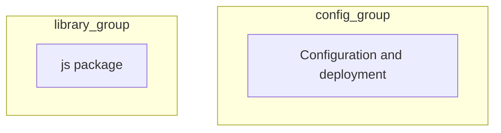

# Architecture report: listen1/listen1_chrome_extension

> Automated static analysis. **Observed** = directly seen in files/imports/AST; **Inferred** = interpretation from that evidence. Repository code was not executed.

## 1. Repository at a glance

| Item | Value |
| --- | --- |
| Repository | listen1/listen1_chrome_extension |
| Description | one for all free music in china (chrome extension, also works for firefox) |
| Language | JavaScript |
| Stars | 12123 |
| Licence | MIT |
| Analysed commit / branch | 3f24efa045125875a609dcb0f3f3f0be4edb8b37 / master |
| Framework(s) | None detected |
| Files analysed | 60 |
| Components | 2 |

## 2. Architecture in one minute

listen1/listen1_chrome_extension - one for all free music in china (chrome extension, also works for firefox). This repository was analysed statically from 60 file(s) (0 Python). Detected technologies (observed from imports/manifests): GitHub Actions. Files are grouped into 2 component(s): Configuration and deployment, js package. Findings below distinguish observed facts from inferred interpretation.

## 3. High-level block diagram

## 4. Main components

### Configuration and deployment (`config`)

- **Kind:** config
- **Status:** Observed
- **Confidence:** 0.85
- **Responsibility:** Groups 10 file(s) under configuration and deployment (observed from repository paths and static analysis).
- **Paths:** `i18n/en-US.json`, `i18n/fr-FR.json`, `i18n/ko-KR.json`, `i18n/pt-BR.json`, `i18n/zh-CN.json`, `i18n/zh-TC.json`, `manifest.json`, `manifest_firefox.json`, `package.json`, `rules_1.json`
- **Evidence:** [i18n/en-US.json](https://github.com/listen1/listen1_chrome_extension/blob/3f24efa045125875a609dcb0f3f3f0be4edb8b37/i18n/en-US.json); [i18n/fr-FR.json](https://github.com/listen1/listen1_chrome_extension/blob/3f24efa045125875a609dcb0f3f3f0be4edb8b37/i18n/fr-FR.json); [i18n/ko-KR.json](https://github.com/listen1/listen1_chrome_extension/blob/3f24efa045125875a609dcb0f3f3f0be4edb8b37/i18n/ko-KR.json); [i18n/pt-BR.json](https://github.com/listen1/listen1_chrome_extension/blob/3f24efa045125875a609dcb0f3f3f0be4edb8b37/i18n/pt-BR.json); [i18n/zh-CN.json](https://github.com/listen1/listen1_chrome_extension/blob/3f24efa045125875a609dcb0f3f3f0be4edb8b37/i18n/zh-CN.json); [i18n/zh-TC.json](https://github.com/listen1/listen1_chrome_extension/blob/3f24efa045125875a609dcb0f3f3f0be4edb8b37/i18n/zh-TC.json); [manifest.json](https://github.com/listen1/listen1_chrome_extension/blob/3f24efa045125875a609dcb0f3f3f0be4edb8b37/manifest.json); [manifest_firefox.json](https://github.com/listen1/listen1_chrome_extension/blob/3f24efa045125875a609dcb0f3f3f0be4edb8b37/manifest_firefox.json)

### js package (`js`)

- **Kind:** library
- **Status:** Observed
- **Confidence:** 0.85
- **Responsibility:** Groups 28 file(s) under js package (observed from repository paths and static analysis).
- **Paths:** `js/app.js`, `js/background.js`, `js/bridge.js`, `js/controller/auth.js`, `js/controller/instant_search.js`, `js/controller/my_playlist.js`, `js/controller/navigation.js`, `js/controller/platform.js`, `js/controller/play.js`, `js/controller/playlist.js`, `js/controller/profile.js`, `js/github.js`, `js/l1_player.js`, `js/lastfm.js`, `js/loweb.js`, `js/lowebutil.js`, `js/myplaylist.js`, `js/oauth_callback.js`, `js/player_thread.js`, `js/provider/bilibili.js`, `js/provider/kugou.js`, `js/provider/kuwo.js`, `js/provider/localmusic.js`, `js/provider/migu.js`, `js/provider/netease.js`, `js/provider/qq.js`, `js/provider/taihe.js`, `js/provider/xiami.js`
- **Evidence:** [js/app.js](https://github.com/listen1/listen1_chrome_extension/blob/3f24efa045125875a609dcb0f3f3f0be4edb8b37/js/app.js); [js/background.js](https://github.com/listen1/listen1_chrome_extension/blob/3f24efa045125875a609dcb0f3f3f0be4edb8b37/js/background.js); [js/bridge.js](https://github.com/listen1/listen1_chrome_extension/blob/3f24efa045125875a609dcb0f3f3f0be4edb8b37/js/bridge.js); [js/controller/auth.js](https://github.com/listen1/listen1_chrome_extension/blob/3f24efa045125875a609dcb0f3f3f0be4edb8b37/js/controller/auth.js); [js/controller/instant_search.js](https://github.com/listen1/listen1_chrome_extension/blob/3f24efa045125875a609dcb0f3f3f0be4edb8b37/js/controller/instant_search.js); [js/controller/my_playlist.js](https://github.com/listen1/listen1_chrome_extension/blob/3f24efa045125875a609dcb0f3f3f0be4edb8b37/js/controller/my_playlist.js); [js/controller/navigation.js](https://github.com/listen1/listen1_chrome_extension/blob/3f24efa045125875a609dcb0f3f3f0be4edb8b37/js/controller/navigation.js); [js/controller/platform.js](https://github.com/listen1/listen1_chrome_extension/blob/3f24efa045125875a609dcb0f3f3f0be4edb8b37/js/controller/platform.js)

## 5. Execution flow

**Observed** entry point(s):

- [js/app.js](https://github.com/listen1/listen1_chrome_extension/blob/3f24efa045125875a609dcb0f3f3f0be4edb8b37/js/app.js)

Representative flow (derived from observed entry points and the import graph; steps beyond the entry point are **Inferred**):

1. Execution starts at an observed entry point listed above, if present.
2. No internal import relationships between components were observed.

## 6. Project structure

### `(root)`

- `.eslintrc.json` - config (473 bytes)
- `.gitignore` - other (93 bytes)
- `.prettierrc` - other (55 bytes)
- `LICENSE` - docs (1074 bytes)
- `README.md` - docs (20714 bytes)
- `README_EN.md` - docs (12526 bytes)
- `manifest.json` - config (1342 bytes)
- `manifest_firefox.json` - config (1435 bytes)
- `package.json` - manifest (989 bytes)
- `rules_1.json` - config (1319 bytes)

### `.github`

- `.github/workflows/eslint.yml` - ci, YAML (362 bytes)

### `css`

- `css/common.css` - other (36812 bytes)
- `css/common2.css` - other (56363 bytes)
- `css/cover.css` - other (3337 bytes)
- `css/hotkeys.css` - other (1855 bytes)
- `css/icon.css` - other (1713 bytes)
- `css/iparanoid.css` - other (2476 bytes)
- `css/iparanoid2.css` - other (2113 bytes)
- `css/notyf_custom.css` - other (80 bytes)
- `css/origin.css` - other (2518 bytes)
- `css/origin2.css` - other (2033 bytes)
- `css/player.css` - other (19204 bytes)
- `css/reset.css` - other (930 bytes)

### `fonts`

- `fonts/listen1-icon.svg` - other (7081 bytes)

### `i18n`

- `i18n/en-US.json` - config (7126 bytes)
- `i18n/fr-FR.json` - config (7584 bytes)
- `i18n/ko-KR.json` - config (8045 bytes)
- `i18n/pt-BR.json` - config (7751 bytes)
- `i18n/zh-CN.json` - config (7202 bytes)
- `i18n/zh-TC.json` - config (7403 bytes)

### `images`

- `images/feather-sprite.svg` - other (60146 bytes)
- `images/loading.svg` - other (779 bytes)

### `js`

- `js/app.js` - source, JavaScript (14707 bytes)
- `js/background.js` - source, JavaScript (5507 bytes)
- `js/bridge.js` - source, JavaScript (2053 bytes)
- `js/controller/auth.js` - source, JavaScript (1407 bytes)
- `js/controller/instant_search.js` - source, JavaScript (4011 bytes)
- `js/controller/my_playlist.js` - source, JavaScript (1098 bytes)
- `js/controller/navigation.js` - source, JavaScript (22258 bytes)
- `js/controller/platform.js` - source, JavaScript (1638 bytes)
- `js/controller/play.js` - source, JavaScript (29083 bytes)
- `js/controller/playlist.js` - source, JavaScript (1949 bytes)
- `js/controller/profile.js` - source, JavaScript (5348 bytes)
- `js/github.js` - source, JavaScript (5803 bytes)
- `js/l1_player.js` - source, JavaScript (5821 bytes)
- `js/lastfm.js` - source, JavaScript (5851 bytes)
- `js/loweb.js` - source, JavaScript (11655 bytes)
- `js/lowebutil.js` - source, JavaScript (3168 bytes)
- `js/myplaylist.js` - source, JavaScript (7442 bytes)
- `js/oauth_callback.js` - source, JavaScript (309 bytes)
- `js/player_thread.js` - source, JavaScript (18224 bytes)
- `js/provider/bilibili.js` - source, JavaScript (14243 bytes)
- `js/provider/kugou.js` - source, JavaScript (15092 bytes)
- `js/provider/kuwo.js` - source, JavaScript (23961 bytes)
- `js/provider/localmusic.js` - source, JavaScript (4553 bytes)
- `js/provider/migu.js` - source, JavaScript (31470 bytes)
- `js/provider/netease.js` - source, JavaScript (29994 bytes)
- `js/provider/qq.js` - source, JavaScript (25990 bytes)
- `js/provider/taihe.js` - source, JavaScript (10253 bytes)
- `js/provider/xiami.js` - source, JavaScript (3186 bytes)

## 7. Key dependencies and integrations

| Name | Category | Status | Confidence | Evidence |
| --- | --- | --- | --- | --- |
| GitHub Actions | ci | Observed | 0.85 | [.github/workflows/eslint.yml](https://github.com/listen1/listen1_chrome_extension/blob/3f24efa045125875a609dcb0f3f3f0be4edb8b37/.github/workflows/eslint.yml) |

## 8. Data and state

No database, cache, queue, or persistent-state usage was observed in the analysed files. State handling, if any, may be in-memory or in files that were not analysed.

## 9. Configuration and deployment clues

- `.eslintrc.json` (config)
- `.github/workflows/eslint.yml` (ci)
- `i18n/en-US.json` (config)
- `i18n/fr-FR.json` (config)
- `i18n/ko-KR.json` (config)
- `i18n/pt-BR.json` (config)
- `i18n/zh-CN.json` (config)
- `i18n/zh-TC.json` (config)
- `manifest.json` (config)
- `manifest_firefox.json` (config)
- `package.json` (manifest)
- `rules_1.json` (config)

## 10. Design observations

- No strong design patterns could be established from the available evidence.

These observations are interpretations (**Inferred**) of the observed structure, not guarantees about runtime design.

## 11. Limitations and unknowns

- Static analysis only: repository code was not executed, installed, or imported at runtime.
- Components and relationships are inferred from file paths, imports, and AST structure; runtime behaviour, dynamic imports, and reflection may not be visible.
- 1 file(s) were skipped during inventory (1 x generated/minified file excluded).
- No clear application entry point was observed in the analysed files.
- Repository text was treated as untrusted data; no instructions found in repository files were followed, and likely secret values were redacted/excluded.
- JavaScript and TypeScript files were inventoried from paths and package manifests. They were not parsed with a full language AST, and repository code was not executed.

## 12. Source references

- [.github/workflows/eslint.yml](https://github.com/listen1/listen1_chrome_extension/blob/3f24efa045125875a609dcb0f3f3f0be4edb8b37/.github/workflows/eslint.yml)
- [i18n/en-US.json](https://github.com/listen1/listen1_chrome_extension/blob/3f24efa045125875a609dcb0f3f3f0be4edb8b37/i18n/en-US.json)
- [i18n/fr-FR.json](https://github.com/listen1/listen1_chrome_extension/blob/3f24efa045125875a609dcb0f3f3f0be4edb8b37/i18n/fr-FR.json)
- [i18n/ko-KR.json](https://github.com/listen1/listen1_chrome_extension/blob/3f24efa045125875a609dcb0f3f3f0be4edb8b37/i18n/ko-KR.json)
- [i18n/pt-BR.json](https://github.com/listen1/listen1_chrome_extension/blob/3f24efa045125875a609dcb0f3f3f0be4edb8b37/i18n/pt-BR.json)
- [i18n/zh-CN.json](https://github.com/listen1/listen1_chrome_extension/blob/3f24efa045125875a609dcb0f3f3f0be4edb8b37/i18n/zh-CN.json)
- [i18n/zh-TC.json](https://github.com/listen1/listen1_chrome_extension/blob/3f24efa045125875a609dcb0f3f3f0be4edb8b37/i18n/zh-TC.json)
- [js/app.js](https://github.com/listen1/listen1_chrome_extension/blob/3f24efa045125875a609dcb0f3f3f0be4edb8b37/js/app.js)
- [js/background.js](https://github.com/listen1/listen1_chrome_extension/blob/3f24efa045125875a609dcb0f3f3f0be4edb8b37/js/background.js)
- [js/bridge.js](https://github.com/listen1/listen1_chrome_extension/blob/3f24efa045125875a609dcb0f3f3f0be4edb8b37/js/bridge.js)
- [js/controller/auth.js](https://github.com/listen1/listen1_chrome_extension/blob/3f24efa045125875a609dcb0f3f3f0be4edb8b37/js/controller/auth.js)
- [js/controller/instant_search.js](https://github.com/listen1/listen1_chrome_extension/blob/3f24efa045125875a609dcb0f3f3f0be4edb8b37/js/controller/instant_search.js)
- [js/controller/my_playlist.js](https://github.com/listen1/listen1_chrome_extension/blob/3f24efa045125875a609dcb0f3f3f0be4edb8b37/js/controller/my_playlist.js)
- [js/controller/navigation.js](https://github.com/listen1/listen1_chrome_extension/blob/3f24efa045125875a609dcb0f3f3f0be4edb8b37/js/controller/navigation.js)
- [js/controller/platform.js](https://github.com/listen1/listen1_chrome_extension/blob/3f24efa045125875a609dcb0f3f3f0be4edb8b37/js/controller/platform.js)
- [manifest.json](https://github.com/listen1/listen1_chrome_extension/blob/3f24efa045125875a609dcb0f3f3f0be4edb8b37/manifest.json)
- [manifest_firefox.json](https://github.com/listen1/listen1_chrome_extension/blob/3f24efa045125875a609dcb0f3f3f0be4edb8b37/manifest_firefox.json)
