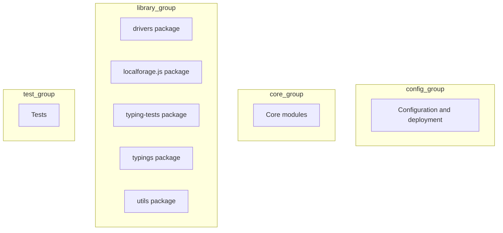

# Architecture report: localForage/localForage

> Automated static analysis. **Observed** = directly seen in files/imports/AST; **Inferred** = interpretation from that evidence. Repository code was not executed.

## 1. Repository at a glance

| Item | Value |
| --- | --- |
| Repository | localForage/localForage |
| Description | 💾 Offline storage, improved. Wraps IndexedDB, WebSQL, or localStorage using a simple but powerful API. |
| Language | JavaScript |
| Stars | 25801 |
| Licence | Apache-2.0 |
| Analysed commit / branch | fb78c77ee583fb727a558c439b5174aca38c5924 / master |
| Framework(s) | None detected |
| Files analysed | 87 |
| Components | 8 |

## 2. Architecture in one minute

localForage/localForage - 💾 Offline storage, improved. Wraps IndexedDB, WebSQL, or localStorage using a simple but powerful API.. This repository was analysed statically from 87 file(s) (0 Python). Detected technologies (observed from imports/manifests): TypeScript, webpack. Files are grouped into 8 component(s): Configuration and deployment, Core modules, drivers package, localforage.js package, Tests, typing-tests package, typings package, utils package. Findings below distinguish observed facts from inferred interpretation.

## 3. High-level block diagram

## 4. Main components

### Configuration and deployment (`config`)

- **Kind:** config
- **Status:** Observed
- **Confidence:** 0.85
- **Responsibility:** Groups 5 file(s) under configuration and deployment (observed from repository paths and static analysis).
- **Paths:** `bower.json`, `component.json`, `contribute.json`, `package.json`, `typing-tests/tsconfig.json`
- **Evidence:** [bower.json](https://github.com/localForage/localForage/blob/fb78c77ee583fb727a558c439b5174aca38c5924/bower.json); [component.json](https://github.com/localForage/localForage/blob/fb78c77ee583fb727a558c439b5174aca38c5924/component.json); [contribute.json](https://github.com/localForage/localForage/blob/fb78c77ee583fb727a558c439b5174aca38c5924/contribute.json); [package.json](https://github.com/localForage/localForage/blob/fb78c77ee583fb727a558c439b5174aca38c5924/package.json); [typing-tests/tsconfig.json](https://github.com/localForage/localForage/blob/fb78c77ee583fb727a558c439b5174aca38c5924/typing-tests/tsconfig.json)

### Core modules (`core`)

- **Kind:** core
- **Status:** Observed
- **Confidence:** 0.85
- **Responsibility:** Groups 1 file(s) under core modules (observed from repository paths and static analysis).
- **Paths:** `Gruntfile.js`
- **Evidence:** [Gruntfile.js](https://github.com/localForage/localForage/blob/fb78c77ee583fb727a558c439b5174aca38c5924/Gruntfile.js)

### drivers package (`drivers`)

- **Kind:** library
- **Status:** Observed
- **Confidence:** 0.85
- **Responsibility:** Groups 3 file(s) under drivers package (observed from repository paths and static analysis).
- **Paths:** `src/drivers/indexeddb.js`, `src/drivers/localstorage.js`, `src/drivers/websql.js`
- **Evidence:** [src/drivers/indexeddb.js](https://github.com/localForage/localForage/blob/fb78c77ee583fb727a558c439b5174aca38c5924/src/drivers/indexeddb.js); [src/drivers/localstorage.js](https://github.com/localForage/localForage/blob/fb78c77ee583fb727a558c439b5174aca38c5924/src/drivers/localstorage.js); [src/drivers/websql.js](https://github.com/localForage/localForage/blob/fb78c77ee583fb727a558c439b5174aca38c5924/src/drivers/websql.js)

### localforage.js package (`localforage_js`)

- **Kind:** library
- **Status:** Observed
- **Confidence:** 0.85
- **Responsibility:** Groups 1 file(s) under localforage.js package (observed from repository paths and static analysis).
- **Paths:** `src/localforage.js`
- **Evidence:** [src/localforage.js](https://github.com/localForage/localForage/blob/fb78c77ee583fb727a558c439b5174aca38c5924/src/localforage.js)

### Tests (`tests`)

- **Kind:** test
- **Status:** Observed
- **Confidence:** 0.85
- **Responsibility:** Groups 30 file(s) under tests (observed from repository paths and static analysis).
- **Paths:** `test/dummyStorageDriver.js`, `test/runner.browserify.js`, `test/runner.js`, `test/runner.webpack.js`, `test/saucelabs-browsers.js`, `test/serviceworker-client.js`, `test/test.api.js`, `test/test.browserify.html`, `test/test.callwhenready.html`, `test/test.callwhenready.js`, `test/test.config.js`, `test/test.customdriver.html`, `test/test.customdriver.js`, `test/test.datatypes.js`, `test/test.drivers.js`, `test/test.faultydriver.html`, `test/test.faultydriver.js`, `test/test.iframecontents.html`, `test/test.iframes.js`, `test/test.main.html`, `test/test.main1.html`, `test/test.min.html`, `test/test.nodriver.html`, `test/test.nodriver.js`, `test/test.polyfill.html`, `test/test.require.html`, `test/test.serviceworkers.js`, `test/test.webpack.html`, `test/test.webworkers.js`, `test/webworker-client.js`
- **Evidence:** [test/dummyStorageDriver.js](https://github.com/localForage/localForage/blob/fb78c77ee583fb727a558c439b5174aca38c5924/test/dummyStorageDriver.js); [test/runner.browserify.js](https://github.com/localForage/localForage/blob/fb78c77ee583fb727a558c439b5174aca38c5924/test/runner.browserify.js); [test/runner.js](https://github.com/localForage/localForage/blob/fb78c77ee583fb727a558c439b5174aca38c5924/test/runner.js); [test/runner.webpack.js](https://github.com/localForage/localForage/blob/fb78c77ee583fb727a558c439b5174aca38c5924/test/runner.webpack.js); [test/saucelabs-browsers.js](https://github.com/localForage/localForage/blob/fb78c77ee583fb727a558c439b5174aca38c5924/test/saucelabs-browsers.js); [test/serviceworker-client.js](https://github.com/localForage/localForage/blob/fb78c77ee583fb727a558c439b5174aca38c5924/test/serviceworker-client.js); [test/test.api.js](https://github.com/localForage/localForage/blob/fb78c77ee583fb727a558c439b5174aca38c5924/test/test.api.js); [test/test.browserify.html](https://github.com/localForage/localForage/blob/fb78c77ee583fb727a558c439b5174aca38c5924/test/test.browserify.html)

### typing-tests package (`typing_tests`)

- **Kind:** library
- **Status:** Observed
- **Confidence:** 0.85
- **Responsibility:** Groups 1 file(s) under typing-tests package (observed from repository paths and static analysis).
- **Paths:** `typing-tests/localforage-tests.ts`
- **Evidence:** [typing-tests/localforage-tests.ts](https://github.com/localForage/localForage/blob/fb78c77ee583fb727a558c439b5174aca38c5924/typing-tests/localforage-tests.ts)

### typings package (`typings`)

- **Kind:** library
- **Status:** Observed
- **Confidence:** 0.85
- **Responsibility:** Groups 1 file(s) under typings package (observed from repository paths and static analysis).
- **Paths:** `typings/localforage.d.ts`
- **Evidence:** [typings/localforage.d.ts](https://github.com/localForage/localForage/blob/fb78c77ee583fb727a558c439b5174aca38c5924/typings/localforage.d.ts)

### utils package (`utils`)

- **Kind:** library
- **Status:** Observed
- **Confidence:** 0.85
- **Responsibility:** Groups 13 file(s) under utils package (observed from repository paths and static analysis).
- **Paths:** `src/utils/createBlob.js`, `src/utils/executeCallback.js`, `src/utils/executeTwoCallbacks.js`, `src/utils/getCallback.js`, `src/utils/idb.js`, `src/utils/includes.js`, `src/utils/isArray.js`, `src/utils/isIndexedDBValid.js`, `src/utils/isLocalStorageValid.js`, `src/utils/isWebSQLValid.js`, `src/utils/normalizeKey.js`, `src/utils/promise.js`, `src/utils/serializer.js`
- **Evidence:** [src/utils/createBlob.js](https://github.com/localForage/localForage/blob/fb78c77ee583fb727a558c439b5174aca38c5924/src/utils/createBlob.js); [src/utils/executeCallback.js](https://github.com/localForage/localForage/blob/fb78c77ee583fb727a558c439b5174aca38c5924/src/utils/executeCallback.js); [src/utils/executeTwoCallbacks.js](https://github.com/localForage/localForage/blob/fb78c77ee583fb727a558c439b5174aca38c5924/src/utils/executeTwoCallbacks.js); [src/utils/getCallback.js](https://github.com/localForage/localForage/blob/fb78c77ee583fb727a558c439b5174aca38c5924/src/utils/getCallback.js); [src/utils/idb.js](https://github.com/localForage/localForage/blob/fb78c77ee583fb727a558c439b5174aca38c5924/src/utils/idb.js); [src/utils/includes.js](https://github.com/localForage/localForage/blob/fb78c77ee583fb727a558c439b5174aca38c5924/src/utils/includes.js); [src/utils/isArray.js](https://github.com/localForage/localForage/blob/fb78c77ee583fb727a558c439b5174aca38c5924/src/utils/isArray.js); [src/utils/isIndexedDBValid.js](https://github.com/localForage/localForage/blob/fb78c77ee583fb727a558c439b5174aca38c5924/src/utils/isIndexedDBValid.js)

## 5. Execution flow

No entry point was observed; the startup flow below is therefore limited.

Representative flow (derived from observed entry points and the import graph; steps beyond the entry point are **Inferred**):

1. Execution starts at an observed entry point listed above, if present.
2. No internal import relationships between components were observed.

## 6. Project structure

### `(root)`

- `.babelrc` - other (79 bytes)
- `.babelrc-umd` - other (115 bytes)
- `.eslintrc` - other (1154 bytes)
- `.gitignore` - other (445 bytes)
- `.huskyrc` - other (53 bytes)
- `.lintstagedrc` - other (72 bytes)
- `.npmignore` - other (116 bytes)
- `.prettierrc` - other (43 bytes)
- `.travis.yml` - ci, YAML (629 bytes)
- `CHANGELOG.md` - docs (8754 bytes)
- `CONTRIBUTING.md` - docs (3039 bytes)
- `Gruntfile.js` - source, JavaScript (10928 bytes)
- `LICENSE` - docs (11337 bytes)
- `README.md` - docs (8967 bytes)
- `bower.json` - config (573 bytes)
- `component.json` - config (400 bytes)
- `contribute.json` - config (969 bytes)
- `package.json` - manifest (2484 bytes)

### `docs`

- `docs/README.txt` - docs (410 bytes)
- `docs/api.md` - docs (17744 bytes)
- `docs/fonts/icomoon.svg` - docs (5380 bytes)
- `docs/index.html` - docs (1847 bytes)
- `docs/scripts/flatdoc.js` - docs (34998 bytes)
- `docs/scripts/legacy.js` - docs (12507 bytes)
- `docs/theme/localforage.css` - docs (2118 bytes)
- `docs/theme/script.js` - docs (5974 bytes)
- `docs/theme/style.css` - docs (17700 bytes)

### `examples`

- `examples/dbquota-error.html` - other (1833 bytes)
- `examples/dropInstance.html` - other (2073 bytes)
- `examples/index.html` - other (1053 bytes)
- `examples/indexeddb-invalidstate.html` - other (1090 bytes)
- `examples/main.js` - source, JavaScript (1026 bytes)
- `examples/no-driver.html` - other (1221 bytes)
- `examples/polyfill.html` - other (1467 bytes)
- `examples/require.html` - other (236 bytes)
- `examples/require.js` - source, JavaScript (81126 bytes)
- `examples/websql-foo.html` - other (1031 bytes)

### `src`

- `src/drivers/indexeddb.js` - source, JavaScript (36908 bytes)
- `src/drivers/localstorage.js` - source, JavaScript (9824 bytes)
- `src/drivers/websql.js` - source, JavaScript (20309 bytes)
- `src/localforage.js` - source, JavaScript (14063 bytes)
- `src/utils/createBlob.js` - source, JavaScript (1204 bytes)
- `src/utils/executeCallback.js` - source, JavaScript (303 bytes)
- `src/utils/executeTwoCallbacks.js` - source, JavaScript (276 bytes)
- `src/utils/getCallback.js` - source, JavaScript (203 bytes)
- `src/utils/idb.js` - source, JavaScript (656 bytes)
- `src/utils/includes.js` - source, JavaScript (386 bytes)
- `src/utils/isArray.js` - source, JavaScript (162 bytes)
- `src/utils/isIndexedDBValid.js` - source, JavaScript (1657 bytes)
- `src/utils/isLocalStorageValid.js` - source, JavaScript (346 bytes)
- `src/utils/isWebSQLValid.js` - source, JavaScript (107 bytes)
- `src/utils/normalizeKey.js` - source, JavaScript (270 bytes)
- `src/utils/promise.js` - source, JavaScript (322 bytes)
- `src/utils/serializer.js` - source, JavaScript (8818 bytes)

### `test`

- `test/dummyStorageDriver.js` - test, JavaScript (14706 bytes)
- `test/runner.browserify.js` - test, JavaScript (192 bytes)
- `test/runner.js` - test, JavaScript (1947 bytes)
- `test/runner.webpack.js` - test, JavaScript (258 bytes)
- `test/saucelabs-browsers.js` - test, JavaScript (1200 bytes)
- `test/serviceworker-client.js` - test, JavaScript (1091 bytes)
- `test/test.api.js` - test, JavaScript (79877 bytes)
- `test/test.browserify.html` - test (1123 bytes)
- `test/test.callwhenready.html` - test (1859 bytes)
- `test/test.callwhenready.js` - test, JavaScript (1389 bytes)
- `test/test.config.js` - test, JavaScript (9744 bytes)
- `test/test.customdriver.html` - test (878 bytes)
- `test/test.customdriver.js` - test, JavaScript (10499 bytes)
- `test/test.datatypes.js` - test, JavaScript (24645 bytes)
- `test/test.drivers.js` - test, JavaScript (7558 bytes)
- `test/test.faultydriver.html` - test (1942 bytes)
- `test/test.faultydriver.js` - test, JavaScript (2134 bytes)
- `test/test.iframecontents.html` - test (487 bytes)
- `test/test.iframes.js` - test, JavaScript (1107 bytes)
- `test/test.main.html` - test (1035 bytes)
- `test/test.main1.html` - test (1157 bytes)
- `test/test.min.html` - test (1146 bytes)
- `test/test.nodriver.html` - test (1281 bytes)
- `test/test.nodriver.js` - test, JavaScript (2904 bytes)
- `test/test.polyfill.html` - test (999 bytes)
- `test/test.require.html` - test (1438 bytes)
- `test/test.serviceworkers.js` - test, JavaScript (3953 bytes)
- `test/test.webpack.html` - test (1117 bytes)
- `test/test.webworkers.js` - test, JavaScript (1949 bytes)
- `test/webworker-client.js` - test, JavaScript (1121 bytes)

### `typing-tests`

- `typing-tests/localforage-tests.ts` - source, TypeScript (9353 bytes)
- `typing-tests/tsconfig.json` - config (340 bytes)

### `typings`

- `typings/localforage.d.ts` - source, TypeScript (3937 bytes)

## 7. Key dependencies and integrations

| Name | Category | Status | Confidence | Evidence |
| --- | --- | --- | --- | --- |
| TypeScript | tooling | Observed | 0.85 | [package.json:60](https://github.com/localForage/localForage/blob/fb78c77ee583fb727a558c439b5174aca38c5924/package.json#L60) |
| webpack | tooling | Observed | 0.85 | [package.json:52](https://github.com/localForage/localForage/blob/fb78c77ee583fb727a558c439b5174aca38c5924/package.json#L52) |

## 8. Data and state

No database, cache, queue, or persistent-state usage was observed in the analysed files. State handling, if any, may be in-memory or in files that were not analysed.

## 9. Configuration and deployment clues

- `.travis.yml` (ci)
- `bower.json` (config)
- `component.json` (config)
- `contribute.json` (config)
- `package.json` (manifest)
- `typing-tests/tsconfig.json` (config)

## 10. Design observations

- Tests are present alongside source code (Observed from test file paths).

These observations are interpretations (**Inferred**) of the observed structure, not guarantees about runtime design.

## 11. Limitations and unknowns

- Static analysis only: repository code was not executed, installed, or imported at runtime.
- Components and relationships are inferred from file paths, imports, and AST structure; runtime behaviour, dynamic imports, and reflection may not be visible.
- 3 file(s) were skipped during inventory (1 x likely secret file excluded; 2 x vendored/generated directory excluded).
- No clear application entry point was observed in the analysed files.
- Repository text was treated as untrusted data; no instructions found in repository files were followed, and likely secret values were redacted/excluded.
- JavaScript and TypeScript files were inventoried from paths and package manifests. They were not parsed with a full language AST, and repository code was not executed.

## 12. Source references

- [Gruntfile.js](https://github.com/localForage/localForage/blob/fb78c77ee583fb727a558c439b5174aca38c5924/Gruntfile.js)
- [bower.json](https://github.com/localForage/localForage/blob/fb78c77ee583fb727a558c439b5174aca38c5924/bower.json)
- [component.json](https://github.com/localForage/localForage/blob/fb78c77ee583fb727a558c439b5174aca38c5924/component.json)
- [contribute.json](https://github.com/localForage/localForage/blob/fb78c77ee583fb727a558c439b5174aca38c5924/contribute.json)
- [package.json](https://github.com/localForage/localForage/blob/fb78c77ee583fb727a558c439b5174aca38c5924/package.json)
- [package.json:52](https://github.com/localForage/localForage/blob/fb78c77ee583fb727a558c439b5174aca38c5924/package.json#L52)
- [package.json:60](https://github.com/localForage/localForage/blob/fb78c77ee583fb727a558c439b5174aca38c5924/package.json#L60)
- [src/drivers/indexeddb.js](https://github.com/localForage/localForage/blob/fb78c77ee583fb727a558c439b5174aca38c5924/src/drivers/indexeddb.js)
- [src/drivers/localstorage.js](https://github.com/localForage/localForage/blob/fb78c77ee583fb727a558c439b5174aca38c5924/src/drivers/localstorage.js)
- [src/drivers/websql.js](https://github.com/localForage/localForage/blob/fb78c77ee583fb727a558c439b5174aca38c5924/src/drivers/websql.js)
- [src/localforage.js](https://github.com/localForage/localForage/blob/fb78c77ee583fb727a558c439b5174aca38c5924/src/localforage.js)
- [src/utils/createBlob.js](https://github.com/localForage/localForage/blob/fb78c77ee583fb727a558c439b5174aca38c5924/src/utils/createBlob.js)
- [src/utils/executeCallback.js](https://github.com/localForage/localForage/blob/fb78c77ee583fb727a558c439b5174aca38c5924/src/utils/executeCallback.js)
- [src/utils/executeTwoCallbacks.js](https://github.com/localForage/localForage/blob/fb78c77ee583fb727a558c439b5174aca38c5924/src/utils/executeTwoCallbacks.js)
- [src/utils/getCallback.js](https://github.com/localForage/localForage/blob/fb78c77ee583fb727a558c439b5174aca38c5924/src/utils/getCallback.js)
- [src/utils/idb.js](https://github.com/localForage/localForage/blob/fb78c77ee583fb727a558c439b5174aca38c5924/src/utils/idb.js)
- [src/utils/includes.js](https://github.com/localForage/localForage/blob/fb78c77ee583fb727a558c439b5174aca38c5924/src/utils/includes.js)
- [src/utils/isArray.js](https://github.com/localForage/localForage/blob/fb78c77ee583fb727a558c439b5174aca38c5924/src/utils/isArray.js)
- [src/utils/isIndexedDBValid.js](https://github.com/localForage/localForage/blob/fb78c77ee583fb727a558c439b5174aca38c5924/src/utils/isIndexedDBValid.js)
- [test/dummyStorageDriver.js](https://github.com/localForage/localForage/blob/fb78c77ee583fb727a558c439b5174aca38c5924/test/dummyStorageDriver.js)
- [test/runner.browserify.js](https://github.com/localForage/localForage/blob/fb78c77ee583fb727a558c439b5174aca38c5924/test/runner.browserify.js)
- [test/runner.js](https://github.com/localForage/localForage/blob/fb78c77ee583fb727a558c439b5174aca38c5924/test/runner.js)
- [test/runner.webpack.js](https://github.com/localForage/localForage/blob/fb78c77ee583fb727a558c439b5174aca38c5924/test/runner.webpack.js)
- [test/saucelabs-browsers.js](https://github.com/localForage/localForage/blob/fb78c77ee583fb727a558c439b5174aca38c5924/test/saucelabs-browsers.js)
- [test/serviceworker-client.js](https://github.com/localForage/localForage/blob/fb78c77ee583fb727a558c439b5174aca38c5924/test/serviceworker-client.js)
- [test/test.api.js](https://github.com/localForage/localForage/blob/fb78c77ee583fb727a558c439b5174aca38c5924/test/test.api.js)
- [test/test.browserify.html](https://github.com/localForage/localForage/blob/fb78c77ee583fb727a558c439b5174aca38c5924/test/test.browserify.html)
- [typing-tests/localforage-tests.ts](https://github.com/localForage/localForage/blob/fb78c77ee583fb727a558c439b5174aca38c5924/typing-tests/localforage-tests.ts)
- [typing-tests/tsconfig.json](https://github.com/localForage/localForage/blob/fb78c77ee583fb727a558c439b5174aca38c5924/typing-tests/tsconfig.json)
- [typings/localforage.d.ts](https://github.com/localForage/localForage/blob/fb78c77ee583fb727a558c439b5174aca38c5924/typings/localforage.d.ts)
