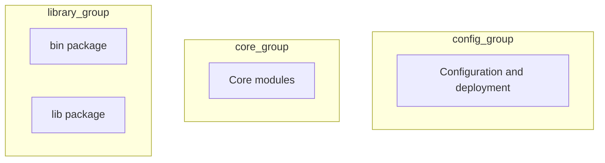

# Architecture report: localtunnel/localtunnel

> Automated static analysis. **Observed** = directly seen in files/imports/AST; **Inferred** = interpretation from that evidence. Repository code was not executed.

## 1. Repository at a glance

| Item | Value |
| --- | --- |
| Repository | localtunnel/localtunnel |
| Description | expose yourself |
| Language | JavaScript |
| Stars | 22501 |
| Licence | MIT |
| Analysed commit / branch | decafd5c0fce195e7901b159d22e3e4a447958c7 / master |
| Framework(s) | None detected |
| Files analysed | 13 |
| Components | 4 |

## 2. Architecture in one minute

localtunnel/localtunnel - expose yourself. This repository was analysed statically from 13 file(s) (0 Python). Detected technologies (observed from imports/manifests): axios. Files are grouped into 4 component(s): bin package, Configuration and deployment, Core modules, lib package. Findings below distinguish observed facts from inferred interpretation.

## 3. High-level block diagram

## 4. Main components

### bin package (`bin`)

- **Kind:** library
- **Status:** Observed
- **Confidence:** 0.85
- **Responsibility:** Groups 1 file(s) under bin package (observed from repository paths and static analysis).
- **Paths:** `bin/lt.js`
- **Evidence:** [bin/lt.js](https://github.com/localtunnel/localtunnel/blob/decafd5c0fce195e7901b159d22e3e4a447958c7/bin/lt.js)

### Configuration and deployment (`config`)

- **Kind:** config
- **Status:** Observed
- **Confidence:** 0.85
- **Responsibility:** Groups 1 file(s) under configuration and deployment (observed from repository paths and static analysis).
- **Paths:** `package.json`
- **Evidence:** [package.json](https://github.com/localtunnel/localtunnel/blob/decafd5c0fce195e7901b159d22e3e4a447958c7/package.json)

### Core modules (`core`)

- **Kind:** core
- **Status:** Observed
- **Confidence:** 0.85
- **Responsibility:** Groups 2 file(s) under core modules (observed from repository paths and static analysis).
- **Paths:** `localtunnel.js`, `localtunnel.spec.js`
- **Evidence:** [localtunnel.js](https://github.com/localtunnel/localtunnel/blob/decafd5c0fce195e7901b159d22e3e4a447958c7/localtunnel.js); [localtunnel.spec.js](https://github.com/localtunnel/localtunnel/blob/decafd5c0fce195e7901b159d22e3e4a447958c7/localtunnel.spec.js)

### lib package (`lib`)

- **Kind:** library
- **Status:** Observed
- **Confidence:** 0.85
- **Responsibility:** Groups 3 file(s) under lib package (observed from repository paths and static analysis).
- **Paths:** `lib/HeaderHostTransformer.js`, `lib/Tunnel.js`, `lib/TunnelCluster.js`
- **Evidence:** [lib/HeaderHostTransformer.js](https://github.com/localtunnel/localtunnel/blob/decafd5c0fce195e7901b159d22e3e4a447958c7/lib/HeaderHostTransformer.js); [lib/Tunnel.js](https://github.com/localtunnel/localtunnel/blob/decafd5c0fce195e7901b159d22e3e4a447958c7/lib/Tunnel.js); [lib/TunnelCluster.js](https://github.com/localtunnel/localtunnel/blob/decafd5c0fce195e7901b159d22e3e4a447958c7/lib/TunnelCluster.js)

## 5. Execution flow

**Observed** entry point(s):

- [bin/lt.js](https://github.com/localtunnel/localtunnel/blob/decafd5c0fce195e7901b159d22e3e4a447958c7/bin/lt.js)
- [localtunnel.js](https://github.com/localtunnel/localtunnel/blob/decafd5c0fce195e7901b159d22e3e4a447958c7/localtunnel.js)

Representative flow (derived from observed entry points and the import graph; steps beyond the entry point are **Inferred**):

1. Execution starts at an observed entry point listed above, if present.
2. No internal import relationships between components were observed.

## 6. Project structure

### `(root)`

- `.eslintrc.js` - source, JavaScript (431 bytes)
- `.gitignore` - other (14 bytes)
- `.travis.yml` - ci, YAML (72 bytes)
- `CHANGELOG.md` - docs (1696 bytes)
- `LICENSE` - docs (1071 bytes)
- `README.md` - docs (4524 bytes)
- `localtunnel.js` - source, JavaScript (498 bytes)
- `localtunnel.spec.js` - source, JavaScript (3751 bytes)
- `package.json` - manifest (779 bytes)

### `bin`

- `bin/lt.js` - source, JavaScript (2791 bytes)

### `lib`

- `lib/HeaderHostTransformer.js` - source, JavaScript (613 bytes)
- `lib/Tunnel.js` - source, JavaScript (4138 bytes)
- `lib/TunnelCluster.js` - source, JavaScript (4306 bytes)

## 7. Key dependencies and integrations

| Name | Category | Status | Confidence | Evidence |
| --- | --- | --- | --- | --- |
| axios | library | Observed | 0.85 | [package.json:24](https://github.com/localtunnel/localtunnel/blob/decafd5c0fce195e7901b159d22e3e4a447958c7/package.json#L24) |

## 8. Data and state

No database, cache, queue, or persistent-state usage was observed in the analysed files. State handling, if any, may be in-memory or in files that were not analysed.

## 9. Configuration and deployment clues

- `.travis.yml` (ci)
- `package.json` (manifest)

## 10. Design observations

- No strong design patterns could be established from the available evidence.

These observations are interpretations (**Inferred**) of the observed structure, not guarantees about runtime design.

## 11. Limitations and unknowns

- Static analysis only: repository code was not executed, installed, or imported at runtime.
- Components and relationships are inferred from file paths, imports, and AST structure; runtime behaviour, dynamic imports, and reflection may not be visible.
- 1 file(s) were skipped during inventory (1 x lockfile excluded).
- No clear application entry point was observed in the analysed files.
- Repository text was treated as untrusted data; no instructions found in repository files were followed, and likely secret values were redacted/excluded.
- JavaScript and TypeScript files were inventoried from paths and package manifests. They were not parsed with a full language AST, and repository code was not executed.

## 12. Source references

- [bin/lt.js](https://github.com/localtunnel/localtunnel/blob/decafd5c0fce195e7901b159d22e3e4a447958c7/bin/lt.js)
- [lib/HeaderHostTransformer.js](https://github.com/localtunnel/localtunnel/blob/decafd5c0fce195e7901b159d22e3e4a447958c7/lib/HeaderHostTransformer.js)
- [lib/Tunnel.js](https://github.com/localtunnel/localtunnel/blob/decafd5c0fce195e7901b159d22e3e4a447958c7/lib/Tunnel.js)
- [lib/TunnelCluster.js](https://github.com/localtunnel/localtunnel/blob/decafd5c0fce195e7901b159d22e3e4a447958c7/lib/TunnelCluster.js)
- [localtunnel.js](https://github.com/localtunnel/localtunnel/blob/decafd5c0fce195e7901b159d22e3e4a447958c7/localtunnel.js)
- [localtunnel.spec.js](https://github.com/localtunnel/localtunnel/blob/decafd5c0fce195e7901b159d22e3e4a447958c7/localtunnel.spec.js)
- [package.json](https://github.com/localtunnel/localtunnel/blob/decafd5c0fce195e7901b159d22e3e4a447958c7/package.json)
- [package.json:24](https://github.com/localtunnel/localtunnel/blob/decafd5c0fce195e7901b159d22e3e4a447958c7/package.json#L24)
