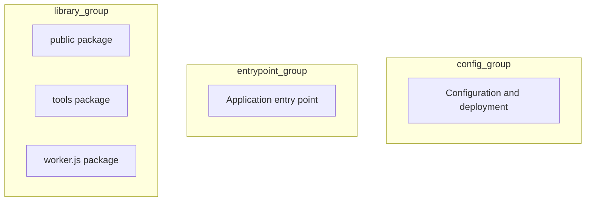

# Architecture report: lockfale/OSINT-Framework

> Automated static analysis. **Observed** = directly seen in files/imports/AST; **Inferred** = interpretation from that evidence. Repository code was not executed.

## 1. Repository at a glance

| Item | Value |
| --- | --- |
| Repository | lockfale/OSINT-Framework |
| Description | OSINT Framework |
| Language | JavaScript |
| Stars | 12453 |
| Licence | MIT |
| Analysed commit / branch | 08720d5b594cb7513d7ec81f8e70c400375a85fc / master |
| Framework(s) | None detected |
| Files analysed | 19 |
| Components | 5 |

## 2. Architecture in one minute

lockfale/OSINT-Framework - OSINT Framework. This repository was analysed statically from 19 file(s) (4 Python). Detected technologies (observed from imports/manifests): GitHub Actions. Files are grouped into 5 component(s): Configuration and deployment, Application entry point, public package, tools package, worker.js package. Observed entry point(s): merge_enrichments.py, tools/extract_urls.py, tools/link_checker.py. Findings below distinguish observed facts from inferred interpretation.

## 3. High-level block diagram

## 4. Main components

### Configuration and deployment (`config`)

- **Kind:** config
- **Status:** Observed
- **Confidence:** 0.85
- **Responsibility:** Groups 3 file(s) under configuration and deployment (observed from repository paths and static analysis).
- **Paths:** `enrichment-batch4-domains.json`, `package.json`, `tools/link-recheck/package.json`
- **Evidence:** [enrichment-batch4-domains.json](https://github.com/lockfale/OSINT-Framework/blob/08720d5b594cb7513d7ec81f8e70c400375a85fc/enrichment-batch4-domains.json); [package.json](https://github.com/lockfale/OSINT-Framework/blob/08720d5b594cb7513d7ec81f8e70c400375a85fc/package.json); [tools/link-recheck/package.json](https://github.com/lockfale/OSINT-Framework/blob/08720d5b594cb7513d7ec81f8e70c400375a85fc/tools/link-recheck/package.json)

### Application entry point (`entrypoint`)

- **Kind:** entrypoint
- **Status:** Observed
- **Confidence:** 0.85
- **Responsibility:** Groups 4 file(s) under application entry point (observed from repository paths and static analysis). Observed top-level classes: LinkResult. Observed top-level functions: check_url, extract_urls, get_dead_urls, is_template, main, merge_enrichment_into_node.
- **Paths:** `merge_enrichments.py`, `tools/extract_urls.py`, `tools/link_checker.py`, `tools/remove_dead_links.py`
- **Evidence:** [merge_enrichments.py:5](https://github.com/lockfale/OSINT-Framework/blob/08720d5b594cb7513d7ec81f8e70c400375a85fc/merge_enrichments.py#L5); [tools/extract_urls.py:27](https://github.com/lockfale/OSINT-Framework/blob/08720d5b594cb7513d7ec81f8e70c400375a85fc/tools/extract_urls.py#L27); [tools/link_checker.py:33](https://github.com/lockfale/OSINT-Framework/blob/08720d5b594cb7513d7ec81f8e70c400375a85fc/tools/link_checker.py#L33); [tools/remove_dead_links.py:15](https://github.com/lockfale/OSINT-Framework/blob/08720d5b594cb7513d7ec81f8e70c400375a85fc/tools/remove_dead_links.py#L15)

### public package (`public`)

- **Kind:** library
- **Status:** Observed
- **Confidence:** 0.85
- **Responsibility:** Groups 1 file(s) under public package (observed from repository paths and static analysis).
- **Paths:** `public/js/arf.js`
- **Evidence:** [public/js/arf.js](https://github.com/lockfale/OSINT-Framework/blob/08720d5b594cb7513d7ec81f8e70c400375a85fc/public/js/arf.js)

### tools package (`tools`)

- **Kind:** library
- **Status:** Observed
- **Confidence:** 0.85
- **Responsibility:** Groups 1 file(s) under tools package (observed from repository paths and static analysis).
- **Paths:** `tools/link-recheck/recheck.mjs`
- **Evidence:** [tools/link-recheck/recheck.mjs](https://github.com/lockfale/OSINT-Framework/blob/08720d5b594cb7513d7ec81f8e70c400375a85fc/tools/link-recheck/recheck.mjs)

### worker.js package (`worker_js`)

- **Kind:** library
- **Status:** Observed
- **Confidence:** 0.85
- **Responsibility:** Groups 1 file(s) under worker.js package (observed from repository paths and static analysis).
- **Paths:** `src/worker.js`
- **Evidence:** [src/worker.js](https://github.com/lockfale/OSINT-Framework/blob/08720d5b594cb7513d7ec81f8e70c400375a85fc/src/worker.js)

## 5. Execution flow

**Observed** entry point(s):

- [merge_enrichments.py:40](https://github.com/lockfale/OSINT-Framework/blob/08720d5b594cb7513d7ec81f8e70c400375a85fc/merge_enrichments.py#L40)
- [public/index.html](https://github.com/lockfale/OSINT-Framework/blob/08720d5b594cb7513d7ec81f8e70c400375a85fc/public/index.html)
- [tools/extract_urls.py:57](https://github.com/lockfale/OSINT-Framework/blob/08720d5b594cb7513d7ec81f8e70c400375a85fc/tools/extract_urls.py#L57)
- [tools/link_checker.py:176](https://github.com/lockfale/OSINT-Framework/blob/08720d5b594cb7513d7ec81f8e70c400375a85fc/tools/link_checker.py#L176)
- [tools/remove_dead_links.py:88](https://github.com/lockfale/OSINT-Framework/blob/08720d5b594cb7513d7ec81f8e70c400375a85fc/tools/remove_dead_links.py#L88)

Representative flow (derived from observed entry points and the import graph; steps beyond the entry point are **Inferred**):

1. Execution starts at an observed entry point listed above, if present.
2. No internal import relationships between components were observed.

## 6. Project structure

### `(root)`

- `.gitignore` - other (427 bytes)
- `LICENSE` - docs (1099 bytes)
- `README.md` - docs (3792 bytes)
- `THE-127-domain-enrichment-batch1.md` - docs (19991 bytes)
- `enrichment-batch4-domains.json` - config (16000 bytes)
- `merge_enrichments.py` - source, Python (1331 bytes)
- `package.json` - manifest (762 bytes)
- `wrangler.jsonc` - other (750 bytes)

### `.github`

- `.github/workflows/ci.yml` - ci, YAML (2721 bytes)

### `public`

- `public/css/arf.css` - other (9287 bytes)
- `public/css/panel.css` - other (8778 bytes)
- `public/index.html` - other (8186 bytes)
- `public/js/arf.js` - source, JavaScript (30206 bytes)

### `src`

- `src/worker.js` - source, JavaScript (12634 bytes)

### `tools`

- `tools/extract_urls.py` - source, Python (1530 bytes)
- `tools/link-recheck/package.json` - manifest (210 bytes)
- `tools/link-recheck/recheck.mjs` - source, JavaScript (6834 bytes)
- `tools/link_checker.py` - source, Python (5159 bytes)
- `tools/remove_dead_links.py` - source, Python (2277 bytes)

## 7. Key dependencies and integrations

| Name | Category | Status | Confidence | Evidence |
| --- | --- | --- | --- | --- |
| GitHub Actions | ci | Observed | 0.85 | [.github/workflows/ci.yml](https://github.com/lockfale/OSINT-Framework/blob/08720d5b594cb7513d7ec81f8e70c400375a85fc/.github/workflows/ci.yml) |

## 8. Data and state

No database, cache, queue, or persistent-state usage was observed in the analysed files. State handling, if any, may be in-memory or in files that were not analysed.

## 9. Configuration and deployment clues

- `.github/workflows/ci.yml` (ci)
- `enrichment-batch4-domains.json` (config)
- `package.json` (manifest)
- `tools/link-recheck/package.json` (manifest)

## 10. Design observations

- An entry/API layer is separated from other code (Inferred from paths and decorators).

These observations are interpretations (**Inferred**) of the observed structure, not guarantees about runtime design.

## 11. Limitations and unknowns

- Static analysis only: repository code was not executed, installed, or imported at runtime.
- Components and relationships are inferred from file paths, imports, and AST structure; runtime behaviour, dynamic imports, and reflection may not be visible.
- 2 file(s) were skipped during inventory (2 x lockfile excluded).
- Repository text was treated as untrusted data; no instructions found in repository files were followed, and likely secret values were redacted/excluded.

## 12. Source references

- [.github/workflows/ci.yml](https://github.com/lockfale/OSINT-Framework/blob/08720d5b594cb7513d7ec81f8e70c400375a85fc/.github/workflows/ci.yml)
- [enrichment-batch4-domains.json](https://github.com/lockfale/OSINT-Framework/blob/08720d5b594cb7513d7ec81f8e70c400375a85fc/enrichment-batch4-domains.json)
- [merge_enrichments.py:5](https://github.com/lockfale/OSINT-Framework/blob/08720d5b594cb7513d7ec81f8e70c400375a85fc/merge_enrichments.py#L5)
- [merge_enrichments.py:40](https://github.com/lockfale/OSINT-Framework/blob/08720d5b594cb7513d7ec81f8e70c400375a85fc/merge_enrichments.py#L40)
- [package.json](https://github.com/lockfale/OSINT-Framework/blob/08720d5b594cb7513d7ec81f8e70c400375a85fc/package.json)
- [public/index.html](https://github.com/lockfale/OSINT-Framework/blob/08720d5b594cb7513d7ec81f8e70c400375a85fc/public/index.html)
- [public/js/arf.js](https://github.com/lockfale/OSINT-Framework/blob/08720d5b594cb7513d7ec81f8e70c400375a85fc/public/js/arf.js)
- [src/worker.js](https://github.com/lockfale/OSINT-Framework/blob/08720d5b594cb7513d7ec81f8e70c400375a85fc/src/worker.js)
- [tools/extract_urls.py:27](https://github.com/lockfale/OSINT-Framework/blob/08720d5b594cb7513d7ec81f8e70c400375a85fc/tools/extract_urls.py#L27)
- [tools/extract_urls.py:57](https://github.com/lockfale/OSINT-Framework/blob/08720d5b594cb7513d7ec81f8e70c400375a85fc/tools/extract_urls.py#L57)
- [tools/link-recheck/package.json](https://github.com/lockfale/OSINT-Framework/blob/08720d5b594cb7513d7ec81f8e70c400375a85fc/tools/link-recheck/package.json)
- [tools/link-recheck/recheck.mjs](https://github.com/lockfale/OSINT-Framework/blob/08720d5b594cb7513d7ec81f8e70c400375a85fc/tools/link-recheck/recheck.mjs)
- [tools/link_checker.py:33](https://github.com/lockfale/OSINT-Framework/blob/08720d5b594cb7513d7ec81f8e70c400375a85fc/tools/link_checker.py#L33)
- [tools/link_checker.py:176](https://github.com/lockfale/OSINT-Framework/blob/08720d5b594cb7513d7ec81f8e70c400375a85fc/tools/link_checker.py#L176)
- [tools/remove_dead_links.py:15](https://github.com/lockfale/OSINT-Framework/blob/08720d5b594cb7513d7ec81f8e70c400375a85fc/tools/remove_dead_links.py#L15)
- [tools/remove_dead_links.py:88](https://github.com/lockfale/OSINT-Framework/blob/08720d5b594cb7513d7ec81f8e70c400375a85fc/tools/remove_dead_links.py#L88)
