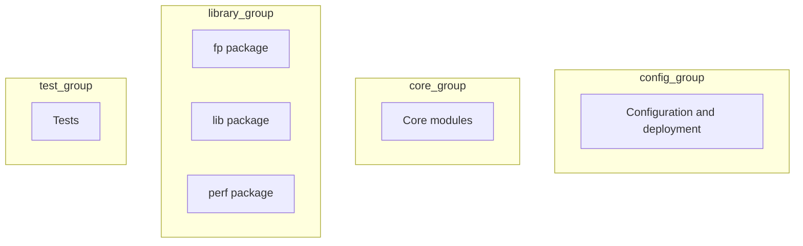

# Architecture report: lodash/lodash

> Automated static analysis. **Observed** = directly seen in files/imports/AST; **Inferred** = interpretation from that evidence. Repository code was not executed.

## 1. Repository at a glance

| Item | Value |
| --- | --- |
| Repository | lodash/lodash |
| Description | A modern JavaScript utility library delivering modularity, performance, & extras. |
| Language | JavaScript |
| Stars | 61355 |
| Licence | Other |
| Analysed commit / branch | 2b5e6f7399a7b48005140b5d5c6bc6c0e62919a8 / main |
| Framework(s) | None detected |
| Files analysed | 61 |
| Components | 6 |

## 2. Architecture in one minute

lodash/lodash - A modern JavaScript utility library delivering modularity, performance, & extras.. This repository was analysed statically from 61 file(s) (0 Python). Detected technologies (observed from imports/manifests): GitHub Actions, webpack. Files are grouped into 6 component(s): Configuration and deployment, Core modules, fp package, lib package, perf package, Tests. Findings below distinguish observed facts from inferred interpretation.

## 3. High-level block diagram

## 4. Main components

### Configuration and deployment (`config`)

- **Kind:** config
- **Status:** Observed
- **Confidence:** 0.85
- **Responsibility:** Groups 2 file(s) under configuration and deployment (observed from repository paths and static analysis).
- **Paths:** `package.json`, `renovate.json`
- **Evidence:** [package.json](https://github.com/lodash/lodash/blob/2b5e6f7399a7b48005140b5d5c6bc6c0e62919a8/package.json); [renovate.json](https://github.com/lodash/lodash/blob/2b5e6f7399a7b48005140b5d5c6bc6c0e62919a8/renovate.json)

### Core modules (`core`)

- **Kind:** core
- **Status:** Observed
- **Confidence:** 0.85
- **Responsibility:** Groups 1 file(s) under core modules (observed from repository paths and static analysis).
- **Paths:** `playwright.config.js`
- **Evidence:** [playwright.config.js](https://github.com/lodash/lodash/blob/2b5e6f7399a7b48005140b5d5c6bc6c0e62919a8/playwright.config.js)

### fp package (`fp`)

- **Kind:** library
- **Status:** Observed
- **Confidence:** 0.85
- **Responsibility:** Groups 4 file(s) under fp package (observed from repository paths and static analysis).
- **Paths:** `fp/_baseConvert.js`, `fp/_convertBrowser.js`, `fp/_mapping.js`, `fp/placeholder.js`
- **Evidence:** [fp/_baseConvert.js](https://github.com/lodash/lodash/blob/2b5e6f7399a7b48005140b5d5c6bc6c0e62919a8/fp/_baseConvert.js); [fp/_convertBrowser.js](https://github.com/lodash/lodash/blob/2b5e6f7399a7b48005140b5d5c6bc6c0e62919a8/fp/_convertBrowser.js); [fp/_mapping.js](https://github.com/lodash/lodash/blob/2b5e6f7399a7b48005140b5d5c6bc6c0e62919a8/fp/_mapping.js); [fp/placeholder.js](https://github.com/lodash/lodash/blob/2b5e6f7399a7b48005140b5d5c6bc6c0e62919a8/fp/placeholder.js)

### lib package (`lib`)

- **Kind:** library
- **Status:** Observed
- **Confidence:** 0.85
- **Responsibility:** Groups 12 file(s) under lib package (observed from repository paths and static analysis).
- **Paths:** `lib/common/file.js`, `lib/common/mapping.js`, `lib/common/minify.js`, `lib/common/uglify.options.js`, `lib/common/util.js`, `lib/fp/build-dist.js`, `lib/fp/build-doc.js`, `lib/fp/build-modules.js`, `lib/main/build-dist.js`, `lib/main/build-doc.js`, `lib/main/build-modules.js`, `lib/main/build-site.js`
- **Evidence:** [lib/common/file.js](https://github.com/lodash/lodash/blob/2b5e6f7399a7b48005140b5d5c6bc6c0e62919a8/lib/common/file.js); [lib/common/mapping.js](https://github.com/lodash/lodash/blob/2b5e6f7399a7b48005140b5d5c6bc6c0e62919a8/lib/common/mapping.js); [lib/common/minify.js](https://github.com/lodash/lodash/blob/2b5e6f7399a7b48005140b5d5c6bc6c0e62919a8/lib/common/minify.js); [lib/common/uglify.options.js](https://github.com/lodash/lodash/blob/2b5e6f7399a7b48005140b5d5c6bc6c0e62919a8/lib/common/uglify.options.js); [lib/common/util.js](https://github.com/lodash/lodash/blob/2b5e6f7399a7b48005140b5d5c6bc6c0e62919a8/lib/common/util.js); [lib/fp/build-dist.js](https://github.com/lodash/lodash/blob/2b5e6f7399a7b48005140b5d5c6bc6c0e62919a8/lib/fp/build-dist.js); [lib/fp/build-doc.js](https://github.com/lodash/lodash/blob/2b5e6f7399a7b48005140b5d5c6bc6c0e62919a8/lib/fp/build-doc.js); [lib/fp/build-modules.js](https://github.com/lodash/lodash/blob/2b5e6f7399a7b48005140b5d5c6bc6c0e62919a8/lib/fp/build-modules.js)

### perf package (`perf`)

- **Kind:** library
- **Status:** Observed
- **Confidence:** 0.85
- **Responsibility:** Groups 2 file(s) under perf package (observed from repository paths and static analysis).
- **Paths:** `perf/asset/perf-ui.js`, `perf/perf.js`
- **Evidence:** [perf/asset/perf-ui.js](https://github.com/lodash/lodash/blob/2b5e6f7399a7b48005140b5d5c6bc6c0e62919a8/perf/asset/perf-ui.js); [perf/perf.js](https://github.com/lodash/lodash/blob/2b5e6f7399a7b48005140b5d5c6bc6c0e62919a8/perf/perf.js)

### Tests (`tests`)

- **Kind:** test
- **Status:** Observed
- **Confidence:** 0.85
- **Responsibility:** Groups 9 file(s) under tests (observed from repository paths and static analysis).
- **Paths:** `test/asset/test-ui.js`, `test/asset/worker.js`, `test/backbone.html`, `test/fp.html`, `test/index.html`, `test/playwright-runner.spec.js`, `test/remove.js`, `test/test-fp.js`, `test/underscore.html`
- **Evidence:** [test/asset/test-ui.js](https://github.com/lodash/lodash/blob/2b5e6f7399a7b48005140b5d5c6bc6c0e62919a8/test/asset/test-ui.js); [test/asset/worker.js](https://github.com/lodash/lodash/blob/2b5e6f7399a7b48005140b5d5c6bc6c0e62919a8/test/asset/worker.js); [test/backbone.html](https://github.com/lodash/lodash/blob/2b5e6f7399a7b48005140b5d5c6bc6c0e62919a8/test/backbone.html); [test/fp.html](https://github.com/lodash/lodash/blob/2b5e6f7399a7b48005140b5d5c6bc6c0e62919a8/test/fp.html); [test/index.html](https://github.com/lodash/lodash/blob/2b5e6f7399a7b48005140b5d5c6bc6c0e62919a8/test/index.html); [test/playwright-runner.spec.js](https://github.com/lodash/lodash/blob/2b5e6f7399a7b48005140b5d5c6bc6c0e62919a8/test/playwright-runner.spec.js); [test/remove.js](https://github.com/lodash/lodash/blob/2b5e6f7399a7b48005140b5d5c6bc6c0e62919a8/test/remove.js); [test/test-fp.js](https://github.com/lodash/lodash/blob/2b5e6f7399a7b48005140b5d5c6bc6c0e62919a8/test/test-fp.js)

## 5. Execution flow

No entry point was observed; the startup flow below is therefore limited.

Representative flow (derived from observed entry points and the import graph; steps beyond the entry point are **Inferred**):

1. Execution starts at an observed entry point listed above, if present.
2. No internal import relationships between components were observed.

## 6. Project structure

### `(root)`

- `.editorconfig` - config (243 bytes)
- `.gitattributes` - other (12 bytes)
- `.gitignore` - other (40 bytes)
- `.jscsrc` - other (2369 bytes)
- `.markdown-doctest-setup.js` - source, JavaScript (218 bytes)
- `CHANGELOG` - other (48 bytes)
- `GOVERNANCE.md` - docs (1425 bytes)
- `LICENSE` - docs (1952 bytes)
- `README.md` - docs (3623 bytes)
- `SECURITY.md` - docs (2042 bytes)
- `incident_response_plan.md` - docs (12166 bytes)
- `package.json` - manifest (1984 bytes)
- `playwright.config.js` - source, JavaScript (1010 bytes)
- `renovate.json` - config (363 bytes)
- `threat-model.md` - docs (8862 bytes)

### `.github`

- `.github/CONTRIBUTING.md` - docs (3260 bytes)
- `.github/workflows/browser-testing.yml` - ci, YAML (871 bytes)
- `.github/workflows/ci-bun.yml` - ci, YAML (839 bytes)
- `.github/workflows/ci-dist-sync.yml` - ci, YAML (916 bytes)
- `.github/workflows/ci-docs.yml` - ci, YAML (729 bytes)
- `.github/workflows/ci-node.yml` - ci, YAML (1272 bytes)
- `.github/workflows/codeql.yml` - ci, YAML (2724 bytes)
- `.github/workflows/renovate.yml` - ci, YAML (649 bytes)
- `.github/workflows/scorecards.yml` - ci, YAML (1925 bytes)

### `fp`

- `fp/_baseConvert.js` - source, JavaScript (16414 bytes)
- `fp/_convertBrowser.js` - source, JavaScript (615 bytes)
- `fp/_mapping.js` - source, JavaScript (9955 bytes)
- `fp/placeholder.js` - source, JavaScript (105 bytes)

### `lib`

- `lib/common/file.js` - source, JavaScript (2140 bytes)
- `lib/common/mapping.js` - source, JavaScript (238 bytes)
- `lib/common/minify.js` - source, JavaScript (1282 bytes)
- `lib/common/uglify.options.js` - source, JavaScript (534 bytes)
- `lib/common/util.js` - source, JavaScript (886 bytes)
- `lib/fp/build-dist.js` - source, JavaScript (1312 bytes)
- `lib/fp/build-doc.js` - source, JavaScript (2029 bytes)
- `lib/fp/build-modules.js` - source, JavaScript (3640 bytes)
- `lib/fp/template/doc/wiki.jst` - other (6600 bytes)
- `lib/fp/template/modules/_falseOptions.jst` - other (113 bytes)
- `lib/fp/template/modules/_util.jst` - other (524 bytes)
- `lib/fp/template/modules/alias.jst` - other (43 bytes)
- `lib/fp/template/modules/category.jst` - other (89 bytes)
- `lib/fp/template/modules/convert.jst` - other (657 bytes)
- `lib/fp/template/modules/fp.jst` - other (101 bytes)
- `lib/fp/template/modules/module.jst` - other (195 bytes)
- `lib/fp/template/modules/thru.jst` - other (223 bytes)
- `lib/main/build-dist.js` - source, JavaScript (734 bytes)
- `lib/main/build-doc.js` - source, JavaScript (2312 bytes)
- `lib/main/build-modules.js` - source, JavaScript (895 bytes)
- `lib/main/build-site.js` - source, JavaScript (6554 bytes)

### `perf`

- `perf/asset/perf-ui.js` - source, JavaScript (3500 bytes)
- `perf/index.html` - other (2342 bytes)
- `perf/perf.js` - source, JavaScript (56316 bytes)

### `test`

- `test/asset/test-ui.js` - test, JavaScript (5178 bytes)
- `test/asset/worker.js` - test, JavaScript (398 bytes)
- `test/backbone.html` - test (5640 bytes)
- `test/fp.html` - test (1322 bytes)
- `test/index.html` - test (11064 bytes)
- `test/playwright-runner.spec.js` - test, JavaScript (832 bytes)
- `test/remove.js` - test, JavaScript (795 bytes)
- `test/test-fp.js` - test, JavaScript (65357 bytes)
- `test/underscore.html` - test (15493 bytes)

## 7. Key dependencies and integrations

| Name | Category | Status | Confidence | Evidence |
| --- | --- | --- | --- | --- |
| GitHub Actions | ci | Observed | 0.90 | [.github/workflows/browser-testing.yml](https://github.com/lodash/lodash/blob/2b5e6f7399a7b48005140b5d5c6bc6c0e62919a8/.github/workflows/browser-testing.yml); [.github/workflows/ci-bun.yml](https://github.com/lodash/lodash/blob/2b5e6f7399a7b48005140b5d5c6bc6c0e62919a8/.github/workflows/ci-bun.yml); [.github/workflows/ci-dist-sync.yml](https://github.com/lodash/lodash/blob/2b5e6f7399a7b48005140b5d5c6bc6c0e62919a8/.github/workflows/ci-dist-sync.yml); [.github/workflows/ci-docs.yml](https://github.com/lodash/lodash/blob/2b5e6f7399a7b48005140b5d5c6bc6c0e62919a8/.github/workflows/ci-docs.yml) |
| webpack | tooling | Observed | 0.85 | [package.json:59](https://github.com/lodash/lodash/blob/2b5e6f7399a7b48005140b5d5c6bc6c0e62919a8/package.json#L59) |

## 8. Data and state

No database, cache, queue, or persistent-state usage was observed in the analysed files. State handling, if any, may be in-memory or in files that were not analysed.

## 9. Configuration and deployment clues

- `.editorconfig` (config)
- `.github/workflows/browser-testing.yml` (ci)
- `.github/workflows/ci-bun.yml` (ci)
- `.github/workflows/ci-dist-sync.yml` (ci)
- `.github/workflows/ci-docs.yml` (ci)
- `.github/workflows/ci-node.yml` (ci)
- `.github/workflows/codeql.yml` (ci)
- `.github/workflows/renovate.yml` (ci)
- `.github/workflows/scorecards.yml` (ci)
- `package.json` (manifest)
- `renovate.json` (config)

## 10. Design observations

- Tests are present alongside source code (Observed from test file paths).

These observations are interpretations (**Inferred**) of the observed structure, not guarantees about runtime design.

## 11. Limitations and unknowns

- Static analysis only: repository code was not executed, installed, or imported at runtime.
- Components and relationships are inferred from file paths, imports, and AST structure; runtime behaviour, dynamic imports, and reflection may not be visible.
- 33 file(s) were skipped during inventory (33 x vendored/generated directory excluded).
- No clear application entry point was observed in the analysed files.
- Repository text was treated as untrusted data; no instructions found in repository files were followed, and likely secret values were redacted/excluded.
- JavaScript and TypeScript files were inventoried from paths and package manifests. They were not parsed with a full language AST, and repository code was not executed.

## 12. Source references

- [.github/workflows/browser-testing.yml](https://github.com/lodash/lodash/blob/2b5e6f7399a7b48005140b5d5c6bc6c0e62919a8/.github/workflows/browser-testing.yml)
- [.github/workflows/ci-bun.yml](https://github.com/lodash/lodash/blob/2b5e6f7399a7b48005140b5d5c6bc6c0e62919a8/.github/workflows/ci-bun.yml)
- [.github/workflows/ci-dist-sync.yml](https://github.com/lodash/lodash/blob/2b5e6f7399a7b48005140b5d5c6bc6c0e62919a8/.github/workflows/ci-dist-sync.yml)
- [.github/workflows/ci-docs.yml](https://github.com/lodash/lodash/blob/2b5e6f7399a7b48005140b5d5c6bc6c0e62919a8/.github/workflows/ci-docs.yml)
- [.github/workflows/ci-node.yml](https://github.com/lodash/lodash/blob/2b5e6f7399a7b48005140b5d5c6bc6c0e62919a8/.github/workflows/ci-node.yml)
- [.github/workflows/codeql.yml](https://github.com/lodash/lodash/blob/2b5e6f7399a7b48005140b5d5c6bc6c0e62919a8/.github/workflows/codeql.yml)
- [.github/workflows/renovate.yml](https://github.com/lodash/lodash/blob/2b5e6f7399a7b48005140b5d5c6bc6c0e62919a8/.github/workflows/renovate.yml)
- [.github/workflows/scorecards.yml](https://github.com/lodash/lodash/blob/2b5e6f7399a7b48005140b5d5c6bc6c0e62919a8/.github/workflows/scorecards.yml)
- [fp/_baseConvert.js](https://github.com/lodash/lodash/blob/2b5e6f7399a7b48005140b5d5c6bc6c0e62919a8/fp/_baseConvert.js)
- [fp/_convertBrowser.js](https://github.com/lodash/lodash/blob/2b5e6f7399a7b48005140b5d5c6bc6c0e62919a8/fp/_convertBrowser.js)
- [fp/_mapping.js](https://github.com/lodash/lodash/blob/2b5e6f7399a7b48005140b5d5c6bc6c0e62919a8/fp/_mapping.js)
- [fp/placeholder.js](https://github.com/lodash/lodash/blob/2b5e6f7399a7b48005140b5d5c6bc6c0e62919a8/fp/placeholder.js)
- [lib/common/file.js](https://github.com/lodash/lodash/blob/2b5e6f7399a7b48005140b5d5c6bc6c0e62919a8/lib/common/file.js)
- [lib/common/mapping.js](https://github.com/lodash/lodash/blob/2b5e6f7399a7b48005140b5d5c6bc6c0e62919a8/lib/common/mapping.js)
- [lib/common/minify.js](https://github.com/lodash/lodash/blob/2b5e6f7399a7b48005140b5d5c6bc6c0e62919a8/lib/common/minify.js)
- [lib/common/uglify.options.js](https://github.com/lodash/lodash/blob/2b5e6f7399a7b48005140b5d5c6bc6c0e62919a8/lib/common/uglify.options.js)
- [lib/common/util.js](https://github.com/lodash/lodash/blob/2b5e6f7399a7b48005140b5d5c6bc6c0e62919a8/lib/common/util.js)
- [lib/fp/build-dist.js](https://github.com/lodash/lodash/blob/2b5e6f7399a7b48005140b5d5c6bc6c0e62919a8/lib/fp/build-dist.js)
- [lib/fp/build-doc.js](https://github.com/lodash/lodash/blob/2b5e6f7399a7b48005140b5d5c6bc6c0e62919a8/lib/fp/build-doc.js)
- [lib/fp/build-modules.js](https://github.com/lodash/lodash/blob/2b5e6f7399a7b48005140b5d5c6bc6c0e62919a8/lib/fp/build-modules.js)
- [package.json](https://github.com/lodash/lodash/blob/2b5e6f7399a7b48005140b5d5c6bc6c0e62919a8/package.json)
- [package.json:59](https://github.com/lodash/lodash/blob/2b5e6f7399a7b48005140b5d5c6bc6c0e62919a8/package.json#L59)
- [perf/asset/perf-ui.js](https://github.com/lodash/lodash/blob/2b5e6f7399a7b48005140b5d5c6bc6c0e62919a8/perf/asset/perf-ui.js)
- [perf/perf.js](https://github.com/lodash/lodash/blob/2b5e6f7399a7b48005140b5d5c6bc6c0e62919a8/perf/perf.js)
- [playwright.config.js](https://github.com/lodash/lodash/blob/2b5e6f7399a7b48005140b5d5c6bc6c0e62919a8/playwright.config.js)
- [renovate.json](https://github.com/lodash/lodash/blob/2b5e6f7399a7b48005140b5d5c6bc6c0e62919a8/renovate.json)
- [test/asset/test-ui.js](https://github.com/lodash/lodash/blob/2b5e6f7399a7b48005140b5d5c6bc6c0e62919a8/test/asset/test-ui.js)
- [test/asset/worker.js](https://github.com/lodash/lodash/blob/2b5e6f7399a7b48005140b5d5c6bc6c0e62919a8/test/asset/worker.js)
- [test/backbone.html](https://github.com/lodash/lodash/blob/2b5e6f7399a7b48005140b5d5c6bc6c0e62919a8/test/backbone.html)
- [test/fp.html](https://github.com/lodash/lodash/blob/2b5e6f7399a7b48005140b5d5c6bc6c0e62919a8/test/fp.html)
- [test/index.html](https://github.com/lodash/lodash/blob/2b5e6f7399a7b48005140b5d5c6bc6c0e62919a8/test/index.html)
- [test/playwright-runner.spec.js](https://github.com/lodash/lodash/blob/2b5e6f7399a7b48005140b5d5c6bc6c0e62919a8/test/playwright-runner.spec.js)
- [test/remove.js](https://github.com/lodash/lodash/blob/2b5e6f7399a7b48005140b5d5c6bc6c0e62919a8/test/remove.js)
- [test/test-fp.js](https://github.com/lodash/lodash/blob/2b5e6f7399a7b48005140b5d5c6bc6c0e62919a8/test/test-fp.js)
